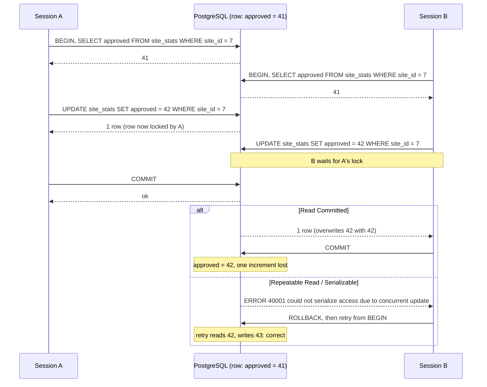
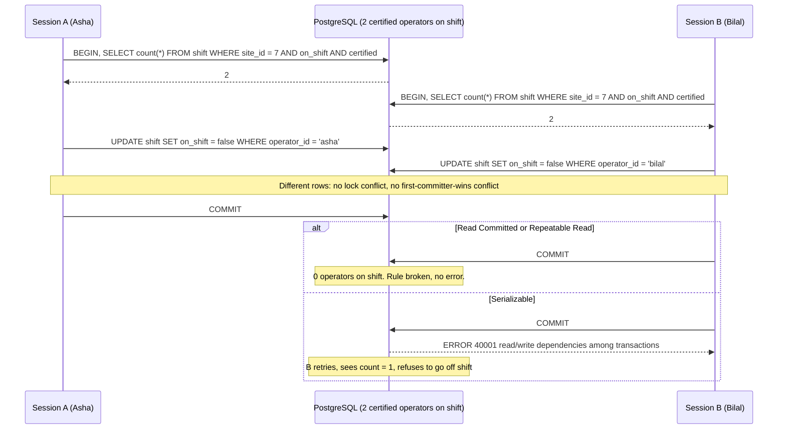
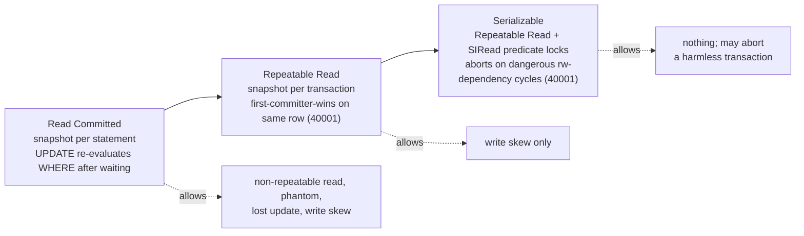

The previous lesson said a transaction is an envelope that hides half-done work from others. "Hides" is doing a lot of work in that sentence. How much a transaction sees of other transactions is set by its **isolation level**, and the default level lets several surprising things happen. This lesson names each surprise, shows the exact sequence of steps that produces it, and shows which PostgreSQL level stops it and at what price.

## Learning objectives

By the end of this lesson you will be able to:

1. Define the five classic anomalies (dirty read, non-repeatable read, phantom read, lost update, write skew) and reproduce each with a two-session interleaving.
2. State what PostgreSQL's Read Committed, Repeatable Read and Serializable levels actually do, including the fact that Read Uncommitted is not a separate level in PostgreSQL.
3. Explain snapshot isolation and why it prevents phantoms but not write skew.
4. Explain how Serializable Snapshot Isolation (SSI) detects conflicts and why it must sometimes abort a transaction that did nothing wrong.
5. Write a correct retry loop for SQLSTATE `40001` in C#, with a bounded number of attempts and jittered backoff.
6. Choose an isolation level per use case, with numbers, and know when a lock or a constraint is the simpler answer.

## Prerequisites

- [Transactions and ACID](#/lesson/m09-transactions-acid): you need MVCC, snapshots and `xmin` from that lesson.
- Comfortable reading two interleaved SQL sessions side by side. Every example here uses *Session A* and *Session B*.
- Next lesson, [Deadlocks, optimistic and pessimistic locking](#/lesson/m09-locking), covers the explicit-lock alternative. This lesson refers to it but does not depend on it.

## Explain it like I'm a beginner

Think of a shared spreadsheet for a construction site's shift roster. Two site engineers, Asha and Bilal, are both editing it at 6 pm.

- If Asha can see the half-typed row Bilal has not saved yet, that is a **dirty read**. PostgreSQL never allows this.
- If Asha reads "3 crane operators on shift", looks away, reads again and now sees "2" because Bilal saved in between, that is a **non-repeatable read**. Same row, different answer, inside one piece of work.
- If Asha counts the rows for tomorrow's shift, then counts again and a *new* row has appeared, that is a **phantom read**. Not a changed row; an extra one.
- If both read "approved inspections: 41", both add one and both write 42, the real answer should be 43. One update vanished. That is a **lost update**.
- The subtle one. The site rule is "at least one certified operator on every shift". Two operators are on shift. Asha checks the rule (2 on shift, fine) and marks herself off. Bilal checks (2 on shift, fine) and marks himself off. Each check was correct when it ran. Both saves succeed. Tomorrow nobody is on shift. Neither of them touched the other's row, so no lock or version check on a single row would have caught it. That is **write skew**.

An isolation level is the database's answer to "how much of this chaos will you let through?" Stronger levels let less through but cost more: more waiting, more work tracking what each transaction read, and sometimes an abort that your code must retry.

## First-principles explanation

### The SQL standard versus PostgreSQL

The SQL standard defines four levels by which anomalies they forbid:

| Level | Dirty read | Non-repeatable read | Phantom read |
|---|---|---|---|
| Read Uncommitted | allowed | allowed | allowed |
| Read Committed | forbidden | allowed | allowed |
| Repeatable Read | forbidden | forbidden | allowed |
| Serializable | forbidden | forbidden | forbidden |

PostgreSQL implements this table more strictly than required, and differently from what the names suggest:

| PostgreSQL level | Dirty read | Non-repeatable read | Phantom | Lost update | Write skew |
|---|---|---|---|---|---|
| Read Uncommitted (= Read Committed) | never | yes | yes | yes | yes |
| Read Committed (default) | never | yes | yes | yes | yes |
| Repeatable Read | never | no | no | **detected: aborts** | yes |
| Serializable | never | no | no | detected | **detected: aborts** |

Three facts to memorise. First, PostgreSQL has **no dirty reads at any level**; asking for Read Uncommitted gives you Read Committed. Second, PostgreSQL's Repeatable Read is really **snapshot isolation**, which also prevents phantoms. Third, from Repeatable Read upwards the database does not *block* to prevent the anomaly, it *detects* it and aborts one transaction with SQLSTATE `40001`, `serialization_failure`. Your application must retry.

### Read Committed: one snapshot per statement

Each statement sees a snapshot of the database as of the moment that statement began. Two statements in the same transaction can see different committed states. That is the whole explanation for non-repeatable and phantom reads at this level.

For writes there is one extra rule you must know. If an `UPDATE` or `DELETE` finds a row that another in-flight transaction has already modified, it **waits** for that transaction. If the other commits, the statement re-evaluates its `WHERE` clause against the *new* version of the row and proceeds. This is why `UPDATE account SET balance = balance - 100 WHERE id = 7 AND balance >= 100` is safe at Read Committed: the second updater waits, then re-checks `balance >= 100` on the fresh row. The row-count tells you whether it passed.

But a plain `SELECT` followed by an `UPDATE` gets no such protection, because the `SELECT` took a snapshot that is now stale and nothing connects it to the later `UPDATE`.

### Repeatable Read: one snapshot per transaction

The transaction takes its snapshot at its first non-transaction-control statement and keeps it until commit. Every `SELECT` sees the same committed state. Rows inserted or changed by others after that moment are invisible, so there are no non-repeatable reads and no phantoms.

The write rule changes too. If this transaction tries to `UPDATE` or `DELETE` a row that another transaction changed and *committed* after our snapshot, PostgreSQL does not re-evaluate. It aborts us:

```
ERROR:  could not serialize access due to concurrent update
```

This is **first-committer-wins**, and it is exactly how lost updates are detected: the second writer of the same row loses and must retry on a fresh snapshot.

What it cannot see is a conflict where two transactions read overlapping data and write *different* rows. That is write skew, and snapshot isolation allows it.

### Serializable: snapshot isolation plus conflict detection

PostgreSQL 9.1 introduced Serializable Snapshot Isolation (SSI). A Serializable transaction runs exactly like Repeatable Read, with one addition: the database records what each transaction *read* (as predicate locks called `SIReadLock`, on rows, pages or whole relations) and watches for a particular pattern of read-write dependencies between concurrent transactions. When the pattern (two consecutive "rw-conflict" edges forming a dangerous structure) appears, the database aborts one of the transactions:

```
ERROR:  could not serialize access due to read/write dependencies among transactions
```

Properties that matter in practice:

- **No extra blocking.** SSI does not take locks that make others wait. It only aborts. Throughput under low contention is close to Repeatable Read.
- **False positives exist.** Predicate locks are coarse (a page-level lock covers many rows, and a sequential scan locks the whole table). Two transactions that would have been fine can be aborted. The documentation is explicit: a transaction may be aborted "even if it did not actually conflict".
- **Read-only transactions can be aborted too**, unless declared `READ ONLY DEFERRABLE`, in which case they wait for a safe snapshot and then can never fail.
- **Memory is bounded.** `max_pred_locks_per_transaction` (default 64) caps how fine-grained the tracking can be before it is summarised to page or relation level, which increases false positives.
- **Every session must use Serializable** for the guarantee to hold. One Read Committed writer breaks the serializable graph for everyone.

The payoff: with Serializable, you can write "read the rule, check it, write" code as if you were the only user, and the database guarantees the outcome equals *some* serial order of the committed transactions. The cost: your code must handle `40001` with a retry loop, every time, without exception.

### Which to use

- **Read Committed** for most OLTP work where each write is a self-contained conditional statement, or where you use explicit row locks for the few check-then-act cases. Lowest overhead, never aborts for serialization reasons.
- **Repeatable Read** for reports and exports that must see one consistent point in time (the monthly progress bill, a reconciliation run). Also useful for lost-update detection on a single row when you do not want a lock.
- **Serializable** when the business rule spans several rows or a count ("at least one on shift", "no more than 10 % of seats held", "no overlapping bookings") and you cannot or do not want to express it as a constraint or a lock. Budget for retries; measure the abort rate.

A rule of thumb for the abort rate: it grows with the number of concurrent transactions touching the same data and with how long they run. Ten operators changing shifts per minute on a site table of 50 rows will almost never conflict. Five hundred concurrent sessions updating the same 20 rows for 200 ms each will conflict constantly, and Serializable becomes a retry storm. In that case redesign the data (per-row counters, a lock on the parent row) rather than fight the level.

## Visual explanation

### Lost update at Read Committed, caught at Repeatable Read



Walk through it. Both sessions read 41 under their own snapshots. A writes 42 and takes the row lock. B's `UPDATE` hits the lock and waits; this waiting happens at every level. A commits. At Read Committed, PostgreSQL re-evaluates B's `WHERE site_id = 7` on the new version (still true), applies B's `SET approved = 42`, and one increment disappears. At Repeatable Read or Serializable, B's snapshot predates A's commit, so B is aborted with `40001`. B retries, reads 42, writes 43. Note that `UPDATE ... SET approved = approved + 1` would have been correct even at Read Committed, because the re-evaluation reads the fresh value; the anomaly only exists when the application computes the new value from a stale read.

### Write skew: two correct checks, one broken rule



Each session read the count (2), decided the rule still held after its own change (1 left), and updated its *own* row. Because the rows differ, neither row locks nor Repeatable Read's first-committer-wins check fire. Only Serializable notices that A's write (Asha's row) would have changed B's read (the count), and B's write would have changed A's read: a cycle. It aborts one. The retry re-runs the count, sees 1, and the application refuses the second leave request.

### How the levels relate



Each level is the previous one plus one mechanism. Read Committed to Repeatable Read changes *when the snapshot is taken* and adds the same-row conflict check. Repeatable Read to Serializable adds *read tracking* and the dependency-cycle check. The dotted arrows list what still gets through. The price moves from "nothing" to "retries on same-row conflicts" to "retries on any detected cycle, including false positives".

## Step-by-step example

We will reproduce every anomaly on one small schema, then fix the shift problem three different ways.

### Step 1 — the schema

```sql
CREATE TABLE shift (
  operator_id text PRIMARY KEY,
  site_id     int  NOT NULL,
  certified   boolean NOT NULL,
  on_shift    boolean NOT NULL
);
INSERT INTO shift VALUES ('asha', 7, true, true), ('bilal', 7, true, true), ('chetan', 7, false, true);

CREATE TABLE site_stats (site_id int PRIMARY KEY, approved int NOT NULL);
INSERT INTO site_stats VALUES (7, 41);
```

### Step 2 — non-repeatable read and phantom (Read Committed)

| Step | Session A | Session B |
|---|---|---|
| 1 | `BEGIN;` | |
| 2 | `SELECT count(*) FROM shift WHERE site_id = 7;` → **3** | |
| 3 | | `INSERT INTO shift VALUES ('dev', 7, true, true);` (autocommit) |
| 4 | `SELECT count(*) FROM shift WHERE site_id = 7;` → **4** | |
| 5 | `COMMIT;` | |

Step 4 differs from step 2 inside one transaction. Because a new row appeared, this is a phantom. Replace B's insert with `UPDATE shift SET certified = false WHERE operator_id = 'chetan'` and A's query with `SELECT certified ... WHERE operator_id = 'chetan'` and you have a non-repeatable read. Run A with `BEGIN ISOLATION LEVEL REPEATABLE READ;` and step 4 returns 3: the snapshot is fixed.

### Step 3 — lost update

Shown in the first sequence diagram. The fix at Read Committed is to make the increment relative (`approved = approved + 1`), lock the row first (`SELECT ... FOR UPDATE`, next lesson), or use a version column (also next lesson). The fix at Repeatable Read is to retry on `40001`.

### Step 4 — write skew, three fixes

The rule: at least one certified operator on shift per site.

**Fix 1: Serializable.** Keep the code as it is; wrap it in `BEGIN ISOLATION LEVEL SERIALIZABLE;` and retry on `40001`. Correct, general, needs the retry loop.

**Fix 2: Materialise the conflict.** Make both transactions write the *same* row so that first-committer-wins or a row lock catches them. For example, `UPDATE site SET roster_version = roster_version + 1 WHERE id = 7` as the first statement. Now the two leave requests conflict on the `site` row. Works at Read Committed (second waits, then re-reads) or Repeatable Read (second aborts). Cheap, but every roster change on a site is now serialised through one row.

**Fix 3: Lock the rows you read.** `SELECT ... FROM shift WHERE site_id = 7 AND certified AND on_shift FOR UPDATE` locks the two operator rows. B's identical select waits until A commits, then sees Asha off shift and count = 1. Precise, but `FOR UPDATE` cannot lock rows that do not exist yet, so it does not protect against *inserts* (a phantom-based skew such as "no overlapping booking").

For rules that are really about *absence* ("no other booking overlaps"), the best fix is often a constraint: an exclusion constraint `EXCLUDE USING gist (room_id WITH =, during WITH &&)` makes the database reject the second booking regardless of isolation level. Constraints beat isolation levels when they can express the rule.

### Step 5 — setting the level from C#

```csharp
// Not compiled by the course checker: Npgsql types.
await using var tx = await conn.BeginTransactionAsync(IsolationLevel.Serializable, ct);
// ... statements with cmd.Transaction = tx ...
await tx.CommitAsync(ct);   // 40001 can surface HERE, not only on the statements
```

```csharp
// EF Core
await using var tx = await db.Database.BeginTransactionAsync(IsolationLevel.RepeatableRead, ct);
```

In Npgsql, a serialization failure surfaces as `PostgresException` with `SqlState == "40001"` (and deadlocks as `"40P01"`). Both are safe to retry *if* the whole transaction is re-run from the beginning on a new snapshot. Retrying a single statement inside the failed transaction is useless: the transaction is aborted.

## Production-style C# implementation

The compilable code below has two parts. `SerializableRetry` is the generic retry loop, written against a small `DbConcurrencyException` abstraction so the course checker can compile it; in production you map `PostgresException.SqlState` to it. `ShiftRosterService` is the leave-request use case, running against an in-memory store that models Serializable behaviour in a deliberately simple way: each site has a version, a transaction remembers the version it read, and commit fails with `40001` if another transaction changed the site in between. Real SSI is more precise, but the application code you write against it is identical.

```text
Roster.Api/
  Program.cs
  Concurrency/DbConcurrencyException.cs
  Concurrency/SerializableRetry.cs
  Roster/IShiftStore.cs
  Roster/InMemoryShiftStore.cs
  Roster/ShiftRosterService.cs
```

```csharp file=Concurrency/DbConcurrencyException.cs
namespace Roster.Concurrency;

/// <summary>
/// Provider-neutral view of a PostgreSQL serialization failure (SQLSTATE 40001) or deadlock (40P01).
/// In production, create one from PostgresException.SqlState in a thin adapter.
/// </summary>
public sealed class DbConcurrencyException(string sqlState, string message) : Exception(message)
{
    public string SqlState { get; } = sqlState;

    public const string SerializationFailure = "40001";
    public const string DeadlockDetected = "40P01";

    public static bool IsRetryable(string sqlState) =>
        sqlState is SerializationFailure or DeadlockDetected;

    public bool IsRetryable() => IsRetryable(SqlState);
}
```

```csharp file=Concurrency/SerializableRetry.cs
using Microsoft.Extensions.Logging;

namespace Roster.Concurrency;

public sealed class SerializableRetryOptions
{
    /// <summary>Total attempts including the first. 5 attempts with the default backoff spans well under a second.</summary>
    public int MaxAttempts { get; set; } = 5;
    public TimeSpan BaseDelay { get; set; } = TimeSpan.FromMilliseconds(20);
    public TimeSpan MaxDelay { get; set; } = TimeSpan.FromMilliseconds(400);
}

/// <summary>
/// Re-runs a whole transaction when PostgreSQL reports a serialization failure or deadlock.
/// The body MUST open and commit its own transaction on every call, because the failed one is already aborted.
/// </summary>
public sealed class SerializableRetry(SerializableRetryOptions options, ILogger<SerializableRetry> log, Func<TimeSpan, CancellationToken, Task>? delay = null)
{
    private readonly Func<TimeSpan, CancellationToken, Task> _delay = delay ?? Task.Delay;

    public async Task<T> ExecuteAsync<T>(Func<int, CancellationToken, Task<T>> body, CancellationToken ct = default)
    {
        for (var attempt = 1; ; attempt++)
        {
            ct.ThrowIfCancellationRequested();
            try
            {
                return await body(attempt, ct);
            }
            catch (DbConcurrencyException ex) when (ex.IsRetryable() && attempt < options.MaxAttempts)
            {
                var wait = Backoff(attempt);
                log.LogWarning("Serialization conflict ({SqlState}) on attempt {Attempt}; retrying in {Delay} ms",
                    ex.SqlState, attempt, (int)wait.TotalMilliseconds);
                await _delay(wait, ct);
            }
        }
    }

    public Task ExecuteAsync(Func<int, CancellationToken, Task> body, CancellationToken ct = default) =>
        ExecuteAsync<object?>(async (a, c) => { await body(a, c); return null; }, ct);

    /// <summary>Exponential backoff with full jitter: avoids two retrying sessions colliding again at the same instant.</summary>
    internal TimeSpan Backoff(int attempt)
    {
        var cap = Math.Min(options.MaxDelay.TotalMilliseconds, options.BaseDelay.TotalMilliseconds * Math.Pow(2, attempt - 1));
        return TimeSpan.FromMilliseconds(Random.Shared.NextDouble() * cap);
    }
}
```

```csharp file=Roster/IShiftStore.cs
namespace Roster.Roster;

public sealed record Operator(string OperatorId, int SiteId, bool Certified, bool OnShift);

/// <summary>One Serializable transaction over the roster. Disposing without Commit rolls back.</summary>
public interface IRosterTransaction : IAsyncDisposable
{
    Task<int> CountCertifiedOnShiftAsync(int siteId, CancellationToken ct = default);
    Task<Operator?> GetOperatorAsync(string operatorId, CancellationToken ct = default);
    Task SetOnShiftAsync(string operatorId, bool onShift, CancellationToken ct = default);
    /// <summary>Throws DbConcurrencyException("40001") when a concurrent transaction invalidated what this one read.</summary>
    Task CommitAsync(CancellationToken ct = default);
}

public interface IShiftStore
{
    Task<IRosterTransaction> BeginSerializableAsync(CancellationToken ct = default);
}
```

```csharp file=Roster/InMemoryShiftStore.cs
using Roster.Concurrency;

namespace Roster.Roster;

/// <summary>
/// In-memory model of Serializable: a transaction snapshots a site's version at first read; commit fails with 40001
/// if any other transaction committed a change to that site after the snapshot. Coarser than real SSI (one "predicate"
/// per site), which is fine: real SSI also has false positives, and the application code is the same either way.
/// </summary>
public sealed class InMemoryShiftStore : IShiftStore
{
    private readonly object _gate = new();
    private readonly Dictionary<string, Operator> _operators = new();
    private readonly Dictionary<int, long> _siteVersion = new();

    public InMemoryShiftStore Seed(params Operator[] operators)
    {
        lock (_gate)
            foreach (var o in operators) { _operators[o.OperatorId] = o; _siteVersion.TryAdd(o.SiteId, 0); }
        return this;
    }

    public Operator? Committed(string operatorId) { lock (_gate) return _operators.GetValueOrDefault(operatorId); }

    public Task<IRosterTransaction> BeginSerializableAsync(CancellationToken ct = default) =>
        Task.FromResult<IRosterTransaction>(new Tx(this));

    private sealed class Tx(InMemoryShiftStore store) : IRosterTransaction
    {
        private readonly Dictionary<int, long> _readVersions = new();   // SIRead "locks": what we depended on
        private readonly Dictionary<string, bool> _writes = new();
        private readonly Dictionary<string, Operator> _snapshot;
        private bool _done;

        // Snapshot taken at BEGIN; later commits by others are invisible to this transaction.
        public Dictionary<string, Operator> Snapshot => _snapshot;

        private Dictionary<string, Operator> TakeSnapshot()
        {
            lock (store._gate) return new Dictionary<string, Operator>(store._operators);
        }

        // C# 12 primary constructor + field initializer order: snapshot is taken when the Tx is created.
        private Dictionary<string, Operator> _snap = null!;
        private Dictionary<string, Operator> Snap => _snap ??= TakeSnapshot();

        public Task<int> CountCertifiedOnShiftAsync(int siteId, CancellationToken ct = default)
        {
            Ensure();
            RememberRead(siteId);
            var count = Snap.Values.Count(o => o.SiteId == siteId && o.Certified && Effective(o).OnShift);
            return Task.FromResult(count);
        }

        public Task<Operator?> GetOperatorAsync(string operatorId, CancellationToken ct = default)
        {
            Ensure();
            if (!Snap.TryGetValue(operatorId, out var o)) return Task.FromResult<Operator?>(null);
            RememberRead(o.SiteId);
            return Task.FromResult<Operator?>(Effective(o));
        }

        public Task SetOnShiftAsync(string operatorId, bool onShift, CancellationToken ct = default)
        {
            Ensure();
            if (!Snap.ContainsKey(operatorId)) throw new KeyNotFoundException(operatorId);
            _writes[operatorId] = onShift;
            return Task.CompletedTask;
        }

        public Task CommitAsync(CancellationToken ct = default)
        {
            Ensure();
            lock (store._gate)
            {
                foreach (var (siteId, seen) in _readVersions)
                    if (store._siteVersion.GetValueOrDefault(siteId) != seen)
                        throw new DbConcurrencyException(DbConcurrencyException.SerializationFailure,
                            "could not serialize access due to read/write dependencies among transactions");

                foreach (var (id, onShift) in _writes)
                {
                    var o = store._operators[id] with { OnShift = onShift };
                    store._operators[id] = o;
                    store._siteVersion[o.SiteId] = store._siteVersion.GetValueOrDefault(o.SiteId) + 1;
                }
            }
            _done = true;
            return Task.CompletedTask;
        }

        public ValueTask DisposeAsync() { _done = true; return ValueTask.CompletedTask; }

        private Operator Effective(Operator o) => _writes.TryGetValue(o.OperatorId, out var w) ? o with { OnShift = w } : o;

        private void RememberRead(int siteId)
        {
            if (_readVersions.ContainsKey(siteId)) return;
            lock (store._gate) _readVersions[siteId] = store._siteVersion.GetValueOrDefault(siteId);
        }

        private void Ensure() { if (_done) throw new InvalidOperationException("transaction finished"); }

        // Keep the unused field warning-free; the real snapshot is lazily taken via Snap.
        private readonly Dictionary<string, Operator> _unusedSnapshotPlaceholder = new();
    }
}
```

```csharp file=Roster/ShiftRosterService.cs
using Microsoft.Extensions.Logging;
using Roster.Concurrency;

namespace Roster.Roster;

public enum LeaveOutcome { Granted, RefusedLastCertified, UnknownOperator, AlreadyOff }

public sealed class ShiftRosterService(IShiftStore store, SerializableRetry retry, ILogger<ShiftRosterService> log)
{
    /// <summary>Rule: a site must always keep at least one certified operator on shift.</summary>
    public Task<LeaveOutcome> RequestLeaveAsync(string operatorId, CancellationToken ct = default) =>
        retry.ExecuteAsync(async (attempt, c) =>
        {
            // Every attempt starts a NEW transaction on a NEW snapshot.
            await using var tx = await store.BeginSerializableAsync(c);

            var op = await tx.GetOperatorAsync(operatorId, c);
            if (op is null) return LeaveOutcome.UnknownOperator;
            if (!op.OnShift) return LeaveOutcome.AlreadyOff;

            if (op.Certified)
            {
                var certifiedOnShift = await tx.CountCertifiedOnShiftAsync(op.SiteId, c);
                if (certifiedOnShift <= 1)
                {
                    log.LogInformation("Leave refused for {Operator}: last certified operator on site {Site} (attempt {Attempt})",
                        operatorId, op.SiteId, attempt);
                    return LeaveOutcome.RefusedLastCertified;
                }
            }

            await tx.SetOnShiftAsync(operatorId, false, c);
            await tx.CommitAsync(c);          // 40001 surfaces here and is retried by SerializableRetry
            return LeaveOutcome.Granted;
        }, ct);
}
```

```csharp file=Program.cs
using Roster.Concurrency;
using Roster.Roster;

var builder = WebApplication.CreateBuilder(args);

builder.Services.AddSingleton(new SerializableRetryOptions { MaxAttempts = 5 });
builder.Services.AddSingleton<SerializableRetry>(sp => new SerializableRetry(
    sp.GetRequiredService<SerializableRetryOptions>(), sp.GetRequiredService<ILogger<SerializableRetry>>()));
builder.Services.AddSingleton<IShiftStore>(_ => new InMemoryShiftStore().Seed(
    new Operator("asha", 7, true, true),
    new Operator("bilal", 7, true, true),
    new Operator("chetan", 7, false, true)));
builder.Services.AddScoped<ShiftRosterService>();

var app = builder.Build();

app.MapPost("/sites/operators/{operatorId}/leave", async (string operatorId, ShiftRosterService svc, CancellationToken ct) =>
    await svc.RequestLeaveAsync(operatorId, ct) switch
    {
        LeaveOutcome.Granted => Results.NoContent(),
        LeaveOutcome.RefusedLastCertified => Results.Conflict("At least one certified operator must stay on shift."),
        LeaveOutcome.AlreadyOff => Results.NoContent(),
        _ => Results.NotFound(),
    });

app.Run();
```

Two design points in `ShiftRosterService`. First, the transaction is opened *inside* the retry body, so each attempt gets a new snapshot; opening it outside and retrying only the statements would be a bug. Second, the method returns a business outcome, not an exception, for the expected refusal. Only the infrastructure concern (serialization failure) is handled with exceptions, and only in one place.

### Mapping Npgsql to the abstraction

```csharp
// Not compiled by the course checker.
try { await tx.CommitAsync(ct); }
catch (PostgresException ex) when (DbConcurrencyException.IsRetryable(ex.SqlState))
{
    throw new DbConcurrencyException(ex.SqlState, ex.MessageText);
}
```

With EF Core, prefer the built-in execution strategy: `optionsBuilder.UseNpgsql(cs, o => o.EnableRetryOnFailure())` retries transient errors including `40001`, and user transactions must be run through `db.Database.CreateExecutionStrategy().ExecuteAsync(...)` so the whole unit is retried.

## Bad design vs good design

**Bad: Serializable without a retry loop.**

```csharp
// Anti-pattern: 40001 propagates as a 500 Internal Server Error to the user.
await using var tx = await conn.BeginTransactionAsync(IsolationLevel.Serializable);
var count = await CountCertifiedOnShiftAsync(conn, tx, siteId);
if (count <= 1) return Refuse();
await SetOffShiftAsync(conn, tx, operatorId);
await tx.CommitAsync();   // throws 40001 under contention
```

Serialization failures are not bugs; they are the mechanism. Under load, 1–5 % of such requests can fail (an estimate that depends entirely on contention), and every one becomes a user-visible error. Worse, developers "fix" it by dropping to Read Committed, which silently reintroduces write skew.

**Bad: Serializable on one path, Read Committed on another.**

If the leave-request endpoint runs Serializable but a nightly job that bulk-updates `on_shift` runs at Read Committed, the serializable guarantee is void. SSI reasons only about transactions that participate.

**Good: pick the mechanism that matches the rule, and make retries a cross-cutting concern.**

- Single-row rule ("balance ≥ 0"): conditional `UPDATE` or `CHECK` constraint at Read Committed.
- Rule about absence ("no overlapping booking"): exclusion or unique constraint.
- Rule spanning a few rows under moderate contention: Serializable with `SerializableRetry` everywhere, or `SELECT ... FOR UPDATE` on the rows read.
- Rule spanning a hot set under heavy contention: redesign, usually by serialising on a parent row or by moving the rule into a single-row counter.

:::callout type=tradeoff title="Repeatable Read is not a safer default"
Teams sometimes set `default_transaction_isolation = 'repeatable read'` cluster-wide "to be safe". Every plain `UPDATE` that races another on the same row now fails with `40001` instead of waiting and succeeding, so code that was correct at Read Committed starts throwing. Stronger levels change behaviour; they are not a free upgrade. Choose per transaction.
:::

:::callout type=warning title="Phantoms and FOR UPDATE"
`SELECT ... FOR UPDATE` locks the rows that exist *now*. It cannot stop another transaction from inserting a row that would have matched. For "no two bookings overlap" style rules, either lock a parent row (the room), use Serializable, or use an exclusion constraint. Many production double-booking bugs are exactly this misunderstanding.
:::

## Practical playground

The in-browser database has a single session, so you cannot run two interleaved transactions here. You can still do useful things:

1. `SHOW default_transaction_isolation;` then `BEGIN ISOLATION LEVEL REPEATABLE READ; SHOW transaction_isolation; COMMIT;`.
2. Run the rule check: which sites currently have fewer than one certified operator on shift?
3. Find overlapping bookings in `room_booking` with the `&&` range operator; this is the *result* of write skew that got through.
4. Add the constraint that would have prevented it: `CREATE EXTENSION IF NOT EXISTS btree_gist; ALTER TABLE room_booking ADD CONSTRAINT no_overlap EXCLUDE USING gist (room_id WITH =, during WITH &&);` and watch it fail because of the existing overlap. Delete one of the overlapping rows and try again.
5. Try the "materialise the conflict" fix: `UPDATE site SET roster_version = roster_version + 1 WHERE id = 7 RETURNING roster_version;`.

:::playground type=sql title="Shift roster and room bookings"
```sql
CREATE TABLE site (id int PRIMARY KEY, name text NOT NULL, roster_version bigint NOT NULL DEFAULT 0);
INSERT INTO site VALUES (7, 'Palashbari bridge yard', 0), (8, 'Manesar casting yard', 0), (9, 'Sohna tunnel portal', 0);

CREATE TABLE shift (
  operator_id text PRIMARY KEY,
  site_id     int  NOT NULL REFERENCES site(id),
  certified   boolean NOT NULL,
  on_shift    boolean NOT NULL
);
INSERT INTO shift VALUES
  ('asha',   7, true,  true),
  ('bilal',  7, true,  true),
  ('chetan', 7, false, true),
  ('deepa',  8, true,  false),
  ('farhan', 8, false, true),
  ('gauri',  9, true,  true);

CREATE TABLE room_booking (
  id      int PRIMARY KEY,
  room_id int NOT NULL,
  booked_by text NOT NULL,
  during  tstzrange NOT NULL
);
INSERT INTO room_booking VALUES
  (1, 101, 'asha',  '[2026-10-20 09:00+05:30, 2026-10-20 10:00+05:30)'),
  (2, 101, 'bilal', '[2026-10-20 09:30+05:30, 2026-10-20 11:00+05:30)'),
  (3, 101, 'deepa', '[2026-10-20 11:00+05:30, 2026-10-20 12:00+05:30)'),
  (4, 102, 'gauri', '[2026-10-20 09:00+05:30, 2026-10-20 12:00+05:30)');

CREATE TABLE site_stats (site_id int PRIMARY KEY REFERENCES site(id), approved int NOT NULL);
INSERT INTO site_stats VALUES (7, 41), (8, 12), (9, 5);
```
:::

## Exercises

:::exercise id=m09-isolation-levels-ex1 difficulty=beginner kind=sql ordered=true title="Which sites already violate the certified-operator rule?"
Write a query that returns `site_id`, `site_name` and `certified_on_shift` for every site with fewer than one certified operator currently on shift, ordered by `site_id`. Sites with no operators at all must be included with a count of 0.
::acceptance
- Includes a site that has operators but none certified and on shift.
- Includes a site with zero operator rows.
- Excludes sites that satisfy the rule.
::hint
Start from `site`, not from `shift`, so empty sites are not lost.
::hint
A `LEFT JOIN shift s ON s.site_id = site.id AND s.certified AND s.on_shift` puts the filter in the join condition so unmatched sites still appear.
::hint
`COUNT(s.operator_id)` counts only matched rows; `HAVING COUNT(s.operator_id) < 1` keeps the violators.
::setup
```sql
CREATE TABLE site (id int PRIMARY KEY, name text NOT NULL);
INSERT INTO site VALUES (7, 'Palashbari bridge yard'), (8, 'Manesar casting yard'), (9, 'Sohna tunnel portal'), (10, 'Dwarka depot');
CREATE TABLE shift (operator_id text PRIMARY KEY, site_id int NOT NULL REFERENCES site(id), certified boolean NOT NULL, on_shift boolean NOT NULL);
INSERT INTO shift VALUES
  ('asha', 7, true, false), ('bilal', 7, true, false), ('chetan', 7, false, true),
  ('deepa', 8, true, true), ('farhan', 8, false, true),
  ('gauri', 9, true, false), ('harish', 9, false, false);
```
::check
```sql
SELECT site.id AS site_id, site.name AS site_name, COUNT(s.operator_id) AS certified_on_shift
FROM site
LEFT JOIN shift s ON s.site_id = site.id AND s.certified AND s.on_shift
GROUP BY site.id, site.name
HAVING COUNT(s.operator_id) < 1
ORDER BY site.id;
```
::solution
```sql
SELECT site.id AS site_id, site.name AS site_name, COUNT(s.operator_id) AS certified_on_shift
FROM site
LEFT JOIN shift s ON s.site_id = site.id AND s.certified AND s.on_shift
GROUP BY site.id, site.name
HAVING COUNT(s.operator_id) < 1
ORDER BY site.id;
```
Sites 7, 9 and 10 violate the rule. Site 7 is the write-skew outcome from the lesson: two correct checks, both operators off. This query is the detection side; prevention needs Serializable, a lock on the rows read, or a conflict materialised on the `site` row.
::mistakes
- Putting `s.certified AND s.on_shift` in the `WHERE` clause instead of the join condition, which turns the `LEFT JOIN` into an inner join and drops sites 9 and 10.
- `COUNT(*)` instead of `COUNT(s.operator_id)`, which reports 1 for sites with no matching rows.
:::

:::exercise id=m09-isolation-levels-ex2 difficulty=beginner kind=written title="Name the anomaly"
For each interleaving below, name the anomaly (dirty read, non-repeatable read, phantom read, lost update or write skew) and state the weakest PostgreSQL isolation level that prevents or detects it.

**(a)** A: `BEGIN; SELECT balance FROM wallet WHERE id = 3;` → 500. B: `UPDATE wallet SET balance = 200 WHERE id = 3;` (autocommit). A: `SELECT balance FROM wallet WHERE id = 3;` → 200. A: `COMMIT;`

**(b)** A and B both run, at Read Committed: `SELECT qty FROM stock WHERE sku = 'CEM-50';` → 10. Both then run `UPDATE stock SET qty = 9 WHERE sku = 'CEM-50';` and commit. Final `qty` = 9 although two bags were issued.

**(c)** Rule: a tender can have at most 3 evaluators. A and B each count evaluators for tender 42 (→ 2), each insert themselves, both commit. Tender 42 now has 4 evaluators.

**(d)** A: `BEGIN; SELECT count(*) FROM complaint WHERE status = 'open';` → 17. B inserts an open complaint and commits. A: same query → 18.
::acceptance
- Each case correctly named.
- Correct weakest level for each: (a) Repeatable Read, (b) Repeatable Read, (c) Serializable, (d) Repeatable Read.
- For (b), notes that `qty = qty - 1` would have been safe even at Read Committed.
- For (c), notes that a unique constraint cannot express "at most 3" but that a lock on the tender row would work.
::hint
Ask two questions: did the same row change, or did the set of rows change? Did the anomaly involve one row written by two transactions, or different rows?
::hint
PostgreSQL's Repeatable Read fixes the snapshot for the whole transaction (so it handles both changed rows and new rows) and aborts the second writer of the same row.
::hint
Write skew is the only one of the five that Repeatable Read lets through, because the two writers touch different rows.
::solution
**(a) Non-repeatable read.** The same row returns different values within one transaction. Repeatable Read fixes the snapshot, so the second read also returns 500.

**(b) Lost update.** Both computed `9` from a stale read and the second overwrote the first. Repeatable Read aborts the second `UPDATE` with `40001` (first-committer-wins); a retry reads 9 and writes 8. At Read Committed the relative form `UPDATE stock SET qty = qty - 1` is already correct because the blocked updater re-reads the fresh row.

**(c) Write skew.** Each transaction read a count and then inserted a *new, different* row. No row was written twice, so Repeatable Read does not detect it; only Serializable does, by tracking the reads. Alternatives: `SELECT ... FROM tender WHERE id = 42 FOR UPDATE` as the first statement to serialise evaluators of the same tender, or a trigger that counts at insert time under that lock.

**(d) Phantom read.** The row count changed because a new row appeared. In PostgreSQL, Repeatable Read prevents phantoms (it is snapshot isolation), unlike the SQL standard's minimum definition of the level.
::mistakes
- Calling (b) write skew. The distinguishing feature of write skew is that the two transactions write *different* rows.
- Saying Serializable is needed for (d). PostgreSQL's Repeatable Read already prevents phantoms.
:::

:::exercise id=m09-isolation-levels-ex3 difficulty=intermediate kind=code title="Implement the serialization retry loop"
Implement `RetryRunner.ExecuteAsync`. It must re-run `body` when it throws a `ConcurrencyException` whose `SqlState` is `40001` or `40P01`, up to `maxAttempts` total attempts, waiting `delay(attempt)` between attempts. Non-retryable exceptions propagate immediately. If the last attempt still fails, the exception propagates.
::requirements
- `body` receives the 1-based attempt number.
- `delay` is injected so tests can run without real waiting; call it once after each failed attempt that will be retried.
- Never call `delay` after the final failed attempt.
::acceptance
- Body that fails twice with `40001` then succeeds returns the value and `delay` was called twice.
- Body that throws `ConcurrencyException("23505")` (unique violation) is not retried.
- Body that always fails with `40001` and `maxAttempts = 3` throws after exactly 3 calls.
::hint
A `for` loop with the attempt counter and a `try/catch` whose `when` filter checks both the SQL state and the remaining attempts.
::hint
`catch (ConcurrencyException ex) when (ex.IsRetryable && attempt < maxAttempts)`: when the filter is false the exception propagates naturally, which handles both the non-retryable and the last-attempt cases.
::hint
```csharp
for (var attempt = 1; ; attempt++)
{
    try { return await body(attempt); }
    catch (ConcurrencyException ex) when (ex.IsRetryable && attempt < maxAttempts) { await delay(attempt); }
}
```
::starter
```csharp file=RetryRunner.cs
using System;
using System.Threading.Tasks;

public sealed class ConcurrencyException : Exception
{
    public string SqlState { get; }
    public ConcurrencyException(string sqlState) : base($"SQLSTATE {sqlState}") => SqlState = sqlState;
    public bool IsRetryable => SqlState == "40001" || SqlState == "40P01";
}

public sealed class RetryRunner
{
    private readonly int _maxAttempts;
    private readonly Func<int, Task> _delay;

    public RetryRunner(int maxAttempts, Func<int, Task> delay)
    {
        if (maxAttempts < 1) throw new ArgumentOutOfRangeException(nameof(maxAttempts));
        _maxAttempts = maxAttempts;
        _delay = delay;
    }

    public Task<T> ExecuteAsync<T>(Func<int, Task<T>> body) => throw new NotImplementedException();
}
```
::tests
```csharp file=RetryRunnerTests.cs
using System;
using System.Collections.Generic;
using System.Threading.Tasks;
using Xunit;

public class RetryRunnerTests
{
    [Fact]
    public async Task Retries_then_succeeds()
    {
        var delays = new List<int>();
        var runner = new RetryRunner(5, a => { delays.Add(a); return Task.CompletedTask; });
        var calls = 0;
        var result = await runner.ExecuteAsync(attempt =>
        {
            calls++;
            if (attempt <= 2) throw new ConcurrencyException("40001");
            return Task.FromResult("granted");
        });
        Assert.Equal("granted", result);
        Assert.Equal(3, calls);
        Assert.Equal(new[] { 1, 2 }, delays);
    }

    [Fact]
    public async Task Deadlock_is_retryable()
    {
        var runner = new RetryRunner(3, _ => Task.CompletedTask);
        var calls = 0;
        var ok = await runner.ExecuteAsync(a => { calls++; if (a == 1) throw new ConcurrencyException("40P01"); return Task.FromResult(true); });
        Assert.True(ok);
        Assert.Equal(2, calls);
    }

    [Fact]
    public async Task Non_retryable_propagates_immediately()
    {
        var runner = new RetryRunner(5, _ => Task.CompletedTask);
        var calls = 0;
        var ex = await Assert.ThrowsAsync<ConcurrencyException>(() =>
            runner.ExecuteAsync<int>(_ => { calls++; throw new ConcurrencyException("23505"); }));
        Assert.Equal("23505", ex.SqlState);
        Assert.Equal(1, calls);
    }

    [Fact]
    public async Task Gives_up_after_max_attempts_without_extra_delay()
    {
        var delays = 0;
        var runner = new RetryRunner(3, _ => { delays++; return Task.CompletedTask; });
        var calls = 0;
        await Assert.ThrowsAsync<ConcurrencyException>(() =>
            runner.ExecuteAsync<int>(_ => { calls++; throw new ConcurrencyException("40001"); }));
        Assert.Equal(3, calls);
        Assert.Equal(2, delays);
    }
}
```
::solution
```csharp file=RetryRunner.cs
using System;
using System.Threading.Tasks;

public sealed class ConcurrencyException : Exception
{
    public string SqlState { get; }
    public ConcurrencyException(string sqlState) : base($"SQLSTATE {sqlState}") => SqlState = sqlState;
    public bool IsRetryable => SqlState == "40001" || SqlState == "40P01";
}

public sealed class RetryRunner
{
    private readonly int _maxAttempts;
    private readonly Func<int, Task> _delay;

    public RetryRunner(int maxAttempts, Func<int, Task> delay)
    {
        if (maxAttempts < 1) throw new ArgumentOutOfRangeException(nameof(maxAttempts));
        _maxAttempts = maxAttempts;
        _delay = delay;
    }

    public async Task<T> ExecuteAsync<T>(Func<int, Task<T>> body)
    {
        for (var attempt = 1; ; attempt++)
        {
            try
            {
                return await body(attempt);
            }
            catch (ConcurrencyException ex) when (ex.IsRetryable && attempt < _maxAttempts)
            {
                await _delay(attempt);
            }
        }
    }
}
```
The exception filter (`when`) does the bookkeeping: a non-retryable state or an exhausted budget means the filter is false and the original exception propagates with its stack trace intact. In production, `delay` is exponential backoff with jitter, and the body must begin a *new* transaction each time.
::mistakes
- Catching `Exception` and retrying everything, including unique-violation and bug exceptions.
- Calling `delay` after the final failure, which adds latency to an error response.
- Retrying only `CommitAsync` instead of the whole body; the aborted transaction cannot be reused.
:::

:::exercise id=m09-isolation-levels-ex4 difficulty=intermediate kind=sql ordered=true title="Find double bookings that slipped through"
Two bookings for the same room overlap in time. Return each overlapping pair once as `room_id`, `first_id`, `second_id` (with `first_id < second_id`) and `overlap_minutes` (an integer number of minutes the two ranges share), ordered by `room_id`, `first_id`, `second_id`. Ranges are half-open (`[start, end)`), so a booking ending at 10:00 does not overlap one starting at 10:00.
::acceptance
- Uses the range overlap operator `&&` or an equivalent start/end comparison.
- Each pair appears once, with `first_id < second_id`.
- `overlap_minutes` is computed from the intersection of the two ranges (`*` on ranges, then `upper` minus `lower`).
::hint
Self-join `room_booking` on the same `room_id` with `a.id < b.id` to avoid duplicates and self-pairs.
::hint
`a.during && b.during` tests overlap. The intersection is `a.during * b.during`.
::hint
Minutes: `EXTRACT(EPOCH FROM (upper(a.during * b.during) - lower(a.during * b.during))) / 60`, cast to `int`.
::setup
```sql
CREATE TABLE room_booking (id int PRIMARY KEY, room_id int NOT NULL, booked_by text NOT NULL, during tstzrange NOT NULL);
INSERT INTO room_booking VALUES
  (1, 101, 'asha',   '[2026-10-20 09:00+05:30, 2026-10-20 10:00+05:30)'),
  (2, 101, 'bilal',  '[2026-10-20 09:30+05:30, 2026-10-20 11:00+05:30)'),
  (3, 101, 'deepa',  '[2026-10-20 11:00+05:30, 2026-10-20 12:00+05:30)'),
  (4, 102, 'gauri',  '[2026-10-20 09:00+05:30, 2026-10-20 12:00+05:30)'),
  (5, 102, 'farhan', '[2026-10-20 11:45+05:30, 2026-10-20 13:00+05:30)'),
  (6, 103, 'chetan', '[2026-10-20 14:00+05:30, 2026-10-20 15:00+05:30)'),
  (7, 103, 'harish', '[2026-10-20 15:00+05:30, 2026-10-20 16:00+05:30)');
```
::check
```sql
SELECT a.room_id, a.id AS first_id, b.id AS second_id,
       (EXTRACT(EPOCH FROM (upper(a.during * b.during) - lower(a.during * b.during))) / 60)::int AS overlap_minutes
FROM room_booking a
JOIN room_booking b ON b.room_id = a.room_id AND a.id < b.id AND a.during && b.during
ORDER BY a.room_id, a.id, b.id;
```
::solution
```sql
SELECT a.room_id, a.id AS first_id, b.id AS second_id,
       (EXTRACT(EPOCH FROM (upper(a.during * b.during) - lower(a.during * b.during))) / 60)::int AS overlap_minutes
FROM room_booking a
JOIN room_booking b ON b.room_id = a.room_id AND a.id < b.id AND a.during && b.during
ORDER BY a.room_id, a.id, b.id;
```
Two pairs overlap: room 101 (bookings 1 and 2, 30 minutes) and room 102 (4 and 5, 15 minutes). Bookings 2 and 3 touch at 11:00 but do not overlap because ranges are half-open, and so do 6 and 7. In production you would not run this query to *prevent* double bookings; you would add `EXCLUDE USING gist (room_id WITH =, during WITH &&)` (requires `btree_gist`), which rejects the second insert at any isolation level. This query is for finding the damage from before the constraint existed.
::mistakes
- Joining with `a.id <> b.id`, which returns each pair twice.
- Testing overlap with `<=` on the end time, which wrongly reports back-to-back bookings as overlapping.
:::

:::exercise id=m09-isolation-levels-ex5 difficulty=advanced kind=code title="Build a snapshot-isolation store with first-committer-wins"
Implement `SnapshotDb`, an in-memory key-value store that behaves like PostgreSQL Repeatable Read: a transaction reads from the snapshot taken at `Begin()`, buffers its writes, and on `Commit()` fails with `SerializationException` if any key it *wrote* was committed by another transaction after its snapshot. Then show, with the provided tests, that write skew still passes, exactly as it does at Repeatable Read.
::requirements
- `Begin()` copies the committed state and records the current global commit counter.
- `Get(key)` returns the transaction's own pending write if any, else the snapshot value (or `null`).
- `Set(key, value)` buffers the write.
- `Commit()` checks `lastCommitted[key] > snapshotVersion` for every written key; if any is true, throw `SerializationException` and discard the writes. Otherwise apply the writes, stamp each key with a new commit version and increment the counter.
::acceptance
- Two transactions incrementing the same counter from the same snapshot: the second commit throws.
- Two transactions writing different keys both commit.
- Write skew (both read keys A and B, each writes only its own key) commits successfully and leaves the invariant broken.
::hint
Keep three things in the store: `Dictionary<string, int?> values`, `Dictionary<string, long> lastCommitted`, and `long version`.
::hint
At `Begin`, `snapshotVersion = version` and `snapshot = new Dictionary(values)`.
::hint
On `Commit`, do the conflict check for all keys *before* applying any write, so a failed commit changes nothing.
::hint
```csharp
foreach (var key in _writes.Keys)
    if (_db.LastCommitted.TryGetValue(key, out var v) && v > _snapshotVersion)
        throw new SerializationException("could not serialize access due to concurrent update");
```
::starter
```csharp file=SnapshotDb.cs
using System;
using System.Collections.Generic;

public sealed class SerializationException : Exception
{
    public SerializationException(string message) : base(message) { }
}

public sealed class SnapshotDb
{
    internal readonly Dictionary<string, int?> Values = new();
    internal readonly Dictionary<string, long> LastCommitted = new();
    internal long Version;

    public SnapshotDb Seed(string key, int value) { Values[key] = value; return this; }
    public int? Committed(string key) => Values.GetValueOrDefault(key);

    public SnapshotTx Begin() => throw new NotImplementedException();
}

public sealed class SnapshotTx
{
    private readonly SnapshotDb _db;
    private readonly Dictionary<string, int?> _snapshot;
    private readonly long _snapshotVersion;
    private readonly Dictionary<string, int?> _writes = new();

    internal SnapshotTx(SnapshotDb db, Dictionary<string, int?> snapshot, long snapshotVersion)
    {
        _db = db; _snapshot = snapshot; _snapshotVersion = snapshotVersion;
    }

    public int? Get(string key) => throw new NotImplementedException();
    public void Set(string key, int? value) => throw new NotImplementedException();
    public void Commit() => throw new NotImplementedException();
}
```
::tests
```csharp file=SnapshotDbTests.cs
using Xunit;

public class SnapshotDbTests
{
    [Fact]
    public void Lost_update_is_detected()
    {
        var db = new SnapshotDb().Seed("approved", 41);
        var a = db.Begin();
        var b = db.Begin();
        a.Set("approved", a.Get("approved")!.Value + 1);
        b.Set("approved", b.Get("approved")!.Value + 1);
        a.Commit();
        Assert.Throws<SerializationException>(() => b.Commit());
        Assert.Equal(42, db.Committed("approved"));
    }

    [Fact]
    public void Retry_on_fresh_snapshot_succeeds()
    {
        var db = new SnapshotDb().Seed("approved", 41);
        var a = db.Begin();
        var b = db.Begin();
        a.Set("approved", 42); a.Commit();
        b.Set("approved", 42);
        Assert.Throws<SerializationException>(() => b.Commit());
        var b2 = db.Begin();
        b2.Set("approved", b2.Get("approved")!.Value + 1);
        b2.Commit();
        Assert.Equal(43, db.Committed("approved"));
    }

    [Fact]
    public void Reads_are_repeatable_within_a_transaction()
    {
        var db = new SnapshotDb().Seed("qty", 10);
        var a = db.Begin();
        Assert.Equal(10, a.Get("qty"));
        var b = db.Begin(); b.Set("qty", 3); b.Commit();
        Assert.Equal(10, a.Get("qty"));
    }

    [Fact]
    public void Disjoint_writes_both_commit()
    {
        var db = new SnapshotDb().Seed("x", 1).Seed("y", 1);
        var a = db.Begin();
        var b = db.Begin();
        a.Set("x", 2); b.Set("y", 2);
        a.Commit(); b.Commit();
        Assert.Equal(2, db.Committed("x"));
        Assert.Equal(2, db.Committed("y"));
    }

    [Fact]
    public void Write_skew_is_NOT_detected_at_repeatable_read()
    {
        // Invariant: asha + bilal >= 1 (at least one certified operator on shift). 1 = on shift, 0 = off.
        var db = new SnapshotDb().Seed("asha", 1).Seed("bilal", 1);
        var a = db.Begin();
        var b = db.Begin();
        if (a.Get("asha")!.Value + a.Get("bilal")!.Value >= 2) a.Set("asha", 0);
        if (b.Get("asha")!.Value + b.Get("bilal")!.Value >= 2) b.Set("bilal", 0);
        a.Commit();
        b.Commit();   // no exception: different keys were written
        Assert.Equal(0, db.Committed("asha")!.Value + db.Committed("bilal")!.Value);   // invariant broken
    }
}
```
::solution
```csharp file=SnapshotDb.cs
using System;
using System.Collections.Generic;

public sealed class SerializationException : Exception
{
    public SerializationException(string message) : base(message) { }
}

public sealed class SnapshotDb
{
    internal readonly Dictionary<string, int?> Values = new();
    internal readonly Dictionary<string, long> LastCommitted = new();
    internal long Version;

    public SnapshotDb Seed(string key, int value) { Values[key] = value; return this; }
    public int? Committed(string key) => Values.GetValueOrDefault(key);

    public SnapshotTx Begin() => new SnapshotTx(this, new Dictionary<string, int?>(Values), Version);
}

public sealed class SnapshotTx
{
    private readonly SnapshotDb _db;
    private readonly Dictionary<string, int?> _snapshot;
    private readonly long _snapshotVersion;
    private readonly Dictionary<string, int?> _writes = new();

    internal SnapshotTx(SnapshotDb db, Dictionary<string, int?> snapshot, long snapshotVersion)
    {
        _db = db; _snapshot = snapshot; _snapshotVersion = snapshotVersion;
    }

    public int? Get(string key) =>
        _writes.TryGetValue(key, out var pending) ? pending : _snapshot.GetValueOrDefault(key);

    public void Set(string key, int? value) => _writes[key] = value;

    public void Commit()
    {
        // First-committer-wins: a key we wrote that someone else committed after our snapshot means we lose.
        foreach (var key in _writes.Keys)
            if (_db.LastCommitted.TryGetValue(key, out var v) && v > _snapshotVersion)
            {
                _writes.Clear();
                throw new SerializationException("could not serialize access due to concurrent update");
            }

        var commitVersion = ++_db.Version;
        foreach (var (key, value) in _writes)
        {
            _db.Values[key] = value;
            _db.LastCommitted[key] = commitVersion;
        }
        _writes.Clear();
    }
}
```
The last test is the lesson in miniature. The store checks only the keys each transaction *wrote*. Write skew involves keys that were *read*, so it sails through. To detect it you would also have to record reads (`_reads`) and fail if any read key was committed after the snapshot, which is a simplified version of what SSI's `SIReadLock`s do, with the same consequence: more aborts, including some unnecessary ones.
::mistakes
- Applying writes before the conflict check, so a failed commit leaves half its keys written.
- Checking `>=` instead of `>` against the snapshot version, which rejects transactions that conflict with nothing.
- Forgetting to copy `Values` at `Begin`, so later commits leak into the "snapshot".
::extensions
Add read tracking and a `Serializable` flag to the transaction, then make the write-skew test fail with `SerializationException`. Measure how many of your other tests now abort unnecessarily.
:::

## Automated testing

Isolation behaviour cannot be unit-tested against a fake with full fidelity, but you can and should test two things in isolation and one thing against the real database.

**1. The retry loop** (exercise 3) with a scripted body: fails N times, then succeeds; non-retryable propagates; budget exhausted propagates; the body is called with increasing attempt numbers. These tests are pure and run in microseconds.

**2. The service's use of the retry loop**, using the in-memory store that throws `40001` on the first commit:

```csharp
[Fact]
public async Task Leave_request_retries_and_refuses_when_last_certified()
{
    var store = new InMemoryShiftStore().Seed(
        new Operator("asha", 7, true, true), new Operator("bilal", 7, true, true));
    var retry = new SerializableRetry(new SerializableRetryOptions { MaxAttempts = 5 },
        NullLogger<SerializableRetry>.Instance, delay: (_, _) => Task.CompletedTask);
    var svc = new ShiftRosterService(store, retry, NullLogger<ShiftRosterService>.Instance);

    // Simulate the write-skew race: both read count = 2 before either commits.
    var txA = await store.BeginSerializableAsync();
    _ = await txA.CountCertifiedOnShiftAsync(7);
    var first = await svc.RequestLeaveAsync("asha");          // commits, bumps site version
    await txA.SetOnShiftAsync("bilal", false);
    await Assert.ThrowsAsync<DbConcurrencyException>(() => txA.CommitAsync()); // 40001

    var second = await svc.RequestLeaveAsync("bilal");        // fresh snapshot sees count = 1
    Assert.Equal(LeaveOutcome.Granted, first);
    Assert.Equal(LeaveOutcome.RefusedLastCertified, second);
}
```

**3. Against real PostgreSQL** (Testcontainers), one test per anomaly you care about. Open two `NpgsqlConnection`s, interleave statements exactly as in the tables above, and assert the outcome: at Read Committed the invariant breaks; at Serializable one connection throws `PostgresException` with `SqlState == "40001"`. These tests are slow (tens of milliseconds each) but they are the only proof that your isolation level and SQL together do what you think. Keep three to five of them, not fifty.

## Real-world application

- **Seat and slot booking** (cinemas, exams, doctor appointments): "no two bookings for the same seat and show" is best done with a unique or exclusion constraint. "No more than 10 % of seats held unpaid" spans rows and is a Serializable or lock-the-parent problem.
- **Wallets and ledgers**: single-row balance rules use conditional updates at Read Committed. Cross-account rules ("total daily outflow ≤ ₹1 lakh") are write-skew-prone and need Serializable or a per-account daily counter row that both transactions must update.
- **Rosters and duty systems** (hospital on-call, site safety officers, railway crew links): the canonical write-skew case. Teams that discover it late usually add Serializable plus retries to the few endpoints that enforce the rule.
- **Reports and exports**: Repeatable Read gives a consistent point-in-time view for a 20-minute monthly report without blocking writers; Read Committed would mix states across pages.
- **Inventory**: `UPDATE stock SET qty = qty - 1 WHERE sku = ? AND qty >= 1` at Read Committed scales better than any stronger level because it never aborts; the row-count check carries the business answer.

## Interview questions

:::interview
::q beginner
What is the difference between a non-repeatable read and a phantom read?
::a
Both are "the same query returns something different later in the same transaction". A non-repeatable read is about an *existing row changing* (its values differ, or it has been deleted). A phantom is about the *set of rows changing*: new rows appear that match the query. PostgreSQL's Read Committed allows both; Repeatable Read prevents both because the whole transaction runs on one snapshot.
::q beginner
Does PostgreSQL ever allow dirty reads?
::a
No. Requesting Read Uncommitted gives Read Committed behaviour. Because of MVCC, a transaction can only see row versions whose creating transaction had committed when the snapshot was taken, so uncommitted data is never visible to others.
::q intermediate
Why does `UPDATE account SET balance = balance - 100 WHERE id = 1 AND balance >= 100` prevent overdraft at Read Committed, while `SELECT balance` followed by `UPDATE ... SET balance = 50` does not?
::a
At Read Committed, an `UPDATE` that finds its target row changed by an in-flight transaction waits for that transaction and then re-evaluates its `WHERE` clause on the *new* row version before applying its `SET` expression, which is also evaluated against the new version. So the second updater sees the already-debited balance. A separate `SELECT` takes an earlier snapshot and nothing connects it to the later `UPDATE`; the computed value `50` is based on stale data and overwrites whatever is there. The fix is a conditional single statement, a `FOR UPDATE` lock on the read, or Repeatable Read with retry.
::q intermediate
What is write skew, and why does Repeatable Read not catch it?
::a
Two transactions read an overlapping set of rows, each makes a decision based on what it read, and each writes a *different* row, so that the combination violates a rule neither could see broken. Repeatable Read detects conflicts only when two transactions write the *same* row (first-committer-wins). Since the written rows differ, no conflict is detected. Serializable adds tracking of reads and aborts one transaction when the reads and writes form a dangerous dependency cycle. Alternatives: lock the rows you read with `FOR UPDATE`, force both to write a shared parent row, or express the rule as a constraint.
::q advanced
How does PostgreSQL's Serializable Snapshot Isolation work, and what are its costs?
::a
Each Serializable transaction runs on a transaction-wide snapshot like Repeatable Read, and additionally records what it read as non-blocking predicate locks (`SIReadLock`) at tuple, page or relation granularity. The engine tracks read-write dependencies ("rw-conflicts") between concurrent transactions; when it finds a transaction with both an incoming and an outgoing rw-conflict edge (a "dangerous structure" that can produce a non-serializable outcome), it aborts one of the involved transactions with SQLSTATE 40001. Costs: memory and CPU for tracking (bounded by `max_pred_locks_per_transaction`, with coarser locks and more false positives when exhausted), aborts that applications must retry, including false positives when scans are coarse, and the requirement that every writer uses Serializable. Read-only transactions can be declared `READ ONLY DEFERRABLE` to avoid aborts at the cost of possibly waiting for a safe snapshot.
::q advanced
You enabled Serializable on a booking service and the 40001 rate is 12 % at peak. What do you do?
::a
First measure what is conflicting (log the failing statements and the tables; `pg_stat_database.conflicts` is for recovery conflicts, so rely on application logs). Typical causes and fixes: sequential scans on a hot table create relation-level predicate locks, so add indexes so reads lock few tuples; transactions are long, so move non-database work out and shrink them; a single hot row or counter is touched by many transactions, so partition the counter or serialise through a parent row with `FOR UPDATE` at Read Committed instead; batch jobs run Serializable too, so run them in off-peak windows or as Read Committed with explicit locks. If the rule can be a constraint (exclusion constraint for overlaps, unique for one-per-key), replace Serializable with the constraint for that path. Keep retries with jitter and a bounded budget so the storm does not amplify itself.
:::

## Summary and revision

**Key takeaways**

- PostgreSQL has three real levels. Read Uncommitted equals Read Committed; dirty reads never happen.
- Read Committed: snapshot per statement; blocked `UPDATE`s re-evaluate `WHERE` on the new row, which is why conditional updates are safe and read-then-write is not.
- Repeatable Read: snapshot per transaction; no non-repeatable reads, no phantoms; same-row conflicts abort the second writer with `40001`. Write skew gets through.
- Serializable: Repeatable Read plus read tracking (SSI); detects write skew by aborting, with occasional false positives. Needs a retry loop and every writer on the same level.
- Prefer constraints when they can express the rule; then conditional updates and row locks; then Serializable for multi-row rules under moderate contention.
- Retry on `40001` and `40P01` by re-running the *whole* transaction with bounded, jittered backoff.

**Terminology**: snapshot isolation, dirty read, non-repeatable read, phantom read, lost update, write skew, first-committer-wins, serialization failure (`40001`), SSI, predicate lock (`SIReadLock`), rw-conflict, `READ ONLY DEFERRABLE`.

:::flashcards
Q: Which anomalies does PostgreSQL's default Read Committed allow?
A: Non-repeatable reads, phantoms, lost updates (from read-then-write) and write skew. Never dirty reads.
Q: What does PostgreSQL do when a Repeatable Read transaction updates a row another transaction changed and committed after its snapshot?
A: Aborts it with SQLSTATE 40001 "could not serialize access due to concurrent update" (first-committer-wins).
Q: Define write skew in one sentence.
A: Two transactions read overlapping data, each writes a different row based on what it read, and together they break a rule neither saw broken.
Q: Which PostgreSQL level is the weakest that detects write skew?
A: Serializable (SSI). Repeatable Read lets it through because no single row is written twice.
Q: Why must a Serializable application always retry on 40001?
A: SSI prevents anomalies by aborting, sometimes even harmless transactions (false positives); the retry on a fresh snapshot is part of the mechanism.
Q: What SQL states should a transaction retry loop treat as retryable?
A: 40001 (serialization_failure) and 40P01 (deadlock_detected). Nothing else by default.
Q: Why does `SELECT ... FOR UPDATE` not prevent phantom-based skew such as double bookings?
A: It locks only rows that exist; a concurrent INSERT of a new overlapping row is not blocked. Use an exclusion constraint, a parent-row lock, or Serializable.
Q: Does Repeatable Read prevent phantoms in PostgreSQL?
A: Yes. PostgreSQL's Repeatable Read is snapshot isolation, stricter than the SQL standard's minimum.
:::

## Knowledge check

:::quiz pass=70
::q single
At Read Committed, Session A runs `UPDATE stock SET qty = qty - 1 WHERE sku = 'X' AND qty >= 1` while Session B has already updated the same row in an uncommitted transaction. What happens to A?
- [ ] A fails immediately with 40001.
- [x] A waits for B; after B commits, A re-evaluates its WHERE on the new row and applies the decrement to the fresh value.
- [ ] A applies its decrement to the old value, losing B's update.
- [ ] A reads B's uncommitted value.
> Read Committed's write rule: wait, then re-check the WHERE clause against the committed row version. This is why the conditional single-statement update is safe at the default level.
::q single
A monthly progress report runs 15 minutes and reads 40 tables. Writers must not be blocked and the report must be internally consistent. Which level?
- [ ] Read Committed
- [x] Repeatable Read
- [ ] Serializable
- [ ] Read Uncommitted
> Repeatable Read gives one snapshot for the whole report without taking locks. Serializable would add predicate-lock tracking and the risk of a 15-minute report being aborted; `READ ONLY DEFERRABLE` could avoid that but is unnecessary here.
::q multi
Which statements about PostgreSQL Serializable (SSI) are true? (Select all that apply.)
- [x] It can abort a transaction that did not actually conflict with any other.
- [x] It requires every concurrent writer to also use Serializable for the guarantee to hold.
- [ ] It makes conflicting transactions wait for each other instead of aborting.
- [x] Serialization failures use SQLSTATE 40001 and should be retried from the start of the transaction.
> SSI detects dangerous read/write dependency patterns and aborts rather than blocks; predicate locks are coarse enough to produce false positives.
::q single
Two users each read "2 approvers assigned to tender 42", each insert themselves as an approver, and both commit. The limit is 3 and now there are 4. Which is this, and what is the weakest level that would have stopped it?
- [ ] Lost update; Repeatable Read
- [ ] Phantom read; Repeatable Read
- [x] Write skew; Serializable
- [ ] Dirty read; Read Committed
> Different rows were written, so same-row detection does not fire. Only read tracking (Serializable), a lock on the tender row, or a trigger under that lock catches it.
::q single
A team sets `default_transaction_isolation = 'repeatable read'` for the whole cluster. What new behaviour should they expect?
- [ ] Nothing changes for writes.
- [x] Plain UPDATEs that race another transaction on the same row now fail with 40001 instead of waiting and succeeding.
- [ ] Dirty reads become possible.
- [ ] Deadlocks become impossible.
> Repeatable Read replaces "wait then re-evaluate" with "abort the second writer". Code that worked at Read Committed must now retry.
::q single
Which rule is best enforced by a constraint rather than by an isolation level?
- [ ] Total outflow from all accounts of a customer in a day must not exceed ₹1 lakh.
- [x] No two bookings for the same room may overlap in time.
- [ ] At least one certified operator must stay on shift at every site.
- [ ] At most 3 evaluators per tender.
> Overlap is a per-row property that an exclusion constraint on (room_id, during) expresses directly, at any isolation level. The others involve counts or sums across rows.
::q single
Your retry loop catches `Exception` and retries up to 5 times. What is the main problem?
- [ ] Five is too few.
- [x] Non-retryable errors (unique violations, bugs, bad input) are retried, hiding failures and multiplying load.
- [ ] Exceptions are slow.
- [ ] Retries must be unlimited.
> Retry only 40001 and 40P01 (and, in some setups, connection failures). Everything else should fail fast and visibly.
:::

## Completion criteria

You have finished this lesson when you can:

- [ ] Score at least 70 % on the knowledge check.
- [ ] Complete exercises 1 and 3; the retry runner tests pass.
- [ ] Complete exercise 2 (name the anomaly) without looking at the table.
- [ ] Complete exercise 5 and explain why its last test demonstrates write skew.
- [ ] Reproduce the lost-update and write-skew interleavings on a real PostgreSQL with two `psql` sessions, once at Read Committed and once at Serializable.
