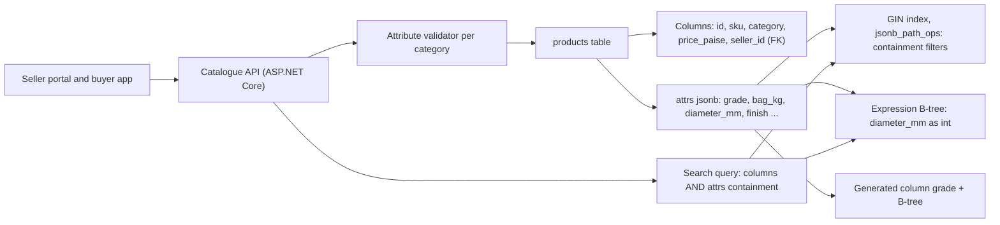
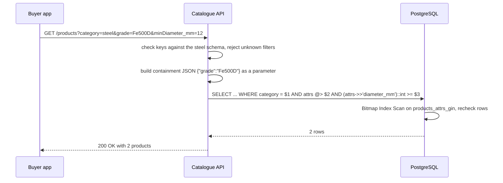

Relational tables are perfect when every row has the same shape. Real data is not always that polite: cement has a grade and a bag weight, steel bars have a diameter and a length, tiles have a size and a finish. PostgreSQL's `jsonb` type lets one column hold a JSON document per row, query inside it, and index it. Used well, it removes dozens of nullable columns and painful "attribute" tables. Used badly, it hides your data model inside a blob the planner cannot reason about. This lesson shows both.

## Learning objectives

By the end of this lesson you will be able to:

1. Explain the difference between `json` and `jsonb` and why `jsonb` is the default choice.
2. Read and filter documents with `->`, `->>`, `#>>`, `@>`, `?`, `?|`, `?&` and SQL/JSON path (`@?`, `JSON_VALUE`, `JSON_TABLE`).
3. Update documents with `jsonb_set`, `||` and `-`, and explain why every update rewrites the whole value.
4. Choose between a GIN index (`jsonb_ops` or `jsonb_path_ops`), an expression B-tree index, and a generated column.
5. Decide, with a checklist, whether a field belongs in a real column, in `jsonb`, or in a separate table.
6. Validate and query `jsonb` safely from C# with parameters, never string concatenation.

## Prerequisites

- [Relational database fundamentals](#/lesson/m09-relational-fundamentals): tables, columns, types.
- [Normalization and denormalization](#/lesson/m09-normalization): a document column is a controlled denormalization.
- [Indexes](#/lesson/m09-indexes): B-tree indexes and how the planner chooses them.

## Explain it like I'm a beginner

Think of a hardware shop's stock register. Every item has the same few boxes at the front of the row: item code, name, category, price. Those are **columns**. But each category also needs its own details. For cement: grade and bag weight. For steel bars: diameter and length. For tiles: size and finish. If you add a box for every possible detail, the register gets 60 boxes per row and most are empty.

So the shopkeeper staples a small **note card** to each row with just the details that item needs: `{"grade": "OPC 53", "bag_kg": 50}`. That card is a JSON document, and the column that holds it is a `jsonb` column.

PostgreSQL can read these cards for you ("show me all steel with grade Fe500D") and can even build an **index of the cards**, like a back-of-the-book index listing which rows have `"finish": "matt"`. That index is called a **GIN index** (Generalized Inverted Index).

The catch: the front boxes are checked by the database (a price must be a number, a category must exist), while the cards can contain anything, including typos like `"grde"`. And the database knows a lot about the front boxes (how many rows have each value) but very little about what is inside the cards, so it guesses when planning queries. The rule of thumb: **things every row has, things you join on, and things you sort and total by belong in columns. Things that vary by row belong on the card.**

## First-principles explanation

### json versus jsonb

PostgreSQL has two JSON types:

- `json` stores the **text** exactly as given: whitespace, key order, even duplicate keys. Every query re-parses it.
- `jsonb` stores a **decomposed binary** form: keys are sorted and de-duplicated (the last duplicate wins), whitespace is gone, numbers are stored as `numeric`. Reading a key does not need re-parsing, and it supports containment operators and indexes.

Use `jsonb` unless you must preserve the exact original text (for example, a signed webhook payload whose signature covers the raw bytes; even then, store the raw body as `text` or `bytea` and a parsed `jsonb` copy beside it).

### Reading values

| Operator | Meaning | Example on `{"grade":"Fe500D","diameter_mm":12,"pressure_bar":{"at_27c":27}}` | Result type |
|---|---|---|---|
| `->` | get key (or array index) as jsonb | `attrs -> 'diameter_mm'` → `12` | jsonb |
| `->>` | get key as text | `attrs ->> 'grade'` → `Fe500D` | text |
| `#>` / `#>>` | get by path | `attrs #>> '{pressure_bar,at_27c}'` → `27` | jsonb / text |
| `@>` | left contains right | `attrs @> '{"grade":"Fe500D"}'` → true | boolean |
| `<@` | left is contained in right | | boolean |
| `?` | key exists at top level | `attrs ? 'anti_skid'` | boolean |
| `?|` / `?&` | any / all of these keys exist | `attrs ?| array['voc','base']` | boolean |
| `@?` / `@@` | SQL/JSON path exists / matches | `attrs @? '$.pressure_bar.at_27c ? (@ >= 10)'` | boolean |

Two traps catch everyone once:

1. `->>` returns **text**. `attrs ->> 'diameter_mm' >= '12'` compares strings, and `'8' >= '12'` is true. Cast: `(attrs ->> 'diameter_mm')::int >= 12`. A row whose value is not a number makes the cast fail for the whole query, so validate on write.
2. A missing key and a JSON `null` both give SQL `NULL` from `->>`. If the difference matters, test with `?` or `jsonb_typeof`.

**Containment** (`@>`) is the most important operator because GIN indexes support it. Its rules: an object contains another if every key on the right exists on the left with a containing value; an array contains another if every element on the right is contained by *some* element on the left (order and duplicates do not matter); scalars must be equal. So `'{"certifications":["BIS","CRS"]}' @> '{"certifications":["CRS"]}'` is true.

PostgreSQL 17 added the SQL-standard query functions `JSON_VALUE`, `JSON_QUERY`, `JSON_EXISTS` and `JSON_TABLE`. `JSON_TABLE` turns a document into rows and columns, which is handy for reporting:

```sql
SELECT p.sku, j.*
FROM products p,
     JSON_TABLE(p.attrs, '$' COLUMNS (
        material   text PATH '$.material',
        bar_at_27c int  PATH '$.pressure_bar.at_27c')) AS j
WHERE p.category = 'pipes';
```

### Writing values

```sql
-- Replace or add one path:
UPDATE products SET attrs = jsonb_set(attrs, '{finish}', '"satin"') WHERE sku = 'TIL-VT-800';
-- Merge keys (right side wins):
UPDATE products SET attrs = attrs || '{"anti_skid": true}' WHERE sku = 'TIL-VT-800';
-- Remove a key, or a nested path:
UPDATE products SET attrs = attrs - 'voc' WHERE sku = 'PNT-EN-4';
UPDATE products SET attrs = attrs #- '{pressure_bar,at_82c}' WHERE sku = 'PIP-CP-25';
```

PostgreSQL rows are immutable versions (MVCC), and `jsonb` values are stored as one unit. Changing one key **writes a new copy of the whole document** and a new row version. For a 200-byte attribute card that is nothing. For a 40 KB document that is stored out of line (TOAST, used for values over about 2 KB), updating a counter inside it 50 times a second rewrites 2 MB/s of TOAST data plus WAL, and every write rewrites the GIN index entries too. A frequently changing value belongs in its own column.

### Indexing jsonb

**GIN with `jsonb_ops` (the default)** indexes every key and every value separately. It supports `@>`, `?`, `?|`, `?&`, `@?` and `@@`. It is the most flexible and the largest.

**GIN with `jsonb_path_ops`** indexes a hash of each *path-to-value*. It supports only `@>`, `@?` and `@@`, not key-existence. It is usually noticeably smaller and faster for containment, because a lookup for `{"grade":"Fe500D"}` probes one hash instead of intersecting "has key grade" with "has value Fe500D".

```sql
CREATE INDEX products_attrs_gin ON products USING gin (attrs jsonb_path_ops);
```

**Expression B-tree index** on one extracted value, for equality, ranges and sorting on a hot key:

```sql
CREATE INDEX products_diameter ON products (((attrs ->> 'diameter_mm')::int)) WHERE category = 'steel';
```

The query must use the *same expression* to match it. A bonus: PostgreSQL collects statistics on indexed expressions, so the planner's row estimates for that key improve.

**Generated column**: when a key is so important that you sort, join or group by it constantly, promote it:

```sql
ALTER TABLE products ADD COLUMN grade text GENERATED ALWAYS AS (attrs ->> 'grade') STORED;
CREATE INDEX ON products (grade);
```

The document stays the single source of truth, and the column is always in sync. (Adding a stored generated column rewrites the table, so on a big table follow [Migrations and schema evolution](#/lesson/m09-migrations-evolution).)

GIN trade-offs: GIN indexes are slower to update than B-trees. PostgreSQL softens this with a "pending list" (`fastupdate`) that batches new entries, which makes inserts cheaper and some searches slower until the list is merged by vacuum. On a write-heavy table, measure.

### The planner knows little about jsonb

PostgreSQL keeps detailed statistics per column (most common values, histograms). For a `jsonb` column it treats the whole document as one value, so for `attrs @> '{"finish":"matt"}'` it uses a fixed default selectivity guess. On a 5-million-row catalogue where 40 % of tiles are matt, the planner may expect a few thousand rows, choose a nested loop, and be wrong by a factor of 1,000. Remedies: expression indexes (which carry their own statistics), generated columns, or extended statistics on expressions (`CREATE STATISTICS ... ON ((attrs ->> 'finish')) FROM products`).

### When to use jsonb, and when not to

Use `jsonb` for:

- **Sparse, variable attributes**: product specifications per category, equipment specs per machine type.
- **Data owned by someone else**: webhook payloads, API responses you archive, GST e-invoice responses. Store as received, extract the few fields you query into columns.
- **Per-tenant custom fields** in a SaaS product, where each customer defines their own fields.
- **Small value objects** always read and written together (a delivery address snapshot on an order).

Prefer real columns (or tables) for:

- Anything you **join on** or that should be a **foreign key**. `jsonb` cannot reference another table.
- Anything that must be **NOT NULL, unique or checked** in every row: price, status, tenant id.
- Values you **aggregate, sort or range-filter** constantly: amounts, dates, quantities.
- Values that **change often** independently of the rest of the document.
- **Repeating groups that grow without bound**: an order's lines, a ticket's comments. Arrays inside a document make every append rewrite the whole thing; use a child table.

A simple test: *if you would add a CHECK constraint, a foreign key or a dedicated index for it, it is a column.*

### What breaks first under load

1. **Planner misestimates** on document predicates, leading to bad join orders. Shows up as a query that is fast for one filter value and slow for another.
2. **Write amplification** on large, frequently updated documents: WAL volume, TOAST churn, GIN maintenance, and replica lag.
3. **Data quality drift**: two clients spell the key differently (`bag_kg` versus `bagKg`), numbers arrive as strings, and every query must defend against it. Validate on write.
4. **Index bloat**: a `jsonb_ops` GIN index over large, varied documents can rival the table in size.

### When a simpler design is enough

If you have five categories and their attributes are stable, five nullable columns or one small table per category may be clearer than a document. If attributes are only *displayed* and never filtered, store them as `jsonb` with no index at all. Indexes are for queries you actually run.

## Visual explanation

### Where each piece of data lives



Requests come from sellers (writes) and buyers (searches) into one API. Every write passes the per-category validator before it reaches PostgreSQL, so the document has a known shape even though the database does not enforce one. Inside the table, the fixed, constrained, joined fields are real columns, including the seller foreign key. The variable specifications live in `attrs`. Three different indexes serve three query shapes: the GIN index answers "has these exact attribute values" filters, the expression index answers range filters on diameter, and the generated `grade` column gives a cheap, well-estimated B-tree for the most common facet. The search query combines a column filter (category) with document filters, and the planner can combine indexes with a bitmap AND.

### A filtered search request



The API first checks every filter key against the category schema, so a buyer cannot filter by an arbitrary key or inject SQL. Equality filters are merged into one JSON object and sent as a single **parameter** to `@>`, which the GIN index serves. The range filter uses the same extraction expression as the expression index, again with the value as a parameter. PostgreSQL scans the GIN index into a bitmap of candidate pages, rechecks those rows (GIN results can be lossy), applies the range condition and returns two rows. At no point is user input concatenated into SQL text.

## Step-by-step example

A building-materials marketplace lists 20 products across cement, steel, tiles, paint and pipes (the same seed as the playground). Product managers want filtered search, sellers want to add new attribute types without a migration, and finance wants prices to stay exact.

### Step 1 — split columns from the document

```sql
CREATE TABLE products (
  id          bigint PRIMARY KEY,
  sku         text   NOT NULL UNIQUE,
  name        text   NOT NULL,
  category    text   NOT NULL,
  price_paise bigint NOT NULL CHECK (price_paise > 0),
  attrs       jsonb  NOT NULL DEFAULT '{}' CHECK (jsonb_typeof(attrs) = 'object')
);
```

Price, category and SKU are in every row, are constrained, and are used for sorting and totals: columns. Everything category-specific is in `attrs`. The `CHECK` guarantees the document is an object, not an array or a bare string.

### Step 2 — read values

```sql
SELECT sku, attrs ->> 'grade' AS grade, (attrs ->> 'bag_kg')::int AS bag_kg
FROM products
WHERE category = 'cement' AND attrs ->> 'grade' = 'OPC 53';
```

Returns `CEM-UT-53` (50 kg) and `CEM-RK-53S` (25 kg).

### Step 3 — filter with containment and add the GIN index

```sql
CREATE INDEX products_attrs_gin ON products USING gin (attrs jsonb_path_ops);

SELECT sku FROM products WHERE attrs @> '{"grade": "Fe500D"}';
```

With 20 rows the planner will still pick a sequential scan (correctly: reading one page is cheaper than any index). Run `SET enable_seqscan = off` in the playground and `EXPLAIN` again to see `Bitmap Index Scan on products_attrs_gin`. On a million-row catalogue the planner picks it by itself.

### Step 4 — range filters need casts

```sql
SELECT sku FROM products
WHERE attrs @> '{"grade": "Fe500D"}'
  AND (attrs ->> 'diameter_mm')::int >= 12;
```

Returns `STL-TM-12` and `STL-TM-20`. Without the cast, the text comparison `'8' >= '12'` would wrongly include the 8 mm bar.

### Step 5 — arrays

Certifications are an array. Count products per certification:

```sql
SELECT c AS certification, count(*) AS products
FROM products, jsonb_array_elements_text(attrs -> 'certifications') AS c
GROUP BY c ORDER BY products DESC, c;
```

BIS 10, GreenPro 3, CRS 2, ISI 2. Products without the key simply produce no rows. Filtering "has CRS" is containment: `attrs @> '{"certifications": ["CRS"]}'`, which the GIN index serves.

### Step 6 — promote a hot key

Analytics shows 70 % of searches filter or facet by `grade`. Promote it:

```sql
ALTER TABLE products ADD COLUMN grade text GENERATED ALWAYS AS (attrs ->> 'grade') STORED;
CREATE INDEX products_grade ON products (grade);
```

Facet counts (`GROUP BY grade`) now read a narrow indexed column with real statistics.

### Step 7 — the C# side

With Npgsql, `jsonb` maps to `string`, `JsonDocument`, `JsonNode` or your own POCOs via System.Text.Json. With EF Core 10, an owned or complex type can be mapped to a JSON column with `.ToJson()`, and LINQ over its properties translates to `->>` expressions. Always pass documents as parameters:

```csharp
// Npgsql: the filter document is a parameter, never concatenated into SQL.
await using var cmd = dataSource.CreateCommand(
    "SELECT sku, name FROM products WHERE category = $1 AND attrs @> $2");
cmd.Parameters.AddWithValue("steel");
cmd.Parameters.Add(new NpgsqlParameter { Value = """{"grade":"Fe500D"}""", NpgsqlDbType = NpgsqlDbType.Jsonb });
```

## Production-style C# implementation

The catalogue service validates attribute documents per category on write and builds parameterised search SQL from whitelisted filters on read. The store is behind an interface; the in-memory version implements `@>` semantics over `JsonNode` so the logic can be tested without PostgreSQL.

```text
Catalog.Api/
  Program.cs
  Attributes/CategorySchema.cs
  Attributes/AttributeValidator.cs
  Attributes/JsonContains.cs
  Search/ProductSearch.cs
  Search/ProductStore.cs
```

```csharp file=Attributes/CategorySchema.cs
namespace Catalog.Attributes;

public enum AttrType { Text, Integer, Number, Boolean, TextArray, IntegerArray, Object }

public sealed record AttrRule(string Key, AttrType Type, bool Required = false, bool Filterable = false, bool RangeFilterable = false);

/// <summary>The shape of attrs for one category. Lives in code or a config table, versioned like any schema.</summary>
public sealed record CategorySchema(string Category, IReadOnlyList<AttrRule> Rules)
{
    public AttrRule? Find(string key) => Rules.FirstOrDefault(r => r.Key == key);
}

public static class Schemas
{
    public static readonly IReadOnlyDictionary<string, CategorySchema> All = new Dictionary<string, CategorySchema>
    {
        ["cement"] = new("cement", new[]
        {
            new AttrRule("grade", AttrType.Text, Required: true, Filterable: true),
            new AttrRule("bag_kg", AttrType.Integer, Required: true, Filterable: true, RangeFilterable: true),
            new AttrRule("certifications", AttrType.TextArray, Filterable: true),
        }),
        ["steel"] = new("steel", new[]
        {
            new AttrRule("grade", AttrType.Text, Filterable: true),
            new AttrRule("diameter_mm", AttrType.Integer, Filterable: true, RangeFilterable: true),
            new AttrRule("length_m", AttrType.Number),
            new AttrRule("certifications", AttrType.TextArray, Filterable: true),
        }),
        ["tiles"] = new("tiles", new[]
        {
            new AttrRule("size_mm", AttrType.IntegerArray, Required: true),
            new AttrRule("finish", AttrType.Text, Required: true, Filterable: true),
            new AttrRule("box_sqft", AttrType.Number),
            new AttrRule("anti_skid", AttrType.Boolean, Filterable: true),
        }),
    };
}
```

```csharp file=Attributes/AttributeValidator.cs
using System.Text.Json;
using System.Text.Json.Nodes;

namespace Catalog.Attributes;

/// <summary>Validates an attrs document against its category schema before it is written.
/// The database only checks that attrs is an object; this is where the real shape is enforced.</summary>
public static class AttributeValidator
{
    public const int MaxDocumentBytes = 4096;   // keeps documents small enough to stay inline (no TOAST)

    public static IReadOnlyList<string> Validate(CategorySchema schema, JsonObject attrs)
    {
        var errors = new List<string>();
        if (attrs.ToJsonString().Length > MaxDocumentBytes) errors.Add($"attrs is larger than {MaxDocumentBytes} bytes");

        foreach (var rule in schema.Rules.Where(r => r.Required))
            if (!attrs.ContainsKey(rule.Key) || attrs[rule.Key] is null) errors.Add($"'{rule.Key}' is required");

        foreach (var (key, value) in attrs)
        {
            var rule = schema.Find(key);
            if (rule is null) { errors.Add($"'{key}' is not an attribute of {schema.Category}"); continue; }
            if (value is null) continue;
            if (!HasType(value, rule.Type)) errors.Add($"'{key}' must be {rule.Type}");
        }
        return errors;
    }

    private static bool HasType(JsonNode node, AttrType type) => type switch
    {
        AttrType.Text => Kind(node) == JsonValueKind.String,
        AttrType.Integer => Kind(node) == JsonValueKind.Number && node.AsValue().TryGetValue<long>(out _),
        AttrType.Number => Kind(node) == JsonValueKind.Number,
        AttrType.Boolean => Kind(node) is JsonValueKind.True or JsonValueKind.False,
        AttrType.Object => node is JsonObject,
        AttrType.TextArray => node is JsonArray a && a.All(e => e is not null && Kind(e) == JsonValueKind.String),
        AttrType.IntegerArray => node is JsonArray a2 && a2.All(e => e is not null && Kind(e) == JsonValueKind.Number && e.AsValue().TryGetValue<long>(out _)),
        _ => false
    };

    private static JsonValueKind Kind(JsonNode node) => node.GetValueKind();
}
```

```csharp file=Attributes/JsonContains.cs
using System.Text.Json;
using System.Text.Json.Nodes;

namespace Catalog.Attributes;

/// <summary>In-memory model of PostgreSQL's jsonb @> operator, used by the fake store and tests.</summary>
public static class JsonContains
{
    public static bool Contains(JsonNode? left, JsonNode? right)
    {
        if (right is null) return left is null;
        if (left is null) return false;

        return (left, right) switch
        {
            (JsonObject l, JsonObject r) => r.All(kv => l.TryGetPropertyValue(kv.Key, out var lv) && Contains(lv, kv.Value)),
            (JsonArray l, JsonArray r) => r.All(re => l.Any(le => Contains(le, re))),
            (JsonArray l, JsonValue r) => l.Any(le => le is JsonValue lv && ScalarEquals(lv, r)),   // top-level array contains a scalar
            (JsonValue l, JsonValue r) => ScalarEquals(l, r),
            _ => false
        };
    }

    private static bool ScalarEquals(JsonValue a, JsonValue b)
    {
        var ka = a.GetValueKind();
        var kb = b.GetValueKind();
        if (ka != kb) return false;
        return ka switch
        {
            JsonValueKind.Number => a.GetValue<decimal>() == b.GetValue<decimal>(),   // 12 and 12.0 are equal in jsonb
            JsonValueKind.String => a.GetValue<string>() == b.GetValue<string>(),
            _ => true   // true/true, false/false, null/null
        };
    }
}
```

```csharp file=Search/ProductSearch.cs
using System.Text.Json.Nodes;
using Catalog.Attributes;

namespace Catalog.Search;

public sealed record SqlQuery(string Text, IReadOnlyList<object> Parameters);

public sealed class InvalidFilterException(string message) : Exception(message);

/// <summary>Turns ?grade=Fe500D&amp;minDiameter_mm=12 into parameterised SQL. Keys are whitelisted by the schema,
/// so user input never becomes SQL text. Equality filters merge into one @> document for the GIN index.</summary>
public static class ProductSearch
{
    public static (JsonObject Exact, List<(string Key, decimal Min)> Ranges) Parse(CategorySchema schema, IReadOnlyDictionary<string, string> query)
    {
        var eq = new JsonObject();
        var ranges = new List<(string, decimal)>();
        foreach (var (rawKey, raw) in query)
        {
            if (rawKey.StartsWith("min", StringComparison.Ordinal))
            {
                var key = char.ToLowerInvariant(rawKey[3]) + rawKey[4..];
                var rule = schema.Find(key);
                if (rule is not { RangeFilterable: true }) throw new InvalidFilterException($"Cannot range-filter on '{key}'.");
                if (!decimal.TryParse(raw, System.Globalization.CultureInfo.InvariantCulture, out var min))
                    throw new InvalidFilterException($"'{rawKey}' must be a number.");
                ranges.Add((key, min));
                continue;
            }

            var r = schema.Find(rawKey);
            if (r is not { Filterable: true }) throw new InvalidFilterException($"Cannot filter on '{rawKey}'.");
            eq[rawKey] = r.Type switch
            {
                AttrType.Integer when long.TryParse(raw, out var n) => JsonValue.Create(n),
                AttrType.Boolean when bool.TryParse(raw, out var b) => JsonValue.Create(b),
                AttrType.TextArray => new JsonArray(JsonValue.Create(raw)),     // "has this certification"
                AttrType.Text => JsonValue.Create(raw),
                _ => throw new InvalidFilterException($"'{rawKey}' has the wrong type.")
            };
        }
        return (eq, ranges);
    }

    public static SqlQuery ToSql(string category, JsonObject equals, IReadOnlyList<(string Key, decimal Min)> ranges, int limit)
    {
        var sql = new System.Text.StringBuilder("SELECT id, sku, name, price_paise, attrs FROM products WHERE category = $1");
        var ps = new List<object> { category };
        if (equals.Count > 0)
        {
            ps.Add(equals.ToJsonString());
            sql.Append($" AND attrs @> ${ps.Count}::jsonb");
        }
        foreach (var (key, min) in ranges)
        {
            // The key is from the schema whitelist. Writing it as a literal lets an expression index on
            // ((attrs ->> 'diameter_mm')::numeric) match. The value is still a parameter.
            ps.Add(min);
            sql.Append($" AND (attrs ->> '{key}')::numeric >= ${ps.Count}");
        }
        ps.Add(limit);
        sql.Append($" ORDER BY price_paise, id LIMIT ${ps.Count}");
        return new SqlQuery(sql.ToString(), ps);
    }
}
```

```csharp file=Search/ProductStore.cs
using System.Text.Json.Nodes;
using Catalog.Attributes;

namespace Catalog.Search;

public sealed record Product(long Id, string Sku, string Name, string Category, long PricePaise, JsonObject Attrs);

public interface IProductStore
{
    Task AddAsync(Product p, CancellationToken ct);
    Task<IReadOnlyList<Product>> SearchAsync(string category, JsonObject equals, IReadOnlyList<(string Key, decimal Min)> ranges, int limit, CancellationToken ct);
}

/// <summary>Fake store with the same semantics as the SQL from ProductSearch.ToSql.</summary>
public sealed class InMemoryProductStore : IProductStore
{
    private readonly List<Product> _rows = new();

    public Task AddAsync(Product p, CancellationToken ct) { _rows.Add(p); return Task.CompletedTask; }

    public Task<IReadOnlyList<Product>> SearchAsync(string category, JsonObject equals, IReadOnlyList<(string Key, decimal Min)> ranges, int limit, CancellationToken ct)
    {
        var q = _rows.Where(p => p.Category == category && JsonContains.Contains(p.Attrs, equals));
        foreach (var (key, min) in ranges)
            q = q.Where(p => p.Attrs[key] is JsonValue v && v.TryGetValue<decimal>(out var d) && d >= min);
        IReadOnlyList<Product> result = q.OrderBy(p => p.PricePaise).ThenBy(p => p.Id).Take(limit).ToList();
        return Task.FromResult(result);
    }
}
```

```csharp file=Program.cs
using System.Text.Json.Nodes;
using Catalog.Attributes;
using Catalog.Search;

var builder = WebApplication.CreateBuilder(args);
builder.Services.AddSingleton<IProductStore, InMemoryProductStore>();
var app = builder.Build();

app.MapPost("/products", async (ProductInput input, IProductStore store, CancellationToken ct) =>
{
    if (!Schemas.All.TryGetValue(input.Category, out var schema))
        return Results.Problem($"Unknown category '{input.Category}'.", statusCode: 400);
    var errors = AttributeValidator.Validate(schema, input.Attrs);
    if (errors.Count > 0) return Results.ValidationProblem(new Dictionary<string, string[]> { ["attrs"] = errors.ToArray() });

    var p = new Product(input.Id, input.Sku, input.Name, input.Category, input.PricePaise, input.Attrs);
    await store.AddAsync(p, ct);
    return Results.Created($"/products/{p.Id}", p);
});

app.MapGet("/products", async (HttpRequest req, IProductStore store, CancellationToken ct) =>
{
    var category = req.Query["category"].ToString();
    if (!Schemas.All.TryGetValue(category, out var schema)) return Results.Problem("Unknown category.", statusCode: 400);
    var filters = req.Query.Where(kv => kv.Key != "category").ToDictionary(kv => kv.Key, kv => kv.Value.ToString());
    try
    {
        var (eq, ranges) = ProductSearch.Parse(schema, filters);
        var rows = await store.SearchAsync(category, eq, ranges, 50, ct);
        return Results.Ok(rows);
    }
    catch (InvalidFilterException ex)
    {
        return Results.Problem(ex.Message, statusCode: 400);
    }
});

app.Run();

public sealed record ProductInput(long Id, string Sku, string Name, string Category, long PricePaise, JsonObject Attrs);
```

**Design notes.**

- The validator is the schema the database does not have. It rejects unknown keys (catching `"grde"` typos), wrong types (a diameter sent as `"12"`), missing required keys, and oversized documents.
- Search keys come from the schema whitelist, and every value is a parameter. The only identifiers written into SQL text are whitelisted key names, written as literals on purpose so expression indexes can match.
- Equality filters merge into one `@>` document, which a single GIN probe answers. Range filters use the same expression as the expression index.
- The in-memory `JsonContains` mirrors PostgreSQL's containment rules, including "array contains element regardless of order", so unit tests describe the same behaviour as production SQL.

:::callout type=warning title="Never build JSON filters by string concatenation"
`$"... WHERE attrs @> '{{\"grade\":\"{grade}\"}}'"` lets a user close the quote and inject SQL. Build a `JsonObject`, serialise it, and pass it as a `jsonb` parameter.
:::

## Bad design vs good design

**Bad**: `CREATE TABLE products (id bigint PRIMARY KEY, data jsonb)`. Price, category, seller id and stock all live inside `data`. Finance's monthly sales total casts `(data ->> 'price')::numeric` across 5 million rows and fails on the first row where a seller sent `"₹410"`. There is no foreign key to sellers, so deleted sellers leave orphan products. Stock is decremented inside the document on every order, rewriting a 6 KB TOASTed value and its GIN entries thousands of times an hour. The planner estimates every `data @> ...` filter with the same constant and picks a nested loop that runs for 40 seconds on popular categories.

**Good**: constrained columns for what every row has (`sku`, `category`, `price_paise`, `seller_id` with a foreign key), stock in its own column or table, `attrs jsonb` for category specifications, validated on write, a `jsonb_path_ops` GIN index for facet filters, and an expression index or generated column for the one or two keys that need ranges and statistics.

**But**: a team that ingests 30 different partner webhook formats and only ever reads them back by `event_id` should not model 30 schemas. Store each payload as `jsonb` with `event_id`, `partner`, `received_at` columns, and no GIN index at all. Extract a field into a column only when a query needs it.

:::callout type=tradeoff title="Column vs jsonb vs child table"
| Need | Column | jsonb key | Child table |
|---|---|---|---|
| Same in every row, constrained | best | weak (CHECK on expressions) | n/a |
| Varies by row or tenant | many NULLs | best | EAV is painful |
| Foreign key / join | best | not possible | best |
| Range, sort, aggregate | best | cast + expression index | good |
| Changes often | best | rewrites whole document | good |
| Unbounded repeating group | n/a | rewrites on every append | best |
| Planner statistics | full | none unless expression index | full |
:::

## Practical playground

Twenty building-material products with category-specific attributes and a `jsonb_path_ops` GIN index. Try the commented queries, then switch off sequential scans to see the GIN index in the plan.

:::playground type=sql title="Querying and indexing a product catalogue"
```sql
CREATE TABLE products (
  id          bigint PRIMARY KEY,
  sku         text   NOT NULL UNIQUE,
  name        text   NOT NULL,
  category    text   NOT NULL,
  price_paise bigint NOT NULL,
  attrs       jsonb  NOT NULL DEFAULT '{}' CHECK (jsonb_typeof(attrs) = 'object')
);
INSERT INTO products VALUES
 (1,  'CEM-UT-53',  'UltraStrong OPC 53 cement 50 kg',   'cement', 41000,   '{"grade":"OPC 53","bag_kg":50,"certifications":["BIS","ISI"]}'),
 (2,  'CEM-UT-43',  'UltraStrong OPC 43 cement 50 kg',   'cement', 38500,   '{"grade":"OPC 43","bag_kg":50,"certifications":["BIS"]}'),
 (3,  'CEM-RK-PPC', 'Rakshak PPC cement 50 kg',          'cement', 36000,   '{"grade":"PPC","bag_kg":50,"certifications":["BIS","GreenPro"]}'),
 (4,  'CEM-RK-53S', 'Rakshak OPC 53 cement 25 kg',       'cement', 21500,   '{"grade":"OPC 53","bag_kg":25,"certifications":["BIS"]}'),
 (5,  'STL-TM-8',   'TMT bar Fe500D 8 mm',               'steel',  6200,    '{"grade":"Fe500D","diameter_mm":8,"length_m":12,"certifications":["BIS"]}'),
 (6,  'STL-TM-12',  'TMT bar Fe500D 12 mm',              'steel',  13900,   '{"grade":"Fe500D","diameter_mm":12,"length_m":12,"certifications":["BIS","CRS"]}'),
 (7,  'STL-TM-16',  'TMT bar Fe550D 16 mm',              'steel',  24800,   '{"grade":"Fe550D","diameter_mm":16,"length_m":12,"certifications":["BIS","CRS"]}'),
 (8,  'STL-TM-20',  'TMT bar Fe500D 20 mm',              'steel',  38600,   '{"grade":"Fe500D","diameter_mm":20,"length_m":12,"certifications":["BIS"]}'),
 (9,  'STL-TM-25',  'TMT bar Fe550D 25 mm',              'steel',  60100,   '{"grade":"Fe550D","diameter_mm":25,"length_m":12}'),
 (10, 'TIL-VT-600', 'Vitrified tile 600x600 glossy',     'tiles',  5400,    '{"size_mm":[600,600],"finish":"glossy","box_sqft":15.5,"certifications":["GreenPro"]}'),
 (11, 'TIL-VT-800', 'Vitrified tile 800x800 matt',       'tiles',  8900,    '{"size_mm":[800,800],"finish":"matt","box_sqft":20.7}'),
 (12, 'TIL-CR-300', 'Ceramic wall tile 300x450',         'tiles',  2900,    '{"size_mm":[300,450],"finish":"glossy","box_sqft":11.6,"anti_skid":false}'),
 (13, 'TIL-PV-400', 'Parking tile 400x400 anti-skid',    'tiles',  3600,    '{"size_mm":[400,400],"finish":"matt","box_sqft":10.3,"anti_skid":true}'),
 (14, 'PNT-EX-20',  'Weathercoat exterior emulsion 20 L','paint',  520000,  '{"base":"water","litres":20,"coverage_sqft_per_l":55,"voc":"low","certifications":["GreenPro"]}'),
 (15, 'PNT-IN-10',  'Silk interior emulsion 10 L',       'paint',  310000,  '{"base":"water","litres":10,"coverage_sqft_per_l":60,"voc":"low"}'),
 (16, 'PNT-EN-4',   'Synthetic enamel 4 L',              'paint',  148000,  '{"base":"solvent","litres":4,"coverage_sqft_per_l":45,"voc":"high"}'),
 (17, 'PIP-CP-25',  'CPVC pipe 25 mm SDR 11, 3 m',       'pipes',  64000,   '{"material":"CPVC","diameter_mm":25,"length_m":3,"pressure_bar":{"at_27c":27,"at_82c":7},"certifications":["BIS"]}'),
 (18, 'PIP-UP-110', 'uPVC pipe 110 mm 6 kgf, 6 m',       'pipes',  145000,  '{"material":"uPVC","diameter_mm":110,"length_m":6,"pressure_bar":{"at_27c":6},"certifications":["BIS","ISI"]}'),
 (19, 'PIP-HD-63',  'HDPE pipe 63 mm PE100, 100 m coil', 'pipes',  1890000, '{"material":"HDPE","diameter_mm":63,"length_m":100,"pressure_bar":{"at_27c":10}}'),
 (20, 'STL-BW-1',   'Binding wire 18 gauge 25 kg',       'steel',  210000,  '{"gauge":18,"weight_kg":25}');
CREATE INDEX products_attrs_gin ON products USING gin (attrs jsonb_path_ops);

-- SELECT sku, attrs ->> 'finish' FROM products WHERE attrs @> '{"finish":"matt"}';
-- SELECT sku FROM products WHERE attrs @> '{"certifications":["CRS"]}';
-- SELECT sku FROM products WHERE attrs ->> 'diameter_mm' >= '12';          -- text comparison: wrong!
-- SELECT sku FROM products WHERE (attrs ->> 'diameter_mm')::int >= 12;     -- numeric: right
-- SELECT sku, JSON_VALUE(attrs, '$.pressure_bar.at_27c' RETURNING int) FROM products WHERE attrs @? '$.pressure_bar.at_27c ? (@ >= 10)';
-- SELECT p.sku, j.* FROM products p, JSON_TABLE(p.attrs, '$' COLUMNS (material text PATH '$.material', hot_bar int PATH '$.pressure_bar.at_82c')) j WHERE category = 'pipes';
-- SET enable_seqscan = off;  EXPLAIN SELECT sku FROM products WHERE attrs @> '{"finish":"matt"}';
-- SELECT pg_size_pretty(pg_relation_size('products_attrs_gin'));
```
:::

## Exercises

:::exercise id=m09-jsonb-ex1 difficulty=beginner kind=sql ordered=true title="Extract values with ->>"
List every **cement** product of grade `OPC 53` with columns `sku`, `grade` (text) and `bag_kg` (an integer), most expensive first.
::setup
```sql
CREATE TABLE products (id bigint PRIMARY KEY, sku text NOT NULL UNIQUE, name text NOT NULL, category text NOT NULL, price_paise bigint NOT NULL, attrs jsonb NOT NULL DEFAULT '{}');
INSERT INTO products VALUES
 (1, 'CEM-UT-53',  'UltraStrong OPC 53 cement 50 kg', 'cement', 41000, '{"grade":"OPC 53","bag_kg":50,"certifications":["BIS","ISI"]}'),
 (2, 'CEM-UT-43',  'UltraStrong OPC 43 cement 50 kg', 'cement', 38500, '{"grade":"OPC 43","bag_kg":50,"certifications":["BIS"]}'),
 (3, 'CEM-RK-PPC', 'Rakshak PPC cement 50 kg',        'cement', 36000, '{"grade":"PPC","bag_kg":50,"certifications":["BIS","GreenPro"]}'),
 (4, 'CEM-RK-53S', 'Rakshak OPC 53 cement 25 kg',     'cement', 21500, '{"grade":"OPC 53","bag_kg":25,"certifications":["BIS"]}'),
 (5, 'STL-TM-8',   'TMT bar Fe500D 8 mm',             'steel',  6200,  '{"grade":"Fe500D","diameter_mm":8,"length_m":12}'),
 (6, 'CEM-AR-53',  'Arya OPC 53 cement 50 kg',        'cement', 40500, '{"grade":"OPC 53","bag_kg":50}');
```
::check
```sql
SELECT sku, attrs ->> 'grade' AS grade, (attrs ->> 'bag_kg')::int AS bag_kg
FROM products
WHERE category = 'cement' AND attrs ->> 'grade' = 'OPC 53'
ORDER BY price_paise DESC;
```
::acceptance
- Three rows: `CEM-UT-53`, `CEM-AR-53`, `CEM-RK-53S` in that order.
- `bag_kg` is an integer column (50, 50, 25), not text.
::hint
`->>` returns a key's value as text; `->` returns jsonb.
::hint
Cast the bag weight: `(attrs ->> 'bag_kg')::int`. The parentheses matter because `::` binds tighter than `->>`.
::hint
```sql
SELECT sku, attrs ->> 'grade' AS grade, (attrs ->> 'bag_kg')::int AS bag_kg FROM products WHERE ... ORDER BY price_paise DESC;
```
::solution
```sql
SELECT sku, attrs ->> 'grade' AS grade, (attrs ->> 'bag_kg')::int AS bag_kg
FROM products
WHERE category = 'cement' AND attrs ->> 'grade' = 'OPC 53'
ORDER BY price_paise DESC;
```
`attrs ->> 'grade' = 'OPC 53'` compares text with text, which is right for a string attribute. The same filter could be written `attrs @> '{"grade":"OPC 53"}'`, which a GIN index can serve; the `->>` form needs an expression index on `(attrs ->> 'grade')` to be indexed.
::mistakes
- `attrs -> 'grade' = 'OPC 53'`: compares jsonb with an invalid JSON literal and errors (the right side would need to be `'"OPC 53"'`).
- `attrs ->> 'bag_kg'::int`: the cast applies to the string `'bag_kg'` and fails.
:::

:::exercise id=m09-jsonb-ex2 difficulty=beginner kind=sql ordered=true title="Containment plus a numeric range"
Find **Fe500D** steel bars with a diameter of **at least 12 mm**. Use containment (`@>`) for the grade and a numeric comparison for the diameter. Return `sku` and `name`, ordered by `sku`.
::setup
```sql
CREATE TABLE products (id bigint PRIMARY KEY, sku text NOT NULL UNIQUE, name text NOT NULL, category text NOT NULL, price_paise bigint NOT NULL, attrs jsonb NOT NULL DEFAULT '{}');
INSERT INTO products VALUES
 (5, 'STL-TM-8',  'TMT bar Fe500D 8 mm',  'steel', 6200,  '{"grade":"Fe500D","diameter_mm":8,"length_m":12,"certifications":["BIS"]}'),
 (6, 'STL-TM-12', 'TMT bar Fe500D 12 mm', 'steel', 13900, '{"grade":"Fe500D","diameter_mm":12,"length_m":12,"certifications":["BIS","CRS"]}'),
 (7, 'STL-TM-16', 'TMT bar Fe550D 16 mm', 'steel', 24800, '{"grade":"Fe550D","diameter_mm":16,"length_m":12,"certifications":["BIS","CRS"]}'),
 (8, 'STL-TM-20', 'TMT bar Fe500D 20 mm', 'steel', 38600, '{"grade":"Fe500D","diameter_mm":20,"length_m":12,"certifications":["BIS"]}'),
 (9, 'STL-TM-25', 'TMT bar Fe550D 25 mm', 'steel', 60100, '{"grade":"Fe550D","diameter_mm":25,"length_m":12}'),
 (21,'STL-TM-10', 'TMT bar Fe500D 10 mm', 'steel', 9800,  '{"grade":"Fe500D","diameter_mm":10,"length_m":12}');
CREATE INDEX products_attrs_gin ON products USING gin (attrs jsonb_path_ops);
```
::check
```sql
SELECT sku, name FROM products
WHERE attrs @> '{"grade": "Fe500D"}' AND (attrs ->> 'diameter_mm')::int >= 12
ORDER BY sku;
```
::acceptance
- Returns `STL-TM-12` and `STL-TM-20` only.
- The 8 mm and 10 mm bars are excluded. (A text comparison would wrongly include the 8 mm bar, because `'8' >= '12'` as text.)
::hint
Containment: `attrs @> '{"grade": "Fe500D"}'`. The right side is a JSON literal.
::hint
`->>` gives text. Compare numbers only after casting.
::hint
Try `attrs ->> 'diameter_mm' >= '12'` first and see which wrong row appears.
::solution
```sql
SELECT sku, name FROM products
WHERE attrs @> '{"grade": "Fe500D"}' AND (attrs ->> 'diameter_mm')::int >= 12
ORDER BY sku;
```
The containment filter can use the GIN index; the range filter cannot (GIN `jsonb_path_ops` supports `@>`, `@?`, `@@`). If diameter ranges are a hot query, add `CREATE INDEX ON products (((attrs ->> 'diameter_mm')::int))` and write the filter with exactly that expression. Alternatively, a path query keeps it all on the GIN index: `attrs @? '$ ? (@.grade == "Fe500D" && @.diameter_mm >= 12)'`.
::mistakes
- Text comparison on numbers.
- `attrs @> '{"grade": "Fe500D", "diameter_mm": 12}'`, which finds exactly 12 mm, not "at least 12".
:::

:::exercise id=m09-jsonb-ex3 difficulty=intermediate kind=sql ordered=true title="Unnest an array for a facet count"
The buyer app shows a "Certifications" facet. Count how many products carry each certification (from the `certifications` array in `attrs`). Return `certification` and `products`, ordered by `products` descending, then `certification` ascending. Products without the key are simply not counted.
::setup
```sql
CREATE TABLE products (id bigint PRIMARY KEY, sku text NOT NULL UNIQUE, category text NOT NULL, attrs jsonb NOT NULL DEFAULT '{}');
INSERT INTO products VALUES
 (1, 'CEM-UT-53',  'cement', '{"grade":"OPC 53","certifications":["BIS","ISI"]}'),
 (2, 'CEM-UT-43',  'cement', '{"grade":"OPC 43","certifications":["BIS"]}'),
 (3, 'CEM-RK-PPC', 'cement', '{"grade":"PPC","certifications":["BIS","GreenPro"]}'),
 (6, 'STL-TM-12',  'steel',  '{"grade":"Fe500D","certifications":["BIS","CRS"]}'),
 (7, 'STL-TM-16',  'steel',  '{"grade":"Fe550D","certifications":["BIS","CRS"]}'),
 (9, 'STL-TM-25',  'steel',  '{"grade":"Fe550D"}'),
 (10,'TIL-VT-600', 'tiles',  '{"finish":"glossy","certifications":["GreenPro"]}'),
 (14,'PNT-EX-20',  'paint',  '{"voc":"low","certifications":["GreenPro"]}'),
 (18,'PIP-UP-110', 'pipes',  '{"material":"uPVC","certifications":["BIS","ISI"]}');
```
::check
```sql
SELECT c AS certification, count(*) AS products
FROM products, jsonb_array_elements_text(attrs -> 'certifications') AS c
GROUP BY c
ORDER BY products DESC, certification;
```
::acceptance
- BIS 6, GreenPro 3, CRS 2, ISI 2, in that order.
- `STL-TM-25`, which has no certifications key, adds nothing and causes no error.
::hint
You need one row per (product, certification). A set-returning function in `FROM` produces that.
::hint
`jsonb_array_elements_text(jsonb)` returns each array element as text. For a NULL input (missing key) it returns no rows.
::hint
```sql
FROM products, jsonb_array_elements_text(attrs -> 'certifications') AS c
```
::hint
Then `GROUP BY c` and order by the count, then by name for ties.
::solution
```sql
SELECT c AS certification, count(*) AS products
FROM products, jsonb_array_elements_text(attrs -> 'certifications') AS c
GROUP BY c
ORDER BY products DESC, certification;
```
The comma join with a set-returning function is an implicit `LATERAL` join: for each product, the function runs on that product's array. On a large catalogue, facet counts like this are expensive (every matching document is unnested), so busy marketplaces precompute them per category in a summary table, or move facet counting to a search engine.
::mistakes
- `jsonb_array_elements` (without `_text`) returns jsonb values, so the facet labels come out quoted (`"BIS"`).
- Forgetting the tie-breaker in `ORDER BY`, so CRS and ISI swap between runs.
:::

:::exercise id=m09-jsonb-ex4 difficulty=intermediate kind=code title="Implement jsonb containment in C#"
Implement `JsonContainment.Contains(JsonNode? left, JsonNode? right)` with PostgreSQL's `@>` rules, so the in-memory fake store behaves like the database. Rules: objects contain objects when every right key exists on the left with a containing value (extra left keys are fine); arrays contain arrays when every right element is contained by **some** left element (order and duplicates ignored); a top-level array contains a scalar if one of its elements equals it; scalars must have the same JSON kind and value (numbers compare by value, so `12` equals `12.0`); JSON `null` (a C# `null` node) only matches `null`.
::acceptance
- `{"grade":"Fe500D","diameter_mm":12}` contains `{"grade":"Fe500D"}`, but not `{"grade":"Fe550D"}`.
- `{"certifications":["BIS","CRS"]}` contains `{"certifications":["CRS"]}` and `{"certifications":["CRS","BIS","CRS"]}`.
- Nested objects work: `{"pressure_bar":{"at_27c":27,"at_82c":7}}` contains `{"pressure_bar":{"at_27c":27}}`.
- `12` equals `12.0`, the string `"12"` does not equal the number `12`, and `true` does not equal `1`.
- Every document contains `{}`.
::hint
Switch on the pair of node types: `(JsonObject, JsonObject)`, `(JsonArray, JsonArray)`, `(JsonArray, JsonValue)`, `(JsonValue, JsonValue)`, otherwise false.
::hint
Objects: `right.All(kv => left.TryGetPropertyValue(kv.Key, out var lv) && Contains(lv, kv.Value))`.
::hint
Arrays: `right.All(r => left.Any(l => Contains(l, r)))`.
::hint
Scalars: compare `GetValueKind()` first. For numbers use `GetValue<decimal>()`; for strings `GetValue<string>()`; `true`/`false` are already distinguished by their kinds.
::hint
Handle nulls at the top: if `right` is null, the answer is `left is null`; if only `left` is null, false.
::starter
```csharp file=JsonContainment.cs
using System;
using System.Linq;
using System.Text.Json;
using System.Text.Json.Nodes;

public static class JsonContainment
{
    public static bool Contains(JsonNode? left, JsonNode? right) => throw new NotImplementedException();
}
```
::tests
```csharp file=JsonContainmentTests.cs
using System.Text.Json.Nodes;
using Xunit;

public class JsonContainmentTests
{
    private static JsonNode? J(string s) => JsonNode.Parse(s);

    [Fact]
    public void Object_subset()
    {
        var doc = J("""{"grade":"Fe500D","diameter_mm":12,"length_m":12}""");
        Assert.True(JsonContainment.Contains(doc, J("""{"grade":"Fe500D"}""")));
        Assert.True(JsonContainment.Contains(doc, J("""{"grade":"Fe500D","diameter_mm":12}""")));
        Assert.False(JsonContainment.Contains(doc, J("""{"grade":"Fe550D"}""")));
        Assert.False(JsonContainment.Contains(doc, J("""{"finish":"matt"}""")));
    }

    [Fact]
    public void Arrays_ignore_order_and_duplicates()
    {
        var doc = J("""{"certifications":["BIS","CRS"]}""");
        Assert.True(JsonContainment.Contains(doc, J("""{"certifications":["CRS"]}""")));
        Assert.True(JsonContainment.Contains(doc, J("""{"certifications":["CRS","BIS","CRS"]}""")));
        Assert.False(JsonContainment.Contains(doc, J("""{"certifications":["ISI"]}""")));
        Assert.True(JsonContainment.Contains(doc, J("""{"certifications":[]}""")));
    }

    [Fact]
    public void Nested_objects()
    {
        var doc = J("""{"material":"CPVC","pressure_bar":{"at_27c":27,"at_82c":7}}""");
        Assert.True(JsonContainment.Contains(doc, J("""{"pressure_bar":{"at_27c":27}}""")));
        Assert.False(JsonContainment.Contains(doc, J("""{"pressure_bar":{"at_27c":10}}""")));
    }

    [Fact]
    public void Scalars_compare_by_kind_and_value()
    {
        Assert.True(JsonContainment.Contains(J("12"), J("12.0")));
        Assert.False(JsonContainment.Contains(J("\"12\""), J("12")));
        Assert.False(JsonContainment.Contains(J("true"), J("1")));
        Assert.True(JsonContainment.Contains(J("false"), J("false")));
    }

    [Fact]
    public void Top_level_array_contains_scalar()
    {
        Assert.True(JsonContainment.Contains(J("[1,2,3]"), J("2")));
        Assert.False(JsonContainment.Contains(J("[1,2,3]"), J("5")));
    }

    [Fact]
    public void Empty_object_is_contained_by_any_object()
    {
        Assert.True(JsonContainment.Contains(J("""{"a":1}"""), J("{}")));
        Assert.False(JsonContainment.Contains(J("[1]"), J("{}")));
    }

    [Fact]
    public void Json_null_matches_only_null()
    {
        Assert.True(JsonContainment.Contains(J("""{"x":null}"""), J("""{"x":null}""")));
        Assert.False(JsonContainment.Contains(J("""{"x":null}"""), J("""{"x":0}""")));
        Assert.False(JsonContainment.Contains(J("""{"x":1}"""), J("""{"x":null}""")));
    }
}
```
::solution
```csharp file=JsonContainment.cs
using System;
using System.Linq;
using System.Text.Json;
using System.Text.Json.Nodes;

public static class JsonContainment
{
    public static bool Contains(JsonNode? left, JsonNode? right)
    {
        if (right is null) return left is null;
        if (left is null) return false;

        return (left, right) switch
        {
            (JsonObject l, JsonObject r) => r.All(kv => l.TryGetPropertyValue(kv.Key, out var lv) && Contains(lv, kv.Value)),
            (JsonArray l, JsonArray r) => r.All(re => l.Any(le => Contains(le, re))),
            (JsonArray l, JsonValue r) => l.Any(le => le is JsonValue lv && ScalarEquals(lv, r)),
            (JsonValue l, JsonValue r) => ScalarEquals(l, r),
            _ => false
        };
    }

    private static bool ScalarEquals(JsonValue a, JsonValue b)
    {
        var ka = a.GetValueKind();
        if (ka != b.GetValueKind()) return false;
        return ka switch
        {
            JsonValueKind.Number => a.GetValue<decimal>() == b.GetValue<decimal>(),
            JsonValueKind.String => a.GetValue<string>() == b.GetValue<string>(),
            _ => true
        };
    }
}
```
`JsonNode.Parse("null")` and a property with value `null` both appear as a C# `null` node, which is why null handling sits at the top of the method. The array-with-scalar rule is PostgreSQL's one documented special case: `'[1,2,3]'::jsonb @> '2'` is true, but only at the top level of the left value.
::alternatives
Instead of a hand-written model, an integration test can send each pair to a real PostgreSQL (`SELECT $1::jsonb @> $2::jsonb`) and compare. Use both: the C# model for fast unit tests, the database test to prove the model is faithful.
::mistakes
- Comparing `ToJsonString()` outputs, which makes `12` differ from `12.0` and makes object key order matter.
- Treating arrays positionally (`l[i]` contains `r[i]`); PostgreSQL ignores order.
- Using `double` for numbers, which loses precision for large integers that `numeric` keeps.
:::

:::exercise id=m09-jsonb-ex5 difficulty=intermediate kind=sql ordered=true title="Promote a hot key to a generated column"
Analytics shows most searches facet by `grade`. Add a stored generated column `grade text` computed from `attrs ->> 'grade'`, index it, then return the facet: `grade` and `products` (count) for rows where `grade` is not null, ordered by `grade`. Then prove it stays in sync: before the final query, update the 25 mm bar (`STL-TM-25`) so its attrs grade becomes `Fe500D`, using `jsonb_set`.
::setup
```sql
CREATE TABLE products (id bigint PRIMARY KEY, sku text NOT NULL UNIQUE, category text NOT NULL, attrs jsonb NOT NULL DEFAULT '{}');
INSERT INTO products VALUES
 (1, 'CEM-UT-53',  'cement', '{"grade":"OPC 53","bag_kg":50}'),
 (2, 'CEM-UT-43',  'cement', '{"grade":"OPC 43","bag_kg":50}'),
 (4, 'CEM-RK-53S', 'cement', '{"grade":"OPC 53","bag_kg":25}'),
 (5, 'STL-TM-8',   'steel',  '{"grade":"Fe500D","diameter_mm":8}'),
 (6, 'STL-TM-12',  'steel',  '{"grade":"Fe500D","diameter_mm":12}'),
 (7, 'STL-TM-16',  'steel',  '{"grade":"Fe550D","diameter_mm":16}'),
 (9, 'STL-TM-25',  'steel',  '{"grade":"Fe550D","diameter_mm":25}'),
 (11,'TIL-VT-800', 'tiles',  '{"finish":"matt"}');
```
::check
```sql
ALTER TABLE products ADD COLUMN grade text GENERATED ALWAYS AS (attrs ->> 'grade') STORED;
CREATE INDEX products_grade ON products (grade);
UPDATE products SET attrs = jsonb_set(attrs, '{grade}', '"Fe500D"') WHERE sku = 'STL-TM-25';
SELECT grade, count(*) AS products FROM products WHERE grade IS NOT NULL GROUP BY grade ORDER BY grade;
```
::acceptance
- Facet result: Fe500D 3, Fe550D 1, OPC 43 1, OPC 53 2.
- The tile without a grade is excluded.
- You updated only `attrs`; the generated column followed automatically.
::hint
`GENERATED ALWAYS AS (expression) STORED` computes the column on every insert and update.
::hint
`jsonb_set(target, path, new_value)`: the path is a text array like `'{grade}'`, and the new value must be jsonb, so a string needs inner quotes: `'"Fe500D"'`.
::hint
You cannot `UPDATE ... SET grade = ...` on a generated column; update the source.
::solution
```sql
ALTER TABLE products ADD COLUMN grade text GENERATED ALWAYS AS (attrs ->> 'grade') STORED;
CREATE INDEX products_grade ON products (grade);
UPDATE products SET attrs = jsonb_set(attrs, '{grade}', '"Fe500D"') WHERE sku = 'STL-TM-25';
SELECT grade, count(*) AS products FROM products WHERE grade IS NOT NULL GROUP BY grade ORDER BY grade;
```
The document stays the source of truth and the column can never drift from it. The column has normal statistics, so the planner estimates `grade = 'Fe500D'` correctly. Cost: adding a stored generated column rewrites the table, and every write computes it. An expression index on `(attrs ->> 'grade')` gives most of the read benefit without the rewrite; the generated column wins when you also want to `SELECT`, sort and group by it as a plain column, or map it to an ORM property.
::mistakes
- `jsonb_set(attrs, '{grade}', 'Fe500D')`: `Fe500D` is not valid JSON; it must be `'"Fe500D"'` (or `to_jsonb('Fe500D'::text)`).
- `GENERATED ALWAYS AS (attrs -> 'grade')`: that stores jsonb (`"Fe500D"` with quotes) in a text column and fails; use `->>`.
:::

:::exercise id=m09-jsonb-ex6 difficulty=advanced kind=written title="Custom fields for a multi-tenant inspection platform"
You run a site-inspection SaaS used by 1,200 construction companies. Each company defines its own inspection form fields (for example "Slab thickness (mm)", "Curing done?", "Photo count", "Contractor rep"), up to 80 fields per form. There are 25 million inspections, growing by 40,000 a day. Customers need: filtering inspections by any of their custom fields, a monthly report per field, and exports. Field definitions change every few weeks. Compare (a) a column per field, (b) an entity-attribute-value table `(inspection_id, field_id, value text)`, and (c) a `jsonb` column `answers` plus a `form_fields` definition table. Choose one, and describe the schema, indexes, validation, how reports run, and what you would move out of the document.
::acceptance
- Rejects (a) with a reason (1,200 tenants × 80 fields, constant DDL).
- Weighs (b) honestly: flexible and typed per row if designed well, but large and join-heavy for multi-field filters.
- Chooses (c) or a justified hybrid, with tenant id, form id, dates and status as columns.
- Names the index: GIN `jsonb_path_ops` on `answers`, combined with a B-tree on `(tenant_id, inspected_on)`; considers partitioning or per-tenant partial indexes for large tenants.
- Explains validation against `form_fields` on write and how keys are named (field ids, not labels).
- Explains how monthly reports avoid scanning documents on every request (summary tables or a warehouse).
::hint
Count the columns option (a) needs and how often DDL would run.
::hint
For (b), write the SQL for "slab thickness ≥ 150 AND curing done = yes" and count the joins.
::hint
Which fields does every inspection have, whatever the tenant? Those are columns.
::hint
Key documents by stable field ids (`"f_812": 150`), not labels, so renaming a label does not rewrite 25 million documents.
::solution
**(a) A column per field** needs up to 96,000 columns across tenants (1,200 × 80) or a table per tenant; every new field is DDL on a 25-million-row table. Rejected.

**(b) EAV**: `inspection_answers(inspection_id, field_id, value_text, value_num, value_bool)`. Flexible and indexable per field (`(field_id, value_num)`), and good for "one field across all inspections" reports. But 25 M inspections × ~40 answered fields = ~1 billion rows (estimate); a filter on three fields is three self-joins or an `INTERSECT`; loading one inspection reads 40 rows. Workable, but heavy.

**(c) jsonb hybrid (chosen)**:

```sql
CREATE TABLE form_fields (
  id bigint PRIMARY KEY, tenant_id bigint NOT NULL, form_id bigint NOT NULL,
  key text NOT NULL,                  -- stable id such as 'f_812', never the label
  label text NOT NULL, type text NOT NULL CHECK (type IN ('number','text','bool','choice','date')),
  required boolean NOT NULL DEFAULT false, choices jsonb, retired_at timestamptz,
  UNIQUE (form_id, key)
);
CREATE TABLE inspections (
  id bigint PRIMARY KEY, tenant_id bigint NOT NULL, form_id bigint NOT NULL, site_id bigint NOT NULL REFERENCES sites,
  inspected_on date NOT NULL, status text NOT NULL, inspector_id bigint NOT NULL,
  answers jsonb NOT NULL CHECK (jsonb_typeof(answers) = 'object'),
  photos_count int NOT NULL DEFAULT 0
);
CREATE INDEX ON inspections (tenant_id, inspected_on);
CREATE INDEX ON inspections USING gin (answers jsonb_path_ops);
```

Everything every inspection has (tenant, form, site, date, status, inspector) is a column with foreign keys. Photos are a child table (unbounded, binary in object storage), and the count is a column. `answers` holds only custom fields, keyed by stable field ids, so renaming a label touches one `form_fields` row.

**Validation**: the API loads the form definition (cached), rejects unknown keys, wrong types, missing required fields and invalid choices, exactly like the lesson's `AttributeValidator`. Retired fields stay readable but are rejected on new writes.

**Queries**: equality and choice filters become one `answers @> $1` document; tenant and date use the B-tree; PostgreSQL combines them with a bitmap AND. Numeric ranges on a hot field get a per-tenant partial expression index created on demand for the few large tenants who need it (`WHERE tenant_id = 42`). For the biggest tenants, consider list or hash partitioning by `tenant_id` (see [Partitioning and sharding](#/lesson/m09-partitioning-sharding)).

**Reports**: a nightly job flattens the previous day's documents (`jsonb_each` joined to `form_fields`) into a typed reporting table or warehouse, and monthly reports read that. Exports stream with keyset pagination.

**What leaves the document**: anything that becomes a cross-tenant platform feature (for example "concrete grade" used in a quality dashboard) is promoted to a real column with a backfill.
::mistakes
- Keying `answers` by human labels, so a label edit requires rewriting millions of documents.
- Putting tenant id inside the document, which loses the foreign key, the B-tree and row-level security.
- One `jsonb_ops` GIN index over large documents with free-text answers, which bloats the index; prefer `jsonb_path_ops` and keep long text answers out of filters.
- Running monthly reports directly on 25 million documents on every page load.
:::

## Automated testing

**Validator unit tests**: each category schema gets tests for missing required keys, unknown keys, wrong types (number sent as string), arrays with mixed types, and the size limit. These are the database's missing constraints, so test them like constraints.

**Containment model tests** (exercise 4) keep the in-memory store faithful to PostgreSQL. Back them with one integration test that runs the same pairs through `SELECT $1::jsonb @> $2::jsonb` on a real database, so the model and the database cannot drift.

**Query-builder tests**: assert that `ProductSearch.ToSql` never places a user-supplied value in the SQL text (only `$n` placeholders), rejects unknown keys, and generates the exact expression your expression index uses (`(attrs ->> 'diameter_mm')::numeric`), so a refactor does not silently stop the index from matching.

**Plan tests** in CI on a seeded database (100,000+ rows so the planner behaves realistically): `EXPLAIN (FORMAT JSON)` on the main search must show a `Bitmap Index Scan` on the GIN index.

```csharp
[Fact]
public void Search_sql_contains_no_user_values()
{
    var schema = Schemas.All["steel"];
    var (eq, ranges) = ProductSearch.Parse(schema, new Dictionary<string, string> { ["grade"] = "x' OR 1=1 --", ["minDiameter_mm"] = "12" });
    var sql = ProductSearch.ToSql("steel", eq, ranges, 50);
    Assert.DoesNotContain("OR 1=1", sql.Text);
    Assert.Contains("attrs @> $2::jsonb", sql.Text);
}
```

## Real-world application

- **E-commerce catalogues** commonly keep core product fields as columns and category specifications as a document, with facet counts precomputed or served by a search engine.
- **Event and webhook ingestion**: payment gateways and logistics partners send varied payloads. Storing the raw `jsonb` with a few extracted columns (`event_id` unique, `received_at`, `type`) makes replays and audits possible without modelling every partner's format.
- **Government and grievance systems** that receive structured forms from many departments store department-specific fields as documents, keyed by field ids from a form-definition table, while case id, department, status and dates stay relational for SLA reporting.
- **Feature flags and user preferences**: small per-user `jsonb` settings read and written as a unit.
- **Audit logs**: "before" and "after" row images as `jsonb`, written once and rarely queried, usually without a GIN index.

## Interview questions

:::interview
::q beginner
What is the difference between json and jsonb in PostgreSQL?
::a
`json` stores the original text, preserving whitespace, key order and duplicate keys, and re-parses it on every access. `jsonb` stores a parsed binary form: keys are de-duplicated (last wins) and not kept in input order, and it supports containment and existence operators and GIN indexes. `jsonb` is faster to query and is the default choice; use `json` (or `text`) only to preserve the exact original bytes, for example for signature checks.
::q beginner
Why does `attrs ->> 'diameter_mm' >= '12'` return the 8 mm bar?
::a
`->>` returns text, so the comparison is between strings, and `'8'` sorts after `'12'` character by character. Cast first: `(attrs ->> 'diameter_mm')::int >= 12`. The cast fails if any matched row holds a non-numeric value, which is why documents should be validated on write.
::q intermediate
How do you index a jsonb column, and which index type for which query?
::a
A GIN index for containment and key-existence queries: the default `jsonb_ops` supports `@>`, `?`, `?|`, `?&`, `@?`, `@@`; `jsonb_path_ops` supports only `@>`, `@?`, `@@` but is usually smaller and faster for containment. For equality, ranges or sorting on one key, an expression B-tree index on `((attrs ->> 'key')::type)`, used with exactly the same expression in queries; it also gives the planner statistics. For a key used everywhere, a stored generated column with a normal B-tree.
::q intermediate
When should a field be a column rather than a jsonb key?
::a
When it is present in every row and must be constrained (NOT NULL, CHECK, UNIQUE); when it is a foreign key or used in joins; when it is aggregated, sorted or range-filtered often; when it changes frequently on its own (each jsonb update rewrites the whole document); and when the planner needs good statistics on it. Variable, sparse, tenant-specific or externally owned attributes are the good jsonb cases.
::q advanced
A search on `attrs @> '{"finish":"matt"}'` is fast for most values and very slow for one. Why, and what do you do?
::a
The planner has no per-key statistics inside `jsonb` and uses a fixed default selectivity for containment, so it estimates the same small row count for every value. For a value that matches a large fraction of rows it may choose a nested loop or the GIN index where a sequential or different plan is better. Fix by giving the planner statistics: an expression index or `CREATE STATISTICS` on `(attrs ->> 'finish')` and querying with that expression, or promote the key to a generated column. Check with `EXPLAIN (ANALYZE)` comparing estimated and actual rows.
::q advanced
A service stores each user's activity feed as one growing jsonb array and updates it on every event. What goes wrong at scale?
::a
Every append rewrites the whole document and creates a new row version. Once the value exceeds about 2 KB it is TOASTed, so each event rewrites the full TOAST value, generates WAL proportional to the document size, rewrites GIN entries, increases replica lag and bloats the table until vacuum. Concurrent appends to the same row also serialise on the row lock and can lose updates if done read-modify-write in the application. Use a child table (one row per event) with an index on `(user_id, created_at)`, and keep only small, rarely changing data in documents.
:::

## Summary and revision

**Key takeaways**

- Use `jsonb`, not `json`, unless you must keep the original text.
- `->` returns jsonb, `->>` returns text; cast before numeric comparisons.
- `@>` containment is the operator to design around: it is index-friendly and ignores array order.
- GIN `jsonb_path_ops` for containment, default `jsonb_ops` when you need key existence, expression B-trees or generated columns for ranges, sorting and statistics.
- Every jsonb update rewrites the whole value; keep documents small and frequently changing values in columns.
- The planner does not know what is inside documents; expression indexes and generated columns give it statistics.
- Columns for what every row has, what you join, constrain, aggregate or update often; jsonb for variable, sparse, tenant-defined or external data. Validate documents on write.

**Terminology**: jsonb, containment (`@>`), key existence (`?`), SQL/JSON path, `JSON_TABLE`, GIN, `jsonb_ops`, `jsonb_path_ops`, expression index, generated column, TOAST, write amplification, EAV.

:::flashcards
Q: json vs jsonb?
A: json keeps the exact text and re-parses it; jsonb stores parsed binary, removes duplicate keys, supports containment and GIN indexes.
Q: What does ->> return, and why does it matter?
A: Text. Numeric comparisons need a cast, otherwise '8' >= '12' is true.
Q: Which operators does GIN jsonb_path_ops support?
A: @>, @? and @@ (containment and JSON path). Not key-existence (?, ?|, ?&).
Q: How does @> treat arrays?
A: Every element on the right must be contained by some element on the left; order and duplicates are ignored.
Q: Why are large, frequently updated jsonb documents costly?
A: Each update writes a new copy of the whole value (often TOASTed), plus WAL and GIN entries.
Q: How do you give the planner statistics about a jsonb key?
A: An expression index or CREATE STATISTICS on the extracted expression, or a stored generated column.
Q: Name three signs a field should be a column, not a jsonb key.
A: It needs a foreign key or join, it must be NOT NULL/unique/checked in every row, it is aggregated/sorted/range-filtered or updated often.
Q: Where does jsonb schema validation live?
A: In the application (per-category or per-form schema) plus a minimal CHECK such as jsonb_typeof(attrs) = 'object'.
:::

## Knowledge check

:::quiz pass=70
::q single
A marketplace stores `price` inside `attrs`. Finance's monthly sum `SUM((attrs ->> 'price')::numeric)` fails. The most likely cause and fix?
- [ ] jsonb cannot store numbers. Use json.
- [x] Some document holds a non-numeric price; prices should be a validated, constrained column.
- [ ] SUM does not work on casts. Use a subquery.
- [ ] The GIN index is corrupt. Reindex.
> Values every row has and that finance aggregates belong in a constrained column. Inside a document, nothing stops `"₹410"`.
::q single
Which index lets `WHERE attrs @> '{"finish":"matt"}'` avoid a full scan on a large table, with the smallest index?
- [ ] B-tree on `attrs`
- [x] GIN on `attrs jsonb_path_ops`
- [ ] Hash on `attrs`
- [ ] GIN on `attrs jsonb_ops`, because path_ops cannot do containment
> `jsonb_path_ops` supports `@>` and is usually smaller than `jsonb_ops`. `jsonb_ops` also works but is larger; it is needed only for key-existence operators.
::q single
`SELECT ... WHERE attrs ? 'anti_skid'` does not use your `jsonb_path_ops` GIN index. Why?
- [x] `jsonb_path_ops` does not support the key-existence operator `?`.
- [ ] `?` only works on json, not jsonb.
- [ ] The key must be quoted twice.
- [ ] GIN indexes only work with `->>`.
> Use the default `jsonb_ops` if you need `?`, `?|`, `?&`, or rewrite as a containment or path query where possible.
::q multi
Which belong in real columns rather than in `attrs`? (Select all that apply.)
- [x] `seller_id`, which references the sellers table
- [x] `stock_quantity`, decremented on every order
- [ ] `finish` for tiles, used only by tiles
- [x] `price_paise`, summed in finance reports
> Foreign keys, frequently updated values and aggregated values are columns. A tile-only finish is a good document attribute.
::q single
You add `CREATE INDEX ON products (((attrs ->> 'diameter_mm')::int))`. Which query can use it?
- [ ] `WHERE attrs ->> 'diameter_mm' >= '12'`
- [x] `WHERE (attrs ->> 'diameter_mm')::int >= 12`
- [ ] `WHERE attrs @> '{"diameter_mm": 12}'`
- [ ] `WHERE attrs -> 'diameter_mm' >= '12'`
> An expression index matches only queries that use the same expression.
::q single
`'{"certifications":["BIS","CRS"]}'::jsonb @> '{"certifications":["CRS","BIS"]}'` returns?
- [x] true
- [ ] false, because the order differs
- [ ] an error
- [ ] NULL
> Array containment ignores order and duplicates.
::q single
A user's preferences document (300 bytes) is read and written as a whole on settings save, a few times a month. Best storage?
- [x] A `jsonb` column on the users table, no index
- [ ] Twenty nullable columns
- [ ] An EAV table with a GIN index
- [ ] A separate document database
> Small, rarely updated, read as a unit: the textbook jsonb case. No index is needed because nobody filters by it.
:::

## Completion criteria

You have finished this lesson when you can:

- [ ] Score at least 70 % on the knowledge check.
- [ ] Complete exercises 1, 2, 3 and 5 in the SQL playground.
- [ ] Complete exercise 4; your downloaded project's `dotnet test` passes.
- [ ] See the GIN index in an `EXPLAIN` plan in the playground and explain why the planner ignores it on 20 rows.
- [ ] Given a new field, decide in one sentence whether it is a column or a document key, and justify it.
