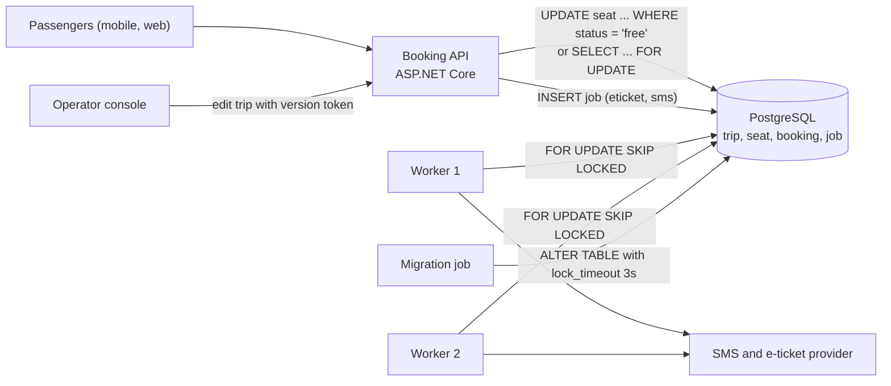
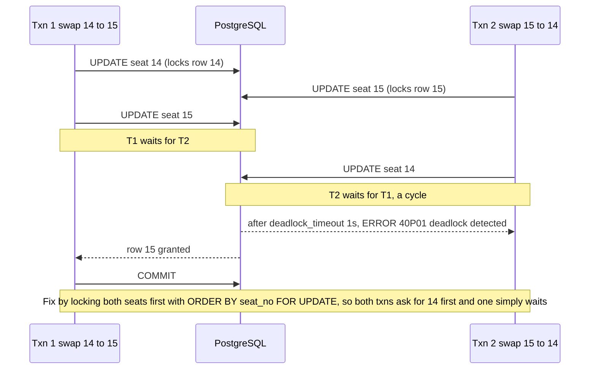
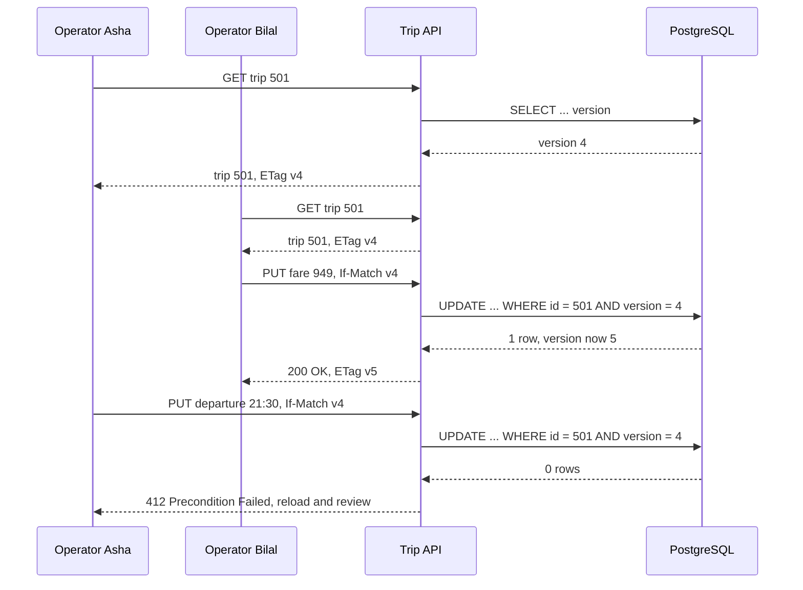

Concurrency bugs are the ones that pass every test on your laptop and appear the first busy morning in production: two passengers holding the same bus seat, a stock count that drifts by a few units a day, a nightly job that freezes at 2 am with "deadlock detected". All of them come from the same question: what happens when two transactions want the same row at the same time? This lesson gives you the tools PostgreSQL offers to answer it, and a way to choose between them.

## Learning objectives

By the end of this lesson you will be able to:

1. Explain the lost-update problem and why the default Read Committed level does not prevent it.
2. Use `SELECT ... FOR UPDATE`, `FOR NO KEY UPDATE`, `FOR SHARE`, `NOWAIT` and `lock_timeout` correctly, and read `pg_locks`.
3. Build a reliable work queue with `FOR UPDATE SKIP LOCKED`.
4. Implement optimistic concurrency with a version column or PostgreSQL's `xmin`, in SQL and in EF Core.
5. Explain how deadlocks form, how PostgreSQL detects them, and prevent them with consistent lock ordering.
6. Write a retry policy for serialization failures and deadlocks that retries the whole unit of work, safely.
7. Choose pessimistic or optimistic locking from the expected conflict rate, with numbers.

## Prerequisites

- [Transactions and ACID](#/lesson/m09-transactions-acid): `BEGIN`, `COMMIT`, MVCC, and why transactions must be short.
- [Isolation levels and anomalies](#/lesson/m09-isolation-levels): Read Committed versus Repeatable Read versus Serializable.
- Helpful: [Idempotency keys](#/lesson/m10-idempotency), because retries are only safe for idempotent operations.

## Explain it like I'm a beginner

An intercity bus operator sells seats online for the Pune–Goa night bus. Seat 14 is free. At 21:00:00.120, Ananya taps "Book 14". At 21:00:00.135, Rahul taps "Book 14". Both requests read the seat row, both see `status = 'free'`, both write `status = 'booked'` with their own name, and both get a confirmation SMS. One of them will have a very bad night. This is the **lost update** problem: the second write silently overwrites the first.

There are two broad ways to stop it.

**Pessimistic locking** is like the paper register at a ticket counter. The clerk puts a finger on line 14 while writing. Anyone else who wants line 14 has to wait until the finger lifts. In SQL: `SELECT ... FOR UPDATE` puts the finger on the row; others wait until you commit.

**Optimistic locking** is like editing a shared document that shows "version 7" at the top. You make your changes and press save. If someone else saved version 8 in the meantime, the system refuses your save and says "the document changed, please reload". In SQL: `UPDATE ... WHERE id = 14 AND version = 7`; if zero rows change, someone beat you.

Pessimistic locking makes people **wait**. Optimistic locking makes people **retry**. Which is better depends on how often they collide.

Locking also introduces a new failure: the **deadlock**. Ananya's request locks seat 14 then wants seat 15; Rahul's request locks seat 15 then wants seat 14. Each waits for the other, forever, like two cars nose to nose on a one-lane hill road. PostgreSQL notices after about a second and cancels one of them. Your code must be ready for that.

## First-principles explanation

### Why Read Committed allows lost updates

Under Read Committed (PostgreSQL's default), each statement sees data committed before *that statement* started. A typical "read, decide, write" in application code is three separate steps:

1. `SELECT status FROM seat WHERE trip_id = 501 AND seat_no = 14;` → `free`
2. C# decides: free, so book it.
3. `UPDATE seat SET status = 'booked', passenger = 'Ananya' WHERE trip_id = 501 AND seat_no = 14;`

Two requests interleave 1, 1, 3, 3. The second `UPDATE` waits for the first to commit (writers block writers on the same row), then re-checks its `WHERE` clause against the new row version. The `WHERE` clause only checks the seat number, which still matches, so it overwrites Ananya with Rahul. No error, no warning.

Four fixes exist, from simplest to most general:

1. **Make it one atomic statement**: `UPDATE seat SET status = 'booked', passenger = $1 WHERE trip_id = 501 AND seat_no = 14 AND status = 'free'`, then check the affected-row count. The re-check after waiting now fails for the second request, which gets 0 rows. This solves most cases and needs no explicit lock.
2. **Pessimistic lock**: `SELECT ... FOR UPDATE` in step 1, so the second reader waits at step 1 and then sees `booked`.
3. **Optimistic version check**: `UPDATE ... WHERE ... AND version = $read_version`, then check the row count.
4. **Serializable isolation**: PostgreSQL detects the dangerous pattern and aborts one transaction with SQLSTATE `40001`; you retry.

### Row-level locks

PostgreSQL has four row lock strengths. You will mostly use the first:

| Lock | Taken by | Blocks |
|---|---|---|
| `FOR UPDATE` | `SELECT ... FOR UPDATE`, `DELETE`, an `UPDATE` that changes a key column | all other row locks and writes on that row |
| `FOR NO KEY UPDATE` | ordinary `UPDATE` of non-key columns | `FOR UPDATE`, other `NO KEY UPDATE`, `FOR SHARE` |
| `FOR SHARE` | `SELECT ... FOR SHARE` | writers, but not other sharers |
| `FOR KEY SHARE` | foreign-key checks on the referenced (parent) row | only `FOR UPDATE` (deleting or re-keying the parent) |

`FOR KEY SHARE` is why inserting a booking that references `trip 501` does not block an `UPDATE trip SET fare = ...`: the foreign-key check only needs the trip's *key* to stay put. If you lock the trip with `FOR UPDATE` when `FOR NO KEY UPDATE` would do, you block those inserts for nothing.

Row locks are not kept in a big lock table in memory. PostgreSQL writes the locking transaction's id into the row's header (`xmax`). A waiter waits on that *transaction* to finish, which is why `pg_locks` shows waiting sessions with `locktype = 'transactionid'`. Consequences: you can lock millions of rows without running out of lock memory, but each lock is a write to the row's page.

Readers are never blocked by row locks. A plain `SELECT` does not wait for `FOR UPDATE`; it reads the last committed version (MVCC).

### Waiting less: NOWAIT, lock_timeout and SKIP LOCKED

- `FOR UPDATE NOWAIT` fails immediately with SQLSTATE `55P03` (`lock_not_available`) instead of waiting. Good for "this seat is being booked by someone else, pick another" UX.
- `SET LOCAL lock_timeout = '2s'` caps any lock wait in the transaction, for row locks and table locks alike.
- `FOR UPDATE SKIP LOCKED` silently skips rows another transaction has locked. Useless for "book seat 14", perfect for **work queues**: ten workers each run "give me the next 5 pending jobs", and each gets different jobs without waiting on each other.

```sql
WITH next AS (
  SELECT id FROM job
  WHERE status = 'pending' AND run_after <= now()
  ORDER BY priority DESC, id
  LIMIT 5
  FOR UPDATE SKIP LOCKED)
UPDATE job j SET status = 'processing', locked_by = 'worker-3', attempts = j.attempts + 1
FROM next WHERE j.id = next.id
RETURNING j.id, j.kind, j.payload;
```

A worker that crashes mid-job leaves rows in `processing`. Either claim and process in one transaction (the lock disappears with the connection, and the job returns to `pending` on rollback), or record `locked_at` and have a sweeper reset stale claims after a timeout.

### Table-level locks and the DDL trap

Every statement also takes a table-level lock. `SELECT` takes `ACCESS SHARE`; `INSERT`, `UPDATE`, `DELETE` take `ROW EXCLUSIVE`. These do not conflict with each other. The dangerous one is `ACCESS EXCLUSIVE`, taken by most `ALTER TABLE` forms, `DROP`, `TRUNCATE`, and a plain `CREATE INDEX` takes `SHARE`, which blocks writes.

The trap: `ALTER TABLE seat ADD COLUMN ...` arrives while a 40-second report holds `ACCESS SHARE`. The `ALTER` waits. Every new query on `seat`, even a simple `SELECT`, queues *behind the waiting `ALTER`*, because locks are granted in order. The booking API stops for 40 seconds. Always run DDL with `SET lock_timeout = '3s'` and retry, so the migration gives up instead of freezing the site. See [Migrations and schema evolution](#/lesson/m09-migrations-evolution).

### Advisory locks

`pg_advisory_xact_lock(key)` locks an arbitrary 64-bit number until the transaction ends; `pg_try_advisory_xact_lock(key)` returns `false` instead of waiting. They are useful for "only one instance of the nightly settlement job may run" or "serialize all bookings for trip 501" without locking a real row. PostgreSQL does not know what the number means, so every code path must agree on the key scheme. Prefer the `_xact_` forms: session-level advisory locks survive a returned pooled connection and are easy to leak.

### Optimistic concurrency: version columns and xmin

Pessimistic locks only work *inside* one transaction. A web form is different: the operator opens "edit trip 501" at 10:00, reads it, thinks, and submits at 10:04. You must not hold a transaction open for four minutes. Instead, carry a **concurrency token** through the round trip:

```sql
-- 10:00 read
SELECT id, departure, fare, version FROM trip WHERE id = 501;          -- version = 4
-- 10:04 write
UPDATE trip SET departure = '2026-11-02 21:30+05:30', fare = 949, version = version + 1
WHERE id = 501 AND version = 4;                                          -- 1 row: success, 0 rows: conflict
```

If another operator saved in between, `version` is 5 and the update matches 0 rows. The application reloads, shows what changed, and lets the operator decide. Never "just retry" an optimistic conflict on human-entered data: you would overwrite the other person's change, which is exactly the lost update you were preventing.

PostgreSQL also offers a built-in token: the system column **`xmin`**, the id of the transaction that wrote the current row version. It changes on every update, whoever made it, and costs no storage. The Npgsql EF Core provider maps a `uint` property marked `IsRowVersion()` to `xmin`. Caveats: it is a 32-bit internal value, so treat it as opaque and only compare for equality; it changes on *any* update to the row, including ones from code paths you did not intend to conflict with. A real `version` column is explicit, portable and visible in your API (an `ETag`), which is often worth the 4 bytes.

### How deadlocks form and how PostgreSQL resolves them

A deadlock needs a cycle of waits: T1 holds A and waits for B; T2 holds B and waits for A. Typical real causes:

- Two transactions updating the same rows in different orders (seat swap 14↔15 and 15↔14; transferring stock between two depots in opposite directions).
- A batch job updating rows in physical order while the API updates them in id order.
- Foreign keys plus `FOR UPDATE` on parents and children in different orders.

PostgreSQL does not check for deadlocks on every wait (that would be expensive). When a transaction has waited `deadlock_timeout` (default 1 s), it builds the wait-for graph. If it finds a cycle, it aborts the transaction that ran the check with SQLSTATE `40P01` (`deadlock_detected`) and logs both statements. The other transaction proceeds. So every deadlock costs at least 1 second of waiting, plus a failed request unless you retry.

Prevention, in order of effectiveness:

1. **Lock in a consistent order.** Sort ids before locking: `SELECT ... WHERE seat_no IN (14, 15) ORDER BY seat_no FOR UPDATE`. If everyone takes locks in the same order, a cycle is impossible.
2. **Lock everything you need up front**, in one statement, rather than one row now and another later.
3. **Keep transactions short.** The probability of a deadlock grows with the time locks are held.
4. **Use the weakest lock that works** (`FOR NO KEY UPDATE` rather than `FOR UPDATE`).
5. **Retry** the losing transaction, because some deadlocks (from foreign keys, indexes, or third-party code) are hard to rule out completely.

### Retrying correctly

Some errors mean "nothing was changed, try the whole thing again":

| SQLSTATE | Name | Retry? |
|---|---|---|
| `40001` | `serialization_failure` | yes, whole transaction |
| `40P01` | `deadlock_detected` | yes, whole transaction |
| `55P03` | `lock_not_available` (NOWAIT, lock_timeout) | maybe, or report "busy" |
| `23505` | `unique_violation` | no, it is a business answer ("seat already booked") |

Rules: retry the **entire unit of work** from `BEGIN`, re-reading data, never just the failed statement (the transaction is already aborted). Cap attempts (3 to 5). Back off exponentially with jitter (for example 20 ms, 40 ms, 80 ms, each randomised) so the colliding transactions do not collide again in lockstep. Make the operation idempotent, because a timeout *after* `COMMIT` reached the server means you do not know whether it committed. And never call external services inside the retried block. See [Timeouts, retries and backoff with jitter](#/lesson/m10-timeouts-retries).

### Choosing with numbers

Let *p* be the probability that an attempt conflicts.

- **Optimistic**: expected attempts ≈ 1 / (1 − *p*). At *p* = 0.05 that is 1.05 attempts: almost free. At *p* = 0.5 it is 2 attempts, and at *p* = 0.9 it is 10, with lots of wasted work.
- **Pessimistic**: no wasted work, but every conflicting request waits for the holder's lock time. If a booking holds the seat row for 6 ms, one hot row can serve at most about 1 ÷ 0.006 ≈ 160 bookings per second, serially.

Seat booking for a normal trip: thousands of seats, low *p*, either works; the atomic conditional `UPDATE` is simplest. A flash sale with 50,000 users and 200 seats in 60 seconds: *p* close to 1 on the hot rows, so optimistic retries become a storm. Use a pessimistic or queue-based design, or pre-allocate inventory into many rows so contention spreads out (200 seat rows rather than one `seats_left` counter).

## Visual explanation

### Where locks appear in the booking system



Each arrow into the database uses a different concurrency tool. Passenger bookings use a conditional update or a short row lock because the conflict is on one seat and must be decided now. The operator console uses an optimistic version token because a human's edit spans minutes. Workers claim jobs with `SKIP LOCKED` so they never wait on each other, and talk to the SMS provider *after* the claim transaction, never inside it. The migration job sets a lock timeout so a long report cannot turn its `ALTER TABLE` into a site-wide queue.

### A deadlock, and how consistent ordering avoids it



Reading top to bottom: each transaction takes its first lock without trouble. The cycle forms when each asks for the row the other holds. Neither can proceed, so after one second PostgreSQL's deadlock check runs in one of the waiting backends, finds the cycle, and aborts that transaction (here T2). T1 then gets row 15 and commits. If both transactions had locked `seat_no IN (14, 15) ORDER BY seat_no` first, T2 would have waited at seat 14 behind T1 and then run normally: a short wait instead of a failure.

### Optimistic edit with a conflict



Both operators read version 4. Bilal saves first, which moves the row to version 5. Asha's update still says `version = 4`, matches nothing, and the API returns `412 Precondition Failed` (or `409 Conflict`). No lock was held during the minutes each operator spent editing, and nobody's change was silently lost. Asha's client reloads, shows Bilal's new fare next to her new departure time, and she resubmits with `If-Match v5`.

## Step-by-step example

The playground is a single database connection, so it cannot show two sessions blocking each other. Run the "two sessions" parts in two `psql` windows against a local PostgreSQL 17 if you want to see waits and deadlocks live; the playground covers everything else.

### Step 1 — reproduce the lost update (two psql sessions)

```sql
-- Session A                                   -- Session B
BEGIN;                                         BEGIN;
SELECT status FROM seat
 WHERE trip_id = 501 AND seat_no = 14;  -- free
                                               SELECT status FROM seat
                                                WHERE trip_id = 501 AND seat_no = 14;  -- free
UPDATE seat SET status = 'booked', passenger = 'Ananya'
 WHERE trip_id = 501 AND seat_no = 14;
                                               UPDATE seat SET status = 'booked', passenger = 'Rahul'
                                                WHERE trip_id = 501 AND seat_no = 14;  -- waits...
COMMIT;
                                               -- ...proceeds, overwrites Ananya
                                               COMMIT;
```

### Step 2 — fix it with one conditional statement

```sql
UPDATE seat SET status = 'booked', passenger = 'Rahul', booked_at = now()
WHERE trip_id = 501 AND seat_no = 14 AND status = 'free';
-- UPDATE 0  -> tell Rahul the seat has gone
```

### Step 3 — or with an explicit row lock, when you need to read before deciding

```sql
BEGIN;
SELECT seat_no, status, fare_band FROM seat
WHERE trip_id = 501 AND seat_no IN (14, 15)
ORDER BY seat_no
FOR NO KEY UPDATE;                     -- consistent order, weakest sufficient lock
-- C#: check both free, compute fare for the pair, apply a group discount...
UPDATE seat SET status = 'booked', passenger = 'Ananya' WHERE trip_id = 501 AND seat_no IN (14, 15);
COMMIT;
```

In the playground, run the `SELECT ... FOR NO KEY UPDATE` inside `BEGIN`, then `SELECT locktype, mode, granted FROM pg_locks WHERE pid = pg_backend_pid();` to see your own locks, then `ROLLBACK`.

### Step 4 — optimistic edit

```sql
UPDATE trip SET fare = 949, version = version + 1
WHERE id = 501 AND version = 4
RETURNING id, fare, version;            -- one row: you won
UPDATE trip SET departure = departure + interval '30 minutes', version = version + 1
WHERE id = 501 AND version = 4
RETURNING id, version;                  -- zero rows: stale, reload
```

Also try `SELECT xmin, * FROM trip WHERE id = 501;` before and after an update, and watch `xmin` change.

### Step 5 — a job queue with SKIP LOCKED

Run the claim query from the first-principles section with `worker-1`, then again with `worker-2`. In one session the first claim has already committed, so the second just takes the next jobs. In two real sessions with both claims inside open transactions, the second claim skips the first worker's locked rows instead of waiting.

### Step 6 — see a deadlock (two psql sessions)

```sql
-- A: BEGIN; UPDATE seat SET held_by = 'A' WHERE trip_id = 501 AND seat_no = 14;
-- B: BEGIN; UPDATE seat SET held_by = 'B' WHERE trip_id = 501 AND seat_no = 15;
-- A: UPDATE seat SET held_by = 'A' WHERE trip_id = 501 AND seat_no = 15;   -- waits
-- B: UPDATE seat SET held_by = 'B' WHERE trip_id = 501 AND seat_no = 14;   -- after ~1 s:
--    ERROR: deadlock detected  DETAIL: Process 4121 waits for ShareLock on transaction 9811; blocked by process 4120 ...
```

## Production-style C# implementation

The compilable code below models the three tools behind interfaces, with in-memory implementations that behave like PostgreSQL for the purpose of tests:

- `ISeatInventory.TryBookAsync`: the atomic conditional update.
- `TripEditor`: optimistic concurrency with a version token, surfaced as an HTTP `ETag`.
- `JobQueue`: `SKIP LOCKED`-style claiming.
- `TransientRetry`: retries a whole unit of work on `40001` and `40P01` with capped exponential backoff and jitter.

```text
Bus.Api/
  Program.cs
  Booking/Errors.cs
  Booking/SeatInventory.cs
  Booking/TripEditor.cs
  Booking/JobQueue.cs
  Booking/TransientRetry.cs
```

```csharp file=Booking/Errors.cs
namespace Bus.Booking;

/// <summary>Stand-in for Npgsql's PostgresException: carries the SQLSTATE that decides what to do.</summary>
public sealed class DbStateException(string sqlState, string message) : Exception(message)
{
    public string SqlState { get; } = sqlState;

    public const string SerializationFailure = "40001";
    public const string DeadlockDetected = "40P01";
    public const string LockNotAvailable = "55P03";
    public const string UniqueViolation = "23505";

    public bool IsRetryable => SqlState is SerializationFailure or DeadlockDetected;
}

/// <summary>Optimistic concurrency conflict: the row's version moved since it was read.</summary>
public sealed class ConcurrencyConflictException(long id, long expected, long actual)
    : Exception($"Row {id} is at version {actual}, expected {expected}.")
{
    public long Id { get; } = id;
    public long ExpectedVersion { get; } = expected;
    public long ActualVersion { get; } = actual;
}
```

```csharp file=Booking/SeatInventory.cs
using System.Collections.Concurrent;

namespace Bus.Booking;

public enum BookOutcome { Booked, AlreadyTaken, NoSuchSeat }

public interface ISeatInventory
{
    /// <summary>UPDATE seat SET status = 'booked', passenger = @p WHERE trip_id = @t AND seat_no = @s AND status = 'free'</summary>
    Task<BookOutcome> TryBookAsync(int tripId, int seatNo, string passenger, CancellationToken ct = default);

    /// <summary>Books several seats atomically, locking them in seat order to avoid deadlocks.</summary>
    Task<BookOutcome> TryBookManyAsync(int tripId, IReadOnlyCollection<int> seatNos, string passenger, CancellationToken ct = default);

    string? PassengerOf(int tripId, int seatNo);
}

public sealed class InMemorySeatInventory : ISeatInventory
{
    private readonly ConcurrentDictionary<(int Trip, int Seat), string?> _seats = new();
    private readonly Dictionary<(int Trip, int Seat), object> _rowLocks = new();

    public InMemorySeatInventory AddTrip(int tripId, int seats)
    {
        for (var s = 1; s <= seats; s++) { _seats[(tripId, s)] = null; _rowLocks[(tripId, s)] = new object(); }
        return this;
    }

    public Task<BookOutcome> TryBookAsync(int tripId, int seatNo, string passenger, CancellationToken ct = default) =>
        TryBookManyAsync(tripId, new[] { seatNo }, passenger, ct);

    public Task<BookOutcome> TryBookManyAsync(int tripId, IReadOnlyCollection<int> seatNos, string passenger, CancellationToken ct = default)
    {
        // Consistent lock order: every caller locks seats in ascending order, so no wait cycle can form.
        var ordered = seatNos.Distinct().Order().ToArray();
        if (ordered.Any(s => !_rowLocks.ContainsKey((tripId, s)))) return Task.FromResult(BookOutcome.NoSuchSeat);
        return Task.FromResult(LockAndBook(tripId, ordered, 0, passenger));
    }

    private BookOutcome LockAndBook(int tripId, int[] ordered, int i, string passenger)
    {
        if (i == ordered.Length)
        {
            // All rows locked: the re-check after locking is what prevents the lost update.
            if (ordered.Any(s => _seats[(tripId, s)] is not null)) return BookOutcome.AlreadyTaken;
            foreach (var s in ordered) _seats[(tripId, s)] = passenger;
            return BookOutcome.Booked;
        }
        lock (_rowLocks[(tripId, ordered[i])]) return LockAndBook(tripId, ordered, i + 1, passenger);
    }

    public string? PassengerOf(int tripId, int seatNo)
    {
        lock (_rowLocks[(tripId, seatNo)]) return _seats[(tripId, seatNo)];
    }
}
```

```csharp file=Booking/TripEditor.cs
namespace Bus.Booking;

public sealed record Trip(int Id, string Route, DateTimeOffset Departure, decimal Fare, long Version);

public interface ITripStore
{
    Task<Trip?> GetAsync(int id, CancellationToken ct = default);

    /// <summary>UPDATE trip SET ..., version = version + 1 WHERE id = @id AND version = @expected. Returns the new row, or null on conflict.</summary>
    Task<Trip?> TryUpdateAsync(Trip changed, long expectedVersion, CancellationToken ct = default);
}

public sealed class InMemoryTripStore : ITripStore
{
    private readonly object _gate = new();
    private readonly Dictionary<int, Trip> _rows = new();

    public InMemoryTripStore Add(Trip t) { lock (_gate) _rows[t.Id] = t; return this; }

    public Task<Trip?> GetAsync(int id, CancellationToken ct = default)
    {
        lock (_gate) return Task.FromResult(_rows.GetValueOrDefault(id));
    }

    public Task<Trip?> TryUpdateAsync(Trip changed, long expectedVersion, CancellationToken ct = default)
    {
        lock (_gate)   // one atomic compare-and-set, like a single UPDATE statement
        {
            if (!_rows.TryGetValue(changed.Id, out var current) || current.Version != expectedVersion)
                return Task.FromResult<Trip?>(null);
            var next = changed with { Version = current.Version + 1 };
            _rows[changed.Id] = next;
            return Task.FromResult<Trip?>(next);
        }
    }
}

public sealed class TripEditor(ITripStore store)
{
    public static string ETagFor(Trip t) => $"\"v{t.Version}\"";

    public static bool TryParseETag(string? etag, out long version)
    {
        version = 0;
        return etag is { Length: > 3 } && etag.StartsWith("\"v") && etag.EndsWith('"')
            && long.TryParse(etag.AsSpan(2, etag.Length - 3), out version);
    }

    /// <summary>Applies a human edit. Never retries automatically: a conflict must go back to the person.</summary>
    public async Task<Trip> UpdateFareAsync(int id, decimal newFare, long expectedVersion, CancellationToken ct = default)
    {
        if (newFare <= 0) throw new ArgumentOutOfRangeException(nameof(newFare));
        var current = await store.GetAsync(id, ct) ?? throw new KeyNotFoundException($"trip {id}");
        var updated = await store.TryUpdateAsync(current with { Fare = newFare }, expectedVersion, ct);
        if (updated is null)
        {
            var now = await store.GetAsync(id, ct);
            throw new ConcurrencyConflictException(id, expectedVersion, now?.Version ?? -1);
        }
        return updated;
    }
}
```

```csharp file=Booking/JobQueue.cs
namespace Bus.Booking;

public enum JobStatus { Pending, Processing, Done, Failed }

public sealed record Job(long Id, string Kind, int Priority, DateTimeOffset RunAfter, JobStatus Status, int Attempts, string? LockedBy);

public interface IJobQueue
{
    /// <summary>
    /// SELECT ... WHERE status = 'pending' AND run_after &lt;= now ORDER BY priority DESC, id LIMIT n FOR UPDATE SKIP LOCKED,
    /// then mark the claimed rows processing. Concurrent callers never receive the same job and never wait on each other.
    /// </summary>
    IReadOnlyList<Job> Claim(string worker, int max, DateTimeOffset now);
    void Complete(long id);
    void Fail(long id, TimeSpan retryAfter, DateTimeOffset now, int maxAttempts);
}

public sealed class InMemoryJobQueue : IJobQueue
{
    private readonly object _gate = new();
    private readonly Dictionary<long, Job> _jobs = new();

    public void Enqueue(Job job) { lock (_gate) _jobs[job.Id] = job; }

    public Job Get(long id) { lock (_gate) return _jobs[id]; }

    public IReadOnlyList<Job> Claim(string worker, int max, DateTimeOffset now)
    {
        lock (_gate)
        {
            var claimed = _jobs.Values
                .Where(j => j.Status == JobStatus.Pending && j.RunAfter <= now)
                .OrderByDescending(j => j.Priority).ThenBy(j => j.Id)
                .Take(max)
                .Select(j => j with { Status = JobStatus.Processing, LockedBy = worker, Attempts = j.Attempts + 1 })
                .ToList();
            foreach (var j in claimed) _jobs[j.Id] = j;
            return claimed;
        }
    }

    public void Complete(long id)
    {
        lock (_gate) _jobs[id] = _jobs[id] with { Status = JobStatus.Done, LockedBy = null };
    }

    public void Fail(long id, TimeSpan retryAfter, DateTimeOffset now, int maxAttempts)
    {
        lock (_gate)
        {
            var j = _jobs[id];
            _jobs[id] = j.Attempts >= maxAttempts
                ? j with { Status = JobStatus.Failed, LockedBy = null }
                : j with { Status = JobStatus.Pending, LockedBy = null, RunAfter = now + retryAfter };
        }
    }
}
```

```csharp file=Booking/TransientRetry.cs
using Microsoft.Extensions.Logging;

namespace Bus.Booking;

public sealed record RetryOptions(int MaxAttempts = 4, int BaseDelayMs = 20, int MaxDelayMs = 500);

/// <summary>
/// Retries a WHOLE unit of work (open connection, BEGIN, all statements, COMMIT) on serialization failures
/// and deadlocks. The delegate must be idempotent and must not call external systems.
/// </summary>
public sealed class TransientRetry(RetryOptions options, ILogger<TransientRetry> log, Func<TimeSpan, CancellationToken, Task>? delay = null, Random? random = null)
{
    private readonly Func<TimeSpan, CancellationToken, Task> _delay = delay ?? Task.Delay;
    private readonly Random _random = random ?? Random.Shared;

    public async Task<T> ExecuteAsync<T>(Func<int, CancellationToken, Task<T>> unitOfWork, CancellationToken ct = default)
    {
        for (var attempt = 1; ; attempt++)
        {
            try
            {
                return await unitOfWork(attempt, ct);
            }
            catch (DbStateException ex) when (ex.IsRetryable && attempt < options.MaxAttempts)
            {
                var wait = BackoffFor(attempt);
                log.LogWarning("Attempt {Attempt} failed with {SqlState}, retrying in {Delay} ms", attempt, ex.SqlState, wait.TotalMilliseconds);
                await _delay(wait, ct);
            }
        }
    }

    /// <summary>Full jitter: a random delay between 0 and min(max, base x 2^(attempt-1)).</summary>
    public TimeSpan BackoffFor(int attempt)
    {
        var cap = Math.Min(options.MaxDelayMs, options.BaseDelayMs * (1 << Math.Min(attempt - 1, 20)));
        return TimeSpan.FromMilliseconds(_random.Next(0, cap + 1));
    }
}
```

```csharp file=Program.cs
using Bus.Booking;
using Microsoft.Extensions.Logging;

var builder = WebApplication.CreateBuilder(args);

builder.Services.AddSingleton<ISeatInventory>(new InMemorySeatInventory().AddTrip(501, 36));
builder.Services.AddSingleton<ITripStore>(new InMemoryTripStore()
    .Add(new Trip(501, "Pune - Goa", new DateTimeOffset(2026, 11, 2, 21, 0, 0, TimeSpan.FromHours(5.5)), 899m, 4)));
builder.Services.AddSingleton<IJobQueue, InMemoryJobQueue>();
builder.Services.AddSingleton(new RetryOptions());
builder.Services.AddSingleton(sp => new TransientRetry(sp.GetRequiredService<RetryOptions>(), sp.GetRequiredService<ILogger<TransientRetry>>()));
builder.Services.AddScoped<TripEditor>();

var app = builder.Build();

app.MapPost("/trips/{tripId:int}/seats/book", async (int tripId, BookRequest req, ISeatInventory seats, TransientRetry retry, CancellationToken ct) =>
{
    var outcome = await retry.ExecuteAsync((_, token) => seats.TryBookManyAsync(tripId, req.SeatNos, req.Passenger, token), ct);
    return outcome switch
    {
        BookOutcome.Booked => Results.Ok(),
        BookOutcome.AlreadyTaken => Results.Conflict(new { message = "One or more seats were just booked by someone else." }),
        _ => Results.NotFound(),
    };
});

app.MapGet("/trips/{id:int}", async (int id, ITripStore store, HttpContext http, CancellationToken ct) =>
{
    var trip = await store.GetAsync(id, ct);
    if (trip is null) return Results.NotFound();
    http.Response.Headers.ETag = TripEditor.ETagFor(trip);
    return Results.Ok(trip);
});

app.MapPut("/trips/{id:int}/fare", async (int id, FareRequest req, HttpContext http, TripEditor editor, CancellationToken ct) =>
{
    if (!TripEditor.TryParseETag(http.Request.Headers.IfMatch, out var expected))
        return Results.StatusCode(StatusCodes.Status428PreconditionRequired);
    try
    {
        var updated = await editor.UpdateFareAsync(id, req.Fare, expected, ct);
        http.Response.Headers.ETag = TripEditor.ETagFor(updated);
        return Results.Ok(updated);
    }
    catch (ConcurrencyConflictException)
    {
        return Results.StatusCode(StatusCodes.Status412PreconditionFailed);
    }
});

app.Run();

public sealed record BookRequest(int[] SeatNos, string Passenger);
public sealed record FareRequest(decimal Fare);
```

### The same tools with Npgsql and EF Core

```csharp
// Not compiled by the course checker: requires Npgsql.
// Pessimistic: lock several seats in a consistent order, re-check, then write.
await using var tx = await conn.BeginTransactionAsync(ct);
await using (var lockCmd = new NpgsqlCommand("""
    SELECT seat_no, status FROM seat
    WHERE trip_id = @trip AND seat_no = ANY(@seats)
    ORDER BY seat_no
    FOR NO KEY UPDATE
    """, conn, tx))
{
    lockCmd.Parameters.AddWithValue("trip", tripId);
    lockCmd.Parameters.AddWithValue("seats", seatNos);
    // read rows, verify all are free ...
}
// UPDATE ..., then:
await tx.CommitAsync(ct);

// Retry filter on the real exception type
catch (PostgresException ex) when (ex.SqlState is PostgresErrorCodes.SerializationFailure or PostgresErrorCodes.DeadlockDetected)
{
    // retry the whole unit of work
}
```

```csharp
// Not compiled by the course checker: requires EF Core and Npgsql.EntityFrameworkCore.PostgreSQL.
public class TripRow
{
    public int Id { get; set; }
    public decimal Fare { get; set; }
    public uint Version { get; set; }          // mapped to the xmin system column
}

modelBuilder.Entity<TripRow>().Property(t => t.Version).IsRowVersion();

try
{
    trip.Fare = 949m;
    db.Entry(trip).Property(t => t.Version).OriginalValue = versionFromIfMatchHeader;
    await db.SaveChangesAsync(ct);             // UPDATE ... WHERE id = @id AND xmin = @version
}
catch (DbUpdateConcurrencyException)
{
    return Results.StatusCode(StatusCodes.Status412PreconditionFailed);
}
```

Setting `OriginalValue` from the client's `If-Match` header matters: without it, EF compares against the version it read *in this request*, which is always current, and the check never fires for the stale client. For an explicit `version` column instead of `xmin`, mark an `int` property with `.IsConcurrencyToken()` and increment it yourself.

:::callout type=warning title="Never hold a row lock across a network call"
`SELECT ... FOR UPDATE`, then a 700 ms call to the payment gateway, then `COMMIT`: every other booking for that seat (and anything waiting behind them) queues for 700 ms, and a slow gateway day turns into a pile-up of blocked connections and pool exhaustion. Hold the seat with a status and an expiry (`status = 'held', hold_until = now() + interval '10 minutes'`) in one short transaction, call the gateway outside any transaction, then confirm in a second short transaction.
:::

## Bad design vs good design

**Bad: check in C#, write later, retry everything.**

```csharp
// Anti-pattern
var seat = await db.Seats.SingleAsync(s => s.TripId == 501 && s.SeatNo == 14);
if (seat.Status != "free") return Results.Conflict();
await paymentGateway.ChargeAsync(passenger, fare);        // 700 ms, no lock, no transaction
seat.Status = "booked"; seat.Passenger = passenger;
await db.SaveChangesAsync();                               // lost update: last writer wins
// and somewhere else:
catch (Exception) { /* retry the whole HTTP handler 3 times */ }   // charges the card 3 times
```

Problems: the check and the write are separated by 700 ms, so concurrent requests both pass; nothing detects the overwrite; the blanket retry repeats the payment.

**Good: decide in the database, hold briefly, retry only what is safe.**

1. One short transaction: `UPDATE seat SET status = 'held', held_by = @booking, hold_until = now() + interval '10 minutes' WHERE ... AND status = 'free'` and check the row count.
2. Call the payment gateway outside any transaction with an idempotency key equal to the booking id.
3. One short transaction: `UPDATE seat SET status = 'booked' WHERE ... AND held_by = @booking AND status = 'held'`, insert the e-ticket job.
4. Retry steps 1 and 3 on `40001`/`40P01` only; the gateway call is protected by its idempotency key, not by retries.
5. A sweeper releases expired holds with `UPDATE ... WHERE status = 'held' AND hold_until < now()`.

**When is all this unnecessary?** A back-office table edited by one person a day needs no version column. A counter where small inaccuracy is fine (page views) should use `UPDATE ... SET n = n + 1` and nothing more. Reach for explicit locks only when a decision depends on what you read.

:::callout type=tradeoff title="Pessimistic waits, optimistic retries"
Pessimistic locking wastes no work but serializes access and can deadlock. Optimistic locking never blocks and never deadlocks, but wastes work on conflict and needs a user-facing conflict path. Low conflict rate and human think time: optimistic. High conflict rate on a hot row within one request: pessimistic, a single atomic statement, or a queue.
:::

## Practical playground

The playground has trips, seats, bookings and a job queue. It is one connection, so it cannot block; use it to learn the statements and inspect locks.

1. Book seat 14 with the conditional `UPDATE` from Step 2. Run it twice; the second returns `UPDATE 0`.
2. Inside `BEGIN ... ROLLBACK`, lock seats 14 and 15 with `FOR NO KEY UPDATE` and query `pg_locks` for your own `pid`.
3. Apply the two optimistic updates from Step 4 and observe which one returns a row.
4. Compare `xmin` before and after an update.
5. Claim jobs with `SKIP LOCKED` as `worker-1`, then as `worker-2`, and check `status`, `attempts` and `locked_by`.
6. Try `SELECT pg_try_advisory_xact_lock(501);` inside a transaction.

:::playground type=sql title="Bus booking: locks, versions and a job queue"
```sql
CREATE TABLE trip (
  id        int PRIMARY KEY,
  route     text NOT NULL,
  departure timestamptz NOT NULL,
  fare      numeric(8,2) NOT NULL CHECK (fare > 0),
  version   int NOT NULL DEFAULT 1
);
CREATE TABLE seat (
  trip_id    int NOT NULL REFERENCES trip,
  seat_no    int NOT NULL,
  fare_band  text NOT NULL,
  status     text NOT NULL DEFAULT 'free' CHECK (status IN ('free','held','booked')),
  passenger  text,
  held_by    text,
  hold_until timestamptz,
  booked_at  timestamptz,
  PRIMARY KEY (trip_id, seat_no)
);
CREATE TABLE job (
  id        bigint PRIMARY KEY,
  kind      text NOT NULL,
  priority  int  NOT NULL,
  status    text NOT NULL DEFAULT 'pending' CHECK (status IN ('pending','processing','done','failed')),
  run_after timestamptz NOT NULL,
  attempts  int  NOT NULL DEFAULT 0,
  locked_by text,
  payload   jsonb NOT NULL DEFAULT '{}'
);
INSERT INTO trip VALUES
 (501, 'Pune - Goa',          '2026-11-02 21:00+05:30',  899.00, 4),
 (502, 'Bengaluru - Chennai', '2026-11-02 22:15+05:30',  749.00, 2),
 (503, 'Delhi - Jaipur',      '2026-11-03 06:30+05:30',  599.00, 7);
INSERT INTO seat (trip_id, seat_no, fare_band)
SELECT t.id, s, CASE WHEN s <= 6 THEN 'front' WHEN s % 4 IN (1, 0) THEN 'window' ELSE 'aisle' END
FROM trip t CROSS JOIN generate_series(1, 36) AS s;
UPDATE seat SET status = 'booked', passenger = 'Meera Iyer', booked_at = '2026-10-19 18:02+05:30'
WHERE trip_id = 501 AND seat_no IN (1, 2);
UPDATE seat SET status = 'held', held_by = 'BK-77120', hold_until = '2026-10-20 10:10+05:30'
WHERE trip_id = 501 AND seat_no = 9;
INSERT INTO job (id, kind, priority, status, run_after, attempts, locked_by, payload) VALUES
 (1, 'sms',     5, 'pending',    '2026-10-20 09:00+05:30', 0, NULL,       '{"to":"+9198xxxxxx01","booking":"BK-77101"}'),
 (2, 'eticket', 9, 'pending',    '2026-10-20 09:05+05:30', 0, NULL,       '{"booking":"BK-77102"}'),
 (3, 'sms',     9, 'processing', '2026-10-20 09:01+05:30', 1, 'worker-2', '{"booking":"BK-77103"}'),
 (4, 'refund',  7, 'pending',    '2026-10-20 09:10+05:30', 2, NULL,       '{"booking":"BK-77090"}'),
 (5, 'eticket', 9, 'pending',    '2026-10-20 11:00+05:30', 0, NULL,       '{"booking":"BK-77104"}'),
 (6, 'sms',     1, 'pending',    '2026-10-20 08:00+05:30', 0, NULL,       '{"booking":"BK-77080"}');
```
:::

## Exercises

:::exercise id=m09-locking-ex1 difficulty=beginner kind=sql ordered=true title="Apply only the non-stale operator edits"
Operators submitted fare edits from the console. Each row in `pending_edit` says which version of the trip the operator was looking at. Apply, in **one** data-modifying statement, every edit whose `expected_version` equals the trip's current `version`: set the new fare and increment the version. Return `edit_id`, `trip_id`, `new_fare` and `new_version` for the edits that were applied, ordered by `edit_id`. Stale edits must change nothing.
::acceptance
- A single `UPDATE ... FROM pending_edit` with the version check in the `WHERE` clause.
- `version` is incremented by exactly 1 for each applied edit.
- Stale edits (expected version lower than current) are not applied and not returned.
- Output columns exactly as specified, ordered by `edit_id`.
::hint
The optimistic check is just one more condition: `t.version = e.expected_version`.
::hint
`UPDATE trip t SET ... FROM pending_edit e WHERE t.id = e.trip_id AND ...` joins the edits to the trips.
::hint
`RETURNING` can mention columns of both `t` and `e`. Wrap the `UPDATE` in a CTE so you can `ORDER BY` the result.
::hint
```sql
WITH applied AS (
  UPDATE trip t SET fare = e.new_fare, version = t.version + 1
  FROM pending_edit e
  WHERE ...
  RETURNING e.edit_id, t.id AS trip_id, t.fare AS new_fare, t.version AS new_version)
SELECT * FROM applied ORDER BY edit_id;
```
::setup
```sql
CREATE TABLE trip (id int PRIMARY KEY, route text NOT NULL, fare numeric(8,2) NOT NULL, version int NOT NULL);
INSERT INTO trip VALUES
 (501, 'Pune - Goa', 899.00, 4), (502, 'Bengaluru - Chennai', 749.00, 3),
 (503, 'Delhi - Jaipur', 599.00, 7), (504, 'Hyderabad - Vijayawada', 650.00, 1),
 (505, 'Kolkata - Siliguri', 1250.00, 12);
CREATE TABLE pending_edit (edit_id int PRIMARY KEY, trip_id int NOT NULL REFERENCES trip,
                           expected_version int NOT NULL, new_fare numeric(8,2) NOT NULL, submitted_by text NOT NULL);
INSERT INTO pending_edit VALUES
 (1, 501, 4, 949.00,  'asha'),
 (2, 502, 2, 799.00,  'bilal'),
 (3, 503, 7, 629.00,  'chitra'),
 (4, 504, 1, 675.00,  'dev'),
 (5, 505, 11, 1199.00, 'esha');
```
::check
```sql
WITH applied AS (
  UPDATE trip t
  SET fare = e.new_fare, version = t.version + 1
  FROM pending_edit e
  WHERE t.id = e.trip_id AND t.version = e.expected_version
  RETURNING e.edit_id, t.id AS trip_id, t.fare AS new_fare, t.version AS new_version)
SELECT edit_id, trip_id, new_fare, new_version FROM applied ORDER BY edit_id;
```
::solution
```sql
WITH applied AS (
  UPDATE trip t
  SET fare = e.new_fare, version = t.version + 1
  FROM pending_edit e
  WHERE t.id = e.trip_id AND t.version = e.expected_version
  RETURNING e.edit_id, t.id AS trip_id, t.fare AS new_fare, t.version AS new_version)
SELECT edit_id, trip_id, new_fare, new_version FROM applied ORDER BY edit_id;
```
Edits 1, 3 and 4 apply; edits 2 and 5 were made against older versions (trip 502 is already at version 3, trip 505 at 12), so they match nothing. `RETURNING` shows the *new* row values, so `new_version` is the incremented one. In an API, each skipped edit becomes a `412 Precondition Failed` for that operator, who reloads and reviews. This exercise has at most one edit per trip on purpose: if two edits for the same trip both carried the current version, an `UPDATE ... FROM` would apply only one of them, and which one is not defined. Real APIs apply one edit per request, which avoids that.
::mistakes
- Checking the version in a separate `SELECT` first, which reintroduces the race the version column exists to prevent.
- Forgetting to increment `version`, so the next stale edit would still match.
- Returning `e.expected_version + 1` instead of the row's actual new version.
:::

:::exercise id=m09-locking-ex2 difficulty=beginner kind=code title="Optimistic concurrency with a version and a bounded retry"
Implement a compare-and-set store and a retry helper for *system* updates (not human edits), such as incrementing a trip's `seats_sold` counter from several workers.
::requirements
- `VersionedStore.TryUpdate(id, expectedVersion, newValue)` replaces the value and increments the version only if the stored version equals `expectedVersion`; it returns `true` on success.
- `VersionedStore.Read(id)` returns `(Value, Version)`.
- `OptimisticRetry.Update(store, id, transform, maxAttempts)` reads, applies `transform`, and tries to write; on conflict it re-reads and retries. It returns the number of attempts used, or throws `InvalidOperationException` after `maxAttempts` failed attempts.
::acceptance
- A stale `TryUpdate` returns `false` and changes nothing.
- A successful `TryUpdate` increments the version by 1.
- `Update` succeeds on the second attempt when one conflicting write happens between its read and its write.
- `Update` gives up after `maxAttempts` conflicts.
::hint
`TryUpdate` must check and write in one locked step, like a single SQL `UPDATE ... WHERE version = @v`.
::hint
`Update` is a loop: read (value, version), compute the new value, `TryUpdate`; stop on success.
::hint
To test the conflict path, the test injects an action that runs between read and write. Call `beforeWrite?.Invoke()` right before `TryUpdate`.
::hint
```csharp
for (var attempt = 1; attempt <= maxAttempts; attempt++)
{
    var (value, version) = store.Read(id);
    var next = transform(value);
    beforeWrite?.Invoke();
    if (store.TryUpdate(id, version, next)) return attempt;
}
throw new InvalidOperationException(...);
```
::starter
```csharp file=Optimistic.cs
using System;
using System.Collections.Generic;

public sealed class VersionedStore<T>
{
    private readonly object _gate = new();
    private readonly Dictionary<int, (T Value, long Version)> _rows = new();

    public void Insert(int id, T value) { lock (_gate) _rows[id] = (value, 1); }

    public (T Value, long Version) Read(int id) => throw new NotImplementedException();

    public bool TryUpdate(int id, long expectedVersion, T newValue) => throw new NotImplementedException();
}

public static class OptimisticRetry
{
    public static int Update<T>(VersionedStore<T> store, int id, Func<T, T> transform, int maxAttempts, Action? beforeWrite = null) =>
        throw new NotImplementedException();
}
```
::tests
```csharp file=OptimisticTests.cs
using System;
using Xunit;

public class OptimisticTests
{
    [Fact]
    public void Stale_update_is_rejected()
    {
        var s = new VersionedStore<int>();
        s.Insert(501, 10);
        Assert.True(s.TryUpdate(501, 1, 11));
        Assert.False(s.TryUpdate(501, 1, 99));
        Assert.Equal((11, 2L), s.Read(501));
    }

    [Fact]
    public void Succeeds_first_time_without_conflict()
    {
        var s = new VersionedStore<int>();
        s.Insert(501, 10);
        Assert.Equal(1, OptimisticRetry.Update(s, 501, v => v + 1, 3));
        Assert.Equal((11, 2L), s.Read(501));
    }

    [Fact]
    public void Retries_after_one_conflicting_write()
    {
        var s = new VersionedStore<int>();
        s.Insert(501, 10);
        var interfered = false;
        var attempts = OptimisticRetry.Update(s, 501, v => v + 1, 3, () =>
        {
            if (interfered) return;
            interfered = true;
            var (v, ver) = s.Read(501);
            s.TryUpdate(501, ver, v + 5);   // another worker sells 5 seats
        });
        Assert.Equal(2, attempts);
        Assert.Equal((16, 3L), s.Read(501));   // 10 + 5 + 1: nothing lost
    }

    [Fact]
    public void Gives_up_after_max_attempts()
    {
        var s = new VersionedStore<int>();
        s.Insert(501, 10);
        Assert.Throws<InvalidOperationException>(() =>
            OptimisticRetry.Update(s, 501, v => v + 1, 3, () =>
            {
                var (v, ver) = s.Read(501);
                s.TryUpdate(501, ver, v);   // always interferes
            }));
    }
}
```
::solution
```csharp file=Optimistic.cs
using System;
using System.Collections.Generic;

public sealed class VersionedStore<T>
{
    private readonly object _gate = new();
    private readonly Dictionary<int, (T Value, long Version)> _rows = new();

    public void Insert(int id, T value) { lock (_gate) _rows[id] = (value, 1); }

    public (T Value, long Version) Read(int id)
    {
        lock (_gate) return _rows[id];
    }

    public bool TryUpdate(int id, long expectedVersion, T newValue)
    {
        lock (_gate)   // check and write as one step: UPDATE ... WHERE id = @id AND version = @expected
        {
            if (!_rows.TryGetValue(id, out var row) || row.Version != expectedVersion) return false;
            _rows[id] = (newValue, row.Version + 1);
            return true;
        }
    }
}

public static class OptimisticRetry
{
    public static int Update<T>(VersionedStore<T> store, int id, Func<T, T> transform, int maxAttempts, Action? beforeWrite = null)
    {
        for (var attempt = 1; attempt <= maxAttempts; attempt++)
        {
            var (value, version) = store.Read(id);    // re-read on every attempt
            var next = transform(value);
            beforeWrite?.Invoke();
            if (store.TryUpdate(id, version, next)) return attempt;
        }
        throw new InvalidOperationException($"Gave up after {maxAttempts} conflicting attempts on row {id}.");
    }
}
```
The third test is the important one: the other worker's +5 survives because the retry re-reads before recomputing. Automatic retry is right here because the transform is a pure function of the current value (no human decision). For human edits, return the conflict instead. Under heavy contention on one row, this loop burns attempts; that is the signal to switch to an atomic `UPDATE ... SET n = n + 1` or a lock.
::mistakes
- Re-using the first read's value on retry, which turns the retry into a lost update.
- Checking the version and writing in two separate locked blocks.
- Retrying forever instead of capping attempts.
:::

:::exercise id=m09-locking-ex3 difficulty=intermediate kind=sql ordered=true title="Claim the next jobs with SKIP LOCKED"
Write the claim statement for `worker-1`. Treat the current time as `'2026-10-20 10:00+05:30'` (use the literal, not `now()`, so the result is reproducible). Claim up to **3** jobs that are `pending` and due (`run_after` at or before that time), highest `priority` first and then lowest `id`. Mark them `processing`, set `locked_by = 'worker-1'` and increment `attempts`. Return `id`, `kind`, `priority` and `attempts` of the claimed jobs, ordered by `id`.
::acceptance
- The selection uses `FOR UPDATE SKIP LOCKED` with `ORDER BY` and `LIMIT`.
- Jobs already `processing`, or due in the future, are not claimed.
- The claim and the status change happen in one statement.
- Output columns as specified, ordered by `id`.
::hint
Select the candidate ids in a CTE with `ORDER BY priority DESC, id LIMIT 3 FOR UPDATE SKIP LOCKED`.
::hint
Then `UPDATE job j ... FROM next WHERE j.id = next.id RETURNING ...`.
::hint
`RETURNING` order is not guaranteed; put the `UPDATE` in a second CTE and `ORDER BY id` in the final `SELECT`.
::setup
```sql
CREATE TABLE job (
  id bigint PRIMARY KEY, kind text NOT NULL, priority int NOT NULL,
  status text NOT NULL CHECK (status IN ('pending','processing','done','failed')),
  run_after timestamptz NOT NULL, attempts int NOT NULL DEFAULT 0, locked_by text
);
INSERT INTO job VALUES
 (1, 'sms',     5, 'pending',    '2026-10-20 09:00+05:30', 0, NULL),
 (2, 'eticket', 9, 'pending',    '2026-10-20 09:05+05:30', 0, NULL),
 (3, 'sms',     9, 'processing', '2026-10-20 09:01+05:30', 1, 'worker-2'),
 (4, 'refund',  7, 'pending',    '2026-10-20 09:10+05:30', 2, NULL),
 (5, 'eticket', 9, 'pending',    '2026-10-20 11:00+05:30', 0, NULL),
 (6, 'sms',     1, 'pending',    '2026-10-20 08:00+05:30', 0, NULL),
 (7, 'eticket', 7, 'pending',    '2026-10-20 09:59+05:30', 0, NULL),
 (8, 'refund',  9, 'done',       '2026-10-20 07:00+05:30', 1, NULL);
```
::check
```sql
WITH next AS (
  SELECT id FROM job
  WHERE status = 'pending' AND run_after <= '2026-10-20 10:00+05:30'
  ORDER BY priority DESC, id
  LIMIT 3
  FOR UPDATE SKIP LOCKED),
claimed AS (
  UPDATE job j
  SET status = 'processing', locked_by = 'worker-1', attempts = j.attempts + 1
  FROM next
  WHERE j.id = next.id
  RETURNING j.id, j.kind, j.priority, j.attempts)
SELECT id, kind, priority, attempts FROM claimed ORDER BY id;
```
::solution
```sql
WITH next AS (
  SELECT id FROM job
  WHERE status = 'pending' AND run_after <= '2026-10-20 10:00+05:30'
  ORDER BY priority DESC, id
  LIMIT 3
  FOR UPDATE SKIP LOCKED),
claimed AS (
  UPDATE job j
  SET status = 'processing', locked_by = 'worker-1', attempts = j.attempts + 1
  FROM next
  WHERE j.id = next.id
  RETURNING j.id, j.kind, j.priority, j.attempts)
SELECT id, kind, priority, attempts FROM claimed ORDER BY id;
```
The claimed jobs are 2 (priority 9), 4 and 7 (priority 7, lower id first). Job 3 is already being processed, job 5 is not due until 11:00, and job 8 is done. With ten workers running this concurrently, each worker's `SKIP LOCKED` passes over rows another worker has locked but not yet committed, so they never wait on each other and never claim the same job. Add a partial index `ON job (priority DESC, id) WHERE status = 'pending'` so the selection stays fast when the table holds millions of finished jobs.
::mistakes
- Using `FOR UPDATE` without `SKIP LOCKED`: correct, but workers queue behind each other on the same top rows.
- Selecting ids in one statement and updating in another without a lock: two workers claim the same job.
- Using `now()` here, which makes the result depend on when you run it.
- Forgetting `ORDER BY` inside the locked subquery, so priority is ignored.
:::

:::exercise id=m09-locking-ex4 difficulty=intermediate kind=code title="Detect a deadlock in a wait-for graph"
Model what PostgreSQL's deadlock detector does: keep a graph of "transaction A waits for transaction B" edges and find a cycle.
::requirements
- `AddWait(waiter, holder)` adds an edge. A transaction waits for at most one other at a time; a new `AddWait` for the same waiter replaces the old edge.
- `Release(tx)` removes the transaction's outgoing edge and every edge pointing to it (it committed or rolled back).
- `FindCycle(start)` follows edges from `start`. If it returns to `start`, return the cycle as a list beginning with `start` (for example `[7, 9, 12]`). Otherwise return an empty list. It must not loop forever on a cycle that does not include `start`.
::acceptance
- Two transactions waiting on each other form the cycle `[a, b]`.
- A three-way cycle is found from any of its members, starting with that member.
- A chain without a cycle returns an empty list.
- After `Release`, the cycle is gone.
::hint
Because each waiter has at most one outgoing edge, the graph is a set of chains. Store it as `Dictionary<int, int>` (waiter → holder).
::hint
Walk from `start`, recording visited transactions. Stop when you return to `start` (cycle), reach a transaction that waits for nobody (no cycle), or revisit a transaction other than `start` (a cycle not involving `start`).
::hint
`Release(tx)`: remove the key `tx`, and remove every key whose value is `tx`.
::hint
```csharp
var path = new List<int> { start };
var seen = new HashSet<int> { start };
var current = start;
while (_waitsFor.TryGetValue(current, out var next))
{
    if (next == start) return path;
    if (!seen.Add(next)) return new List<int>();
    path.Add(next); current = next;
}
return new List<int>();
```
::starter
```csharp file=WaitForGraph.cs
using System;
using System.Collections.Generic;
using System.Linq;

public sealed class WaitForGraph
{
    private readonly Dictionary<int, int> _waitsFor = new();

    public void AddWait(int waiter, int holder) => throw new NotImplementedException();

    public void Release(int tx) => throw new NotImplementedException();

    public List<int> FindCycle(int start) => throw new NotImplementedException();
}
```
::tests
```csharp file=WaitForGraphTests.cs
using System.Collections.Generic;
using Xunit;

public class WaitForGraphTests
{
    [Fact]
    public void Two_way_deadlock()
    {
        var g = new WaitForGraph();
        g.AddWait(101, 102);
        g.AddWait(102, 101);
        Assert.Equal(new List<int> { 101, 102 }, g.FindCycle(101));
        Assert.Equal(new List<int> { 102, 101 }, g.FindCycle(102));
    }

    [Fact]
    public void Three_way_cycle_from_any_member()
    {
        var g = new WaitForGraph();
        g.AddWait(7, 9);
        g.AddWait(9, 12);
        g.AddWait(12, 7);
        Assert.Equal(new List<int> { 9, 12, 7 }, g.FindCycle(9));
    }

    [Fact]
    public void Chain_is_not_a_deadlock()
    {
        var g = new WaitForGraph();
        g.AddWait(1, 2);
        g.AddWait(2, 3);
        Assert.Empty(g.FindCycle(1));
    }

    [Fact]
    public void Cycle_elsewhere_does_not_hang_or_report()
    {
        var g = new WaitForGraph();
        g.AddWait(1, 2);
        g.AddWait(2, 3);
        g.AddWait(3, 2);
        Assert.Empty(g.FindCycle(1));
        Assert.Equal(new List<int> { 2, 3 }, g.FindCycle(2));
    }

    [Fact]
    public void Release_breaks_the_cycle()
    {
        var g = new WaitForGraph();
        g.AddWait(101, 102);
        g.AddWait(102, 101);
        g.Release(102);   // the victim was rolled back
        Assert.Empty(g.FindCycle(101));
    }

    [Fact]
    public void New_wait_replaces_old_edge()
    {
        var g = new WaitForGraph();
        g.AddWait(5, 6);
        g.AddWait(6, 5);
        g.AddWait(5, 8);   // 5 stopped waiting for 6 (lock_timeout) and now waits for 8
        Assert.Empty(g.FindCycle(6));
    }
}
```
::solution
```csharp file=WaitForGraph.cs
using System;
using System.Collections.Generic;
using System.Linq;

public sealed class WaitForGraph
{
    private readonly Dictionary<int, int> _waitsFor = new();

    public void AddWait(int waiter, int holder)
    {
        if (waiter == holder) throw new ArgumentException("A transaction cannot wait for itself.");
        _waitsFor[waiter] = holder;
    }

    public void Release(int tx)
    {
        _waitsFor.Remove(tx);
        foreach (var waiter in _waitsFor.Where(kv => kv.Value == tx).Select(kv => kv.Key).ToList())
            _waitsFor.Remove(waiter);   // they are no longer blocked by tx
    }

    public List<int> FindCycle(int start)
    {
        var path = new List<int> { start };
        var seen = new HashSet<int> { start };
        var current = start;
        while (_waitsFor.TryGetValue(current, out var next))
        {
            if (next == start) return path;
            if (!seen.Add(next)) return new List<int>();   // a cycle that does not include start
            path.Add(next);
            current = next;
        }
        return new List<int>();
    }
}
```
PostgreSQL does the equivalent when a backend has waited `deadlock_timeout`: it searches the wait-for graph starting from *itself*, and if it finds a cycle, it aborts itself. That is why the victim is "whoever noticed first" rather than the youngest or cheapest transaction, and why every deadlock costs at least `deadlock_timeout` of waiting. The real graph is richer (a transaction can wait for several lock holders, and soft edges from lock queue order matter), so the real detector does a full depth-first search.
::mistakes
- Looping forever when the walk enters a cycle that does not include `start`.
- Forgetting to remove incoming edges on `Release`, leaving phantom waits.
- Returning the cycle starting from an arbitrary member instead of from `start`.
:::

:::exercise id=m09-locking-ex5 difficulty=advanced kind=written title="Fix the 2 am deadlocks in stock transfers"
A construction-materials company moves stock between depots. Two code paths exist:

- **Transfer API** (daytime, ~5/s): `BEGIN; UPDATE stock SET qty = qty - $n WHERE depot = $from AND sku = $sku; UPDATE stock SET qty = qty + $n WHERE depot = $to AND sku = $sku; INSERT INTO movement ...; COMMIT;`
- **Nightly rebalancer** (2:00 to 2:40): for each SKU, loops over depots in descending order of surplus and issues transfers using the same code, with a 150 ms call to a route-planning service between the two `UPDATE`s to pick a truck.

Every night the log shows 30 to 80 `ERROR: deadlock detected` messages, and a few daytime transfers fail with the same error during month-end. Some failed daytime transfers were simply lost because the API returned 500.

Explain why the deadlocks happen (draw or describe the cycle), propose a fix to each code path, add a safe retry policy, and estimate how your change affects lock hold time and deadlock probability. Mention how you would confirm the fix in production.
::acceptance
- Identifies opposite-order row locking (A→B versus B→A on the same SKU) as the cycle.
- Fixes ordering by locking both stock rows in a deterministic order (for example by `depot` then `sku`) before updating.
- Moves the route-planning call out of the transaction.
- Adds retry on `40P01` and `40001` for the whole transaction with backoff and jitter, plus idempotency for the API.
- Uses numbers for lock hold time before and after.
- Names a concrete production signal to confirm the fix (log lines, `pg_stat_database.deadlocks`, lock wait metrics).
::hint
What happens when the rebalancer moves SKU X from Pune to Nashik while the API moves SKU X from Nashik to Pune at the same moment?
::hint
How long does the rebalancer hold the first row lock before it asks for the second?
::hint
`SELECT ... WHERE (depot, sku) IN (...) ORDER BY depot, sku FOR NO KEY UPDATE` takes both locks in one deterministic order.
::hint
`pg_stat_database` has a `deadlocks` counter per database.
::solution
**The cycle.** A transfer locks the *source* row first and the *destination* row second. Two transfers of the same SKU in opposite directions lock in opposite orders: T1 locks (Pune, CEM-OPC53) and wants (Nashik, CEM-OPC53); T2 locks (Nashik, CEM-OPC53) and wants (Pune, CEM-OPC53). Neither can proceed. The rebalancer makes this likely: within one SKU it issues many transfers among the same few depots, and in a concurrent batch (or alongside the API) some go in opposite directions. Month-end daytime volume does the same with the API alone.

**Why it is so frequent at night.** The 150 ms route-planning call sits *between* the two `UPDATE`s, so the first lock is held for at least 150 ms while the second is requested. The daytime path holds the first lock for perhaps 1 to 2 ms (an estimate) before taking the second. The window in which an opposite-direction transfer can grab the other row is roughly 100× wider at night, and the probability of a deadlock grows with that window.

**Fix 1: lock in a deterministic order, all at once.**

```sql
BEGIN;
SELECT depot, sku, qty FROM stock
WHERE (depot, sku) IN (($from, $sku), ($to, $sku))
ORDER BY depot, sku
FOR NO KEY UPDATE;
-- check source qty >= n in the application (or rely on CHECK (qty >= 0))
UPDATE stock SET qty = qty - $n WHERE depot = $from AND sku = $sku;
UPDATE stock SET qty = qty + $n WHERE depot = $to   AND sku = $sku;
INSERT INTO movement (id, from_depot, to_depot, sku, qty, request_id) VALUES (...);
COMMIT;
```

Now both transactions request (Nashik, X) before (Pune, X), alphabetically. One waits briefly for the other; no cycle can form. `FOR NO KEY UPDATE` is enough because the key does not change, and it does not block foreign-key checks from `movement`.

**Fix 2: no network calls inside the transaction.** The rebalancer calls the route planner *first*, outside any transaction, to choose the truck, then runs the short transaction above. Lock hold time drops from 150+ ms to about 2 ms. Better still, the rebalancer computes all moves for a SKU first and applies them in one transaction, locking all affected rows in one ordered `SELECT ... FOR NO KEY UPDATE`.

**Fix 3: retry safely.** Wrap the whole transaction (connection, `BEGIN`, lock, updates, `COMMIT`) in a retry for SQLSTATE `40P01` and `40001`: up to 4 attempts, full-jitter backoff starting at 20 ms and capped at 500 ms. Make the API idempotent with a client `request_id` stored in `movement` under a `UNIQUE` constraint; a retry after an ambiguous failure then either succeeds once or hits `23505`, which the API maps to "already applied" instead of a 500. No transfer is lost.

**Expected effect.** Ordering removes the deadlocks caused by opposite directions entirely. Remaining risks (other code paths, foreign keys) are covered by retries. With 2 ms hold times instead of 150 ms, even lock *waits* (not deadlocks) shrink dramatically, and the rebalancer finishes sooner.

**Confirm in production.** Track `pg_stat_database.deadlocks` (should go flat), count `deadlock detected` log lines per night (target 0), set `log_lock_waits = on` to log any wait longer than `deadlock_timeout`, and add an application metric for retries by SQLSTATE. Check that the API's 500 rate at month-end drops and that `movement` has no duplicate `request_id`s.
::mistakes
- Raising `deadlock_timeout` to "reduce deadlocks". It only delays detection; the cycle still exists.
- Retrying only the failed `UPDATE` statement. The transaction is aborted; the whole unit must restart.
- Using `SERIALIZABLE` as the fix. It adds more aborts; it does not order locks.
- Keeping the network call inside the transaction and only adding retries, which hides the problem and keeps lock times long.
:::

## Automated testing

**1. Unit tests for the policies.** Concurrency rules are easiest to pin down in pure code:

```csharp
public class TransientRetryTests
{
    [Fact]
    public async Task Retries_deadlocks_then_succeeds_and_never_retries_unique_violations()
    {
        var delays = new List<TimeSpan>();
        var retry = new TransientRetry(new RetryOptions(MaxAttempts: 3), NullLogger<TransientRetry>.Instance,
            (d, _) => { delays.Add(d); return Task.CompletedTask; }, new Random(42));

        var result = await retry.ExecuteAsync<int>((attempt, _) =>
            attempt < 3 ? throw new DbStateException(DbStateException.DeadlockDetected, "deadlock") : Task.FromResult(7));
        Assert.Equal(7, result);
        Assert.Equal(2, delays.Count);

        await Assert.ThrowsAsync<DbStateException>(() => retry.ExecuteAsync<int>((_, _) =>
            throw new DbStateException(DbStateException.UniqueViolation, "dup")));
    }

    [Fact]
    public async Task Concurrent_bookings_of_one_seat_have_exactly_one_winner()
    {
        var seats = new InMemorySeatInventory().AddTrip(501, 36);
        var outcomes = await Task.WhenAll(Enumerable.Range(0, 50)
            .Select(i => Task.Run(() => seats.TryBookAsync(501, 14, $"p{i}"))));
        Assert.Single(outcomes, o => o == BookOutcome.Booked);
    }
}
```

**2. Integration tests with two real connections.** Against PostgreSQL in a container, open two `NpgsqlConnection`s and script the interleaving with `Task`s and `SemaphoreSlim` gates: assert the second `UPDATE ... AND status = 'free'` returns 0 rows; assert two opposite-order transfers using the ordered `FOR NO KEY UPDATE` both complete; assert a deliberately unordered pair produces `PostgresException` with `SqlState == "40P01"` (proving the test can detect the bug). Set `deadlock_timeout` low (for example `100ms`) in the test database to keep these tests fast.

**3. Load tests.** Fire 500 concurrent bookings at 50 seats and assert exactly 50 bookings exist, no seat has two passengers, and the error mix is only "already taken".

## Real-world application

- **Ticketing and reservations** (buses, trains, cinemas, hotel rooms): conditional updates or short `FOR UPDATE` locks on per-seat rows, temporary holds with expiry, and payment outside the transaction.
- **Inventory and warehouses**: stock moves between locations lock rows in a canonical order; flash sales spread inventory over many rows or use a queue to avoid one hot counter.
- **Back-office editors** (fares, tariffs, project schedules, bills of quantities): optimistic concurrency with `ETag`/`If-Match`, and a merge or review screen on conflict.
- **Background processing**: `SKIP LOCKED` queues in PostgreSQL are a solid choice up to thousands of jobs per second before a dedicated broker is needed; libraries for many languages are built on exactly this pattern.
- **Schema migrations**: `lock_timeout` on every DDL statement prevents a migration from freezing a busy table.

## Interview questions

:::interview
::q beginner
What is a lost update, and give two ways to prevent it in PostgreSQL.
::a
Two transactions read the same row, both compute a new value from what they read, and both write; the second write overwrites the first without either noticing. Prevent it with (1) a single atomic conditional statement, `UPDATE seat SET status = 'booked' WHERE id = 14 AND status = 'free'`, checking the row count; (2) a pessimistic lock, `SELECT ... FOR UPDATE`, so the second reader waits and sees the new value; or (3) an optimistic version check, `UPDATE ... WHERE id = 14 AND version = 7`, treating 0 rows as a conflict. Serializable isolation with retries also works.
::q beginner
What is the difference between optimistic and pessimistic locking?
::a
Pessimistic locking takes a lock before reading so others wait (`SELECT ... FOR UPDATE`); it wastes no work but serializes access and can deadlock, and it only works inside one transaction. Optimistic locking takes no lock; it checks at write time that the row has not changed (a version column or `xmin`) and fails the write otherwise; it never blocks, works across HTTP round trips, but needs a retry or a user-facing conflict path. Choose optimistic for low conflict rates and human edits, pessimistic for high contention within a single request.
::q intermediate
How does `FOR UPDATE SKIP LOCKED` make a work queue, and what happens if a worker crashes?
::a
Each worker runs a statement that selects the next N pending jobs `ORDER BY priority, id LIMIT N FOR UPDATE SKIP LOCKED` and marks them processing. Rows locked by other workers' open transactions are skipped instead of waited on, so workers never block each other and never take the same job. If the worker processes the job inside the same transaction and crashes, the connection drops, the transaction rolls back, the lock is released, and the job is `pending` again. If the worker commits the claim and processes outside the transaction, a crash leaves the job `processing`; you need a `locked_at` timestamp and a sweeper that resets stale claims, plus idempotent job handlers because a job may run twice.
::q intermediate
Your EF Core entity has a concurrency token, but stale updates from the browser still overwrite newer data. Why?
::a
Most likely the API loads the entity fresh in the request, applies the client's changes and saves. EF compares the token against the value it just loaded, which is always current, so the check passes. The client's version (from an `ETag` or a hidden field) must be applied as the *original value*: `db.Entry(entity).Property(e => e.Version).OriginalValue = clientVersion;`, or the update must be issued as `UPDATE ... WHERE id = @id AND version = @clientVersion`. Then a stale client produces `DbUpdateConcurrencyException`, which the API maps to `412` or `409`.
::q advanced
Explain how PostgreSQL detects deadlocks and how you would design a system to avoid them.
::a
A transaction that has waited for a lock longer than `deadlock_timeout` (1 s by default) searches the wait-for graph from itself. If it finds a cycle, it aborts itself with SQLSTATE `40P01`; the other transactions proceed. Checks are deferred to avoid the cost of searching on every short wait, so each deadlock costs at least that timeout. To avoid them: acquire locks in a consistent global order (sort keys; `ORDER BY key FOR UPDATE` in one statement), lock everything needed up front, use the weakest sufficient lock (`FOR NO KEY UPDATE`), keep transactions short with no network calls inside, and make batch jobs use the same ordering as online paths. Because some deadlocks are hard to rule out (foreign keys, triggers, third-party code), also retry the whole transaction on `40P01` with jittered backoff, and monitor `pg_stat_database.deadlocks` and `log_lock_waits`.
::q advanced
A flash sale offers 500 phones to 200,000 users in the first minute. Design the inventory update so it neither oversells nor collapses under lock contention.
::a
A single `stock` row with `UPDATE ... SET qty = qty - 1 WHERE qty > 0` is correct but becomes a hot row: every purchase serializes on it, and with a few milliseconds per transaction you get only a few hundred per second while connections pile up waiting. Options: (1) pre-create 500 unit rows (or, say, 50 bucket rows of 10) and claim one with `UPDATE ... WHERE id = (SELECT id FROM unit WHERE status = 'free' LIMIT 1 FOR UPDATE SKIP LOCKED) RETURNING id`, which spreads locks so buyers rarely wait; (2) put purchase requests on a queue and let a small number of workers allocate units sequentially, returning results asynchronously; (3) gate entry with a token or rate limiter in front of the database so only a bounded number of buyers attempt checkout at once. In all cases, hold a unit with a short expiry, take payment outside the transaction with an idempotency key, confirm in a second short transaction, and release expired holds with a sweeper. Optimistic retries on one counter would produce a retry storm at that conflict rate.
:::

## Summary and revision

**Key takeaways**

- Read Committed lets "read, decide, write" lose updates. The simplest fix is one conditional `UPDATE` with a row-count check.
- `FOR UPDATE` and `FOR NO KEY UPDATE` lock rows until commit; plain readers never wait for them.
- `NOWAIT` and `lock_timeout` bound waiting; `SKIP LOCKED` turns a table into a work queue.
- `ACCESS EXCLUSIVE` DDL queues every later query behind it; always set `lock_timeout` for migrations.
- Optimistic concurrency carries a version (or `xmin`) through the round trip; a 0-row update is a conflict, shown to the human, not blindly retried.
- Deadlocks are wait cycles; PostgreSQL aborts one with `40P01` after `deadlock_timeout`. Prevent them with consistent lock order, short transactions and no network calls inside them.
- Retry the whole unit of work on `40001` and `40P01`, with a cap and jittered backoff, and make it idempotent.
- Pick by conflict rate: optimistic attempts grow as 1 / (1 − p); pessimistic throughput on one row is about 1 / lock hold time.

**Terminology**: lost update, pessimistic locking, optimistic locking, row lock, `FOR UPDATE`, `FOR NO KEY UPDATE`, `FOR SHARE`, `FOR KEY SHARE`, `NOWAIT`, `SKIP LOCKED`, `lock_timeout`, `ACCESS EXCLUSIVE`, advisory lock, version column, `xmin`, `ETag`, `If-Match`, deadlock, wait-for graph, `deadlock_timeout`, SQLSTATE `40P01`, `40001`, `55P03`, jitter.

:::flashcards
Q: Why does `UPDATE ... WHERE id = 14 AND status = 'free'` prevent a double booking under Read Committed?
A: The second UPDATE waits for the first to commit, then re-checks its WHERE clause against the new row version, finds status is no longer 'free', and updates 0 rows.
Q: When should you use FOR NO KEY UPDATE instead of FOR UPDATE?
A: When you will update non-key columns only; it does not block foreign-key checks (FOR KEY SHARE) from child inserts.
Q: What does SKIP LOCKED do?
A: Skips rows locked by other transactions instead of waiting, so concurrent workers each claim different rows from a queue table.
Q: What SQLSTATE does PostgreSQL raise for a deadlock, and what should the application do?
A: 40P01 deadlock_detected. Retry the whole transaction with jittered backoff, and fix the lock ordering.
Q: How long does a deadlock take to be detected by default?
A: At least deadlock_timeout, which defaults to 1 second, because the check only runs after a wait that long.
Q: What is the most effective way to prevent deadlocks?
A: Acquire locks in a consistent order, for example by sorting keys and locking them in one ORDER BY ... FOR UPDATE statement.
Q: What is xmin, and how is it used for optimistic concurrency?
A: A system column holding the id of the transaction that wrote the row version; it changes on every update, so comparing it at write time detects concurrent changes.
Q: Why should an optimistic conflict on a human edit not be retried automatically?
A: Retrying would overwrite the other person's change, recreating the lost update; the user should reload and decide.
Q: Why must DDL in migrations set lock_timeout?
A: A waiting ACCESS EXCLUSIVE lock queues every later query on the table behind it, so one long reader can freeze the table for everyone.
:::

## Knowledge check

:::quiz pass=70
::q single
Two requests run `SELECT balance` then `UPDATE wallet SET balance = <value computed in C#>` under Read Committed. What can happen?
- [ ] The second UPDATE fails with a serialization error.
- [x] The second UPDATE waits, then overwrites the first, and one change is lost.
- [ ] Both UPDATEs are merged automatically.
- [ ] PostgreSQL raises a deadlock.
> Writers wait for writers on the same row, but Read Committed then applies the second write on top. Nothing checks that the value it computed was based on stale data.
::q single
Ten workers poll a `job` table. Which claim pattern lets them work in parallel without waiting on each other or double-processing?
- [ ] `SELECT ... LIMIT 5` then `UPDATE ... WHERE id IN (...)`
- [ ] `SELECT ... FOR UPDATE LIMIT 5`
- [x] `SELECT ... FOR UPDATE SKIP LOCKED LIMIT 5` inside the claiming UPDATE
- [ ] `LOCK TABLE job IN EXCLUSIVE MODE`
> Without a lock, two workers claim the same rows. With a plain `FOR UPDATE`, they queue behind each other on the same top rows. `SKIP LOCKED` passes over rows already locked by other workers.
::q single
An operator saves a form with `If-Match: "v4"` but the trip is now at version 5. What should the API do?
- [ ] Retry the update with version 5 automatically
- [ ] Apply the update and set version 6
- [x] Return 412 Precondition Failed (or 409) so the client reloads and the operator reviews the change
- [ ] Lock the row until the operator confirms
> The version mismatch means someone else changed the trip. Applying or auto-retrying would silently discard their change.
::q multi
Which changes reduce the chance of deadlocks? (Select all that apply.)
- [x] Locking all needed rows up front with `ORDER BY key FOR UPDATE`
- [x] Moving an HTTP call from inside the transaction to before it
- [ ] Increasing `deadlock_timeout` from 1s to 10s
- [x] Using `FOR NO KEY UPDATE` instead of `FOR UPDATE` when keys do not change
> Consistent ordering removes cycles, shorter transactions shrink the window, and weaker locks conflict less. A longer `deadlock_timeout` only delays detection.
::q single
A migration runs `ALTER TABLE seat ADD COLUMN notes text` while a 60-second report is reading `seat`. What happens without `lock_timeout`?
- [ ] The ALTER runs immediately because readers do not block DDL.
- [x] The ALTER waits for the report, and every new query on `seat` queues behind the waiting ALTER for up to a minute.
- [ ] The report is cancelled automatically.
- [ ] The ALTER fails with a deadlock.
> `ALTER TABLE` needs `ACCESS EXCLUSIVE`, which conflicts with the report's `ACCESS SHARE`. Lock requests are queued in order, so later readers wait behind the ALTER.
::q single
An optimistic update loop on a single hot counter row sees a conflict probability of about 0.9 at peak. Roughly how many attempts does each update need on average?
- [ ] 1.1
- [ ] 2
- [x] 10
- [ ] 90
> Expected attempts ≈ 1 / (1 − p) = 1 / 0.1 = 10. At that conflict rate an atomic `SET n = n + 1`, a lock, or spreading the counter over many rows works better.
::q single
Which errors should a generic transaction retry policy retry?
- [x] `40001` serialization_failure and `40P01` deadlock_detected
- [ ] `23505` unique_violation and `23503` foreign_key_violation
- [ ] Any `PostgresException`
- [ ] Only timeouts
> Serialization failures and deadlocks mean "nothing was applied, try again". Constraint violations are business answers that will fail again on retry.
:::

## Completion criteria

You have finished this lesson when you can:

- [ ] Score at least 70 % on the knowledge check.
- [ ] Complete exercises 1 and 2, and either 3 or 4.
- [ ] In the playground, book a seat with a conditional update, apply an optimistic edit and see a stale one fail, and claim jobs with `SKIP LOCKED`.
- [ ] Reproduce a deadlock with two `psql` sessions on a local PostgreSQL, then prevent it with ordered locking.
- [ ] For a new feature, choose atomic update, pessimistic lock, optimistic version or queue, and justify it with an estimated conflict rate.
