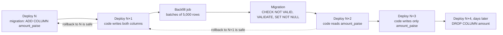
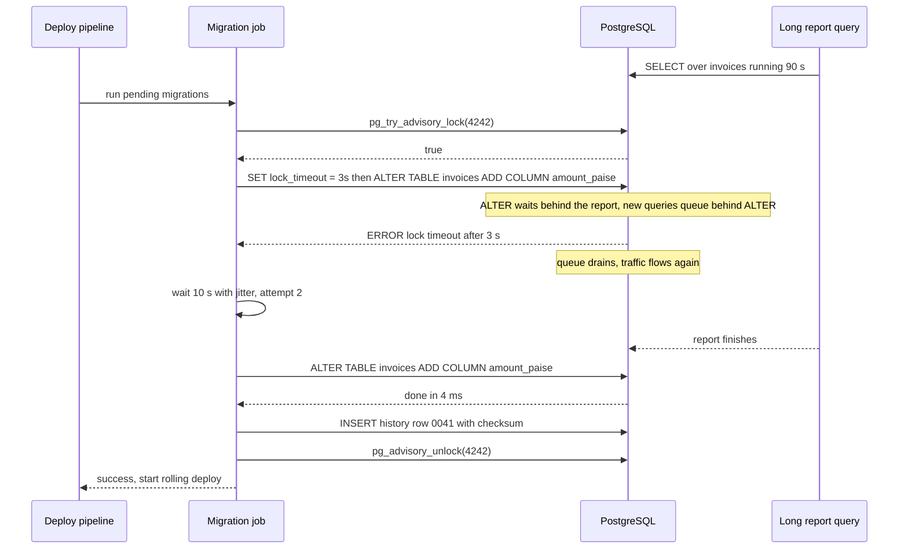

Your schema will change many more times than your first design expects: a column gets a better type, a table splits in two, a free-text field becomes a foreign key. On a laptop you just run `ALTER TABLE`. On a production database with 40 million rows and six API instances serving traffic, the same statement can freeze every request for minutes or crash the old version of your code that is still running. This lesson is about changing the schema while the system keeps working.

## Learning objectives

By the end of this lesson you will be able to:

1. Explain what a versioned migration is, how a history table tracks it, and why migrations must be immutable once applied.
2. Classify common `ALTER TABLE` operations in PostgreSQL 17 as instant (catalog-only), scanning, or rewriting, and say which lock each takes.
3. Explain the lock-queue problem and protect every migration with `lock_timeout`.
4. Plan a breaking change (rename, type change, split) as an **expand → migrate → contract** sequence across several deploys, with a rollback point at each step.
5. Write a batched, resumable, throttled backfill and run it as an ASP.NET Core `BackgroundService`.
6. Add `NOT NULL`, foreign keys and indexes to a big table without long locks (`NOT VALID` + `VALIDATE`, `CREATE INDEX CONCURRENTLY`).

## Prerequisites

- [Relational database fundamentals](#/lesson/m09-relational-fundamentals): tables, columns, constraints.
- [Transactions and ACID](#/lesson/m09-transactions-acid): you will see why some DDL must not run inside a transaction and why a long transaction blocks others.
- [Indexes](#/lesson/m09-indexes): you will build indexes on live tables.

## Explain it like I'm a beginner

Imagine a busy railway station that needs a new platform layout. You cannot close the station for a week. So the engineers work in stages: first they **build the new platform next to the old one** while trains keep using the old one. Then they **send some trains to both** to check everything works. Then **all trains move to the new platform**. Only after weeks without problems do they **demolish the old platform**. At every stage, if something goes wrong, trains can go back to what worked yesterday.

Changing a database schema in production works the same way. You never "swap" a column in one jump, because two things are true at once:

- **Old code is still running.** During a rolling deploy, version 41 and version 42 of your API serve traffic side by side for several minutes. If version 42's migration renames `mobile` to `phone`, version 41 crashes on every request that touches `mobile`.
- **Some changes lock the table.** Certain `ALTER TABLE` statements make PostgreSQL rewrite every row, or wait for an exclusive lock. While they wait or run, every query on that table waits too.

So the safe recipe is the station recipe, and it has a name: **expand and contract** (also called parallel change). Expand: add the new thing beside the old thing. Migrate: copy data across and teach the code to use the new thing. Contract: remove the old thing once nothing uses it.

A **migration** is simply a numbered script that makes one schema change, kept in your Git repository and applied in order by a tool (EF Core migrations, Flyway, DbUp, or a small runner of your own). The database remembers which numbers it has already applied in a **history table**, so every environment ends up with the same schema.

## First-principles explanation

### Migrations as code

A migration is a versioned, ordered, immutable change script. Four properties matter:

1. **Ordered.** `0041_add_amount_paise` runs after `0040_...`. Order comes from the id (a number or timestamp), not from file dates.
2. **Recorded.** A history table (`__EFMigrationsHistory` in EF Core, `flyway_schema_history` in Flyway) stores each applied id. The runner applies only ids that are missing.
3. **Immutable once applied.** If you edit `0041` after it ran in staging, staging and a fresh developer database now differ silently. Good runners store a checksum of each script and refuse to continue if an applied script changed. Fix mistakes with a new migration, `0042_fix_...`.
4. **Forward-only in production.** "Down" migrations are useful in development, but in production a down migration that drops a column also drops data written since the up migration. Rolling back means deploying the previous *code*, which must still work with the *new* schema. That is the whole point of expand/contract.

Where migrations run matters too. Calling `Database.Migrate()` at application startup is convenient on one instance and dangerous on six: they race, and a slow migration delays every pod's readiness. Run migrations as **one separate step** in the pipeline (an EF Core migration bundle, `dotnet ef migrations script --idempotent` reviewed and applied by a job, or a dedicated runner) and guard it with a database **advisory lock** so two runs cannot overlap.

### What ALTER TABLE really does

Every `ALTER TABLE` takes a lock. Most forms take `ACCESS EXCLUSIVE`, the strongest lock: it conflicts with everything, even plain `SELECT`. The question is not "does it lock" but "**how long** does it hold the lock". There are three cost classes:

| Class | What PostgreSQL does | Time on a 40 M-row table (estimate) | Examples (PostgreSQL 17) |
|---|---|---|---|
| **Catalog-only** | Updates the system catalog. No row is touched. | milliseconds | `ADD COLUMN` nullable, `ADD COLUMN ... DEFAULT <constant>` (since PG 11), `DROP COLUMN`, `RENAME COLUMN`, `DROP NOT NULL`, increasing `varchar(n)` length, `varchar` → `text`, `numeric(12,2)` → `numeric(14,2)` |
| **Scan** | Reads every row to check a rule, holding the lock while it reads. | seconds to minutes | `SET NOT NULL` (unless a validated `CHECK (col IS NOT NULL)` already proves it), `ADD CONSTRAINT ... CHECK` or `FOREIGN KEY` without `NOT VALID` |
| **Rewrite** | Writes a new copy of the whole table and all its indexes. | minutes to hours, plus 2× disk | `ALTER COLUMN ... TYPE` with a real conversion (`int` → `bigint`, `text` → `int`, `bigint` → `int`), `ADD COLUMN ... DEFAULT clock_timestamp()` (volatile default), `SET UNLOGGED`/`LOGGED` |

You can watch the difference: `pg_relation_filenode('invoices')` returns the file that stores the table. A rewrite creates a new file, so the number changes. The playground below lets you try it.

Back-of-the-envelope for a rewrite: 40 million rows × ~120 bytes ≈ 4.8 GB of heap, plus three indexes of ~1 GB each. Writing ~8 GB at an assumed sustained 200 MB/s is ~40 seconds of pure I/O, and in practice often several minutes with index builds and WAL. All of it under `ACCESS EXCLUSIVE`. At 1,500 requests per second touching that table, that is roughly 1,500 × 240 s = 360,000 requests that queue or time out (estimate). That is an outage, not a migration.

### The lock queue: why a "fast" ALTER can still cause an outage

Even a catalog-only `ALTER TABLE` must *acquire* `ACCESS EXCLUSIVE`. Locks are granted in queue order. Suppose a reporting query has been reading `invoices` for 90 seconds. Your `ALTER TABLE invoices ADD COLUMN note text` arrives and waits behind it. Now every new `SELECT` on `invoices` queues **behind your ALTER**, because it conflicts with the exclusive lock you are waiting for. A 5 ms change has blocked the table for 90 seconds.

The fix is to wait only briefly and retry:

```sql
SET lock_timeout = '3s';          -- give up the lock wait after 3 seconds
SET statement_timeout = '15s';    -- and never run longer than this
ALTER TABLE invoices ADD COLUMN amount_paise bigint;
```

If the lock is not granted in 3 seconds the statement fails, the queue behind it drains, and your migration job retries after a short pause. Every production migration should set `lock_timeout`. It turns "silent outage" into "retry later".

### Expand, migrate, contract

A breaking change becomes a sequence of non-breaking ones. Take a GST invoicing service that stores `amount numeric(12,2)` in rupees and wants `amount_paise bigint` (integer paise, no rounding surprises):

1. **Expand (migration, deploy N).** `ADD COLUMN amount_paise bigint` (nullable, catalog-only). Old code ignores it. Safe to roll back: the column just sits there.
2. **Dual write (code, deploy N+1).** New code writes both `amount` and `amount_paise` on every insert and update. Reads still use `amount`. Rollback to N is safe because N still writes `amount`, though rows it writes will have a NULL `amount_paise` and must be caught by the backfill.
3. **Backfill (job).** Fill `amount_paise` for old rows in small batches. Re-runnable, so it also catches rows written by any old instance during the rollout.
4. **Tighten (migration).** Add `CHECK (amount_paise IS NOT NULL) NOT VALID`, `VALIDATE` it, then `SET NOT NULL` (PostgreSQL 12+ skips the scan when a validated check proves it) and drop the check.
5. **Switch reads (code, deploy N+2).** Read `amount_paise`. Keep dual writing, so rolling back to N+1 still works.
6. **Stop writing old (code, deploy N+3).** Write only `amount_paise`. Make `amount` nullable first if it was `NOT NULL`, or old-column inserts fail.
7. **Contract (migration, deploy N+4, days later).** `DROP COLUMN amount`. Catalog-only. This is the only step you cannot undo, so it waits until you are confident.

That is five deploys for a "rename". It feels slow; it is the price of never having a broken window. Small teams often compress steps 5–6 into one deploy when they can accept a short rollback restriction.

:::callout type=tip title="Rename is the classic trap"
`ALTER TABLE customers RENAME COLUMN mobile TO phone` is instant, which makes it look safe. It is not: every running instance of the old code still says `mobile`. Treat a rename as add-new, dual-write, backfill, switch reads, drop-old. Or keep the old physical name and rename only in your C# mapping.
:::

### Backfills that do not hurt

The tempting backfill is one statement:

```sql
UPDATE invoices SET amount_paise = (amount * 100)::bigint;   -- one transaction, 40 M rows
```

In PostgreSQL every updated row is a new row version (MVCC), so this writes 40 million new tuples, generates gigabytes of WAL, doubles the table until vacuum runs, holds row locks on every invoice for the whole run (so any concurrent update of an invoice waits), makes read replicas fall minutes behind replaying the WAL, and, if it fails at row 39 million, rolls everything back.

A good backfill is:

- **Batched by key range**: `WHERE id > $last AND id <= $last + 5000`, or "next 5,000 ids where the new column is NULL". Each batch is its own short transaction (tens of milliseconds).
- **Idempotent**: running a batch twice gives the same result (`WHERE amount_paise IS NULL` or a deterministic expression).
- **Resumable**: it stores a checkpoint (the last id done) so a restart continues instead of starting over.
- **Throttled**: it sleeps between batches and backs off when replica lag or database CPU is high.
- **Observable**: it logs rows per second and progress, so you can estimate completion: 40 M rows ÷ 5,000 per batch = 8,000 batches; at ~50 ms per batch plus a 100 ms pause, about 8,000 × 0.15 s = 20 minutes (estimate).

### Adding constraints and indexes on a big table

- **Index**: `CREATE INDEX CONCURRENTLY` builds without blocking writes. It cannot run inside a transaction block, takes longer, and on failure leaves an `INVALID` index that you must drop and retry. Most migration tools need you to mark that migration as non-transactional (in EF Core, `migrationBuilder.Sql(..., suppressTransaction: true)`).
- **Foreign key**: `ADD CONSTRAINT ... FOREIGN KEY ... NOT VALID` is quick and enforces the rule for new rows. Then `VALIDATE CONSTRAINT` scans old rows holding only `SHARE UPDATE EXCLUSIVE`, which allows normal reads and writes.
- **NOT NULL**: the check-constraint trick from step 4 above.
- **Unique constraint**: build a unique index concurrently, then `ADD CONSTRAINT ... UNIQUE USING INDEX`.

### What breaks first under load

The first thing to break is usually **lock waits**, not CPU: an innocent DDL statement queues behind a long query and stalls the table. Second is **replication lag** from a large backfill: replicas replay WAL serially, and a replica 10 minutes behind serves stale data to every read routed there (see [Read replicas](#/lesson/m09-replicas)). Third is **disk**: a rewrite or an unthrottled backfill can briefly need twice the table's size. Fourth is **connection pool exhaustion**: requests waiting on a lock still hold connections, so a 30-second lock wait on a busy table empties the pool and turns a table problem into a whole-service outage.

### When a simpler approach is enough

- A table with a few thousand rows (a settings table, a list of 30 Indian states): just run the `ALTER TABLE` with a `lock_timeout`. A rewrite of 50 KB takes milliseconds.
- An internal tool with a planned maintenance window and five users: stop the app, migrate, start the app.
- A brand-new column nobody reads yet: a single nullable `ADD COLUMN` is already expand-only.

Expand/contract is for tables that are large, hot, or read by code you cannot deploy atomically (mobile apps, other teams' services, partner integrations).

## Visual explanation

### The expand/contract timeline



Read it left to right. Each box is either a schema change (migration) or a code change (deploy), never both in a way that breaks the version still running. The first arrow adds a column that old code ignores. The second makes new rows correct in both columns. The backfill fixes old rows, and the constraint step makes the database itself guarantee there are no gaps. Only then do reads switch. The dotted arrows show the rollback points: from N+1 you can go back to N, and from N+2 back to N+1, because the previous version's columns are still there and still written. The final drop has no dotted arrow: it is the one irreversible step, so it comes last and only after a quiet period.

### A migration job with a lock timeout



The pipeline runs migrations once, before the rolling deploy, through a single job. The advisory lock stops a second pipeline run from applying the same migrations at the same moment. The first `ALTER` waits behind a long report; because `lock_timeout` is 3 seconds, the damage is at most 3 seconds of queued queries instead of 90. The job retries after a jittered pause, succeeds in milliseconds, records the migration id and checksum in the history table, releases the lock, and only then lets the deploy roll out code that expects the new column.

## Step-by-step example

A building-materials distributor runs an invoicing API: 40 million invoices, 1,500 requests per second at peak, six API instances behind a load balancer. Two changes are requested: store amounts as integer paise, and replace the free-text `mobile` column on `customers` with a normalised `phone_e164` (`+919810012345`).

### Step 1 — expand

```sql
-- 0041_add_amount_paise_and_phone.sql
SET lock_timeout = '3s';
ALTER TABLE invoices  ADD COLUMN amount_paise bigint;   -- catalog-only
ALTER TABLE customers ADD COLUMN phone_e164 text;       -- catalog-only
```

Both are nullable without defaults, so no row is touched. Old code does `SELECT id, amount, ...` with explicit column lists and ignores the new columns. (If any old code does `SELECT *` into a strict mapper, find it first.)

### Step 2 — dual write in code

The C# writer sets both columns. The phase is a configuration value, so you can move forward or back without a code change:

```csharp
// Inside the repository's insert, during the DualWrite phase.
cmd.Parameters.AddWithValue("amount", invoice.AmountPaise / 100m);
cmd.Parameters.AddWithValue("amount_paise", invoice.AmountPaise);
```

### Step 3 — backfill in batches

```sql
WITH batch AS (
  SELECT id FROM invoices
  WHERE amount_paise IS NULL
  ORDER BY id
  LIMIT 5000
  FOR UPDATE SKIP LOCKED          -- skip rows a live request is updating right now
)
UPDATE invoices i
SET amount_paise = (i.amount * 100)::bigint
FROM batch
WHERE i.id = batch.id;
```

Run until it updates 0 rows. `SKIP LOCKED` means the backfill never waits behind a user's transaction; skipped rows are picked up by a later batch. The phone backfill uses the same shape with `'+91' || right(regexp_replace(mobile, '\D', '', 'g'), 10)` and leaves numbers that do not have 10 digits for manual review.

### Step 4 — make the database guarantee it

```sql
ALTER TABLE invoices ADD CONSTRAINT invoices_amount_paise_nn CHECK (amount_paise IS NOT NULL) NOT VALID;  -- instant
ALTER TABLE invoices VALIDATE CONSTRAINT invoices_amount_paise_nn;   -- scans, but allows reads and writes
ALTER TABLE invoices ALTER COLUMN amount_paise SET NOT NULL;         -- uses the validated check, no scan
ALTER TABLE invoices DROP CONSTRAINT invoices_amount_paise_nn;
```

If `VALIDATE` fails, some instance wrote a row without the new column (an old pod during rollout, or a forgotten code path like a CSV importer). Re-run the backfill, find the code path, and validate again. This failure is the constraint doing its job.

### Step 5 — switch reads, then stop writing the old column

Deploy N+2 reads `amount_paise`. Deploy N+3 stops writing `amount`, after making it nullable (`ALTER TABLE invoices ALTER COLUMN amount DROP NOT NULL`, catalog-only).

### Step 6 — contract

A week later, after checking `pg_stat_statements` for any query still mentioning `amount`:

```sql
ALTER TABLE invoices DROP COLUMN amount;   -- catalog-only. Space is reclaimed as rows are rewritten over time.
```

### Step 7 — the EF Core version

With EF Core each step is one migration. Generated migrations do not add `lock_timeout` and do not know about `CONCURRENTLY`, so add them yourself:

```csharp
public partial class AddAmountPaise : Migration
{
    protected override void Up(MigrationBuilder mb)
    {
        mb.Sql("SET lock_timeout = '3s'");
        mb.AddColumn<long>(name: "amount_paise", table: "invoices", nullable: true);
        mb.Sql("CREATE INDEX CONCURRENTLY IF NOT EXISTS ix_invoices_amount_paise ON invoices (amount_paise)",
               suppressTransaction: true);
    }
}
```

Generate a reviewed script with `dotnet ef migrations script --idempotent` or build a bundle with `dotnet ef migrations bundle`, and run it from the pipeline, not from `Program.cs`.

## Production-style C# implementation

Three pieces: a migration runner (ordered, checksummed, single-runner via an advisory lock), a phase-aware invoice writer for dual writes, and a resumable backfill worker. Database access sits behind interfaces with in-memory fakes so the course checker can compile and run it; the SQL each method stands for is in comments.

```text
Invoicing.Api/
  Program.cs
  Schema/Migration.cs
  Schema/MigrationStores.cs
  Schema/MigrationRunner.cs
  Invoices/SchemaPhase.cs
  Invoices/InvoiceWriter.cs
  Backfill/BackfillWorker.cs
```

```csharp file=Schema/Migration.cs
using System.Security.Cryptography;
using System.Text;

namespace Invoicing.Schema;

/// <summary>One versioned change. Id order is apply order. Never edit after it has run anywhere.</summary>
public sealed record Migration(string Id, string Description, string Sql, bool Transactional = true)
{
    public string Checksum { get; } = Convert.ToHexString(SHA256.HashData(Encoding.UTF8.GetBytes(Sql.ReplaceLineEndings("\n"))));
}

public sealed record AppliedMigration(string Id, string Checksum, DateTimeOffset AppliedAt);

public sealed class MigrationDriftException(string message) : Exception(message);
```

```csharp file=Schema/MigrationStores.cs
namespace Invoicing.Schema;

/// <summary>The history table: SELECT id, checksum, applied_at FROM schema_history ORDER BY id.</summary>
public interface IMigrationHistory
{
    Task<IReadOnlyList<AppliedMigration>> GetAppliedAsync(CancellationToken ct);
    Task RecordAsync(AppliedMigration applied, CancellationToken ct);
}

/// <summary>Runs one script. A real one sets lock_timeout first and retries on lock timeout (SQLSTATE 55P03).</summary>
public interface IMigrationExecutor
{
    Task ExecuteAsync(Migration migration, CancellationToken ct);
}

/// <summary>SELECT pg_try_advisory_lock(key) / pg_advisory_unlock(key) on a dedicated connection.</summary>
public interface IAdvisoryLock
{
    Task<IAsyncDisposable?> TryAcquireAsync(long key, CancellationToken ct);
}

public sealed class InMemoryMigrationHistory : IMigrationHistory
{
    private readonly List<AppliedMigration> _rows = new();
    public Task<IReadOnlyList<AppliedMigration>> GetAppliedAsync(CancellationToken ct) =>
        Task.FromResult<IReadOnlyList<AppliedMigration>>(_rows.OrderBy(r => r.Id, StringComparer.Ordinal).ToList());
    public Task RecordAsync(AppliedMigration applied, CancellationToken ct) { _rows.Add(applied); return Task.CompletedTask; }
}

public sealed class LoggingExecutor : IMigrationExecutor
{
    public List<string> Executed { get; } = new();
    public Task ExecuteAsync(Migration migration, CancellationToken ct) { Executed.Add(migration.Id); return Task.CompletedTask; }
}

public sealed class InMemoryAdvisoryLock : IAdvisoryLock
{
    private readonly HashSet<long> _held = new();
    private readonly object _gate = new();

    public Task<IAsyncDisposable?> TryAcquireAsync(long key, CancellationToken ct)
    {
        lock (_gate)
        {
            if (!_held.Add(key)) return Task.FromResult<IAsyncDisposable?>(null);
            return Task.FromResult<IAsyncDisposable?>(new Releaser(this, key));
        }
    }

    private sealed class Releaser(InMemoryAdvisoryLock owner, long key) : IAsyncDisposable
    {
        public ValueTask DisposeAsync() { lock (owner._gate) owner._held.Remove(key); return ValueTask.CompletedTask; }
    }
}
```

```csharp file=Schema/MigrationRunner.cs
using Microsoft.Extensions.Logging;

namespace Invoicing.Schema;

public sealed record MigrationResult(bool LockAcquired, IReadOnlyList<string> Applied);

public sealed class MigrationRunner(
    IEnumerable<Migration> migrations,
    IMigrationHistory history,
    IMigrationExecutor executor,
    IAdvisoryLock advisoryLock,
    TimeProvider clock,
    ILogger<MigrationRunner> log)
{
    public const long LockKey = 4242;

    public async Task<MigrationResult> RunAsync(CancellationToken ct)
    {
        await using var handle = await advisoryLock.TryAcquireAsync(LockKey, ct);
        if (handle is null)
        {
            log.LogWarning("Another migration run holds the lock. Skipping.");
            return new MigrationResult(false, Array.Empty<string>());
        }

        var available = migrations.OrderBy(m => m.Id, StringComparer.Ordinal).ToList();
        var byId = available.ToDictionary(m => m.Id, StringComparer.Ordinal);
        var applied = await history.GetAppliedAsync(ct);

        foreach (var a in applied)
        {
            if (!byId.TryGetValue(a.Id, out var m))
                throw new MigrationDriftException($"Migration {a.Id} was applied but is missing from the code.");
            if (!string.Equals(m.Checksum, a.Checksum, StringComparison.Ordinal))
                throw new MigrationDriftException($"Migration {a.Id} was edited after it was applied. Add a new migration instead.");
        }

        var done = applied.Select(a => a.Id).ToHashSet(StringComparer.Ordinal);
        var ran = new List<string>();
        foreach (var m in available.Where(m => !done.Contains(m.Id)))
        {
            log.LogInformation("Applying {Id}: {Description}", m.Id, m.Description);
            await executor.ExecuteAsync(m, ct);
            await history.RecordAsync(new AppliedMigration(m.Id, m.Checksum, clock.GetUtcNow()), ct);
            ran.Add(m.Id);
        }
        return new MigrationResult(true, ran);
    }
}
```

```csharp file=Invoices/SchemaPhase.cs
namespace Invoicing.Invoices;

/// <summary>Where the amount -> amount_paise change currently is. Set from configuration, so moving
/// one phase back is a config change, not a redeploy.</summary>
public enum SchemaPhase
{
    OldOnly = 0,      // before deploy N+1: write and read amount (rupees)
    DualWrite = 1,    // write both, read old
    ReadNew = 2,      // write both, read new
    NewOnly = 3       // write and read amount_paise only
}

public sealed class SchemaPhaseOptions
{
    public SchemaPhase AmountPhase { get; set; } = SchemaPhase.DualWrite;
}
```

```csharp file=Invoices/InvoiceWriter.cs
using Microsoft.Extensions.Options;

namespace Invoicing.Invoices;

/// <summary>The physical row during the transition: both columns may exist.</summary>
public sealed class InvoiceRow
{
    public long Id { get; init; }
    public decimal? Amount { get; set; }        // legacy rupees, numeric(12,2)
    public long? AmountPaise { get; set; }      // new, bigint
}

public interface IInvoiceTable
{
    void Upsert(InvoiceRow row);
    InvoiceRow? Find(long id);
}

public sealed class InMemoryInvoiceTable : IInvoiceTable
{
    private readonly Dictionary<long, InvoiceRow> _rows = new();
    public void Upsert(InvoiceRow row) => _rows[row.Id] = row;
    public InvoiceRow? Find(long id) => _rows.GetValueOrDefault(id);
}

public sealed class InvoiceWriter(IInvoiceTable table, IOptionsMonitor<SchemaPhaseOptions> options)
{
    private SchemaPhase Phase => options.CurrentValue.AmountPhase;

    public void Save(long id, long amountPaise)
    {
        var row = new InvoiceRow { Id = id };
        if (Phase <= SchemaPhase.ReadNew) row.Amount = amountPaise / 100m;     // old column still written
        if (Phase >= SchemaPhase.DualWrite) row.AmountPaise = amountPaise;     // new column written
        table.Upsert(row);
    }

    /// <summary>Reads follow the phase. In ReadNew a missing new value falls back to the old one,
    /// which covers rows an old instance wrote during the rollout before the backfill reached them.</summary>
    public long? ReadAmountPaise(long id)
    {
        var row = table.Find(id);
        if (row is null) return null;
        return Phase switch
        {
            SchemaPhase.OldOnly or SchemaPhase.DualWrite => row.Amount is { } r ? (long)(r * 100) : null,
            SchemaPhase.ReadNew => row.AmountPaise ?? (row.Amount is { } r2 ? (long)(r2 * 100) : null),
            _ => row.AmountPaise
        };
    }
}
```

```csharp file=Backfill/BackfillWorker.cs
using Microsoft.Extensions.Hosting;
using Microsoft.Extensions.Logging;
using Microsoft.Extensions.Options;

namespace Invoicing.Backfill;

public sealed record BatchResult(int RowsUpdated, long LastId);

/// <summary>
/// One short transaction:
/// WITH batch AS (SELECT id FROM invoices WHERE id > $after AND amount_paise IS NULL ORDER BY id LIMIT $size FOR UPDATE SKIP LOCKED)
/// UPDATE invoices i SET amount_paise = (i.amount * 100)::bigint FROM batch WHERE i.id = batch.id RETURNING i.id
/// </summary>
public interface IBackfillBatch
{
    Task<BatchResult> RunAsync(long afterId, int size, CancellationToken ct);
}

/// <summary>Stores the last id done so a restart resumes. A one-row table in the database is typical.</summary>
public interface IBackfillCheckpoint
{
    Task<long> LoadAsync(string job, CancellationToken ct);
    Task SaveAsync(string job, long lastId, CancellationToken ct);
}

/// <summary>Reports how far behind replicas are, in seconds (from pg_stat_replication.replay_lag).</summary>
public interface IReplicaLagProbe
{
    Task<double> MaxLagSecondsAsync(CancellationToken ct);
}

public sealed class BackfillOptions
{
    public string JobName { get; set; } = "invoices.amount_paise";
    public int BatchSize { get; set; } = 5000;
    public TimeSpan PauseBetweenBatches { get; set; } = TimeSpan.FromMilliseconds(100);
    public double MaxReplicaLagSeconds { get; set; } = 5;
    public bool Enabled { get; set; }
}

public sealed class BackfillWorker(
    IBackfillBatch batch,
    IBackfillCheckpoint checkpoint,
    IReplicaLagProbe lag,
    IOptions<BackfillOptions> options,
    TimeProvider clock,
    ILogger<BackfillWorker> log) : BackgroundService
{
    public long TotalRows { get; private set; }

    protected override async Task ExecuteAsync(CancellationToken stoppingToken)
    {
        var o = options.Value;
        if (!o.Enabled) return;
        await RunToCompletionAsync(o, stoppingToken);
    }

    public async Task RunToCompletionAsync(BackfillOptions o, CancellationToken ct)
    {
        var after = await checkpoint.LoadAsync(o.JobName, ct);
        var started = clock.GetTimestamp();

        while (!ct.IsCancellationRequested)
        {
            // Back off while replicas are behind: a backfill must not make reads stale.
            if (await lag.MaxLagSecondsAsync(ct) > o.MaxReplicaLagSeconds)
            {
                log.LogInformation("Replica lag high, pausing backfill.");
                await Task.Delay(o.PauseBetweenBatches * 10, clock, ct);
                continue;
            }

            var r = await batch.RunAsync(after, o.BatchSize, ct);
            if (r.RowsUpdated == 0) break;

            after = r.LastId;
            TotalRows += r.RowsUpdated;
            await checkpoint.SaveAsync(o.JobName, after, ct);

            var elapsed = clock.GetElapsedTime(started).TotalSeconds;
            log.LogInformation("Backfill {Job}: {Rows} rows, last id {Id}, {Rate:F0} rows/s",
                o.JobName, TotalRows, after, elapsed > 0 ? TotalRows / elapsed : 0);

            if (o.PauseBetweenBatches > TimeSpan.Zero) await Task.Delay(o.PauseBetweenBatches, clock, ct);
        }
    }
}

public sealed class InMemoryCheckpoint : IBackfillCheckpoint
{
    private readonly Dictionary<string, long> _state = new();
    public Task<long> LoadAsync(string job, CancellationToken ct) => Task.FromResult(_state.GetValueOrDefault(job));
    public Task SaveAsync(string job, long lastId, CancellationToken ct) { _state[job] = lastId; return Task.CompletedTask; }
}

public sealed class NoLagProbe : IReplicaLagProbe
{
    public Task<double> MaxLagSecondsAsync(CancellationToken ct) => Task.FromResult(0d);
}

/// <summary>Simulates a table of ids 1..N whose new column starts NULL.</summary>
public sealed class InMemoryBackfillBatch(long maxId) : IBackfillBatch
{
    public Task<BatchResult> RunAsync(long afterId, int size, CancellationToken ct)
    {
        if (afterId >= maxId) return Task.FromResult(new BatchResult(0, afterId));
        var last = Math.Min(maxId, afterId + size);
        return Task.FromResult(new BatchResult((int)(last - afterId), last));
    }
}
```

```csharp file=Program.cs
using Invoicing.Backfill;
using Invoicing.Invoices;
using Invoicing.Schema;

var builder = WebApplication.CreateBuilder(args);

builder.Services.AddSingleton(TimeProvider.System);

// Migrations: ordered list, applied once per deploy by a separate job (here exposed as an admin endpoint).
builder.Services.AddSingleton<IEnumerable<Migration>>(new[]
{
    new Migration("0041", "add amount_paise", "ALTER TABLE invoices ADD COLUMN amount_paise bigint"),
    new Migration("0042", "index amount_paise",
        "CREATE INDEX CONCURRENTLY IF NOT EXISTS ix_invoices_amount_paise ON invoices (amount_paise)", Transactional: false),
});
builder.Services.AddSingleton<IMigrationHistory, InMemoryMigrationHistory>();
builder.Services.AddSingleton<IMigrationExecutor, LoggingExecutor>();
builder.Services.AddSingleton<IAdvisoryLock, InMemoryAdvisoryLock>();
builder.Services.AddSingleton<MigrationRunner>();

// Dual-write phase comes from configuration: "SchemaPhase:AmountPhase": "ReadNew".
builder.Services.Configure<SchemaPhaseOptions>(builder.Configuration.GetSection("SchemaPhase"));
builder.Services.AddSingleton<IInvoiceTable, InMemoryInvoiceTable>();
builder.Services.AddSingleton<InvoiceWriter>();

// Backfill worker, off by default. Enable for one instance only: "Backfill:Enabled": true.
builder.Services.Configure<BackfillOptions>(builder.Configuration.GetSection("Backfill"));
builder.Services.AddSingleton<IBackfillBatch>(_ => new InMemoryBackfillBatch(40_000));
builder.Services.AddSingleton<IBackfillCheckpoint, InMemoryCheckpoint>();
builder.Services.AddSingleton<IReplicaLagProbe, NoLagProbe>();
builder.Services.AddHostedService<BackfillWorker>();

var app = builder.Build();

app.MapPost("/admin/migrations/run", async (MigrationRunner runner, CancellationToken ct) =>
{
    var r = await runner.RunAsync(ct);
    return r.LockAcquired ? Results.Ok(r) : Results.Conflict("A migration run is already in progress.");
});

app.MapPost("/invoices/{id:long}", (long id, long amountPaise, InvoiceWriter writer) =>
{
    writer.Save(id, amountPaise);
    return Results.Ok(new { id, amountPaise = writer.ReadAmountPaise(id) });
});

app.Run();
```

**Design notes.**

- The checksum normalises line endings, so a Windows checkout and a Linux build agree. Any other edit to an applied script fails the run loudly: drift is caught in staging, not discovered in production.
- `Transactional: false` marks scripts like `CREATE INDEX CONCURRENTLY` that must run outside a transaction. A real executor runs them on their own and checks afterwards for an `INVALID` index.
- The writer's phase lives in `IOptionsMonitor`, so operators can step back from `ReadNew` to `DualWrite` in seconds if the new column misbehaves.
- The backfill saves a checkpoint after every batch and checks replica lag before each one. It runs on one instance only (a config flag here; a leader lease or a dedicated job in a bigger system).

:::callout type=warning title="Never run Migrate() on every pod at startup"
Six pods starting together race to apply the same migration. Some fail, some wait on locks, and readiness probes time out while a long migration runs. Apply migrations once per release, from the pipeline, guarded by an advisory lock.
:::

## Bad design vs good design

**Bad**: one release that contains `ALTER TABLE invoices ALTER COLUMN amount TYPE bigint USING (amount * 100)::bigint` and the code that expects paise, applied by `Database.Migrate()` in `Program.cs`. On deploy, the first pod starts the rewrite of 40 million rows under `ACCESS EXCLUSIVE`. Every invoice query on every pod, old and new, waits. The connection pools fill. Health checks fail and the orchestrator restarts pods, which try to migrate again and wait too. When the rewrite finishes several minutes later, the old pods that survived start reading paise as rupees and show ₹1,25,000 invoices as ₹1,25,00,000. Rolling back the code does not help, because the column now holds paise.

**Good**: the seven steps above. Every migration is catalog-only or holds a weak lock, every one sets `lock_timeout`, data moves in small resumable batches, and every deploy can be rolled back to the previous one. The one irreversible step, `DROP COLUMN`, happens last.

**But**: for a 2,000-row lookup table, the "bad" single-step `ALTER ... TYPE` is fine with a `lock_timeout` and a release where nothing old reads that column. Do not run a five-deploy project for a table that rewrites in 20 ms.

:::callout type=tradeoff title="Common changes at a glance (PostgreSQL 17)"
| Change | Direct statement | Safe path on a big, hot table |
|---|---|---|
| Add nullable column | catalog-only | run it, with `lock_timeout` |
| Add column with constant default | catalog-only | run it |
| Add column with volatile default | rewrite | add nullable, backfill, then set default |
| Rename column | catalog-only but breaks old code | add, dual write, backfill, switch, drop |
| `int` → `bigint` | rewrite | new column, dual write, backfill, swap |
| `SET NOT NULL` | full scan under exclusive lock | `CHECK ... NOT VALID`, `VALIDATE`, `SET NOT NULL` |
| Add foreign key | scan under lock on both tables | `NOT VALID`, then `VALIDATE` |
| Add index | blocks writes | `CREATE INDEX CONCURRENTLY` |
| Drop column | catalog-only, irreversible | only after no code reads or writes it |
:::

## Practical playground

An invoicing schema with 200 invoices. Use `pg_relation_filenode('invoices')` before and after each `ALTER` to see whether PostgreSQL rewrote the table, and `pg_attribute.atthasmissing` to see the "fast default" trick that makes `ADD COLUMN ... DEFAULT 'INR'` instant.

:::playground type=sql title="Which ALTER TABLE rewrites the table?"
```sql
CREATE TABLE customers (
  id      bigint PRIMARY KEY,
  name    text   NOT NULL,
  mobile  text,                 -- legacy free-form
  city    text   NOT NULL
);
INSERT INTO customers VALUES
  (1, 'Shree Ganesh Builders',  '98100 12345',     'Gurugram'),
  (2, 'Patel Infra LLP',        '+91-98250-44321', 'Ahmedabad'),
  (3, 'Kaveri Constructions',   '09845012345',     'Bengaluru'),
  (4, 'Lakshmi Steel Traders',  '+91 99400 55667', 'Chennai'),
  (5, 'Northline Roadways',     '70421 88990',     'Mumbai'),
  (6, 'Brahmaputra Bridges',    '7002 123 456',    'Guwahati'),
  (7, 'Deccan Aggregates',      NULL,              'Hyderabad'),
  (8, 'Malwa Cement Agency',    '+919826012345',   'Indore');

CREATE TABLE invoices (
  id           bigint        PRIMARY KEY,
  customer_id  bigint        NOT NULL REFERENCES customers (id),
  quantity     int           NOT NULL,
  amount       numeric(12,2) NOT NULL,      -- rupees, legacy
  note         varchar(20),
  issued_on    date          NOT NULL
);
INSERT INTO invoices
SELECT g,
       1 + (g - 1) % 8,
       1 + (g * 37) % 400,
       ((g * 7919) % 450000 + 1250) + (g % 100) / 100.0,
       NULL,
       DATE '2026-04-01' + (g * 3) % 180
FROM generate_series(1, 200) AS g;

-- Try these one at a time and compare the filenode each time:
-- SELECT pg_relation_filenode('invoices');
-- ALTER TABLE invoices ADD COLUMN amount_paise bigint;                       -- catalog-only
-- ALTER TABLE invoices ADD COLUMN currency text NOT NULL DEFAULT 'INR';     -- catalog-only (fast default)
-- SELECT attname, atthasmissing FROM pg_attribute WHERE attrelid = 'invoices'::regclass AND attnum > 0;
-- ALTER TABLE invoices ALTER COLUMN note TYPE varchar(50);                   -- catalog-only (longer limit)
-- ALTER TABLE invoices ALTER COLUMN amount TYPE numeric(14,2);               -- catalog-only (more precision)
-- ALTER TABLE invoices ALTER COLUMN quantity TYPE bigint;                    -- REWRITE: filenode changes
-- ALTER TABLE invoices ADD COLUMN created_at timestamptz NOT NULL DEFAULT clock_timestamp();  -- REWRITE
```
:::

## Exercises

:::exercise id=m09-migrations-evolution-ex1 difficulty=beginner kind=sql ordered=true title="Expand: add amount_paise and backfill it"
The invoices table stores `amount` as rupees in `numeric(12,2)`. Do the **expand** step: add a nullable `amount_paise bigint` column, fill it for every row with the amount in paise (₹1,250.37 → 125037), and finish with a query that returns `id`, `amount`, `amount_paise` for invoices 1 to 5, ordered by `id`. Do not drop or change `amount`: old code still uses it.
::setup
```sql
CREATE TABLE invoices (
  id bigint PRIMARY KEY, customer_id bigint NOT NULL, amount numeric(12,2) NOT NULL, issued_on date NOT NULL
);
INSERT INTO invoices
SELECT g, 1 + (g - 1) % 8, ((g * 7919) % 450000 + 1250) + (g % 100) / 100.0, DATE '2026-04-01' + (g * 3) % 180
FROM generate_series(1, 200) AS g;
```
::check
```sql
ALTER TABLE invoices ADD COLUMN amount_paise bigint;
UPDATE invoices SET amount_paise = (amount * 100)::bigint;
SELECT id, amount, amount_paise FROM invoices WHERE id <= 5 ORDER BY id;
```
::acceptance
- `amount_paise` exists, is `bigint` and nullable.
- Invoice 1 has `amount` 9169.01 and `amount_paise` 916901.
- The `amount` column is unchanged.
::hint
Expand means "add beside", so start with `ALTER TABLE ... ADD COLUMN` with no default and no `NOT NULL`.
::hint
Rupees to paise is multiply by 100. Cast the result to `bigint`.
::hint
On this 200-row table one `UPDATE` is fine. On 40 million rows you would batch it (exercise 3).
::hint
```sql
ALTER TABLE invoices ADD COLUMN amount_paise bigint;
UPDATE invoices SET amount_paise = (amount * 100)::bigint;
SELECT id, amount, amount_paise FROM invoices WHERE id <= 5 ORDER BY id;
```
::solution
```sql
ALTER TABLE invoices ADD COLUMN amount_paise bigint;
UPDATE invoices SET amount_paise = (amount * 100)::bigint;
SELECT id, amount, amount_paise FROM invoices WHERE id <= 5 ORDER BY id;
```
The `ADD COLUMN` is catalog-only: no row is rewritten and the exclusive lock is held for milliseconds. Because `amount` has exactly two decimal places, `amount * 100` is already a whole number and the cast is exact. If the source could have more decimals, decide the rounding rule explicitly (`round(amount * 100)`) and write it down.
::mistakes
- Adding the column as `NOT NULL DEFAULT 0`: instant in PostgreSQL 11+, but now every unbackfilled row claims to be ₹0, and code cannot tell "not migrated" from "free".
- `ALTER COLUMN amount TYPE bigint USING ...` in place: a rewrite under an exclusive lock, and old code reads paise as rupees.
- Casting `amount::bigint * 100`, which drops the paise before multiplying.
:::

:::exercise id=m09-migrations-evolution-ex2 difficulty=beginner kind=code title="Pending migrations with drift detection"
Implement `MigrationPlanner.Pending`. It receives the migrations in the code (any order) and the history rows from the database, and returns the migrations that still need to run, ordered by `Id` using ordinal string comparison. It must throw `MigrationDriftException` if an applied migration is missing from the code, or if its checksum differs from the code's checksum (someone edited an applied script).
::acceptance
- Returns pending migrations in ordinal `Id` order regardless of input order.
- Returns an empty list when everything is applied.
- Throws `MigrationDriftException` for an edited applied script and for an applied id missing from the code.
::hint
Build a dictionary from id to migration for the code side.
::hint
Check every history row first. Only when all are consistent, compute what is missing.
::hint
`StringComparer.Ordinal` gives "0009" before "0010" when ids are zero-padded; that is why runners pad ids or use timestamps.
::hint
```csharp
var byId = available.ToDictionary(m => m.Id, StringComparer.Ordinal);
foreach (var a in applied) { /* missing or checksum differs -> throw */ }
var done = applied.Select(a => a.Id).ToHashSet(StringComparer.Ordinal);
return available.Where(m => !done.Contains(m.Id)).OrderBy(m => m.Id, StringComparer.Ordinal).ToList();
```
::starter
```csharp file=MigrationPlanner.cs
using System;
using System.Collections.Generic;
using System.Linq;

public sealed record MigrationScript(string Id, string Checksum);
public sealed record HistoryRow(string Id, string Checksum);
public sealed class MigrationDriftException(string message) : Exception(message);

public static class MigrationPlanner
{
    public static IReadOnlyList<MigrationScript> Pending(IEnumerable<MigrationScript> available, IEnumerable<HistoryRow> applied)
        => throw new NotImplementedException();
}
```
::tests
```csharp file=MigrationPlannerTests.cs
using System.Linq;
using Xunit;

public class MigrationPlannerTests
{
    private static readonly MigrationScript M1 = new("0040", "aa");
    private static readonly MigrationScript M2 = new("0041", "bb");
    private static readonly MigrationScript M3 = new("0042", "cc");

    [Fact]
    public void Returns_missing_in_id_order()
    {
        var pending = MigrationPlanner.Pending(new[] { M3, M1, M2 }, new[] { new HistoryRow("0040", "aa") });
        Assert.Equal(new[] { "0041", "0042" }, pending.Select(p => p.Id).ToArray());
    }

    [Fact]
    public void Nothing_pending_when_all_applied()
    {
        var applied = new[] { new HistoryRow("0040", "aa"), new HistoryRow("0041", "bb"), new HistoryRow("0042", "cc") };
        Assert.Empty(MigrationPlanner.Pending(new[] { M1, M2, M3 }, applied));
    }

    [Fact]
    public void Fresh_database_gets_everything()
    {
        var pending = MigrationPlanner.Pending(new[] { M2, M1 }, new HistoryRow[0]);
        Assert.Equal(new[] { "0040", "0041" }, pending.Select(p => p.Id).ToArray());
    }

    [Fact]
    public void Edited_applied_script_is_drift()
    {
        Assert.Throws<MigrationDriftException>(() =>
            MigrationPlanner.Pending(new[] { M1, M2 }, new[] { new HistoryRow("0040", "XX") }));
    }

    [Fact]
    public void Applied_but_missing_from_code_is_drift()
    {
        Assert.Throws<MigrationDriftException>(() =>
            MigrationPlanner.Pending(new[] { M2 }, new[] { new HistoryRow("0040", "aa") }));
    }

    [Fact]
    public void Ordinal_order_not_culture_order()
    {
        var a = new MigrationScript("20261001_a", "1");
        var b = new MigrationScript("20261001_B", "2");
        var pending = MigrationPlanner.Pending(new[] { a, b }, new HistoryRow[0]);
        Assert.Equal("20261001_B", pending[0].Id);   // 'B' (66) < 'a' (97) in ordinal order
    }
}
```
::solution
```csharp file=MigrationPlanner.cs
using System;
using System.Collections.Generic;
using System.Linq;

public sealed record MigrationScript(string Id, string Checksum);
public sealed record HistoryRow(string Id, string Checksum);
public sealed class MigrationDriftException(string message) : Exception(message);

public static class MigrationPlanner
{
    public static IReadOnlyList<MigrationScript> Pending(IEnumerable<MigrationScript> available, IEnumerable<HistoryRow> applied)
    {
        var code = available.ToList();
        var byId = code.ToDictionary(m => m.Id, StringComparer.Ordinal);
        var history = applied.ToList();

        foreach (var a in history)
        {
            if (!byId.TryGetValue(a.Id, out var m))
                throw new MigrationDriftException($"Applied migration {a.Id} is not in the code.");
            if (!string.Equals(m.Checksum, a.Checksum, StringComparison.Ordinal))
                throw new MigrationDriftException($"Applied migration {a.Id} has been edited.");
        }

        var done = history.Select(a => a.Id).ToHashSet(StringComparer.Ordinal);
        return code.Where(m => !done.Contains(m.Id))
                   .OrderBy(m => m.Id, StringComparer.Ordinal)
                   .ToList();
    }
}
```
Drift checks come before planning, so a bad state stops the run before anything new is applied on top of it. Ordinal ordering makes the order identical on every machine; culture-aware comparison can order mixed-case ids differently on different servers.
::alternatives
Some teams also reject an *unapplied* migration whose id sorts before the newest applied one (an "out-of-order" migration from a long-lived branch). Flyway calls this `outOfOrder` and disables it by default. Allowing it is fine when migrations are truly independent.
::mistakes
- Using `OrderBy(m => m.Id)` with the default comparer (culture-sensitive).
- Silently re-running an edited script, which applies the change twice or not at all depending on the edit.
- Comparing checksums case-insensitively when they are hex strings from different tools; normalise once, then compare ordinally.
:::

:::exercise id=m09-migrations-evolution-ex3 difficulty=intermediate kind=sql title="One backfill batch that never waits on users"
The expand step already added `customers.phone_e164`, and a previous batch filled customers 1 and 2. Write **one batch** of the backfill: take the next **3** customers by `id` that still have `phone_e164 IS NULL` and a non-NULL `mobile`, lock them with `FOR UPDATE SKIP LOCKED`, and set `phone_e164` to `'+91'` followed by the last 10 digits of `mobile` (strip every non-digit first). Return the updated `id` and `phone_e164` with `RETURNING`.
::setup
```sql
CREATE TABLE customers (id bigint PRIMARY KEY, name text NOT NULL, mobile text, city text NOT NULL, phone_e164 text);
INSERT INTO customers (id, name, mobile, city) VALUES
  (1, 'Shree Ganesh Builders',  '98100 12345',     'Gurugram'),
  (2, 'Patel Infra LLP',        '+91-98250-44321', 'Ahmedabad'),
  (3, 'Kaveri Constructions',   '09845012345',     'Bengaluru'),
  (4, 'Deccan Aggregates',      NULL,              'Hyderabad'),
  (5, 'Lakshmi Steel Traders',  '+91 99400 55667', 'Chennai'),
  (6, 'Northline Roadways',     '70421 88990',     'Mumbai'),
  (7, 'Brahmaputra Bridges',    '7002 123 456',    'Guwahati'),
  (8, 'Malwa Cement Agency',    '+919826012345',   'Indore');
UPDATE customers SET phone_e164 = '+91' || right(regexp_replace(mobile, '\D', '', 'g'), 10) WHERE id IN (1, 2);
```
::check
```sql
WITH batch AS (
  SELECT id FROM customers
  WHERE phone_e164 IS NULL AND mobile IS NOT NULL
  ORDER BY id
  LIMIT 3
  FOR UPDATE SKIP LOCKED
)
UPDATE customers c
SET phone_e164 = '+91' || right(regexp_replace(c.mobile, '\D', '', 'g'), 10)
FROM batch
WHERE c.id = batch.id
RETURNING c.id, c.phone_e164;
```
::acceptance
- Exactly customers 3, 5 and 6 are updated (4 has no mobile; 1 and 2 are already done).
- Values are `+919845012345`, `+919940055667`, `+917042188990`.
- Running the same statement again would pick 7 and 8, never 1 to 6: the batch is idempotent and resumable.
::hint
Select the batch ids in a CTE, then `UPDATE ... FROM batch`.
::hint
The "still to do" condition is the resume point: `phone_e164 IS NULL AND mobile IS NOT NULL`.
::hint
`regexp_replace(mobile, '\D', '', 'g')` removes every non-digit. `right(text, 10)` keeps the last 10 characters, which drops a leading `0` or `91`.
::hint
`FOR UPDATE SKIP LOCKED` goes at the end of the CTE's `SELECT`, after `LIMIT`.
::hint
```sql
WITH batch AS (SELECT id FROM customers WHERE ... ORDER BY id LIMIT 3 FOR UPDATE SKIP LOCKED)
UPDATE customers c SET phone_e164 = ... FROM batch WHERE c.id = batch.id RETURNING c.id, c.phone_e164;
```
::solution
```sql
WITH batch AS (
  SELECT id FROM customers
  WHERE phone_e164 IS NULL AND mobile IS NOT NULL
  ORDER BY id
  LIMIT 3
  FOR UPDATE SKIP LOCKED
)
UPDATE customers c
SET phone_e164 = '+91' || right(regexp_replace(c.mobile, '\D', '', 'g'), 10)
FROM batch
WHERE c.id = batch.id
RETURNING c.id, c.phone_e164;
```
Each batch is its own short transaction. `SKIP LOCKED` means that if a user is editing customer 5 at this moment, the batch takes 6, 7 and 8 instead of waiting; customer 5 is picked up by a later batch because the `WHERE` still matches it. The backfill worker loops until the statement returns 0 rows, and saves nothing extra: the NULL column itself is the checkpoint. On a table of 40 million rows you would also add `AND id > $last_id` to keep each batch's index scan short.
::mistakes
- Updating the whole table in one statement: long row locks, a WAL spike, and replica lag.
- Leaving out `mobile IS NOT NULL`: the NULL row is "updated" to NULL every batch and the loop never ends.
- `right(mobile, 10)` without stripping non-digits: `'+91 99400 55667'` would become `'+9199400 55667'`-style garbage.
:::

:::exercise id=m09-migrations-evolution-ex4 difficulty=intermediate kind=sql title="Tighten: NOT NULL without a long lock, and the straggler"
The backfill of `amount_paise` reported "done", but one old API pod wrote invoice 37 during the rollout without the new column. Make `amount_paise` `NOT NULL` the safe way: add `CHECK (amount_paise IS NOT NULL) NOT VALID` named `invoices_amount_paise_nn`, fix the straggler, `VALIDATE` the constraint, `SET NOT NULL`, then drop the check. Finish with `SELECT id, amount_paise, (SELECT attnotnull FROM pg_attribute WHERE attrelid = 'invoices'::regclass AND attname = 'amount_paise') AS not_null FROM invoices WHERE id = 37`.
::setup
```sql
CREATE TABLE invoices (id bigint PRIMARY KEY, amount numeric(12,2) NOT NULL, amount_paise bigint);
INSERT INTO invoices SELECT g, ((g * 7919) % 450000 + 1250) + (g % 100) / 100.0, NULL FROM generate_series(1, 200) AS g;
UPDATE invoices SET amount_paise = (amount * 100)::bigint WHERE id <> 37;
```
::check
```sql
ALTER TABLE invoices ADD CONSTRAINT invoices_amount_paise_nn CHECK (amount_paise IS NOT NULL) NOT VALID;
UPDATE invoices SET amount_paise = (amount * 100)::bigint WHERE amount_paise IS NULL;
ALTER TABLE invoices VALIDATE CONSTRAINT invoices_amount_paise_nn;
ALTER TABLE invoices ALTER COLUMN amount_paise SET NOT NULL;
ALTER TABLE invoices DROP CONSTRAINT invoices_amount_paise_nn;
SELECT id, amount_paise,
       (SELECT attnotnull FROM pg_attribute WHERE attrelid = 'invoices'::regclass AND attname = 'amount_paise') AS not_null
FROM invoices WHERE id = 37;
```
::acceptance
- Invoice 37 has `amount_paise` 29425337 and `not_null` is true.
- The `NOT VALID` constraint is added **before** the fix (it succeeds even though a bad row exists, and blocks new bad rows immediately).
- No `CHECK` constraint remains at the end.
::hint
Try `VALIDATE` before fixing the row and read the error: that is exactly how you discover stragglers in production.
::hint
`NOT VALID` means "enforce for new and updated rows from now on, do not check old rows yet".
::hint
Fix stragglers with the same idempotent expression the backfill used, restricted to `amount_paise IS NULL`.
::hint
Since PostgreSQL 12, `SET NOT NULL` skips its full-table scan when a validated `CHECK (col IS NOT NULL)` exists. That is why the order is add, fix, validate, set, drop.
::solution
```sql
ALTER TABLE invoices ADD CONSTRAINT invoices_amount_paise_nn CHECK (amount_paise IS NOT NULL) NOT VALID;
UPDATE invoices SET amount_paise = (amount * 100)::bigint WHERE amount_paise IS NULL;
ALTER TABLE invoices VALIDATE CONSTRAINT invoices_amount_paise_nn;
ALTER TABLE invoices ALTER COLUMN amount_paise SET NOT NULL;
ALTER TABLE invoices DROP CONSTRAINT invoices_amount_paise_nn;
SELECT id, amount_paise,
       (SELECT attnotnull FROM pg_attribute WHERE attrelid = 'invoices'::regclass AND attname = 'amount_paise') AS not_null
FROM invoices WHERE id = 37;
```
On a large table the lock profile is what matters: adding the `NOT VALID` constraint is instant; `VALIDATE` scans under `SHARE UPDATE EXCLUSIVE`, which allows normal reads and writes; `SET NOT NULL` then needs `ACCESS EXCLUSIVE` only for a catalog update. A plain `SET NOT NULL` would hold `ACCESS EXCLUSIVE` for the entire scan. Your result set can be the same either way, so the grader cannot tell; the method is what you are practising.
::mistakes
- Running `SET NOT NULL` directly on a 40-million-row table: a full scan under the strongest lock.
- Fixing stragglers with a hand-typed value instead of the backfill expression.
- Forgetting to drop the helper check, leaving two constraints that mean the same thing.
:::

:::exercise id=m09-migrations-evolution-ex5 difficulty=intermediate kind=code title="A resumable, bounded backfill runner"
Implement `BackfillRunner.RunAsync`. It loads the checkpoint (last id done), then repeatedly calls `source.RunBatchAsync(afterId, batchSize)` until a batch updates 0 rows or `maxBatches` batches have run in this call. After **every** successful batch it saves the new checkpoint. It returns the total rows updated in this call. A batch that throws must not move the checkpoint.
::acceptance
- A fresh run over 12,000 rows with batch size 5,000 runs 3 batches, returns 12,000 and leaves the checkpoint at 12,000.
- A second run after completion updates 0 rows.
- With `maxBatches = 1` the runner stops after one batch, and the next call resumes from the saved checkpoint.
- If a batch throws, the exception propagates and the checkpoint still holds the last successful batch.
::hint
Load the checkpoint once at the start; keep `afterId` in a local variable.
::hint
Save the checkpoint only after `RunBatchAsync` returns successfully.
::hint
Loop condition: `batches < maxBatches`, and break when `RowsUpdated == 0`.
::hint
```csharp
var after = await checkpoint.LoadAsync(ct);
while (batches < maxBatches) {
    var r = await source.RunBatchAsync(after, batchSize, ct);
    if (r.RowsUpdated == 0) break;
    after = r.LastId; total += r.RowsUpdated; batches++;
    await checkpoint.SaveAsync(after, ct);
}
```
::starter
```csharp file=BackfillRunner.cs
using System;
using System.Threading;
using System.Threading.Tasks;

public sealed record BatchOutcome(int RowsUpdated, long LastId);

public interface IBatchSource
{
    Task<BatchOutcome> RunBatchAsync(long afterId, int batchSize, CancellationToken ct);
}

public interface ICheckpointStore
{
    Task<long> LoadAsync(CancellationToken ct);
    Task SaveAsync(long lastId, CancellationToken ct);
}

public static class BackfillRunner
{
    public static Task<long> RunAsync(IBatchSource source, ICheckpointStore checkpoint, int batchSize, int maxBatches, CancellationToken ct)
        => throw new NotImplementedException();
}
```
::tests
```csharp file=BackfillRunnerTests.cs
using System;
using System.Collections.Generic;
using System.Threading;
using System.Threading.Tasks;
using Xunit;

public class BackfillRunnerTests
{
    private sealed class FakeTable(long maxId, long? failAfterId = null) : IBatchSource
    {
        public List<long> Calls { get; } = new();
        public Task<BatchOutcome> RunBatchAsync(long afterId, int batchSize, CancellationToken ct)
        {
            Calls.Add(afterId);
            if (failAfterId == afterId) throw new InvalidOperationException("deadlock detected");
            if (afterId >= maxId) return Task.FromResult(new BatchOutcome(0, afterId));
            var last = Math.Min(maxId, afterId + batchSize);
            return Task.FromResult(new BatchOutcome((int)(last - afterId), last));
        }
    }

    private sealed class MemCheckpoint : ICheckpointStore
    {
        public long Value { get; set; }
        public int Saves { get; private set; }
        public Task<long> LoadAsync(CancellationToken ct) => Task.FromResult(Value);
        public Task SaveAsync(long lastId, CancellationToken ct) { Value = lastId; Saves++; return Task.CompletedTask; }
    }

    [Fact]
    public async Task Fresh_run_completes_in_batches()
    {
        var t = new FakeTable(12_000); var cp = new MemCheckpoint();
        var total = await BackfillRunner.RunAsync(t, cp, 5000, 100, CancellationToken.None);
        Assert.Equal(12_000L, total);
        Assert.Equal(12_000L, cp.Value);
        Assert.Equal(3, cp.Saves);
        Assert.Equal(new long[] { 0, 5000, 10_000, 12_000 }, t.Calls.ToArray());
    }

    [Fact]
    public async Task Rerun_after_completion_does_nothing()
    {
        var t = new FakeTable(12_000); var cp = new MemCheckpoint { Value = 12_000 };
        Assert.Equal(0L, await BackfillRunner.RunAsync(t, cp, 5000, 100, CancellationToken.None));
        Assert.Equal(0, cp.Saves);
    }

    [Fact]
    public async Task Max_batches_bounds_one_call_and_next_call_resumes()
    {
        var t = new FakeTable(12_000); var cp = new MemCheckpoint();
        Assert.Equal(5000L, await BackfillRunner.RunAsync(t, cp, 5000, 1, CancellationToken.None));
        Assert.Equal(5000L, cp.Value);
        Assert.Equal(7000L, await BackfillRunner.RunAsync(t, cp, 5000, 10, CancellationToken.None));
        Assert.Equal(12_000L, cp.Value);
    }

    [Fact]
    public async Task Failed_batch_keeps_last_good_checkpoint()
    {
        var t = new FakeTable(20_000, failAfterId: 10_000); var cp = new MemCheckpoint();
        await Assert.ThrowsAsync<InvalidOperationException>(() => BackfillRunner.RunAsync(t, cp, 5000, 100, CancellationToken.None));
        Assert.Equal(10_000L, cp.Value);
    }
}
```
::solution
```csharp file=BackfillRunner.cs
using System;
using System.Threading;
using System.Threading.Tasks;

public sealed record BatchOutcome(int RowsUpdated, long LastId);

public interface IBatchSource
{
    Task<BatchOutcome> RunBatchAsync(long afterId, int batchSize, CancellationToken ct);
}

public interface ICheckpointStore
{
    Task<long> LoadAsync(CancellationToken ct);
    Task SaveAsync(long lastId, CancellationToken ct);
}

public static class BackfillRunner
{
    public static async Task<long> RunAsync(IBatchSource source, ICheckpointStore checkpoint, int batchSize, int maxBatches, CancellationToken ct)
    {
        if (batchSize <= 0) throw new ArgumentOutOfRangeException(nameof(batchSize));
        var after = await checkpoint.LoadAsync(ct);
        long total = 0;
        var batches = 0;

        while (batches < maxBatches)
        {
            ct.ThrowIfCancellationRequested();
            var r = await source.RunBatchAsync(after, batchSize, ct);
            if (r.RowsUpdated == 0) break;

            after = r.LastId;
            total += r.RowsUpdated;
            batches++;
            await checkpoint.SaveAsync(after, ct);
        }
        return total;
    }
}
```
`maxBatches` lets a scheduler run the backfill in slices (for example 200 batches every minute, only at night), and the checkpoint makes each slice continue where the last one stopped. In the real worker, add the pause and the replica-lag check from the production code between batches.
::mistakes
- Saving the checkpoint before the batch runs: a failed batch is then skipped forever.
- Loading the checkpoint inside the loop and ignoring the local `after`, which costs a round trip per batch and invites races.
- Treating a short batch (fewer rows than `batchSize`) as "done"; with `SKIP LOCKED` a short batch can happen mid-table. Only 0 rows means done.
:::

:::exercise id=m09-migrations-evolution-ex6 difficulty=advanced kind=written title="Plan the int to bigint change on a 900-million-row table"
`site_readings.id` is an `integer` primary key fed by a sequence, currently at 1.9 billion. The maximum `integer` is 2,147,483,647, and the table gains about 3 million rows a day. Three services and a nightly export read the table; two other tables have foreign keys to `site_readings.id`. Write a migration plan that changes the key to `bigint` with no downtime. Include the timeline (how many days you have), each migration and deploy, how you keep the new column in sync, how you swap the primary key, how foreign keys move, and the rollback point at each step.
::acceptance
- Computes the remaining runway: (2,147,483,647 − 1,900,000,000) ÷ 3,000,000 ≈ 82 days.
- Uses a new `bigint` column kept in sync by a trigger (or dual writes) plus a batched backfill, not `ALTER COLUMN TYPE`.
- Builds the unique index concurrently and swaps the primary key in one short transaction with `lock_timeout`.
- Handles the referencing foreign-key columns the same way and re-adds the foreign keys `NOT VALID` then `VALIDATE`.
- Names an irreversible step and puts it last.
::hint
First: how long until the sequence overflows? That decides whether you can afford a careful plan (you can).
::hint
Application dual writes are hard when three services insert. A `BEFORE INSERT OR UPDATE` trigger that sets `id_new = NEW.id` keeps the new column in sync for every writer.
::hint
The swap: `CREATE UNIQUE INDEX CONCURRENTLY`, then in one transaction drop the old PK constraint, add `PRIMARY KEY USING INDEX`, rename columns, and move the sequence ownership.
::hint
Foreign keys in child tables also hold `integer` values. They need the same expand, sync, backfill and swap, ideally before the parent swap.
::solution
**Runway**: (2,147,483,647 − 1,900,000,000) ÷ 3 M/day ≈ 82 days. Add an alert at 85 % of the integer range on every integer-keyed sequence so the next one is found earlier.

**Why not `ALTER COLUMN id TYPE bigint`**: it rewrites 900 M rows and every index under `ACCESS EXCLUSIVE`. At an estimated ~100 bytes a row that is ~90 GB of heap plus indexes: hours of downtime.

**Plan**

1. *Migration A (expand)*: `ALTER TABLE site_readings ADD COLUMN id_new bigint` (catalog-only). Add a `BEFORE INSERT OR UPDATE` trigger: `NEW.id_new := NEW.id`. Every writer, in every service, now fills it. Same for child tables: `readings_photos.reading_id_new`, `readings_alerts.reading_id_new`, each with a trigger. *Rollback*: drop triggers and columns.
2. *Backfill*: batched by id range (`WHERE id > $last AND id <= $last + 20000 AND id_new IS NULL`), 20,000 rows per batch. 900 M ÷ 20,000 = 45,000 batches; at ~0.2 s per batch including a pause, about 2.5 hours (estimate); throttle on replica lag. Children likewise.
3. *Migration B*: `CREATE UNIQUE INDEX CONCURRENTLY site_readings_id_new_uq ON site_readings (id_new)`. Add `CHECK (id_new IS NOT NULL) NOT VALID`, `VALIDATE`, `SET NOT NULL`. Check for an `INVALID` index after the concurrent build.
4. *Migration C (swap, one transaction, `lock_timeout = '3s'`, retried)*: drop the child foreign keys; `ALTER TABLE site_readings DROP CONSTRAINT site_readings_pkey`; `ADD CONSTRAINT site_readings_pkey PRIMARY KEY USING INDEX site_readings_id_new_uq`; rename `id` → `id_old`, `id_new` → `id`; `ALTER SEQUENCE site_readings_id_seq AS bigint OWNED BY site_readings.id`; set the column default to the sequence; change the trigger to copy in the other direction (`NEW.id_old := NEW.id`) so old code paths that still read `id_old` keep working. Do the same rename in child tables. Re-add child foreign keys `NOT VALID`. The transaction is catalog-only and takes milliseconds.
5. *Migration D*: `VALIDATE CONSTRAINT` on each child foreign key (scans under a weak lock).
6. *Deploy*: services move to `long` ids in their models and DTOs (and JSON consumers are checked: JavaScript loses precision above 2⁵³, which is far away but worth noting). *Rollback*: the reverse trigger keeps `id_old` correct, so the previous code still works until the next step.
7. *Contract, after two weeks*: drop the triggers and `id_old` columns. Irreversible, so it is last.

**Risks**: the swap needs a brief exclusive lock on the parent and children together, so run it at low traffic with retries; the nightly export must not hold a long transaction on the table at that moment; ORMs cache column types, so restart services after step 4.
::mistakes
- Waiting until the sequence is at 2.1 billion: the plan needs days of backfill and soak time.
- Forgetting child foreign-key columns, which are still `integer` and overflow on the first insert above 2³¹ − 1.
- Doing the swap without `lock_timeout`, so it queues behind the nightly export and blocks the table.
- Dropping the old column in the same release as the swap, which removes the rollback point.
:::

## Automated testing

**Migration tests in CI.** Spin up a real PostgreSQL (a container, or a Testcontainers fixture) and apply every migration from an empty database, then apply them again to check they are no-ops. Then apply them to a snapshot of the *previous release's schema with seeded data*: this catches migrations that work on empty tables but fail on real data (a `SET NOT NULL` with NULLs present, a unique index with duplicates).

**Compatibility tests.** The core promise of expand/contract is "release N−1 works against schema N". Run the previous release's integration tests against the new schema in CI. If they fail, the migration is not backward compatible.

**Lock-safety lint.** Scan migration SQL for dangerous forms before review: `ALTER COLUMN ... TYPE`, `SET NOT NULL` without a preceding validated check, `ADD FOREIGN KEY` without `NOT VALID`, `CREATE INDEX` without `CONCURRENTLY`, any migration missing `SET lock_timeout`. Open-source linters exist for this (for example Squawk); a 50-line script is also fine.

**Unit tests** for the runner (exercise 2) and the backfill loop (exercise 5) run against fakes in milliseconds. Test drift, ordering, resume after failure, and the `maxBatches` bound.

**Backfill verification.** After a backfill, run a check query on a replica: `SELECT count(*) FROM invoices WHERE amount_paise IS DISTINCT FROM (amount * 100)::bigint`. It must be 0 before you switch reads.

```csharp
[Fact]
public async Task Previous_release_queries_work_after_migration()
{
    // Arrange: database at schema N-1 with seed data, then apply migration N.
    // Act: run the N-1 repository's insert and select.
    // Assert: no exceptions, and the inserted row is readable by both N-1 and N repositories.
}
```

## Real-world application

- **Large SaaS platforms** publish engineering posts describing online schema-change tools for MySQL (gh-ost, pt-online-schema-change) that copy a table in the background and swap it in; PostgreSQL's catalog-only operations and `CONCURRENTLY` cover most of the same needs natively, and tools such as pgroll automate expand/contract for PostgreSQL.
- **Payments and banking**: integer-overflow migrations from `int` to `bigint` keys are a well-known class of incident across the industry; the trigger-plus-backfill-plus-swap plan in exercise 6 is the standard remedy.
- **Government and infrastructure portals** (grievance systems, project-monitoring dashboards) often have many integrators reading the same tables through reports and APIs. Renames there must be expand/contract with views: keep a view with the old column names for the old consumers until each one has migrated.
- **Mobile apps** cannot be force-upgraded. An API field backed by a column must survive for months after the app stops using it, which is an extreme form of the "contract later" step.
- **EF Core teams** typically generate migrations, review the SQL with `dotnet ef migrations script`, hand-edit for `lock_timeout` and `CONCURRENTLY`, and apply bundles from the pipeline.

## Interview questions

:::interview
::q beginner
What is a database migration and why is the history table important?
::a
A migration is a versioned script that makes one schema change, kept in source control and applied in order. The history table records which migration ids have been applied (and usually a checksum), so the runner applies only the missing ones and every environment converges to the same schema. Without it you would rely on people remembering which scripts they ran. The checksum detects an applied script that was later edited, which would make environments drift apart.
::q beginner
Why is renaming a column dangerous during a rolling deploy, even though the rename itself is instant?
::a
During a rolling deploy the old and new versions of the code run at the same time. The old version still uses the old column name, so after the rename its queries fail with "column does not exist". The safe approach is expand/contract: add the new column, write both, backfill, switch reads, stop writing the old one, then drop it. Alternatively, keep the physical name and change only the ORM mapping.
::q intermediate
Explain expand and contract with a concrete example.
::a
Changing `amount numeric` (rupees) to `amount_paise bigint`. Expand: add the nullable new column (catalog-only). Deploy code that writes both columns. Backfill old rows in small batches. Add `CHECK NOT VALID`, validate, `SET NOT NULL`. Deploy code that reads the new column but still writes both. Deploy code that writes only the new column. Days later, drop the old column. Each step is backward compatible with the previous code version, so each deploy can be rolled back, and only the final drop is irreversible.
::q intermediate
A one-line `ALTER TABLE ... ADD COLUMN` caused a 60-second outage. How?
::a
The lock queue. `ALTER TABLE` needs `ACCESS EXCLUSIVE`. A long-running query held a conflicting lock, so the ALTER waited, and every new query on the table queued behind the waiting ALTER. The ALTER itself would have taken milliseconds. Prevent it with `SET lock_timeout = '3s'` (fail fast and retry), by running migrations when long reports are not active, and by having statement timeouts on reporting queries.
::q advanced
How would you backfill a new column on a 500-million-row table that serves live traffic?
::a
Batches of a few thousand rows, each in its own short transaction, selected by key range or by "new column IS NULL" with `FOR UPDATE SKIP LOCKED` so the job never waits on user transactions. Idempotent expression, checkpoint after each batch so it can resume, a pause between batches, and back-off when replica lag or CPU rises. Run on one worker (leader lease or a job), log progress and rate to estimate completion. Keep the new column in sync for new writes with dual writes or a trigger during the backfill. Verify with a mismatch count before switching reads. Watch autovacuum: each batch creates dead tuples, so table bloat and vacuum need monitoring.
::q advanced
How do you add a foreign key and a NOT NULL constraint to a large table without blocking writes?
::a
Foreign key: `ADD CONSTRAINT ... FOREIGN KEY ... NOT VALID` takes a brief lock and enforces the rule for new rows only; then `VALIDATE CONSTRAINT` checks existing rows under `SHARE UPDATE EXCLUSIVE`, which allows reads and writes. NOT NULL: add `CHECK (col IS NOT NULL) NOT VALID`, validate it, then `SET NOT NULL`, which in PostgreSQL 12+ uses the validated check and skips the scan, then drop the check. For an index use `CREATE INDEX CONCURRENTLY` outside a transaction and check for an invalid index on failure. Always set `lock_timeout`.
:::

## Summary and revision

**Key takeaways**

- Migrations are ordered, recorded, checksummed and immutable. Fix mistakes with a new migration. Apply them once per release from the pipeline, under an advisory lock.
- Every `ALTER TABLE` takes a lock; what matters is how long. Catalog-only changes are instant; scans and rewrites hold the lock for the whole table.
- The lock queue can turn an instant ALTER into an outage. Always set `lock_timeout` and retry.
- Breaking changes become expand → dual write → backfill → tighten → switch reads → stop old writes → contract. Each deploy is rollback-safe; only the drop is irreversible.
- Backfills are batched, idempotent, resumable, throttled on replica lag and verified with a mismatch count.
- Use `NOT VALID` + `VALIDATE` for constraints, the check trick for `NOT NULL`, and `CREATE INDEX CONCURRENTLY` for indexes.
- Small tables and maintenance windows do not need any of this; use judgement.

**Terminology**: migration, history table, checksum drift, expand/contract (parallel change), catalog-only change, table rewrite, `ACCESS EXCLUSIVE`, lock queue, `lock_timeout`, dual write, backfill, `NOT VALID`, `VALIDATE CONSTRAINT`, `CREATE INDEX CONCURRENTLY`, advisory lock.

:::flashcards
Q: What are the three cost classes of ALTER TABLE in PostgreSQL?
A: Catalog-only (instant), scan (reads every row under the lock), rewrite (copies the whole table and indexes under the lock).
Q: Why must every production migration set lock_timeout?
A: A waiting ALTER blocks all new queries on the table behind it. lock_timeout makes it give up quickly so the queue drains, and the job retries.
Q: Is ADD COLUMN ... DEFAULT 'INR' a rewrite in PostgreSQL 17?
A: No. A constant default is stored in the catalog (fast default). A volatile default such as clock_timestamp() does rewrite.
Q: What are the steps of expand and contract?
A: Add new, dual write, backfill, tighten constraints, switch reads, stop writing old, drop old.
Q: How do you add NOT NULL to a big table without a long exclusive lock?
A: ADD CHECK (col IS NOT NULL) NOT VALID, VALIDATE CONSTRAINT, SET NOT NULL (uses the check), DROP the check.
Q: Why should migration scripts never be edited after they are applied?
A: Environments that already ran them would differ from new ones. Runners store checksums and fail on drift. Add a new migration instead.
Q: Four properties of a good backfill?
A: Batched in short transactions, idempotent, resumable from a checkpoint, throttled (pauses and replica-lag back-off).
Q: What can CREATE INDEX CONCURRENTLY not do?
A: Run inside a transaction block. On failure it leaves an INVALID index you must drop and rebuild.
:::

## Knowledge check

:::quiz pass=70
::q single
A migration runs `ALTER TABLE orders ADD COLUMN gift_note text` on a busy table. It normally takes 2 ms, but this time the API stalls for 45 seconds. What most likely happened?
- [ ] Adding a column rewrites the table.
- [x] The ALTER waited behind a long-running query for its exclusive lock, and new queries queued behind the ALTER.
- [ ] The text type requires a table scan.
- [ ] Autovacuum blocked the ALTER.
> The lock queue. Set `lock_timeout` so the ALTER gives up after a few seconds and retries.
::q single
Which change rewrites a 50-million-row table in PostgreSQL 17?
- [ ] `ADD COLUMN status text NOT NULL DEFAULT 'open'`
- [ ] `ALTER COLUMN title TYPE varchar(200)` from `varchar(100)`
- [x] `ALTER COLUMN quantity TYPE bigint` from `integer`
- [ ] `DROP COLUMN legacy_code`
> A real type conversion with a different storage format rewrites every row. Constant defaults, longer varchar limits and drops are catalog-only.
::q single
Deploy N+2 switched reads to `amount_paise`. A bug appears. Which design makes rolling back to N+1 safe?
- [x] N+2 still writes both `amount` and `amount_paise`.
- [ ] N+2 dropped `amount` to avoid confusion.
- [ ] The migration in N+2 converted `amount` to paise in place.
- [ ] N+1 and N+2 use different databases.
> Rollback is safe only if the previous version's columns are still kept correct. Keep dual writes until the new read path has proven itself.
::q multi
Which properties should a production backfill have? (Select all that apply.)
- [x] Small batches, each in its own short transaction
- [x] Resumable from a saved checkpoint
- [ ] A single transaction so it is atomic
- [x] Back-off when replica lag rises
> One giant transaction holds row locks for its whole run, spikes WAL and replica lag, and loses all progress on failure.
::q single
`VALIDATE CONSTRAINT` fails for `CHECK (amount_paise IS NOT NULL)` after the backfill reported done. What does this tell you?
- [ ] The NOT VALID constraint was not created.
- [x] Some writer inserted or updated rows without the new column after the backfill passed them.
- [ ] PostgreSQL cannot validate check constraints on bigint.
- [ ] The backfill must be run inside VALIDATE.
> Usually an old pod during the rollout or a forgotten code path. Re-run the idempotent backfill, find the writer, validate again.
::q single
Six pods call `Database.Migrate()` at startup during a deploy. What is the main risk?
- [ ] EF Core refuses to run migrations twice.
- [x] Concurrent runs race and long migrations block startup and readiness on every pod.
- [ ] Migrations run in reverse order.
- [ ] The history table is deleted.
> Apply migrations once per release, from the pipeline or a single job, guarded by an advisory lock.
::q single
You must add a foreign key from `invoice_lines.invoice_id` to `invoices.id` on large tables with no blocking. Best approach?
- [ ] `ADD FOREIGN KEY` at night.
- [x] `ADD CONSTRAINT ... FOREIGN KEY ... NOT VALID`, then `VALIDATE CONSTRAINT`.
- [ ] Enforce the relationship only in C#.
- [ ] `CREATE INDEX CONCURRENTLY` on `invoices.id`.
> NOT VALID enforces new rows immediately with a brief lock; VALIDATE checks old rows under a lock that allows reads and writes.
:::

## Completion criteria

You have finished this lesson when you can:

- [ ] Score at least 70 % on the knowledge check.
- [ ] Use the playground to show which `ALTER TABLE` forms change `pg_relation_filenode`.
- [ ] Complete exercises 1, 3 and 4 in the SQL playground.
- [ ] Complete exercises 2 and 5; your downloaded project's `dotnet test` passes.
- [ ] Write, without notes, the expand/contract plan for a column rename with the rollback point at each step.
