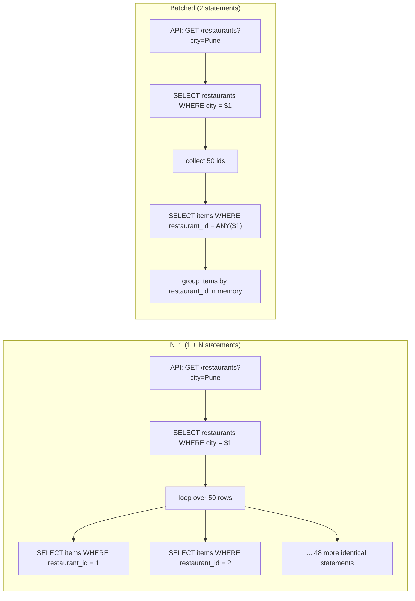
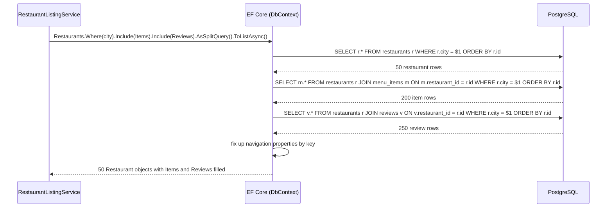

Most slow pages in a .NET application are not slow because PostgreSQL is slow. They are slow because the code asks PostgreSQL the same small question hundreds of times in a row. This lesson shows how that happens, how to catch it in tests, and which EF Core features fix it without turning your code into hand-written SQL everywhere.

## Learning objectives

By the end of this lesson you will be able to:

1. Explain the N+1 problem with numbers: why 1 + N round trips cost far more than 1 big query, even on a fast network.
2. Detect N+1 in code review, in logs and in an automated test that counts queries.
3. Choose between `Include`, a projection (`Select`), and a split query (`AsSplitQuery`) for a given screen, and explain the cartesian-explosion trade-off.
4. Use `AsNoTracking`, compiled queries and `IDbContextFactory` to cut per-query overhead where it matters.
5. Write the PostgreSQL that EF Core would generate (joins, `LATERAL` top-N) so you can read query plans and fix the slow ones.
6. Say when the simplest fix (a small `IN (...)` batch) beats every ORM feature.

## Prerequisites

- [Relational database fundamentals](#/lesson/m09-relational-fundamentals) and [One-to-one, one-to-many and many-to-many](#/lesson/m09-relationships): you should be comfortable with foreign keys and joins.
- [Indexes](#/lesson/m09-indexes): the batched queries in this lesson depend on an index on the foreign-key column.
- [Query planning and EXPLAIN ANALYZE](#/lesson/m09-query-planning): we will reason about the cost of one big query versus many small ones.

## Explain it like I'm a beginner

Imagine you run a tiffin-delivery service in Pune and your manager asks for a sheet of all 50 restaurants with the number of dishes each one sells.

Option A: you phone each restaurant and ask "how many dishes do you have?" That is 50 phone calls, plus the one call to head office to get the list of restaurants. 51 calls. Each call takes 30 seconds of dialling and greeting even if the answer is one word. Total: about 25 minutes.

Option B: you ask head office once: "send me the list of restaurants *with* the dish count for each." One call, maybe two minutes.

A web application that loads a list and then, inside a loop, loads something for each row is doing Option A. The database equivalent is **one query for the list, then N more queries, one per row**. We call that the **N+1 query problem** (N+1 queries where 1 or 2 would do).

The "dialling and greeting" is the round trip (network latency) plus the work PostgreSQL does for every statement no matter how small: parse it, plan it, start a transaction snapshot, send the result back. On a LAN that is about half a millisecond. Across availability zones in a cloud region it is often 1–2 ms. 50 rows × 1 ms is 50 ms, which already feels sluggish. A page with 500 rows and two related collections per row is 1,001 queries and a second of pure waiting.

The fix is always the same idea: **ask for related data in bulk**. Either join it in the same query, or fetch the list first and then fetch *all* the related rows in one second query (`WHERE restaurant_id IN (1, 2, …, 50)`). Object-relational mappers (ORMs) like EF Core make N+1 easy to write by accident, and they also give you the tools to avoid it. The skill is knowing which tool fits which screen.

## First-principles explanation

### Where the time really goes

A query's cost has two parts:

- **Fixed cost per statement**: network round trip, parsing, planning, snapshot, result serialisation. Call it 0.3–2 ms depending on where the database lives. This is what N+1 multiplies.
- **Variable cost per row**: reading pages from disk or cache, joining, sorting. A single query that returns 1,000 rows pays this once per row, but the fixed cost only once.

Back-of-the-envelope: a listing of 50 restaurants with menu counts and average ratings.

| Approach | Statements | Fixed cost (at 1 ms each) | Rows moved |
|---|---|---|---|
| N+1 for items and reviews | 1 + 50 + 50 = 101 | ~101 ms | 50 + 200 + 250 |
| One join (single query) | 1 | ~1 ms | up to 50 × 4 × 5 = 1,000 (cartesian) |
| Split: list + items + reviews | 3 | ~3 ms | 50 + 200 + 250 = 500 |

These are estimates, not benchmarks, but the shape is right: the N+1 version is 30–100× slower in latency, and it also holds a pooled connection for the whole loop, which starves other requests (see [Database connection pooling](#/lesson/m09-connection-pooling)).

### Why ORMs make it easy to write

EF Core maps a `Restaurant` class with a `List<MenuItem> Items` property. If you load restaurants and then touch `r.Items` in a loop, one of two things happens:

- With **lazy loading** enabled (proxies), EF Core silently runs a query *per restaurant* the moment you touch the property. The code looks innocent and the N+1 is invisible.
- Without lazy loading (the EF Core default), `Items` is just `null` or empty, and someone "fixes" the bug by adding a query inside the loop. Same result, written by hand.

Either way the symptom is the same: a log full of identical statements that differ only in one parameter value.

### The four tools, and what each costs

1. **Eager loading with `Include`**: one SQL statement with `LEFT JOIN`s. Simple, but each extra collection multiplies rows (the **cartesian explosion**). Restaurants × items × reviews = items·reviews rows per restaurant.
2. **Split queries with `AsSplitQuery`**: EF Core runs one statement per collection, each with the same `WHERE`, and stitches the results in memory. No explosion, but 2–3 round trips and no single consistent snapshot unless you wrap them in a transaction.
3. **Projection with `Select`**: ask for exactly the columns and aggregates the screen needs (`new RestaurantCard(r.Id, r.Name, r.Items.Count(), r.Reviews.Average(...))`). EF Core translates to SQL subqueries or `LATERAL` joins. Smallest result set, no change tracking, but you cannot update the result.
4. **Batching by hand**: load the list, collect ids, run `WHERE restaurant_id = ANY($1)`. Works with any data access layer, and it is what EF Core's split query does under the hood.

Then there are the per-query overheads:

- **Change tracking**: EF Core keeps a snapshot of every loaded entity so it can detect changes on `SaveChanges`. For read-only screens that is wasted memory and CPU. `AsNoTracking()` (or `UseQueryTrackingBehavior(NoTracking)` for the whole context) removes it. Projections to DTOs are never tracked anyway.
- **Query compilation**: EF Core turns a LINQ expression tree into SQL. It caches the result keyed by the expression shape, so the second call is cheap. A **compiled query** (`EF.CompileAsyncQuery`) skips even the cache lookup. It matters only in very hot paths (thousands of calls per second); for most endpoints it is noise.
- **Context creation**: `DbContext` pooling (`AddDbContextPool`) reuses context instances; `IDbContextFactory<T>` is the right tool for background services where no request scope exists.

### What breaks first under load

With N+1 the first thing to break is the **connection pool**, not the database. Each request holds its connection for the whole loop (101 ms instead of 3 ms), so with a pool of 100 connections you saturate at about 1,000 requests per second instead of 30,000. Requests then queue for a connection, latency climbs, and health checks time out. PostgreSQL itself is often sitting at 20 % CPU while this happens: the bottleneck is round trips, not work.

### When a simpler design is enough

- A detail page that loads **one** restaurant and its 12 menu items: `Include` is perfect; there is no N.
- A list that shows only columns of the main table: no related data, no problem.
- An admin screen used twice a day: fix it when it shows up in logs, not before.

The expensive, always-on list endpoints are where you spend the effort: the home feed, the search results, the orders page.

## Visual explanation

### Request flow: N+1 versus batched



Read the left side top to bottom: after the first query the code enters a loop and every iteration goes back to the database. The 50 statements are *the same text with a different parameter*, which is the signature you look for in logs. On the right, the code collects the ids and makes one trip. The grouping step (`ToLookup(i => i.RestaurantId)`) replaces the loop's queries with a dictionary lookup that costs nanoseconds.

### Sequence: what EF Core does for a split query



Three statements, each repeating the outer `WHERE` so the database does the filtering, and each ordered by the parent key so EF Core can merge them in a single pass. Note what this costs: three round trips instead of one, and the three statements see three different snapshots unless you open a transaction first. If a review is inserted between statement 1 and 3, you get a review for a restaurant you already loaded (harmless here) or, in other shapes, a child whose parent is missing. Single-query mode (one `LEFT JOIN`) avoids that at the price of the cartesian explosion.

## Step-by-step example

We will fix one endpoint: `GET /restaurants?city=Pune` returns cards with the restaurant name, how many dishes are available and the average rating.

### Step 1 — the naive version (do not ship this)

```csharp
// BAD: one query for the list, then two queries per restaurant.
var restaurants = await db.Restaurants.Where(r => r.City == city).ToListAsync(ct);
var cards = new List<RestaurantCard>();
foreach (var r in restaurants)
{
    var itemCount = await db.MenuItems.CountAsync(m => m.RestaurantId == r.Id && m.IsAvailable, ct);
    var avg = await db.Reviews.Where(v => v.RestaurantId == r.Id).AverageAsync(v => (double?)v.Rating, ct);
    cards.Add(new RestaurantCard(r.Id, r.Name, itemCount, avg));
}
```

With 50 restaurants this is 101 statements. The code reads naturally, which is exactly why it survives code review.

### Step 2 — see it

Turn on EF Core's logging for the `Database.Command` category at `Information` and run the endpoint once. You will see 101 lines of `Executed DbCommand (0ms) [Parameters=[@__r_Id_0='17'], ...]`. Better still, write a test that counts statements (we do this in the implementation section) so the regression cannot come back.

### Step 3 — projection: ask for what the screen needs

```csharp
// GOOD for read-only lists: one statement, no tracking, only the needed columns.
var cards = await db.Restaurants
    .Where(r => r.City == city)
    .OrderBy(r => r.Id)
    .Select(r => new RestaurantCard(
        r.Id,
        r.Name,
        r.Items.Count(m => m.IsAvailable),
        r.Reviews.Average(v => (double?)v.Rating)))
    .ToListAsync(ct);
```

EF Core translates the two aggregates to correlated subqueries. PostgreSQL runs it as one statement, roughly:

```sql
SELECT r.id, r.name,
       (SELECT count(*) FROM menu_items m WHERE m.restaurant_id = r.id AND m.is_available) AS item_count,
       (SELECT avg(v.rating) FROM reviews v WHERE v.restaurant_id = r.id) AS avg_rating
FROM restaurants r
WHERE r.city = $1
ORDER BY r.id;
```

With indexes on `menu_items(restaurant_id)` and `reviews(restaurant_id)`, each subquery is an index scan of a handful of rows. 50 restaurants, 1 round trip.

### Step 4 — when you need the entities: Include, and the explosion

Suppose the detail page needs full `Restaurant` objects with items and reviews to edit them. Two includes in a single query produce `restaurants LEFT JOIN menu_items LEFT JOIN reviews`. A restaurant with 4 items and 10 reviews comes back as 40 rows, each carrying the restaurant columns and the item columns again. EF Core logs a `MultipleCollectionIncludeWarning` when it sees this shape. Two fixes:

```csharp
// Option A: split queries — 3 statements, no duplication.
var r = await db.Restaurants
    .Include(x => x.Items.Where(m => m.IsAvailable))   // filtered include (EF Core 5+)
    .Include(x => x.Reviews.OrderByDescending(v => v.CreatedAt).Take(20))
    .AsSplitQuery()
    .FirstAsync(x => x.Id == id, ct);

// Option B: keep single query but include only ONE collection; load the other on demand.
```

Rule of thumb: one collection include per query is fine in single mode. Two or more collections: use `AsSplitQuery()` or a projection. You can also set split as the default for a context with `UseQuerySplittingBehavior(QuerySplittingBehavior.SplitQuery)` in `UseNpgsql(...)` and opt back in to single per query with `AsSingleQuery()`.

### Step 5 — remove overhead you do not need

```csharp
// Read-only: skip change tracking.
var list = await db.Restaurants.AsNoTracking().Where(r => r.City == city).ToListAsync(ct);

// Hot path called thousands of times per second: compile once.
private static readonly Func<CatalogDbContext, int, CancellationToken, Task<Restaurant?>> ById =
    EF.CompileAsyncQuery((CatalogDbContext db, int id, CancellationToken ct) =>
        db.Restaurants.AsNoTracking().FirstOrDefault(r => r.Id == id));
```

The compiled query saves a cache lookup and expression-tree hashing, typically a few tens of microseconds per call (an estimate; measure yours). On a 1 ms query that is a rounding error. On a 50 µs primary-key lookup hit 5,000 times per second it is worth having.

## Production-style C# implementation

The checker for this course cannot compile EF Core, so the compiled code below talks to a small in-memory "database" behind an interface that **counts statements**. That is also the right shape for a unit test in a real project: your service depends on a repository interface, and the test double records how many times it was called. The EF Core implementation of the same interface was shown in the step-by-step section above.

```text
Catalog.Api/
  Program.cs
  Catalog/Models.cs
  Catalog/IQueryLog.cs
  Catalog/InMemoryCatalogStore.cs
  Catalog/RestaurantListingService.cs
  Catalog/QueryBudget.cs
```

```csharp file=Catalog/Models.cs
namespace Catalog;

public sealed record Restaurant(int Id, string Name, string City);
public sealed record MenuItem(int Id, int RestaurantId, string Name, int PricePaise, bool IsAvailable);
public sealed record Review(int Id, int RestaurantId, int Rating, DateOnly CreatedAt);

/// <summary>What the listing screen shows. A DTO, never tracked, never updated.</summary>
public sealed record RestaurantCard(int Id, string Name, int AvailableItems, double? AverageRating);
```

```csharp file=Catalog/IQueryLog.cs
namespace Catalog;

/// <summary>Records every statement sent to the store. In production this is the EF Core command
/// interceptor or Npgsql logging; in tests it lets us assert "this request ran 3 statements".</summary>
public interface IQueryLog
{
    int Count { get; }
    IReadOnlyList<string> Statements { get; }
    void Record(string statement);
}

public sealed class ListQueryLog : IQueryLog
{
    private readonly List<string> _statements = new();
    public int Count => _statements.Count;
    public IReadOnlyList<string> Statements => _statements;
    public void Record(string statement) => _statements.Add(statement);

    /// <summary>Statement texts (parameters stripped) that ran more than once — the N+1 fingerprint.</summary>
    public IReadOnlyList<string> Repeated() =>
        _statements.GroupBy(s => s).Where(g => g.Count() > 1).Select(g => g.Key).ToList();
}
```

```csharp file=Catalog/InMemoryCatalogStore.cs
namespace Catalog;

/// <summary>Stands in for the database. Each public method is "one statement" and records itself.
/// It exposes both the per-row methods (the trap) and the batched methods (the fix).</summary>
public interface ICatalogStore
{
    Task<IReadOnlyList<Restaurant>> RestaurantsByCityAsync(string city, CancellationToken ct);
    Task<IReadOnlyList<MenuItem>> ItemsForRestaurantAsync(int restaurantId, CancellationToken ct);
    Task<IReadOnlyList<MenuItem>> ItemsForRestaurantsAsync(IReadOnlyCollection<int> restaurantIds, CancellationToken ct);
    Task<IReadOnlyList<Review>> ReviewsForRestaurantsAsync(IReadOnlyCollection<int> restaurantIds, CancellationToken ct);
}

public sealed class InMemoryCatalogStore(IQueryLog log) : ICatalogStore
{
    public List<Restaurant> Restaurants { get; } = new();
    public List<MenuItem> Items { get; } = new();
    public List<Review> Reviews { get; } = new();

    public Task<IReadOnlyList<Restaurant>> RestaurantsByCityAsync(string city, CancellationToken ct)
    {
        log.Record("SELECT * FROM restaurants WHERE city = $1 ORDER BY id");
        return Task.FromResult<IReadOnlyList<Restaurant>>(Restaurants.Where(r => r.City == city).OrderBy(r => r.Id).ToList());
    }

    public Task<IReadOnlyList<MenuItem>> ItemsForRestaurantAsync(int restaurantId, CancellationToken ct)
    {
        // Parameter value deliberately NOT in the text, so repeated calls look identical in the log.
        log.Record("SELECT * FROM menu_items WHERE restaurant_id = $1");
        return Task.FromResult<IReadOnlyList<MenuItem>>(Items.Where(m => m.RestaurantId == restaurantId).ToList());
    }

    public Task<IReadOnlyList<MenuItem>> ItemsForRestaurantsAsync(IReadOnlyCollection<int> ids, CancellationToken ct)
    {
        log.Record("SELECT * FROM menu_items WHERE restaurant_id = ANY($1)");
        var set = ids.ToHashSet();
        return Task.FromResult<IReadOnlyList<MenuItem>>(Items.Where(m => set.Contains(m.RestaurantId)).ToList());
    }

    public Task<IReadOnlyList<Review>> ReviewsForRestaurantsAsync(IReadOnlyCollection<int> ids, CancellationToken ct)
    {
        log.Record("SELECT * FROM reviews WHERE restaurant_id = ANY($1)");
        var set = ids.ToHashSet();
        return Task.FromResult<IReadOnlyList<Review>>(Reviews.Where(v => set.Contains(v.RestaurantId)).ToList());
    }
}
```

```csharp file=Catalog/RestaurantListingService.cs
namespace Catalog;

/// <summary>Builds the listing with a fixed number of statements (3) whatever the city size.</summary>
public sealed class RestaurantListingService(ICatalogStore store, QueryBudget budget)
{
    public async Task<IReadOnlyList<RestaurantCard>> ListAsync(string city, CancellationToken ct)
    {
        var restaurants = await store.RestaurantsByCityAsync(city, ct);
        budget.Spend();
        if (restaurants.Count == 0) return Array.Empty<RestaurantCard>();

        var ids = restaurants.Select(r => r.Id).ToArray();
        var items = await store.ItemsForRestaurantsAsync(ids, ct);
        budget.Spend();
        var reviews = await store.ReviewsForRestaurantsAsync(ids, ct);
        budget.Spend();

        // In-memory "fix-up", exactly what EF Core does after a split query.
        var itemsBy = items.Where(m => m.IsAvailable).ToLookup(m => m.RestaurantId);
        var ratingBy = reviews.GroupBy(v => v.RestaurantId)
                              .ToDictionary(g => g.Key, g => g.Average(v => (double)v.Rating));

        return restaurants
            .Select(r => new RestaurantCard(r.Id, r.Name, itemsBy[r.Id].Count(),
                                            ratingBy.TryGetValue(r.Id, out var avg) ? avg : null))
            .ToList();
    }
}
```

```csharp file=Catalog/QueryBudget.cs
namespace Catalog;

public sealed class QueryBudgetExceededException(int limit)
    : InvalidOperationException($"Request exceeded its budget of {limit} database statements. Likely N+1.");

/// <summary>Per-request guard. Scoped in DI. In development it throws so the N+1 fails the test;
/// in production it only counts, and the count is exported as a metric.</summary>
public sealed class QueryBudget(int limit, bool throwOnExceed)
{
    public int Limit { get; } = limit;
    public int Spent { get; private set; }
    public bool Exceeded => Spent > Limit;

    public void Spend()
    {
        Spent++;
        if (throwOnExceed && Spent > Limit) throw new QueryBudgetExceededException(Limit);
    }
}
```

```csharp file=Program.cs
using Catalog;

var builder = WebApplication.CreateBuilder(args);

// One log and one budget per request. The store would be a pooled DbContext in a real app.
builder.Services.AddScoped<IQueryLog, ListQueryLog>();
builder.Services.AddScoped<QueryBudget>(_ =>
    new QueryBudget(limit: 10, throwOnExceed: builder.Environment.IsDevelopment()));
builder.Services.AddSingleton<InMemoryCatalogStore>(sp => Seed.Build(new ListQueryLog()));
builder.Services.AddScoped<ICatalogStore>(sp =>
{
    // Share the seeded data, but record statements into THIS request's log.
    var seeded = sp.GetRequiredService<InMemoryCatalogStore>();
    var store = new InMemoryCatalogStore(sp.GetRequiredService<IQueryLog>());
    store.Restaurants.AddRange(seeded.Restaurants);
    store.Items.AddRange(seeded.Items);
    store.Reviews.AddRange(seeded.Reviews);
    return store;
});
builder.Services.AddScoped<RestaurantListingService>();

var app = builder.Build();

app.MapGet("/restaurants", async (string city, RestaurantListingService svc, IQueryLog log, HttpResponse res, CancellationToken ct) =>
{
    var cards = await svc.ListAsync(city, ct);
    res.Headers["X-Db-Statements"] = log.Count.ToString();   // handy while developing
    return Results.Ok(cards);
});

app.Run();

public static class Seed
{
    public static InMemoryCatalogStore Build(IQueryLog log)
    {
        var s = new InMemoryCatalogStore(log);
        string[] cities = { "Pune", "Mumbai", "Delhi" };
        for (var i = 1; i <= 60; i++)
        {
            s.Restaurants.Add(new Restaurant(i, $"Restaurant {i}", cities[i % 3]));
            for (var j = 1; j <= 4; j++) s.Items.Add(new MenuItem(i * 10 + j, i, $"Dish {j}", 9900 + j * 2500, j != 4));
            for (var k = 1; k <= 5; k++) s.Reviews.Add(new Review(i * 10 + k, i, 1 + (i + k) % 5, new DateOnly(2026, 9, 1 + k)));
        }
        return s;
    }
}
```

**How this maps to EF Core.** `ICatalogStore` is the seam. The production implementation wraps a `CatalogDbContext` and its `RestaurantsByCityAsync` is the projection query from Step 3, or a split-query `Include`. The `IQueryLog` is replaced by a `DbCommandInterceptor` (override `ReaderExecutingAsync` and record `command.CommandText`) registered with `options.AddInterceptors(...)`. The `QueryBudget` stays exactly as it is: a scoped object the interceptor calls `Spend()` on. In `Development`, a test hitting `/restaurants` with 60 rows will throw on the 11th statement, which turns an invisible slowdown into a red build.

:::callout type=tip title="A test that fails on N+1"
Register `ListQueryLog` as scoped, call the endpoint with a city that has at least 20 rows, then assert `log.Count <= 3` and `log.Repeated().Count == 0`. The second assertion is the sharper one: a request that runs the same statement text twice is almost always looping.
:::

## Bad design vs good design

**Bad**: lazy loading enabled globally (`UseLazyLoadingProxies()`), a `Restaurant` entity with `virtual ICollection<MenuItem> Items`, and a Razor view that writes `@restaurant.Items.Count` inside a `foreach`. Nothing in the C# shows a query. The page runs 1 + N statements, the N grows with the business, and the first person to notice is a customer in a city with 400 restaurants.

Problems:

- The data access happens in the view, far from anyone who thinks about SQL.
- The number of statements is a function of data volume, so it passes every test on a 5-row fixture.
- Every statement holds the pooled connection, so one slow page degrades unrelated endpoints.

**Good**: the implementation above. The service decides, in one place, which statements run. The count is constant. A budget object turns a regression into a thrown exception in development, and a metric in production. Read screens use projections to DTOs; edit screens use `Include` with `AsSplitQuery()` for multiple collections.

**Is the ORM the problem?** No. Hand-written Dapper code with a `foreach` and a `QueryAsync` inside is the same bug with more typing. The fix is a habit: *after you load a list, you may not query inside the loop over it*. Collect the keys and go once.

:::callout type=tradeoff title="Single query, split query or projection?"
- **Projection** when the screen is read-only and needs a subset of columns or aggregates. Smallest payload, one statement.
- **Include, single query** when you need entities and there is at most one collection navigation.
- **Include, split query** when you need entities with two or more collections. Accept 2–3 round trips; wrap in a transaction if the collections must be mutually consistent.
- **Hand batching with `ANY($1)`** when you are not using EF Core, or when you load children from a different store (another database, a cache, an HTTP service). GraphQL servers call this a DataLoader (see [GraphQL](#/lesson/m10-graphql)).
:::

## Practical playground

The seed below is the catalogue from this lesson: 8 restaurants in three cities, 28 menu items (restaurant 3 has none) and 40 reviews. Try the three shapes yourself: the N+1 statement for one restaurant, the single join with its cartesian explosion, and the projection with correlated subqueries. Then run `EXPLAIN` in front of each and compare.

:::playground type=sql title="One join, split queries, or a projection?"
```sql
CREATE TABLE restaurants (
  id   int  PRIMARY KEY,
  name text NOT NULL,
  city text NOT NULL
);
CREATE TABLE menu_items (
  id            int  PRIMARY KEY,
  restaurant_id int  NOT NULL REFERENCES restaurants (id),
  name          text NOT NULL,
  price_paise   int  NOT NULL,
  is_available  boolean NOT NULL DEFAULT true
);
CREATE TABLE reviews (
  id            int  PRIMARY KEY,
  restaurant_id int  NOT NULL REFERENCES restaurants (id),
  rating        int  NOT NULL CHECK (rating BETWEEN 1 AND 5),
  created_at    date NOT NULL
);
CREATE INDEX ON menu_items (restaurant_id);
CREATE INDEX ON reviews (restaurant_id);

INSERT INTO restaurants VALUES
  (1,'Shivaji Misal House','Pune'), (2,'Kothrud Kitchen','Pune'), (3,'New Cloud Kitchen','Pune'),
  (4,'Bandra Bites','Mumbai'),      (5,'Marine Drive Cafe','Mumbai'),
  (6,'Chandni Chowk Chaat','Delhi'),(7,'Hauz Khas Grill','Delhi'), (8,'Dwarka Dhaba','Delhi');

-- 28 items spread over restaurants 1,2,4..8 (restaurant 3 has no menu yet); every 5th item is unavailable.
INSERT INTO menu_items
SELECT g, (ARRAY[1,2,4,5,6,7,8])[((g - 1) % 7) + 1], 'Item ' || g, 9900 + (g * 3700) % 30000, g % 5 <> 0
FROM generate_series(1, 28) AS g;

-- 40 reviews; restaurant 1 gets twice as many as the others.
INSERT INTO reviews
SELECT g, (ARRAY[1,1,2,4,5,6,7,8])[((g - 1) % 8) + 1], 1 + (g * 7) % 5, DATE '2026-09-01' + (g % 45)
FROM generate_series(1, 40) AS g;

-- The N+1 statement, as EF Core would run it 8 times:
-- SELECT * FROM menu_items WHERE restaurant_id = 1;
-- The single-query Include (count the rows that come back!):
-- SELECT r.id, m.id AS item, v.id AS review FROM restaurants r
--   LEFT JOIN menu_items m ON m.restaurant_id = r.id
--   LEFT JOIN reviews v ON v.restaurant_id = r.id ORDER BY r.id;
```
:::

## Exercises

:::exercise id=m09-n-plus-one-ex1 difficulty=beginner kind=sql ordered=true title="Replace the loop with one query"
The listing page currently runs `SELECT count(*) FROM menu_items WHERE restaurant_id = $1` once per restaurant. Write **one** query that returns every Pune restaurant with its number of menu items (available or not), as columns `id`, `name`, `item_count`, ordered by `id`. Restaurants with no items must appear with `0`.
::setup
```sql
CREATE TABLE restaurants (id int PRIMARY KEY, name text NOT NULL, city text NOT NULL);
CREATE TABLE menu_items (id int PRIMARY KEY, restaurant_id int NOT NULL REFERENCES restaurants (id), name text NOT NULL, price_paise int NOT NULL, is_available boolean NOT NULL DEFAULT true);
INSERT INTO restaurants VALUES
  (1,'Shivaji Misal House','Pune'), (2,'Kothrud Kitchen','Pune'), (3,'New Cloud Kitchen','Pune'),
  (4,'Bandra Bites','Mumbai'), (5,'Marine Drive Cafe','Mumbai'),
  (6,'Chandni Chowk Chaat','Delhi'), (7,'Hauz Khas Grill','Delhi'), (8,'Dwarka Dhaba','Delhi');
INSERT INTO menu_items
SELECT g, (ARRAY[1,2,4,5,6,7,8])[((g - 1) % 7) + 1], 'Item ' || g, 9900 + (g * 3700) % 30000, g % 5 <> 0
FROM generate_series(1, 28) AS g;
```
::check
```sql
SELECT r.id, r.name, count(m.id) AS item_count
FROM restaurants r
LEFT JOIN menu_items m ON m.restaurant_id = r.id
WHERE r.city = 'Pune'
GROUP BY r.id, r.name
ORDER BY r.id;
```
::acceptance
- Exactly three rows: ids 1, 2 and 3.
- Restaurants 1 and 2 show `item_count` 4; restaurant 3 shows 0.
- A single statement, no procedural loop.
::hint
You need rows from `restaurants` even when there is no matching `menu_items` row. Which join keeps the left side?
::hint
`LEFT JOIN menu_items m ON m.restaurant_id = r.id`, then `GROUP BY r.id, r.name`.
::hint
`count(*)` would return 1 for the restaurant with no items (the NULL-padded row still counts). Count a column from the right table instead: `count(m.id)`.
::hint
```sql
SELECT r.id, r.name, count(m.id) AS item_count
FROM restaurants r LEFT JOIN menu_items m ON m.restaurant_id = r.id
WHERE r.city = 'Pune'
GROUP BY r.id, r.name ORDER BY r.id;
```
::solution
```sql
SELECT r.id, r.name, count(m.id) AS item_count
FROM restaurants r
LEFT JOIN menu_items m ON m.restaurant_id = r.id
WHERE r.city = 'Pune'
GROUP BY r.id, r.name
ORDER BY r.id;
```
This is what EF Core produces for `.Select(r => new { r.Id, r.Name, ItemCount = r.Items.Count() })`, except EF Core prefers a correlated subquery (`(SELECT count(*) FROM menu_items m WHERE m.restaurant_id = r.id)`), which gives the same result and avoids the `GROUP BY`. Both run as one statement; both use the index on `menu_items(restaurant_id)`.
::mistakes
- Using `INNER JOIN`, which drops New Cloud Kitchen.
- Using `count(*)`, which reports 1 for the restaurant with no items.
- Forgetting `GROUP BY r.name` (PostgreSQL allows it only because `r.id` is the primary key; it is clearer to list both).
:::

:::exercise id=m09-n-plus-one-ex2 difficulty=beginner kind=code title="Batch the child query"
`NaiveMenuLoader` loads menu items with one store call per restaurant. Implement `BatchedMenuLoader.LoadAsync` so that it makes **exactly one** call to `ItemsForRestaurantsAsync` and returns the same dictionary (restaurant id → its items, in the store's order). Restaurants with no items must still have an (empty) entry.
::acceptance
- For 10 restaurants the fake store records exactly 1 statement (the naive loader records 10).
- Every requested restaurant id is a key in the result, including ones with no items.
- Items are grouped under the right restaurant.
::hint
Collect all the ids first, then make a single call with the whole collection.
::hint
`ToLookup(m => m.RestaurantId)` groups the batch result in memory; indexing a lookup with a missing key returns an empty sequence, not an exception.
::hint
Build the dictionary from the *requested ids*, not from the items, so restaurants with no items still get an entry.
::hint
```csharp
var items = await store.ItemsForRestaurantsAsync(ids, ct);
var byRestaurant = items.ToLookup(m => m.RestaurantId);
return ids.ToDictionary(id => id, id => (IReadOnlyList<MenuItem>)byRestaurant[id].ToList());
```
::starter
```csharp file=MenuLoaders.cs
using System;
using System.Collections.Generic;
using System.Linq;
using System.Threading;
using System.Threading.Tasks;

public sealed record MenuItem(int Id, int RestaurantId, string Name);

public interface IMenuStore
{
    int Statements { get; }
    Task<IReadOnlyList<MenuItem>> ItemsForRestaurantAsync(int restaurantId, CancellationToken ct);
    Task<IReadOnlyList<MenuItem>> ItemsForRestaurantsAsync(IReadOnlyCollection<int> restaurantIds, CancellationToken ct);
}

public sealed class FakeMenuStore : IMenuStore
{
    private readonly List<MenuItem> _items = new();
    public int Statements { get; private set; }
    public FakeMenuStore Add(params MenuItem[] items) { _items.AddRange(items); return this; }

    public Task<IReadOnlyList<MenuItem>> ItemsForRestaurantAsync(int restaurantId, CancellationToken ct)
    {
        Statements++;
        return Task.FromResult<IReadOnlyList<MenuItem>>(_items.Where(m => m.RestaurantId == restaurantId).ToList());
    }

    public Task<IReadOnlyList<MenuItem>> ItemsForRestaurantsAsync(IReadOnlyCollection<int> ids, CancellationToken ct)
    {
        Statements++;
        var set = new HashSet<int>(ids);
        return Task.FromResult<IReadOnlyList<MenuItem>>(_items.Where(m => set.Contains(m.RestaurantId)).ToList());
    }
}

public interface IMenuLoader
{
    Task<IReadOnlyDictionary<int, IReadOnlyList<MenuItem>>> LoadAsync(IReadOnlyList<int> restaurantIds, CancellationToken ct);
}

/// <summary>The N+1 version, kept for comparison.</summary>
public sealed class NaiveMenuLoader(IMenuStore store) : IMenuLoader
{
    public async Task<IReadOnlyDictionary<int, IReadOnlyList<MenuItem>>> LoadAsync(IReadOnlyList<int> restaurantIds, CancellationToken ct)
    {
        var result = new Dictionary<int, IReadOnlyList<MenuItem>>();
        foreach (var id in restaurantIds)
            result[id] = await store.ItemsForRestaurantAsync(id, ct);
        return result;
    }
}

public sealed class BatchedMenuLoader(IMenuStore store) : IMenuLoader
{
    public Task<IReadOnlyDictionary<int, IReadOnlyList<MenuItem>>> LoadAsync(IReadOnlyList<int> restaurantIds, CancellationToken ct)
        => throw new NotImplementedException();
}
```
::tests
```csharp file=MenuLoaderTests.cs
using System.Linq;
using System.Threading;
using System.Threading.Tasks;
using Xunit;

public class MenuLoaderTests
{
    private static FakeMenuStore Store()
    {
        var s = new FakeMenuStore();
        for (var r = 1; r <= 10; r++)
            if (r != 7) s.Add(new MenuItem(r * 10 + 1, r, "Thali"), new MenuItem(r * 10 + 2, r, "Lassi"));
        return s;
    }

    private static readonly int[] Ids = Enumerable.Range(1, 10).ToArray();

    [Fact]
    public async Task Naive_loader_runs_one_statement_per_restaurant()
    {
        var store = Store();
        await new NaiveMenuLoader(store).LoadAsync(Ids, CancellationToken.None);
        Assert.Equal(10, store.Statements);
    }

    [Fact]
    public async Task Batched_loader_runs_exactly_one_statement()
    {
        var store = Store();
        await new BatchedMenuLoader(store).LoadAsync(Ids, CancellationToken.None);
        Assert.Equal(1, store.Statements);
    }

    [Fact]
    public async Task Batched_loader_groups_items_correctly()
    {
        var result = await new BatchedMenuLoader(Store()).LoadAsync(Ids, CancellationToken.None);
        Assert.Equal(10, result.Count);
        Assert.Equal(2, result[3].Count);
        Assert.All(result[3], m => Assert.Equal(3, m.RestaurantId));
    }

    [Fact]
    public async Task Restaurant_without_items_has_empty_entry()
    {
        var result = await new BatchedMenuLoader(Store()).LoadAsync(Ids, CancellationToken.None);
        Assert.True(result.ContainsKey(7));
        Assert.Empty(result[7]);
    }

    [Fact]
    public async Task Empty_input_runs_no_statement()
    {
        var store = Store();
        var result = await new BatchedMenuLoader(store).LoadAsync(new int[0], CancellationToken.None);
        Assert.Empty(result);
        Assert.Equal(0, store.Statements);
    }
}
```
::solution
Collect, fetch once, group in memory. The early return for an empty input avoids sending `WHERE restaurant_id = ANY('{}')` to the database for nothing.

```csharp file=MenuLoaders.cs
using System;
using System.Collections.Generic;
using System.Linq;
using System.Threading;
using System.Threading.Tasks;

public sealed record MenuItem(int Id, int RestaurantId, string Name);

public interface IMenuStore
{
    int Statements { get; }
    Task<IReadOnlyList<MenuItem>> ItemsForRestaurantAsync(int restaurantId, CancellationToken ct);
    Task<IReadOnlyList<MenuItem>> ItemsForRestaurantsAsync(IReadOnlyCollection<int> restaurantIds, CancellationToken ct);
}

public sealed class FakeMenuStore : IMenuStore
{
    private readonly List<MenuItem> _items = new();
    public int Statements { get; private set; }
    public FakeMenuStore Add(params MenuItem[] items) { _items.AddRange(items); return this; }

    public Task<IReadOnlyList<MenuItem>> ItemsForRestaurantAsync(int restaurantId, CancellationToken ct)
    {
        Statements++;
        return Task.FromResult<IReadOnlyList<MenuItem>>(_items.Where(m => m.RestaurantId == restaurantId).ToList());
    }

    public Task<IReadOnlyList<MenuItem>> ItemsForRestaurantsAsync(IReadOnlyCollection<int> ids, CancellationToken ct)
    {
        Statements++;
        var set = new HashSet<int>(ids);
        return Task.FromResult<IReadOnlyList<MenuItem>>(_items.Where(m => set.Contains(m.RestaurantId)).ToList());
    }
}

public interface IMenuLoader
{
    Task<IReadOnlyDictionary<int, IReadOnlyList<MenuItem>>> LoadAsync(IReadOnlyList<int> restaurantIds, CancellationToken ct);
}

public sealed class NaiveMenuLoader(IMenuStore store) : IMenuLoader
{
    public async Task<IReadOnlyDictionary<int, IReadOnlyList<MenuItem>>> LoadAsync(IReadOnlyList<int> restaurantIds, CancellationToken ct)
    {
        var result = new Dictionary<int, IReadOnlyList<MenuItem>>();
        foreach (var id in restaurantIds)
            result[id] = await store.ItemsForRestaurantAsync(id, ct);
        return result;
    }
}

public sealed class BatchedMenuLoader(IMenuStore store) : IMenuLoader
{
    public async Task<IReadOnlyDictionary<int, IReadOnlyList<MenuItem>>> LoadAsync(IReadOnlyList<int> restaurantIds, CancellationToken ct)
    {
        if (restaurantIds.Count == 0) return new Dictionary<int, IReadOnlyList<MenuItem>>();

        var distinct = restaurantIds.Distinct().ToArray();
        var items = await store.ItemsForRestaurantsAsync(distinct, ct);
        var byRestaurant = items.ToLookup(m => m.RestaurantId);

        return distinct.ToDictionary(id => id, id => (IReadOnlyList<MenuItem>)byRestaurant[id].ToList());
    }
}
```
::alternatives
If the id list can be very large (tens of thousands), chunk it: `ids.Chunk(1000)` and one statement per chunk. PostgreSQL handles large `ANY($1)` arrays well, but very large parameter arrays make plans worse and logs unreadable.
::mistakes
- Building the dictionary from `items.GroupBy(...)`, which silently drops restaurants with no items.
- Calling `ItemsForRestaurantsAsync` inside the loop with a one-element array: one statement per restaurant, exactly the bug with a different method name.
:::

:::exercise id=m09-n-plus-one-ex3 difficulty=intermediate kind=sql ordered=true title="Measure the cartesian explosion"
Two `Include`s in a single EF Core query become `restaurants JOIN menu_items JOIN reviews`. Write a query that shows, for every restaurant that has both items and reviews, how many rows the double join produces compared with the useful data: columns `id`, `items` (distinct menu items), `reviews` (distinct reviews) and `joined_rows` (rows the double join returns), ordered by `id`.
::setup
```sql
CREATE TABLE restaurants (id int PRIMARY KEY, name text NOT NULL, city text NOT NULL);
CREATE TABLE menu_items (id int PRIMARY KEY, restaurant_id int NOT NULL REFERENCES restaurants (id), name text NOT NULL, price_paise int NOT NULL, is_available boolean NOT NULL DEFAULT true);
CREATE TABLE reviews (id int PRIMARY KEY, restaurant_id int NOT NULL REFERENCES restaurants (id), rating int NOT NULL CHECK (rating BETWEEN 1 AND 5), created_at date NOT NULL);
INSERT INTO restaurants VALUES
  (1,'Shivaji Misal House','Pune'), (2,'Kothrud Kitchen','Pune'), (3,'New Cloud Kitchen','Pune'),
  (4,'Bandra Bites','Mumbai'), (5,'Marine Drive Cafe','Mumbai'),
  (6,'Chandni Chowk Chaat','Delhi'), (7,'Hauz Khas Grill','Delhi'), (8,'Dwarka Dhaba','Delhi');
INSERT INTO menu_items
SELECT g, (ARRAY[1,2,4,5,6,7,8])[((g - 1) % 7) + 1], 'Item ' || g, 9900 + (g * 3700) % 30000, g % 5 <> 0
FROM generate_series(1, 28) AS g;
INSERT INTO reviews
SELECT g, (ARRAY[1,1,2,4,5,6,7,8])[((g - 1) % 8) + 1], 1 + (g * 7) % 5, DATE '2026-09-01' + (g % 45)
FROM generate_series(1, 40) AS g;
```
::check
```sql
SELECT r.id,
       count(DISTINCT m.id) AS items,
       count(DISTINCT v.id) AS reviews,
       count(*)             AS joined_rows
FROM restaurants r
JOIN menu_items m ON m.restaurant_id = r.id
JOIN reviews    v ON v.restaurant_id = r.id
GROUP BY r.id
ORDER BY r.id;
```
::acceptance
- Seven rows (restaurant 3 has no items and is excluded by the inner joins).
- Restaurant 1 shows 4 items, 10 reviews and 40 joined rows; the others show 4, 5 and 20.
- `joined_rows` equals `items × reviews` on every row.
::hint
Start with the double join and `count(*)` grouped by restaurant. That number is what EF Core has to read and de-duplicate in single-query mode.
::hint
`count(m.id)` over the double join counts each item once *per review*. You need `count(DISTINCT m.id)`.
::hint
The total across all rows is 160 joined rows for 28 + 40 = 68 useful rows. A split query would fetch 68 rows in three statements; the single query fetches 160 in one. Which is cheaper depends on row width and latency: that is the trade-off.
::solution
```sql
SELECT r.id,
       count(DISTINCT m.id) AS items,
       count(DISTINCT v.id) AS reviews,
       count(*)             AS joined_rows
FROM restaurants r
JOIN menu_items m ON m.restaurant_id = r.id
JOIN reviews    v ON v.restaurant_id = r.id
GROUP BY r.id
ORDER BY r.id;
```
The explosion is multiplicative: each extra collection multiplies the row count by that collection's size. With three collections of 10 each you move 1,000 rows per parent to deliver 30. EF Core de-duplicates them correctly, but the bytes still cross the network and the database still sorts them. That is why EF Core warns on multiple collection includes and offers `AsSplitQuery()`.
::mistakes
- Using `LEFT JOIN`, which changes the question (and brings back restaurant 3 with `joined_rows = 1`).
- Reporting `count(m.id)` as "items"; it is inflated by the number of reviews.
:::

:::exercise id=m09-n-plus-one-ex4 difficulty=intermediate kind=code title="A per-request query budget with duplicate detection"
Implement `RequestQueryBudget`. It receives every statement text a request runs (parameters already stripped). It must count statements, throw `QueryBudgetExceededException` on the first statement **beyond** the limit when `throwOnExceed` is true, and report which statement texts ran more than once (`DuplicateStatements`), because repeated identical text is the N+1 fingerprint.
::acceptance
- With limit 3, the fourth `Record` throws when `throwOnExceed` is true; with it false, nothing throws and `Exceeded` becomes true.
- `DuplicateStatements` returns only texts that ran at least twice, each once, in first-seen order.
- `Statements` reports the total number recorded, including the one that threw.
::hint
Keep a `List<string>` of everything recorded; derive everything else from it.
::hint
Increment the count *before* checking the limit, so the statement that pushed you over is included in `Statements`.
::hint
For first-seen order, `GroupBy` preserves the order of first occurrence, so `GroupBy(s => s).Where(g => g.Count() > 1).Select(g => g.Key)` is enough.
::hint
```csharp
public void Record(string statement)
{
    _all.Add(statement);
    if (throwOnExceed && _all.Count > Limit) throw new QueryBudgetExceededException(Limit, _all.Count);
}
```
::starter
```csharp file=RequestQueryBudget.cs
using System;
using System.Collections.Generic;
using System.Linq;

public sealed class QueryBudgetExceededException(int limit, int actual)
    : InvalidOperationException($"Request ran {actual} statements; budget is {limit}.")
{
    public int Limit { get; } = limit;
    public int Actual { get; } = actual;
}

public sealed class RequestQueryBudget(int limit, bool throwOnExceed)
{
    public int Limit { get; } = limit;

    /// <summary>Total statements recorded so far.</summary>
    public int Statements => throw new NotImplementedException();

    /// <summary>True once more than Limit statements have been recorded.</summary>
    public bool Exceeded => throw new NotImplementedException();

    /// <summary>Statement texts recorded at least twice, each listed once, in first-seen order.</summary>
    public IReadOnlyList<string> DuplicateStatements => throw new NotImplementedException();

    public void Record(string statement) => throw new NotImplementedException();
}
```
::tests
```csharp file=RequestQueryBudgetTests.cs
using Xunit;

public class RequestQueryBudgetTests
{
    private const string List = "SELECT * FROM restaurants WHERE city = $1";
    private const string Child = "SELECT * FROM menu_items WHERE restaurant_id = $1";

    [Fact]
    public void Counts_statements()
    {
        var b = new RequestQueryBudget(10, throwOnExceed: true);
        b.Record(List); b.Record(Child); b.Record(Child);
        Assert.Equal(3, b.Statements);
        Assert.False(b.Exceeded);
    }

    [Fact]
    public void Throws_on_first_statement_beyond_limit()
    {
        var b = new RequestQueryBudget(3, throwOnExceed: true);
        b.Record(List); b.Record(Child); b.Record(Child);
        var ex = Assert.Throws<QueryBudgetExceededException>(() => b.Record(Child));
        Assert.Equal(3, ex.Limit);
        Assert.Equal(4, ex.Actual);
        Assert.Equal(4, b.Statements);
    }

    [Fact]
    public void Only_counts_when_not_throwing()
    {
        var b = new RequestQueryBudget(2, throwOnExceed: false);
        for (var i = 0; i < 5; i++) b.Record(Child);
        Assert.True(b.Exceeded);
        Assert.Equal(5, b.Statements);
    }

    [Fact]
    public void Reports_duplicates_once_in_first_seen_order()
    {
        var b = new RequestQueryBudget(100, throwOnExceed: false);
        b.Record(List);
        b.Record(Child); b.Record(Child); b.Record(Child);
        b.Record(List);
        b.Record("SELECT 1");
        Assert.Equal(new[] { List, Child }, b.DuplicateStatements);
    }

    [Fact]
    public void No_duplicates_for_a_well_behaved_request()
    {
        var b = new RequestQueryBudget(100, throwOnExceed: false);
        b.Record(List); b.Record("SELECT * FROM menu_items WHERE restaurant_id = ANY($1)");
        Assert.Empty(b.DuplicateStatements);
    }
}
```
::solution
Everything derives from one list. In a real application the `Record` call comes from an EF Core `DbCommandInterceptor` (or Npgsql's logging), and the budget object is registered as a scoped service so each request gets its own.

```csharp file=RequestQueryBudget.cs
using System;
using System.Collections.Generic;
using System.Linq;

public sealed class QueryBudgetExceededException(int limit, int actual)
    : InvalidOperationException($"Request ran {actual} statements; budget is {limit}.")
{
    public int Limit { get; } = limit;
    public int Actual { get; } = actual;
}

public sealed class RequestQueryBudget(int limit, bool throwOnExceed)
{
    private readonly List<string> _all = new();

    public int Limit { get; } = limit;
    public int Statements => _all.Count;
    public bool Exceeded => _all.Count > Limit;

    public IReadOnlyList<string> DuplicateStatements =>
        _all.GroupBy(s => s, StringComparer.Ordinal)
            .Where(g => g.Count() > 1)
            .Select(g => g.Key)
            .ToList();

    public void Record(string statement)
    {
        ArgumentNullException.ThrowIfNull(statement);
        _all.Add(statement);
        if (throwOnExceed && _all.Count > Limit)
            throw new QueryBudgetExceededException(Limit, _all.Count);
    }
}
```
::alternatives
Instead of throwing, emit an OpenTelemetry metric `db.statements_per_request` and alert when the p95 rises. Throwing is for development and CI; metrics are for production, where a thrown exception would turn a slow page into a broken one.
::mistakes
- Checking the limit before adding, so `Statements` under-reports by one when it throws.
- Normalising statement text by removing parameter *values* yourself: strip them at the source (EF Core logs placeholders like `@__id_0`), otherwise two different queries can collide.
:::

:::exercise id=m09-n-plus-one-ex5 difficulty=advanced kind=sql ordered=true title="Top-2 cheapest dishes per restaurant in one statement"
The home screen shows each restaurant with its two cheapest *available* dishes. The naive code runs `SELECT ... ORDER BY price LIMIT 2` once per restaurant. Write one query returning `restaurant_id`, `name` (dish name) and `price_paise` for the two cheapest available dishes of every restaurant that has any, ordered by `restaurant_id`, then `price_paise`, then `name`. This is what EF Core generates for `.Select(r => r.Items.Where(m => m.IsAvailable).OrderBy(m => m.PricePaise).Take(2))`.
::setup
```sql
CREATE TABLE restaurants (id int PRIMARY KEY, name text NOT NULL, city text NOT NULL);
CREATE TABLE menu_items (id int PRIMARY KEY, restaurant_id int NOT NULL REFERENCES restaurants (id), name text NOT NULL, price_paise int NOT NULL, is_available boolean NOT NULL DEFAULT true);
INSERT INTO restaurants VALUES
  (1,'Shivaji Misal House','Pune'), (2,'Kothrud Kitchen','Pune'), (3,'New Cloud Kitchen','Pune'),
  (4,'Bandra Bites','Mumbai'), (5,'Marine Drive Cafe','Mumbai'),
  (6,'Chandni Chowk Chaat','Delhi'), (7,'Hauz Khas Grill','Delhi'), (8,'Dwarka Dhaba','Delhi');
INSERT INTO menu_items
SELECT g, (ARRAY[1,2,4,5,6,7,8])[((g - 1) % 7) + 1], 'Item ' || g, 9900 + (g * 3700) % 30000, g % 5 <> 0
FROM generate_series(1, 28) AS g;
```
::check
```sql
SELECT r.id AS restaurant_id, t.name, t.price_paise
FROM restaurants r
CROSS JOIN LATERAL (
  SELECT m.name, m.price_paise
  FROM menu_items m
  WHERE m.restaurant_id = r.id AND m.is_available
  ORDER BY m.price_paise, m.name
  LIMIT 2
) AS t
ORDER BY r.id, t.price_paise, t.name;
```
::acceptance
- 14 rows: two for each of restaurants 1, 2, 4, 5, 6, 7, 8; none for restaurant 3.
- Restaurant 1 returns `Item 1` (13600) then `Item 22` (31300).
- Unavailable dishes (ids 5, 10, 15, 20, 25) never appear.
::hint
A `LIMIT` inside a plain subquery applies to the whole result, not per restaurant. You need a subquery that can see the outer row.
::hint
`CROSS JOIN LATERAL (SELECT ... WHERE m.restaurant_id = r.id ORDER BY price LIMIT 2) t` runs the subquery once per restaurant, like a loop, but inside one statement and one plan.
::hint
An alternative is a window function: `row_number() OVER (PARTITION BY restaurant_id ORDER BY price_paise, name)` in a subquery, then `WHERE rn <= 2`. Both are valid; `LATERAL` with `LIMIT` uses the `(restaurant_id, price_paise)` index best.
::hint
```sql
SELECT r.id, t.name, t.price_paise
FROM restaurants r
CROSS JOIN LATERAL (SELECT name, price_paise FROM menu_items m
                    WHERE m.restaurant_id = r.id AND m.is_available
                    ORDER BY price_paise, name LIMIT 2) t
ORDER BY r.id, t.price_paise, t.name;
```
::solution
```sql
SELECT r.id AS restaurant_id, t.name, t.price_paise
FROM restaurants r
CROSS JOIN LATERAL (
  SELECT m.name, m.price_paise
  FROM menu_items m
  WHERE m.restaurant_id = r.id AND m.is_available
  ORDER BY m.price_paise, m.name
  LIMIT 2
) AS t
ORDER BY r.id, t.price_paise, t.name;
```
`LATERAL` is "a loop inside the database": PostgreSQL evaluates the subquery per outer row, but the planner sees the whole thing, uses one snapshot and one round trip, and with an index on `(restaurant_id, price_paise)` each inner probe reads two index entries. `CROSS JOIN LATERAL` drops restaurants with no rows; use `LEFT JOIN LATERAL ... ON true` to keep them with NULLs. The window-function version (`row_number() OVER (PARTITION BY ...)`) reads *all* items for each restaurant before filtering, so it is slower when menus are large and the limit is small.
::mistakes
- Putting `LIMIT 2` on the outer query: you get two rows in total.
- Forgetting the `name` tie-breaker in the inner `ORDER BY`: two dishes with the same price come back in arbitrary order and the result is not stable between runs.
:::

:::exercise id=m09-n-plus-one-ex6 difficulty=intermediate kind=written title="Choose the loading strategy for three screens"
For each screen, choose projection, single-query `Include`, split-query `Include` or hand batching, and justify in two or three sentences each: (a) an order-history list showing 25 orders with their item count and total; (b) an order-edit page loading one order with its 8 lines, its 3 payments and its 2 shipments for modification; (c) a nightly job that loads 200,000 invoices and their line items to export a CSV.
::acceptance
- Each screen gets exactly one primary strategy with a reason tied to row counts or mutability.
- The answer mentions the cartesian explosion for (b) and memory or tracking for (c).
- The answer says what would change the decision.
::hint
Ask two questions per screen: "do I need to update these entities?" and "how many collections am I loading per parent?"
::hint
For (c), think about what change tracking costs for 200,000 entities and how you would stream rows instead of loading them all.
::hint
For (b), 8 × 3 × 2 = 48 rows per order in single-query mode; is that bad, or fine for one order?
::solution
(a) **Projection.** The list is read-only and needs two aggregates per order. `Select(o => new OrderRow(o.Id, o.Lines.Count(), o.Lines.Sum(l => l.Total)))` is one statement with correlated subqueries, no tracking, 25 rows. Would change if the list were paged by a computed total (then precompute the total as a column).

(b) **Include with `AsSplitQuery()`.** You need tracked entities to edit, and there are three collections. Single query would return 48 rows for one order, which is harmless at this size but the pattern breaks on an order with 200 lines. Split gives 4 statements of 1, 8, 3 and 2 rows. Open a transaction (or use a serializable snapshot) if a payment arriving mid-load would be a problem. If only lines were needed, single-query `Include` would be fine.

(c) **Projection streamed with `AsAsyncEnumerable()` (or hand batching in pages of 5,000 ids).** Loading 200,000 tracked entities plus children holds hundreds of MB in the change tracker. Project to a flat `(InvoiceId, LineNo, Amount)` shape ordered by invoice id, iterate with `await foreach`, and write CSV as rows arrive. If the export must be transactionally consistent, run it inside one `REPEATABLE READ` transaction, or against a read replica ([Read replicas](#/lesson/m09-replicas)).
::mistakes
- Choosing split queries for (a): extra round trips for data you could aggregate in SQL.
- Loading (c) with `ToListAsync()` and then writing: peak memory equals the whole dataset.
:::

## Automated testing

Three layers catch N+1 before customers do.

**1. Count statements in unit tests.** `RestaurantListingService` depends on `ICatalogStore` and an `IQueryLog`. The test seeds 50 restaurants, calls `ListAsync`, and asserts the count is constant:

```csharp
public class RestaurantListingServiceTests
{
    [Fact]
    public async Task Runs_three_statements_regardless_of_city_size()
    {
        var log = new ListQueryLog();
        var store = Seed.Build(log);                      // 60 restaurants, 20 per city
        var svc = new RestaurantListingService(store, new QueryBudget(5, throwOnExceed: true));

        var cards = await svc.ListAsync("Pune", CancellationToken.None);

        Assert.Equal(20, cards.Count);
        Assert.Equal(3, log.Count);
        Assert.Empty(log.Repeated());
    }

    [Fact]
    public async Task Computes_available_items_and_average()
    {
        var log = new ListQueryLog();
        var svc = new RestaurantListingService(Seed.Build(log), new QueryBudget(5, throwOnExceed: true));
        var first = (await svc.ListAsync("Pune", CancellationToken.None)).First();
        Assert.Equal(3, first.AvailableItems);           // 4 dishes, the 4th unavailable
        Assert.NotNull(first.AverageRating);
    }
}
```

**2. Count statements in integration tests.** With a real `CatalogDbContext` against PostgreSQL (Testcontainers is common), register a `DbCommandInterceptor` that calls `QueryBudget.Spend()` and run each endpoint with a fixture of at least 20 parents. Assert on the budget, not on timing: timing tests flake; counts do not.

**3. Guard in development.** Register the budget with `throwOnExceed = env.IsDevelopment()`. Developers see `QueryBudgetExceededException` the first time they open the page, with the repeated statement text in the message. Set the limit per endpoint where needed (an admin report may legitimately need 8 statements).

Edge cases worth a test: an empty city (zero statements after the first), a restaurant with no reviews (`AverageRating` is `null`, not `0`), and duplicate ids in the input to a batch loader.

## Real-world application

- **E-commerce order history** is the classic case: orders → lines → product names. A projection with `Count()` and `Sum()` replaces hundreds of statements per page.
- **GraphQL servers** face N+1 structurally, because each resolver runs independently. The standard fix is a DataLoader that collects keys during one tick and issues a single `ANY($1)` query, which is exactly the `BatchedMenuLoader` above.
- **Project-management dashboards** for infrastructure programmes (hundreds of work packages, each with milestones and RFIs) are often built as "load packages, then loop". Moving the milestone counts into a `LATERAL` or a materialised view turns a 6-second page into tens of milliseconds, in our experience; measure your own.
- **Background exporters** that load whole entity graphs run out of memory first and slow down second. Streaming projections fix both.
- **Multi-tenant SaaS**: an N+1 that is tolerable for a tenant with 30 rows is an outage for the tenant with 30,000. Statement budgets per request catch it at the small tenant.

## Interview questions

:::interview
::q beginner
What is the N+1 query problem, and why is it slow if each query is fast?
::a
It is loading a list with one query and then running one more query per row to fetch related data: 1 + N statements. Each statement pays a fixed cost (network round trip, parse, plan, snapshot) of roughly 0.3–2 ms regardless of how little data it returns. 200 rows means 201 statements and hundreds of milliseconds of pure overhead, while the database may be nearly idle. It also holds the pooled connection for the whole loop, which starves other requests. The fix is to fetch related rows in bulk: a join, a projection with subqueries, or a second query with `WHERE parent_id = ANY($1)`.
::q beginner
How do you detect N+1 in an EF Core application?
::a
Enable logging for `Microsoft.EntityFrameworkCore.Database.Command` and look for the same statement text repeated with different parameter values. Better, add a `DbCommandInterceptor` that counts statements per request and assert on that count in integration tests, or throw in development when a budget is exceeded. Also watch for lazy loading (`UseLazyLoadingProxies`) and for `await` inside a `foreach` over query results.
::q intermediate
When would you use `AsSplitQuery()` instead of a single query with multiple `Include`s?
::a
When a query includes two or more collection navigations. In single-query mode EF Core joins them all, so rows multiply (items × reviews per parent): the cartesian explosion. Split mode runs one statement per collection and stitches results by key: fewer bytes but 2–3 round trips, and the statements see different snapshots unless wrapped in a transaction. One collection include is fine in single mode. For read-only screens a projection often beats both.
::q intermediate
What does `AsNoTracking()` do, and when should you not use it?
::a
It tells EF Core not to put the loaded entities in the change tracker, which saves the snapshot copy and identity-map bookkeeping per entity. Use it for read-only queries; set `UseQueryTrackingBehavior(NoTracking)` as the default if most of your context's queries are reads. Do not use it when you intend to modify and `SaveChanges` the entities, or when you rely on identity resolution (the same row appearing as one object instance). Projections to DTOs are never tracked, so it is irrelevant there.
::q advanced
Compiled queries: when are they worth it, and what are their limits?
::a
`EF.CompileAsyncQuery` turns a LINQ query into a delegate once, skipping expression-tree hashing and the query-cache lookup on every call. The saving is small (tens of microseconds per call, as an estimate), so it matters only on very hot, simple queries such as primary-key lookups called thousands of times per second. Limits: the query shape is fixed (you cannot add `Where` clauses dynamically), the delegate must be static and shared, and it does not change the SQL, so it never fixes an N+1 or a missing index. Fix query shape and indexing first; compile last.
::q advanced
A tenant with 50,000 projects reports a 40-second dashboard. Logs show 150,001 statements. Walk through your fix and how you stop it recurring.
::a
First confirm the shape: one list statement followed by two repeated statements per project (milestone count, open RFIs). Replace the loop with a single projection that computes both aggregates via correlated subqueries or a `LATERAL` join, and page the dashboard (keyset pagination) so no request touches 50,000 parents. Check that `milestones(project_id)` and `rfis(project_id, status)` are indexed; the projection is only fast if each subquery is an index probe. If the aggregates are expensive, precompute them into columns updated by triggers or a scheduled job. Then prevent recurrence: a scoped statement budget wired to a `DbCommandInterceptor` that throws in development and emits a metric in production, an integration test with a 100-project fixture asserting a constant statement count, and a code-review rule that no query may run inside a loop over query results.
:::

## Summary and revision

**Key takeaways**

- N+1 is a *shape* problem: the number of statements grows with the data. Fix the shape, not the speed of each statement.
- Look for the fingerprint: identical statement text repeated with different parameters.
- Four fixes: projection (`Select`) for read-only screens; `Include` single query for one collection; `AsSplitQuery()` for several collections; hand batching with `ANY($1)` everywhere else.
- Cartesian explosion: rows multiply per extra collection in a single join. Split queries trade that for extra round trips and separate snapshots.
- `AsNoTracking()` for reads, `IDbContextFactory` for background work, compiled queries only on measured hot paths.
- Make the statement count a test assertion and a per-request budget. Counts are stable; timings flake.

**Terminology**: N+1, round trip, eager loading, lazy loading, projection, split query, cartesian explosion, change tracking, compiled query, `LATERAL`, DataLoader, statement budget.

:::flashcards
Q: What is the signature of N+1 in a database log?
A: The same statement text repeated many times with only the parameter value changing, right after a list query.
Q: Why is N+1 slow even when each statement takes under a millisecond?
A: Fixed per-statement cost (round trip, parse, plan, snapshot) multiplied by N, plus the pooled connection held for the whole loop.
Q: What is the cartesian explosion?
A: In a single query with two or more collection includes, rows multiply (items × reviews per parent), so far more bytes are moved than the useful data.
Q: What does AsSplitQuery() trade for avoiding the explosion?
A: Extra round trips (one per collection) and separate snapshots unless wrapped in a transaction.
Q: When is a projection the best choice?
A: Read-only screens that need a subset of columns or aggregates; one statement, no tracking, smallest payload.
Q: What does AsNoTracking() save?
A: The change tracker's snapshot copy and identity-map work per entity; use it for reads you will not SaveChanges.
Q: When are compiled queries worth it?
A: Only on very hot, fixed-shape queries (thousands per second); they never fix N+1 or missing indexes.
Q: What SQL construct is "a loop inside one statement" for top-N per parent?
A: CROSS JOIN LATERAL (SELECT ... WHERE child.parent_id = parent.id ORDER BY ... LIMIT n).
Q: What is the simplest regression test for N+1?
A: Count statements per request with an interceptor and assert the count is constant for a fixture of 20+ parents.
:::

## Knowledge check

:::quiz pass=70
::q single
A page lists 80 tenders and, for each, shows the number of bids. Logs show 81 statements. Database CPU is at 15 %, yet the page takes 300 ms. What is the main cause?
- [ ] The database is under-provisioned.
- [x] Per-statement fixed cost (round trips, parsing, planning) multiplied by 80.
- [ ] The bids table lacks a primary key.
- [ ] The JSON serialiser is slow.
> Low CPU with many statements is the N+1 signature. Each statement costs latency, not database work.
::q single
Which EF Core query is the best fit for a read-only list that shows order id, line count and total amount for 25 orders?
- [ ] `Include(o => o.Lines)` single query, then compute in C#.
- [ ] `Include(o => o.Lines).AsSplitQuery()`.
- [x] `Select(o => new OrderRow(o.Id, o.Lines.Count(), o.Lines.Sum(l => l.Total)))`.
- [ ] A compiled query returning full `Order` entities.
> A projection asks the database for the aggregates: one statement, 25 rows, no tracking. Includes move every line across the wire to count them in C#.
::q multi
Which statements about `AsSplitQuery()` are true? (Select all that apply.)
- [x] It runs one statement per included collection.
- [x] It avoids the cartesian explosion of multiple collection joins.
- [ ] It guarantees all statements see the same snapshot.
- [x] It can be made the default for a context and overridden per query with `AsSingleQuery()`.
> Split queries run in separate statements and, without an explicit transaction, each sees its own snapshot.
::q single
An order with 8 lines, 3 payments and 2 shipments is loaded with three `Include`s in single-query mode. How many rows does PostgreSQL return?
- [ ] 13
- [ ] 14
- [x] 48
- [ ] 1
> Collections multiply: 8 × 3 × 2 = 48 rows, each repeating the order's columns. Split query would return 1 + 8 + 3 + 2 = 14 rows over four statements.
::q single
Which change is most likely to make a difference on a primary-key lookup endpoint called 4,000 times per second where the query itself takes 60 µs?
- [ ] Switching to `AsSplitQuery()`.
- [ ] Adding more `Include`s.
- [x] `AsNoTracking()` plus a compiled query.
- [ ] Increasing the connection pool to 500.
> On a tiny, hot query the EF Core overhead (tracking, query cache lookup) is a visible share of the cost. Everywhere else, fix query shape and indexes first.
::q single
You replace a `foreach` with `await store.ItemsForRestaurantsAsync(new[] { r.Id })` inside the same loop. What have you achieved?
- [ ] Fixed the N+1.
- [x] Nothing: it is still one statement per restaurant.
- [ ] Introduced a cartesian explosion.
- [ ] Made the query untracked.
> Batching means one call with all ids outside the loop. A batch method called per row is the same bug.
::q single
Which test is the most reliable guard against N+1 regressions?
- [ ] Asserting the endpoint responds in under 100 ms.
- [x] Asserting the number of statements per request is constant for a fixture with 20+ parents.
- [ ] Asserting the response JSON is correct.
- [ ] Asserting the database CPU stays under 50 %.
> Statement counts are deterministic. Timing and CPU depend on the machine; JSON correctness does not catch performance shape.
:::

## Completion criteria

You have finished this lesson when you can:

- [ ] Score at least 70 % on the knowledge check.
- [ ] Complete exercises 1 and 2. For exercise 2, your downloaded project's `dotnet test` passes with exactly one statement for the batched loader.
- [ ] Complete exercise 3 or 5 in the SQL playground and explain the row counts you see.
- [ ] Explain, in under two minutes, when you would choose projection, single-query `Include`, split query, or hand batching.
