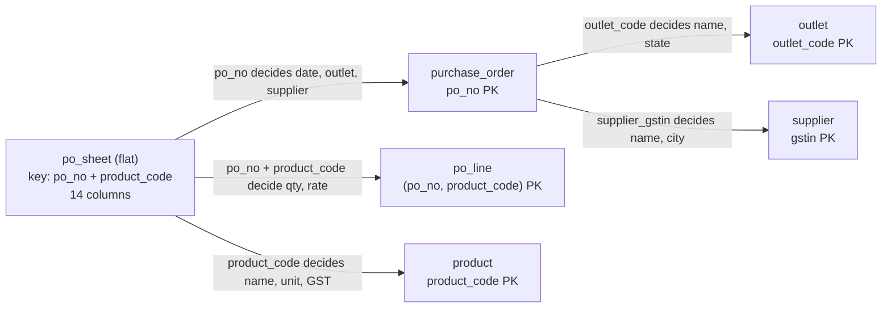
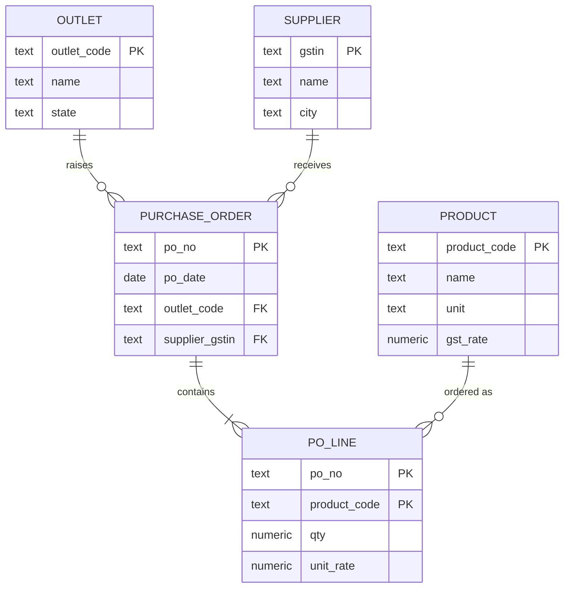
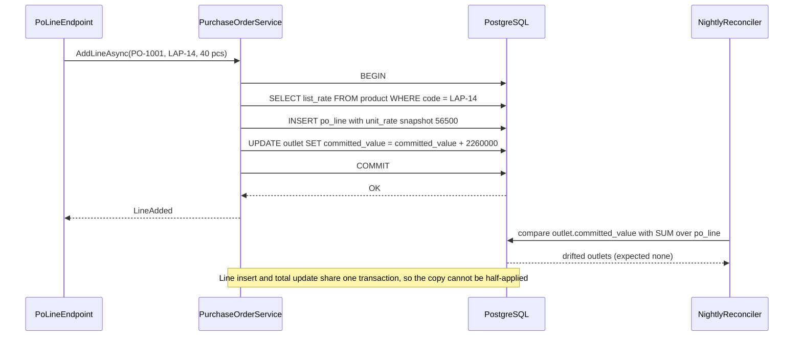

Almost every database starts life as a spreadsheet somebody outgrew. The spreadsheet works until the day one supplier's name is spelled three different ways, an outlet's state is wrong on half its rows, and deleting the last order for a product deletes the only record of its GST rate. Normalization is the discipline that prevents those bugs by design. Denormalization is the discipline of breaking it on purpose, for speed, while keeping the copies honest.

## Learning objectives

By the end of this lesson you will be able to:

1. Explain update, insert and delete anomalies with a concrete example and say which design choice causes each.
2. Write down the functional dependencies of a table and compute an attribute closure by hand.
3. Find candidate keys and decide whether a table is in 1NF, 2NF, 3NF or BCNF.
4. Decompose a flat table into normalized tables without losing information (lossless join) or rules (dependency preservation).
5. Tell a real redundancy from a historical snapshot, such as the price on an order line.
6. Choose a denormalization technique (generated column, trigger-maintained total, materialized view, read model) using numbers, and plan how to detect drift.

## Prerequisites

- [Relational database fundamentals](#/lesson/m09-relational-fundamentals): tables, primary keys, foreign keys, `UNIQUE` and `CHECK`.
- [One-to-one, one-to-many and many-to-many](#/lesson/m09-relationships): we will split one wide table into parents, children and a junction.
- Helpful: [Transactions and ACID](#/lesson/m09-transactions-acid), because keeping a denormalized copy in sync is a transaction problem.

## Explain it like I'm a beginner

A retail chain runs three outlets: a store in Nagpur, one in Lucknow and one in Gurugram. The buying team tracks every purchase order to its distributors in one Excel sheet. Each row is one product on one order:

| po_no | outlet | outlet_state | supplier_gstin | supplier_name | product | unit | gst_rate | qty | rate |
|---|---|---|---|---|---|---|---|---|---|
| PO-1001 | NGP-SB | Maharashtra | 27AAFCD4410K1Z3 | Deccan Electronics Distributors | LAP-14 | piece | 18 | 40 | 56,500 |
| PO-1001 | NGP-SB | Maharashtra | 27AAFCD4410K1Z3 | Deccan Electronics Distributors | LAP-15 | piece | 18 | 25 | 55,800 |
| PO-1002 | LKO-HG | Uttar Pradesh | 09AAKCG7721M1Z8 | Ganga Mobile Traders | PHN-128 | piece | 18 | 60 | 48,200 |

Look at what is repeated. "Deccan Electronics Distributors" appears on every line of every order from that supplier. "Maharashtra" appears on every line of every Nagpur order. "LAP-14 is sold per piece at 18 % GST" appears on every line that orders LAP-14. With 30,000 rows, those facts are copied thousands of times.

Copies cause three kinds of trouble (anomalies):

- **Update anomaly.** The supplier changes its registered name. Someone updates 412 rows and misses 3. Now the sheet says two different things and nobody knows which is right.
- **Insert anomaly.** A new product, a soft-drink case (SOD-6) at 40 % GST, is approved but not ordered yet. There is nowhere to write it down, because every row needs a PO number.
- **Delete anomaly.** The only order for the 256 GB smartphone (PHN-256) is cancelled and its row deleted. The fact "PHN-256 is sold per piece at 18 %" vanishes with it.

**Normalization** is the fix: put each fact in exactly one place. Suppliers go in a `supplier` table (one row each), outlets in an `outlet` table, products in a `product` table, and the order lines only hold the keys plus what is genuinely about that line: quantity and agreed rate. A name change is now one `UPDATE` of one row.

The analogy: a well-run office keeps one master contact card per supplier in a filing cabinet. Every purchase order just writes "Supplier #27-114". Nobody photocopies the contact card onto every order.

**Denormalization** is the opposite move, made deliberately: you copy a fact somewhere else because reading it from its single home is too slow for one important screen. That is fine, as long as you know which copy is the truth, how the copy is kept up to date, and how you will notice if it drifts.

## First-principles explanation

### Functional dependencies: the idea underneath every normal form

A **functional dependency** (FD) `X → Y` means: if two rows agree on the columns in `X`, they must agree on the columns in `Y`. In plain words, "X decides Y".

For the procurement sheet:

- `po_no → po_date, outlet_code, supplier_gstin` (one order belongs to one outlet and one supplier).
- `outlet_code → outlet_name, outlet_state`.
- `supplier_gstin → supplier_name, supplier_city`.
- `product_code → product_name, unit, gst_rate`.
- `po_no, product_code → qty, rate` (the line's own facts).

FDs come from the business, not from the data. Your sample might happen to show every Lucknow order on the same day, but nobody believes `outlet_code → po_date`. You discover FDs by asking domain experts "can this ever differ?", not by running `SELECT DISTINCT`.

### Closure and keys

The **closure** of a set of columns, written `X⁺`, is everything `X` decides, directly or through a chain. Computing it is a loop: start with `X`, and keep adding the right-hand side of any FD whose left-hand side is already inside, until nothing changes.

`{po_no}⁺`: start with `po_no`. The first FD adds `po_date, outlet_code, supplier_gstin`. Now `outlet_code` is inside, so add `outlet_name, outlet_state`. `supplier_gstin` is inside, so add `supplier_name, supplier_city`. Nothing more applies. Result: eight columns, but not `product_code`, `qty` or `rate`.

`{po_no, product_code}⁺` adds the product facts and the line facts, so it covers all 14 columns. A set whose closure is the whole table is a **superkey**. A superkey with nothing removable is a **candidate key**. Here the only candidate key is `(po_no, product_code)`. Columns that belong to some candidate key are **prime**; the rest are **non-prime**.

### The normal forms, one rule each

**First normal form (1NF): one value per cell, no repeating groups.** A cell containing `"LAP-14, LAP-15"` or columns `product_1, product_2, product_3` break 1NF. You cannot index, join or constrain a comma-separated list, and the fourth product has nowhere to go. PostgreSQL arrays and `jsonb` are technically single values, which is why using them is a design decision (see [PostgreSQL JSONB](#/lesson/m09-jsonb)) rather than an automatic violation. Use them for data you read and write as a whole, never for things you need to join to or constrain.

**Second normal form (2NF): no non-prime column depends on only part of a composite key.** The key is `(po_no, product_code)`, but `gst_rate` depends on `product_code` alone and `supplier_gstin` depends on `po_no` alone. Those are **partial dependencies**. Fix: move them to tables keyed by that part (`product`, `purchase_order`). A table with a single-column key is automatically in 2NF.

**Third normal form (3NF): no non-prime column depends on another non-prime column.** Inside `purchase_order(po_no, outlet_code, outlet_state)`, `outlet_state` depends on `outlet_code`, which depends on `po_no`. That chain is a **transitive dependency**. Fix: move `outlet_state` to `outlet`. The formal rule: for every FD `X → A`, either `X` is a superkey or `A` is prime.

**Boyce–Codd normal form (BCNF): every determinant is a superkey.** BCNF drops the "or `A` is prime" escape hatch. The two only differ when a table has overlapping candidate keys, which is rare but real. Example: an after-sales table `service_assignment(outlet, repair_type, centre)`. Business rules: an outlet sends each repair type to exactly one service centre (`outlet, repair_type → centre`), and each centre is authorised for exactly one repair type (`centre → repair_type`). Candidate keys are `(outlet, repair_type)` and `(outlet, centre)`. Every column is prime, so the table is in 3NF. But `centre` is a determinant and not a superkey, so it is not in BCNF: the fact "Kalyan Phone Care repairs phones" is repeated for every outlet using that centre.

Decomposing to BCNF gives `centre(centre PK, repair_type)` and `outlet_centre(outlet, centre)`. The repetition is gone, but the rule "one centre per repair type per outlet" now spans two tables and cannot be a simple `UNIQUE` constraint. This is the classic trade-off: **3NF can always preserve every dependency; BCNF sometimes cannot.** Most teams stop at 3NF in such cases and accept the small redundancy, or keep BCNF and enforce the cross-table rule with a trigger.

Higher forms (4NF for independent multi-valued facts, 5NF for join dependencies) exist. In practice, if you model many-to-many relationships with one junction table per relationship, you rarely meet them.

### Decomposition must be lossless

Splitting a table is only safe if joining the pieces gives back exactly the original rows, no more and no fewer. The test for a split of `R` into `R1` and `R2`: the shared columns must be a key of at least one side. Splitting the sheet into `purchase_order(po_no, ...)` and `po_line(po_no, product_code, ...)` shares `po_no`, which is the key of `purchase_order`. Lossless. Splitting into `(po_no, supplier_name)` and `(supplier_name, product_code)` would share `supplier_name`, which is a key of neither, and the join would invent rows that never existed (spurious tuples).

### Not every repeated value is redundancy

Each `po_line` stores `unit_rate`. The `product` table may also hold a current list price. Is that a 3NF violation? No. The rate on the line is **the price agreed on that order on that date**. It is a different fact from "today's list price", and it must not change when the price list does. Copying the price at the moment of ordering is a **snapshot**, and it is correct modelling. The same applies to a delivery address on an invoice, the GST rate applied on a bill, or a customer's name as printed on a contract. Ask: "if the source changes tomorrow, should this value change?" If not, it is a snapshot, not a copy.

### Denormalization: deliberate copies, with a maintenance plan

A normalized schema answers every question correctly, but some questions get expensive. The operations head's dashboard shows, for each of 400 outlets, the committed value of all purchase orders. With 2 million order lines, that is a join plus an aggregate over 2 million rows on every page load. With an index on `po_line(po_no)` it may take a few hundred milliseconds (an estimate; measure on your data with `EXPLAIN ANALYZE`). At 20 dashboard loads per minute that is acceptable. At 2,000 per minute it is not.

Your options, from least to most risky:

1. **Do nothing yet.** Add the right index, measure. Most "we need to denormalize" claims are really "we need an index" (see [Indexes](#/lesson/m09-indexes)).
2. **Generated column.** A value computed from other columns *of the same row*, such as `line_value numeric GENERATED ALWAYS AS (qty * unit_rate) STORED`. PostgreSQL 17 recomputes it on every write; it can never drift. Free safety.
3. **Materialized view.** `CREATE MATERIALIZED VIEW outlet_commitment AS SELECT ...` stores the aggregate. `REFRESH MATERIALIZED VIEW CONCURRENTLY` rebuilds it (it needs a unique index on the view) without blocking readers. Data is stale between refreshes, for example up to 5 minutes. Good for dashboards.
4. **Maintained total column.** `outlet.committed_value` updated in the same transaction as every line insert, by application code or a trigger. Always current. The hidden cost: every line insert now also updates *one shared row* per outlet. If 50 lines per second land on the same flagship outlet, they queue on that row's lock. That is a hot row, and it turns a parallel workload into a serial one.
5. **Separate read model.** A projection table or another store fed by events ([CQRS fundamentals](#/lesson/m08-cqrs-fundamentals)). Most flexible, eventually consistent, most moving parts.

Whichever you pick, write down: **which value is the source of truth, who updates the copy, in which transaction, and which reconciliation query proves they agree.** A denormalized column without a reconciliation query is a bug that has not been discovered yet.

### The cost model in numbers

Think of normalization as paying on read and denormalization as paying on write.

- Normalized: a supplier rename touches 1 row. A dashboard read touches up to 2 million rows (or fewer with good indexes).
- Fully denormalized sheet: a supplier rename touches 412 rows and must find them all. A dashboard read touches 400 pre-computed rows.
- Maintained total: each of, say, 3,000 line inserts per day costs one extra `UPDATE`. That is about 0.035 extra writes per second, which is nothing, unless they cluster on one outlet, in which case lock waits, not row counts, become the cost.

The decision is about ratios: how often is the fact read versus changed, and how bad is a stale or wrong value?

## Visual explanation

### From one sheet to five tables



Each arrow is one functional dependency being given its own home. The two arrows leaving the sheet directly remove the **partial** dependencies (facts about only the order, or only the product), which gets us to 2NF. The two arrows leaving `purchase_order` remove the **transitive** dependencies (outlet and supplier facts reached through `po_no`), which gets us to 3NF. Every split shares a column that is the primary key of the new table, so all splits are lossless.

### The normalized model



Read the crow's-feet as "one to many". An outlet raises zero or more purchase orders, an order contains one or more lines, and a product can appear on many lines. Notice that `po_line` holds only keys plus its own facts. `unit_rate` stays on the line as a snapshot of the agreed price, not as a copy of anything.

### Keeping a denormalized total honest



The service reads the current list rate and stores it on the line as a snapshot. It then adds the line value (40 × ₹56,500 = ₹22,60,000) to the outlet's denormalized total in the *same* transaction, so a crash cannot leave one without the other. The reconciler at the bottom is the safety net: it recomputes totals from the source of truth and reports any outlet where the copy disagrees, which catches code paths (a bulk import, a manual fix) that forgot to update the copy.

## Step-by-step example

### Step 1 — list the dependencies of the flat sheet

```text
po_no                    -> po_date, outlet_code, supplier_gstin
outlet_code             -> outlet_name, outlet_state
supplier_gstin           -> supplier_name, supplier_city
product_code            -> product_name, unit, gst_rate
po_no, product_code     -> qty, rate
```

Candidate key: `(po_no, product_code)`. Non-prime: everything else.

### Step 2 — classify the violations

| Dependency | Problem | Normal form broken |
|---|---|---|
| `po_no → po_date, ...` | depends on part of the key | 2NF |
| `product_code → gst_rate, ...` | depends on part of the key | 2NF |
| `outlet_code → outlet_state` | non-prime decides non-prime | 3NF |
| `supplier_gstin → supplier_name` | non-prime decides non-prime | 3NF |

### Step 3 — create the normalized tables with the rules inside

```sql
CREATE TABLE outlet (
  outlet_code text PRIMARY KEY,
  name         text NOT NULL,
  state        text NOT NULL
);
CREATE TABLE supplier (
  gstin text PRIMARY KEY CHECK (gstin ~ '^[0-9]{2}[A-Z0-9]{13}$'),
  name  text NOT NULL,
  city  text NOT NULL
);
CREATE TABLE product (
  product_code text PRIMARY KEY,
  name          text NOT NULL,
  unit          text NOT NULL,
  gst_rate      numeric(5,2) NOT NULL CHECK (gst_rate IN (0, 5, 18, 40))
);
CREATE TABLE purchase_order (
  po_no          text PRIMARY KEY,
  po_date        date NOT NULL,
  outlet_code   text NOT NULL REFERENCES outlet,
  supplier_gstin text NOT NULL REFERENCES supplier
);
CREATE TABLE po_line (
  po_no         text NOT NULL REFERENCES purchase_order ON DELETE CASCADE,
  product_code text NOT NULL REFERENCES product,
  qty           numeric(12,3) NOT NULL CHECK (qty > 0),
  unit_rate     numeric(12,2) NOT NULL CHECK (unit_rate > 0),
  line_value    numeric(16,2) GENERATED ALWAYS AS (qty * unit_rate) STORED,
  PRIMARY KEY (po_no, product_code)
);
```

All three anomalies are gone. A new product can be inserted before anyone orders it. Cancelling the last order for PHN-256 deletes its lines but not the product. Renaming a supplier is one row. `line_value` is a generated column: a safe, same-row denormalization.

### Step 4 — migrate the data

```sql
INSERT INTO outlet (outlet_code, name, state)
SELECT DISTINCT outlet_code, outlet_name, outlet_state FROM po_sheet;
-- fails with a duplicate-key error if one outlet_code has two different states:
-- that is the migration finding your update anomalies for you.
```

Run a "conflicting copies" query first (exercise 1 does exactly this), fix the data with the business, then migrate. `DISTINCT` on all columns plus a primary key is a quick lossless check: if the insert succeeds, the dependency really held in the data.

### Step 5 — rebuild the old report with joins

```sql
SELECT p.outlet_code, s.name AS supplier, SUM(l.line_value) AS taxable_value
FROM po_line l
JOIN purchase_order o ON o.po_no = l.po_no
JOIN outlet p ON p.outlet_code = o.outlet_code
JOIN supplier s ON s.gstin = o.supplier_gstin
GROUP BY p.outlet_code, s.name
ORDER BY p.outlet_code, s.name;
```

Four joins sounds expensive, but each one is a primary-key lookup. PostgreSQL will typically hash-join the small dimension tables and scan `po_line` once. [Query planning](#/lesson/m09-query-planning) shows how to confirm that.

### Step 6 — decide on one denormalization, with a reconciler

The dashboard needs committed value per outlet in under 50 ms. We add `outlet.committed_value numeric(18,2) NOT NULL DEFAULT 0`, update it in the same transaction as each line insert, and run this nightly:

```sql
SELECT p.outlet_code, p.committed_value, COALESCE(SUM(l.line_value), 0) AS actual
FROM outlet p
LEFT JOIN purchase_order o ON o.outlet_code = p.outlet_code
LEFT JOIN po_line l ON l.po_no = o.po_no
GROUP BY p.outlet_code, p.committed_value
HAVING p.committed_value <> COALESCE(SUM(l.line_value), 0);
```

An empty result is the proof the copy is honest.

## Production-style C# implementation

The compilable code below has two parts. `Procurement.Schema` is a small functional-dependency analyzer: give it columns and FDs, and it reports candidate keys and 2NF, 3NF and BCNF violations. It is the same algorithm you just ran by hand, and it is handy in a design review or a migration tool. `Procurement.Orders` shows the denormalized-total pattern behind an interface, with an in-memory store; a real store would use Npgsql or EF Core inside one transaction (snippet afterwards).

```text
Procurement.Api/
  Program.cs
  Schema/FunctionalDependency.cs
  Schema/SchemaAnalyzer.cs
  Orders/Models.cs
  Orders/IProcurementStore.cs
  Orders/InMemoryProcurementStore.cs
  Orders/PurchaseOrderService.cs
```

```csharp file=Schema/FunctionalDependency.cs
namespace Procurement.Schema;

/// <summary>X -> Y: rows that agree on Left must agree on Right.</summary>
public sealed class FunctionalDependency
{
    public FunctionalDependency(IEnumerable<string> left, IEnumerable<string> right)
    {
        Left = new HashSet<string>(left, StringComparer.OrdinalIgnoreCase);
        Right = new HashSet<string>(right, StringComparer.OrdinalIgnoreCase);
        if (Left.Count == 0 || Right.Count == 0) throw new ArgumentException("Both sides need at least one column.");
    }

    public IReadOnlySet<string> Left { get; }
    public IReadOnlySet<string> Right { get; }

    /// <summary>Parses "po_no, product_code -> qty, rate".</summary>
    public static FunctionalDependency Parse(string text)
    {
        var parts = text.Split("->", 2, StringSplitOptions.TrimEntries);
        if (parts.Length != 2) throw new FormatException($"Expected 'a, b -> c' but got '{text}'.");
        return new FunctionalDependency(Columns(parts[0]), Columns(parts[1]));
    }

    private static string[] Columns(string s) =>
        s.Split(',', StringSplitOptions.TrimEntries | StringSplitOptions.RemoveEmptyEntries);

    public override string ToString() =>
        $"{string.Join(", ", Left.Order(StringComparer.Ordinal))} -> {string.Join(", ", Right.Order(StringComparer.Ordinal))}";
}

public sealed class RelationSchema
{
    public RelationSchema(string name, IEnumerable<string> attributes, IEnumerable<FunctionalDependency> dependencies)
    {
        Name = name;
        Attributes = new HashSet<string>(attributes, StringComparer.OrdinalIgnoreCase);
        Dependencies = dependencies.ToList();
        foreach (var fd in Dependencies)
            if (!fd.Left.Concat(fd.Right).All(Attributes.Contains))
                throw new ArgumentException($"Dependency '{fd}' uses a column that is not in {name}.");
    }

    public string Name { get; }
    public IReadOnlySet<string> Attributes { get; }
    public IReadOnlyList<FunctionalDependency> Dependencies { get; }
}

public enum NormalForm { First = 1, Second = 2, Third = 3, BoyceCodd = 4 }

public sealed record Violation(NormalForm Breaks, string Dependency, string Reason);

public sealed record NormalizationReport(
    string Relation,
    IReadOnlyList<string> CandidateKeys,
    NormalForm HighestNormalForm,
    IReadOnlyList<Violation> Violations);
```

```csharp file=Schema/SchemaAnalyzer.cs
using System.Numerics;

namespace Procurement.Schema;

public static class SchemaAnalyzer
{
    /// <summary>Everything the start columns decide, directly or through chains (X+).</summary>
    public static HashSet<string> Closure(IEnumerable<string> start, IReadOnlyList<FunctionalDependency> fds)
    {
        var result = new HashSet<string>(start, StringComparer.OrdinalIgnoreCase);
        bool changed;
        do
        {
            changed = false;
            foreach (var fd in fds)
            {
                if (fd.Left.All(result.Contains) && !fd.Right.All(result.Contains))
                {
                    result.UnionWith(fd.Right);
                    changed = true;   // a new column may unlock an FD we already skipped, so loop again
                }
            }
        } while (changed);
        return result;
    }

    public static bool IsSuperkey(RelationSchema r, IEnumerable<string> columns) =>
        Closure(columns, r.Dependencies).IsSupersetOf(r.Attributes);

    /// <summary>Minimal superkeys, smallest first. Brute force is fine for the 5-20 columns of a real table.</summary>
    public static IReadOnlyList<IReadOnlySet<string>> CandidateKeys(RelationSchema r)
    {
        var cols = r.Attributes.Order(StringComparer.Ordinal).ToArray();
        if (cols.Length > 20) throw new ArgumentException("Too many columns for exhaustive key search.");
        var keys = new List<IReadOnlySet<string>>();
        var masks = Enumerable.Range(1, (1 << cols.Length) - 1).OrderBy(m => BitOperations.PopCount((uint)m));
        foreach (var mask in masks)
        {
            var subset = new HashSet<string>(StringComparer.OrdinalIgnoreCase);
            for (var i = 0; i < cols.Length; i++) if ((mask & (1 << i)) != 0) subset.Add(cols[i]);
            if (keys.Any(k => k.IsSubsetOf(subset))) continue;   // not minimal
            if (IsSuperkey(r, subset)) keys.Add(subset);
        }
        return keys;
    }

    public static NormalizationReport Analyze(RelationSchema r)
    {
        var keys = CandidateKeys(r);
        var prime = new HashSet<string>(keys.SelectMany(k => k), StringComparer.OrdinalIgnoreCase);
        var violations = new List<Violation>();

        foreach (var fd in r.Dependencies)
        {
            var dependent = fd.Right.Where(c => !fd.Left.Contains(c)).ToList();
            if (dependent.Count == 0) continue;                         // trivial: X -> part of X
            if (IsSuperkey(r, fd.Left)) continue;                        // fine in every normal form

            var nonPrime = dependent.Where(c => !prime.Contains(c)).ToList();
            var partOfKey = keys.Any(k => fd.Left.All(k.Contains) && fd.Left.Count < k.Count);

            if (nonPrime.Count > 0 && partOfKey)
                violations.Add(new Violation(NormalForm.Second, fd.ToString(),
                    $"{string.Join(", ", nonPrime)} depend(s) on only part of a candidate key"));
            else if (nonPrime.Count > 0)
                violations.Add(new Violation(NormalForm.Third, fd.ToString(),
                    $"non-key columns {string.Join(", ", fd.Left)} decide non-prime {string.Join(", ", nonPrime)}"));
            else
                violations.Add(new Violation(NormalForm.BoyceCodd, fd.ToString(),
                    $"{string.Join(", ", fd.Left)} is a determinant but not a superkey"));
        }

        var highest = violations.Count == 0
            ? NormalForm.BoyceCodd
            : (NormalForm)((int)violations.Min(v => v.Breaks) - 1);
        var keyText = keys.Select(k => "(" + string.Join(", ", k.Order(StringComparer.Ordinal)) + ")").ToList();
        return new NormalizationReport(r.Name, keyText, highest, violations);
    }
}
```

```csharp file=Orders/Models.cs
namespace Procurement.Orders;

public sealed record Product(string Code, string Name, string Unit, decimal GstRate, decimal ListRate);

public sealed record PoLine(string PoNo, string ProductCode, decimal Qty, decimal UnitRate)
{
    // Same-row derived value, like a STORED generated column: cannot drift.
    public decimal LineValue => Qty * UnitRate;
}

public sealed record Drift(string OutletCode, decimal Stored, decimal Actual);

public enum AddLineOutcome { Added, UnknownOrder, UnknownProduct, DuplicateLine }
```

```csharp file=Orders/IProcurementStore.cs
namespace Procurement.Orders;

public interface IProcurementStore
{
    Task<Product?> FindProductAsync(string code, CancellationToken ct = default);
    Task<string?> OutletOfOrderAsync(string poNo, CancellationToken ct = default);

    /// <summary>
    /// Inserts the line AND adds its value to the outlet's denormalized total atomically.
    /// In PostgreSQL this is one transaction: INSERT po_line, then UPDATE outlet SET committed_value = committed_value + @v.
    /// Returns false if the line already exists (primary key violation).
    /// </summary>
    Task<bool> AddLineAndBumpTotalAsync(string outletCode, PoLine line, CancellationToken ct = default);

    Task<decimal> StoredTotalAsync(string outletCode, CancellationToken ct = default);

    /// <summary>The reconciliation query: stored totals versus SUM(line_value) from the source of truth.</summary>
    Task<IReadOnlyList<Drift>> FindDriftAsync(CancellationToken ct = default);
}
```

```csharp file=Orders/InMemoryProcurementStore.cs
namespace Procurement.Orders;

/// <summary>In-memory stand-in for the normalized tables plus one denormalized column (outlet.committed_value).</summary>
public sealed class InMemoryProcurementStore : IProcurementStore
{
    private readonly object _gate = new();
    private readonly Dictionary<string, Product> _products = new(StringComparer.OrdinalIgnoreCase);
    private readonly Dictionary<string, string> _orderOutlet = new(StringComparer.OrdinalIgnoreCase);
    private readonly Dictionary<(string, string), PoLine> _lines = new();
    private readonly Dictionary<string, decimal> _committed = new(StringComparer.OrdinalIgnoreCase);

    public InMemoryProcurementStore AddProduct(Product m) { lock (_gate) _products[m.Code] = m; return this; }
    public InMemoryProcurementStore AddOutlet(string code) { lock (_gate) _committed.TryAdd(code, 0m); return this; }
    public InMemoryProcurementStore AddOrder(string poNo, string outletCode) { lock (_gate) _orderOutlet[poNo] = outletCode; return this; }

    /// <summary>Simulates a bulk import that bypasses the service and forgets the copy. The reconciler must catch it.</summary>
    public void ImportLineWithoutTotal(PoLine line) { lock (_gate) _lines[(line.PoNo, line.ProductCode)] = line; }

    public Task<Product?> FindProductAsync(string code, CancellationToken ct = default)
    {
        lock (_gate) return Task.FromResult(_products.GetValueOrDefault(code));
    }

    public Task<string?> OutletOfOrderAsync(string poNo, CancellationToken ct = default)
    {
        lock (_gate) return Task.FromResult(_orderOutlet.GetValueOrDefault(poNo));
    }

    public Task<bool> AddLineAndBumpTotalAsync(string outletCode, PoLine line, CancellationToken ct = default)
    {
        lock (_gate)   // the lock plays the role of one database transaction
        {
            if (!_lines.TryAdd((line.PoNo, line.ProductCode), line)) return Task.FromResult(false);
            _committed[outletCode] = _committed.GetValueOrDefault(outletCode) + line.LineValue;
            return Task.FromResult(true);
        }
    }

    public Task<decimal> StoredTotalAsync(string outletCode, CancellationToken ct = default)
    {
        lock (_gate) return Task.FromResult(_committed.GetValueOrDefault(outletCode));
    }

    public Task<IReadOnlyList<Drift>> FindDriftAsync(CancellationToken ct = default)
    {
        lock (_gate)
        {
            var actual = _lines.Values
                .GroupBy(l => _orderOutlet[l.PoNo], StringComparer.OrdinalIgnoreCase)
                .ToDictionary(g => g.Key, g => g.Sum(l => l.LineValue), StringComparer.OrdinalIgnoreCase);
            IReadOnlyList<Drift> drift = _committed
                .Select(p => new Drift(p.Key, p.Value, actual.GetValueOrDefault(p.Key)))
                .Where(d => d.Stored != d.Actual)
                .OrderBy(d => d.OutletCode, StringComparer.Ordinal)
                .ToList();
            return Task.FromResult(drift);
        }
    }
}
```

```csharp file=Orders/PurchaseOrderService.cs
using Microsoft.Extensions.Logging;

namespace Procurement.Orders;

public sealed class PurchaseOrderService(IProcurementStore store, ILogger<PurchaseOrderService> log)
{
    public async Task<AddLineOutcome> AddLineAsync(string poNo, string productCode, decimal qty, CancellationToken ct = default)
    {
        if (qty <= 0) throw new ArgumentOutOfRangeException(nameof(qty), "CHECK (qty > 0)");

        var outlet = await store.OutletOfOrderAsync(poNo, ct);
        if (outlet is null) return AddLineOutcome.UnknownOrder;

        var product = await store.FindProductAsync(productCode, ct);
        if (product is null) return AddLineOutcome.UnknownProduct;

        // Snapshot: the agreed rate is stored on the line and never follows later price-list changes.
        var line = new PoLine(poNo, product.Code, qty, product.ListRate);

        var added = await store.AddLineAndBumpTotalAsync(outlet, line, ct);
        if (!added) return AddLineOutcome.DuplicateLine;

        log.LogInformation("PO {PoNo}: {Qty} {Unit} of {Product} at {Rate}", poNo, qty, product.Unit, product.Code, line.UnitRate);
        return AddLineOutcome.Added;
    }
}
```

```csharp file=Program.cs
using Procurement.Orders;
using Procurement.Schema;

var builder = WebApplication.CreateBuilder(args);

builder.Services.AddSingleton<IProcurementStore>(_ => new InMemoryProcurementStore()
    .AddProduct(new Product("LAP-14", "Laptop 14-inch", "piece", 18m, 56_500m))
    .AddProduct(new Product("PHN-128", "Smartphone 128 GB", "piece", 18m, 48_200m))
    .AddOutlet("NGP-SB").AddOutlet("LKO-HG")
    .AddOrder("PO-1001", "NGP-SB").AddOrder("PO-1002", "LKO-HG"));
builder.Services.AddScoped<PurchaseOrderService>();

var app = builder.Build();

app.MapPost("/schema/analyze", (SchemaRequest req) =>
{
    var schema = new RelationSchema(req.Name, req.Columns, req.Dependencies.Select(FunctionalDependency.Parse));
    return Results.Ok(SchemaAnalyzer.Analyze(schema));
});

app.MapPost("/orders/{poNo}/lines", async (string poNo, AddLineRequest req, PurchaseOrderService svc, CancellationToken ct) =>
    await svc.AddLineAsync(poNo, req.ProductCode, req.Qty, ct) switch
    {
        AddLineOutcome.Added => Results.Created($"/orders/{poNo}/lines/{req.ProductCode}", null),
        AddLineOutcome.DuplicateLine => Results.Conflict(),
        _ => Results.NotFound(),
    });

app.MapGet("/admin/reconcile", async (IProcurementStore store, CancellationToken ct) => Results.Ok(await store.FindDriftAsync(ct)));

app.Run();

public sealed record SchemaRequest(string Name, string[] Columns, string[] Dependencies);
public sealed record AddLineRequest(string ProductCode, decimal Qty);
```

### The same atomic "line plus total" on PostgreSQL

```csharp
// Not compiled by the course checker: requires the Npgsql package.
await using var conn = await dataSource.OpenConnectionAsync(ct);
await using var tx = await conn.BeginTransactionAsync(ct);
await using (var ins = new NpgsqlCommand(
    "INSERT INTO po_line (po_no, product_code, qty, unit_rate) VALUES (@po, @m, @q, @r) ON CONFLICT DO NOTHING", conn, tx))
{
    ins.Parameters.AddWithValue("po", poNo); ins.Parameters.AddWithValue("m", code);
    ins.Parameters.AddWithValue("q", qty);   ins.Parameters.AddWithValue("r", rate);
    if (await ins.ExecuteNonQueryAsync(ct) == 0) { await tx.RollbackAsync(ct); return AddLineOutcome.DuplicateLine; }
}
await using (var bump = new NpgsqlCommand(
    "UPDATE outlet SET committed_value = committed_value + @v WHERE outlet_code = @p", conn, tx))
{
    bump.Parameters.AddWithValue("v", qty * rate); bump.Parameters.AddWithValue("p", outletCode);
    await bump.ExecuteNonQueryAsync(ct);
}
await tx.CommitAsync(ct);
```

With EF Core, model the generated column with `.HasComputedColumnSql("qty * unit_rate", stored: true)` so EF never tries to write it, and do the total bump with `ExecuteUpdateAsync(s => s.SetProperty(p => p.CommittedValue, p => p.CommittedValue + value))` inside the same `SaveChanges` transaction.

:::callout type=warning title="A trigger-maintained total turns parallel inserts into a queue"
`UPDATE outlet SET committed_value = ...` takes a row lock on that outlet until commit. If an import loads 10,000 lines for one outlet with 16 parallel workers, all 16 wait on the same row. Either batch the bump (add the batch's sum once per transaction), or use a materialized view refreshed every few minutes when the dashboard can tolerate staleness.
:::

## Bad design vs good design

**Bad: the flat table, plus "helpful" copies everywhere.**

```sql
-- Anti-pattern: one wide table and a comma-separated list
CREATE TABLE po_sheet (
  po_no text, po_date date, outlet_code text, outlet_name text, outlet_state text,
  supplier_gstin text, supplier_name text, supplier_city text,
  products text,                -- 'LAP-14:40, LAP-15:25'  (breaks 1NF)
  total_value numeric            -- typed in by hand, never reconciled
);
```

What goes wrong: you cannot put a foreign key on `products`, so typos like `LAP14` are accepted. The supplier's name differs between orders. `total_value` disagrees with the lines after the first manual edit. Every report starts with string parsing.

**Good: normalized core, one deliberate copy with a plan.**

- Five 3NF tables with keys, foreign keys and `CHECK`s (Step 3).
- `line_value` as a `STORED` generated column.
- `outlet.committed_value` maintained in the same transaction as each line, plus the nightly reconciliation query from Step 6.

**When is the extra structure not worth it?** A one-off analysis of last year's spend, loaded once and never updated, can stay flat; anomalies only matter when data changes. Append-only event or log tables (GPS pings, audit records) are often deliberately wide, because rows are never updated and reads want everything in one place. And a reporting warehouse is usually denormalized into a star schema on purpose, because it is rebuilt from the normalized source rather than edited.

:::callout type=tradeoff title="Normalize the writes, denormalize the reads"
A useful default: the tables you write to are in 3NF, because that is where anomalies bite. The structures you read from at scale (materialized views, read models, search indexes, caches) can be as denormalized as the screens need, because they are derived and can be rebuilt.
:::

## Practical playground

The playground contains the flat `po_sheet` (with deliberate anomalies) and the normalized tables populated from cleaned data. Try:

1. Find every `supplier_gstin` in `po_sheet` that appears with more than one `supplier_name`. That is an update anomaly in the wild.
2. Try `INSERT INTO outlet SELECT DISTINCT outlet_code, outlet_name, outlet_state FROM po_sheet;` and read the error.
3. Insert a product that has never been ordered (`SOD-6`, soft-drink case, unit `case`, 40 %). Notice it is impossible in `po_sheet` without inventing a PO.
4. Rebuild the "spend per outlet per supplier" report from the normalized tables with joins.
5. Run the reconciliation query from Step 6. Then corrupt one `committed_value` with an `UPDATE` and run it again.
6. Compare `SELECT * FROM po_line` with its generated `line_value` column, then try to `UPDATE po_line SET line_value = 1` and read the error.

:::playground type=sql title="Procurement: flat sheet versus normalized tables"
```sql
CREATE TABLE po_sheet (
  po_no text, po_date date, outlet_code text, outlet_name text, outlet_state text,
  supplier_gstin text, supplier_name text, supplier_city text,
  product_code text, product_name text, unit text, gst_rate numeric(5,2),
  qty numeric(12,3), rate numeric(12,2)
);
INSERT INTO po_sheet VALUES
 ('PO-1001','2026-07-02','NGP-SB','Nagpur Sitabuldi store','Maharashtra','27AAFCD4410K1Z3','Deccan Electronics Distributors','Nagpur','LAP-14','Laptop 14-inch','piece',18,40,56500),
 ('PO-1001','2026-07-02','NGP-SB','Nagpur Sitabuldi store','Maharashtra','27AAFCD4410K1Z3','Deccan Electronics Distributors','Nagpur','LAP-15','Laptop 15-inch','piece',18,25,55800),
 ('PO-1002','2026-07-05','LKO-HG','Lucknow Hazratganj store','Uttar Pradesh','09AAKCG7721M1Z8','Ganga Mobile Traders','Kanpur','PHN-128','Smartphone 128 GB','piece',18,60,48200),
 ('PO-1003','2026-07-09','GGN-CH','Gurugram Cyber Hub store','Haryana','06AABCA9083H1Z1','Aravalli Apparel','Gurugram','TEE-01','Cotton T-shirt','piece',5,900,1450),
 ('PO-1004','2026-07-15','NGP-SB','Nagpur Sitabuldi store','Maharastra','27AAFCD4410K1Z3','Deccan Electronics Distributor','Nagpur','LAP-14','Laptop 14-inch','piece',18,30,57200),
 ('PO-1005','2026-07-21','LKO-HG','Lucknow Hazratganj store','Uttar Pradesh','09AAKCG7721M1Z8','Ganga Mobile Traders','Kanpur','PHN-256','Smartphone 256 GB','piece',18,20,51900),
 ('PO-1006','2026-08-01','GGN-CH','Gurugram Cyber Hub store','Haryana','06AABCA9083H1Z1','Aravalli Apparel','Gurgaon','KRT-01','Cotton kurta','piece',5,450,1520),
 ('PO-1006','2026-08-01','GGN-CH','Gurugram Cyber Hub store','Haryana','06AABCA9083H1Z1','Aravalli Apparel','Gurgaon','TEE-01','Cotton T-shirt','piece',5,600,1450);

CREATE TABLE outlet (outlet_code text PRIMARY KEY, name text NOT NULL, state text NOT NULL,
                      committed_value numeric(18,2) NOT NULL DEFAULT 0);
CREATE TABLE supplier (gstin text PRIMARY KEY, name text NOT NULL, city text NOT NULL);
CREATE TABLE product (product_code text PRIMARY KEY, name text NOT NULL, unit text NOT NULL,
                       gst_rate numeric(5,2) NOT NULL CHECK (gst_rate IN (0,5,18,40)));
CREATE TABLE purchase_order (po_no text PRIMARY KEY, po_date date NOT NULL,
                             outlet_code text NOT NULL REFERENCES outlet,
                             supplier_gstin text NOT NULL REFERENCES supplier);
CREATE TABLE po_line (po_no text NOT NULL REFERENCES purchase_order ON DELETE CASCADE,
                      product_code text NOT NULL REFERENCES product,
                      qty numeric(12,3) NOT NULL CHECK (qty > 0),
                      unit_rate numeric(12,2) NOT NULL CHECK (unit_rate > 0),
                      line_value numeric(16,2) GENERATED ALWAYS AS (qty * unit_rate) STORED,
                      PRIMARY KEY (po_no, product_code));

INSERT INTO outlet (outlet_code, name, state) VALUES
 ('NGP-SB','Nagpur Sitabuldi store','Maharashtra'), ('LKO-HG','Lucknow Hazratganj store','Uttar Pradesh'),
 ('GGN-CH','Gurugram Cyber Hub store','Haryana'), ('PAT-BR','Patna Boring Road store','Bihar');
INSERT INTO supplier VALUES
 ('27AAFCD4410K1Z3','Deccan Electronics Distributors','Nagpur'), ('09AAKCG7721M1Z8','Ganga Mobile Traders','Kanpur'),
 ('06AABCA9083H1Z1','Aravalli Apparel','Gurugram');
INSERT INTO product VALUES
 ('LAP-14','Laptop 14-inch','piece',18), ('LAP-15','Laptop 15-inch','piece',18), ('PHN-128','Smartphone 128 GB','piece',18),
 ('PHN-256','Smartphone 256 GB','piece',18), ('KRT-01','Cotton kurta','piece',5), ('TEE-01','Cotton T-shirt','piece',5);
INSERT INTO purchase_order VALUES
 ('PO-1001','2026-07-02','NGP-SB','27AAFCD4410K1Z3'), ('PO-1002','2026-07-05','LKO-HG','09AAKCG7721M1Z8'),
 ('PO-1003','2026-07-09','GGN-CH','06AABCA9083H1Z1'), ('PO-1004','2026-07-15','NGP-SB','27AAFCD4410K1Z3'),
 ('PO-1005','2026-07-21','LKO-HG','09AAKCG7721M1Z8'), ('PO-1006','2026-08-01','GGN-CH','06AABCA9083H1Z1');
INSERT INTO po_line (po_no, product_code, qty, unit_rate) VALUES
 ('PO-1001','LAP-14',40,56500), ('PO-1001','LAP-15',25,55800), ('PO-1002','PHN-128',60,48200),
 ('PO-1003','TEE-01',900,1450), ('PO-1004','LAP-14',30,57200), ('PO-1005','PHN-256',20,51900),
 ('PO-1006','KRT-01',450,1520), ('PO-1006','TEE-01',600,1450);
UPDATE outlet p SET committed_value = s.total
FROM (SELECT o.outlet_code, SUM(l.line_value) AS total
      FROM po_line l JOIN purchase_order o ON o.po_no = l.po_no GROUP BY o.outlet_code) s
WHERE s.outlet_code = p.outlet_code;
```
:::

## Exercises

:::exercise id=m09-normalization-ex1 difficulty=beginner kind=sql ordered=true title="Find the update anomalies in the flat sheet"
The procurement sheet copies supplier details onto every line. Find every `supplier_gstin` whose rows disagree about the supplier's name or city. Return `supplier_gstin`, `name_variants` (number of distinct names), `city_variants` (number of distinct cities) and `names` (the distinct names joined with `' | '`, in alphabetical order). Order by `supplier_gstin`.
::acceptance
- Only GSTINs with more than one distinct name **or** more than one distinct city appear.
- `names` lists each distinct spelling once, alphabetically, separated by `' | '`.
- Column names exactly as specified.
::hint
Group the sheet by the column that is supposed to decide the others: `supplier_gstin`.
::hint
`COUNT(DISTINCT supplier_name)` tells you how many spellings exist for one GSTIN.
::hint
Filter groups with `HAVING`, not `WHERE`, because the condition is on an aggregate.
::hint
`string_agg(DISTINCT supplier_name, ' | ' ORDER BY supplier_name)` builds the list. With `DISTINCT`, the `ORDER BY` must use the same expression.
::setup
```sql
CREATE TABLE po_sheet (
  po_no text, po_date date, outlet_code text, outlet_state text,
  supplier_gstin text, supplier_name text, supplier_city text,
  product_code text, qty numeric(12,3), rate numeric(12,2)
);
INSERT INTO po_sheet VALUES
 ('PO-1001','2026-07-02','NGP-SB','Maharashtra','27AAFCD4410K1Z3','Deccan Electronics Distributors','Nagpur','LAP-14',40,56500),
 ('PO-1001','2026-07-02','NGP-SB','Maharashtra','27AAFCD4410K1Z3','Deccan Electronics Distributors','Nagpur','LAP-15',25,55800),
 ('PO-1002','2026-07-05','LKO-HG','Uttar Pradesh','09AAKCG7721M1Z8','Ganga Mobile Traders','Kanpur','PHN-128',60,48200),
 ('PO-1003','2026-07-09','GGN-CH','Haryana','06AABCA9083H1Z1','Aravalli Apparel','Gurugram','TEE-01',900,1450),
 ('PO-1004','2026-07-15','NGP-SB','Maharastra','27AAFCD4410K1Z3','Deccan Electronics Distributor','Nagpur','LAP-14',30,57200),
 ('PO-1005','2026-07-21','LKO-HG','Uttar Pradesh','09AAKCG7721M1Z8','Ganga Mobile Traders','Kanpur','PHN-256',20,51900),
 ('PO-1006','2026-08-01','GGN-CH','Haryana','06AABCA9083H1Z1','Aravalli Apparel','Gurgaon','KRT-01',450,1520),
 ('PO-1006','2026-08-01','GGN-CH','Haryana','06AABCA9083H1Z1','Aravalli Apparel','Gurgaon','TEE-01',600,1450),
 ('PO-1007','2026-08-04','PAT-BR','Bihar','10AAHCK3301B1Z6','Kosi Beverages Depot','Patna','SOD-6',2000,385),
 ('PO-1008','2026-08-11','PAT-BR','Bihar','10AAHCK3301B1Z6','KOSI BEVERAGES DEPOT','Patna','SOD-6',1500,390);
```
::check
```sql
SELECT supplier_gstin,
       COUNT(DISTINCT supplier_name) AS name_variants,
       COUNT(DISTINCT supplier_city) AS city_variants,
       string_agg(DISTINCT supplier_name, ' | ' ORDER BY supplier_name) AS names
FROM po_sheet
GROUP BY supplier_gstin
HAVING COUNT(DISTINCT supplier_name) > 1 OR COUNT(DISTINCT supplier_city) > 1
ORDER BY supplier_gstin;
```
::solution
```sql
SELECT supplier_gstin,
       COUNT(DISTINCT supplier_name) AS name_variants,
       COUNT(DISTINCT supplier_city) AS city_variants,
       string_agg(DISTINCT supplier_name, ' | ' ORDER BY supplier_name) AS names
FROM po_sheet
GROUP BY supplier_gstin
HAVING COUNT(DISTINCT supplier_name) > 1 OR COUNT(DISTINCT supplier_city) > 1
ORDER BY supplier_gstin;
```
Three suppliers disagree with themselves. Aravalli Apparel (`06...`) has one name but two cities (Gurugram and the old name Gurgaon). Kosi Beverages Depot (`10...`) has two spellings that differ only in case, and Deccan Electronics (`27...`) has a missing "s". Ganga Mobile is consistent only by luck. Every one of these is an update anomaly: the dependency `supplier_gstin → supplier_name, supplier_city` is true in the business but nothing in the schema enforces it. In the normalized design, `gstin` is the primary key of `supplier`, so a second spelling is impossible. Running this query before a migration tells you which rows a human must clean first.
::mistakes
- Using `WHERE COUNT(...) > 1`, which is a syntax error: aggregates are filtered with `HAVING`.
- Grouping by `supplier_name` instead of `supplier_gstin`, which hides the problem because each spelling becomes its own group.
- Treating the case-only difference as "not a real duplicate". It is: a join or `GROUP BY` on name would split that supplier in two.
:::

:::exercise id=m09-normalization-ex2 difficulty=beginner kind=code title="Compute an attribute closure"
Implement the closure algorithm: given a starting set of columns and a list of functional dependencies, return every column the start decides, directly or through chains. Then implement `Determines`, which answers "does this set of columns decide that column?".
::requirements
- `Closure` must keep looping until a full pass adds nothing new, because a column added late can unlock a dependency that was skipped earlier in the same pass.
- Column names are compared case-insensitively.
- The start columns are always part of their own closure.
::acceptance
- `{po_no}` decides the date, outlet, supplier and the outlet's and supplier's details, but not `product_code` or `qty`.
- `{po_no, product_code}` decides all 14 columns of the sheet.
- The result is correct even when the dependencies are listed in an order that requires several passes.
::hint
Start with a set that contains the input columns. A dependency "fires" when all of its left-hand columns are already in the set.
::hint
When a dependency fires, add all of its right-hand columns. Remember whether anything changed in this pass.
::hint
Wrap the pass in `do { ... } while (changed);`.
::hint
```csharp
var result = new HashSet<string>(start, StringComparer.OrdinalIgnoreCase);
bool changed;
do
{
    changed = false;
    foreach (var fd in fds)
        if (fd.Left.All(result.Contains) && !fd.Right.All(result.Contains)) { /* add, set changed */ }
} while (changed);
```
::starter
```csharp file=FdClosure.cs
using System;
using System.Collections.Generic;
using System.Linq;

public sealed record Fd(string[] Left, string[] Right);

public static class FdClosure
{
    public static HashSet<string> Closure(IEnumerable<string> start, IReadOnlyList<Fd> fds) =>
        throw new NotImplementedException();

    public static bool Determines(IEnumerable<string> left, string column, IReadOnlyList<Fd> fds) =>
        throw new NotImplementedException();
}
```
::tests
```csharp file=FdClosureTests.cs
using System.Collections.Generic;
using Xunit;

public class FdClosureTests
{
    private static readonly List<Fd> Sheet = new()
    {
        new Fd(new[] { "po_no" }, new[] { "po_date", "outlet_code", "supplier_gstin" }),
        new Fd(new[] { "outlet_code" }, new[] { "outlet_name", "outlet_state" }),
        new Fd(new[] { "supplier_gstin" }, new[] { "supplier_name", "supplier_city" }),
        new Fd(new[] { "product_code" }, new[] { "product_name", "unit", "gst_rate" }),
        new Fd(new[] { "po_no", "product_code" }, new[] { "qty", "rate" }),
    };

    [Fact]
    public void Po_no_decides_order_outlet_and_supplier_facts()
    {
        var c = FdClosure.Closure(new[] { "po_no" }, Sheet);
        Assert.Equal(8, c.Count);
        Assert.Contains("outlet_state", c);
        Assert.Contains("supplier_city", c);
        Assert.DoesNotContain("product_code", c);
        Assert.DoesNotContain("qty", c);
    }

    [Fact]
    public void Composite_key_decides_everything()
    {
        var c = FdClosure.Closure(new[] { "po_no", "product_code" }, Sheet);
        Assert.Equal(14, c.Count);
    }

    [Fact]
    public void Needs_multiple_passes_when_dependencies_are_listed_backwards()
    {
        var backwards = new List<Fd>
        {
            new Fd(new[] { "c" }, new[] { "d" }),
            new Fd(new[] { "b" }, new[] { "c" }),
            new Fd(new[] { "a" }, new[] { "b" }),
        };
        var c = FdClosure.Closure(new[] { "a" }, backwards);
        Assert.Equal(4, c.Count);
        Assert.Contains("d", c);
    }

    [Fact]
    public void Comparison_is_case_insensitive()
    {
        Assert.True(FdClosure.Determines(new[] { "OUTLET_CODE" }, "Outlet_State", Sheet));
    }

    [Fact]
    public void Product_does_not_decide_supplier()
    {
        Assert.False(FdClosure.Determines(new[] { "product_code" }, "supplier_name", Sheet));
        Assert.True(FdClosure.Determines(new[] { "product_code" }, "product_code", Sheet));
    }
}
```
::solution
```csharp file=FdClosure.cs
using System;
using System.Collections.Generic;
using System.Linq;

public sealed record Fd(string[] Left, string[] Right);

public static class FdClosure
{
    public static HashSet<string> Closure(IEnumerable<string> start, IReadOnlyList<Fd> fds)
    {
        var result = new HashSet<string>(start, StringComparer.OrdinalIgnoreCase);
        bool changed;
        do
        {
            changed = false;
            foreach (var fd in fds)
            {
                if (fd.Left.All(result.Contains) && !fd.Right.All(result.Contains))
                {
                    result.UnionWith(fd.Right);
                    changed = true;
                }
            }
        } while (changed);
        return result;
    }

    public static bool Determines(IEnumerable<string> left, string column, IReadOnlyList<Fd> fds) =>
        Closure(left, fds).Contains(column);
}
```
The loop is a fixed-point computation: it stops only when a full pass changes nothing. With `n` dependencies it runs at most `n + 1` passes, because every productive pass fires at least one new dependency. The `!fd.Right.All(result.Contains)` guard is what prevents an infinite loop.
::mistakes
- Doing one pass only. It works when dependencies happen to be listed in "chain order" and silently fails otherwise (the third test).
- Building the `HashSet` with the default comparer, so `PROJECT_CODE` and `outlet_code` are treated as different columns.
- Setting `changed = true` every time a dependency fires, even if it adds nothing new, which loops forever.
::extensions
Use `Closure` to write `IsSuperkey(attributes, columns, fds)`, then find all candidate keys (exercise 4).
:::

:::exercise id=m09-normalization-ex3 difficulty=intermediate kind=sql ordered=true title="Rebuild the GST spend report from normalized tables"
After normalization, finance still wants the old report. For **every** outlet (including ones with no orders yet), return `outlet_code`, `outlet_name`, `order_count` (number of distinct purchase orders), `taxable_value` (sum of `qty × unit_rate`) and `gst_amount` (sum of `qty × unit_rate × gst_rate / 100`, rounded to 2 decimals). Outlets without orders show `0` for all three numbers. Order by `outlet_code`.
::acceptance
- Uses joins across `outlet`, `purchase_order`, `po_line` and `product`.
- An outlet with no orders still appears with zeros.
- GST is computed per line using the product's rate, not one rate for the whole outlet.
- `taxable_value` and `gst_amount` have exactly 2 decimal places.
::hint
Start from `outlet` and `LEFT JOIN` outwards, so outlets with no orders survive.
::hint
The GST rate lives on `product`. Join `po_line` to `product` to get the rate for each line.
::hint
When an outlet has no lines, `SUM(...)` returns `NULL`. Wrap it in `COALESCE(..., 0)`. Use `COUNT(DISTINCT o.po_no)` because one order has several lines.
::hint
Joining `po_line` and `product` together inside the left join (`LEFT JOIN (po_line l JOIN product m ON ...) ON l.po_no = o.po_no`) keeps the inner join from removing outlets. Round with `round(x, 2)`.
::setup
```sql
CREATE TABLE outlet (outlet_code text PRIMARY KEY, name text NOT NULL, state text NOT NULL);
CREATE TABLE supplier (gstin text PRIMARY KEY, name text NOT NULL, city text NOT NULL);
CREATE TABLE product (product_code text PRIMARY KEY, name text NOT NULL, unit text NOT NULL, gst_rate numeric(5,2) NOT NULL);
CREATE TABLE purchase_order (po_no text PRIMARY KEY, po_date date NOT NULL,
  outlet_code text NOT NULL REFERENCES outlet, supplier_gstin text NOT NULL REFERENCES supplier);
CREATE TABLE po_line (po_no text NOT NULL REFERENCES purchase_order, product_code text NOT NULL REFERENCES product,
  qty numeric(12,3) NOT NULL, unit_rate numeric(12,2) NOT NULL, PRIMARY KEY (po_no, product_code));
INSERT INTO outlet VALUES ('GGN-CH','Gurugram Cyber Hub store','Haryana'), ('LKO-HG','Lucknow Hazratganj store','Uttar Pradesh'),
  ('NGP-SB','Nagpur Sitabuldi store','Maharashtra'), ('PAT-BR','Patna Boring Road store','Bihar');
INSERT INTO supplier VALUES ('27AAFCD4410K1Z3','Deccan Electronics Distributors','Nagpur'),
  ('09AAKCG7721M1Z8','Ganga Mobile Traders','Kanpur'), ('06AABCA9083H1Z1','Aravalli Apparel','Gurugram'),
  ('10AAHCK3301B1Z6','Kosi Beverages Depot','Patna');
INSERT INTO product VALUES ('LAP-14','Laptop 14-inch','piece',18), ('LAP-15','Laptop 15-inch','piece',18),
  ('PHN-128','Smartphone 128 GB','piece',18), ('TEE-01','Cotton T-shirt','piece',5), ('KRT-01','Cotton kurta','piece',5),
  ('SOD-6','Soft drink case 6 x 1.25 L','case',40);
INSERT INTO purchase_order VALUES
  ('PO-1001','2026-07-02','NGP-SB','27AAFCD4410K1Z3'), ('PO-1002','2026-07-05','LKO-HG','09AAKCG7721M1Z8'),
  ('PO-1003','2026-07-09','GGN-CH','06AABCA9083H1Z1'), ('PO-1004','2026-07-15','NGP-SB','27AAFCD4410K1Z3'),
  ('PO-1006','2026-08-01','GGN-CH','06AABCA9083H1Z1'), ('PO-1009','2026-08-12','GGN-CH','10AAHCK3301B1Z6');
INSERT INTO po_line VALUES
  ('PO-1001','LAP-14',40,56500), ('PO-1001','LAP-15',25,55800), ('PO-1002','PHN-128',60,48200),
  ('PO-1003','TEE-01',900,1450), ('PO-1004','LAP-14',30,57200), ('PO-1006','KRT-01',450,1520),
  ('PO-1006','TEE-01',600,1450), ('PO-1009','SOD-6',1200,372.50);
```
::check
```sql
SELECT p.outlet_code,
       p.name AS outlet_name,
       COUNT(DISTINCT o.po_no) AS order_count,
       round(COALESCE(SUM(l.qty * l.unit_rate), 0), 2) AS taxable_value,
       round(COALESCE(SUM(l.qty * l.unit_rate * m.gst_rate / 100), 0), 2) AS gst_amount
FROM outlet p
LEFT JOIN purchase_order o ON o.outlet_code = p.outlet_code
LEFT JOIN (po_line l JOIN product m ON m.product_code = l.product_code) ON l.po_no = o.po_no
GROUP BY p.outlet_code, p.name
ORDER BY p.outlet_code;
```
::solution
```sql
SELECT p.outlet_code,
       p.name AS outlet_name,
       COUNT(DISTINCT o.po_no) AS order_count,
       round(COALESCE(SUM(l.qty * l.unit_rate), 0), 2) AS taxable_value,
       round(COALESCE(SUM(l.qty * l.unit_rate * m.gst_rate / 100), 0), 2) AS gst_amount
FROM outlet p
LEFT JOIN purchase_order o ON o.outlet_code = p.outlet_code
LEFT JOIN (po_line l JOIN product m ON m.product_code = l.product_code) ON l.po_no = o.po_no
GROUP BY p.outlet_code, p.name
ORDER BY p.outlet_code;
```
Gurugram has three orders with mixed GST rates: apparel at 5 % and soft drinks at 40 %, so its GST (₹3,21,750) is neither 5 % nor 40 % of its taxable value (₹33,06,000). (The rates follow the GST slabs in force since September 2025, 0, 5, 18 and 40 %, and are illustrative for these products; real rates change by government notification.) That per-line rate is exactly why `gst_rate` belongs on `product` and is joined per line. Patna appears with zeros because it starts from `outlet` with left joins. In the flat sheet, Patna could not appear at all until it had an order: an insert anomaly that the normalized model removes.

A real invoice would also snapshot the GST rate on the line, because rates change by government notification and an old bill must keep the old rate. This exercise uses the current rate to keep the joins visible.
::mistakes
- Writing `LEFT JOIN po_line ... JOIN product ...` in a row: the plain `JOIN` to `product` turns the outer join back into an inner one and Patna disappears.
- `COUNT(*)` instead of `COUNT(DISTINCT o.po_no)`: it counts lines, not orders, and reports 1 for an outlet with no orders.
- Rounding each line before summing, which can differ from the reference by a few paise.
:::

:::exercise id=m09-normalization-ex4 difficulty=intermediate kind=code title="Find candidate keys and BCNF violations"
Given a relation's columns and functional dependencies, list its candidate keys and the dependencies that break BCNF. `Closure` is already implemented for you.
::requirements
- `CandidateKeys` returns every minimal superkey, each formatted as its column names sorted with `StringComparer.Ordinal` and joined with `","`. Return the list sorted the same way.
- `BcnfViolations` returns every non-trivial dependency whose left side is not a superkey, formatted with `Fd.Format()`, in the order they were given.
- A dependency is trivial if every right-hand column is also on the left.
::acceptance
- For `service_assignment(outlet, repair_type, centre)` with `outlet,repair_type -> centre` and `centre -> repair_type`, the keys are `centre,outlet` and `outlet,repair_type`, and the only BCNF violation is `centre -> repair_type`.
- For the 14-column procurement sheet, the only key is `po_no,product_code` and there are exactly four violations.
- A relation in BCNF returns an empty violation list.
::hint
A superkey is a set whose closure contains every column. A candidate key is a superkey with no smaller superkey inside it.
::hint
Try subsets from smallest to largest. If a subset already contains a key you found, skip it: it cannot be minimal.
::hint
Enumerate subsets with a bitmask from `1` to `(1 << n) - 1`, ordered by `BitOperations.PopCount((uint)mask)`.
::hint
```csharp
foreach (var mask in Enumerable.Range(1, (1 << cols.Length) - 1).OrderBy(m => BitOperations.PopCount((uint)m)))
{
    var subset = cols.Where((c, i) => (mask & (1 << i)) != 0).ToHashSet();
    if (found.Any(k => k.IsSubsetOf(subset))) continue;
    if (IsSuperkey(...)) found.Add(subset);
}
```
::starter
```csharp file=KeyFinder.cs
using System;
using System.Collections.Generic;
using System.Linq;
using System.Numerics;

public sealed record Fd(string[] Left, string[] Right)
{
    public string Format() =>
        string.Join(",", Left.OrderBy(x => x, StringComparer.Ordinal)) + " -> " +
        string.Join(",", Right.OrderBy(x => x, StringComparer.Ordinal));
}

public static class KeyFinder
{
    public static HashSet<string> Closure(IEnumerable<string> start, IReadOnlyList<Fd> fds)
    {
        var result = new HashSet<string>(start, StringComparer.Ordinal);
        bool changed;
        do
        {
            changed = false;
            foreach (var fd in fds)
                if (fd.Left.All(result.Contains) && !fd.Right.All(result.Contains)) { result.UnionWith(fd.Right); changed = true; }
        } while (changed);
        return result;
    }

    public static bool IsSuperkey(IReadOnlyCollection<string> columns, IEnumerable<string> candidate, IReadOnlyList<Fd> fds) =>
        throw new NotImplementedException();

    public static List<string> CandidateKeys(IReadOnlyCollection<string> columns, IReadOnlyList<Fd> fds) =>
        throw new NotImplementedException();

    public static List<string> BcnfViolations(IReadOnlyCollection<string> columns, IReadOnlyList<Fd> fds) =>
        throw new NotImplementedException();
}
```
::tests
```csharp file=KeyFinderTests.cs
using System.Collections.Generic;
using Xunit;

public class KeyFinderTests
{
    private static readonly string[] CentreCols = { "outlet", "repair_type", "centre" };
    private static readonly List<Fd> CentreFds = new()
    {
        new Fd(new[] { "outlet", "repair_type" }, new[] { "centre" }),
        new Fd(new[] { "centre" }, new[] { "repair_type" }),
    };

    private static readonly string[] SheetCols =
    {
        "po_no", "po_date", "outlet_code", "outlet_name", "outlet_state", "supplier_gstin", "supplier_name",
        "supplier_city", "product_code", "product_name", "unit", "gst_rate", "qty", "rate",
    };
    private static readonly List<Fd> SheetFds = new()
    {
        new Fd(new[] { "po_no" }, new[] { "po_date", "outlet_code", "supplier_gstin" }),
        new Fd(new[] { "outlet_code" }, new[] { "outlet_name", "outlet_state" }),
        new Fd(new[] { "supplier_gstin" }, new[] { "supplier_name", "supplier_city" }),
        new Fd(new[] { "product_code" }, new[] { "product_name", "unit", "gst_rate" }),
        new Fd(new[] { "po_no", "product_code" }, new[] { "qty", "rate" }),
    };

    [Fact]
    public void Service_assignment_has_two_overlapping_keys()
    {
        var keys = KeyFinder.CandidateKeys(CentreCols, CentreFds);
        Assert.Equal(new List<string> { "centre,outlet", "outlet,repair_type" }, keys);
    }

    [Fact]
    public void Service_assignment_is_3nf_but_not_bcnf()
    {
        var v = KeyFinder.BcnfViolations(CentreCols, CentreFds);
        Assert.Single(v);
        Assert.Equal("centre -> repair_type", v[0]);
    }

    [Fact]
    public void Sheet_has_one_composite_key()
    {
        Assert.Equal(new List<string> { "po_no,product_code" }, KeyFinder.CandidateKeys(SheetCols, SheetFds));
    }

    [Fact]
    public void Sheet_has_four_violations_in_input_order()
    {
        var v = KeyFinder.BcnfViolations(SheetCols, SheetFds);
        Assert.Equal(4, v.Count);
        Assert.Equal("po_no -> outlet_code,po_date,supplier_gstin", v[0]);
        Assert.Equal("product_code -> gst_rate,product_name,unit", v[3]);
    }

    [Fact]
    public void Normalized_supplier_table_is_bcnf()
    {
        var cols = new[] { "gstin", "name", "city" };
        var fds = new List<Fd> { new Fd(new[] { "gstin" }, new[] { "name", "city" }) };
        Assert.Empty(KeyFinder.BcnfViolations(cols, fds));
        Assert.Equal(new List<string> { "gstin" }, KeyFinder.CandidateKeys(cols, fds));
    }

    [Fact]
    public void Trivial_dependency_is_ignored()
    {
        var cols = new[] { "a", "b", "c" };
        var fds = new List<Fd> { new Fd(new[] { "a" }, new[] { "b", "c" }), new Fd(new[] { "b", "c" }, new[] { "b" }) };
        Assert.Empty(KeyFinder.BcnfViolations(cols, fds));
    }
}
```
::solution
```csharp file=KeyFinder.cs
using System;
using System.Collections.Generic;
using System.Linq;
using System.Numerics;

public sealed record Fd(string[] Left, string[] Right)
{
    public string Format() =>
        string.Join(",", Left.OrderBy(x => x, StringComparer.Ordinal)) + " -> " +
        string.Join(",", Right.OrderBy(x => x, StringComparer.Ordinal));
}

public static class KeyFinder
{
    public static HashSet<string> Closure(IEnumerable<string> start, IReadOnlyList<Fd> fds)
    {
        var result = new HashSet<string>(start, StringComparer.Ordinal);
        bool changed;
        do
        {
            changed = false;
            foreach (var fd in fds)
                if (fd.Left.All(result.Contains) && !fd.Right.All(result.Contains)) { result.UnionWith(fd.Right); changed = true; }
        } while (changed);
        return result;
    }

    public static bool IsSuperkey(IReadOnlyCollection<string> columns, IEnumerable<string> candidate, IReadOnlyList<Fd> fds) =>
        Closure(candidate, fds).IsSupersetOf(columns);

    public static List<string> CandidateKeys(IReadOnlyCollection<string> columns, IReadOnlyList<Fd> fds)
    {
        var cols = columns.ToArray();
        var found = new List<HashSet<string>>();
        foreach (var mask in Enumerable.Range(1, (1 << cols.Length) - 1).OrderBy(m => BitOperations.PopCount((uint)m)))
        {
            var subset = cols.Where((_, i) => (mask & (1 << i)) != 0).ToHashSet(StringComparer.Ordinal);
            if (found.Any(k => k.IsSubsetOf(subset))) continue;   // contains a smaller key: not minimal
            if (IsSuperkey(columns, subset, fds)) found.Add(subset);
        }
        return found
            .Select(k => string.Join(",", k.OrderBy(x => x, StringComparer.Ordinal)))
            .OrderBy(x => x, StringComparer.Ordinal)
            .ToList();
    }

    public static List<string> BcnfViolations(IReadOnlyCollection<string> columns, IReadOnlyList<Fd> fds) =>
        fds.Where(fd => fd.Right.Any(r => !fd.Left.Contains(r)))      // non-trivial
           .Where(fd => !IsSuperkey(columns, fd.Left, fds))            // determinant is not a superkey
           .Select(fd => fd.Format())
           .ToList();
}
```
Searching subsets smallest-first guarantees minimality: by the time we test a 3-column set, every key of size 1 or 2 is already known, so any superset of one is skipped. The search is exponential in the number of columns (2¹⁴ = 16,384 subsets for the sheet), which is fine for design-time tooling and a reason never to run it on a hot path.

The centre example shows the BCNF-versus-3NF gap: `centre -> repair_type` breaks BCNF, but `repair_type` is part of the key `outlet,repair_type`, so 3NF allows it.
::mistakes
- Testing "is a superkey" by checking only the dependency's own right side instead of the whole closure.
- Returning non-minimal superkeys such as `centre,outlet,repair_type`.
- Counting `b,c -> b` as a violation. A trivial dependency is always true and says nothing about design.
::extensions
Add `ThirdNfViolations`: the same as BCNF, but skip a dependency when every non-trivial right-hand column is prime (appears in some candidate key).
:::

:::exercise id=m09-normalization-ex5 difficulty=advanced kind=written title="Denormalize the outlet dashboard, with numbers"
The operations head's dashboard shows, for each of 400 outlets, the total committed purchase value and the value delivered so far. Data: 2.4 million `po_line` rows growing by 3,000 per working day, and 1.1 million `delivery` rows growing by 2,000 per day. The dashboard is opened about 1,500 times per hour in the morning peak. One flagship outlet receives about 40 % of all new lines, often in bulk imports of 5,000 lines. Finance accepts figures up to 10 minutes old on the dashboard, but the "approve payment" screen for a single order must be exact.

Propose a design. Cover: (1) what you would measure before denormalizing, (2) which technique you pick for the dashboard and why, (3) why you would or would not use a trigger-maintained total on `outlet`, (4) how the payment screen stays exact, and (5) the reconciliation query and alert.
::acceptance
- Converts the traffic into per-second numbers and compares them with write rates.
- Identifies the hot-row lock problem for the flagship outlet and its bulk imports.
- Picks a technique that matches the 10-minute staleness budget, and explains how it refreshes without blocking readers.
- Keeps the payment screen on the normalized source of truth.
- Gives a concrete reconciliation query and what triggers an alert.
::hint
Start with the ratio: dashboard reads per second versus line writes per second.
::hint
Ask what a trigger on `po_line` does to 5,000 inserts for the same outlet inside one import.
::hint
`REFRESH MATERIALIZED VIEW CONCURRENTLY` needs a unique index on the view and does not block `SELECT`s.
::hint
The payment screen reads one order: a primary-key lookup plus its lines. Does it need a precomputed number at all?
::solution
**1. Measure first.** 1,500 loads/hour is about 0.4 loads per second. Each load aggregates 2.4 M + 1.1 M rows. Run `EXPLAIN (ANALYZE, BUFFERS)` on the dashboard query. If it is ~150 ms with indexes on `po_line(po_no)` and `delivery(po_no)` (estimate), that is 0.4 × 0.15 s ≈ 0.06 seconds of database time per second, which is easily affordable, and you may not need to denormalize at all. Denormalize only if the measured time or the CPU cost is a problem, or if the data will grow 10×.

**2. Dashboard: a materialized view, refreshed every 5 minutes.**

```sql
CREATE MATERIALIZED VIEW outlet_dashboard AS
SELECT p.outlet_code,
       COALESCE(c.committed, 0) AS committed_value,
       COALESCE(d.delivered, 0) AS delivered_value
FROM outlet p
LEFT JOIN (SELECT o.outlet_code, SUM(l.line_value) AS committed
           FROM po_line l JOIN purchase_order o USING (po_no) GROUP BY o.outlet_code) c USING (outlet_code)
LEFT JOIN (SELECT o.outlet_code, SUM(d.qty * l.unit_rate) AS delivered
           FROM delivery d JOIN po_line l USING (po_no, product_code)
           JOIN purchase_order o USING (po_no) GROUP BY o.outlet_code) d USING (outlet_code);
CREATE UNIQUE INDEX ON outlet_dashboard (outlet_code);
-- every 5 minutes, from a scheduled job:
REFRESH MATERIALIZED VIEW CONCURRENTLY outlet_dashboard;
```

Staleness is at most 5 minutes plus refresh time, inside the 10-minute budget. `CONCURRENTLY` lets dashboard readers keep reading the old contents during refresh. Each refresh costs one full aggregate, 12 times an hour instead of 1,500, which is roughly 125× less aggregate work at peak.

**3. No trigger-maintained total.** Writes average 3,000 / 8 working hours ≈ 0.1 per second, which is tiny, but 40 % land on one outlet and arrive in 5,000-line imports. A per-row trigger would run `UPDATE outlet SET committed_value = ...` 5,000 times on the *same row*. Within one import transaction that is 5,000 extra row versions of one row (bloat). Across parallel import workers they serialize on that row's lock. The dashboard does not need per-second freshness, so we would be paying contention for nothing.

**4. Payment screen: normalized source.** Approving payment for one order reads `purchase_order` by primary key and its handful of `po_line` and `delivery` rows by index. That is a few milliseconds and always exact. Never read the payment amount from the materialized view.

**5. Reconciliation.** Nightly, compare the view (refreshed just before) with a fresh aggregate for a sample, and compare any other denormalized copies with their sources:

```sql
SELECT v.outlet_code, v.committed_value, s.actual
FROM outlet_dashboard v
JOIN (SELECT o.outlet_code, SUM(l.line_value) AS actual
      FROM po_line l JOIN purchase_order o USING (po_no) GROUP BY o.outlet_code) s USING (outlet_code)
WHERE v.committed_value <> s.actual;
```

Alert if any row is returned right after a refresh, or if the refresh job has not succeeded for 15 minutes (staleness beyond budget). Also show "as of 10:35" on the dashboard so users know the figure is a snapshot.
::mistakes
- Denormalizing before measuring; often an index solves it.
- Adding a per-row trigger total without considering bulk imports onto one hot outlet.
- Using `REFRESH MATERIALIZED VIEW` without `CONCURRENTLY` (it locks out readers), or with `CONCURRENTLY` but no unique index (it errors).
- Serving the payment amount from the stale copy.
:::

## Automated testing

Test normalization decisions at three levels.

**1. Unit tests for pure logic.** The FD analyzer and the service's snapshot behaviour run in milliseconds:

```csharp
public class SchemaAnalyzerTests
{
    [Fact]
    public void Flat_sheet_is_only_in_first_normal_form()
    {
        var sheet = new RelationSchema("po_sheet",
            ["po_no", "po_date", "outlet_code", "outlet_state", "product_code", "gst_rate", "qty"],
            ["po_no -> po_date, outlet_code", "outlet_code -> outlet_state",
             "product_code -> gst_rate", "po_no, product_code -> qty"].Select(FunctionalDependency.Parse));
        var report = SchemaAnalyzer.Analyze(sheet);
        Assert.Equal(NormalForm.First, report.HighestNormalForm);
        Assert.Equal(["(po_no, product_code)"], report.CandidateKeys);
    }

    [Fact]
    public async Task Line_keeps_rate_snapshot_and_total_matches()
    {
        var store = new InMemoryProcurementStore()
            .AddProduct(new Product("LAP-14", "Laptop 14", "piece", 18m, 56_500m))
            .AddOutlet("NGP-SB").AddOrder("PO-1", "NGP-SB");
        var svc = new PurchaseOrderService(store, NullLogger<PurchaseOrderService>.Instance);
        Assert.Equal(AddLineOutcome.Added, await svc.AddLineAsync("PO-1", "LAP-14", 40m));
        Assert.Equal(2_260_000m, await store.StoredTotalAsync("NGP-SB"));
        Assert.Empty(await store.FindDriftAsync());
    }
}
```

**2. Reconciliation as a test.** Simulate the bulk import that bypasses the service (`ImportLineWithoutTotal`) and assert that `FindDriftAsync` reports exactly that outlet. This proves the safety net works, not just the happy path.

**3. Schema tests against real PostgreSQL** (Testcontainers). Assert that the constraints you rely on exist: inserting a second supplier with the same GSTIN fails, inserting a line for a non-existent product fails, and writing to `line_value` fails with "column can only be updated to DEFAULT". Run the reconciliation SQL against a seeded database in CI and assert zero rows.

## Real-world application

- **ERP and procurement systems** keep masters (supplier, product, outlet) normalized and snapshot prices, tax rates and addresses onto transactional documents. Getting that split wrong is how invoices change after they were issued.
- **Loyalty and wallet systems** keep a points or wallet balance per customer. The balance is a classic denormalized figure: it is updated with every transaction and reconciled against the transaction ledger, because a wrong balance flows into every later redemption.
- **E-commerce catalogues** normalize products and sellers for writes and push a denormalized document per product into a search engine for reads.
- **Analytics warehouses** deliberately use a star schema (one wide fact table plus dimension tables), rebuilt from normalized sources by ETL jobs.
- **Social feeds and counters** (likes, followers) are denormalized counters. At very high rates they are sharded or batched to avoid the hot-row problem described above.

## Interview questions

:::interview
::q beginner
What problem does normalization solve? Give an example of each anomaly.
::a
It removes redundant copies of the same fact so that changes cannot contradict each other. **Update anomaly**: a supplier's name is copied on 400 order lines and a rename misses some, so the data now disagrees with itself. **Insert anomaly**: you cannot record a new product's GST rate until someone orders it, because every row needs an order number. **Delete anomaly**: deleting the last order for a product deletes the only record of that product's unit and rate. Normalization gives each fact one home (a `product` table, a `supplier` table) so each change touches one row.
::q beginner
What is the difference between 2NF and 3NF in one sentence each?
::a
2NF: no non-key column depends on only *part* of a composite key (for example `gst_rate` depending only on `product_code` in a table keyed by `po_no, product_code`). 3NF: no non-key column depends on another non-key column (for example `outlet_state` depending on `outlet_code`, which depends on `po_no`). Both are fixed by moving the dependent columns into a table keyed by their real determinant.
::q intermediate
When is a table in 3NF but not in BCNF, and what do you do about it?
::a
When a non-superkey determines part of a candidate key, which requires overlapping candidate keys. Example: `service_assignment(outlet, repair_type, centre)` with `outlet, repair_type → centre` and `centre → repair_type`. Every column is prime, so 3NF is satisfied, but `centre` is a determinant that is not a superkey, so BCNF is not. Decomposing into `centre(centre, repair_type)` and `outlet_centre(outlet, centre)` removes the redundancy but loses the ability to enforce "one centre per repair type per outlet" with a single `UNIQUE` constraint. Options: stay in 3NF and accept the small redundancy, or decompose and enforce the cross-table rule with a trigger. Most teams choose 3NF unless the repeated fact changes often.
::q intermediate
Your order line stores `unit_rate` and the product table stores `list_rate`. A reviewer says this violates 3NF. Do you agree?
::a
No. They are different facts. `list_rate` is today's price; `unit_rate` is the price agreed on that order on that date, and it must not change when the price list changes. Storing it is a snapshot, which is correct modelling, not redundancy. The test is: "if the source changes tomorrow, should this value change?" If not, it is its own fact. The same applies to tax rates on invoices and addresses on shipments.
::q advanced
A product manager wants a `total_spend` column on `outlet`, kept up to date by a trigger on `po_line`. What questions do you ask, and what alternatives do you propose?
::a
Questions: How fresh must it be (seconds, minutes, end of day)? How often is it read versus written? Do writes cluster on a few outlets or arrive in bulk? Is there an index on the query that would make on-the-fly aggregation fast enough? Risks of the trigger: every line insert updates one shared row, which serializes concurrent inserts for the same outlet on that row's lock and creates a new row version each time; bulk imports amplify this; any path that bypasses the trigger (`COPY` with triggers disabled, a manual fix) causes drift. Alternatives: measure the plain aggregate with a good index first; a materialized view refreshed concurrently every few minutes if minutes of staleness are acceptable; a per-transaction batched bump (add the sum once per import transaction instead of once per row); or an asynchronous read model. Whichever is chosen, add a reconciliation query and an alert.
::q advanced
How would you migrate a 30-million-row flat table to a normalized schema in production without downtime?
::a
Use expand and contract. (1) Create the new tables alongside the old one. (2) Profile the data: run "conflicting copies" queries per dependency (for example GSTINs with several names) and get the business to resolve conflicts, since the new primary keys will reject them. (3) Backfill in batches of a few thousand rows per transaction, using `INSERT ... SELECT DISTINCT ... ON CONFLICT DO NOTHING` for masters and keyset-paged batches for lines, so locks are short. (4) Dual-write: the application writes both old and new structures, or a trigger on the old table propagates changes, until the backfill catches up. (5) Verify with reconciliation queries (row counts and sums per outlet). (6) Switch reads to the new tables behind a feature flag, then stop writing the old table, then drop it in a later release. See [Migrations and schema evolution](#/lesson/m09-migrations-evolution).
:::

## Summary and revision

**Key takeaways**

- Redundant copies cause update, insert and delete anomalies. Normalization gives each fact one home.
- A functional dependency `X → Y` comes from business rules. The closure `X⁺` tells you what `X` decides, and a candidate key's closure is the whole table.
- 1NF: one value per cell. 2NF: no partial dependency on a composite key. 3NF: no non-key decides a non-key. BCNF: every determinant is a superkey.
- 3NF always preserves dependencies; BCNF may not. Stopping at 3NF is often the pragmatic choice.
- Decompositions must be lossless: the shared columns must be a key of one side.
- Snapshots (price on an order line, tax rate on an invoice) are separate facts, not redundancy.
- Denormalize deliberately: generated column, then materialized view, then maintained total, then read model. Always name the source of truth and write the reconciliation query.
- Maintained totals create hot rows. Measure write clustering before choosing them.

**Terminology**: functional dependency, determinant, closure, superkey, candidate key, prime attribute, partial dependency, transitive dependency, 1NF, 2NF, 3NF, BCNF, lossless join, dependency preservation, snapshot, generated column, materialized view, hot row, reconciliation.

:::flashcards
Q: What does the functional dependency `X → Y` mean?
A: Any two rows that agree on the columns in X must agree on the columns in Y. X decides Y.
Q: How do you compute the closure of a set of columns?
A: Start with the set, repeatedly add the right-hand side of any dependency whose left-hand side is already inside, and stop when a full pass adds nothing.
Q: What breaks 2NF?
A: A non-prime column that depends on only part of a composite candidate key, such as `gst_rate` depending on `product_code` in a table keyed by `(po_no, product_code)`.
Q: What breaks 3NF?
A: A transitive dependency: a non-prime column decided by something that is not a superkey, such as `outlet_state` decided by `outlet_code` inside `purchase_order`.
Q: What extra rule does BCNF add over 3NF?
A: Every non-trivial determinant must be a superkey, with no exception for prime columns on the right-hand side.
Q: When is a decomposition lossless?
A: When the columns shared by the two parts form a key of at least one part, so joining them back creates no spurious rows.
Q: Is the agreed price on an order line a 3NF violation?
A: No. It is a snapshot of a different fact (the price on that date) and must not change when the price list does.
Q: What is the safest kind of denormalization in PostgreSQL?
A: A STORED generated column computed from the same row; the database recomputes it on every write, so it cannot drift.
Q: What is the main hidden cost of a trigger-maintained total on a parent row?
A: Every child insert updates the same parent row, so concurrent inserts for that parent serialize on its row lock and create many row versions.
Q: What must accompany every denormalized copy?
A: A named source of truth, a defined update path and transaction, and a reconciliation query that proves the copy matches.
:::

## Knowledge check

:::quiz pass=70
::q single
A table `cashier_shift(outlet_id, cashier_id, cashier_phone, shift_date)` has key `(outlet_id, shift_date)`. The cashier's phone is stored on every shift. Which normal form does it break?
- [ ] 1NF
- [ ] 2NF
- [x] 3NF
- [ ] It is in BCNF
> `cashier_phone` depends on `cashier_id`, a non-key column, which depends on the key. That is a transitive dependency, a 3NF violation. It is not a 2NF problem because the phone does not depend on part of the key.
::q single
Ops wants to record a new outlet before its first shift, but `outlet_name` lives only in the `cashier_shift` table. Which anomaly is this?
- [ ] Update anomaly
- [x] Insert anomaly
- [ ] Delete anomaly
- [ ] Phantom read
> You cannot insert a fact (an outlet exists, with this name) without inventing an unrelated fact (a shift). Moving outlet details into an `outlet` table fixes it.
::q multi
Which of these are snapshots that belong on the transactional row rather than redundancies to remove? (Select all that apply.)
- [x] The GST rate applied on an issued invoice line
- [x] The delivery address printed on a dispatched shipment
- [ ] A supplier's current phone number copied onto every purchase order
- [x] The unit rate agreed on a purchase order line
> Each correct answer is a fact about that document at that time, and must not change when the master changes. The supplier's current phone number should change everywhere at once, so it belongs only in `supplier`.
::q single
`service_assignment(outlet, repair_type, centre)` has dependencies `outlet, repair_type → centre` and `centre → repair_type`. Which statement is true?
- [ ] It is not in 3NF because `centre` is not a key.
- [x] It is in 3NF but not BCNF.
- [ ] It is in BCNF because every column is part of some key.
- [ ] It is not in 2NF.
> `repair_type` is prime (it is part of the key `outlet, repair_type`), so 3NF allows `centre → repair_type`. BCNF does not, because `centre` alone is not a superkey.
::q single
You split `po_sheet` into `A(po_no, supplier_name)` and `B(supplier_name, product_code, qty)`. What goes wrong?
- [ ] Nothing, the split is lossless.
- [x] Joining A and B on `supplier_name` can produce order lines that never existed, because `supplier_name` is not a key of either table.
- [ ] It violates 1NF.
- [ ] Foreign keys become impossible.
> A lossless split needs the shared columns to be a key of one side. One supplier has many orders and many lines, so the join pairs every order with every line of that supplier.
::q single
A dashboard can be 10 minutes stale and is opened 2,000 times per hour. Line inserts arrive in bulk imports of 5,000 rows for one outlet. What is the best first denormalization?
- [ ] A per-row trigger updating `outlet.total`
- [x] A materialized view with a unique index, refreshed `CONCURRENTLY` every few minutes
- [ ] Copying the outlet total onto every `po_line`
- [ ] Storing the total in a C# static variable
> The view matches the staleness budget, cuts aggregate work from 2,000 runs per hour to a dozen, and avoids the hot-row contention a per-row trigger would cause during bulk imports.
::q single
Which PostgreSQL 17 feature lets you store `qty * unit_rate` on the row with zero risk of it going out of sync?
- [ ] A materialized view
- [ ] A `BEFORE INSERT` trigger
- [x] `GENERATED ALWAYS AS (qty * unit_rate) STORED`
- [ ] A `DEFAULT` expression
> A stored generated column is recomputed on every insert and update and cannot be written directly. A `DEFAULT` is only applied on insert and can be overwritten; a trigger can be disabled or bypassed.
:::

## Completion criteria

You have finished this lesson when you can:

- [ ] Score at least 70 % on the knowledge check.
- [ ] Complete exercises 1 and 2, and either 3 or 4.
- [ ] In the playground, find the update anomalies in `po_sheet`, see the migration fail on them, and rebuild the spend report from the normalized tables.
- [ ] Given a new table and its business rules, list its functional dependencies, its candidate keys and its highest normal form.
- [ ] Defend one denormalization in a design review by naming its source of truth, its update path, its staleness and its reconciliation query.
