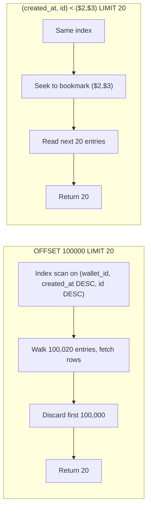
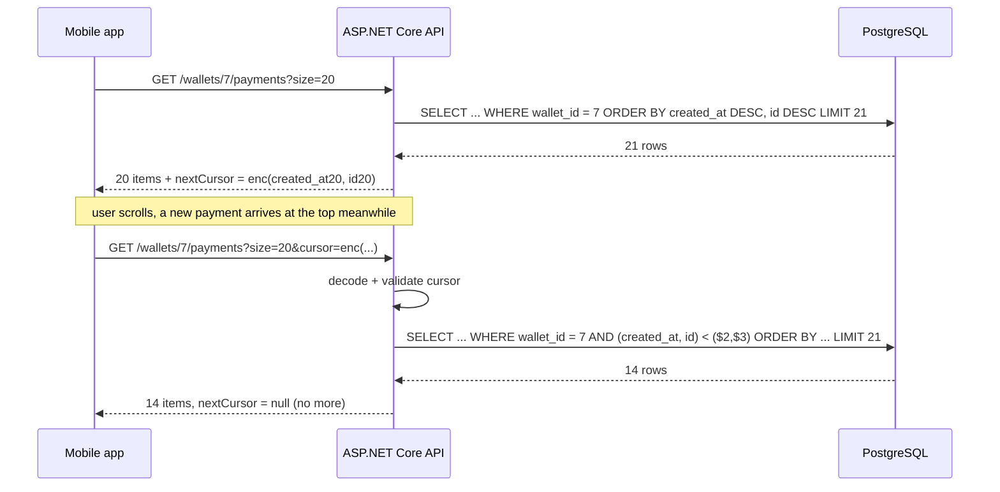

Every list in every application is paged: transaction history, order lists, audit logs, search results. The two ways to page look similar in the API and behave very differently at scale. One slows down and loses rows as the table grows; the other stays fast and consistent but asks more of your sort order. This lesson shows both, with the SQL PostgreSQL actually runs and the C# that turns a database position into an opaque cursor.

## Learning objectives

By the end of this lesson you will be able to:

1. Explain, with row counts, why `OFFSET 100000 LIMIT 20` reads 100,020 rows and why that gets worse on every page.
2. Describe the two correctness bugs of offset paging on changing data: skipped rows and duplicated rows.
3. Write a keyset (cursor) query with a **stable** sort key and a **tie-breaker**, using PostgreSQL row-value comparison `(created_at, id) < ($1, $2)`.
4. Choose the index that makes a keyset page an index seek of exactly `LIMIT` rows.
5. Encode and decode an opaque cursor in C# (Base64Url), validate it, and return it from an ASP.NET Core endpoint.
6. Say when offset paging is still the right choice.

## Prerequisites

- [Relational database fundamentals](#/lesson/m09-relational-fundamentals): primary keys and `ORDER BY`.
- [Indexes](#/lesson/m09-indexes): composite indexes and column order; keyset pagination depends on them.
- [Query planning and EXPLAIN ANALYZE](#/lesson/m09-query-planning): you will compare the plan of an offset page with a keyset page.

## Explain it like I'm a beginner

Think of a thick printed ledger of UPI payments, newest first. A friend asks: "show me payments 1,001 to 1,020."

**Offset paging** is counting. You start at the top and count 1,000 entries, then read the next 20. For entries 10,001–10,020 you count 10,000 first. Every page costs the counting of everything before it. And if someone glues a new payment at the top while you are counting, every entry shifts down by one: the last one you showed on the previous page appears again at the top of this one.

**Keyset paging** is a bookmark. You remember the last entry you showed ("09:06 on 1 Oct, payment number 49") and say: "give me the next 20 entries that come *after* that one in the sort order." No counting. New entries glued at the top do not affect you, because your bookmark is a *position in the data*, not a *row number*.

Two details make the bookmark work. First, the sort order must be **total**: for any two payments you must always be able to say which comes first. "Sort by time" is not enough when two payments share the same second, so you add a tie-breaker, usually the primary key. Second, the sort columns must be **indexed in that order**, so the database can jump to the bookmark instead of scanning from the top.

The "bookmark" is what APIs call a **cursor**: an opaque string the client sends back to get the next page. Opaque means the client does not parse it or build it; the server encodes `(created_at, id)` into it and decodes it on the way back.

## First-principles explanation

### What OFFSET really does

PostgreSQL has no shortcut for `OFFSET n`. It runs the query, produces rows in order, **discards the first n**, and returns the next `LIMIT`. For `ORDER BY created_at DESC LIMIT 20 OFFSET 100000` with an index on `created_at`, the executor walks 100,020 index entries and fetches 100,020 heap rows (or fewer if the index is covering), then throws 100,000 away.

Back-of-the-envelope for a wallet with 2 million payments, 20 per page, index entries ~0.5 µs each plus heap fetch ~2 µs when cached (estimates):

| Page | Rows walked | Approx. time |
|---|---|---|
| 1 | 20 | ~0.05 ms |
| 500 | 10,020 | ~25 ms |
| 5,000 | 100,020 | ~250 ms |
| 50,000 | 1,000,020 | ~2.5 s |

The cost grows linearly with page number. A crawler or an export job that walks the whole table page by page does O(n²) work in total: 2 million rows ÷ 20 per page = 100,000 pages, each walking on average 1 million rows, which is 10¹¹ row visits.

### The two correctness bugs

Offset pages are defined relative to the *current* first row. Data changes between requests, so:

- **Insert at the top** (a new payment arrives, newest-first ordering): every existing row shifts down one position. Page 2 starts one row earlier than expected and **repeats** the last row of page 1.
- **Delete above the current position** (a payment is reversed and removed, or a filter changes): rows shift up. Page 2 starts one row later and **skips** a row the user never sees.

For a dashboard that is refreshed anyway, this is tolerable. For an export, a reconciliation job, a message timeline or an infinite-scroll feed, a skipped payment is a bug report.

### Keyset: position, not count

A keyset query says "rows after this key":

```sql
SELECT id, amount_paise, created_at
FROM payments
WHERE wallet_id = $1
  AND (created_at, id) < ($2, $3)      -- strictly after the last row of the previous page (DESC order)
ORDER BY created_at DESC, id DESC
LIMIT 20;
```

The row-value comparison `(created_at, id) < ($2, $3)` means "created_at earlier than $2, OR created_at equal to $2 and id less than $3". That is exactly the lexicographic order of the `ORDER BY`. With an index on `(wallet_id, created_at DESC, id DESC)` PostgreSQL seeks to the bookmark and reads 20 entries: constant cost, whichever page you are on.

Three requirements follow:

1. **Deterministic total order.** Every sort must end with a unique column (the primary key is the usual tie-breaker). Without it, rows with equal `created_at` may straddle a page boundary and be skipped or repeated.
2. **The sort key must be stable** for the rows being paged. Paging by `updated_at` or by a score that changes breaks, because a row can move from "after the bookmark" to "before" it between requests. Immutable columns (`created_at`, `id`, an invoice number) are safe.
3. **Matching index.** The index column order must match the `ORDER BY` (and leading equality filters such as `wallet_id` come first). Mixed directions (`created_at DESC, id ASC`) need the index to declare the same directions, or PostgreSQL cannot use it for both the seek and the order.

### What you lose with keyset

- **No random access.** You cannot jump to page 37; you can only go next (and previous, with the comparison flipped). Most infinite-scroll UIs never need page 37.
- **No total count** for free. `COUNT(*)` is a separate (and, on big tables, expensive) query. Show "more" rather than "page 3 of 1,204", or use an estimate.
- **Sorting by mutable or computed columns is hard.** "Sort by current balance" has no stable key. Options: sort by a snapshot column, or accept offset for that one view.
- **Cursor plumbing.** The server must encode, decode and validate cursors, and the client must store them.

### Cursor encoding

A cursor is a serialised key. Keep it:

- **Opaque**: Base64Url so clients do not build their own. Document that its format can change.
- **Self-validating**: reject anything that does not decode to the expected shape, with a 400 error, not a 500.
- **Bound to the query**: a cursor from "newest first, status = success" must not be accepted by "oldest first". Include a short query fingerprint in the cursor, or version it.
- **Optionally signed**: an HMAC stops clients from fabricating positions. Usually unnecessary for data they are allowed to read anyway; necessary if the cursor carries anything you do not want them to change (for example a tenant id).

### What breaks first under load

Offset paging breaks the database first: deep pages are CPU and I/O heavy, and they hold the connection longer, which empties the pool. Keyset paging breaks nothing in the database, but it shifts complexity to the API: a client that stores a cursor for days may hit a row that no longer exists, which keyset handles fine (the comparison still works), or a schema change in cursor format, which versioning handles.

### When offset is enough

- Small result sets (a few thousand rows at most) where the deepest page is still cheap.
- Admin grids that need "jump to page N" and show a total count.
- Data that does not change while the user browses (a published report, last month's statement).
- Reporting queries run once, where correctness across pages is checked by a final count.

If your product has an infinite-scroll feed, a sync API, or an export, use keyset. For an admin table with 400 rows, offset is simpler and nobody will notice the difference.

## Visual explanation

### What the executor does for each style



The left side shows why page number drives cost: the executor must produce every row before the page in order to count them, and then throws them away. The right side seeks directly to the position stored in the cursor. Both return 20 rows; one visited 100,020 and the other 20. The index is identical in both cases; the difference is entirely in the `WHERE` clause.

### Infinite scroll with cursors



Two details to notice. The API asks for `size + 1` rows: if 21 come back, there is another page and the 21st row is dropped; if 20 or fewer, `nextCursor` is `null`. That avoids a separate "is there more?" query. And the new payment that arrived between requests does not disturb page 2, because the bookmark is a position in the data. With offset paging the same event would have repeated the last row of page 1.

## Step-by-step example

We will page a wallet's payment history, newest first.

### Step 1 — the offset version

```sql
SELECT id, amount_paise, status, created_at
FROM payments
WHERE wallet_id = $1
ORDER BY created_at DESC
LIMIT 20 OFFSET $2;
```

Two problems already. `ORDER BY created_at DESC` alone is not deterministic when two payments share a timestamp (bulk settlements do), so even page 1 can differ between runs. And the offset cost grows with the page.

### Step 2 — make the order total

Add the primary key as a tie-breaker and create the matching index:

```sql
CREATE INDEX payments_wallet_created_id ON payments (wallet_id, created_at DESC, id DESC);

SELECT id, amount_paise, status, created_at
FROM payments
WHERE wallet_id = $1
ORDER BY created_at DESC, id DESC
LIMIT 20 OFFSET $2;
```

This fixes the non-determinism and lets the planner satisfy the `ORDER BY` from the index. The offset cost remains.

### Step 3 — replace the offset with a bookmark

The client sends back the `(created_at, id)` of the last row it saw:

```sql
SELECT id, amount_paise, status, created_at
FROM payments
WHERE wallet_id = $1
  AND (created_at, id) < ($2, $3)
ORDER BY created_at DESC, id DESC
LIMIT 21;
```

`EXPLAIN (ANALYZE, BUFFERS)` now shows an `Index Scan` with `Index Cond: ((wallet_id = 7) AND (ROW(created_at, id) < ROW($2, $3)))` and `rows=21`, with a handful of buffer hits, on page 1 and on page 10,000 alike.

### Step 4 — hide the key behind a cursor

Clients should not see or construct `(created_at, id)`. The API encodes them. Pseudo-shape of the cursor payload: version byte, then the UTC ticks of `created_at`, then the id. Base64Url-encode the bytes. On the way back: decode, check the version, check lengths, and reject anything else with `400 Bad Request`. The C# is in the next section.

### Step 5 — the EF Core version

```csharp
// Keyset with EF Core. Npgsql translates the tuple comparison to a row-value comparison.
var rows = await db.Payments
    .Where(p => p.WalletId == walletId)
    .Where(p => after == null
        || p.CreatedAt < after.CreatedAt
        || (p.CreatedAt == after.CreatedAt && p.Id < after.Id))
    .OrderByDescending(p => p.CreatedAt).ThenByDescending(p => p.Id)
    .Take(size + 1)
    .AsNoTracking()
    .ToListAsync(ct);
```

The expanded `OR` form is what row-value comparison means; PostgreSQL's planner handles both, but the `(a, b) < (x, y)` form is guaranteed to use the composite index in one seek, so when you write raw SQL prefer it. In EF Core 10 you can also write `EF.Functions.LessThan(ValueTuple.Create(p.CreatedAt, p.Id), ValueTuple.Create(after.CreatedAt, after.Id))` with the Npgsql provider to get the row-value form directly.

## Production-style C# implementation

The compiled code uses an in-memory store behind `IPaymentStore` so the course checker can build it; the SQL each method stands for is in the comments. The cursor code is exactly what you would ship.

```text
Wallet.Api/
  Program.cs
  Paging/Payment.cs
  Paging/PageCursor.cs
  Paging/IPaymentStore.cs
  Paging/PaymentFeedService.cs
```

```csharp file=Paging/Payment.cs
namespace Wallet.Paging;

public sealed record Payment(long Id, int WalletId, int AmountPaise, string Status, DateTimeOffset CreatedAt);

public sealed record PaymentDto(long Id, decimal AmountRupees, string Status, DateTimeOffset CreatedAt);

/// <summary>One page of results. NextCursor is null on the last page.</summary>
public sealed record Page<T>(IReadOnlyList<T> Items, string? NextCursor);
```

```csharp file=Paging/PageCursor.cs
using System.Buffers.Binary;
using System.Buffers.Text;

namespace Wallet.Paging;

/// <summary>The keyset position: the sort key of the last row the client saw.
/// Encoded as 1 version byte + 8 bytes UTC ticks + 8 bytes id, Base64Url.</summary>
public sealed record PageCursor(DateTimeOffset CreatedAt, long Id)
{
    private const byte Version = 1;
    private const int Length = 1 + 8 + 8;

    public string Encode()
    {
        Span<byte> buf = stackalloc byte[Length];
        buf[0] = Version;
        BinaryPrimitives.WriteInt64BigEndian(buf[1..9], CreatedAt.UtcTicks);
        BinaryPrimitives.WriteInt64BigEndian(buf[9..17], Id);
        return Base64Url.EncodeToString(buf);
    }

    /// <summary>Returns false for anything that is not a cursor this server produced.</summary>
    public static bool TryDecode(string? text, out PageCursor? cursor)
    {
        cursor = null;
        if (string.IsNullOrWhiteSpace(text) || text.Length > 64) return false;

        Span<byte> buf = stackalloc byte[Length + 2];
        if (!Base64Url.IsValid(text)) return false;
        if (!Base64Url.TryDecodeFromChars(text, buf, out var written) || written != Length) return false;
        if (buf[0] != Version) return false;

        var ticks = BinaryPrimitives.ReadInt64BigEndian(buf[1..9]);
        var id = BinaryPrimitives.ReadInt64BigEndian(buf[9..17]);
        if (ticks < 0 || ticks > DateTimeOffset.MaxValue.Ticks || id < 0) return false;

        cursor = new PageCursor(new DateTimeOffset(ticks, TimeSpan.Zero), id);
        return true;
    }
}
```

```csharp file=Paging/IPaymentStore.cs
namespace Wallet.Paging;

public interface IPaymentStore
{
    /// <summary>
    /// SELECT ... FROM payments WHERE wallet_id = $1 [AND (created_at, id) &lt; ($2, $3)]
    /// ORDER BY created_at DESC, id DESC LIMIT $4
    /// </summary>
    Task<IReadOnlyList<Payment>> NewestFirstAsync(int walletId, PageCursor? after, int limit, CancellationToken ct);
}

public sealed class InMemoryPaymentStore : IPaymentStore
{
    private readonly List<Payment> _rows = new();
    public int StatementsRun { get; private set; }

    public InMemoryPaymentStore Add(params Payment[] rows) { _rows.AddRange(rows); return this; }

    public Task<IReadOnlyList<Payment>> NewestFirstAsync(int walletId, PageCursor? after, int limit, CancellationToken ct)
    {
        StatementsRun++;
        IEnumerable<Payment> q = _rows.Where(p => p.WalletId == walletId);
        if (after is not null)
            q = q.Where(p => p.CreatedAt < after.CreatedAt || (p.CreatedAt == after.CreatedAt && p.Id < after.Id));
        var page = q.OrderByDescending(p => p.CreatedAt).ThenByDescending(p => p.Id).Take(limit).ToList();
        return Task.FromResult<IReadOnlyList<Payment>>(page);
    }
}
```

```csharp file=Paging/PaymentFeedService.cs
namespace Wallet.Paging;

public sealed class InvalidCursorException() : Exception("The cursor is not valid for this endpoint.");

public sealed class PaymentFeedService(IPaymentStore store)
{
    public const int MaxPageSize = 100;

    public async Task<Page<PaymentDto>> NewestFirstAsync(int walletId, string? cursor, int size, CancellationToken ct)
    {
        size = Math.Clamp(size, 1, MaxPageSize);

        PageCursor? after = null;
        if (cursor is not null && !PageCursor.TryDecode(cursor, out after)) throw new InvalidCursorException();

        // Ask for one extra row to learn whether another page exists without a COUNT.
        var rows = await store.NewestFirstAsync(walletId, after, size + 1, ct);
        var hasMore = rows.Count > size;
        var items = rows.Take(size).ToList();

        var next = hasMore ? new PageCursor(items[^1].CreatedAt, items[^1].Id).Encode() : null;
        return new Page<PaymentDto>(
            items.Select(p => new PaymentDto(p.Id, p.AmountPaise / 100m, p.Status, p.CreatedAt)).ToList(),
            next);
    }
}
```

```csharp file=Program.cs
using Wallet.Paging;

var builder = WebApplication.CreateBuilder(args);

builder.Services.AddSingleton<IPaymentStore>(_ => SeedPayments.Build());
builder.Services.AddScoped<PaymentFeedService>();

var app = builder.Build();

app.MapGet("/wallets/{walletId:int}/payments", async (int walletId, string? cursor, int? size, PaymentFeedService feed, CancellationToken ct) =>
{
    try
    {
        var page = await feed.NewestFirstAsync(walletId, cursor, size ?? 20, ct);
        return Results.Ok(new { items = page.Items, nextCursor = page.NextCursor });
    }
    catch (InvalidCursorException ex)
    {
        return Results.Problem(ex.Message, statusCode: StatusCodes.Status400BadRequest);
    }
});

app.Run();

public static class SeedPayments
{
    public static InMemoryPaymentStore Build()
    {
        var store = new InMemoryPaymentStore();
        var start = new DateTimeOffset(2026, 10, 1, 9, 0, 0, TimeSpan.FromHours(5.5));
        for (var g = 1; g <= 64; g++)
            store.Add(new Payment(g, 1 + (g - 1) % 4, 10_000 * (1 + (g * 7) % 9), g % 11 == 0 ? "failed" : "success",
                                  start.AddMinutes((g - 1) / 8)));   // 8 payments per minute: deliberate ties
        return store;
    }
}
```

**Design notes.**

- The cursor carries only the sort key, 17 bytes before encoding. It does not carry the wallet id: the wallet comes from the route and the user's authorisation, so a cursor cannot be used to read another wallet.
- `TryDecode` is strict: length, version and value ranges. Garbage becomes a 400, never an exception in the data layer.
- `size + 1` gives `hasMore` for free. A `COUNT(*)` for "total pages" is a separate decision; on a 2-million-row wallet it is a full index scan and belongs in a cached summary, not on every page.
- For "previous page" add a direction flag to the cursor, flip the comparison to `>` and the `ORDER BY` to ascending, then reverse the rows in memory before returning.

:::callout type=warning title="The sort key must not change"
Keyset paging by `updated_at` is a common mistake. A row updated between two requests jumps from "after the bookmark" to "before" it and is never shown. Page by immutable columns (`created_at`, `id`, a sequence) or by a value captured at insert time.
:::

## Bad design vs good design

**Bad**: `GET /payments?page=3&pageSize=50` with `ORDER BY created_at DESC LIMIT 50 OFFSET 100`, no tie-breaker, and a `SELECT count(*)` on every request for the "page 3 of 2,418" label. On a wallet with 2 million payments the 40,000th page walks 2 million rows; the count walks 2 million rows on *every* page; and two payments settled in the same second swap places between requests, so the client occasionally shows one twice and misses the other.

**Good**: `GET /wallets/7/payments?size=50&cursor=AQ...` with `(created_at, id) < ($2,$3) ORDER BY created_at DESC, id DESC LIMIT 51`, an index on `(wallet_id, created_at DESC, id DESC)`, `nextCursor` derived from the last row, no count. Constant cost per page, no skips, no repeats.

**But**: the admin "search all payments" grid with filters, sortable columns and a "go to page" box is a different product. There, use offset with a capped depth (refuse `OFFSET` beyond, say, 10,000 and tell the user to narrow the filter), always add the primary-key tie-breaker, and compute the count with `EXPLAIN`-based estimates or a cached number.

:::callout type=tradeoff title="Offset vs keyset at a glance"
| | Offset | Keyset |
|---|---|---|
| Cost of page n | grows with n | constant |
| Jump to page n | yes | no |
| Total count | natural (but expensive) | separate query |
| Stable under inserts/deletes | no (skips/repeats) | yes |
| Sort by any column | yes | only stable, indexed keys with a tie-breaker |
| Client complexity | page number | opaque cursor |
:::

## Practical playground

Sixty-four payments across four wallets, eight per minute so that `created_at` ties are common. Wallet 1 holds ids 1, 5, 9 … 61. Run the offset and keyset versions of page 2, then insert a new payment for wallet 1 with the newest timestamp and run both again. Watch which one repeats a row.

:::playground type=sql title="Offset vs keyset on a payments feed"
```sql
CREATE TABLE payments (
  id           bigint      PRIMARY KEY,
  wallet_id    int         NOT NULL,
  amount_paise int         NOT NULL,
  status       text        NOT NULL,
  created_at   timestamptz NOT NULL
);
INSERT INTO payments
SELECT g,
       1 + (g - 1) % 4,
       10000 * (1 + (g * 7) % 9),
       CASE WHEN g % 11 = 0 THEN 'failed' ELSE 'success' END,
       TIMESTAMPTZ '2026-10-01 09:00:00+05:30' + ((g - 1) / 8) * INTERVAL '1 minute'
FROM generate_series(1, 64) AS g;

CREATE INDEX payments_wallet_created_id ON payments (wallet_id, created_at DESC, id DESC);

-- Page 1 (both styles agree):
-- SELECT id, created_at FROM payments WHERE wallet_id = 1 ORDER BY created_at DESC, id DESC LIMIT 4;
-- Page 2, offset:
-- SELECT id, created_at FROM payments WHERE wallet_id = 1 ORDER BY created_at DESC, id DESC LIMIT 4 OFFSET 4;
-- Page 2, keyset (bookmark = last row of page 1):
-- SELECT id, created_at FROM payments WHERE wallet_id = 1
--   AND (created_at, id) < (TIMESTAMPTZ '2026-10-01 09:06:00+05:30', 49)
-- ORDER BY created_at DESC, id DESC LIMIT 4;
-- Now: INSERT INTO payments VALUES (99, 1, 50000, 'success', '2026-10-01 09:30:00+05:30'); and rerun both page 2s.
```
:::

## Exercises

:::exercise id=m09-pagination-ex1 difficulty=beginner kind=sql ordered=true title="A deterministic offset page"
Return the second page of four payments for wallet 1, newest first, as columns `id`, `amount_paise`, `created_at`. The order must be fully deterministic: two payments in the same minute must always come back in the same order (higher `id` first).
::setup
```sql
CREATE TABLE payments (id bigint PRIMARY KEY, wallet_id int NOT NULL, amount_paise int NOT NULL, status text NOT NULL, created_at timestamptz NOT NULL);
INSERT INTO payments
SELECT g, 1 + (g - 1) % 4, 10000 * (1 + (g * 7) % 9), CASE WHEN g % 11 = 0 THEN 'failed' ELSE 'success' END,
       TIMESTAMPTZ '2026-10-01 09:00:00+05:30' + ((g - 1) / 8) * INTERVAL '1 minute'
FROM generate_series(1, 64) AS g;
```
::check
```sql
SELECT id, amount_paise, created_at
FROM payments
WHERE wallet_id = 1
ORDER BY created_at DESC, id DESC
LIMIT 4 OFFSET 4;
```
::acceptance
- Exactly four rows with ids 45, 41, 37, 33 in that order.
- Ids 45 and 41 share a `created_at`; 45 comes first.
- Running the query twice gives the same rows in the same order.
::hint
Page 2 of size 4 means skip 4 and take 4.
::hint
`ORDER BY created_at DESC` alone leaves ties in an undefined order. Add a second sort column that is unique.
::hint
```sql
... ORDER BY created_at DESC, id DESC LIMIT 4 OFFSET 4;
```
::solution
```sql
SELECT id, amount_paise, created_at
FROM payments
WHERE wallet_id = 1
ORDER BY created_at DESC, id DESC
LIMIT 4 OFFSET 4;
```
The tie-breaker is not optional even for offset paging. Without it, PostgreSQL may return 45 before 41 on one run and 41 before 45 on the next (for example after a different plan is chosen), and a page boundary falling between them repeats one and skips the other.
::mistakes
- `OFFSET 8` (confusing "page 2" with "skip two pages").
- Sorting by `id` only; it happens to agree with `created_at` in this seed, but a real table with backfilled rows would not.
:::

:::exercise id=m09-pagination-ex2 difficulty=beginner kind=code title="Encode and decode a cursor"
Implement `FeedCursor.Encode` and `FeedCursor.TryDecode`. The cursor holds `(DateTimeOffset CreatedAt, long Id)`. Encode as 16 bytes (8 bytes UTC ticks, big-endian, then 8 bytes id) in **Base64Url** (characters `A–Z a–z 0–9 - _`, no padding). `TryDecode` must return `false` for null, empty, non-Base64Url text, wrong length, or negative values, and must never throw.
::acceptance
- `TryDecode(Encode(c))` returns `true` and an equal cursor for any valid `c`.
- The encoded string contains no `+`, `/` or `=`.
- Garbage such as `"not a cursor!"`, `""`, `null` and a valid Base64Url string of the wrong length all return `false`.
::hint
`System.Buffers.Binary.BinaryPrimitives.WriteInt64BigEndian` writes a `long` into a `Span<byte>`.
::hint
`System.Buffers.Text.Base64Url` (.NET 9+) has `EncodeToString(ReadOnlySpan<byte>)`, `IsValid(ReadOnlySpan<char>)` and `TryDecodeFromChars(ReadOnlySpan<char>, Span<byte>, out int written)`.
::hint
Check `IsValid` first, then that `written == 16`, then that ticks and id are non-negative and ticks ≤ `DateTimeOffset.MaxValue.Ticks`.
::hint
```csharp
Span<byte> buf = stackalloc byte[16];
BinaryPrimitives.WriteInt64BigEndian(buf[..8], CreatedAt.UtcTicks);
BinaryPrimitives.WriteInt64BigEndian(buf[8..], Id);
return Base64Url.EncodeToString(buf);
```
::starter
```csharp file=FeedCursor.cs
using System;
using System.Buffers.Binary;
using System.Buffers.Text;

public sealed record FeedCursor(DateTimeOffset CreatedAt, long Id)
{
    public string Encode() => throw new NotImplementedException();

    public static bool TryDecode(string? text, out FeedCursor? cursor) => throw new NotImplementedException();
}
```
::tests
```csharp file=FeedCursorTests.cs
using System;
using Xunit;

public class FeedCursorTests
{
    private static readonly FeedCursor Sample = new(new DateTimeOffset(2026, 10, 1, 9, 6, 0, TimeSpan.FromHours(5.5)), 49);

    [Fact]
    public void Round_trips()
    {
        var text = Sample.Encode();
        Assert.True(FeedCursor.TryDecode(text, out var back));
        Assert.Equal(Sample.CreatedAt.UtcTicks, back!.CreatedAt.UtcTicks);
        Assert.Equal(49L, back.Id);
    }

    [Fact]
    public void Is_url_safe_without_padding()
    {
        var text = Sample.Encode();
        Assert.DoesNotContain("+", text);
        Assert.DoesNotContain("/", text);
        Assert.DoesNotContain("=", text);
        Assert.Equal(22, text.Length);   // 16 bytes -> 22 Base64Url chars
    }

    [Theory]
    [InlineData(null)]
    [InlineData("")]
    [InlineData("not a cursor!")]
    [InlineData("AAAA")]                        // valid Base64Url, wrong length
    [InlineData("AAAAAAAAAAAAAAAAAAAAAAAAAAAAAA")] // 22 bytes, wrong length
    public void Rejects_garbage(string? text)
    {
        Assert.False(FeedCursor.TryDecode(text, out var c));
        Assert.Null(c);
    }

    [Fact]
    public void Rejects_negative_id()
    {
        var bytes = new byte[16];
        bytes[8] = 0xFF;   // sign bit set -> negative id
        var text = System.Buffers.Text.Base64Url.EncodeToString(bytes);
        Assert.False(FeedCursor.TryDecode(text, out _));
    }

    [Fact]
    public void Preserves_ordering_of_ticks()
    {
        var earlier = new FeedCursor(Sample.CreatedAt.AddMinutes(-1), 1);
        FeedCursor.TryDecode(earlier.Encode(), out var e);
        FeedCursor.TryDecode(Sample.Encode(), out var s);
        Assert.True(e!.CreatedAt < s!.CreatedAt);
    }
}
```
::solution
```csharp file=FeedCursor.cs
using System;
using System.Buffers.Binary;
using System.Buffers.Text;

public sealed record FeedCursor(DateTimeOffset CreatedAt, long Id)
{
    private const int Length = 16;

    public string Encode()
    {
        Span<byte> buf = stackalloc byte[Length];
        BinaryPrimitives.WriteInt64BigEndian(buf[..8], CreatedAt.UtcTicks);
        BinaryPrimitives.WriteInt64BigEndian(buf[8..], Id);
        return Base64Url.EncodeToString(buf);
    }

    public static bool TryDecode(string? text, out FeedCursor? cursor)
    {
        cursor = null;
        if (string.IsNullOrEmpty(text) || text.Length > 64 || !Base64Url.IsValid(text)) return false;

        Span<byte> buf = stackalloc byte[64];
        if (!Base64Url.TryDecodeFromChars(text, buf, out var written) || written != Length) return false;

        var ticks = BinaryPrimitives.ReadInt64BigEndian(buf[..8]);
        var id = BinaryPrimitives.ReadInt64BigEndian(buf[8..16]);
        if (ticks < 0 || ticks > DateTimeOffset.MaxValue.Ticks || id < 0) return false;

        cursor = new FeedCursor(new DateTimeOffset(ticks, TimeSpan.Zero), id);
        return true;
    }
}
```
Binary big-endian encoding keeps the cursor short (22 characters) and, as a bonus, makes the encoded strings sort in the same order as the keys. A JSON payload (`{"t":"2026-10-01T03:36:00Z","id":49}`) in Base64Url also works and is easier to debug; it is about three times longer. Either way, always store UTC ticks: a cursor must not depend on the server's time zone.
::alternatives
Add a leading version byte so the format can change later without breaking old clients, and an HMAC tag if the cursor will ever carry data the client must not alter.
::mistakes
- Using `Convert.ToBase64String`, which produces `+`, `/` and `=`; they need URL-encoding and break when a client forgets.
- Catching `FormatException` as the only validation; a wrong-length but valid string decodes without throwing.
- Storing `CreatedAt.Ticks` (local) instead of `UtcTicks`.
:::

:::exercise id=m09-pagination-ex3 difficulty=intermediate kind=sql ordered=true title="Keyset page 2 with a row-value comparison"
The client saw page 1 (ids 61, 57, 53, 49) and holds the bookmark of the last row: `created_at = '2026-10-01 09:06:00+05:30'`, `id = 49`. Write the keyset query that returns the next four payments for wallet 1, newest first, as `id`, `amount_paise`, `created_at`, using a single row-value comparison in the `WHERE` clause.
::setup
```sql
CREATE TABLE payments (id bigint PRIMARY KEY, wallet_id int NOT NULL, amount_paise int NOT NULL, status text NOT NULL, created_at timestamptz NOT NULL);
INSERT INTO payments
SELECT g, 1 + (g - 1) % 4, 10000 * (1 + (g * 7) % 9), CASE WHEN g % 11 = 0 THEN 'failed' ELSE 'success' END,
       TIMESTAMPTZ '2026-10-01 09:00:00+05:30' + ((g - 1) / 8) * INTERVAL '1 minute'
FROM generate_series(1, 64) AS g;
CREATE INDEX payments_wallet_created_id ON payments (wallet_id, created_at DESC, id DESC);
```
::check
```sql
SELECT id, amount_paise, created_at
FROM payments
WHERE wallet_id = 1
  AND (created_at, id) < (TIMESTAMPTZ '2026-10-01 09:06:00+05:30', 49)
ORDER BY created_at DESC, id DESC
LIMIT 4;
```
::acceptance
- Returns ids 45, 41, 37, 33 in that order (the same rows as `OFFSET 4`, but without counting).
- The `WHERE` clause uses `(created_at, id) < (..., ...)`, not an `OFFSET`.
- The query still works if a new payment with id 99 and a later timestamp is inserted first.
::hint
"After this row in DESC order" means "smaller in `(created_at, id)` order".
::hint
`(created_at, id) < ($ts, 49)` is PostgreSQL's row-value comparison: earlier timestamp, or equal timestamp and smaller id.
::hint
Keep the `ORDER BY created_at DESC, id DESC` and `LIMIT 4`; the bookmark replaces only the `OFFSET`.
::hint
```sql
WHERE wallet_id = 1 AND (created_at, id) < (TIMESTAMPTZ '2026-10-01 09:06:00+05:30', 49)
ORDER BY created_at DESC, id DESC LIMIT 4
```
::solution
```sql
SELECT id, amount_paise, created_at
FROM payments
WHERE wallet_id = 1
  AND (created_at, id) < (TIMESTAMPTZ '2026-10-01 09:06:00+05:30', 49)
ORDER BY created_at DESC, id DESC
LIMIT 4;
```
Try `EXPLAIN` on it: the index condition includes the row comparison and the plan reads four index entries. Insert `(99, 1, 50000, 'success', '2026-10-01 09:30:00+05:30')` and run both the keyset query and the offset query from exercise 1: keyset still returns 45, 41, 37, 33; offset now returns 49, 45, 41, 37 and has repeated id 49.
::mistakes
- Writing `created_at < $ts AND id < 49`, which wrongly excludes rows in the same minute with a smaller id *and* rows in earlier minutes with a larger id. The row-value form (or its `OR` expansion) is the correct one.
- Using `<=`, which repeats the bookmark row.
:::

:::exercise id=m09-pagination-ex4 difficulty=intermediate kind=code title="Keyset paging over an in-memory feed with no skips or repeats"
Implement `KeysetPager.NextPage`. It receives all rows (unordered), an optional bookmark `(CreatedAt, Id)` and a page size, and returns the next page in `(CreatedAt DESC, Id DESC)` order plus a bookmark for the following page (`null` when there is none). The tests insert a new row between page 1 and page 2 and check that nothing is skipped or repeated, and that ties on `CreatedAt` are handled.
::acceptance
- Pages are ordered by `CreatedAt` descending, then `Id` descending.
- Walking all pages visits every row exactly once, even when a newer row is inserted between calls.
- The bookmark of the last page is `null`; a page is never empty unless there are no rows at all after the bookmark.
::hint
Filter first ("after the bookmark"), then sort, then take `size + 1` to know whether more rows exist.
::hint
"After the bookmark" in descending order: `CreatedAt < b.CreatedAt || (CreatedAt == b.CreatedAt && Id < b.Id)`.
::hint
The bookmark for the next call is the sort key of the *last item you return*, not of the extra `size + 1`th row.
::hint
```csharp
var page = ordered.Take(size + 1).ToList();
var hasMore = page.Count > size;
var items = page.Take(size).ToList();
var next = hasMore ? new Bookmark(items[^1].CreatedAt, items[^1].Id) : null;
```
::starter
```csharp file=KeysetPager.cs
using System;
using System.Collections.Generic;
using System.Linq;

public sealed record FeedRow(long Id, DateTimeOffset CreatedAt, string Text);
public sealed record Bookmark(DateTimeOffset CreatedAt, long Id);
public sealed record FeedPage(IReadOnlyList<FeedRow> Items, Bookmark? Next);

public static class KeysetPager
{
    public static FeedPage NextPage(IEnumerable<FeedRow> rows, Bookmark? after, int size)
        => throw new NotImplementedException();
}
```
::tests
```csharp file=KeysetPagerTests.cs
using System;
using System.Collections.Generic;
using System.Linq;
using Xunit;

public class KeysetPagerTests
{
    private static readonly DateTimeOffset T0 = new(2026, 10, 1, 9, 0, 0, TimeSpan.Zero);

    // 10 rows, two per minute -> ties on CreatedAt.
    private static List<FeedRow> Rows() =>
        Enumerable.Range(1, 10).Select(i => new FeedRow(i, T0.AddMinutes((i - 1) / 2), $"row {i}")).ToList();

    [Fact]
    public void First_page_is_newest_first_with_id_tiebreak()
    {
        var page = KeysetPager.NextPage(Rows(), null, 3);
        Assert.Equal(new long[] { 10, 9, 8 }, page.Items.Select(r => r.Id).ToArray());
        Assert.NotNull(page.Next);
        Assert.Equal(8, page.Next!.Id);
    }

    [Fact]
    public void Walks_all_rows_exactly_once()
    {
        var rows = Rows();
        var seen = new List<long>();
        Bookmark? b = null;
        do
        {
            var p = KeysetPager.NextPage(rows, b, 4);
            seen.AddRange(p.Items.Select(r => r.Id));
            b = p.Next;
        } while (b is not null);
        Assert.Equal(Enumerable.Range(1, 10).Reverse().Select(i => (long)i).ToArray(), seen.ToArray());
    }

    [Fact]
    public void Insert_between_pages_causes_no_repeat_or_skip()
    {
        var rows = Rows();
        var p1 = KeysetPager.NextPage(rows, null, 4);              // 10 9 8 7
        rows.Add(new FeedRow(11, T0.AddMinutes(30), "new at top"));  // arrives after page 1 was served
        var p2 = KeysetPager.NextPage(rows, p1.Next, 4);           // 6 5 4 3
        var p3 = KeysetPager.NextPage(rows, p2.Next, 4);           // 2 1
        var all = p1.Items.Concat(p2.Items).Concat(p3.Items).Select(r => r.Id).ToList();
        Assert.Equal(new long[] { 10, 9, 8, 7, 6, 5, 4, 3, 2, 1 }, all.ToArray());
        Assert.Null(p3.Next);
    }

    [Fact]
    public void Tie_on_created_at_is_split_correctly_across_pages()
    {
        var rows = Rows();                      // ids 7 and 8 share a minute
        var p1 = KeysetPager.NextPage(rows, null, 3);   // 10 9 8
        var p2 = KeysetPager.NextPage(rows, p1.Next, 3); // must start with 7
        Assert.Equal(7, p2.Items[0].Id);
    }

    [Fact]
    public void Last_page_has_null_bookmark_and_exact_boundary()
    {
        var rows = Rows();
        var p = KeysetPager.NextPage(rows, new Bookmark(T0.AddMinutes(1), 3), 5);  // rows after id 3: 2, 1
        Assert.Equal(new long[] { 2, 1 }, p.Items.Select(r => r.Id).ToArray());
        Assert.Null(p.Next);
    }

    [Fact]
    public void Exactly_size_rows_remaining_gives_null_next()
    {
        var rows = Rows();
        var p = KeysetPager.NextPage(rows, new Bookmark(T0.AddMinutes(1), 4), 4);  // remaining: 3 2 1
        Assert.Equal(3, p.Items.Count);
        Assert.Null(p.Next);
        var q = KeysetPager.NextPage(rows, new Bookmark(T0.AddMinutes(2), 5), 4);  // remaining: 4 3 2 1 exactly
        Assert.Equal(4, q.Items.Count);
        Assert.Null(q.Next);
    }
}
```
::solution
```csharp file=KeysetPager.cs
using System;
using System.Collections.Generic;
using System.Linq;

public sealed record FeedRow(long Id, DateTimeOffset CreatedAt, string Text);
public sealed record Bookmark(DateTimeOffset CreatedAt, long Id);
public sealed record FeedPage(IReadOnlyList<FeedRow> Items, Bookmark? Next);

public static class KeysetPager
{
    public static FeedPage NextPage(IEnumerable<FeedRow> rows, Bookmark? after, int size)
    {
        if (size <= 0) throw new ArgumentOutOfRangeException(nameof(size));

        IEnumerable<FeedRow> q = rows;
        if (after is not null)
            q = q.Where(r => r.CreatedAt < after.CreatedAt || (r.CreatedAt == after.CreatedAt && r.Id < after.Id));

        var page = q.OrderByDescending(r => r.CreatedAt).ThenByDescending(r => r.Id)
                    .Take(size + 1)
                    .ToList();

        var hasMore = page.Count > size;
        var items = page.Take(size).ToList();
        var next = hasMore ? new Bookmark(items[^1].CreatedAt, items[^1].Id) : null;
        return new FeedPage(items, next);
    }
}
```
This is the same logic the database runs for `(created_at, id) < ($1, $2) ORDER BY created_at DESC, id DESC LIMIT size + 1`. The `size + 1` trick is why the "exactly size rows remaining" test expects `Next == null`: four rows remain, we ask for five, get four, and know there is nothing more.
::alternatives
Return `hasMore` as a boolean and let the API layer build the cursor string; keeping the pager free of encoding makes it reusable for the "previous page" direction.
::mistakes
- Comparing with `<=`, which repeats the bookmark row on every page.
- Using only `CreatedAt < after.CreatedAt`: rows 8 and 7 share a minute, so row 7 would be skipped after a page ending in 8.
- Producing the next bookmark from the `size + 1`th row, which skips that row.
:::

:::exercise id=m09-pagination-ex5 difficulty=advanced kind=sql ordered=true title="Keyset over a non-unique sort column"
Product wants the wallet 1 feed sorted by **amount, largest first**. Amounts repeat (there are two payments of ₹900), so the sort needs `id DESC` as a tie-breaker. Page 1 (size 5) returned ids 41, 5, 37, 1, 33, so the bookmark is `(amount_paise = 70000, id = 33)`. Write the query for page 2 returning `id`, `amount_paise`, and state (in the acceptance) which index makes it a single seek.
::setup
```sql
CREATE TABLE payments (id bigint PRIMARY KEY, wallet_id int NOT NULL, amount_paise int NOT NULL, status text NOT NULL, created_at timestamptz NOT NULL);
INSERT INTO payments
SELECT g, 1 + (g - 1) % 4, 10000 * (1 + (g * 7) % 9), CASE WHEN g % 11 = 0 THEN 'failed' ELSE 'success' END,
       TIMESTAMPTZ '2026-10-01 09:00:00+05:30' + ((g - 1) / 8) * INTERVAL '1 minute'
FROM generate_series(1, 64) AS g;
CREATE INDEX payments_wallet_amount_id ON payments (wallet_id, amount_paise DESC, id DESC);
```
::check
```sql
SELECT id, amount_paise
FROM payments
WHERE wallet_id = 1
  AND (amount_paise, id) < (70000, 33)
ORDER BY amount_paise DESC, id DESC
LIMIT 5;
```
::acceptance
- Returns ids 29, 61, 25, 57, 21 with amounts 60000, 50000, 50000, 40000, 40000.
- No row from page 1 appears again and no row is skipped (ids 61 and 25 both have ₹500 and are kept together).
- The matching index is `(wallet_id, amount_paise DESC, id DESC)`; the leading equality column comes first, then the sort columns in the same directions as the `ORDER BY`.
::hint
The pattern is the same as for `created_at`: the sort column first, then the unique tie-breaker, in the same directions.
::hint
Row-value comparison works for any comparable types: `(amount_paise, id) < (70000, 33)`.
::hint
Check your result against `... ORDER BY amount_paise DESC, id DESC LIMIT 5 OFFSET 5`; on unchanged data the two must agree.
::hint
```sql
WHERE wallet_id = 1 AND (amount_paise, id) < (70000, 33)
ORDER BY amount_paise DESC, id DESC LIMIT 5
```
::solution
```sql
SELECT id, amount_paise
FROM payments
WHERE wallet_id = 1
  AND (amount_paise, id) < (70000, 33)
ORDER BY amount_paise DESC, id DESC
LIMIT 5;
```
Sorting by a non-unique column is fine for keyset paging as long as the sort is made total with a unique tie-breaker and that column is stable. `amount_paise` never changes after a payment is recorded, so it qualifies. A sort by "current balance" or "last activity" would not, because a row can move across the bookmark between requests.

If the sort direction were mixed (`amount_paise DESC, id ASC`), the row-value shortcut no longer applies (it assumes the same direction for all columns) and you would write the `OR` expansion by hand: `amount_paise < 70000 OR (amount_paise = 70000 AND id > 33)`, with an index declared as `(wallet_id, amount_paise DESC, id ASC)`.
::mistakes
- Omitting the tie-breaker because "amounts are usually different": two ₹900 payments straddling a page boundary will be repeated or lost.
- Creating the index as `(amount_paise, id)` without `wallet_id` first; the planner then has to filter wallet rows out of the whole table's order.
:::

:::exercise id=m09-pagination-ex6 difficulty=intermediate kind=written title="Choose a paging strategy for three endpoints"
For each endpoint choose offset or keyset, name the sort key and tie-breaker, and the index: (a) a mobile app's transaction history with infinite scroll; (b) an internal admin grid over all refunds with sortable columns, filters and "page 7 of 92"; (c) a partner-facing sync API that lets a partner download all orders changed since their last sync, in batches of 1,000.
::acceptance
- Each answer names a strategy, a sort key with tie-breaker and the index.
- (c) explains why `updated_at` alone is dangerous and how to make it safe.
- (b) says how deep an offset is acceptable and what to do about the total count.
::hint
Which endpoints need "jump to page N"? Which run against millions of rows repeatedly?
::hint
For (c), think about a row updated twice while the partner is paging, and about two rows with the same `updated_at`.
::hint
A monotonic sequence number assigned at commit time (or a logical-replication position) is the usual answer for sync APIs.
::solution
(a) **Keyset.** Sort `(created_at DESC, id DESC)`, index `(wallet_id, created_at DESC, id DESC)`, opaque cursor, `size + 1` for `hasMore`, no count. Infinite scroll never needs page numbers and the table is large and constantly growing.

(b) **Offset, bounded.** Sort by the user's chosen column **plus** `id` as a tie-breaker; indexes on the two or three most common sort columns with `id` appended. Refuse `OFFSET` beyond about 10,000 rows and ask the admin to narrow the filter. Show the total from `count(*)` only when the filter is selective (estimate rows from `EXPLAIN` first), otherwise show "10,000+". Offset is right here because the product needs random access and the audience is small.

(c) **Keyset on a monotonic change sequence**, not on `updated_at`. `updated_at` is not stable (a row updated during paging jumps forward and is seen twice, which is harmless, but a clock skew or a row updated with an *earlier* timestamp is missed), and it has ties. Add a `change_seq bigint` column filled from a sequence on every insert/update (or use an outbox/changelog table), index `(change_seq)`, and page with `WHERE change_seq > $last ORDER BY change_seq LIMIT 1000`. The partner stores the last `change_seq` as its cursor. Note the remaining subtlety: with concurrent transactions a lower sequence number can commit *after* a higher one has been read; mitigate by only serving changes older than a few seconds, or by using logical replication positions.
::mistakes
- Keyset by `updated_at` for the sync API.
- Unbounded offset in the admin grid "because it is internal": a single deep page can lock up a connection for seconds.
:::

## Automated testing

**Unit tests for the cursor** (exercise 2): round trip, URL safety, rejection of garbage. These run in microseconds and catch most production incidents around pagination, which are usually "client sent us something odd and we threw a 500".

**Unit tests for the paging logic** (exercise 4): no skips or repeats when a row is inserted between pages; tie-breakers; last-page detection. The in-memory `IPaymentStore` makes these independent of PostgreSQL.

**Integration test against PostgreSQL** for the real store:

```csharp
[Fact]
public async Task Keyset_pages_cover_every_row_once_under_concurrent_inserts()
{
    // Arrange: 1,000 payments for wallet 7 with deliberate created_at ties.
    // Act: walk pages of 50 while a background task inserts 20 newer payments.
    // Assert: the set of ids seen equals the 1,000 original ids; no duplicates; the walk made 21 statements.
}
```

The assertion on statement count (`21` = 1,000 ÷ 50 + 1) also guards against accidentally re-introducing a `COUNT(*)` per page.

**A plan test** worth having on the hot endpoint: run `EXPLAIN (FORMAT JSON)` on the keyset query in CI against a seeded database and assert the top node is an `Index Scan` on `payments_wallet_created_id` with no `Sort` node. This catches a future migration that drops or reorders the index.

Edge cases: a cursor pointing at a row that has since been deleted (keyset handles it; the comparison still works), `size = 0` or `size = 10,000` (clamp), a cursor from a different sort order (reject via a version or fingerprint byte), and an empty wallet (first page empty, `nextCursor` null).

## Real-world application

- **Payment and banking apps** show history as an infinite scroll over tens of millions of rows per large customer. Keyset on `(created_at, id)` with an opaque cursor is the standard shape; some add a signed cursor so the position cannot be tampered with.
- **Public APIs** such as those of large SaaS products expose `next` links or `cursor` fields rather than page numbers for exactly these reasons: deep offsets cost them CPU and give customers inconsistent exports. Several document that page-number parameters are capped at a depth such as 10,000 rows.
- **Search engines** often cap offset depth (Elasticsearch's `index.max_result_window` defaults to 10,000) and offer `search_after`, a keyset mechanism, for deeper walks.
- **Infrastructure programme platforms** that sync inspection records or progress entries to a head-office warehouse nightly use a change sequence, not a timestamp, as the sync cursor; a missed row in a progress report is a contractual dispute, not a UI glitch.
- **Admin back-offices** keep offset paging deliberately: sortable columns and "go to page" matter more than the cost on a small, filtered result set.

## Interview questions

:::interview
::q beginner
Why does `OFFSET 100000 LIMIT 20` get slower as the offset grows?
::a
PostgreSQL has no way to jump to row 100,001. It produces rows in the requested order, discards the first 100,000, and returns 20. Cost is proportional to offset plus limit: 100,020 index entries and heap fetches to return 20 rows. Walking a whole table this way is quadratic in total. Keyset pagination replaces the offset with a `WHERE` on the last-seen key so each page is a constant-cost index seek.
::q beginner
What is a tie-breaker in pagination and why is it needed?
::a
A unique column added at the end of the `ORDER BY` so that the sort is total. Without it, rows with equal sort values (two payments in the same second) have no defined order; a page boundary falling between them can show one twice and skip the other, and the order can differ between runs. The primary key is the usual tie-breaker. It is needed for offset paging too, not only keyset.
::q intermediate
Explain keyset pagination and the index it needs.
::a
Instead of "skip n rows", the query says "rows after this key": `WHERE (created_at, id) < ($last_created, $last_id) ORDER BY created_at DESC, id DESC LIMIT 20`. The row-value comparison matches the lexicographic order of the sort. It needs a composite index whose columns are the leading equality filters (for example `wallet_id`), then the sort columns in the same order and directions: `(wallet_id, created_at DESC, id DESC)`. Then every page is an index seek that reads exactly `LIMIT` entries. The sort key must be immutable; the client receives it as an opaque cursor.
::q intermediate
What do you lose with keyset pagination, and how do you handle those losses?
::a
Random access ("page 37") and a free total count. Most feeds do not need either; show "load more" and, if needed, a cached or estimated count. Sorting by mutable or computed columns is also hard; use a snapshot column or fall back to bounded offset for that view. Backward paging needs the comparison and order flipped and the result reversed. Finally, cursors need encoding, validation and versioning on the server.
::q advanced
A partner needs to download every order changed since their last sync, reliably. Design the paging.
::a
Do not page by `updated_at`: it has ties, clocks skew, and a row updated twice during the walk moves. Add a monotonic `change_seq bigint` set from a sequence on every insert and update (or maintain a changelog/outbox table with its own sequence), index it, and page with `WHERE change_seq > $cursor ORDER BY change_seq LIMIT 1000`. The partner stores the last `change_seq`. Address the commit-order gap (a transaction with a lower sequence can commit after a higher one was already read) by serving only changes older than a safety window, by using `pg_current_snapshot()` to exclude in-flight transactions, or by sourcing the feed from logical replication. Make the endpoint idempotent so a partner can replay a batch.
::q advanced
How would you encode and secure a cursor in ASP.NET Core?
::a
Serialize the sort key compactly (version byte, UTC ticks, id) and Base64Url-encode it so it is URL-safe without padding. On input, validate strictly (length, version, value ranges) and return 400 on failure. Do not include authorisation data in the cursor; take tenant or wallet from the route and the user's claims. If the cursor must carry anything the client should not alter, add an HMAC with a server key, or encrypt it with `IDataProtector`. Version the format so you can change it without breaking stored cursors, and bind it to the query shape (a fingerprint byte) so a cursor from one sort order is rejected by another.
:::

## Summary and revision

**Key takeaways**

- Offset cost grows with page number because the executor must produce and discard every earlier row. Deep offset walks are quadratic.
- Offset pages drift when rows are inserted or deleted above the position: repeats and skips.
- Keyset paging uses the last-seen key: `(created_at, id) < ($1, $2) ORDER BY created_at DESC, id DESC LIMIT n`. Constant cost, stable under changes.
- Every sort needs a unique tie-breaker, and the index must match the sort's columns and directions, with equality filters first.
- Sort keys must be immutable. Never keyset-page by `updated_at` or a changing score.
- Cursors are opaque, validated, versioned and bound to the query; fetch `size + 1` to know whether more rows exist.
- Offset is still right for small, filtered admin grids that need "jump to page" and a count.

**Terminology**: offset, keyset (seek method), cursor, tie-breaker, total order, row-value comparison, stable sort key, `hasMore` via `LIMIT n+1`, bounded offset.

:::flashcards
Q: What does PostgreSQL do for OFFSET 100000?
A: Produces rows in order, discards the first 100,000, returns the LIMIT; cost grows with the offset.
Q: Two correctness bugs of offset paging on changing data?
A: Repeated rows after inserts above the position; skipped rows after deletes above it.
Q: The keyset WHERE clause for newest-first paging by created_at with id tie-breaker?
A: WHERE (created_at, id) < ($last_created_at, $last_id) ORDER BY created_at DESC, id DESC LIMIT n.
Q: What index does keyset paging on wallet payments need?
A: (wallet_id, created_at DESC, id DESC): equality filter first, then sort columns in matching directions.
Q: Why must the keyset sort key be immutable?
A: A row whose key changes can move across the bookmark between requests and be skipped or repeated.
Q: How do you know if there is a next page without COUNT?
A: Fetch LIMIT size + 1; if size + 1 rows return, there is more; return size and build the cursor from the last returned row.
Q: What makes a cursor "opaque" and why?
A: It is Base64Url-encoded server data the client does not parse or build, so the format can change and clients cannot fabricate positions.
Q: When is offset paging still the right choice?
A: Small or well-filtered result sets that need "jump to page N" and a total, such as admin grids; bound the maximum offset.
:::

## Knowledge check

:::quiz pass=70
::q single
An export job walks a 3-million-row table with `LIMIT 1000 OFFSET n`, increasing n by 1,000 each call. Why does the last call take seconds while the first took milliseconds?
- [ ] The index becomes fragmented during the walk.
- [x] Each call produces and discards all rows before the offset, so the last call visits about 3 million rows.
- [ ] Connection pooling adds latency over time.
- [ ] `LIMIT` is ignored when `OFFSET` is large.
> Offset cost is linear in the offset; the full walk is quadratic. Keyset makes every call constant cost.
::q single
A feed is sorted by `created_at DESC` with no tie-breaker. Two payments share a timestamp and fall on a page boundary. What can happen?
- [ ] Nothing; PostgreSQL always orders ties by insertion order.
- [x] One may be shown on both pages and the other on neither.
- [ ] The query fails with an ambiguity error.
- [ ] Both are always shown on the second page.
> Without a total order, tie placement is arbitrary and can differ between executions. Add `id DESC`.
::q single
Which `WHERE` clause correctly selects rows after the bookmark `(ts, 49)` for `ORDER BY created_at DESC, id DESC`?
- [ ] `created_at < ts AND id < 49`
- [x] `(created_at, id) < (ts, 49)`
- [ ] `created_at <= ts AND id <> 49`
- [ ] `created_at < ts OR id < 49`
> Row-value comparison means "earlier timestamp, or equal timestamp and smaller id", matching the sort order exactly. The `AND` form drops valid rows; the `OR` form includes wrong ones.
::q multi
Which columns are safe keyset sort keys? (Select all that apply.)
- [x] `created_at` together with `id`
- [ ] `updated_at` together with `id`
- [x] An invoice number assigned once at creation
- [ ] A popularity score recomputed hourly
> Keys must be immutable. `updated_at` and scores move rows across the bookmark between requests.
::q single
Your keyset query on `(wallet_id = $1 AND (created_at, id) < ($2,$3)) ORDER BY created_at DESC, id DESC` shows a `Sort` node in `EXPLAIN`. Most likely cause?
- [ ] Row-value comparison cannot use indexes.
- [x] The index does not match: wrong column order or directions (for example `(created_at, wallet_id)` or ascending).
- [ ] `LIMIT` prevents index use.
- [ ] `timestamptz` columns cannot be indexed.
> The index must be `(wallet_id, created_at DESC, id DESC)`: equality column first, then the sort columns in the same directions.
::q single
An admin needs "page 7 of 92" over refunds filtered to one month (about 4,000 rows). Best choice?
- [x] Offset with a tie-breaker and a bounded maximum offset.
- [ ] Keyset with opaque cursors.
- [ ] Load all 4,000 rows into the browser.
- [ ] Keyset by `updated_at`.
> Random access and a count on a small filtered set are what offset does well. Keyset would complicate the UI for no gain.
::q single
Your API fetches `size + 1` rows for a keyset page. Why?
- [ ] To compensate for the bookmark row being included.
- [x] To know whether a next page exists without a separate `COUNT` query.
- [ ] Because `LIMIT` is exclusive in PostgreSQL.
- [ ] To fill the page when a row is deleted.
> If `size + 1` rows come back, there is more; return `size` of them and build the cursor from the last returned row.
:::

## Completion criteria

You have finished this lesson when you can:

- [ ] Score at least 70 % on the knowledge check.
- [ ] Complete exercises 1 and 3 in the SQL playground and show, by inserting a row between pages, that offset repeats a row and keyset does not.
- [ ] Complete exercises 2 and 4; your downloaded project's `dotnet test` passes.
- [ ] Explain, in under two minutes, what index a given keyset query needs and why the sort key must be immutable.
