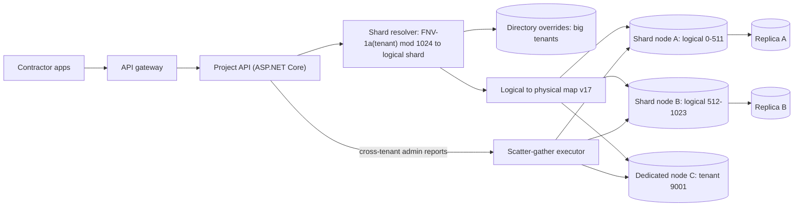
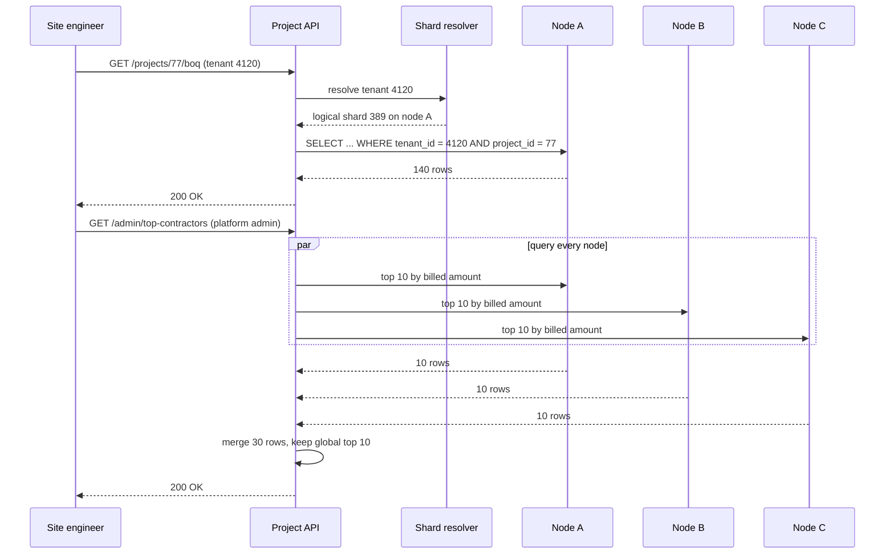
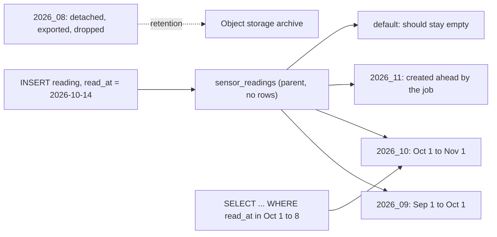

Every table that grows forever eventually becomes a problem: indexes no longer fit in memory, deleting old rows takes hours, vacuum never finishes, and one server runs out of disk or write capacity. There are two answers. **Partitioning** splits one table into many smaller tables *inside one database*, so each piece is easier to manage and queries touch only the pieces they need. **Sharding** splits the data *across several database servers*, so no single machine has to hold or write all of it. Partitioning is a tool you can use on a Tuesday afternoon. Sharding is an architecture decision you live with for years. This lesson covers both, and how to tell which one you actually need.

## Learning objectives

By the end of this lesson you will be able to:

1. Explain the difference between partitioning (one server) and sharding (many servers), and between vertical and horizontal splitting.
2. Create range, list and hash partitioned tables in PostgreSQL 17, including a default partition, and explain the primary-key and unique-constraint rules.
3. Write queries that benefit from partition pruning, and recognise predicates that prevent it.
4. Run partition maintenance: create future partitions, detach old ones for retention, and attach a prepared table without a long lock.
5. Choose a shard key using cardinality, distribution, query locality and hotspot analysis, and route requests to shards in C# with logical shards and a stable hash.
6. Describe how a Citus-style distributed PostgreSQL works (distribution column, co-location, reference tables) and the cost of cross-shard queries and transactions.

## Prerequisites

- [Indexes](#/lesson/m09-indexes): partitions each have their own indexes.
- [Query planning and EXPLAIN ANALYZE](#/lesson/m09-query-planning): you will read plans to confirm pruning.
- [Read replicas](#/lesson/m09-replicas): replicas scale reads; sharding is what you reach for when writes or storage outgrow one primary.

## Explain it like I'm a beginner

Imagine the records room of a district office that keeps every land registration since 1950 in one giant ledger. Finding this year's entries means flipping past seventy years of pages, and throwing away records older than the retention period means tearing pages out one by one.

**Partitioning** is splitting the ledger into one binder per year, all on the same shelf, in the same room. Looking for 2026 entries? Take the 2026 binder only. Retention says records older than 30 years can go to the archive? Lift the old binders off the shelf in one move. The room, the clerk and the rules are the same. You just organised the paper. Choosing binders by year is **range** partitioning; binders by taluka (a fixed list of names) is **list** partitioning; binders numbered 0 to 7 where each record goes to "binder = record number mod 8" is **hash** partitioning.

**Sharding** is opening more records rooms in different buildings, each with its own clerk, because one room and one clerk can no longer keep up. Now someone must decide which building each record goes to, and that rule (the **shard key**) is very hard to change later. Questions about one landowner are easy if all of their records are in the same building. Questions like "total registrations across the state" now need a messenger to visit every building and add up the answers. And moving a record from one building to another while people are reading it takes planning.

The simple rule: **partition first, shard only when one server truly cannot cope.**

## First-principles explanation

### Partitioning, sharding and their relatives

| Term | What is split | Where the pieces live |
|---|---|---|
| Vertical split | Columns (or whole tables into separate services) | Same or different servers |
| **Partitioning** (horizontal, local) | Rows of one table into child tables | One PostgreSQL server |
| **Sharding** (horizontal, distributed) | Rows across independent databases | Many servers |
| Replication | Nothing: every copy has all rows | Many servers, for reads and failover |

Replication and sharding are often combined: each shard is a primary with its own replicas.

### Why partition

- **Cheap retention.** `DROP TABLE` or `DETACH PARTITION` of an old month is a catalog operation. `DELETE FROM readings WHERE read_at < now() - interval '90 days'` on 9 billion rows generates huge WAL, bloats the table and runs for hours.
- **Partition pruning.** A query for one week reads one partition's index instead of a giant one. Smaller indexes stay in memory.
- **Maintenance per piece.** Vacuum, analyse, reindex and backups work on manageable chunks; old partitions stop changing and vacuum once.
- **Different storage per age.** Recent partitions on fast disks, old ones compressed or moved to cheaper tablespaces, or exported to object storage.

Partitioning does **not** make every query faster. A query that does not filter on the partition key now scans every partition (one index lookup per partition instead of one), and planning time grows with the number of partitions. Pick the key that matches your dominant access pattern.

### Declarative partitioning in PostgreSQL 17

```sql
CREATE TABLE sensor_readings (
  sensor_id           int           NOT NULL,
  site_code           text          NOT NULL,
  read_at             timestamptz   NOT NULL,
  strain_microstrain  numeric(8,2)  NOT NULL,
  PRIMARY KEY (sensor_id, read_at)                 -- must include the partition key
) PARTITION BY RANGE (read_at);

CREATE TABLE sensor_readings_2026_10 PARTITION OF sensor_readings
  FOR VALUES FROM ('2026-10-01 00:00+05:30') TO ('2026-11-01 00:00+05:30');   -- lower bound inclusive, upper exclusive
CREATE TABLE sensor_readings_default PARTITION OF sensor_readings DEFAULT;
```

The parent holds no rows itself; it routes inserts to the matching child. The three methods:

- **RANGE** for time and other ordered keys. Bounds are `[from, to)`, so adjacent months never overlap.
- **LIST** for a known set of values: `FOR VALUES IN ('BR', 'JH')` for states, or `('roads', 'bridges')` for departments.
- **HASH** to spread rows evenly when no natural range or list exists: `FOR VALUES WITH (MODULUS 8, REMAINDER 3)`. All partitions must be created up front, and changing the modulus means re-partitioning.

Rules that surprise people:

1. **Primary keys and unique constraints must include the partition key.** There are no global indexes; each partition enforces uniqueness only within itself. `UNIQUE (reading_uuid)` alone is impossible on a table partitioned by time. If you need global uniqueness of a non-key column, enforce it some other way (a separate lookup table, or a key that embeds time such as UUIDv7 together with `read_at`).
2. **Indexes created on the parent** are created on every partition, including future ones.
3. **The default partition catches everything else.** That is a safety net for inserts with unexpected keys, but it has a cost: attaching a new partition must check that the default does not already hold rows for the new range, and fails if it does. Keep the default empty and alert when it is not.
4. **Updating the partition key moves the row** to another partition (a delete plus insert internally).
5. **Foreign keys** can point *to* a partitioned table (since PostgreSQL 12) and *from* one.
6. **Sub-partitioning** is allowed (range by month, then hash by sensor), but every level multiplies the partition count.

### Partition pruning

The planner removes partitions whose bounds cannot match the `WHERE` clause.

- **Plan-time pruning** works with constants: `read_at >= '2026-10-01 00:00+05:30' AND read_at < '2026-10-08 00:00+05:30'` scans only the October partition.
- **Execution-time pruning** works with parameters and stable expressions such as `now() - interval '7 days'`; `EXPLAIN` shows "Subplans Removed: N".
- **No pruning** when the key is hidden inside an expression: `WHERE read_at::date = '2026-10-03'` or `WHERE date_trunc('month', read_at) = ...` must check every partition. Write ranges on the raw column instead.

### Partition maintenance

A time-partitioned table needs a small routine, usually a scheduled job (or the `pg_partman` extension):

1. **Create partitions ahead** (for example the next three months), so inserts never fall into the default.
2. **Detach old partitions** past retention: `ALTER TABLE ... DETACH PARTITION ... CONCURRENTLY` (PostgreSQL 14+, outside a transaction) avoids blocking queries on the parent. Then archive (export to Parquet in object storage) and drop.
3. **Attach bulk-loaded data cheaply**: load a standalone table, add a `CHECK` constraint matching the bounds, then `ATTACH PARTITION`. PostgreSQL sees the validated check and skips the scan of the new table.

### Sizing a partitioned table

A bridge-health monitoring system: 12,000 strain and vibration sensors across 400 bridges, one reading every 10 seconds.

- 12,000 ÷ 10 s = 1,200 rows/s × 86,400 ≈ **104 million rows/day**.
- At ~80 bytes per row plus ~40 bytes of primary-key index per row (estimates): ~120 bytes × 104 M ≈ **12.5 GB/day**.
- Retention of 13 months online: ~400 days × 12.5 GB ≈ **5 TB**.

Monthly partitions would each be ~375 GB with indexes too big to cache; daily partitions are ~12.5 GB each and ~400 partitions in total, which PostgreSQL 17 handles, though planning gets slower for queries that cannot prune. A common compromise is daily partitions for the recent 30 days and monthly roll-ups (or an aggregated table) for older data. Writes at 1,200 rows/s are comfortable for one well-tuned primary with batched inserts. Storage and retention, not write rate, drive this design: **partitioning, not sharding.**

### When partitioning is not enough: sharding

Shard when one primary cannot hold the **write rate**, the **working set**, or the **storage** even after indexing, partitioning, batching and hardware upgrades. Examples: a multi-tenant SaaS where the largest customers alone generate more writes than one node handles, or a payments ledger growing by terabytes per month.

Sharding costs:

- **Cross-shard queries** become scatter-gather: ask every shard, merge results. Latency is the slowest shard plus merge time.
- **Cross-shard transactions** need two-phase commit or sagas. Most designs avoid them by choosing a key that keeps a transaction on one shard.
- **No foreign keys or unique constraints across shards.**
- **Global ids** must be generated without a single sequence: UUIDv7, Snowflake-style ids, or per-shard sequences with a shard prefix.
- **Rebalancing** when shards fill up: moving data between servers while live.
- **Operations multiply**: N primaries, N sets of replicas, backups, upgrades and migrations.

### Choosing a shard key

A good shard key has:

1. **High cardinality**: many distinct values (tenant id, user id, order id), so it can spread over many shards. `country` with 3 values cannot.
2. **Even distribution of data and load.** Watch for **hot keys**: a single giant tenant, or a celebrity account, can overload its shard whatever the hash does.
3. **Query locality**: most queries and transactions include the key, so they touch one shard. For a B2B SaaS, `tenant_id` usually wins because almost every query is "within this company".
4. **Stability**: the value of the key for a row never changes. Changing a row's shard key means moving the row between servers.
5. **No monotonic hot spot**: range-sharding by `created_at` sends all new writes to the newest shard. Hash the key, or combine it.

Strategies:

- **Hash sharding**: `shard = hash(key) mod N`. Even, but adding a server with naive `mod N` remaps almost every key. Fix with **logical shards**: hash to one of, say, 1,024 logical shards, and map logical shards to physical servers. Adding a server moves whole logical shards, not individual keys. (Consistent hashing is another answer to the same problem.)
- **Range sharding**: keys in contiguous ranges per shard. Good for range scans, prone to hot spots.
- **Directory (lookup) sharding**: a table maps each tenant to a shard. Maximum flexibility (move a big tenant to its own server), but the directory is a critical dependency that must be cached and highly available.
- **Hybrid**: hash by default, directory overrides for the few huge tenants. Common in practice.

The hash must be **stable across processes and versions**. In .NET, `string.GetHashCode()` is randomised per process, so it would send the same tenant to different shards on different servers. Use a defined hash (FNV-1a, xxHash, Murmur) on the key's bytes.

### Citus-style distributed PostgreSQL

Citus is an open-source PostgreSQL extension that turns a group of PostgreSQL servers into one distributed database. The ideas generalise to other distributed SQL systems:

- A **coordinator** node holds metadata and plans queries; **worker** nodes hold shards (ordinary PostgreSQL tables named like `orders_102008`).
- `SELECT create_distributed_table('orders', 'tenant_id')` hash-distributes a table by its **distribution column** into a fixed number of shards (32 by default), spread over the workers.
- Tables distributed by the same column with the same shard count are **co-located**: shard 7 of `orders` and shard 7 of `order_lines` live on the same worker, so a join on `tenant_id` runs locally on each worker.
- Small tables every shard needs (a list of states, GST rates, product categories) are **reference tables**, copied to every worker so joins with them stay local.
- A query with `WHERE tenant_id = 42` is **routed** to one worker; a query without it is **parallelised** across all workers and merged by the coordinator; a transaction touching several workers uses two-phase commit internally.
- A **shard rebalancer** moves shards between workers when nodes are added, using logical replication to keep them live during the move.

The modelling rule is the same as for hand-rolled sharding: pick one distribution column (usually the tenant), put it in every large table and in every primary key, and make it part of every join condition.

### What breaks first under load

- **Partitioned table**: inserts that land in the default partition because nobody created next month's partition; queries that do not filter on the key and scan 400 partitions; planning time for thousands of partitions; lock contention when DDL on the parent waits behind queries on any partition.
- **Sharded system**: the **hot shard** (one huge tenant or a hot key), long before average load is a problem; scatter-gather queries whose latency is set by the slowest shard; the shard directory or coordinator as a bottleneck; rebalancing traffic competing with production traffic.

### When a simpler design is enough

- Tables under a few tens of millions of rows with healthy indexes rarely need partitioning.
- If the problem is reads, replicas and caching come before sharding.
- If the problem is one heavy query, an index, a summary table or a materialized view beats re-architecture.
- If the problem is storage of old data, partition and archive to object storage.
- Vertical scaling of a single PostgreSQL server goes a long way (many cores, hundreds of GB of RAM, fast NVMe). Shard when you have numbers showing you will outgrow it, not before.

## Visual explanation

### A sharded multi-tenant SaaS



Each request carries a tenant id from the user's token. The resolver first checks a small directory of overrides (huge tenants moved to their own node), otherwise hashes the tenant id with a stable hash into one of 1,024 logical shards, then looks up which physical node currently owns that logical shard in a versioned map. Nodes A and B each own half of the logical shards; node C is dedicated to one very large tenant. Normal API traffic touches exactly one node. Platform-wide admin reports go through a scatter-gather executor that queries all nodes in parallel and merges the results. Each node is an ordinary PostgreSQL primary with its own replica, and inside each node, large tables can still be partitioned by time.

### Single-shard request versus scatter-gather



The first request includes the tenant id, so the resolver maps it to one logical shard and one node, and the query runs entirely there, exactly as on an unsharded database. The second request has no tenant, so the API sends the same query to every node in parallel. Each node returns its local top 10; the global top 10 must be among those 30 rows, so the merge is correct and cheap. Its latency is the slowest node's latency plus the merge, and if any node is down the report is either incomplete or fails, which is why such queries belong on admin and reporting paths, not in the user's hot path.

### Range partitions over time



Inserts go to the parent, which routes each row to the partition whose range contains `read_at`. The maintenance job creates November before November starts, so the default partition stays empty. August has passed retention, so it was detached (a catalog change), exported to object storage, and dropped: no `DELETE`, no bloat. A query for 1–8 October is pruned to the October partition alone.

## Step-by-step example

The bridge-health platform from the sizing section stores sensor readings for bridges such as a river crossing in Bihar and a hill-road viaduct in Assam.

### Step 1 — create the parent and monthly partitions

```sql
CREATE TABLE sensor_readings (
  sensor_id int NOT NULL, site_code text NOT NULL, read_at timestamptz NOT NULL,
  strain_microstrain numeric(8,2) NOT NULL,
  PRIMARY KEY (sensor_id, read_at)
) PARTITION BY RANGE (read_at);

CREATE TABLE sensor_readings_2026_08 PARTITION OF sensor_readings FOR VALUES FROM ('2026-08-01 00:00+05:30') TO ('2026-09-01 00:00+05:30');
CREATE TABLE sensor_readings_2026_09 PARTITION OF sensor_readings FOR VALUES FROM ('2026-09-01 00:00+05:30') TO ('2026-10-01 00:00+05:30');
CREATE TABLE sensor_readings_2026_10 PARTITION OF sensor_readings FOR VALUES FROM ('2026-10-01 00:00+05:30') TO ('2026-11-01 00:00+05:30');
CREATE TABLE sensor_readings_default PARTITION OF sensor_readings DEFAULT;
```

Bounds are written with the `+05:30` offset so they mean midnight in India regardless of the session's time zone.

### Step 2 — load and look

The playground loads 1,400 readings spanning August to early November. `SELECT tableoid::regclass, count(*) FROM sensor_readings GROUP BY 1` shows where rows landed: about 460 per month and 34 in the default, because nobody created November. That is the bug the maintenance job exists to prevent.

### Step 3 — confirm pruning

```sql
EXPLAIN (COSTS OFF)
SELECT avg(strain_microstrain) FROM sensor_readings
WHERE read_at >= '2026-10-01 00:00+05:30' AND read_at < '2026-10-08 00:00+05:30';
```

The plan scans only `sensor_readings_2026_10`. Rewrite the filter as `read_at::date BETWEEN '2026-10-01' AND '2026-10-07'` and every partition appears.

### Step 4 — maintenance

Retention is two months online. The job detaches August, creates November as a standalone table, moves November's rows out of the default, adds a matching `CHECK` and attaches it. Exercise 4 walks through it, including the error you get if you forget the default partition.

### Step 5 — decide about sharding

The same company also runs a multi-tenant project-management SaaS for 3,000 contractors. Its numbers: 2,500 writes/s at peak today, growing 60 % a year, and the five largest contractors produce 30 % of writes. In two years: 2,500 × 1.6² ≈ 6,400 writes/s (estimate), beyond what the team measured one primary handling with their workload (about 4,000/s). They choose `tenant_id` as the shard key (every query is within one contractor), 1,024 logical shards on two nodes to start, and a directory override that gives the largest contractor its own node.

### Step 6 — route in C#

The resolver below hashes the tenant id with FNV-1a, maps it to a logical shard, and returns the node's data source. Each node gets its own `NpgsqlDataSource` (and pool) in production.

## Production-style C# implementation

Two pieces: a **partition maintenance planner** that generates the monthly DDL (a pure function, easy to test, run by a `BackgroundService`), and a **shard resolver** with a stable hash, logical shards, directory overrides and a scatter-gather helper. Database calls are behind interfaces with fakes.

```text
Platform.Api/
  Program.cs
  Partitions/PartitionPlanner.cs
  Partitions/PartitionMaintenanceService.cs
  Sharding/StableHash.cs
  Sharding/ShardMap.cs
  Sharding/ScatterGather.cs
```

```csharp file=Partitions/PartitionPlanner.cs
using System.Globalization;

namespace Platform.Partitions;

public sealed record MonthlyPartitionPolicy(string Table, int MonthsAhead, int MonthsRetained, TimeSpan UtcOffset);

/// <summary>Computes which monthly partitions should exist and which should be detached. Pure: no I/O.</summary>
public static class PartitionPlanner
{
    public static string PartitionName(string table, int year, int month) => $"{table}_{year:D4}_{month:D2}";

    public static IReadOnlyList<string> CreateStatements(MonthlyPartitionPolicy p, DateOnly today, IReadOnlySet<string> existing)
    {
        var sql = new List<string>();
        var first = new DateOnly(today.Year, today.Month, 1);
        for (var i = 0; i <= p.MonthsAhead; i++)
        {
            var from = first.AddMonths(i);
            var to = from.AddMonths(1);
            var name = PartitionName(p.Table, from.Year, from.Month);
            if (existing.Contains(name)) continue;
            sql.Add($"CREATE TABLE IF NOT EXISTS {name} PARTITION OF {p.Table} " +
                    $"FOR VALUES FROM ('{Bound(from, p.UtcOffset)}') TO ('{Bound(to, p.UtcOffset)}')");
        }
        return sql;
    }

    public static IReadOnlyList<string> DetachStatements(MonthlyPartitionPolicy p, DateOnly today, IReadOnlySet<string> existing)
    {
        var oldestKept = new DateOnly(today.Year, today.Month, 1).AddMonths(-p.MonthsRetained);
        return existing
            .Select(name => (name, month: ParseMonth(p.Table, name)))
            .Where(x => x.month is { } m && m < oldestKept)
            .OrderBy(x => x.month)
            .Select(x => $"ALTER TABLE {p.Table} DETACH PARTITION {x.name} CONCURRENTLY")
            .ToList();
    }

    private static string Bound(DateOnly d, TimeSpan offset)
    {
        var sign = offset < TimeSpan.Zero ? "-" : "+";
        return $"{d:yyyy-MM-dd} 00:00{sign}{offset.Duration():hh\\:mm}";
    }

    private static DateOnly? ParseMonth(string table, string name)
    {
        var prefix = table + "_";
        if (!name.StartsWith(prefix, StringComparison.Ordinal)) return null;
        return DateOnly.TryParseExact(name[prefix.Length..] + "_01", "yyyy_MM_dd", CultureInfo.InvariantCulture, DateTimeStyles.None, out var d)
            ? d : null;
    }
}
```

```csharp file=Partitions/PartitionMaintenanceService.cs
using Microsoft.Extensions.Hosting;
using Microsoft.Extensions.Logging;

namespace Platform.Partitions;

/// <summary>
/// Lists partitions:  SELECT c.relname FROM pg_inherits i JOIN pg_class c ON c.oid = i.inhrelid WHERE i.inhparent = $1::regclass
/// Executes DDL one statement at a time, with SET lock_timeout, outside a transaction (DETACH ... CONCURRENTLY needs that).
/// </summary>
public interface IPartitionCatalog
{
    Task<IReadOnlySet<string>> ListAsync(string table, CancellationToken ct);
    Task ExecuteAsync(string ddl, CancellationToken ct);
    Task<long> DefaultPartitionRowsAsync(string table, CancellationToken ct);
}

public sealed class PartitionMaintenanceService(
    IPartitionCatalog catalog,
    IEnumerable<MonthlyPartitionPolicy> policies,
    TimeProvider clock,
    ILogger<PartitionMaintenanceService> log) : BackgroundService
{
    protected override async Task ExecuteAsync(CancellationToken stoppingToken)
    {
        while (!stoppingToken.IsCancellationRequested)
        {
            await RunOnceAsync(stoppingToken);
            await Task.Delay(TimeSpan.FromHours(6), clock, stoppingToken);
        }
    }

    public async Task RunOnceAsync(CancellationToken ct)
    {
        foreach (var p in policies)
        {
            var today = DateOnly.FromDateTime(clock.GetUtcNow().ToOffset(p.UtcOffset).DateTime);
            var existing = await catalog.ListAsync(p.Table, ct);

            foreach (var ddl in PartitionPlanner.CreateStatements(p, today, existing))
            {
                log.LogInformation("Creating partition: {Ddl}", ddl);
                await catalog.ExecuteAsync(ddl, ct);
            }
            foreach (var ddl in PartitionPlanner.DetachStatements(p, today, existing))
            {
                log.LogInformation("Detaching for retention: {Ddl}", ddl);
                await catalog.ExecuteAsync(ddl, ct);   // archive and DROP happen in a separate, audited job
            }

            var stray = await catalog.DefaultPartitionRowsAsync(p.Table, ct);
            if (stray > 0) log.LogError("{Table} default partition holds {Rows} rows. New partitions for that range will fail to attach.", p.Table, stray);
        }
    }
}

public sealed class InMemoryPartitionCatalog : IPartitionCatalog
{
    public HashSet<string> Partitions { get; } = new(StringComparer.Ordinal);
    public List<string> Executed { get; } = new();

    public Task<IReadOnlySet<string>> ListAsync(string table, CancellationToken ct) =>
        Task.FromResult<IReadOnlySet<string>>(new HashSet<string>(Partitions.Where(p => p.StartsWith(table + "_", StringComparison.Ordinal))));

    public Task ExecuteAsync(string ddl, CancellationToken ct)
    {
        Executed.Add(ddl);
        var words = ddl.Split(' ');
        if (ddl.StartsWith("CREATE TABLE IF NOT EXISTS ", StringComparison.Ordinal)) Partitions.Add(words[5]);
        if (ddl.Contains(" DETACH PARTITION ", StringComparison.Ordinal)) Partitions.Remove(words[5]);
        return Task.CompletedTask;
    }

    public Task<long> DefaultPartitionRowsAsync(string table, CancellationToken ct) => Task.FromResult(0L);
}
```

```csharp file=Sharding/StableHash.cs
using System.Text;

namespace Platform.Sharding;

/// <summary>FNV-1a 64-bit. Deterministic across processes, machines and .NET versions,
/// unlike string.GetHashCode(), which is randomised per process.</summary>
public static class StableHash
{
    private const ulong Offset = 14695981039346656037UL;
    private const ulong Prime = 1099511628211UL;

    public static ulong Fnv1a64(ReadOnlySpan<byte> data)
    {
        var h = Offset;
        foreach (var b in data) { h ^= b; h *= Prime; }
        return h;
    }

    public static ulong Fnv1a64(string key) => Fnv1a64(Encoding.UTF8.GetBytes(key));
}
```

```csharp file=Sharding/ShardMap.cs
namespace Platform.Sharding;

public sealed record ShardLocation(string Node, int LogicalShard, string Reason);

/// <summary>
/// tenant -> (directory override | FNV-1a mod LogicalShards) -> logical shard -> node.
/// The map is versioned and replaced atomically when a logical shard moves.
/// </summary>
public sealed class ShardMap
{
    public int LogicalShards { get; }
    public int Version { get; }
    private readonly string[] _nodeByLogical;
    private readonly IReadOnlyDictionary<long, string> _overrides;

    public ShardMap(int version, int logicalShards, IReadOnlyList<(int From, int To, string Node)> ranges, IReadOnlyDictionary<long, string> overrides)
    {
        if (logicalShards <= 0) throw new ArgumentOutOfRangeException(nameof(logicalShards));
        Version = version;
        LogicalShards = logicalShards;
        _overrides = overrides;
        _nodeByLogical = new string[logicalShards];
        foreach (var (from, to, node) in ranges)
            for (var i = from; i <= to; i++) _nodeByLogical[i] = node;
        if (_nodeByLogical.Any(n => n is null)) throw new ArgumentException("Every logical shard must be assigned to a node.");
    }

    public int LogicalShardFor(long tenantId) => (int)(StableHash.Fnv1a64(tenantId.ToString(System.Globalization.CultureInfo.InvariantCulture)) % (ulong)LogicalShards);

    public ShardLocation Resolve(long tenantId)
    {
        var logical = LogicalShardFor(tenantId);
        return _overrides.TryGetValue(tenantId, out var dedicated)
            ? new ShardLocation(dedicated, logical, "directory override")
            : new ShardLocation(_nodeByLogical[logical], logical, $"hash to logical {logical}");
    }

    public IReadOnlyCollection<string> AllNodes => _nodeByLogical.Concat(_overrides.Values).Distinct(StringComparer.Ordinal).ToList();

    /// <summary>Returns a new map with one logical shard moved, after its data has been copied and caught up.</summary>
    public ShardMap WithMovedShard(int logical, string toNode)
    {
        var ranges = Enumerable.Range(0, LogicalShards).Select(i => (i, i, i == logical ? toNode : _nodeByLogical[i])).ToList();
        return new ShardMap(Version + 1, LogicalShards, ranges, _overrides);
    }
}

public sealed class ShardMapProvider(ShardMap initial)
{
    private volatile ShardMap _current = initial;
    public ShardMap Current => _current;
    public void Publish(ShardMap next)
    {
        if (next.Version <= _current.Version) throw new InvalidOperationException("Shard map versions must increase.");
        _current = next;
    }
}
```

```csharp file=Sharding/ScatterGather.cs
namespace Platform.Sharding;

public interface IShardQueryExecutor
{
    /// <summary>Runs the same parameterised query on one node and returns its rows.</summary>
    Task<IReadOnlyList<T>> QueryAsync<T>(string node, string sql, object parameters, CancellationToken ct);
}

public sealed class PartialResultException(IReadOnlyList<string> failedNodes)
    : Exception($"Nodes failed: {string.Join(", ", failedNodes)}")
{
    public IReadOnlyList<string> FailedNodes { get; } = failedNodes;
}

public static class ScatterGather
{
    /// <summary>Queries every node in parallel with a per-node timeout and merges with the caller's function.
    /// Fails loudly rather than returning a silently incomplete answer.</summary>
    public static async Task<IReadOnlyList<T>> RunAsync<T>(
        IShardQueryExecutor exec, IEnumerable<string> nodes, string sql, object parameters,
        Func<IEnumerable<T>, IEnumerable<T>> merge, TimeSpan perNodeTimeout, CancellationToken ct)
    {
        var list = nodes.ToList();
        var tasks = list.Select(async node =>
        {
            using var cts = CancellationTokenSource.CreateLinkedTokenSource(ct);
            cts.CancelAfter(perNodeTimeout);
            try { return (node, rows: await exec.QueryAsync<T>(node, sql, parameters, cts.Token), ok: true); }
            catch (Exception) when (!ct.IsCancellationRequested) { return (node, rows: (IReadOnlyList<T>)Array.Empty<T>(), ok: false); }
        }).ToList();

        var results = await Task.WhenAll(tasks);
        var failed = results.Where(r => !r.ok).Select(r => r.node).ToList();
        if (failed.Count > 0) throw new PartialResultException(failed);
        return merge(results.SelectMany(r => r.rows)).ToList();
    }
}

public sealed record ContractorTotal(long TenantId, string Name, long BilledPaise);

public sealed class FakeShardExecutor(Dictionary<string, List<ContractorTotal>> data) : IShardQueryExecutor
{
    public Task<IReadOnlyList<T>> QueryAsync<T>(string node, string sql, object parameters, CancellationToken ct)
    {
        var rows = data.TryGetValue(node, out var r) ? r : new List<ContractorTotal>();
        IReadOnlyList<T> top = rows.OrderByDescending(x => x.BilledPaise).Take(10).Cast<T>().ToList();
        return Task.FromResult(top);
    }
}
```

```csharp file=Program.cs
using Platform.Partitions;
using Platform.Sharding;

var builder = WebApplication.CreateBuilder(args);
builder.Services.AddSingleton(TimeProvider.System);

// Partition maintenance for the sensor table: 3 months ahead, 13 months online, bounds in IST.
builder.Services.AddSingleton<IEnumerable<MonthlyPartitionPolicy>>(new[]
{
    new MonthlyPartitionPolicy("sensor_readings", MonthsAhead: 3, MonthsRetained: 13, UtcOffset: TimeSpan.FromHours(5.5))
});
builder.Services.AddSingleton<IPartitionCatalog, InMemoryPartitionCatalog>();
builder.Services.AddHostedService<PartitionMaintenanceService>();

// Sharding: 1,024 logical shards on two nodes, one dedicated node for tenant 9001.
var map = new ShardMap(
    version: 17,
    logicalShards: 1024,
    ranges: new[] { (0, 511, "node-a"), (512, 1023, "node-b") },
    overrides: new Dictionary<long, string> { [9001] = "node-c" });
builder.Services.AddSingleton(new ShardMapProvider(map));
builder.Services.AddSingleton<IShardQueryExecutor>(new FakeShardExecutor(new()
{
    ["node-a"] = new() { new(4120, "Ganga Infra", 9_40_00_000_00), new(77, "Deccan Roads", 3_10_00_000_00) },
    ["node-b"] = new() { new(5003, "Northline Bridges", 6_25_00_000_00) },
    ["node-c"] = new() { new(9001, "Mega EPC Ltd", 41_00_00_000_00) },
}));

var app = builder.Build();

app.MapGet("/tenants/{tenantId:long}/shard", (long tenantId, ShardMapProvider maps) =>
{
    var loc = maps.Current.Resolve(tenantId);
    return Results.Ok(new { tenantId, loc.Node, loc.LogicalShard, loc.Reason, mapVersion = maps.Current.Version });
});

app.MapGet("/admin/top-contractors", async (ShardMapProvider maps, IShardQueryExecutor exec, CancellationToken ct) =>
{
    try
    {
        var top = await ScatterGather.RunAsync<ContractorTotal>(exec, maps.Current.AllNodes,
            "SELECT tenant_id, name, billed_paise FROM contractor_totals ORDER BY billed_paise DESC LIMIT 10", new { },
            rows => rows.OrderByDescending(r => r.BilledPaise).Take(10), TimeSpan.FromSeconds(2), ct);
        return Results.Ok(top);
    }
    catch (PartialResultException ex)
    {
        return Results.Problem($"Report incomplete: {string.Join(", ", ex.FailedNodes)} did not answer.", statusCode: 503);
    }
});

app.Run();
```

**Design notes.**

- Partition DDL is generated by a pure function, so tests can cover month boundaries, leap years and time zones without a database. The job only creates and detaches; dropping data is a separate, audited step.
- The job checks the default partition every run. Rows there mean a missing partition, and they will block the future `ATTACH` for that range.
- `ShardMap` never uses `GetHashCode()`. Tenant ids are hashed as invariant-culture strings with FNV-1a, so every API instance, background worker and migration script agrees.
- The map is immutable and versioned; moving a logical shard publishes a new version only after the data move has caught up. Readers always see one consistent map.
- Scatter-gather fails loudly when a node does not answer. A silently incomplete "top contractors" report is worse than an error.

:::callout type=warning title="Never shard with string.GetHashCode()"
In .NET Core and later, string hash codes are randomised per process. Two API instances would send the same tenant to different shards. Use a defined hash on the key's bytes.
:::

## Bad design vs good design

**Bad (partitioning)**: `sensor_readings` partitioned by `sensor_id` with 12,000 list partitions, "because most queries are for one sensor". Retention still needs `DELETE` in every partition. Every dashboard query that covers "all sensors on bridge X for the last day" touches hundreds of partitions. Planning a query that cannot prune takes longer than running it.

**Good (partitioning)**: range by `read_at` (daily or monthly), primary key `(sensor_id, read_at)`, index on `(site_code, read_at)` created on the parent, a job that creates partitions ahead and detaches expired ones, and queries that always include a time range on the raw column.

**Bad (sharding)**: a SaaS shards by `created_at` month so that "old data is on old servers". Every new write in the system goes to the newest shard, which runs hot while the others idle, and every tenant's history query touches every shard.

**Good (sharding)**: shard by `tenant_id` with 1,024 logical shards, directory overrides for the few giant tenants, every large table carrying `tenant_id` in its primary key, reference data replicated to each node, and cross-tenant analytics in a separate warehouse fed by change data capture.

**But**: a 30-million-row orders table on a single primary is not a sharding problem. An index on `(customer_id, created_at)` and a read replica will carry it for years.

:::callout type=tradeoff title="Partitioning vs sharding"
| | Partitioning | Sharding |
|---|---|---|
| Scope | One server | Many servers |
| Solves | Retention, index size, maintenance, pruning | Write throughput, storage and working set beyond one node |
| Transactions | Normal | Cross-shard needs 2PC or sagas |
| Constraints | Unique must include partition key | No cross-shard FKs or uniqueness |
| Queries without the key | Scan all partitions (still one server) | Scatter-gather over the network |
| Changing the key later | Re-partition (painful) | Re-shard (very painful) |
| Operational cost | Low (a job) | High (N clusters) |
:::

## Practical playground

1,400 strain readings from two bridges, partitioned by month, with a default partition that has quietly collected November's rows. Check where rows landed, compare plans for pruned and unpruned predicates, and try attaching November.

:::playground type=sql title="Range partitions, pruning and the default-partition trap"
```sql
CREATE TABLE sensor_readings (
  sensor_id           int          NOT NULL,
  site_code           text         NOT NULL,
  read_at             timestamptz  NOT NULL,
  strain_microstrain  numeric(8,2) NOT NULL,
  PRIMARY KEY (sensor_id, read_at)
) PARTITION BY RANGE (read_at);

CREATE TABLE sensor_readings_2026_08 PARTITION OF sensor_readings FOR VALUES FROM ('2026-08-01 00:00+05:30') TO ('2026-09-01 00:00+05:30');
CREATE TABLE sensor_readings_2026_09 PARTITION OF sensor_readings FOR VALUES FROM ('2026-09-01 00:00+05:30') TO ('2026-10-01 00:00+05:30');
CREATE TABLE sensor_readings_2026_10 PARTITION OF sensor_readings FOR VALUES FROM ('2026-10-01 00:00+05:30') TO ('2026-11-01 00:00+05:30');
CREATE TABLE sensor_readings_default PARTITION OF sensor_readings DEFAULT;
CREATE INDEX ON sensor_readings (site_code, read_at);

INSERT INTO sensor_readings
SELECT 1 + g % 12,
       CASE WHEN g % 12 < 6 THEN 'BR-GND-01' ELSE 'AS-BRH-02' END,
       TIMESTAMPTZ '2026-08-01 00:00+05:30' + g * INTERVAL '97 minutes',
       round((120 + (g * 37) % 300 / 3.0)::numeric, 2)
FROM generate_series(0, 1399) AS g;

-- SELECT tableoid::regclass AS partition, count(*) FROM sensor_readings GROUP BY 1 ORDER BY 1;
-- EXPLAIN (COSTS OFF) SELECT avg(strain_microstrain) FROM sensor_readings
--   WHERE read_at >= '2026-10-01 00:00+05:30' AND read_at < '2026-10-08 00:00+05:30';      -- one partition
-- EXPLAIN (COSTS OFF) SELECT avg(strain_microstrain) FROM sensor_readings
--   WHERE read_at::date BETWEEN '2026-10-01' AND '2026-10-07';                             -- every partition
-- EXPLAIN (COSTS OFF) SELECT * FROM sensor_readings WHERE read_at >= now() - interval '7 days';  -- "Subplans Removed"
-- CREATE TABLE sensor_readings_2026_11 PARTITION OF sensor_readings
--   FOR VALUES FROM ('2026-11-01 00:00+05:30') TO ('2026-12-01 00:00+05:30');            -- fails: rows in default
```
:::

## Exercises

:::exercise id=m09-partitioning-sharding-ex1 difficulty=beginner kind=sql ordered=true title="Create monthly range partitions and load them"
The parent table `sensor_readings` is partitioned by `RANGE (read_at)` but has no partitions yet, and 1,400 readings wait in `readings_staging`. Create partitions for **August, September and October 2026** (boundaries at midnight IST, `+05:30`) plus a **default** partition, copy all staging rows into the parent, and return `partition` (the partition name as text) and `readings` (count), ordered by partition name.
::setup
```sql
CREATE TABLE readings_staging (sensor_id int NOT NULL, site_code text NOT NULL, read_at timestamptz NOT NULL, strain_microstrain numeric(8,2) NOT NULL);
INSERT INTO readings_staging
SELECT 1 + g % 12, CASE WHEN g % 12 < 6 THEN 'BR-GND-01' ELSE 'AS-BRH-02' END,
       TIMESTAMPTZ '2026-08-01 00:00+05:30' + g * INTERVAL '97 minutes', round((120 + (g * 37) % 300 / 3.0)::numeric, 2)
FROM generate_series(0, 1399) AS g;
CREATE TABLE sensor_readings (
  sensor_id int NOT NULL, site_code text NOT NULL, read_at timestamptz NOT NULL, strain_microstrain numeric(8,2) NOT NULL,
  PRIMARY KEY (sensor_id, read_at)
) PARTITION BY RANGE (read_at);
```
::check
```sql
CREATE TABLE sensor_readings_2026_08 PARTITION OF sensor_readings FOR VALUES FROM ('2026-08-01 00:00+05:30') TO ('2026-09-01 00:00+05:30');
CREATE TABLE sensor_readings_2026_09 PARTITION OF sensor_readings FOR VALUES FROM ('2026-09-01 00:00+05:30') TO ('2026-10-01 00:00+05:30');
CREATE TABLE sensor_readings_2026_10 PARTITION OF sensor_readings FOR VALUES FROM ('2026-10-01 00:00+05:30') TO ('2026-11-01 00:00+05:30');
CREATE TABLE sensor_readings_default PARTITION OF sensor_readings DEFAULT;
INSERT INTO sensor_readings SELECT * FROM readings_staging;
SELECT tableoid::regclass::text AS partition, count(*) AS readings
FROM sensor_readings GROUP BY 1 ORDER BY 1;
```
::acceptance
- Four partitions named `sensor_readings_2026_08`, `sensor_readings_2026_09`, `sensor_readings_2026_10`, `sensor_readings_default`.
- Counts 461, 445, 460 and 34 respectively (the 34 are early-November readings with no partition of their own).
- No row is lost: the counts add up to 1,400.
::hint
`CREATE TABLE child PARTITION OF parent FOR VALUES FROM (a) TO (b)`; the upper bound is exclusive, so the next month starts exactly where this one ends.
::hint
`CREATE TABLE ... PARTITION OF parent DEFAULT` creates the catch-all.
::hint
Insert into the **parent**; PostgreSQL routes each row. `tableoid::regclass::text` tells you which partition a row is stored in.
::hint
```sql
CREATE TABLE sensor_readings_2026_08 PARTITION OF sensor_readings
  FOR VALUES FROM ('2026-08-01 00:00+05:30') TO ('2026-09-01 00:00+05:30');
-- ... September, October, DEFAULT ...
INSERT INTO sensor_readings SELECT * FROM readings_staging;
SELECT tableoid::regclass::text AS partition, count(*) AS readings FROM sensor_readings GROUP BY 1 ORDER BY 1;
```
::solution
```sql
CREATE TABLE sensor_readings_2026_08 PARTITION OF sensor_readings FOR VALUES FROM ('2026-08-01 00:00+05:30') TO ('2026-09-01 00:00+05:30');
CREATE TABLE sensor_readings_2026_09 PARTITION OF sensor_readings FOR VALUES FROM ('2026-09-01 00:00+05:30') TO ('2026-10-01 00:00+05:30');
CREATE TABLE sensor_readings_2026_10 PARTITION OF sensor_readings FOR VALUES FROM ('2026-10-01 00:00+05:30') TO ('2026-11-01 00:00+05:30');
CREATE TABLE sensor_readings_default PARTITION OF sensor_readings DEFAULT;
INSERT INTO sensor_readings SELECT * FROM readings_staging;
SELECT tableoid::regclass::text AS partition, count(*) AS readings
FROM sensor_readings GROUP BY 1 ORDER BY 1;
```
Without the default partition, the insert would have failed with "no partition of relation found for row" for the November readings, and the whole `INSERT ... SELECT` would have rolled back. The default saved the data, but it also hid the real problem: November's partition was never created. Exercise 4 shows the bill for that.
::mistakes
- Using `'2026-08-31 23:59:59'` as an upper bound: bounds are exclusive, so the last second of the month is lost or lands in the default.
- Writing bounds without a time zone; they are then interpreted in the session's time zone, which differs between servers and clients.
- Creating the primary key on each partition separately instead of on the parent.
:::

:::exercise id=m09-partitioning-sharding-ex2 difficulty=beginner kind=sql ordered=true title="A query that prunes to one partition"
Engineers want the average strain per bridge for **1 to 7 October 2026** (IST). Write the query so PostgreSQL can prune to the October partition: compare the raw `read_at` column with a half-open range. Return `site_code`, `avg_strain` (rounded to 2 decimals) and `readings`, ordered by `site_code`. Afterwards, run `EXPLAIN` on your query in the playground and confirm only `sensor_readings_2026_10` appears.
::setup
```sql
CREATE TABLE sensor_readings (
  sensor_id int NOT NULL, site_code text NOT NULL, read_at timestamptz NOT NULL, strain_microstrain numeric(8,2) NOT NULL,
  PRIMARY KEY (sensor_id, read_at)
) PARTITION BY RANGE (read_at);
CREATE TABLE sensor_readings_2026_08 PARTITION OF sensor_readings FOR VALUES FROM ('2026-08-01 00:00+05:30') TO ('2026-09-01 00:00+05:30');
CREATE TABLE sensor_readings_2026_09 PARTITION OF sensor_readings FOR VALUES FROM ('2026-09-01 00:00+05:30') TO ('2026-10-01 00:00+05:30');
CREATE TABLE sensor_readings_2026_10 PARTITION OF sensor_readings FOR VALUES FROM ('2026-10-01 00:00+05:30') TO ('2026-11-01 00:00+05:30');
CREATE TABLE sensor_readings_default PARTITION OF sensor_readings DEFAULT;
INSERT INTO sensor_readings
SELECT 1 + g % 12, CASE WHEN g % 12 < 6 THEN 'BR-GND-01' ELSE 'AS-BRH-02' END,
       TIMESTAMPTZ '2026-08-01 00:00+05:30' + g * INTERVAL '97 minutes', round((120 + (g * 37) % 300 / 3.0)::numeric, 2)
FROM generate_series(0, 1399) AS g;
```
::check
```sql
SELECT site_code, round(avg(strain_microstrain), 2) AS avg_strain, count(*) AS readings
FROM sensor_readings
WHERE read_at >= '2026-10-01 00:00+05:30' AND read_at < '2026-10-08 00:00+05:30'
GROUP BY site_code
ORDER BY site_code;
```
::acceptance
- Two rows, one per bridge (`AS-BRH-02`, `BR-GND-01`), with their averages and counts for exactly seven IST days.
- The `WHERE` clause compares `read_at` directly, with `>=` on the start and `<` on the end.
- `EXPLAIN` of your query shows a scan of `sensor_readings_2026_10` only.
::hint
Pruning needs the partition key on its own on one side of the comparison.
::hint
"1 to 7 October inclusive" is the half-open range `[1 Oct 00:00, 8 Oct 00:00)`.
::hint
Avoid `read_at::date`, `date_trunc(...)` or `BETWEEN '2026-10-01' AND '2026-10-07'` (the last one stops at midnight on the 7th).
::hint
```sql
WHERE read_at >= '2026-10-01 00:00+05:30' AND read_at < '2026-10-08 00:00+05:30'
```
::solution
```sql
SELECT site_code, round(avg(strain_microstrain), 2) AS avg_strain, count(*) AS readings
FROM sensor_readings
WHERE read_at >= '2026-10-01 00:00+05:30' AND read_at < '2026-10-08 00:00+05:30'
GROUP BY site_code
ORDER BY site_code;
```
The plan is an aggregate over a scan of `sensor_readings_2026_10` alone. With `WHERE read_at::date BETWEEN '2026-10-01' AND '2026-10-07'` the result might even match, but the plan scans all four partitions, and on a 5 TB table that is the difference between milliseconds and minutes. The cast also depends on the session time zone, so on a server set to UTC the "date" of a reading at 02:00 IST is the previous day.
::mistakes
- `BETWEEN '2026-10-01' AND '2026-10-07'` on a timestamp: it excludes everything after midnight at the start of the 7th.
- Wrapping the key in a function, which defeats pruning and index use.
:::

:::exercise id=m09-partitioning-sharding-ex3 difficulty=intermediate kind=sql ordered=true title="Hash partitioning for an even spread"
A billing service stores orders for 40 tenants with no useful time or list key for its main queries ("all orders for tenant T"). Create `orders` partitioned by `HASH (tenant_id)` into **4** partitions named `orders_p0` to `orders_p3` (remainders 0 to 3), with primary key `(tenant_id, order_id)`. Load the rows from `orders_staging` and return `partition`, `orders` (row count) and `tenants` (distinct tenants), ordered by partition.
::setup
```sql
CREATE TABLE orders_staging (order_id bigint NOT NULL, tenant_id int NOT NULL, amount_paise bigint NOT NULL);
INSERT INTO orders_staging SELECT g, 1 + g % 40, 1000 * g FROM generate_series(1, 400) AS g;
```
::check
```sql
CREATE TABLE orders (order_id bigint NOT NULL, tenant_id int NOT NULL, amount_paise bigint NOT NULL,
                     PRIMARY KEY (tenant_id, order_id)) PARTITION BY HASH (tenant_id);
CREATE TABLE orders_p0 PARTITION OF orders FOR VALUES WITH (MODULUS 4, REMAINDER 0);
CREATE TABLE orders_p1 PARTITION OF orders FOR VALUES WITH (MODULUS 4, REMAINDER 1);
CREATE TABLE orders_p2 PARTITION OF orders FOR VALUES WITH (MODULUS 4, REMAINDER 2);
CREATE TABLE orders_p3 PARTITION OF orders FOR VALUES WITH (MODULUS 4, REMAINDER 3);
INSERT INTO orders SELECT * FROM orders_staging;
SELECT tableoid::regclass::text AS partition, count(*) AS orders, count(DISTINCT tenant_id) AS tenants
FROM orders GROUP BY 1 ORDER BY 1;
```
::acceptance
- Four partitions, every tenant entirely inside one partition (the tenant counts add up to 40).
- Row counts are roughly but not exactly equal (here 100, 130, 70, 100): hashing 40 keys into 4 buckets is lumpy.
- The primary key includes `tenant_id`.
::hint
`PARTITION BY HASH (tenant_id)` on the parent, then one child per remainder: `FOR VALUES WITH (MODULUS 4, REMAINDER r)`.
::hint
The primary key must contain the partition key, so `(tenant_id, order_id)` rather than `(order_id)`.
::hint
Count distinct tenants per partition to prove each tenant's rows stay together.
::solution
```sql
CREATE TABLE orders (order_id bigint NOT NULL, tenant_id int NOT NULL, amount_paise bigint NOT NULL,
                     PRIMARY KEY (tenant_id, order_id)) PARTITION BY HASH (tenant_id);
CREATE TABLE orders_p0 PARTITION OF orders FOR VALUES WITH (MODULUS 4, REMAINDER 0);
CREATE TABLE orders_p1 PARTITION OF orders FOR VALUES WITH (MODULUS 4, REMAINDER 1);
CREATE TABLE orders_p2 PARTITION OF orders FOR VALUES WITH (MODULUS 4, REMAINDER 2);
CREATE TABLE orders_p3 PARTITION OF orders FOR VALUES WITH (MODULUS 4, REMAINDER 3);
INSERT INTO orders SELECT * FROM orders_staging;
SELECT tableoid::regclass::text AS partition, count(*) AS orders, count(DISTINCT tenant_id) AS tenants
FROM orders GROUP BY 1 ORDER BY 1;
```
Hash partitioning gives an even spread only on average. With few keys, or with one tenant much bigger than the others, partitions are uneven; the hash cannot split one tenant. The same is true of hash sharding, which is why large systems hash into many more logical shards than servers and move the heaviest tenants with a directory override. Note that "orders for tenant T" prunes to one partition (`WHERE tenant_id = 7`), but a range such as `tenant_id BETWEEN 1 AND 5` cannot prune with hash partitioning.
::mistakes
- `PRIMARY KEY (order_id)`: rejected, because a unique constraint on a partitioned table must include the partition key.
- Expecting `orders_p0` to hold tenants 4, 8, 12 ...: PostgreSQL uses its own hash of the value, not the value modulo 4.
:::

:::exercise id=m09-partitioning-sharding-ex4 difficulty=intermediate kind=sql ordered=true title="Monthly maintenance: retire August, attach November"
It is early November. Retention is two full months online. Do this month's maintenance: (1) detach `sensor_readings_2026_08`; (2) create November's partition, which **fails if you try it directly** because the default partition already holds November rows. So create `sensor_readings_2026_11` as a standalone table (`LIKE sensor_readings`), move the November rows from the default into it, add a `CHECK` constraint matching the bounds, and `ATTACH` it. Finish with `partition` and `readings` per partition of `sensor_readings`, ordered by name.
::setup
```sql
CREATE TABLE sensor_readings (
  sensor_id int NOT NULL, site_code text NOT NULL, read_at timestamptz NOT NULL, strain_microstrain numeric(8,2) NOT NULL,
  PRIMARY KEY (sensor_id, read_at)
) PARTITION BY RANGE (read_at);
CREATE TABLE sensor_readings_2026_08 PARTITION OF sensor_readings FOR VALUES FROM ('2026-08-01 00:00+05:30') TO ('2026-09-01 00:00+05:30');
CREATE TABLE sensor_readings_2026_09 PARTITION OF sensor_readings FOR VALUES FROM ('2026-09-01 00:00+05:30') TO ('2026-10-01 00:00+05:30');
CREATE TABLE sensor_readings_2026_10 PARTITION OF sensor_readings FOR VALUES FROM ('2026-10-01 00:00+05:30') TO ('2026-11-01 00:00+05:30');
CREATE TABLE sensor_readings_default PARTITION OF sensor_readings DEFAULT;
INSERT INTO sensor_readings
SELECT 1 + g % 12, CASE WHEN g % 12 < 6 THEN 'BR-GND-01' ELSE 'AS-BRH-02' END,
       TIMESTAMPTZ '2026-08-01 00:00+05:30' + g * INTERVAL '97 minutes', round((120 + (g * 37) % 300 / 3.0)::numeric, 2)
FROM generate_series(0, 1399) AS g;
```
::check
```sql
ALTER TABLE sensor_readings DETACH PARTITION sensor_readings_2026_08;
CREATE TABLE sensor_readings_2026_11 (LIKE sensor_readings INCLUDING DEFAULTS INCLUDING CONSTRAINTS);
INSERT INTO sensor_readings_2026_11
  SELECT * FROM sensor_readings_default
  WHERE read_at >= '2026-11-01 00:00+05:30' AND read_at < '2026-12-01 00:00+05:30';
DELETE FROM sensor_readings_default
  WHERE read_at >= '2026-11-01 00:00+05:30' AND read_at < '2026-12-01 00:00+05:30';
ALTER TABLE sensor_readings_2026_11 ADD CONSTRAINT sensor_readings_2026_11_bounds
  CHECK (read_at >= '2026-11-01 00:00+05:30' AND read_at < '2026-12-01 00:00+05:30');
ALTER TABLE sensor_readings ATTACH PARTITION sensor_readings_2026_11
  FOR VALUES FROM ('2026-11-01 00:00+05:30') TO ('2026-12-01 00:00+05:30');
SELECT tableoid::regclass::text AS partition, count(*) AS readings
FROM sensor_readings GROUP BY 1 ORDER BY 1;
```
::acceptance
- Result: `sensor_readings_2026_09` 445, `sensor_readings_2026_10` 460, `sensor_readings_2026_11` 34. August is gone from the parent and the default is empty.
- The detached August table still exists as a normal table (ready to export and drop).
- The new partition was attached, not created with `PARTITION OF` after the fact.
::hint
Try `CREATE TABLE sensor_readings_2026_11 PARTITION OF sensor_readings FOR VALUES FROM (...) TO (...)` first and read the error.
::hint
`CREATE TABLE x (LIKE sensor_readings INCLUDING DEFAULTS INCLUDING CONSTRAINTS)` makes a standalone table with the same columns.
::hint
Move rows in two statements: `INSERT INTO new SELECT * FROM sensor_readings_default WHERE <November>` and `DELETE FROM sensor_readings_default WHERE <November>`. In production, do both in one transaction.
::hint
A `CHECK` that matches the bounds lets `ATTACH PARTITION` skip scanning the new table. The default partition is still scanned to prove it holds no November rows, so it must be emptied first.
::hint
```sql
ALTER TABLE sensor_readings ATTACH PARTITION sensor_readings_2026_11
  FOR VALUES FROM ('2026-11-01 00:00+05:30') TO ('2026-12-01 00:00+05:30');
```
::solution
```sql
ALTER TABLE sensor_readings DETACH PARTITION sensor_readings_2026_08;
CREATE TABLE sensor_readings_2026_11 (LIKE sensor_readings INCLUDING DEFAULTS INCLUDING CONSTRAINTS);
INSERT INTO sensor_readings_2026_11
  SELECT * FROM sensor_readings_default
  WHERE read_at >= '2026-11-01 00:00+05:30' AND read_at < '2026-12-01 00:00+05:30';
DELETE FROM sensor_readings_default
  WHERE read_at >= '2026-11-01 00:00+05:30' AND read_at < '2026-12-01 00:00+05:30';
ALTER TABLE sensor_readings_2026_11 ADD CONSTRAINT sensor_readings_2026_11_bounds
  CHECK (read_at >= '2026-11-01 00:00+05:30' AND read_at < '2026-12-01 00:00+05:30');
ALTER TABLE sensor_readings ATTACH PARTITION sensor_readings_2026_11
  FOR VALUES FROM ('2026-11-01 00:00+05:30') TO ('2026-12-01 00:00+05:30');
SELECT tableoid::regclass::text AS partition, count(*) AS readings
FROM sensor_readings GROUP BY 1 ORDER BY 1;
```
This is the expensive version of a job that should have run in October. With partitions created three months ahead, November would have been a one-line `CREATE TABLE ... PARTITION OF` on an empty range. In production, use `DETACH PARTITION ... CONCURRENTLY` (outside a transaction) so queries on the parent are not blocked, then export August to object storage and drop it in a separate, audited step.
::mistakes
- Dropping the default partition to make the error go away, which deletes the November rows with it.
- Forgetting the `CHECK` constraint: the attach then scans the whole new table under a lock that blocks inserts into the parent.
- `DROP TABLE sensor_readings_2026_08` immediately, before the archive export has been verified.
:::

:::exercise id=m09-partitioning-sharding-ex5 difficulty=intermediate kind=code title="Logical shards with a stable hash"
Implement `ShardRouter`. `Fnv1a64(string)` computes the 64-bit FNV-1a hash of the key's UTF-8 bytes (offset basis `14695981039346656037`, prime `1099511628211`). `LogicalShard(key)` is `Fnv1a64(key) % logicalShards`. The constructor receives the number of logical shards and an array saying which node owns each logical shard; `NodeFor(key)` returns that node. `MoveShard(logical, toNode)` reassigns one logical shard. The tests check known hash values, an even spread, and that moving one logical shard moves only the keys in it.
::acceptance
- `Fnv1a64("")` is `14695981039346656037` and `Fnv1a64("a")` is `0xaf63dc4c8601ec8c`.
- 100,000 keys over 64 logical shards: every shard gets between 1,300 and 1,825 keys (expected ~1,562).
- After `MoveShard(5, "node-c")`, exactly the keys whose logical shard is 5 change node.
- The result never depends on `string.GetHashCode()`.
::hint
FNV-1a: start with the offset basis; for each byte, XOR it into the hash, then multiply by the prime (unchecked 64-bit arithmetic wraps, which is what you want).
::hint
`System.Text.Encoding.UTF8.GetBytes(key)` gives the bytes.
::hint
Keep a `string[]` of length `logicalShards`; validate that its length matches in the constructor.
::hint
```csharp
ulong h = 14695981039346656037UL;
foreach (var b in Encoding.UTF8.GetBytes(key)) { h ^= b; h *= 1099511628211UL; }
return h;
```
::starter
```csharp file=ShardRouter.cs
using System;
using System.Text;

public sealed class ShardRouter
{
    public ShardRouter(int logicalShards, string[] nodeByLogical) => throw new NotImplementedException();

    public static ulong Fnv1a64(string key) => throw new NotImplementedException();

    public int LogicalShard(string key) => throw new NotImplementedException();

    public string NodeFor(string key) => throw new NotImplementedException();

    public void MoveShard(int logical, string toNode) => throw new NotImplementedException();
}
```
::tests
```csharp file=ShardRouterTests.cs
using System;
using System.Linq;
using Xunit;

public class ShardRouterTests
{
    private static ShardRouter TwoNodes(int logical) =>
        new(logical, Enumerable.Range(0, logical).Select(i => i < logical / 2 ? "node-a" : "node-b").ToArray());

    [Fact]
    public void Known_fnv1a_vectors()
    {
        Assert.Equal(14695981039346656037UL, ShardRouter.Fnv1a64(""));
        Assert.Equal(0xaf63dc4c8601ec8cUL, ShardRouter.Fnv1a64("a"));
    }

    [Fact]
    public void Same_key_same_shard()
    {
        var r = TwoNodes(1024);
        Assert.Equal(r.LogicalShard("tenant-4120"), r.LogicalShard("tenant-4120"));
        Assert.InRange(r.LogicalShard("tenant-4120"), 0, 1023);
    }

    [Fact]
    public void Spread_is_even_enough()
    {
        var r = TwoNodes(64);
        var counts = new int[64];
        for (var i = 0; i < 100_000; i++) counts[r.LogicalShard($"tenant-{i}")]++;
        Assert.True(counts.Min() >= 1300, $"min {counts.Min()}");
        Assert.True(counts.Max() <= 1825, $"max {counts.Max()}");
    }

    [Fact]
    public void Moving_one_logical_shard_moves_only_its_keys()
    {
        var r = TwoNodes(64);
        var keys = Enumerable.Range(0, 5000).Select(i => $"tenant-{i}").ToArray();
        var before = keys.Select(r.NodeFor).ToArray();
        r.MoveShard(5, "node-c");
        var after = keys.Select(r.NodeFor).ToArray();
        for (var i = 0; i < keys.Length; i++)
        {
            var inShard5 = r.LogicalShard(keys[i]) == 5;
            Assert.Equal(inShard5, before[i] != after[i]);
            if (inShard5) Assert.Equal("node-c", after[i]);
        }
    }

    [Fact]
    public void Constructor_validates_map()
    {
        Assert.Throws<ArgumentException>(() => new ShardRouter(4, new[] { "a", "b" }));
    }
}
```
::solution
```csharp file=ShardRouter.cs
using System;
using System.Text;

public sealed class ShardRouter
{
    private const ulong OffsetBasis = 14695981039346656037UL;
    private const ulong Prime = 1099511628211UL;

    private readonly int _logicalShards;
    private readonly string[] _nodeByLogical;

    public ShardRouter(int logicalShards, string[] nodeByLogical)
    {
        if (logicalShards <= 0) throw new ArgumentOutOfRangeException(nameof(logicalShards));
        if (nodeByLogical is null || nodeByLogical.Length != logicalShards)
            throw new ArgumentException("There must be exactly one node per logical shard.", nameof(nodeByLogical));
        _logicalShards = logicalShards;
        _nodeByLogical = (string[])nodeByLogical.Clone();
    }

    public static ulong Fnv1a64(string key)
    {
        var h = OffsetBasis;
        foreach (var b in Encoding.UTF8.GetBytes(key))
        {
            h ^= b;
            h *= Prime;
        }
        return h;
    }

    public int LogicalShard(string key) => (int)(Fnv1a64(key) % (ulong)_logicalShards);

    public string NodeFor(string key) => _nodeByLogical[LogicalShard(key)];

    public void MoveShard(int logical, string toNode)
    {
        if ((uint)logical >= (uint)_logicalShards) throw new ArgumentOutOfRangeException(nameof(logical));
        _nodeByLogical[logical] = toNode;
    }
}
```
With 1,024 logical shards on 2 nodes, adding a third node means moving about a third of the logical shards (roughly 341), and each move copies only the keys in that logical shard. Compare naive `hash % nodes`: going from 2 to 3 nodes changes the node of about two thirds of all keys. In production, `MoveShard` happens only after the shard's data has been copied and caught up, and the new map is published with a higher version.
::alternatives
Consistent hashing with virtual nodes achieves the same "move only a fraction" property without a fixed logical shard count. Directory-based routing adds per-tenant overrides on top of either approach.
::mistakes
- `key.GetHashCode()`: different on every process start.
- `Math.Abs((int)hash) % n`: `Math.Abs(int.MinValue)` throws, and truncating to 32 bits loses spread. Keep the modulo in `ulong`.
- Hashing `key.ToString()` of a `long` with the current culture; use invariant formatting (or hash the 8 bytes).
:::

:::exercise id=m09-partitioning-sharding-ex6 difficulty=advanced kind=hld title="Shard a multi-tenant project-management SaaS"
A SaaS for 3,000 construction contractors stores projects, BOQ items, daily progress entries, bills and documents. Today: one PostgreSQL primary with two replicas, 2,500 writes/s at peak, 4 TB of data, growing 60 % a year. The largest 5 contractors produce 30 % of writes; the largest one alone 12 %. The team measured that one primary handles about 4,000 writes/s with their workload. Platform admins need cross-contractor reports. Design the sharded architecture: shard key, number of logical shards, how giant tenants are handled, what stays unsharded, how ids are generated, how cross-tenant reports work, and how you migrate from one database without downtime. Start from the starter graph.
::acceptance
- Shows when the single primary runs out: 2,500 × 1.6 ≈ 4,000 writes/s in about a year.
- Chooses `tenant_id` as the shard key and justifies it with query locality; puts it in every large table's primary key.
- Uses many logical shards (for example 1,024) mapped to a few nodes, plus directory overrides for the largest tenants.
- Keeps reference data (GST rates, states, units) replicated to every shard and global data (users, billing plans) in a small separate database.
- Sends cross-tenant reports to a warehouse fed by change data capture rather than scatter-gather on the OLTP shards.
- Describes a migration: dual-write or logical replication per tenant, verification, cut-over per tenant group.
::hint
What fraction of queries include the tenant id? That decides the shard key.
::hint
The largest tenant has 12 % of writes. On a 4-node cluster, what share of a node is that?
::hint
Which tables are tiny and needed by every tenant's queries?
::hint
Logical replication can copy one tenant's rows to a new node while the old one keeps serving.
::starter
```json
{
  "nodes": [
    { "id": "c", "type": "client", "label": "Contractor apps", "props": { "rps": 25000 } },
    { "id": "lb", "type": "load-balancer", "label": "Load balancer" },
    { "id": "api", "type": "app-server", "label": "Project API", "props": { "instances": 8 } },
    { "id": "db", "type": "database", "label": "PostgreSQL primary", "props": { "replicas": 2 } }
  ],
  "edges": [
    { "from": "c", "to": "lb", "kind": "sync" },
    { "from": "lb", "to": "api", "kind": "sync" },
    { "from": "api", "to": "db", "kind": "sync" }
  ]
}
```
::solution
Reference architecture:

```json
{
  "nodes": [
    { "id": "c", "type": "client", "label": "Contractor apps", "props": { "rps": 25000 } },
    { "id": "lb", "type": "load-balancer", "label": "Load balancer", "props": { "multiAz": true } },
    { "id": "api", "type": "app-server", "label": "Project API with shard resolver", "props": { "instances": 12 } },
    { "id": "dir", "type": "service-registry", "label": "Shard map v17 + tenant overrides (cached)" },
    { "id": "glob", "type": "database", "label": "Global DB: users, plans, tenant directory", "props": { "replicas": 2 } },
    { "id": "s1", "type": "database", "label": "Shard node 1 (logical 0-341)", "props": { "replicas": 1, "multiAz": true } },
    { "id": "s2", "type": "database", "label": "Shard node 2 (logical 342-682)", "props": { "replicas": 1, "multiAz": true } },
    { "id": "s3", "type": "database", "label": "Shard node 3 (logical 683-1023)", "props": { "replicas": 1, "multiAz": true } },
    { "id": "big", "type": "database", "label": "Dedicated node: largest tenant", "props": { "replicas": 1, "multiAz": true } },
    { "id": "obj", "type": "object-storage", "label": "Documents and drawings" },
    { "id": "cdc", "type": "stream", "label": "CDC stream (logical decoding)" },
    { "id": "wh", "type": "database", "label": "Analytics warehouse (cross-tenant reports)" },
    { "id": "mon", "type": "monitoring", "label": "Per-shard load, hot tenant alerts" }
  ],
  "edges": [
    { "from": "c", "to": "lb", "kind": "sync" },
    { "from": "lb", "to": "api", "kind": "sync" },
    { "from": "api", "to": "dir", "kind": "sync", "label": "tenant to node" },
    { "from": "api", "to": "glob", "kind": "sync", "label": "auth, plans" },
    { "from": "api", "to": "s1", "kind": "sync", "label": "WHERE tenant_id = $1" },
    { "from": "api", "to": "s2", "kind": "sync" },
    { "from": "api", "to": "s3", "kind": "sync" },
    { "from": "api", "to": "big", "kind": "sync" },
    { "from": "api", "to": "obj", "kind": "sync", "label": "signed URLs" },
    { "from": "s1", "to": "cdc", "kind": "async" },
    { "from": "s2", "to": "cdc", "kind": "async" },
    { "from": "s3", "to": "cdc", "kind": "async" },
    { "from": "big", "to": "cdc", "kind": "async" },
    { "from": "cdc", "to": "wh", "kind": "async" },
    { "from": "api", "to": "mon", "kind": "async" }
  ]
}
```

Reasoning:

- **Runway**: 2,500 × 1.6 = 4,000 writes/s in about a year, the measured limit. Sharding is justified, and it must be ready before then.
- **Shard key** `tenant_id`: nearly every query and transaction is within one contractor. Every large table (`projects`, `boq_items`, `progress_entries`, `bills`) gets `tenant_id` and has primary key `(tenant_id, id)`; all joins include it, so they run on one node.
- **Logical shards**: 1,024 logical shards hashed with a stable hash, on 3 nodes initially; adding a node moves ~a quarter of the logical shards.
- **Giant tenants**: the largest tenant has 12 % of all writes, which is ~36 % of one node's share on a 3-node cluster: give it a dedicated node via a directory override. Watch the next four; they can move later.
- **Unsharded data**: users, login, billing plans and the tenant directory live in a small global database. Reference tables (GST rates, states, units of measure) are copied to every shard by a publication, so joins stay local.
- **Ids**: UUIDv7 or Snowflake-style 64-bit ids, unique without coordination and roughly time-ordered for index locality.
- **Cross-tenant reports**: logical decoding streams changes from every shard into a warehouse; admins query the warehouse. Only small operational admin queries use scatter-gather.
- **Inside each shard**: `progress_entries` is range-partitioned by month for retention.
- **Migration**: create the shard nodes; for each tenant group, copy data with logical replication (filtered by `tenant_id`, PostgreSQL 15+ row filters), let it catch up, briefly block writes for that group (seconds), verify counts and checksums, flip the directory entry, and resume. Repeat group by group; the old primary becomes the first shard.
::mistakes
- Sharding by `project_id`: bills and reports span projects of the same tenant, so many queries become cross-shard.
- Relying on hashing alone with a tenant that has 12 % of all traffic.
- Running platform analytics as scatter-gather on the OLTP shards at peak.
- Global sequences shared by all shards.
:::

## Automated testing

**Pure-function tests for partition planning**: month boundaries (31 January to 1 February, leap-year February 2028), time-zone offsets in bounds, "already exists" handling, and retention cut-offs. These run in microseconds and protect the job that keeps the default partition empty.

**Integration test for maintenance** on a real PostgreSQL: create the parent and partitions, insert rows at the boundaries (exactly `2026-11-01 00:00+05:30` must land in November), run the job, and assert the partition list and that the default is empty.

**Plan tests**: `EXPLAIN (FORMAT JSON)` of the main time-range queries must list exactly the expected partitions. This catches a refactor that wraps `read_at` in a function.

**Shard router tests** (exercise 5): known hash vectors, distribution, and "move one logical shard moves only its keys". Add a test that routing results are identical across two processes (run the hash in a child process or compare with recorded values), which is the property `GetHashCode` breaks.

**Scatter-gather tests** with a fake executor where one node times out: the API must return an error, not a partial result presented as complete.

```csharp
[Fact]
public void Planner_creates_three_months_ahead_in_ist()
{
    var p = new MonthlyPartitionPolicy("sensor_readings", 3, 13, TimeSpan.FromHours(5.5));
    var sql = PartitionPlanner.CreateStatements(p, new DateOnly(2026, 10, 20), new HashSet<string>());
    Assert.Equal(4, sql.Count);   // Oct, Nov, Dec, Jan
    Assert.Contains("FROM ('2026-11-01 00:00+05:30') TO ('2026-12-01 00:00+05:30')", sql[1]);
}
```

## Real-world application

- **IoT and monitoring platforms** (bridge health, smart meters, vehicle telemetry) are the classic range-partitioning case: high insert rates, queries by time window, and retention by dropping old partitions. Extensions such as TimescaleDB automate this pattern as "hypertables".
- **Multi-tenant SaaS products** commonly shard by tenant. Citus documents this model, and several SaaS companies have described moving from a single PostgreSQL to tenant-sharded clusters in public engineering posts.
- **Payments and ledgers** shard by account or merchant, keep each transfer's legs on one shard where possible, and use sagas for transfers that cross shards.
- **Government grievance and registration systems** often list-partition by state or department and range-partition by year, which matches both access patterns (department dashboards) and legal retention rules.
- **Large consumer apps** use thousands of logical shards on far fewer physical servers so that capacity can be added by moving logical shards, not by rehashing users.

## Interview questions

:::interview
::q beginner
What is the difference between partitioning and sharding?
::a
Partitioning splits one table's rows into several child tables inside a single database server; the database routes rows and prunes partitions automatically, and transactions and constraints work normally (with the rule that unique keys include the partition key). Sharding splits data across several independent database servers; the application or a distributed layer routes each request to the right server, and cross-shard queries, transactions and constraints become hard. Partitioning helps manageability and retention; sharding helps when one server cannot handle the write rate or storage.
::q beginner
Why is dropping an old partition better than DELETE for retention?
::a
`DETACH`/`DROP` of a partition is a metadata operation that removes a whole month instantly. `DELETE` of a month of rows marks each row dead, writes WAL for every row, bloats the table and indexes until vacuum runs, makes replicas lag, and can take hours. Partitioning by the retention column turns retention into a cheap, predictable job.
::q intermediate
Your partitioned table's queries got slower after partitioning. What are the likely reasons?
::a
Queries do not filter on the partition key, so each touches every partition (one index probe per partition, more planning). Or the key is wrapped in an expression (`read_at::date = ...`), which prevents pruning. Or there are thousands of partitions, increasing planning time. Or rows pile up in the default partition. Fix by choosing the key that matches the main access pattern, writing raw-column range predicates, keeping the partition count reasonable, and creating partitions ahead so the default stays empty.
::q intermediate
How do you choose a shard key?
::a
High cardinality so it can spread over many shards; even distribution of data and load, checking for hot keys such as one huge tenant; query locality, meaning most queries and transactions include it so they hit one shard; stability, since the value should never change; and no monotonic hot spot such as time, which sends all new writes to one shard. For B2B SaaS, `tenant_id` usually wins. Combine hashing into many logical shards with a directory for exceptions.
::q advanced
How would you add a fourth database node to a hash-sharded cluster without downtime?
::a
Use logical shards (for example 1,024) mapped to physical nodes, so adding a node means moving whole logical shards, not rehashing keys. For each logical shard to move: copy its data to the new node (snapshot plus logical replication of changes), wait until caught up, briefly block writes for that logical shard, verify (row counts, checksums), publish a new shard-map version pointing to the new node, resume writes, and later delete the old copy. Throttle copying to protect production traffic. Clients cache the map with a version and refresh on a "wrong shard" error.
::q advanced
Explain co-location and reference tables in a Citus-style distributed database.
::a
Tables distributed by the same column with the same shard count are co-located: rows with the same distribution value live on the same worker, so joins and foreign keys on that column execute locally on each worker without moving data. Reference tables are small tables replicated in full to every worker, so joining a distributed table to them is also local. Modelling therefore puts the distribution column (usually tenant id) into every large table and its primary key, joins on it, and turns small lookup tables into reference tables. Queries without the distribution column fan out to all workers and are merged by the coordinator.
:::

## Summary and revision

**Key takeaways**

- Partitioning splits a table inside one server; sharding splits data across servers. Partition first; shard only when one server truly cannot cope.
- PostgreSQL supports RANGE, LIST and HASH partitioning. Unique keys must include the partition key; indexes on the parent cascade.
- Pruning needs predicates on the raw partition key. Expressions on the key scan everything.
- Keep the default partition empty: create partitions ahead with a job, detach (concurrently) and archive old ones. Attach prepared tables with a matching `CHECK`.
- A good shard key has high cardinality, even load, query locality, stability and no time hot spot. `tenant_id` is the usual B2B choice.
- Use many logical shards on few nodes, a stable hash (never `GetHashCode`), and directory overrides for giant tenants.
- Citus-style systems: distribution column, co-located tables, reference tables, router versus fan-out queries, a rebalancer.
- Cross-shard queries, transactions, constraints and ids are the lasting cost of sharding.

**Terminology**: partition, partition key, range/list/hash partitioning, default partition, partition pruning, attach/detach, shard, shard key, distribution column, logical shard, directory sharding, consistent hashing, hot shard, scatter-gather, co-location, reference table, rebalancing.

:::flashcards
Q: Partitioning vs sharding in one line each?
A: Partitioning: one table split into child tables on one server. Sharding: data split across several servers.
Q: What must a primary key on a partitioned PostgreSQL table include?
A: The partition key, because uniqueness is enforced per partition and there are no global indexes.
Q: Which predicate prevents partition pruning: read_at >= '2026-10-01' or read_at::date = '2026-10-01'?
A: The cast. Pruning needs the raw partition key compared with values.
Q: Why must the default partition stay empty?
A: Attaching a partition for a range fails if the default already holds rows in that range, and the default hides missing partitions.
Q: How do you attach a bulk-loaded table without a long scan?
A: Add a CHECK constraint matching the partition bounds first; ATTACH PARTITION then skips validating the new table.
Q: Five properties of a good shard key?
A: High cardinality, even load, query locality, stability, no monotonic (time) hot spot.
Q: Why use 1,024 logical shards on 3 servers?
A: Adding a server moves whole logical shards instead of rehashing every key.
Q: What is a reference table in Citus?
A: A small table copied to every worker so joins with it stay local to each shard.
:::

## Knowledge check

:::quiz pass=70
::q single
A telemetry table grows by 100 million rows a day and keeps 13 months. The main pain is the nightly `DELETE` of expired rows, which takes hours and bloats the table. Best first step?
- [ ] Shard by device id across four servers.
- [x] Range-partition by reading time and detach or drop expired partitions.
- [ ] Add a read replica for the delete.
- [ ] Hash-partition by device id.
> Retention by time is exactly what range partitioning makes cheap. Sharding is a much bigger change for a problem one server can handle.
::q single
A query filters `WHERE date_trunc('day', read_at) = '2026-10-03'` on a table partitioned by `read_at`. What happens?
- [ ] It scans only the 3 October partition.
- [x] It scans every partition, because the key is inside a function.
- [ ] It fails because date_trunc is not allowed on partition keys.
- [ ] It scans only the default partition.
> Write `read_at >= '2026-10-03' AND read_at < '2026-10-04'` to allow pruning.
::q single
You try to create `PRIMARY KEY (reading_id)` on a table partitioned by `read_at`. PostgreSQL refuses. Why?
- [x] Unique constraints on partitioned tables must include the partition key.
- [ ] Partitioned tables cannot have primary keys.
- [ ] reading_id must be a UUID.
- [ ] Primary keys must be created on each partition first.
> Each partition enforces uniqueness only for its own rows, so the key must include the column that decides the partition.
::q multi
Which are good reasons to shard rather than only partition? (Select all that apply.)
- [x] Write throughput exceeds what one well-tuned primary can sustain.
- [ ] Old rows must be deleted monthly.
- [x] The working set and storage no longer fit one server economically.
- [ ] Some queries are slow because an index is missing.
> Retention and missing indexes are single-server problems. Sharding is for write rate and size beyond one node.
::q single
A SaaS shards by `created_at` month. What goes wrong first?
- [ ] Cross-shard joins for reference data.
- [x] All new writes hit the newest shard, which runs hot while the others idle.
- [ ] Ids collide across shards.
- [ ] Old shards fill up.
> Monotonic keys create a write hot spot. Hash the key or use tenant id.
::q single
Two API servers route the same tenant to different shards. The router uses `tenantName.GetHashCode() % shards`. Why?
- [ ] Modulo is not deterministic.
- [x] String hash codes are randomised per process in .NET, so each server computes a different value.
- [ ] The shard count differs between servers.
- [ ] Tenants must be hashed as integers.
> Use a defined hash such as FNV-1a or xxHash over the key's bytes.
::q single
In a Citus-style cluster, `orders` and `order_lines` are both distributed by `tenant_id` and co-located. What does that buy you?
- [ ] Global unique constraints on order_id.
- [x] Joins on tenant_id run locally on each worker without moving data.
- [ ] Automatic partition pruning by date.
- [ ] Every query runs on one worker.
> Co-location keeps rows with the same distribution value together. Queries without the tenant still fan out.
:::

## Completion criteria

You have finished this lesson when you can:

- [ ] Score at least 70 % on the knowledge check.
- [ ] Complete exercises 1 to 4 in the SQL playground, and show with `EXPLAIN` that your exercise 2 query prunes to one partition.
- [ ] Complete exercise 5; your downloaded project's `dotnet test` passes.
- [ ] Complete exercise 6 in the HLD canvas with the runway arithmetic written down.
- [ ] Explain, without notes, why a default partition can block a future `ATTACH`, and why logical shards make adding a server cheap.
