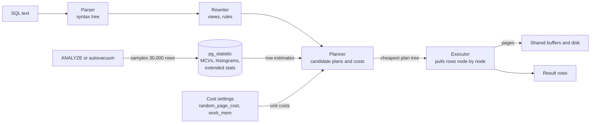
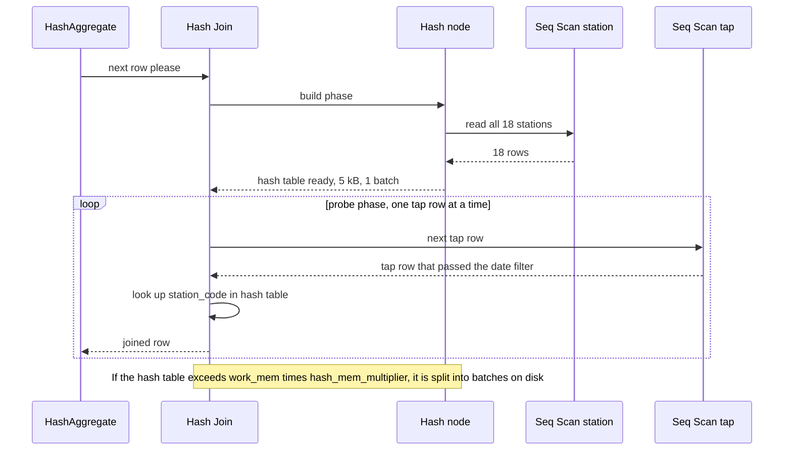

When a query is slow, guessing is expensive. Adding a random index, raising memory, or rewriting the query in three different ways can each take an afternoon and may make things worse. PostgreSQL will tell you exactly what it did and how long each step took, if you ask with `EXPLAIN ANALYZE`. This lesson teaches you to read that answer, to understand why the planner made its choice, and to fix the cause rather than the symptom.

## Learning objectives

By the end of this lesson you will be able to:

1. Describe the path of a query through parser, rewriter, planner and executor, and what the planner optimises.
2. Read an `EXPLAIN (ANALYZE, BUFFERS)` plan: costs, estimated versus actual rows, loops, timing and buffers.
3. Recognise sequential, index, index-only and bitmap scans, and say when each is the right choice.
4. Explain nested loop, hash and merge joins, and predict which one the planner will pick.
5. Explain how statistics (`pg_stats`, MCVs, histograms, extended statistics) produce row estimates, and why correlated columns fool the planner.
6. Apply a fix that matches the cause: an index, a sargable rewrite, `ANALYZE`, extended statistics, `work_mem`, or a query restructure.

## Prerequisites

- [Indexes, composite indexes, B-tree and hash](#/lesson/m09-indexes): what an index is and the leftmost-prefix rule.
- [One-to-one, one-to-many and many-to-many](#/lesson/m09-relationships): joins between parent and child tables.
- Useful later: [N+1 query problems](#/lesson/m09-n-plus-one), which is the application-side twin of a bad nested loop.

## Explain it like I'm a beginner

Think of a navigation app planning a drive from Gurugram to Noida at 6 pm. It does not try every road. It uses what it knows (road lengths, typical speeds, today's traffic reports) to *estimate* the travel time of a few candidate routes, and picks the cheapest estimate. If the traffic report is a week old, it confidently sends you into a jam.

PostgreSQL's **query planner** does the same for SQL. Your query says *what* you want ("total fares per station on 10 October"). The planner decides *how*: which table to read first, whether to use an index, and how to match rows between tables. It estimates a **cost** for each candidate plan using **statistics** about your data (how many rows, how many distinct values, which values are common) and picks the cheapest.

- `EXPLAIN` shows the route the app *would* take, with its estimates.
- `EXPLAIN ANALYZE` actually drives the route and reports real timings next to the estimates.

Almost every bad plan comes from one of three things: the statistics are wrong or missing (an old traffic report), the query is written so a shortcut cannot be used (a road the app does not know connects), or there genuinely is no shortcut (no index). Reading the plan tells you which.

We will use a metro smart-card system as the running example: `station` (18 rows), `card` (5,000 cards) and `tap` (30,000 entry and exit taps over two weeks). Rajiv Chowk, an interchange, gets far more taps than any other station, which turns out to matter.

## First-principles explanation

### The life of a query

1. **Parser**: checks syntax and turns the text into a tree.
2. **Rewriter**: expands views and applies rules.
3. **Planner (optimizer)**: generates candidate plans and estimates the cost of each. For joins of many tables it cannot try every order; above `geqo_threshold` (12 tables by default) it switches to a genetic search.
4. **Executor**: runs the chosen plan as a tree of nodes. Each node pulls rows from its children, does its job (filter, join, sort, aggregate) and passes rows up.

The planner optimises **estimated total cost**, or startup cost when a `LIMIT` means only the first rows matter. Cost is in arbitrary units anchored to "reading one page sequentially = 1.0".

### The cost model, with the real constants

| Setting | Default | Meaning |
|---|---|---|
| `seq_page_cost` | 1.0 | read one 8 KB page in sequence |
| `random_page_cost` | 4.0 | read one page at a random location |
| `cpu_tuple_cost` | 0.01 | process one row |
| `cpu_index_tuple_cost` | 0.005 | process one index entry |
| `cpu_operator_cost` | 0.0025 | evaluate one operator or function |

A sequential scan of `tap` (273 pages, 30,000 rows) with a two-condition filter costs:

273 × 1.0 + 30,000 × 0.01 + 30,000 × 2 × 0.0025 = 273 + 300 + 150 = **723**

which is exactly the `cost=0.00..723.00` you will see in the playground. An index scan that fetches *r* scattered rows pays roughly one random page per row, so about 4 × *r* plus a little CPU. With these numbers, the index wins only while *r* stays below roughly 180 rows, which is 0.6 % of the table. That tipping point is why the planner often ignores an index for a query that matches "only" 10 % of rows. It is not being stupid: reading 3,000 random pages really is slower than reading 273 in sequence.

On SSDs, random reads are much closer to sequential reads than the default 4.0 assumes. Many teams set `random_page_cost = 1.1` to 1.5 on SSD-backed servers. Change it only after measuring, and change it globally rather than per query.

### Where row estimates come from

`ANALYZE` (run automatically by autovacuum, or manually) samples up to 300 × `default_statistics_target` rows (30,000 by default) and stores per-column statistics, visible in `pg_stats`:

- `null_frac`: the fraction of NULLs.
- `n_distinct`: the number of distinct values (negative means "a fraction of the row count").
- `most_common_vals` and `most_common_freqs` (**MCVs**): up to 100 common values and their frequencies.
- `histogram_bounds`: values splitting the remaining (non-MCV) data into equal-sized buckets, used for ranges.
- `correlation`: how closely physical row order follows the column's sort order (near 1 means BRIN and index range scans are cheap).

For `WHERE station_code = 'RCK'`, the planner finds `RCK` in the MCV list with frequency 0.3055 and estimates 30,000 × 0.3055 ≈ 9,166 rows. For a value not in the MCV list, it spreads the remaining frequency evenly over the remaining distinct values. For a range like `tapped_at >= x`, it interpolates in the histogram.

### The independence assumption, and how it fails

With two conditions, the planner multiplies their selectivities as if the columns were unrelated:

`WHERE line = 'YELLOW' AND station_code = 'RCK'`
→ 30,000 × P(YELLOW) × P(RCK) = 30,000 × 0.2223 × 0.3055 ≈ **2,037 rows**.

But Rajiv Chowk is on the Blue line in this data, so the true answer is **0**. The opposite also happens: `line = 'BLUE' AND station_code = 'RCK'` is estimated at about 4,838 rows when the truth is 9,166, because every Rajiv Chowk tap *is* a Blue-line tap. Real data is full of such dependencies: city and PIN code, product and category, state and GSTIN prefix.

A 2,000× overestimate may make the planner choose a hash join and a big memory allocation where a nested loop would finish in microseconds. An underestimate is often worse: the planner picks a nested loop expecting 5 outer rows, gets 50,000, and runs 50,000 inner index lookups.

The fix is **extended statistics**:

```sql
CREATE STATISTICS tap_station_line (dependencies, mcv) ON station_code, line FROM tap;
ANALYZE tap;
```

`dependencies` records that `station_code` determines `line`; `mcv` stores common *combinations*. After this, the playground estimates 1 row for YELLOW + RCK (the planner never estimates fewer than 1) and 9,166 for BLUE + RCK. There is also `ndistinct`, which fixes `GROUP BY a, b` estimates.

### Reading EXPLAIN ANALYZE

```text
Hash Join  (cost=1.41..730.92 rows=2009 width=12) (actual time=1.908..16.996 rows=2009 loops=1)
  Hash Cond: (t.station_code = s.code)
  Buffers: shared hit=274
  ->  Seq Scan on tap t  (cost=0.00..723.00 rows=2009 width=4) (actual time=1.777..13.092 rows=2009 loops=1)
        Filter: ((tapped_at >= '2026-10-10') AND (tapped_at < '2026-10-11'))
        Rows Removed by Filter: 27991
  ->  Hash  (cost=1.18..1.18 rows=18 width=16) (actual time=0.052..0.053 rows=18 loops=1)
        Buckets: 1024  Batches: 1  Memory Usage: 5kB
        ->  Seq Scan on station s  (cost=0.00..1.18 rows=18 width=16) (actual time=0.013..0.026 rows=18 loops=1)
```

How to read it:

- **It is a tree.** Indentation and `->` show children. Execution starts at the leaves; rows flow upwards.
- **`cost=1.41..730.92`**: estimated startup cost (before the first row) and total cost. Units, not milliseconds.
- **`rows=2009`** (first bracket): estimated rows *per loop*. **`width`**: average row size in bytes.
- **`actual time=1.908..16.996`**: milliseconds to first row and to last row, *per loop*.
- **`rows=2009 loops=1`** (second bracket): actual rows per loop and the number of times this node ran. Multiply time and rows by `loops` to get totals. A node with `actual time=0.020..0.026 rows=6 loops=4800` spent about 0.026 × 4,800 ≈ 125 ms in total.
- **`Rows Removed by Filter`**: rows read and thrown away. A large number next to a small output is the classic sign of a missing index or a non-sargable condition.
- **`Buffers: shared hit=274 read=12`** (with `BUFFERS`, the default for `ANALYZE` since PostgreSQL 18): pages found in cache and pages read from disk or the OS cache. This is often more stable than timing.
- **Memory and disk lines**: `Sort Method: external merge Disk: 1680kB` or `Batches: 8` on a hash node mean the operation did not fit in `work_mem` and spilled to temporary files.

The first diagnostic to run on any plan: **compare estimated rows with actual rows at every node.** A ratio of 10× or more, especially low in the tree, is where the plan went wrong. Everything above it was planned on bad information.

`EXPLAIN ANALYZE` really runs the statement. For an `UPDATE` or `DELETE`, wrap it in `BEGIN; ... ROLLBACK;`. For a production query that takes minutes, use plain `EXPLAIN` first, or capture real plans with the `auto_explain` module.

### Scan types

- **Seq Scan**: read every page in order. Best when a large fraction of rows match, or the table is small.
- **Index Scan**: walk the index, fetch each heap row. Best for few rows, or ordered output with `LIMIT`.
- **Index Only Scan**: answer from the index alone, with heap visits only for pages not marked all-visible (`Heap Fetches`).
- **Bitmap Index Scan + Bitmap Heap Scan**: collect matching row pointers, sort them by page, read each page once. Best for thousands of scattered rows, and can combine indexes with `BitmapAnd`/`BitmapOr`. `Recheck Cond` appears because the bitmap may become lossy (page-level) under memory pressure.
- **Parallel Seq Scan** with `Gather`: several worker processes split the scan. Common for analytics on large tables.

### Join algorithms

**Nested loop**: for each row of the outer input, look up matches in the inner input. Cost ≈ outer rows × cost of one inner lookup. Excellent when the outer side is small and the inner side has an index on the join key (2 cards → 2 index lookups into `tap`). Terrible when the outer side is large and the planner thought it was small.

**Hash join**: read the smaller input, build an in-memory hash table on the join key, then stream the larger input and probe the table. Cost ≈ read both inputs once. Only for equality joins. Needs memory: up to `work_mem × hash_mem_multiplier` (default 4 MB × 2.0). If the hash table does not fit, it splits into batches written to disk (`Batches: 4`).

**Merge join**: sort both inputs on the join key (or read them already sorted from indexes), then walk them together like a zip. Good for large inputs that are already ordered, and for some non-equality merge conditions. Sorting cost can dominate if inputs are not pre-sorted.

Rules of thumb you can check in the playground: a selective filter on a small outer table plus an index on the inner join column gives a nested loop; joining a big table to a small dimension table gives a hash join with the small table hashed; two big tables both indexed on the join key may give a merge join.

### Common causes of bad plans, and their fixes

| Symptom in the plan | Likely cause | Fix |
|---|---|---|
| Estimated rows far off at a scan node | stale statistics after a bulk load | `ANALYZE table`, check autovacuum settings |
| Far off on a multi-column filter | correlated columns | `CREATE STATISTICS ... (dependencies, mcv)` |
| Seq Scan with huge `Rows Removed by Filter` | no usable index, or a function on the column | add an index, or make the condition sargable |
| Default-looking estimate (0.5 %, 33 %) on an expression | planner has no statistics for the expression | rewrite as a range on the raw column, or index the expression (which also collects stats on it) |
| Nested Loop with a huge `loops` count on the inner side | underestimated outer rows | fix the estimate first; then consider an index on the join key |
| `Sort Method: external merge Disk` or `Batches: > 1` | `work_mem` too small for this query | `SET LOCAL work_mem = '64MB'` for this query, or reduce the rows being sorted |
| Fast with literals, slow from the application | generic plan for a prepared statement with skewed data | check with `EXPLAIN (GENERIC_PLAN)`; consider `plan_cache_mode = force_custom_plan` for that query |
| `OFFSET 100000` reading 100,000 rows to discard them | offset pagination | [keyset pagination](#/lesson/m09-pagination) |

A **sargable** condition (search-argument-able) is one an index can use: the indexed column appears bare on one side. `WHERE tapped_at::date = '2026-10-10'` is not sargable; the planner also has no statistics for the expression and falls back to a default estimate of 0.5 % (150 rows). `WHERE tapped_at >= '2026-10-10' AND tapped_at < '2026-10-11'` is sargable and is estimated from the histogram. The same applies to `lower(email) = ...`, `amount + 0 > 100`, and comparing a `bigint` column with a `numeric` parameter, which can force a cast on the column side.

What *not* to do: setting `enable_seqscan = off` or `enable_nestloop = off` globally. Those settings exist to *test* whether an alternative plan would be faster, in your own session. PostgreSQL has no built-in query hints by design; the `pg_hint_plan` extension exists, but every hint is a statement that you know your data better than the statistics, forever.

### Finding which queries to explain

Do not start from a hunch. Enable `pg_stat_statements` and sort by `total_exec_time`: a 3 ms query called 2 million times a day (100 minutes of database time) matters more than a 4-second report run twice. Then `EXPLAIN (ANALYZE, BUFFERS)` the top entries with representative parameters.

## Visual explanation

### From SQL text to rows



The planner is the only stage that makes choices, and it has two inputs: statistics from `pg_statistic` (refreshed by `ANALYZE`) and cost settings. If either is wrong, the plan is wrong, even though the executor does exactly what it is told. That is why most fixes act on the left-hand side of this diagram (statistics, indexes, query shape) rather than on the executor.

### How a hash join runs



The hash join first builds a table from the smaller input (18 stations, 5 kB) and only then streams the larger one. That is why the `Hash` node's actual time finishes almost at once and the join's startup time includes it. Each tap row costs one hash lookup, so the total cost is close to "read both tables once". The aggregate above it pulls joined rows one at a time and groups them by station name.

## Step-by-step example

Use the playground for every step.

### Step 1 — a baseline with a filter but no index

```sql
EXPLAIN (ANALYZE, BUFFERS)
SELECT s.name, count(*) AS taps
FROM tap t JOIN station s ON s.code = t.station_code
WHERE t.tapped_at >= '2026-10-10' AND t.tapped_at < '2026-10-11'
GROUP BY s.name;
```

Read it bottom up: `Seq Scan on tap` with `Rows Removed by Filter: 27991` to keep about 2,000 rows; `Seq Scan on station` feeding a `Hash`; `Hash Join`; `HashAggregate`. Estimates match actuals closely, so the plan is reasonable *given the indexes that exist*. The waste is the 28,000 discarded rows.

### Step 2 — give it an index and watch the scan change

```sql
CREATE INDEX tap_tapped_at_idx ON tap (tapped_at);
ANALYZE tap;
```

Re-run Step 1. The `Seq Scan on tap` becomes `Index Scan using tap_tapped_at_idx`, even though about 2,000 rows (7 %) match, far above the 180-row tipping point computed earlier. The reason is `correlation`: taps were inserted in time order, so `pg_stats.correlation` for `tapped_at` is 1 and one day's taps sit on a few dozen neighbouring pages, not 2,000 scattered ones. The real planner uses correlation to discount random reads; the simple "one random page per row" model is the worst case. On a less ordered table you would see a `Bitmap Heap Scan` here instead. Narrow the range to one hour and you get an `Index Only Scan` for `count(*)`; widen it to ten days (two thirds of the table) and it goes back to a seq scan. That is the cost model's tipping point at work.

### Step 3 — break the index with a non-sargable filter

```sql
EXPLAIN SELECT count(*) FROM tap WHERE tapped_at::date = '2026-10-10';
```

Seq scan again, and the estimate is a suspiciously round 150 rows (the default 0.5 % for an expression with no statistics). The rewrite in Step 2's form restores both the index and a histogram-based estimate.

### Step 4 — see the independence assumption fail

```sql
EXPLAIN ANALYZE SELECT * FROM tap WHERE line = 'YELLOW' AND station_code = 'RCK';
```

Estimated about 2,037 rows, actual 0. Now:

```sql
CREATE STATISTICS tap_station_line (dependencies, mcv) ON station_code, line FROM tap;
ANALYZE tap;
EXPLAIN ANALYZE SELECT * FROM tap WHERE line = 'YELLOW' AND station_code = 'RCK';
```

Estimated 1, actual 0. Query `pg_stats_ext` to see what was stored.

### Step 5 — see the join algorithm change with the outer row count

```sql
CREATE INDEX tap_card_idx ON tap (card_id, tapped_at);
ANALYZE tap;

-- Two cards: nested loop with index lookups into tap
EXPLAIN ANALYZE SELECT c.holder, t.tapped_at FROM card c JOIN tap t ON t.card_id = c.id WHERE c.id IN (17, 42);

-- Every card: hash join, card is hashed, tap is scanned once
EXPLAIN ANALYZE SELECT c.card_type, sum(t.fare) FROM card c JOIN tap t ON t.card_id = c.id GROUP BY c.card_type;
```

The first plan shows `Nested Loop` with the inner side running `loops=2`. The second shows `Hash Join` with `Hash` on `card` (5,000 rows, about 230 kB). Same tables, same index, different best plan.

### Step 6 — watch a sort spill to disk

```sql
SET work_mem = '64kB';
EXPLAIN (ANALYZE) SELECT * FROM tap ORDER BY fare, tapped_at;
RESET work_mem;
EXPLAIN (ANALYZE) SELECT * FROM tap ORDER BY fare, tapped_at;
```

With 64 kB the sort reports `external merge Disk: ~1,700kB`. With the default it becomes an in-memory `quicksort`. In production, raise `work_mem` for the specific query or role that needs it (`SET LOCAL` inside a transaction), never blindly for everyone: each sort or hash node in each connection may use that much.

## Production-style C# implementation

Plans are data. `EXPLAIN (ANALYZE, BUFFERS, FORMAT JSON)` returns a JSON tree, and a small analyzer can turn it into actionable findings for a slow-query dashboard or a CI check. The compilable code below parses that JSON with `System.Text.Json`, computes per-node exclusive time, and flags misestimates, spills, wasteful filters and runaway nested loops. The plan source is an interface; production fetches plans with Npgsql (snippet afterwards).

```text
Metro.Api/
  Program.cs
  Plans/PlanNode.cs
  Plans/ExplainJsonParser.cs
  Plans/PlanAdvisor.cs
  Plans/IPlanSource.cs
```

```csharp file=Plans/PlanNode.cs
namespace Metro.Plans;

/// <summary>One node of an EXPLAIN (ANALYZE, FORMAT JSON) plan. Times and rows are per loop, as PostgreSQL reports them.</summary>
public sealed class PlanNode
{
    public required string NodeType { get; init; }
    public string? Relation { get; init; }
    public string? IndexName { get; init; }
    public double PlanRows { get; init; }
    public double ActualRows { get; init; }
    public double Loops { get; init; } = 1;
    public double ActualTotalMs { get; init; }
    public double RowsRemovedByFilter { get; init; }
    public string? SortSpaceType { get; init; }
    public long HashBatches { get; init; }
    public IReadOnlyList<PlanNode> Children { get; init; } = [];

    /// <summary>Total time spent in this node and its subtree, across all loops.</summary>
    public double InclusiveMs => ActualTotalMs * Loops;

    /// <summary>Time spent in this node alone. Approximate for parallel plans.</summary>
    public double ExclusiveMs => Math.Max(0, InclusiveMs - Children.Sum(c => c.InclusiveMs));

    /// <summary>How wrong the row estimate was, as a factor of at least 1.</summary>
    public double MisestimateFactor
    {
        get
        {
            var hi = Math.Max(PlanRows, ActualRows);
            var lo = Math.Max(Math.Min(PlanRows, ActualRows), 1);
            return hi / lo;
        }
    }

    public IEnumerable<PlanNode> DescendantsAndSelf()
    {
        yield return this;
        foreach (var c in Children)
            foreach (var d in c.DescendantsAndSelf())
                yield return d;
    }

    public string Label => Relation is null ? NodeType : $"{NodeType} on {Relation}" + (IndexName is null ? "" : $" using {IndexName}");
}

public sealed record ExplainResult(PlanNode Root, double PlanningMs, double ExecutionMs);
```

```csharp file=Plans/ExplainJsonParser.cs
using System.Text.Json;

namespace Metro.Plans;

public static class ExplainJsonParser
{
    /// <summary>Parses the single-row output of EXPLAIN (ANALYZE, FORMAT JSON): an array with one object holding "Plan".</summary>
    public static ExplainResult Parse(string json)
    {
        using var doc = JsonDocument.Parse(json);
        var top = doc.RootElement.ValueKind == JsonValueKind.Array ? doc.RootElement[0] : doc.RootElement;
        if (!top.TryGetProperty("Plan", out var plan))
            throw new FormatException("Expected an object with a \"Plan\" property.");
        return new ExplainResult(
            ReadNode(plan),
            Number(top, "Planning Time"),
            Number(top, "Execution Time"));
    }

    private static PlanNode ReadNode(JsonElement e)
    {
        var children = new List<PlanNode>();
        if (e.TryGetProperty("Plans", out var plans))
            foreach (var child in plans.EnumerateArray()) children.Add(ReadNode(child));

        return new PlanNode
        {
            NodeType = Text(e, "Node Type") ?? "Unknown",
            Relation = Text(e, "Relation Name"),
            IndexName = Text(e, "Index Name"),
            PlanRows = Number(e, "Plan Rows"),
            ActualRows = Number(e, "Actual Rows"),
            Loops = e.TryGetProperty("Actual Loops", out _) ? Number(e, "Actual Loops") : 1,
            ActualTotalMs = Number(e, "Actual Total Time"),
            RowsRemovedByFilter = Number(e, "Rows Removed by Filter"),
            SortSpaceType = Text(e, "Sort Space Type"),
            HashBatches = (long)Number(e, "Hash Batches"),
            Children = children,
        };
    }

    private static string? Text(JsonElement e, string name) =>
        e.TryGetProperty(name, out var v) && v.ValueKind == JsonValueKind.String ? v.GetString() : null;

    private static double Number(JsonElement e, string name) =>
        e.TryGetProperty(name, out var v) && v.ValueKind == JsonValueKind.Number ? v.GetDouble() : 0;
}
```

```csharp file=Plans/PlanAdvisor.cs
namespace Metro.Plans;

public enum Severity { Info, Warning, Critical }

public sealed record PlanFinding(Severity Severity, string Node, string Problem, string Suggestion);

public sealed record PlanAdvisorOptions
{
    public double MisestimateFactor { get; init; } = 10;
    public double WastefulFilterRatio { get; init; } = 20;   // rows removed per row kept
    public double RunawayLoops { get; init; } = 1_000;
}

public sealed class PlanAdvisor(PlanAdvisorOptions options)
{
    public IReadOnlyList<PlanFinding> Review(ExplainResult result)
    {
        var findings = new List<PlanFinding>();
        var nodes = result.Root.DescendantsAndSelf().ToList();

        var hottest = nodes.MaxBy(n => n.ExclusiveMs);
        if (hottest is not null && result.ExecutionMs > 0)
            findings.Add(new PlanFinding(Severity.Info, hottest.Label,
                $"spends {hottest.ExclusiveMs:F1} ms of {result.ExecutionMs:F1} ms in this node alone",
                "Start the investigation here."));

        foreach (var n in nodes)
        {
            if (n.MisestimateFactor >= options.MisestimateFactor && Math.Max(n.PlanRows, n.ActualRows) >= 100)
                findings.Add(new PlanFinding(Severity.Critical, n.Label,
                    $"estimated {n.PlanRows:N0} rows, got {n.ActualRows:N0} (x{n.MisestimateFactor:F0})",
                    "Run ANALYZE; for multi-column filters add CREATE STATISTICS (dependencies, mcv); for expressions rewrite to a sargable range."));

            var kept = n.ActualRows * n.Loops;
            if (n.RowsRemovedByFilter > 0 && n.RowsRemovedByFilter * n.Loops >= options.WastefulFilterRatio * Math.Max(kept, 1))
                findings.Add(new PlanFinding(Severity.Warning, n.Label,
                    $"reads {n.RowsRemovedByFilter * n.Loops:N0} rows to keep {kept:N0}",
                    "An index on the filtered columns, or a partial index, would avoid reading discarded rows."));

            if (n.SortSpaceType == "Disk")
                findings.Add(new PlanFinding(Severity.Warning, n.Label, "sort spilled to disk",
                    "Raise work_mem for this query with SET LOCAL, or sort fewer rows (filter earlier, use an index for ORDER BY)."));

            if (n.HashBatches > 1)
                findings.Add(new PlanFinding(Severity.Warning, n.Label, $"hash table split into {n.HashBatches} batches",
                    "The build side did not fit in work_mem x hash_mem_multiplier; check its row estimate first."));

            if (n.NodeType == "Nested Loop" && n.Children.Count == 2 && n.Children[1].Loops >= options.RunawayLoops)
                findings.Add(new PlanFinding(Severity.Warning, n.Label,
                    $"inner side ran {n.Children[1].Loops:N0} times",
                    "Fine if each lookup is an index probe and the outer estimate was right; otherwise fix the outer estimate so a hash join is chosen."));
        }

        return findings.OrderByDescending(f => f.Severity).ToList();
    }
}
```

```csharp file=Plans/IPlanSource.cs
namespace Metro.Plans;

public interface IPlanSource
{
    /// <summary>Returns EXPLAIN (ANALYZE, BUFFERS, FORMAT JSON) output for a named, parameterised query.</summary>
    Task<string> ExplainAsync(string queryName, CancellationToken ct = default);
}

/// <summary>Serves captured plans, for local runs and tests. Production runs EXPLAIN through Npgsql.</summary>
public sealed class CapturedPlanSource(IReadOnlyDictionary<string, string> plans) : IPlanSource
{
    public Task<string> ExplainAsync(string queryName, CancellationToken ct = default) =>
        plans.TryGetValue(queryName, out var json)
            ? Task.FromResult(json)
            : throw new KeyNotFoundException($"No captured plan named '{queryName}'.");
}
```

```csharp file=Program.cs
using Metro.Plans;

var builder = WebApplication.CreateBuilder(args);

const string capturedYellowRck = """
[{"Plan": {"Node Type": "Seq Scan", "Relation Name": "tap", "Plan Rows": 2037, "Actual Rows": 0,
  "Actual Loops": 1, "Actual Total Time": 4.1, "Rows Removed by Filter": 30000},
  "Planning Time": 0.12, "Execution Time": 4.2}]
""";

builder.Services.AddSingleton(new PlanAdvisorOptions());
builder.Services.AddSingleton<PlanAdvisor>();
builder.Services.AddSingleton<IPlanSource>(new CapturedPlanSource(new Dictionary<string, string>
{
    ["taps-by-line-and-station"] = capturedYellowRck,
}));

var app = builder.Build();

app.MapPost("/plans/analyze", async (HttpRequest request, PlanAdvisor advisor) =>
{
    using var reader = new StreamReader(request.Body);
    var result = ExplainJsonParser.Parse(await reader.ReadToEndAsync());
    return Results.Ok(advisor.Review(result));
});

app.MapGet("/plans/{queryName}", async (string queryName, IPlanSource source, PlanAdvisor advisor, CancellationToken ct) =>
    Results.Ok(advisor.Review(ExplainJsonParser.Parse(await source.ExplainAsync(queryName, ct)))));

app.Run();
```

### Getting real plans from the application

```csharp
// Not compiled by the course checker: requires the Npgsql package.
// Explain the exact SQL the app runs, with real parameter values, inside a rolled-back transaction.
await using var conn = await dataSource.OpenConnectionAsync(ct);
await using var tx = await conn.BeginTransactionAsync(ct);
await using var cmd = new NpgsqlCommand(
    "EXPLAIN (ANALYZE, BUFFERS, FORMAT JSON) " + sql, conn, tx);
foreach (var p in parameters) cmd.Parameters.Add(p);
var json = (string)(await cmd.ExecuteScalarAsync(ct))!;
await tx.RollbackAsync(ct);   // EXPLAIN ANALYZE executes the statement, so never commit
```

With EF Core, `query.ToQueryString()` gives the SQL (with parameter declarations) to paste into `EXPLAIN`. For plans of real production traffic, enable `auto_explain` with `auto_explain.log_min_duration = '500ms'` and `auto_explain.log_format = json`, then feed the logged JSON to the same analyzer.

:::callout type=warning title="EXPLAIN ANALYZE executes the statement"
`EXPLAIN ANALYZE DELETE FROM tap WHERE ...` deletes the rows. Always wrap data-changing statements in `BEGIN; ... ROLLBACK;`. Also remember that timing a query twice in a row measures a warm cache the second time; look at `Buffers: read=` to see how much came from disk.
:::

## Bad design vs good design

**Bad: tuning by superstition.**

```sql
-- Anti-pattern: "the planner is wrong, force it"
SET enable_seqscan = off;               -- set in postgresql.conf "because seq scans are slow"
SET random_page_cost = 0.5;             -- below seq_page_cost: nonsense, makes random reads look free
SELECT * FROM tap WHERE tapped_at::date = current_date - 1;   -- unchanged non-sargable filter
```

This hides the real problem (a non-sargable predicate), makes every other query on the server pick index scans even when a seq scan is far cheaper, and leaves the misestimate in place for the next query.

**Good: measure, find the misestimate, fix the cause.**

1. Pick the query from `pg_stat_statements` by total time.
2. `EXPLAIN (ANALYZE, BUFFERS)` it with real parameters.
3. Find the lowest node where estimated and actual rows diverge by 10× or more, or where most of the time is spent.
4. Apply the matching fix: rewrite the filter as a range, `ANALYZE` after a bulk load, add extended statistics for correlated columns, add or adjust an index, or raise `work_mem` for that query only.
5. Re-run and confirm both the estimate and the time improved. Record the before and after plans in the ticket.

**When is all this unnecessary?** For a query that runs once a day on a small table and takes 200 ms, the right amount of plan analysis is zero. Spend the effort on queries with high *total* time or on the user-facing critical path.

:::callout type=tradeoff title="Better estimates cost a little at ANALYZE time"
Raising `default_statistics_target` or a column's `SET STATISTICS 1000` gives more MCVs and finer histograms, which helps skewed columns, at the price of slower `ANALYZE` and slightly slower planning. Raise it per column where you have proven misestimates, not globally.
:::

## Practical playground

The playground seeds the metro data with statistics already gathered. Use the **Explain** button, or type `EXPLAIN (ANALYZE) ...` yourself. Work through Steps 1 to 6, then try:

1. `SELECT attname, n_distinct, most_common_vals, most_common_freqs FROM pg_stats WHERE tablename = 'tap';`
2. Insert 20,000 more taps at Hauz Khas with `INSERT ... SELECT ... FROM generate_series(...)` without running `ANALYZE`, then explain `WHERE station_code = 'HKS'`. Compare the estimate with reality, then run `ANALYZE tap` and compare again.
3. Join all three tables and find the plan node that takes the most time.

The engine is PGlite, based on PostgreSQL 18. It prints a few extra details that 17 does not (such as `Index Searches`, and buffer counts by default with `ANALYZE`). Costs, scan types and join choices follow the same rules as 17.

:::playground type=sql title="Metro smart-card taps: read the plans"
```sql
CREATE TABLE station (code text PRIMARY KEY, name text NOT NULL, line text NOT NULL);
INSERT INTO station VALUES
 ('RCK','Rajiv Chowk','BLUE'),('KBH','Karol Bagh','BLUE'),('DWK','Dwarka Sector 21','BLUE'),
 ('NOI','Noida City Centre','BLUE'),('YMB','Yamuna Bank','BLUE'),
 ('KSG','Kashmere Gate','YELLOW'),('CHC','Chandni Chowk','YELLOW'),('HKS','Hauz Khas','YELLOW'),
 ('HCC','Millennium City Centre','YELLOW'),('SKT','Saket','YELLOW'),
 ('NDLS','New Delhi','ORANGE'),('AIR','Airport T3','ORANGE'),('DHK','Dhaula Kuan','ORANGE'),('AER','Aerocity','ORANGE'),
 ('JNP','Janakpuri West','MAGENTA'),('BTN','Botanical Garden','MAGENTA'),('OKN','Okhla NSIC','MAGENTA'),
 ('KJM','Kalkaji Mandir','MAGENTA');
CREATE TABLE card (id bigint PRIMARY KEY, holder text NOT NULL, card_type text NOT NULL, issued_on date NOT NULL);
INSERT INTO card
SELECT g, 'Holder ' || g,
       CASE WHEN g % 10 = 0 THEN 'student' WHEN g % 10 = 1 THEN 'senior' ELSE 'regular' END,
       date '2020-01-01' + (g % 2000)
FROM generate_series(1, 5000) AS g;
CREATE TABLE tap (
  id           bigint GENERATED ALWAYS AS IDENTITY PRIMARY KEY,
  card_id      bigint NOT NULL REFERENCES card,
  station_code text   NOT NULL REFERENCES station,
  line         text   NOT NULL,
  direction    text   NOT NULL,
  fare         numeric(6,2) NOT NULL,
  tapped_at    timestamptz NOT NULL
);
-- Every 4th tap is at Rajiv Chowk (the busy interchange); the rest spread across all stations.
INSERT INTO tap (card_id, station_code, line, direction, fare, tapped_at)
SELECT 1 + (g * 37) % 5000, s.code, s.line,
       CASE WHEN g % 2 = 0 THEN 'in' ELSE 'out' END,
       CASE WHEN g % 2 = 0 THEN 0 ELSE 10 + (g % 6) * 10 END,
       timestamptz '2026-10-01 05:30+05:30' + g * interval '43 seconds'
FROM generate_series(1, 30000) AS g
JOIN LATERAL (SELECT code, line FROM station ORDER BY code
              OFFSET (CASE WHEN g % 4 = 0 THEN 15 ELSE (g * 7) % 18 END) LIMIT 1) s ON true;
ANALYZE;
```
:::

## Exercises

:::exercise id=m09-query-planning-ex1 difficulty=beginner kind=sql ordered=true title="Find the misestimated nodes in a captured plan"
A slow "monthly fare summary" was captured with `EXPLAIN ANALYZE` and loaded into a table, one row per plan node. `est_rows` and `actual_rows` are **per loop**, as PostgreSQL reports them. Return every node whose estimate is wrong by a factor of 10 or more in either direction. Output `node_id`, `node_type`, `est_rows`, `actual_rows`, `loops`, `actual_total_rows` (actual rows × loops) and `factor` (the larger of estimated and actual divided by the smaller, treating the smaller as at least 1, rounded to 1 decimal). Order by `factor` descending, then `node_id`.
::acceptance
- Uses per-loop numbers for the factor, not loop-multiplied ones.
- Catches both overestimates and underestimates.
- Guards against division by zero when actual rows are 0.
- Column names and rounding exactly as specified.
::hint
The factor compares two numbers regardless of which is bigger: `greatest(a, b) / least(a, b)`.
::hint
`least(est_rows, actual_rows)` can be 0. Wrap it: `greatest(least(est_rows, actual_rows), 1)`.
::hint
Filter with the same expression in `WHERE`, or compute it in a subquery or CTE and filter outside.
::hint
```sql
WITH f AS (
  SELECT *, round(greatest(est_rows, actual_rows) / greatest(least(est_rows, actual_rows), 1), 1) AS factor
  FROM plan_node)
SELECT ... FROM f WHERE factor >= 10 ORDER BY factor DESC, node_id;
```
::setup
```sql
CREATE TABLE plan_node (
  node_id     int PRIMARY KEY,
  parent_id   int REFERENCES plan_node,
  node_type   text NOT NULL,
  relation    text,
  est_rows    numeric(12,2) NOT NULL,
  actual_rows numeric(12,2) NOT NULL,
  loops       int NOT NULL,
  total_ms    numeric(10,3) NOT NULL
);
INSERT INTO plan_node VALUES
 (1, NULL, 'Sort',            NULL,      18,      18,    1, 2214.900),
 (2, 1,    'HashAggregate',   NULL,      18,      18,    1, 2214.700),
 (3, 2,    'Nested Loop',     NULL,      42,  184220,    1, 2190.400),
 (4, 3,    'Nested Loop',     NULL,       6,    4612,    1,   31.800),
 (5, 4,    'Seq Scan',        'station',  1,       1,    1,    0.020),
 (6, 4,    'Index Scan',      'card',     6,    4612,    1,   25.300),
 (7, 3,    'Index Scan',      'tap',      7,      39.94, 4612,  0.452),
 (8, 1,    'Seq Scan',        'fare_band', 2000,   3,    1,    0.040);
```
::check
```sql
WITH f AS (
  SELECT node_id, node_type, est_rows, actual_rows, loops,
         actual_rows * loops AS actual_total_rows,
         round(greatest(est_rows, actual_rows) / greatest(least(est_rows, actual_rows), 1), 1) AS factor
  FROM plan_node)
SELECT node_id, node_type, est_rows, actual_rows, loops, actual_total_rows, factor
FROM f
WHERE factor >= 10
ORDER BY factor DESC, node_id;
```
::solution
```sql
WITH f AS (
  SELECT node_id, node_type, est_rows, actual_rows, loops,
         actual_rows * loops AS actual_total_rows,
         round(greatest(est_rows, actual_rows) / greatest(least(est_rows, actual_rows), 1), 1) AS factor
  FROM plan_node)
SELECT node_id, node_type, est_rows, actual_rows, loops, actual_total_rows, factor
FROM f
WHERE factor >= 10
ORDER BY factor DESC, node_id;
```
Four nodes come back (3, 4, 6 and 8). The story they tell: the index scan on `card` (node 6) expected 6 rows and found 4,612, a 769× underestimate. Because of it, the planner chose a nested loop (node 3) expecting 6 outer rows, and the inner index scan on `tap` (node 7) ran 4,612 times. Each loop looks cheap (0.45 ms, 40 rows, factor 5.7, below the threshold), but 4,612 loops × 0.452 ms ≈ 2.1 s is nearly the whole query. Node 3 itself is off by 4,386×. Node 8 is a 667× *overestimate*, harmless here because the table is tiny. Fix the lowest bad estimate (node 6, probably a stale or correlated filter on `card`) and the planner will likely switch node 3 to a hash join.
::mistakes
- Multiplying `est_rows` by `loops` before comparing. The estimate is already per loop; compare like with like.
- Only checking `actual_rows > est_rows`, which misses overestimates such as node 8.
- Dividing by `least(...)` without the `greatest(..., 1)` guard, which fails when a node returns 0 rows.
:::

:::exercise id=m09-query-planning-ex2 difficulty=beginner kind=code title="Compute scan costs with the planner's formulas"
Implement a simplified version of PostgreSQL's cost model to see why the planner switches from an index scan to a sequential scan as more rows match.
::requirements
- `SeqScan = pages × SeqPageCost + rows × CpuTupleCost + rows × quals × CpuOperatorCost`.
- `IndexScan` (simplified worst case, every matching row on a different page) `= (indexDepth + matchingRows) × RandomPageCost + matchingRows × (CpuIndexTupleCost + CpuTupleCost)`.
- `Cheaper` returns `"Index Scan"` when the index cost is strictly lower, otherwise `"Seq Scan"`.
- `BreakEvenRows` returns the largest `matchingRows` for which the index scan is still strictly cheaper (0 if none).
::acceptance
- The `tap` table (273 pages, 30,000 rows, 2 filter conditions) costs exactly 723 to seq scan with default settings.
- An index scan for 10 rows with depth 2 costs 48.15 and wins.
- The break-even point for `tap` with depth 2 is 178 rows.
- With `RandomPageCost = 1.1` (SSD tuning) the break-even rises above 600 rows.
::hint
Write the two formulas directly; they are one line each.
::hint
For `BreakEvenRows`, you can loop upwards from 0 until the index stops being cheaper, or solve the inequality for `matchingRows`.
::hint
Solving: index cost is linear in r, `a + b × r` with `a = depth × RandomPageCost` and `b = RandomPageCost + CpuIndexTupleCost + CpuTupleCost`. The largest r with `a + b × r < seq` is the ceiling of `(seq − a) / b` minus 1.
::hint
A loop is easier to get exactly right:
```csharp
long r = 0;
while (IndexScan(s, r + 1, depth) < seq) r++;
return r;
```
::starter
```csharp file=CostModel.cs
using System;

public sealed record CostSettings(
    double SeqPageCost = 1.0,
    double RandomPageCost = 4.0,
    double CpuTupleCost = 0.01,
    double CpuIndexTupleCost = 0.005,
    double CpuOperatorCost = 0.0025);

public static class CostModel
{
    public static double SeqScan(CostSettings s, long pages, long rows, int quals) => throw new NotImplementedException();

    public static double IndexScan(CostSettings s, long matchingRows, int indexDepth) => throw new NotImplementedException();

    public static string Cheaper(CostSettings s, long pages, long rows, int quals, long matchingRows, int indexDepth) =>
        throw new NotImplementedException();

    public static long BreakEvenRows(CostSettings s, long pages, long rows, int quals, int indexDepth) =>
        throw new NotImplementedException();
}
```
::tests
```csharp file=CostModelTests.cs
using Xunit;

public class CostModelTests
{
    private static readonly CostSettings Defaults = new();

    [Fact]
    public void Seq_scan_of_tap_matches_postgres()
    {
        Assert.Equal(723.0, CostModel.SeqScan(Defaults, 273, 30_000, 2), 6);
        Assert.Equal(573.0, CostModel.SeqScan(Defaults, 273, 30_000, 0), 6);
    }

    [Fact]
    public void Index_scan_for_few_rows()
    {
        Assert.Equal(48.15, CostModel.IndexScan(Defaults, 10, 2), 6);
        Assert.Equal("Index Scan", CostModel.Cheaper(Defaults, 273, 30_000, 2, 10, 2));
    }

    [Fact]
    public void Seq_scan_wins_for_many_rows()
    {
        Assert.Equal("Seq Scan", CostModel.Cheaper(Defaults, 273, 30_000, 2, 2_000, 2));
    }

    [Fact]
    public void Break_even_with_defaults()
    {
        Assert.Equal(178, CostModel.BreakEvenRows(Defaults, 273, 30_000, 2, 2));
    }

    [Fact]
    public void Ssd_tuning_moves_the_break_even()
    {
        var ssd = Defaults with { RandomPageCost = 1.1 };
        Assert.True(CostModel.BreakEvenRows(ssd, 273, 30_000, 2, 2) > 600);
    }

    [Fact]
    public void Tiny_table_never_uses_the_index()
    {
        Assert.Equal(0, CostModel.BreakEvenRows(Defaults, 1, 18, 1, 2));
    }
}
```
::solution
```csharp file=CostModel.cs
using System;

public sealed record CostSettings(
    double SeqPageCost = 1.0,
    double RandomPageCost = 4.0,
    double CpuTupleCost = 0.01,
    double CpuIndexTupleCost = 0.005,
    double CpuOperatorCost = 0.0025);

public static class CostModel
{
    public static double SeqScan(CostSettings s, long pages, long rows, int quals) =>
        pages * s.SeqPageCost + rows * s.CpuTupleCost + rows * quals * s.CpuOperatorCost;

    public static double IndexScan(CostSettings s, long matchingRows, int indexDepth) =>
        (indexDepth + matchingRows) * s.RandomPageCost + matchingRows * (s.CpuIndexTupleCost + s.CpuTupleCost);

    public static string Cheaper(CostSettings s, long pages, long rows, int quals, long matchingRows, int indexDepth) =>
        IndexScan(s, matchingRows, indexDepth) < SeqScan(s, pages, rows, quals) ? "Index Scan" : "Seq Scan";

    public static long BreakEvenRows(CostSettings s, long pages, long rows, int quals, int indexDepth)
    {
        var seq = SeqScan(s, pages, rows, quals);
        if (IndexScan(s, 1, indexDepth) >= seq) return 0;
        long r = 1;
        while (r < rows && IndexScan(s, r + 1, indexDepth) < seq) r++;
        return r;
    }
}
```
With defaults, the index scan stops paying off at 178 of 30,000 rows (0.6 %). With `RandomPageCost = 1.1` the break-even is 646 rows, because random reads are priced almost like sequential ones. The real planner is smarter than this model: it uses the column's `correlation` to estimate how many matching rows share a heap page (a well-correlated index scan is much cheaper) and caches via `effective_cache_size`. The lesson stands: an index is not automatically cheaper, and the crossover depends on settings that should match your hardware.
::mistakes
- Using `RandomPageCost` for the sequential scan or `SeqPageCost` for the index scan.
- Forgetting the per-row CPU terms, which shifts the break-even.
- Returning the first row count where the index *loses* instead of the last one where it wins.
:::

:::exercise id=m09-query-planning-ex3 difficulty=intermediate kind=sql ordered=true title="Reproduce the planner's independence estimate from pg_stats"
The `tap` table has fresh statistics. For each (station, line) pair in `probe`, compute the row estimate the planner makes when it multiplies the two columns' selectivities independently, and compare it with the true count. Return `station_code`, `line`, `independent_estimate` (reltuples × frequency of the station × frequency of the line, rounded to a whole number) and `actual_rows`. Order by `station_code`, `line`.
::acceptance
- Reads frequencies from `pg_stats.most_common_vals` and `most_common_freqs`, not from `count(*)`.
- Uses `pg_class.reltuples` for the table's row count.
- `actual_rows` is the real count from `tap`.
- The result shows the estimate is far off for at least two pairs.
::hint
`most_common_vals` has the pseudo-type `anyarray`. Cast it with `most_common_vals::text::text[]` before unnesting.
::hint
`unnest(a, b)` with two arrays returns them side by side: `FROM pg_stats, unnest(most_common_vals::text::text[], most_common_freqs) AS u(val, freq)`.
::hint
Build one CTE for station frequencies (`attname = 'station_code'`) and one for line frequencies (`attname = 'line'`), then join both to `probe`.
::hint
Cast to `float8` before multiplying (`n.reltuples::float8 * s.freq * l.freq`), then `round(...::numeric)`. Count actual rows with a correlated subquery or a `LEFT JOIN` plus `GROUP BY`.
::setup
```sql
CREATE TABLE station (code text PRIMARY KEY, name text NOT NULL, line text NOT NULL);
INSERT INTO station VALUES
 ('RCK','Rajiv Chowk','BLUE'),('KBH','Karol Bagh','BLUE'),('DWK','Dwarka Sector 21','BLUE'),
 ('NOI','Noida City Centre','BLUE'),('YMB','Yamuna Bank','BLUE'),
 ('KSG','Kashmere Gate','YELLOW'),('CHC','Chandni Chowk','YELLOW'),('HKS','Hauz Khas','YELLOW'),
 ('HCC','Millennium City Centre','YELLOW'),('SKT','Saket','YELLOW'),
 ('NDLS','New Delhi','ORANGE'),('AIR','Airport T3','ORANGE'),('DHK','Dhaula Kuan','ORANGE'),('AER','Aerocity','ORANGE'),
 ('JNP','Janakpuri West','MAGENTA'),('BTN','Botanical Garden','MAGENTA'),('OKN','Okhla NSIC','MAGENTA'),
 ('KJM','Kalkaji Mandir','MAGENTA');
CREATE TABLE tap (id bigint GENERATED ALWAYS AS IDENTITY PRIMARY KEY, card_id bigint NOT NULL,
  station_code text NOT NULL, line text NOT NULL, tapped_at timestamptz NOT NULL);
INSERT INTO tap (card_id, station_code, line, tapped_at)
SELECT 1 + (g * 37) % 5000, s.code, s.line, timestamptz '2026-10-01 05:30+05:30' + g * interval '43 seconds'
FROM generate_series(1, 30000) AS g
JOIN LATERAL (SELECT code, line FROM station ORDER BY code
              OFFSET (CASE WHEN g % 4 = 0 THEN 15 ELSE (g * 7) % 18 END) LIMIT 1) s ON true;
CREATE TABLE probe (station_code text NOT NULL, line text NOT NULL);
INSERT INTO probe VALUES ('RCK','BLUE'), ('RCK','YELLOW'), ('HKS','YELLOW'), ('NDLS','ORANGE');
ANALYZE tap;
```
::check
```sql
WITH s AS (
  SELECT u.val AS station_code, u.freq
  FROM pg_stats, unnest(most_common_vals::text::text[], most_common_freqs) AS u(val, freq)
  WHERE tablename = 'tap' AND attname = 'station_code'),
l AS (
  SELECT u.val AS line, u.freq
  FROM pg_stats, unnest(most_common_vals::text::text[], most_common_freqs) AS u(val, freq)
  WHERE tablename = 'tap' AND attname = 'line'),
n AS (SELECT reltuples FROM pg_class WHERE relname = 'tap')
SELECT p.station_code, p.line,
       round((n.reltuples::float8 * s.freq * l.freq)::numeric) AS independent_estimate,
       (SELECT count(*) FROM tap t WHERE t.station_code = p.station_code AND t.line = p.line) AS actual_rows
FROM probe p
JOIN s ON s.station_code = p.station_code
JOIN l ON l.line = p.line
CROSS JOIN n
ORDER BY p.station_code, p.line;
```
::solution
```sql
WITH s AS (
  SELECT u.val AS station_code, u.freq
  FROM pg_stats, unnest(most_common_vals::text::text[], most_common_freqs) AS u(val, freq)
  WHERE tablename = 'tap' AND attname = 'station_code'),
l AS (
  SELECT u.val AS line, u.freq
  FROM pg_stats, unnest(most_common_vals::text::text[], most_common_freqs) AS u(val, freq)
  WHERE tablename = 'tap' AND attname = 'line'),
n AS (SELECT reltuples FROM pg_class WHERE relname = 'tap')
SELECT p.station_code, p.line,
       round((n.reltuples::float8 * s.freq * l.freq)::numeric) AS independent_estimate,
       (SELECT count(*) FROM tap t WHERE t.station_code = p.station_code AND t.line = p.line) AS actual_rows
FROM probe p
JOIN s ON s.station_code = p.station_code
JOIN l ON l.line = p.line
CROSS JOIN n
ORDER BY p.station_code, p.line;
```
Every single-column statistic here is exact (the table is small enough that `ANALYZE` read every row), yet the combined estimates are badly wrong: Hauz Khas + Yellow is underestimated about 4.5×, Rajiv Chowk + Blue about 2×, and Rajiv Chowk + Yellow is estimated at roughly 2,000 rows when there are none. The individual numbers are right; the *multiplication* is wrong, because a station determines its line. Your estimates should match what `EXPLAIN` prints for the same filters. Add `CREATE STATISTICS ... (dependencies, mcv) ON station_code, line` and `ANALYZE` in the playground and watch `EXPLAIN` agree with `actual_rows` instead.
::mistakes
- Unnesting `most_common_vals` without the `::text::text[]` cast, which fails because `anyarray` cannot be unnested directly.
- Using `count(*)` to compute frequencies, which gives the truth rather than the planner's view.
- Multiplying `float4` values without casting, which can make the rounded result differ by one.
::extensions
Query `pg_stats_ext` after creating the extended statistics and find the stored combination frequency for (`RCK`, `BLUE`).
:::

:::exercise id=m09-query-planning-ex4 difficulty=intermediate kind=code title="Find the hottest node and the misestimates in a plan tree"
Tools like a plan visualiser show "self time" per node, which PostgreSQL does not print directly. Implement it, plus a misestimate finder, over a plan tree.
::requirements
- `InclusiveMs(node) = ActualTotalMs × Loops` (PostgreSQL reports times per loop).
- `ExclusiveMs(node) = InclusiveMs(node) − Σ InclusiveMs(child)`, never below 0.
- `Hottest(root)` returns the node with the largest exclusive time anywhere in the tree.
- `Misestimates(root, threshold)` returns `(NodeType, Factor)` pairs in pre-order (parent before children, children left to right) for nodes whose factor is at least `threshold`. Factor = `max(PlanRows, ActualRows) / max(min(PlanRows, ActualRows), 1)`.
::acceptance
- In the captured fare-summary plan, the hottest node is the inner `Index Scan` on `tap` that ran 4,612 times.
- The parent nested loop's exclusive time is small even though its inclusive time is about 2.2 s.
- Misestimates are returned in pre-order and include both under- and overestimates.
- A node with 0 actual rows does not cause division by zero.
::hint
Write `InclusiveMs` first; the other two functions use it.
::hint
Exclusive time: subtract the children's *inclusive* times, because each child's subtree time is already included in it.
::hint
Pre-order traversal is a recursive function that yields the node and then recurses into each child in order.
::hint
```csharp
static IEnumerable<PlanNode> Walk(PlanNode n)
{
    yield return n;
    foreach (var c in n.Children) foreach (var d in Walk(c)) yield return d;
}
```
::starter
```csharp file=PlanStats.cs
using System;
using System.Collections.Generic;
using System.Linq;

public sealed class PlanNode
{
    public PlanNode(string nodeType, double planRows, double actualRows, double loops, double actualTotalMs, params PlanNode[] children)
    {
        NodeType = nodeType; PlanRows = planRows; ActualRows = actualRows; Loops = loops;
        ActualTotalMs = actualTotalMs; Children = children;
    }

    public string NodeType { get; }
    public double PlanRows { get; }
    public double ActualRows { get; }
    public double Loops { get; }
    public double ActualTotalMs { get; }
    public IReadOnlyList<PlanNode> Children { get; }
}

public static class PlanStats
{
    public static double InclusiveMs(PlanNode n) => throw new NotImplementedException();

    public static double ExclusiveMs(PlanNode n) => throw new NotImplementedException();

    public static PlanNode Hottest(PlanNode root) => throw new NotImplementedException();

    public static List<(string NodeType, double Factor)> Misestimates(PlanNode root, double threshold) =>
        throw new NotImplementedException();
}
```
::tests
```csharp file=PlanStatsTests.cs
using Xunit;

public class PlanStatsTests
{
    // The fare-summary plan from exercise 1.
    private static PlanNode Captured(out PlanNode innerTap, out PlanNode outerLoop)
    {
        var station = new PlanNode("Seq Scan station", 1, 1, 1, 0.020);
        var card = new PlanNode("Index Scan card", 6, 4612, 1, 25.300);
        var innerLoop = new PlanNode("Nested Loop inner", 6, 4612, 1, 31.800, station, card);
        innerTap = new PlanNode("Index Scan tap", 7, 39.94, 4612, 0.452);
        outerLoop = new PlanNode("Nested Loop outer", 42, 184220, 1, 2190.400, innerLoop, innerTap);
        var agg = new PlanNode("HashAggregate", 18, 18, 1, 2214.700, outerLoop);
        var band = new PlanNode("Seq Scan fare_band", 2000, 3, 1, 0.040);
        return new PlanNode("Sort", 18, 18, 1, 2214.900, agg, band);
    }

    [Fact]
    public void Inclusive_multiplies_by_loops()
    {
        Captured(out var innerTap, out _);
        Assert.Equal(0.452 * 4612, PlanStats.InclusiveMs(innerTap), 6);
    }

    [Fact]
    public void Hottest_is_the_inner_index_scan()
    {
        var root = Captured(out var innerTap, out _);
        Assert.Same(innerTap, PlanStats.Hottest(root));
    }

    [Fact]
    public void Outer_loop_self_time_is_small()
    {
        Captured(out _, out var outerLoop);
        var self = PlanStats.ExclusiveMs(outerLoop);
        Assert.InRange(self, 70, 80);   // 2190.4 - 31.8 - 2084.6
    }

    [Fact]
    public void Exclusive_time_is_never_negative()
    {
        var child = new PlanNode("Child", 1, 1, 1, 10);
        var parent = new PlanNode("Parent", 1, 1, 1, 9.5, child);
        Assert.Equal(0, PlanStats.ExclusiveMs(parent));
    }

    [Fact]
    public void Misestimates_in_pre_order()
    {
        var m = PlanStats.Misestimates(Captured(out _, out _), 10);
        Assert.Equal(new[] { "Nested Loop outer", "Nested Loop inner", "Index Scan card", "Seq Scan fare_band" },
                     m.ConvertAll(x => x.NodeType).ToArray());
        Assert.Equal(4612.0 / 6, m[2].Factor, 6);
    }

    [Fact]
    public void Zero_actual_rows_is_safe()
    {
        var n = new PlanNode("Seq Scan tap", 2037, 0, 1, 4.1);
        var m = PlanStats.Misestimates(n, 10);
        Assert.Single(m);
        Assert.Equal(2037, m[0].Factor, 6);
    }
}
```
::solution
```csharp file=PlanStats.cs
using System;
using System.Collections.Generic;
using System.Linq;

public sealed class PlanNode
{
    public PlanNode(string nodeType, double planRows, double actualRows, double loops, double actualTotalMs, params PlanNode[] children)
    {
        NodeType = nodeType; PlanRows = planRows; ActualRows = actualRows; Loops = loops;
        ActualTotalMs = actualTotalMs; Children = children;
    }

    public string NodeType { get; }
    public double PlanRows { get; }
    public double ActualRows { get; }
    public double Loops { get; }
    public double ActualTotalMs { get; }
    public IReadOnlyList<PlanNode> Children { get; }
}

public static class PlanStats
{
    public static double InclusiveMs(PlanNode n) => n.ActualTotalMs * n.Loops;

    public static double ExclusiveMs(PlanNode n) =>
        Math.Max(0, InclusiveMs(n) - n.Children.Sum(InclusiveMs));

    public static PlanNode Hottest(PlanNode root) => Walk(root).MaxBy(ExclusiveMs)!;

    public static List<(string NodeType, double Factor)> Misestimates(PlanNode root, double threshold) =>
        Walk(root)
            .Select(n => (n.NodeType, Factor: Math.Max(n.PlanRows, n.ActualRows) / Math.Max(Math.Min(n.PlanRows, n.ActualRows), 1)))
            .Where(x => x.Factor >= threshold)
            .ToList();

    private static IEnumerable<PlanNode> Walk(PlanNode n)
    {
        yield return n;
        foreach (var c in n.Children)
            foreach (var d in Walk(c))
                yield return d;
    }
}
```
The inner index scan has a tiny per-loop time (0.452 ms) but runs 4,612 times, so its inclusive time is about 2,085 ms and almost all of it is exclusive. A naive reading of the text plan ("0.452 ms, fast") misses this; multiplying by loops is the single most important habit when reading nested loops. The clamp to zero handles rounding and parallel plans, where children's times can add up to more than the parent's wall-clock time.
::mistakes
- Forgetting to multiply by `Loops`, which makes the inner index scan look negligible.
- Subtracting children's per-loop time instead of their inclusive time.
- Traversing breadth-first, which returns misestimates in the wrong order.
:::

:::exercise id=m09-query-planning-ex5 difficulty=advanced kind=written title="Diagnose a slow endpoint from its plan"
The endpoint `GET /cards/{id}/statement?month=2026-09` became slow (p95 3.8 s) the day after a backfill loaded 9 million historical taps. The application runs this query with parameters (`$1` = card id, `$2` = month start as `date`):

```sql
SELECT t.tapped_at, s.name, t.direction, t.fare
FROM tap t JOIN station s ON s.code = t.station_code
WHERE t.card_id = $1 AND date_trunc('month', t.tapped_at) = $2
ORDER BY t.tapped_at;
```

The captured plan (abridged):

```text
Sort  (cost=48211.10..48211.12 rows=6 width=40) (actual time=3794.2..3794.4 rows=41 loops=1)
  Sort Key: t.tapped_at
  Sort Method: quicksort  Memory: 28kB
  ->  Hash Join  (cost=1.41..48211.02 rows=6 width=40) (actual time=12.6..3794.0 rows=41 loops=1)
        Hash Cond: (t.station_code = s.code)
        ->  Seq Scan on tap t  (cost=0.00..48209.50 rows=6 width=32) (actual time=12.5..3793.6 rows=41 loops=1)
              Filter: ((card_id = $1) AND (date_trunc('month', tapped_at) = $2))
              Rows Removed by Filter: 9029959
        ->  Hash  (cost=1.18..1.18 rows=18 width=16) (actual time=0.05..0.05 rows=18 loops=1)
Planning Time: 0.3 ms
Execution Time: 3794.6 ms
```

There is an index `tap_card_idx ON tap (card_id, tapped_at)`. Explain (1) why the index is not used, (2) what the backfill likely did to statistics and whether that matters here, (3) the fix, with the new SQL and the plan you expect, (4) how you would verify it, and (5) one guard to stop this class of regression.
::acceptance
- Identifies `date_trunc('month', tapped_at) = $2` as non-sargable for the `tapped_at` part of the index.
- Notes that `card_id = $1` alone could still use the index, and explains why the planner may prefer a seq scan anyway (estimates, generic plan, or stats), or at least that a range rewrite is needed for the second column.
- Rewrites the predicate as a half-open range and shows the expected index scan with no sort.
- Mentions `ANALYZE` after bulk loads and checking estimates.
- Proposes a concrete verification and a regression guard.
::hint
Look at `Rows Removed by Filter` and the fact that both conditions are listed under `Filter`, not `Index Cond`.
::hint
`date_trunc('month', tapped_at)` hides `tapped_at` inside a function. What can the index on `(card_id, tapped_at)` do with that?
::hint
A month is the half-open range `[$2, $2 + interval '1 month')`.
::hint
After 9 million new rows, has autovacuum's analyze necessarily run yet? What does `pg_stat_user_tables.last_autoanalyze` say?
::solution
**1. Why no index.** Both conditions appear under `Filter`, meaning they are checked row by row after a sequential read of 9 million rows. The month condition wraps `tapped_at` in `date_trunc`, so the B-tree on `(card_id, tapped_at)` cannot use its second column. It could still seek on `card_id = $1` alone, and with good statistics a lookup of one card's few thousand taps would beat a seq scan. That the planner chose a seq scan points to a second problem: the estimate.

**2. Statistics after the backfill.** The backfill grew the table enormously. Autoanalyze triggers after `autovacuum_analyze_threshold + autovacuum_analyze_scale_factor × reltuples` changed rows (50 + 10 %), but it runs asynchronously and may not have finished, or may have run mid-load. Meanwhile `card_id`'s statistics may describe the old table: if `n_distinct` is stored as a negative fraction, or the MCV list now misrepresents frequent cards, per-card estimates can be badly off. Separately, the app uses a prepared statement. After five executions PostgreSQL may switch to a **generic plan** that cannot see the actual `$1` and `$2` values. For a generic plan, a function of a parameter on an expression without statistics gets a default selectivity. Either way the fix starts with a sargable query and fresh statistics.

**3. Fix.**

```sql
ANALYZE tap;   -- immediately, and add it to the end of every backfill script

SELECT t.tapped_at, s.name, t.direction, t.fare
FROM tap t JOIN station s ON s.code = t.station_code
WHERE t.card_id = $1
  AND t.tapped_at >= $2
  AND t.tapped_at <  $2 + interval '1 month'
ORDER BY t.tapped_at;
```

Note `$2` is a `date`; comparing a `timestamptz` column with a `date` converts the *parameter*, not the column, so the index stays usable. Expected plan:

```text
Nested Loop
  ->  Index Scan using tap_card_idx on tap t
        Index Cond: ((card_id = $1) AND (tapped_at >= $2) AND (tapped_at < ($2 + '1 mon'::interval)))
  ->  Index Scan using station_pkey on station s   (or a Hash on the 18 stations)
        Index Cond: (code = t.station_code)
```

No `Sort` node, because the index delivers rows in `tapped_at` order within one card. Both columns are now in the `Index Cond`. Expect tens of rows read and single-digit milliseconds.

**4. Verify.** Run `EXPLAIN (ANALYZE, BUFFERS)` with real parameters, and also `EXPLAIN (GENERIC_PLAN)` (available since PostgreSQL 16) to see the plan a prepared statement would get. Check estimated rows ≈ actual rows on the `tap` scan. In production, compare p95 latency and the query's `mean_exec_time` in `pg_stat_statements` before and after; reset or snapshot it at deploy time.

**5. Guard.** Add a CI integration test that seeds a representative volume, runs `ANALYZE`, executes `EXPLAIN (FORMAT JSON)` for the statement query, and fails if the plan contains a `Seq Scan` on `tap` or a `Sort` node. Add a lint rule rejecting `date_trunc(...)`, `::date` or other functions applied to indexed timestamp columns in `WHERE` clauses. Make every bulk-load job end with `ANALYZE` on the tables it touched.
::mistakes
- Adding an index on `date_trunc('month', tapped_at)`. It works, but adds write cost for a problem a range rewrite solves for free, and still does not serve other date ranges.
- Raising `work_mem`. The sort is 28 kB in memory; memory is not the problem.
- Turning off `enable_seqscan` for the application role.
- Blaming the hash join on `station`, which takes 0.05 ms.
:::

## Automated testing

Plans change when data changes, so tests should pin down only what matters.

**1. Unit tests for the analyzer.** Feed captured JSON plans and assert findings:

```csharp
public class PlanAdvisorTests
{
    [Fact]
    public void Flags_the_yellow_rck_misestimate_and_wasteful_filter()
    {
        const string json = """
        [{"Plan": {"Node Type": "Seq Scan", "Relation Name": "tap", "Plan Rows": 2037, "Actual Rows": 0,
          "Actual Loops": 1, "Actual Total Time": 4.1, "Rows Removed by Filter": 30000},
          "Planning Time": 0.1, "Execution Time": 4.2}]
        """;
        var findings = new PlanAdvisor(new PlanAdvisorOptions()).Review(ExplainJsonParser.Parse(json));
        Assert.Contains(findings, f => f.Severity == Severity.Critical && f.Problem.Contains("estimated 2,037"));
        Assert.Contains(findings, f => f.Problem.StartsWith("reads 30,000 rows"));
    }
}
```

**2. Plan assertions in integration tests.** Against a real PostgreSQL in a container, seed data with a realistic *shape* (skew, correlation), run `ANALYZE`, then assert on `EXPLAIN (FORMAT JSON)`: no `Seq Scan` on large tables for point queries, no `Sort` where an index should provide order, estimates within 10× at the scan nodes. Keep the assertions coarse; a test that pins exact costs breaks on every minor release.

**3. Production feedback.** Log slow plans with `auto_explain`, and review the top `pg_stat_statements` entries weekly. A plan regression usually shows up as a jump in `mean_exec_time` for one `queryid` right after a deploy or a bulk load.

## Real-world application

- **Transit and payments**: card and wallet statements are "one owner, one time range, newest first", served by a composite index and a sargable range. Backfills and migrations are the usual trigger for regressions.
- **Multi-tenant SaaS**: tenant sizes are wildly skewed. A generic plan tuned for a small tenant can be terrible for the largest one, which is why teams check `EXPLAIN (GENERIC_PLAN)` and sometimes force custom plans for tenant-scoped queries.
- **E-commerce and catalogues**: correlated attributes (category and brand, city and PIN code) are classic extended-statistics cases.
- **Infrastructure project dashboards**: reports joining packages, measurements and bills across several years are where hash joins spill to disk; per-report `work_mem` and pre-aggregated summaries help.
- **Analytics on OLTP replicas**: parallel sequential scans and hash aggregates are normal and fine there; the same plan on the primary during peak hours is not.

## Interview questions

:::interview
::q beginner
What is the difference between `EXPLAIN` and `EXPLAIN ANALYZE`?
::a
`EXPLAIN` shows the plan the planner chose, with estimated costs and row counts, without running the query. `EXPLAIN ANALYZE` runs the query and adds actual time, actual rows and loop counts per node, so you can compare estimates with reality. Because it executes the statement, wrap data-changing statements in a transaction and roll back. Adding `BUFFERS` shows how many pages each node read from cache or disk.
::q beginner
Why might PostgreSQL ignore an index and do a sequential scan?
::a
Because it estimates the seq scan is cheaper. That is correct when many rows match (reading the whole table sequentially beats thousands of random page reads; with default costs the crossover can be well under 1 % of rows), when the table is small, or when the query cannot use the index (a function on the column, a type mismatch, a missing leading column). It is incorrect when the estimate is wrong, typically from stale statistics or correlated columns, which you diagnose by comparing estimated and actual rows.
::q intermediate
Explain nested loop, hash join and merge join, and when the planner picks each.
::a
**Nested loop** runs the inner side once per outer row; it is best when the outer side is small and the inner side has an index on the join key, and it is the only join that supports any join condition. **Hash join** builds a hash table from the smaller input and probes it with the larger; it reads each input once and suits large equality joins, but needs `work_mem × hash_mem_multiplier` memory or spills to batches on disk. **Merge join** walks two inputs sorted on the join key; it is good when both are already ordered (for example via indexes) and large. The planner picks by estimated cost, so a bad row estimate for the outer side is the most common reason for a disastrous nested loop.
::q intermediate
A query filters on `city = 'Pune' AND pincode = '411001'`. The estimate is 3 rows; the actual is 4,000. What is going on and how do you fix it?
::a
The planner assumes the two conditions are independent and multiplies their selectivities, but a PIN code determines the city, so the true selectivity is just that of the PIN code. The fix is extended statistics: `CREATE STATISTICS addr_city_pin (dependencies, mcv) ON city, pincode FROM address; ANALYZE address;`. Then verify with `EXPLAIN ANALYZE` that the estimate is close to 4,000. If the underestimate was causing a nested loop with thousands of inner loops, the plan should switch to a hash join or a better index path.
::q advanced
A query is fast when you run it in psql with literal values but slow from the application. What do you investigate?
::a
First, whether the application uses a prepared statement. PostgreSQL plans the first five executions with the actual parameter values (custom plans) and may then switch to a cached generic plan if it is not much costlier on average. With skewed data (one huge tenant, one hot station), a generic plan can be terrible for some values. Check with `EXPLAIN (GENERIC_PLAN)` or by running `PREPARE`/`EXECUTE` six times. Also check parameter types: an application sending `numeric` for a `bigint` column, or `text` for a `uuid`, can force a cast on the column side and disable the index. Check session settings that differ (`work_mem`, `search_path`, `jit`). Fixes include `plan_cache_mode = force_custom_plan` for that statement or role, correct parameter types in Npgsql (`NpgsqlDbType`), or restructuring the query so one plan fits all values.
::q advanced
How do you build a systematic process for finding and fixing slow queries in a production PostgreSQL fleet?
::a
Enable `pg_stat_statements` everywhere and rank by total execution time, not per-call time, so frequent medium queries surface. Enable `auto_explain` with a threshold such as 500 ms and JSON format so real plans with real parameters are captured. For each top query: reproduce with `EXPLAIN (ANALYZE, BUFFERS)`, find the lowest misestimated or most expensive node, and fix the cause (sargable rewrite, index, `ANALYZE` after loads, extended statistics, per-query `work_mem`, keyset pagination, batching N+1 loops). Record before and after plans. Guard with plan assertions in integration tests for critical queries, a CI check for non-concurrent index builds, and dashboards on `mean_exec_time` per `queryid` with alerts on sudden jumps after deploys or bulk loads.
:::

## Summary and revision

**Key takeaways**

- The planner picks the plan with the lowest *estimated* cost; estimates come from statistics and cost settings.
- Read plans bottom up, multiply per-loop time and rows by `loops`, and compare estimated with actual rows at every node.
- A seq scan is often correct; the index crossover can be under 1 % of rows with default costs on spinning-disk assumptions.
- Nested loop for small outer plus indexed inner, hash join for big equality joins, merge join for large sorted inputs.
- Correlated columns break the independence assumption; `CREATE STATISTICS (dependencies, mcv)` fixes the estimate.
- Non-sargable filters (functions or casts on the column) disable indexes and statistics; rewrite them as ranges on the raw column.
- Spills (`external merge Disk`, `Batches > 1`) mean `work_mem` is too small for that query; raise it locally.
- Start from `pg_stat_statements` by total time, capture real plans with `auto_explain`, and guard critical plans in tests.

**Terminology**: planner, executor, cost, startup cost, `seq_page_cost`, `random_page_cost`, selectivity, `pg_stats`, MCV, histogram, `n_distinct`, correlation, extended statistics, sargable, seq scan, index scan, bitmap heap scan, index-only scan, nested loop, hash join, merge join, `work_mem`, `hash_mem_multiplier`, generic plan, `auto_explain`, `pg_stat_statements`.

:::flashcards
Q: In EXPLAIN ANALYZE output, are actual time and actual rows totals or per loop?
A: Per loop. Multiply by `loops` to get the node's total, which matters most for the inner side of nested loops.
Q: What is the first thing to compare at every node of a slow plan?
A: Estimated rows versus actual rows. The lowest node where they differ by 10x or more is usually where the plan went wrong.
Q: What does the seq scan cost formula look like with default settings?
A: pages × 1.0 + rows × 0.01 + rows × conditions × 0.0025. For 273 pages and 30,000 rows with 2 conditions that is 723.
Q: Why do correlated columns cause misestimates?
A: The planner multiplies per-column selectivities as if the columns were independent; extended statistics (dependencies, mcv) teach it the relationship.
Q: When does the planner prefer a hash join?
A: For equality joins where both inputs are fairly large, building a hash table on the smaller input and probing it once per row of the larger.
Q: What does `Sort Method: external merge Disk` mean?
A: The sort did not fit in work_mem and spilled to temporary files; raise work_mem for that query or sort fewer rows.
Q: What makes a predicate non-sargable?
A: Wrapping the indexed column in a function or cast (`date(col)`, `lower(col)`, `col::text`), so the index on the raw column cannot be used.
Q: Why can a prepared statement be slower than the same query with literals?
A: After five executions PostgreSQL may switch to a generic plan that ignores the actual parameter values, which is poor for skewed data.
Q: Which extension ranks queries by total execution time?
A: pg_stat_statements; auto_explain complements it by logging the plans of slow statements.
:::

## Knowledge check

:::quiz pass=70
::q single
A plan shows `Index Scan using order_items_order_idx on order_items (actual time=0.031..0.040 rows=3 loops=25000)`. Roughly how much time did this node take in total?
- [ ] 0.04 ms
- [ ] 40 ms
- [x] About 1 second
- [ ] It cannot be computed
> Times are per loop: 0.040 ms × 25,000 loops = 1,000 ms. This is the classic hidden cost of a nested loop with a large outer side.
::q single
A query matching about 8 % of a 10-million-row table uses a seq scan even though an index exists. Statistics are fresh and estimates match actuals. What is the best interpretation?
- [x] The planner is probably right: 800,000 random heap fetches would cost more than one sequential pass.
- [ ] The index is corrupt and should be rebuilt.
- [ ] `enable_seqscan` should be turned off.
- [ ] The statistics target must be raised.
> With accurate estimates, the choice reflects the cost model. If the server is on SSD and you have measured that random reads are cheap, lowering `random_page_cost` globally is the principled change, not disabling seq scans.
::q single
`WHERE state = 'Karnataka' AND city = 'Mysuru'` is estimated at 12 rows and returns 9,000. What is the most targeted fix?
- [ ] Increase `work_mem`
- [ ] Rewrite the query with a CTE
- [x] `CREATE STATISTICS ... (dependencies, mcv) ON state, city` and `ANALYZE`
- [ ] Add a hash index on `city`
> City determines state, so multiplying the two selectivities underestimates badly. Extended statistics capture the dependency.
::q multi
Which of these predicates prevent a plain B-tree index on `created_at` from being used for the range? (Select all that apply.)
- [x] `WHERE created_at::date = '2026-10-15'`
- [ ] `WHERE created_at >= '2026-10-15' AND created_at < '2026-10-16'`
- [x] `WHERE date_trunc('day', created_at) = '2026-10-15'`
- [ ] `WHERE created_at > now() - interval '1 day'`
> Wrapping the column in a cast or function hides it from the index. Expressions on the *other* side, such as `now() - interval '1 day'`, are fine because they are computed once.
::q single
A hash join node shows `Batches: 16` and the query is slow. What does that tell you first?
- [ ] The join condition is not an equality.
- [x] The hash table did not fit in memory; check whether the build side's row estimate is far too low before raising work_mem.
- [ ] A merge join would always be faster.
- [ ] The inner table needs an index.
> Batches above 1 mean a spill to disk. Often the planner sized it for far fewer rows than arrived, so fixing the estimate can be the real fix; otherwise raise `work_mem` for that query.
::q single
Right after a nightly job inserts 5 million rows into a 2-million-row table, morning queries are slow until about 10 am. What is the most likely cause and fix?
- [ ] Too few indexes; add more.
- [x] Statistics describe the old table until autoanalyze catches up; run `ANALYZE` at the end of the job.
- [ ] The buffer cache is cold; nothing can be done.
- [ ] Connection pool exhaustion.
> Bulk loads change the data distribution faster than autovacuum's analyze reacts. An explicit `ANALYZE` makes estimates correct immediately.
::q single
Which statement about `EXPLAIN ANALYZE UPDATE ...` is correct?
- [ ] It only estimates, so it is always safe.
- [x] It performs the update, so wrap it in BEGIN and ROLLBACK when testing.
- [ ] It runs the update on a copy of the table.
- [ ] It is not allowed for data-changing statements.
> `ANALYZE` means "execute and measure". The changes are real unless you roll back.
:::

## Completion criteria

You have finished this lesson when you can:

- [ ] Score at least 70 % on the knowledge check.
- [ ] Complete exercises 1 and 2, and either 3 or 4.
- [ ] In the playground, change a plan from seq scan to index scan, break it with a non-sargable filter, fix the YELLOW + RCK estimate with extended statistics, and see a nested loop turn into a hash join.
- [ ] Given an unfamiliar `EXPLAIN ANALYZE` output, find the node with the most exclusive time and the lowest serious misestimate within five minutes.
- [ ] Explain the planner's cost model and the independence assumption to a teammate using concrete numbers.
