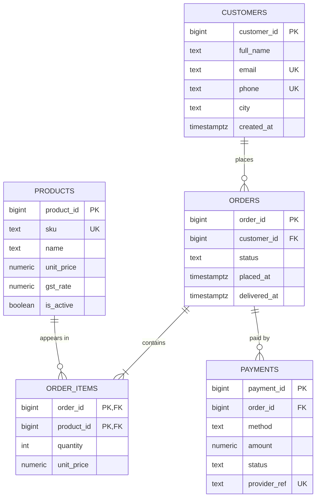
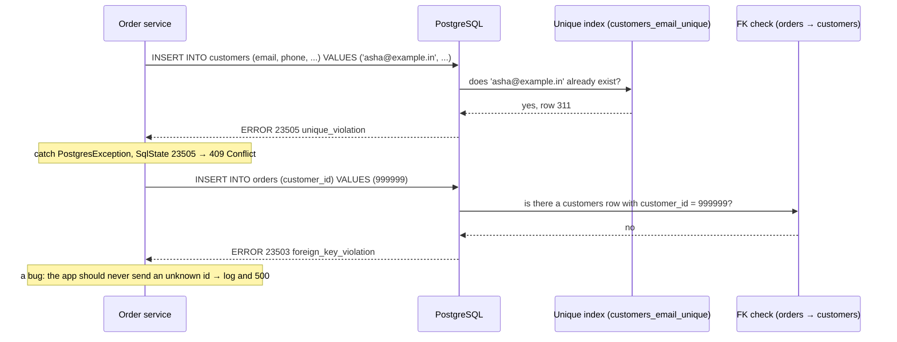

Almost every system you will design in this course ends with a database holding the facts that must survive a restart: who ordered what, who paid, what is in stock. The relational model is the default way to store those facts, and PostgreSQL is the default engine in this course. This lesson gives you the vocabulary and the habits: what a table really is, why keys matter, how constraints turn "we should never..." into "the database refuses to", and how NULL quietly breaks code that forgets it.

## Learning objectives

By the end of this lesson you will be able to:

1. Explain tables, rows, columns, schemas and the relational model in plain English and in the correct terms (relation, tuple, attribute, domain).
2. Choose primary keys (natural versus surrogate, `bigint` identity versus UUID) and explain the trade-offs.
3. Write PostgreSQL 17 DDL with `NOT NULL`, `UNIQUE`, `CHECK`, `DEFAULT`, `FOREIGN KEY` and identity columns, and say which business rule each one protects.
4. Pick appropriate data types for money, time, text and identifiers, and avoid the classic mistakes (`float` for money, `timestamp` without time zone).
5. Reason correctly about `NULL` in comparisons, aggregates and unique constraints.
6. Read and write basic `SELECT`, `JOIN`, `GROUP BY` and `LEFT JOIN ... IS NULL` queries, and map rows to C# records.

## Prerequisites

- [Collections, generics and common data structures](#/lesson/m01-collections-generics): dictionaries and sets, which are the in-memory cousins of keys and unique indexes.
- [What is system design?](#/lesson/m02-what-is-system-design): where the data store sits in a system and why its guarantees matter.

## Explain it like I'm a beginner

Think of a kirana store owner who keeps a few paper registers. One register lists customers: name, phone number, address. Another lists products and prices. A third lists each sale: date, which customer, which products, how much was paid. The owner uses the **phone number** to find a customer quickly and writes it, not the full address, in the sales register. That is a relational database on paper.

- A **register** is a **table**. Each **line** in it is a **row** (formally a *tuple*). Each **column heading** is a **column** (an *attribute*).
- The phone number that uniquely identifies a customer is a **primary key**.
- Writing the phone number in the sales register instead of copying the address is a **foreign key**: a reference to a row in another table.
- The rule "no sale without a known customer" is a **constraint**. On paper the owner enforces it by habit. In a database the engine enforces it, every time, without exceptions, even when a tired developer runs a script at 2 am.

The big idea of the relational model, published by Edgar Codd in 1970, is that data is stored as plain tables of values, and you ask questions about them in a language (SQL) that says *what* you want, not *how* to find it. The database decides how. Everything else in this module (relationships, normalization, indexes, query planning) builds on that.

## First-principles explanation

### The scenario: KiranaKart

**KiranaKart** is a grocery delivery service in Pune and Nagpur. Customers place orders from a catalogue of about 4,000 products; each order has several lines; each order is paid by UPI, card or cash on delivery. The business runs about 25,000 orders a day. Numbers like these matter for later lessons; today they tell us the data is small enough that correctness, not performance, is the main concern. 25,000 orders × 4 lines each × 365 days ≈ 36.5 million order lines a year, perhaps 4 GB (estimate) with indexes. A laptop could hold it.

### Tables are sets of facts, not files

A table is a **set of rows that share the same columns**. Three consequences follow, and they are not obvious to people coming from spreadsheets or JSON files:

1. **Rows have no inherent order.** `SELECT * FROM orders` can return rows in any order unless you write `ORDER BY`. The database is free to return whatever order is fastest today, and that order can change after an index is added or a table is vacuumed.
2. **Every column has one type (its domain), and every row has every column.** There is no "this row has an extra field". If a value does not apply, the column holds `NULL`.
3. **A row is identified by its values, not by its position.** "The third row" means nothing. "The order with `order_id = 1042`" means something, and that is why keys exist.

### Keys: how you name a row

A **candidate key** is a column (or set of columns) that is unique for every row and cannot be `NULL`. A table may have several: for `customers`, both `customer_id` and `phone` might be unique. You pick one as the **primary key** (PK); the others become **unique constraints**.

**Natural versus surrogate keys.** A natural key is something the business already uses: a phone number, a GSTIN, a PAN, an ISBN. A surrogate key is a value the database invents: an auto-incrementing integer or a UUID. Natural keys feel appealing because they carry meaning, but they have problems:

- They change. People change phone numbers. Companies re-register and get a new GSTIN.
- They are often wider and slower to compare than an 8-byte integer.
- Their uniqueness is a *belief about the world*, and the world lets you down. Two family members share a phone; an older PAN record has a typo.

The common practice, and the one this course follows, is: **surrogate primary key, plus unique constraints on the natural keys that must be unique**. You get a stable handle for foreign keys *and* the business rule enforced.

**`bigint` identity or UUID?**

| Choice | Pros | Cons |
|---|---|---|
| `bigint GENERATED ALWAYS AS IDENTITY` | 8 bytes, sequential (good index locality), readable in logs and URLs | Reveals volume ("order 1,000,042"), generated only by the database, so the app must round-trip to learn the id; guessable |
| `uuid` (random, version 4) | Generated anywhere (client, several services), unguessable | 16 bytes, random inserts scatter across the index, less friendly to read |
| `uuid` version 7 (time-ordered) | Generated anywhere, sorts by creation time so inserts stay at the index's right edge | 16 bytes; needs `uuidv7()` (PostgreSQL 18) or generation in the app (`Guid.CreateVersion7()` in .NET) |

For KiranaKart, a single service with one database, `bigint` identity is the simplest correct choice. When you expect sharding or offline clients, choose UUIDv7. Avoid `serial`: it is an older shortcut that creates a sequence with looser ownership semantics; `GENERATED ALWAYS AS IDENTITY` is the SQL-standard replacement.

### Constraints: business rules the database enforces

A constraint is a rule that every row must satisfy at every moment. The database checks it on every `INSERT`, `UPDATE` and `DELETE` and rejects the statement if the rule would be broken. Four of them do most of the work:

- **`NOT NULL`**: the value must exist. "Every order has a customer."
- **`UNIQUE`**: no two rows share this value. "Two customers cannot have the same email."
- **`CHECK (expr)`**: an expression must be true for the row. "Quantity is at least 1." "Status is one of a known list." "Discount never exceeds the price."
- **`FOREIGN KEY ... REFERENCES`**: the value must match a primary or unique key in another table. "An order line points at a real product." This is **referential integrity**.

Constraints are the cheapest reliability tool you have. Application code can be bypassed by a bug, a batch job, a support engineer with a SQL console or a second service written next year. A constraint cannot. The habit to build: **every time you write "the app makes sure that...", ask whether the database could make sure instead.**

The one constraint type that usually should *not* carry a long list of business values is `CHECK (status IN (...))` when the list changes often. Then use a small lookup table (`order_statuses`) with a foreign key, so adding a status is an `INSERT`, not a migration. For stable lists (`'upi'`, `'card'`, `'cod'`) a `CHECK` is fine.

### Data types: the mistakes that cost money

PostgreSQL has rich types; choosing well avoids whole categories of bugs.

| Need | Use | Avoid, and why |
|---|---|---|
| Money | `numeric(12,2)` (exact decimal) | `real`/`double precision`: 0.1 + 0.2 ≠ 0.3; rounding errors in totals and GST |
| Moment in time | `timestamptz` (stored as UTC, displayed in the session's zone) | `timestamp` without time zone: silently loses the zone; a server moved from IST to UTC shifts every value |
| Calendar date | `date` | `text` in `dd/mm/yyyy`: cannot compare or sort |
| Free text | `text` | `varchar(255)` as a default: the 255 is folklore, not a requirement. Use `varchar(n)` or a `CHECK (length(x) <= n)` only when the business has a real limit |
| Identifiers | `bigint` or `uuid` | `int` for anything that could pass 2.1 billion rows |
| Yes/no | `boolean` | `char(1)` with `'Y'`/`'N'` |
| Flexible attributes | `jsonb` (see [PostgreSQL JSONB](#/lesson/m09-jsonb)) | `text` holding JSON you cannot query |

Two things to know about `numeric`: the first number is total digits, the second is digits after the decimal point. `numeric(12,2)` holds up to ₹99,99,99,999.99. For currency conversion rates or per-unit prices quoted to four decimals, use `numeric(14,4)`.

### NULL: the value that is not a value

`NULL` means "unknown or not applicable". It is not zero, not an empty string, and not equal to anything, including itself. This produces behaviour that surprises everyone once:

- `NULL = NULL` is not true; it is `NULL`. Use `IS NULL` and `IS NOT NULL`.
- `WHERE delivered_at <> '2026-10-01'` **excludes** rows where `delivered_at` is `NULL`, because the comparison is unknown, and `WHERE` keeps only true.
- `count(*)` counts rows; `count(delivered_at)` counts rows where it is not null. `sum`, `avg`, `max` ignore nulls. `avg` of three rows with values 10, 20 and `NULL` is 15, not 10.
- `'abc' || NULL` is `NULL`. Use `coalesce(x, '')` when concatenating.
- In a `UNIQUE` constraint, two `NULL`s do **not** conflict by default. A `UNIQUE (gstin)` column can hold a thousand `NULL` GSTINs for individual customers. If you want one `NULL` at most, PostgreSQL 15 and later accept `UNIQUE NULLS NOT DISTINCT`.
- A `CHECK` constraint passes when its expression is `NULL`. `CHECK (quantity > 0)` lets a `NULL` quantity through unless the column is also `NOT NULL`.

The practical rule: make a column `NOT NULL` unless "unknown" is a real state you must represent. `delivered_at` is legitimately `NULL` until delivery. `customer_id` on an order is not.

### Schemas and naming

A **schema** in PostgreSQL is a namespace inside a database (`public` by default). Use schemas to group tables by area (`sales.orders`, `catalog.products`) when a database serves several bounded contexts. Naming conventions matter more than which one you choose; a common, readable one:

- `snake_case` for everything; PostgreSQL folds unquoted identifiers to lower case, and quoted mixed-case identifiers are a lifelong annoyance.
- Singular or plural table names, consistently (this course uses plural: `orders`, `products`).
- Primary key `id` or `<table>_id`; foreign key `<referenced_table_singular>_id` (`customer_id`).
- Constraint names you can read in error messages: `orders_status_check`, `order_items_product_fk`. PostgreSQL generates names if you omit them, but a named constraint makes the log line `violates check constraint "order_items_quantity_positive"` self-explanatory.

### The KiranaKart schema

```sql
CREATE TABLE customers (
    customer_id  bigint GENERATED ALWAYS AS IDENTITY PRIMARY KEY,
    full_name    text        NOT NULL,
    email        text        NOT NULL,
    phone        text        NOT NULL,
    city         text        NOT NULL,
    created_at   timestamptz NOT NULL DEFAULT now(),
    CONSTRAINT customers_email_unique UNIQUE (email),
    CONSTRAINT customers_phone_unique UNIQUE (phone),
    CONSTRAINT customers_phone_format CHECK (phone ~ '^[6-9][0-9]{9}$')
);

CREATE TABLE products (
    product_id   bigint GENERATED ALWAYS AS IDENTITY PRIMARY KEY,
    sku          text          NOT NULL UNIQUE,
    name         text          NOT NULL,
    unit_price   numeric(10,2) NOT NULL CHECK (unit_price >= 0),
    gst_rate     numeric(4,2)  NOT NULL CHECK (gst_rate IN (0, 5, 12, 18, 28)),
    is_active    boolean       NOT NULL DEFAULT true
);

CREATE TABLE orders (
    order_id     bigint GENERATED ALWAYS AS IDENTITY PRIMARY KEY,
    customer_id  bigint      NOT NULL REFERENCES customers (customer_id),
    status       text        NOT NULL DEFAULT 'placed'
                 CHECK (status IN ('placed', 'packed', 'delivered', 'cancelled')),
    placed_at    timestamptz NOT NULL DEFAULT now(),
    delivered_at timestamptz,
    CONSTRAINT orders_delivered_after_placed CHECK (delivered_at IS NULL OR delivered_at >= placed_at)
);

CREATE TABLE order_items (
    order_id     bigint        NOT NULL REFERENCES orders (order_id) ON DELETE CASCADE,
    product_id   bigint        NOT NULL REFERENCES products (product_id),
    quantity     int           NOT NULL CHECK (quantity > 0),
    unit_price   numeric(10,2) NOT NULL CHECK (unit_price >= 0),
    PRIMARY KEY (order_id, product_id)
);

CREATE TABLE payments (
    payment_id   bigint GENERATED ALWAYS AS IDENTITY PRIMARY KEY,
    order_id     bigint        NOT NULL REFERENCES orders (order_id),
    method       text          NOT NULL CHECK (method IN ('upi', 'card', 'cod')),
    amount       numeric(12,2) NOT NULL CHECK (amount > 0),
    status       text          NOT NULL CHECK (status IN ('pending', 'captured', 'failed', 'refunded')),
    provider_ref text,
    paid_at      timestamptz,
    CONSTRAINT payments_provider_ref_unique UNIQUE (provider_ref)
);
```

Read it with the "which rule does this protect?" question:

- `order_items` has a **composite primary key** `(order_id, product_id)`: the same product cannot appear twice on one order. If the business wanted two lines for the same product (say, different batches), the key would need to change. The key *is* the business rule.
- `order_items.unit_price` is copied from `products.unit_price` at order time on purpose. Prices change; the order must remember what was charged. This is a legitimate, deliberate duplication that [Normalization and denormalization](#/lesson/m09-normalization) will discuss.
- `ON DELETE CASCADE` on `order_items` means deleting an order removes its lines. `payments.order_id` has no cascade: the default is `NO ACTION`, so an order with payments cannot be deleted at all, which is what a finance team wants.
- `payments.provider_ref` is unique but nullable: cash on delivery has no provider reference, and several `NULL`s do not conflict.
- `orders_delivered_after_placed` is a `CHECK` spanning two columns of the same row. `CHECK` cannot look at other rows or tables; for that you need triggers, exclusion constraints or application logic.

### Reading data: the four queries you write every day

```sql
-- 1. One row by key (the most common query in any system)
SELECT order_id, status, placed_at FROM orders WHERE order_id = 1042;

-- 2. Join: lines of an order with product names and line totals
SELECT p.name, oi.quantity, oi.unit_price, oi.quantity * oi.unit_price AS line_total
FROM order_items oi
JOIN products p ON p.product_id = oi.product_id
WHERE oi.order_id = 1042;

-- 3. Aggregate: revenue per city for delivered orders
SELECT c.city, count(DISTINCT o.order_id) AS orders, sum(oi.quantity * oi.unit_price) AS revenue
FROM orders o
JOIN customers c   ON c.customer_id = o.customer_id
JOIN order_items oi ON oi.order_id = o.order_id
WHERE o.status = 'delivered'
GROUP BY c.city
ORDER BY revenue DESC;

-- 4. Anti-join: customers who never ordered
SELECT c.customer_id, c.full_name
FROM customers c
LEFT JOIN orders o ON o.customer_id = c.customer_id
WHERE o.order_id IS NULL;
```

Query 3 shows why `count(DISTINCT ...)` matters: after joining order lines, one order appears as several rows, so `count(*)` would count lines, not orders. Query 4 is the classic **anti-join**: `LEFT JOIN` keeps every customer, fills the order columns with `NULL` where there is no match, and the `IS NULL` filter keeps exactly those. `NOT EXISTS (SELECT 1 FROM orders o WHERE o.customer_id = c.customer_id)` says the same thing and is often clearer.

### Trade-offs and failure modes

- **Too few constraints**: the database accepts garbage, and you find out months later when a report disagrees with finance. Cleaning data retroactively costs far more than a `CHECK` would have.
- **Too many clever constraints**: a `CHECK` that encodes a changing business rule (a GST rate list that the government revises) forces a migration for a policy change. Use a lookup table for rules that change.
- **Natural keys as primary keys**: a phone number change becomes an `UPDATE` across every referencing table. Surrogate keys isolate you.
- **Foreign keys cost writes**: each insert into `order_items` checks that the product and order exist, which is an index lookup each. For 25,000 orders a day this is nothing. For a telemetry table ingesting 200,000 rows a second, teams sometimes drop foreign keys deliberately and validate elsewhere. Know that you are trading safety for speed, and write it down.
- **`float` for money**: a ₹0.01 mismatch between the payment gateway and your ledger blocks reconciliation for a whole day. `numeric` costs a little CPU and prevents it.

### When a simpler alternative is better

If the data is a single list of key → value pairs, a key-value store is simpler. If it is a document that is always read and written whole and never joined (a saved form draft), a `jsonb` column or a document store is fine. The relational model earns its complexity when data is **shared** between several kinds of facts, when **rules** must hold across them, and when you do not yet know all the questions you will ask. Orders, customers, products and payments are exactly that.

## Visual explanation

### The KiranaKart schema as an entity-relationship diagram



How to read the lines: `||--o{` between `CUSTOMERS` and `ORDERS` means one customer (exactly one, the double bar) has zero or more orders (the circle and crow's foot). `ORDERS ||--|{ ORDER_ITEMS` means an order has **one or more** items: the single bar on the right says "at least one". Notice that the database schema above cannot actually enforce "at least one item": a foreign key guarantees every item has an order, not that every order has an item. That rule lives in the application or in a deferred trigger, which is a useful example of where constraints end. `PK`, `FK` and `UK` mark primary, foreign and unique keys; `order_items` has a composite key made of two foreign keys.

### What happens when an insert hits a constraint



Each constraint is checked **inside the statement**, before anything is committed, and a failure rolls the statement back. Two details are worth remembering. First, PostgreSQL error codes (`SQLSTATE`) are stable five-character strings: `23505` is always a unique violation, `23503` a foreign key violation, `23514` a check violation, `23502` a not-null violation. Application code should map these to HTTP responses rather than parsing the English message. Second, the two failures in the diagram deserve different treatment: a duplicate email is an expected user error (409), while an unknown customer id is a programming error that should be logged loudly.

## Step-by-step example

Let us walk one order through the schema, watching what each constraint does.

**Step 1 — Register a customer.** The app inserts Asha Deshpande, email `asha@example.in`, phone `9822012345`, city Pune. The `CHECK (phone ~ '^[6-9][0-9]{9}$')` passes (ten digits, starts with 9). The unique indexes on email and phone find no match. `created_at` takes the default `now()`. The database returns `customer_id = 311` through `RETURNING customer_id`.

**Step 2 — Register her again by mistake.** A retry after a network timeout sends the same insert. The unique index finds `asha@example.in`, the statement fails with `23505`, and the service answers 409 Conflict with a pointer to the existing customer. No duplicate row. The constraint just made a flaky network harmless; [Idempotency](#/lesson/m10-idempotency) builds on this idea.

**Step 3 — Place the order.** Inside one transaction (see [Transactions and ACID](#/lesson/m09-transactions-acid)):

```sql
BEGIN;
INSERT INTO orders (customer_id) VALUES (311) RETURNING order_id;      -- say 1042
INSERT INTO order_items (order_id, product_id, quantity, unit_price) VALUES
  (1042, 17, 2, 62.00),   -- Toor dal 1 kg
  (1042, 93, 1, 48.50);   -- Milk 1 L
COMMIT;
```

The foreign keys verify customer 311 and products 17 and 93 exist. `quantity > 0` passes. The composite primary key would reject a second line for product 17 on this order.

**Step 4 — Try a bad line.** A later edit sends `(1042, 17, 0, 62.00)`. Two things go wrong at once: product 17 is already on the order (primary key) and quantity is 0 (check). PostgreSQL reports only the first violation it hits. In practice that is the `CHECK` (`23514`): `NOT NULL` and `CHECK` constraints are tested before the row goes into the unique index, and foreign keys are checked last, at the end of the statement. The statement fails either way, and nothing is half-written.

**Step 5 — Record the payment.** UPI payment of ₹172.50 (2 × 62.00 + 48.50) with `provider_ref = 'UPI-7781-AX'`, status `captured`, `paid_at = now()`. If the gateway sends the same callback twice, the unique `provider_ref` rejects the second insert, which is exactly what you want for payments. A webhook handler usually writes `INSERT ... ON CONFLICT (provider_ref) DO NOTHING` and treats "no row inserted" as "already processed", so the retry gets a success response instead of an error.

**Step 6 — Deliver.** `UPDATE orders SET status = 'delivered', delivered_at = now() WHERE order_id = 1042;` The check `delivered_at >= placed_at` passes. If a clock-skewed server set `delivered_at` to yesterday, the check would catch it.

**Step 7 — A support engineer deletes the order by hand.** `DELETE FROM orders WHERE order_id = 1042;` fails with `23503`: the payment references it, and payments have no cascade. The data that finance needs survives a well-meaning mistake. Order items *would* have cascaded, which is why cascade is applied only to true "part-of" children.

## Production-style C# implementation

The compiled code below is pure logic: a tiny constraint engine that mirrors what PostgreSQL does for a table, so you can see the behaviour in a unit test without a database, plus the domain records and the error mapping an ASP.NET Core API uses. The database access snippets (Dapper) are shown separately because they need Npgsql, which the checker does not have.

```text
KiranaKart.Api/
  Program.cs
  Domain/Models.cs
  Data/Constraints.cs
  Data/InMemoryTable.cs
  Data/PostgresErrors.cs
```

```csharp file=Domain/Models.cs
namespace KiranaKart.Domain;

/// <summary>Rows map to records: one property per column, nullable where the column is nullable.</summary>
public sealed record Customer(long CustomerId, string FullName, string Email, string Phone, string City, DateTimeOffset CreatedAt);

public sealed record Product(long ProductId, string Sku, string Name, decimal UnitPrice, decimal GstRate, bool IsActive);

public sealed record Order(long OrderId, long CustomerId, string Status, DateTimeOffset PlacedAt, DateTimeOffset? DeliveredAt);

public sealed record OrderItem(long OrderId, long ProductId, int Quantity, decimal UnitPrice)
{
    public decimal LineTotal => Quantity * UnitPrice;
}

public sealed record Payment(long PaymentId, long OrderId, string Method, decimal Amount, string Status, string? ProviderRef, DateTimeOffset? PaidAt);
```

```csharp file=Data/Constraints.cs
namespace KiranaKart.Data;

/// <summary>Mirrors PostgreSQL SQLSTATE classes for integrity violations.</summary>
public enum ViolationKind { NotNull, Unique, Check, ForeignKey }

public sealed class ConstraintViolationException(ViolationKind kind, string constraintName, string message)
    : Exception(message)
{
    public ViolationKind Kind { get; } = kind;
    public string ConstraintName { get; } = constraintName;

    /// <summary>The five-character SQLSTATE PostgreSQL would report.</summary>
    public string SqlState => Kind switch
    {
        ViolationKind.NotNull => "23502",
        ViolationKind.ForeignKey => "23503",
        ViolationKind.Unique => "23505",
        ViolationKind.Check => "23514",
        _ => "23000",
    };
}

/// <summary>A row-level rule. Implementations are checked on every insert and update, exactly like PostgreSQL.</summary>
public interface IConstraint<TRow>
{
    string Name { get; }
    void Check(TRow row, IReadOnlyCollection<TRow> existing);
}

/// <summary>CHECK (expr): passes when the predicate is true OR the value is "unknown" (null), like SQL.</summary>
public sealed class CheckConstraint<TRow>(string name, Func<TRow, bool?> predicate) : IConstraint<TRow>
{
    public string Name => name;

    public void Check(TRow row, IReadOnlyCollection<TRow> existing)
    {
        if (predicate(row) == false)
            throw new ConstraintViolationException(ViolationKind.Check, name, $"new row violates check constraint \"{name}\"");
    }
}

/// <summary>NOT NULL on one column.</summary>
public sealed class NotNullConstraint<TRow>(string name, Func<TRow, object?> column) : IConstraint<TRow>
{
    public string Name => name;

    public void Check(TRow row, IReadOnlyCollection<TRow> existing)
    {
        if (column(row) is null)
            throw new ConstraintViolationException(ViolationKind.NotNull, name, $"null value violates not-null constraint \"{name}\"");
    }
}

/// <summary>UNIQUE on a key. Null keys never conflict, matching the SQL default (NULLS DISTINCT).</summary>
public sealed class UniqueConstraint<TRow, TKey>(string name, Func<TRow, TKey?> key) : IConstraint<TRow>
{
    public string Name => name;

    public void Check(TRow row, IReadOnlyCollection<TRow> existing)
    {
        var k = key(row);
        if (k is null) return;
        if (existing.Any(e => Equals(key(e), k)))
            throw new ConstraintViolationException(ViolationKind.Unique, name, $"duplicate key value violates unique constraint \"{name}\"");
    }
}

/// <summary>FOREIGN KEY: the referenced key must exist in the parent table (a lookup function stands in for the index).</summary>
public sealed class ForeignKeyConstraint<TRow, TKey>(string name, Func<TRow, TKey?> key, Func<TKey, bool> parentExists) : IConstraint<TRow>
{
    public string Name => name;

    public void Check(TRow row, IReadOnlyCollection<TRow> existing)
    {
        var k = key(row);
        if (k is null) return;                     // a null FK is allowed unless the column is NOT NULL
        if (!parentExists(k))
            throw new ConstraintViolationException(ViolationKind.ForeignKey, name, $"insert violates foreign key constraint \"{name}\"");
    }
}
```

```csharp file=Data/InMemoryTable.cs
namespace KiranaKart.Data;

/// <summary>
/// A stand-in for one PostgreSQL table: rows plus constraints. Used in tests and to make the
/// constraint behaviour visible. A real repository would issue SQL through Npgsql/Dapper.
/// </summary>
public sealed class InMemoryTable<TRow, TKey>(Func<TRow, TKey> primaryKey) where TKey : notnull
{
    private readonly Dictionary<TKey, TRow> _rows = new();
    private readonly List<IConstraint<TRow>> _constraints = new();

    public InMemoryTable<TRow, TKey> With(IConstraint<TRow> constraint)
    {
        _constraints.Add(constraint);
        return this;
    }

    public IReadOnlyCollection<TRow> Rows => _rows.Values;

    public bool ContainsKey(TKey key) => _rows.ContainsKey(key);

    public TRow? Find(TKey key) => _rows.TryGetValue(key, out var row) ? row : default;

    public void Insert(TRow row)
    {
        var key = primaryKey(row);
        if (_rows.ContainsKey(key))
            throw new ConstraintViolationException(ViolationKind.Unique, "pkey", "duplicate key value violates primary key");
        foreach (var c in _constraints) c.Check(row, Rows);     // all-or-nothing: nothing is added until every check passes
        _rows[key] = row;
    }

    public bool Delete(TKey key, Func<TKey, bool>? referencedByChild = null)
    {
        if (referencedByChild is not null && referencedByChild(key))
            throw new ConstraintViolationException(ViolationKind.ForeignKey, "fk", "update or delete violates foreign key constraint");
        return _rows.Remove(key);
    }
}
```

```csharp file=Data/PostgresErrors.cs
namespace KiranaKart.Data;

/// <summary>Maps integrity violations to HTTP responses. Expected user errors become 4xx; programming errors stay 500.</summary>
public static class PostgresErrors
{
    public static IResult ToHttp(ConstraintViolationException ex) => ex.Kind switch
    {
        ViolationKind.Unique => Results.Conflict(new { error = "already_exists", constraint = ex.ConstraintName }),
        ViolationKind.Check => Results.UnprocessableEntity(new { error = "invalid_value", constraint = ex.ConstraintName }),
        ViolationKind.NotNull => Results.UnprocessableEntity(new { error = "missing_value", constraint = ex.ConstraintName }),
        _ => Results.Problem(title: "Integrity error", detail: ex.ConstraintName, statusCode: 500),
    };
}
```

```csharp file=Program.cs
using KiranaKart.Data;
using KiranaKart.Domain;

var builder = WebApplication.CreateBuilder(args);

// One "table" per entity, each with the constraints from the SQL schema.
var customers = new InMemoryTable<Customer, long>(c => c.CustomerId)
    .With(new UniqueConstraint<Customer, string>("customers_email_unique", c => c.Email))
    .With(new UniqueConstraint<Customer, string>("customers_phone_unique", c => c.Phone))
    .With(new CheckConstraint<Customer>("customers_phone_format",
        c => c.Phone.Length == 10 && c.Phone[0] >= '6' && c.Phone.All(char.IsAsciiDigit)));

var orders = new InMemoryTable<Order, long>(o => o.OrderId)
    .With(new ForeignKeyConstraint<Order, long>("orders_customer_fk", o => o.CustomerId, customers.ContainsKey))
    .With(new CheckConstraint<Order>("orders_status_check",
        o => o.Status is "placed" or "packed" or "delivered" or "cancelled"))
    .With(new CheckConstraint<Order>("orders_delivered_after_placed",
        o => o.DeliveredAt is null ? null : o.DeliveredAt >= o.PlacedAt));

builder.Services.AddSingleton(customers);
builder.Services.AddSingleton(orders);
builder.Services.AddSingleton(TimeProvider.System);

var app = builder.Build();
var nextCustomerId = 0L;
var nextOrderId = 0L;

app.MapPost("/customers", (NewCustomer body, InMemoryTable<Customer, long> table, TimeProvider clock) =>
{
    var id = Interlocked.Increment(ref nextCustomerId);
    var row = new Customer(id, body.FullName, body.Email, body.Phone, body.City, clock.GetUtcNow());
    try { table.Insert(row); }
    catch (ConstraintViolationException ex) { return PostgresErrors.ToHttp(ex); }
    return Results.Created($"/customers/{id}", row);
});

app.MapPost("/orders", (NewOrder body, InMemoryTable<Order, long> table, TimeProvider clock) =>
{
    var id = Interlocked.Increment(ref nextOrderId);
    var row = new Order(id, body.CustomerId, "placed", clock.GetUtcNow(), null);
    try { table.Insert(row); }
    catch (ConstraintViolationException ex) { return PostgresErrors.ToHttp(ex); }
    return Results.Created($"/orders/{id}", row);
});

app.Run();

public sealed record NewCustomer(string FullName, string Email, string Phone, string City);
public sealed record NewOrder(long CustomerId);
```

With a real database the handler body is a Dapper call, and the same mapping applies to `PostgresException.SqlState`. This snippet needs Npgsql and Dapper, so it is not part of the compiled set:

```csharp
// Npgsql + Dapper: insert and read back the generated key; map SQLSTATE to HTTP.
await using var conn = await dataSource.OpenConnectionAsync(ct);
try
{
    var id = await conn.ExecuteScalarAsync<long>(
        """
        INSERT INTO customers (full_name, email, phone, city)
        VALUES (@FullName, @Email, @Phone, @City)
        RETURNING customer_id
        """, body);
    return Results.Created($"/customers/{id}", new { id });
}
catch (PostgresException ex) when (ex.SqlState == PostgresErrorCodes.UniqueViolation)
{
    return Results.Conflict(new { error = "already_exists", constraint = ex.ConstraintName });
}
```

Design notes:

- **Parameters, never string concatenation.** `@Email` is sent separately from the SQL text, so a value like `'; DROP TABLE customers; --` is just a weird email, not a command. This is the whole defence against SQL injection.
- **`RETURNING`** avoids a second round trip to learn the generated id.
- **The constraint engine is deliberately naive** (`existing.Any(...)` is O(n)). A real unique index is a B-tree lookup, O(log n); see [Indexes](#/lesson/m09-indexes). The point here is the semantics, including the three-valued `CHECK` and "nulls never conflict".
- **Map by SQLSTATE, not message text.** Messages change between PostgreSQL versions and languages; codes do not.

## Bad design vs good design

**Bad**: a single `orders` table with columns `customer_name`, `customer_phone`, `customer_address`, `product1_name`, `product1_qty`, `product2_name`, `product2_qty`, `product3_name`, `product3_qty`, `payment_method`, `amount_paid` stored as `double precision`, dates as `text` like `'19/10/2026'`, and no constraints because "the app validates". Four lines on an order? Impossible. A customer changes her phone number? Update thousands of order rows, miss some, and now reports disagree. Revenue by month? Parse dates in application code. ₹172.50 stored as `172.49999999999997`. A retry during a timeout inserts the same order twice.

**Good**: the five-table schema above. Each fact lives in one place: a customer's phone in `customers`, a product's current price in `products`, the price charged at order time in `order_items`. Constraints make the common mistakes impossible: duplicate emails, orphan order lines, zero quantities, deliveries before placement, payments recorded twice. Money is `numeric`, time is `timestamptz`, keys are `bigint`.

**Is the good design always right?** For a prototype that will be thrown away in two weeks, a flat table and fast iteration can win. For an event log where you only ever append and read by time, a wide, constraint-light table is appropriate. The structured design pays off when the data outlives the code that first wrote it, which is almost always the case for orders, customers and payments.

:::callout type=mistake title="Relying on the application to enforce uniqueness"
"Check if the email exists, then insert" has a gap between the check and the insert. Two requests arriving 5 ms apart both see "does not exist" and both insert. Only a unique constraint closes the gap, because the database checks and writes atomically. Keep the application check for a friendly error message, but never rely on it.
:::

:::callout type=tradeoff title="Foreign keys are not free"
Each foreign key adds an index lookup to every insert and update of the referencing column, and a check against children on every delete of a parent. PostgreSQL requires an index on the *referenced* key (it must be a primary or unique key) but does **not** create one on the *referencing* column: without an index on `payments (order_id)`, every delete of an order scans the whole `payments` table. Index foreign-key columns you join on or delete parents by. For normal business tables (thousands to millions of rows a day) the cost is small and the protection is large. For very high-rate append-only tables, measure before adding them, and if you leave them out, document who validates the references instead.
:::

## Practical playground

The playground seeds a small KiranaKart database. Try these:

1. `INSERT INTO customers (full_name, email, phone, city) VALUES ('Dup', 'asha@example.in', '9000000001', 'Pune');` and read the error code and constraint name.
2. `INSERT INTO order_items VALUES (1, 1, 0, 62.00);` to see which constraint fires first.
3. `SELECT count(*), count(delivered_at), avg(quantity) FROM orders o JOIN order_items oi USING (order_id);` and explain the difference between the two counts.
4. `DELETE FROM orders WHERE order_id = 1;` and see the foreign key from `payments` protect the order, then try an order with no payment.
5. Write the anti-join for products never ordered, then rewrite it with `NOT EXISTS`.

:::playground type=sql title="KiranaKart: constraints in action"
```sql
CREATE TABLE customers (
  customer_id bigint GENERATED ALWAYS AS IDENTITY PRIMARY KEY,
  full_name   text NOT NULL,
  email       text NOT NULL,
  phone       text NOT NULL,
  city        text NOT NULL,
  created_at  timestamptz NOT NULL DEFAULT now(),
  CONSTRAINT customers_email_unique UNIQUE (email),
  CONSTRAINT customers_phone_unique UNIQUE (phone),
  CONSTRAINT customers_phone_format CHECK (phone ~ '^[6-9][0-9]{9}$')
);
CREATE TABLE products (
  product_id bigint GENERATED ALWAYS AS IDENTITY PRIMARY KEY,
  sku        text NOT NULL UNIQUE,
  name       text NOT NULL,
  unit_price numeric(10,2) NOT NULL CHECK (unit_price >= 0),
  gst_rate   numeric(4,2) NOT NULL CHECK (gst_rate IN (0, 5, 12, 18, 28)),
  is_active  boolean NOT NULL DEFAULT true
);
CREATE TABLE orders (
  order_id     bigint GENERATED ALWAYS AS IDENTITY PRIMARY KEY,
  customer_id  bigint NOT NULL REFERENCES customers (customer_id),
  status       text NOT NULL DEFAULT 'placed' CHECK (status IN ('placed','packed','delivered','cancelled')),
  placed_at    timestamptz NOT NULL DEFAULT now(),
  delivered_at timestamptz,
  CONSTRAINT orders_delivered_after_placed CHECK (delivered_at IS NULL OR delivered_at >= placed_at)
);
CREATE TABLE order_items (
  order_id   bigint NOT NULL REFERENCES orders (order_id) ON DELETE CASCADE,
  product_id bigint NOT NULL REFERENCES products (product_id),
  quantity   int NOT NULL CHECK (quantity > 0),
  unit_price numeric(10,2) NOT NULL CHECK (unit_price >= 0),
  PRIMARY KEY (order_id, product_id)
);
CREATE TABLE payments (
  payment_id   bigint GENERATED ALWAYS AS IDENTITY PRIMARY KEY,
  order_id     bigint NOT NULL REFERENCES orders (order_id),
  method       text NOT NULL CHECK (method IN ('upi','card','cod')),
  amount       numeric(12,2) NOT NULL CHECK (amount > 0),
  status       text NOT NULL CHECK (status IN ('pending','captured','failed','refunded')),
  provider_ref text,
  paid_at      timestamptz,
  CONSTRAINT payments_provider_ref_unique UNIQUE (provider_ref)
);

INSERT INTO customers (full_name, email, phone, city) VALUES
  ('Asha Deshpande', 'asha@example.in',  '9822012345', 'Pune'),
  ('Rohan Mehta',    'rohan@example.in', '9876501234', 'Nagpur'),
  ('Priya Nair',     'priya@example.in', '9900011122', 'Pune'),
  ('Imran Shaikh',   'imran@example.in', '7012345678', 'Nagpur'),
  ('Kavita Rao',     'kavita@example.in','8899001122', 'Pune');

INSERT INTO products (sku, name, unit_price, gst_rate, is_active) VALUES
  ('DAL-TOOR-1KG', 'Toor dal 1 kg',        62.00, 0,  true),
  ('MILK-1L',      'Milk 1 L',             48.50, 0,  true),
  ('RICE-5KG',     'Basmati rice 5 kg',   420.00, 5,  true),
  ('OIL-1L',       'Sunflower oil 1 L',   135.00, 5,  true),
  ('BISC-200G',    'Biscuits 200 g',       30.00, 18, true),
  ('SOAP-4PK',     'Bath soap 4 pack',    120.00, 18, false);

INSERT INTO orders (customer_id, status, placed_at, delivered_at) VALUES
  (1, 'delivered', '2026-10-01 09:10+05:30', '2026-10-01 11:05+05:30'),
  (1, 'delivered', '2026-10-05 18:30+05:30', '2026-10-05 20:10+05:30'),
  (2, 'delivered', '2026-10-02 08:00+05:30', '2026-10-02 10:20+05:30'),
  (3, 'cancelled', '2026-10-03 12:00+05:30', NULL),
  (3, 'placed',    '2026-10-18 19:45+05:30', NULL),
  (4, 'packed',    '2026-10-18 20:15+05:30', NULL);

INSERT INTO order_items (order_id, product_id, quantity, unit_price) VALUES
  (1, 1, 2, 62.00), (1, 2, 1, 48.50),
  (2, 3, 1, 420.00), (2, 4, 2, 135.00),
  (3, 2, 4, 48.50), (3, 5, 3, 30.00),
  (4, 1, 1, 62.00),
  (5, 3, 1, 420.00), (5, 1, 1, 62.00), (5, 5, 2, 30.00),
  (6, 4, 1, 135.00);

INSERT INTO payments (order_id, method, amount, status, provider_ref, paid_at) VALUES
  (1, 'upi',  172.50, 'captured', 'UPI-7781-AX', '2026-10-01 09:11+05:30'),
  (2, 'card', 690.00, 'captured', 'CARD-55019',  '2026-10-05 18:31+05:30'),
  (3, 'cod',  284.00, 'captured', NULL,          '2026-10-02 10:20+05:30'),
  (4, 'upi',   62.00, 'refunded', 'UPI-7790-QA', '2026-10-03 12:01+05:30'),
  (5, 'upi',  542.00, 'pending',  NULL,          NULL),
  (6, 'cod',  135.00, 'pending',  NULL,          NULL);
```
:::

## Exercises

:::exercise id=m09-relational-fundamentals-ex1 difficulty=beginner kind=sql ordered=true title="Order totals with customer names"
Write a query that lists every order with the customer's `full_name`, the `order_id`, the order `status` and the `order_total` (sum of `quantity × unit_price` over its lines, as `numeric`). Order by `order_id`.
::setup
```sql
CREATE TABLE customers (customer_id bigint PRIMARY KEY, full_name text NOT NULL, city text NOT NULL);
CREATE TABLE orders (order_id bigint PRIMARY KEY, customer_id bigint NOT NULL REFERENCES customers, status text NOT NULL);
CREATE TABLE order_items (order_id bigint REFERENCES orders, product_id bigint, quantity int NOT NULL CHECK (quantity > 0), unit_price numeric(10,2) NOT NULL, PRIMARY KEY (order_id, product_id));
INSERT INTO customers VALUES (1,'Asha Deshpande','Pune'),(2,'Rohan Mehta','Nagpur'),(3,'Priya Nair','Pune'),(4,'Imran Shaikh','Nagpur');
INSERT INTO orders VALUES (1,1,'delivered'),(2,1,'delivered'),(3,2,'delivered'),(4,3,'cancelled'),(5,3,'placed'),(6,4,'packed');
INSERT INTO order_items VALUES
  (1,1,2,62.00),(1,2,1,48.50),(2,3,1,420.00),(2,4,2,135.00),(3,2,4,48.50),(3,5,3,30.00),
  (4,1,1,62.00),(5,3,1,420.00),(5,1,1,62.00),(5,5,2,30.00),(6,4,1,135.00);
```
::check
```sql
SELECT c.full_name, o.order_id, o.status, sum(oi.quantity * oi.unit_price) AS order_total
FROM orders o
JOIN customers c ON c.customer_id = o.customer_id
JOIN order_items oi ON oi.order_id = o.order_id
GROUP BY c.full_name, o.order_id, o.status
ORDER BY o.order_id;
```
::acceptance
- Six rows, one per order, ordered by `order_id`.
- Order 1 totals 172.50, order 2 totals 690.00, order 5 totals 542.00.
- Column names are exactly `full_name`, `order_id`, `status`, `order_total`.
::hint
You need three tables: start from `orders`, join `customers` for the name and `order_items` for the lines.
::hint
A total per order means `GROUP BY` the order. Every non-aggregated column in the `SELECT` must appear in the `GROUP BY`.
::hint
The line total is `quantity * unit_price`; wrap it in `sum(...)` and alias it `AS order_total`.
::hint
```sql
SELECT c.full_name, o.order_id, o.status, sum(oi.quantity * oi.unit_price) AS order_total
FROM orders o JOIN customers c ON ... JOIN order_items oi ON ...
GROUP BY ... ORDER BY o.order_id;
```
::solution
```sql
SELECT c.full_name, o.order_id, o.status, sum(oi.quantity * oi.unit_price) AS order_total
FROM orders o
JOIN customers c ON c.customer_id = o.customer_id
JOIN order_items oi ON oi.order_id = o.order_id
GROUP BY c.full_name, o.order_id, o.status
ORDER BY o.order_id;
```

Joining `order_items` multiplies each order into one row per line; `GROUP BY` folds them back to one row per order while `sum` adds the line totals. Because `order_id` is the primary key of `orders`, grouping by it already determines `full_name` and `status`, and PostgreSQL would accept `GROUP BY o.order_id` alone when the other columns are functionally dependent on a primary key in the `GROUP BY`; listing them is clearer for readers.
::mistakes
- `sum(quantity) * sum(unit_price)`, which multiplies totals instead of summing products.
- Forgetting `GROUP BY` and getting one row for the whole table.
- Joining `customers` through `order_items` instead of `orders`, which has no customer column.
:::

:::exercise id=m09-relational-fundamentals-ex2 difficulty=beginner kind=code title="A unique constraint that treats NULLs like SQL"
Implement `UniqueIndex<TKey>`, a tiny in-memory unique constraint with SQL semantics.
::requirements
- `bool TryAdd(long rowId, TKey? key)`: returns `true` and remembers the key if no other row has the same non-null key, otherwise `false`. A `null` key is always accepted (SQL `NULLS DISTINCT` default) and is **not** remembered.
- `bool Remove(long rowId)`: forgets the row's key so it can be reused; returns whether the row was known.
- `int Count`: number of rows currently holding a **non-null** key.
- Re-adding the same `rowId` with a new key replaces its old key (as an `UPDATE` would), still subject to the uniqueness rule.
::acceptance
- Adding `"asha@example.in"` for row 1 and again for row 2 returns `true` then `false`.
- Adding `null` for rows 3, 4 and 5 all return `true`, and `Count` stays unchanged.
- After `Remove(1)`, row 2 can add `"asha@example.in"`.
- Changing row 1's key from `"a"` to `"b"` then adding `"a"` for row 9 succeeds.
::hint
You need two lookups: key → rowId (to detect duplicates) and rowId → key (to remove or replace).
::hint
Treat `null` keys as "not indexed": return `true` without touching the key dictionary, but remember to drop any previous key the row had.
::hint
For replacement, remove the row's old key first, then check the new key. If the new key is taken by *another* row, put the old key back and return `false`.
::hint
```csharp
if (_byRow.TryGetValue(rowId, out var old)) { _byKey.Remove(old); _byRow.Remove(rowId); }
if (key is null) return true;
if (_byKey.TryGetValue(key, out var other) && other != rowId) { /* restore old, return false */ }
```
::starter
```csharp file=UniqueIndex.cs
using System;
using System.Collections.Generic;

public sealed class UniqueIndex<TKey> where TKey : notnull
{
    public bool TryAdd(long rowId, TKey? key) => throw new NotImplementedException();

    public bool Remove(long rowId) => throw new NotImplementedException();

    public int Count => throw new NotImplementedException();
}
```
::tests
```csharp file=UniqueIndexTests.cs
using Xunit;

public class UniqueIndexTests
{
    [Fact]
    public void Duplicate_key_is_rejected()
    {
        var idx = new UniqueIndex<string>();
        Assert.True(idx.TryAdd(1, "asha@example.in"));
        Assert.False(idx.TryAdd(2, "asha@example.in"));
        Assert.Equal(1, idx.Count);
    }

    [Fact]
    public void Nulls_never_conflict_and_are_not_counted()
    {
        var idx = new UniqueIndex<string>();
        Assert.True(idx.TryAdd(3, null));
        Assert.True(idx.TryAdd(4, null));
        Assert.True(idx.TryAdd(5, null));
        Assert.Equal(0, idx.Count);
    }

    [Fact]
    public void Removed_key_can_be_reused()
    {
        var idx = new UniqueIndex<string>();
        idx.TryAdd(1, "asha@example.in");
        Assert.True(idx.Remove(1));
        Assert.False(idx.Remove(1));
        Assert.True(idx.TryAdd(2, "asha@example.in"));
    }

    [Fact]
    public void Update_replaces_old_key()
    {
        var idx = new UniqueIndex<string>();
        idx.TryAdd(1, "a");
        Assert.True(idx.TryAdd(1, "b"));
        Assert.True(idx.TryAdd(9, "a"));
        Assert.False(idx.TryAdd(10, "b"));
        Assert.Equal(2, idx.Count);
    }

    [Fact]
    public void Failed_update_keeps_old_key()
    {
        var idx = new UniqueIndex<string>();
        idx.TryAdd(1, "a");
        idx.TryAdd(2, "b");
        Assert.False(idx.TryAdd(1, "b"));
        Assert.False(idx.TryAdd(3, "a"));
    }

    [Fact]
    public void Same_row_same_key_is_fine()
    {
        var idx = new UniqueIndex<string>();
        idx.TryAdd(1, "a");
        Assert.True(idx.TryAdd(1, "a"));
        Assert.Equal(1, idx.Count);
    }
}
```
::solution
```csharp file=UniqueIndex.cs
using System;
using System.Collections.Generic;

public sealed class UniqueIndex<TKey> where TKey : notnull
{
    private readonly Dictionary<TKey, long> _byKey = new();
    private readonly Dictionary<long, TKey> _byRow = new();

    public bool TryAdd(long rowId, TKey? key)
    {
        _byRow.TryGetValue(rowId, out var oldKey);
        var hadOld = oldKey is not null;

        if (key is not null && _byKey.TryGetValue(key, out var owner) && owner != rowId)
            return false;                                   // another row owns this key: reject, keep old state

        if (hadOld) { _byKey.Remove(oldKey!); _byRow.Remove(rowId); }
        if (key is null) return true;                       // NULL is never indexed and never conflicts

        _byKey[key] = rowId;
        _byRow[rowId] = key;
        return true;
    }

    public bool Remove(long rowId)
    {
        if (!_byRow.TryGetValue(rowId, out var key)) return false;
        _byKey.Remove(key);
        _byRow.Remove(rowId);
        return true;
    }

    public int Count => _byKey.Count;
}
```

The check happens **before** any mutation, so a rejected update leaves the index exactly as it was. That is the same all-or-nothing behaviour a database statement gives you. `Count` reflects only non-null keys, matching `count(column)` in SQL, which ignores `NULL`s.
::alternatives
PostgreSQL 15+ offers `UNIQUE NULLS NOT DISTINCT`, where at most one `NULL` is allowed. Adding a boolean flag for that mode and a sentinel for the single null is a good extension.
::mistakes
- Checking duplicates after removing the old key, so a failed update loses the row's previous key.
- Counting rows with `null` keys.
- Using a single dictionary and scanning values to find a row's key (O(n) removal).
:::

:::exercise id=m09-relational-fundamentals-ex3 difficulty=intermediate kind=sql ordered=true title="Products that were never ordered"
Marketing wants to retire dead stock. Return `product_id`, `sku` and `name` of every product that does not appear on any order line, including inactive products, ordered by `product_id`.
::setup
```sql
CREATE TABLE products (product_id bigint PRIMARY KEY, sku text NOT NULL UNIQUE, name text NOT NULL, is_active boolean NOT NULL);
CREATE TABLE orders (order_id bigint PRIMARY KEY, status text NOT NULL);
CREATE TABLE order_items (order_id bigint REFERENCES orders, product_id bigint REFERENCES products, quantity int NOT NULL, PRIMARY KEY (order_id, product_id));
INSERT INTO products VALUES
  (1,'DAL-TOOR-1KG','Toor dal 1 kg',true),(2,'MILK-1L','Milk 1 L',true),(3,'RICE-5KG','Basmati rice 5 kg',true),
  (4,'OIL-1L','Sunflower oil 1 L',true),(5,'BISC-200G','Biscuits 200 g',true),(6,'SOAP-4PK','Bath soap 4 pack',false),
  (7,'TEA-500G','Assam tea 500 g',true),(8,'SALT-1KG','Iodised salt 1 kg',true);
INSERT INTO orders VALUES (1,'delivered'),(2,'delivered'),(3,'cancelled'),(4,'placed');
INSERT INTO order_items VALUES (1,1,2),(1,2,1),(2,3,1),(2,4,2),(3,2,4),(3,5,3),(4,3,1),(4,1,1);
```
::check
```sql
SELECT p.product_id, p.sku, p.name
FROM products p
LEFT JOIN order_items oi ON oi.product_id = p.product_id
WHERE oi.order_id IS NULL
ORDER BY p.product_id;
```
::acceptance
- Returns products 6, 7 and 8 only.
- Product 5 (ordered only on a cancelled order) is **not** returned: it was ordered, whatever happened later.
- The query does not use `NOT IN` with a subquery that could contain `NULL`s.
::hint
"Never ordered" is a question about absence. An inner join can only find presence.
::hint
`LEFT JOIN` keeps all products and leaves the `order_items` columns `NULL` where nothing matched.
::hint
Filter on a column from the right side being `NULL`. Pick one that can never be `NULL` in a real match, such as `oi.order_id`.
::hint
Equivalent and often clearer: `WHERE NOT EXISTS (SELECT 1 FROM order_items oi WHERE oi.product_id = p.product_id)`.
::solution
```sql
SELECT p.product_id, p.sku, p.name
FROM products p
WHERE NOT EXISTS (SELECT 1 FROM order_items oi WHERE oi.product_id = p.product_id)
ORDER BY p.product_id;
```

Both the `LEFT JOIN ... IS NULL` form and `NOT EXISTS` are anti-joins and PostgreSQL plans them the same way in most cases. Avoid `WHERE product_id NOT IN (SELECT product_id FROM order_items)`: if the subquery can ever return a `NULL`, `NOT IN` returns no rows at all, because `x <> NULL` is unknown for every `x`. Here `product_id` is a primary key column so it cannot be null, but the habit is dangerous.
::mistakes
- `NOT IN` against a nullable column, which silently returns an empty result.
- Filtering on `oi.quantity IS NULL` when `quantity` could legitimately be null in another schema; use the join key.
- Excluding cancelled orders. The question asked about products that were never ordered, not products that were never delivered.
:::

:::exercise id=m09-relational-fundamentals-ex4 difficulty=intermediate kind=code title="Foreign key actions: RESTRICT, CASCADE, SET NULL"
Implement `ParentChildStore`, an in-memory model of two tables linked by a foreign key, where deleting a parent follows the configured referential action.
::requirements
- `enum FkAction { Restrict, Cascade, SetNull }`.
- `ParentChildStore(FkAction onDelete)`.
- `void AddParent(long id)`; `void AddChild(long childId, long? parentId)`. Adding a child whose non-null `parentId` does not exist throws `InvalidOperationException` (foreign key violation). Adding a child with a `null` parent is allowed.
- `void DeleteParent(long id)`:
  - `Restrict`: throw `InvalidOperationException` if any child references the parent; otherwise delete.
  - `Cascade`: delete the parent and every child that references it.
  - `SetNull`: delete the parent and set those children's `parentId` to `null`.
- `IReadOnlyDictionary<long, long?> Children` exposes current children; `IReadOnlyCollection<long> Parents` exposes parents.
::acceptance
- Adding child 10 with parent 99 (missing) throws.
- With `Restrict`, deleting a parent that has a child throws and nothing changes.
- With `Cascade`, deleting parent 1 removes its two children and leaves other children untouched.
- With `SetNull`, deleting parent 1 keeps its children with `parentId == null`.
::hint
Keep parents in a `HashSet<long>` and children in a `Dictionary<long, long?>`.
::hint
Find referencing children first: `Children.Where(kv => kv.Value == id).Select(kv => kv.Key).ToList()`. Materialise the list before mutating the dictionary.
::hint
For `Restrict`, check the list is empty before deleting anything, so a failure leaves the store unchanged.
::hint
```csharp
var refs = _children.Where(kv => kv.Value == id).Select(kv => kv.Key).ToList();
switch (_onDelete) { case FkAction.Restrict when refs.Count > 0: throw ...; case FkAction.Cascade: foreach (var c in refs) _children.Remove(c); break; ... }
```
::starter
```csharp file=ParentChildStore.cs
using System;
using System.Collections.Generic;
using System.Linq;

public enum FkAction { Restrict, Cascade, SetNull }

public sealed class ParentChildStore
{
    public ParentChildStore(FkAction onDelete) => throw new NotImplementedException();

    public IReadOnlyCollection<long> Parents => throw new NotImplementedException();

    public IReadOnlyDictionary<long, long?> Children => throw new NotImplementedException();

    public void AddParent(long id) => throw new NotImplementedException();

    public void AddChild(long childId, long? parentId) => throw new NotImplementedException();

    public void DeleteParent(long id) => throw new NotImplementedException();
}
```
::tests
```csharp file=ParentChildStoreTests.cs
using System;
using Xunit;

public class ParentChildStoreTests
{
    private static ParentChildStore Seed(FkAction action)
    {
        var s = new ParentChildStore(action);
        s.AddParent(1);
        s.AddParent(2);
        s.AddChild(10, 1);
        s.AddChild(11, 1);
        s.AddChild(20, 2);
        s.AddChild(30, null);
        return s;
    }

    [Fact]
    public void Missing_parent_is_a_violation() =>
        Assert.Throws<InvalidOperationException>(() => new ParentChildStore(FkAction.Restrict).AddChild(10, 99));

    [Fact]
    public void Null_parent_is_allowed()
    {
        var s = new ParentChildStore(FkAction.Restrict);
        s.AddChild(30, null);
        Assert.Null(s.Children[30]);
    }

    [Fact]
    public void Restrict_blocks_delete_and_changes_nothing()
    {
        var s = Seed(FkAction.Restrict);
        Assert.Throws<InvalidOperationException>(() => s.DeleteParent(1));
        Assert.Contains(1L, s.Parents);
        Assert.Equal(4, s.Children.Count);
    }

    [Fact]
    public void Restrict_allows_delete_without_children()
    {
        var s = Seed(FkAction.Restrict);
        s.AddParent(3);
        s.DeleteParent(3);
        Assert.DoesNotContain(3L, s.Parents);
    }

    [Fact]
    public void Cascade_removes_children()
    {
        var s = Seed(FkAction.Cascade);
        s.DeleteParent(1);
        Assert.DoesNotContain(1L, s.Parents);
        Assert.False(s.Children.ContainsKey(10));
        Assert.False(s.Children.ContainsKey(11));
        Assert.Equal(2L, s.Children[20]);
        Assert.Null(s.Children[30]);
    }

    [Fact]
    public void SetNull_orphans_children_safely()
    {
        var s = Seed(FkAction.SetNull);
        s.DeleteParent(1);
        Assert.Null(s.Children[10]);
        Assert.Null(s.Children[11]);
        Assert.Equal(2L, s.Children[20]);
    }
}
```
::solution
```csharp file=ParentChildStore.cs
using System;
using System.Collections.Generic;
using System.Linq;

public enum FkAction { Restrict, Cascade, SetNull }

public sealed class ParentChildStore
{
    private readonly FkAction _onDelete;
    private readonly HashSet<long> _parents = new();
    private readonly Dictionary<long, long?> _children = new();

    public ParentChildStore(FkAction onDelete) => _onDelete = onDelete;

    public IReadOnlyCollection<long> Parents => _parents;

    public IReadOnlyDictionary<long, long?> Children => _children;

    public void AddParent(long id) => _parents.Add(id);

    public void AddChild(long childId, long? parentId)
    {
        if (parentId is { } p && !_parents.Contains(p))
            throw new InvalidOperationException($"insert violates foreign key: parent {p} does not exist");
        _children[childId] = parentId;
    }

    public void DeleteParent(long id)
    {
        if (!_parents.Contains(id)) return;
        var refs = _children.Where(kv => kv.Value == id).Select(kv => kv.Key).ToList();

        switch (_onDelete)
        {
            case FkAction.Restrict when refs.Count > 0:
                throw new InvalidOperationException($"delete violates foreign key: {refs.Count} child row(s) reference parent {id}");
            case FkAction.Cascade:
                foreach (var c in refs) _children.Remove(c);
                break;
            case FkAction.SetNull:
                foreach (var c in refs) _children[c] = null;
                break;
        }
        _parents.Remove(id);
    }
}
```

The three actions map to three business meanings. `RESTRICT`/`NO ACTION` (the default): "you cannot delete a product that has been sold". `CASCADE`: "order lines are part of the order; deleting the order deletes them". `SET NULL`: "if the sales rep leaves, keep the customer but clear `assigned_rep_id`" (the column must be nullable). PostgreSQL also offers `SET DEFAULT`. Choose per relationship, and prefer `RESTRICT` unless the child is meaningless without the parent.
::alternatives
Many teams avoid physical deletes of business entities entirely and use a status column instead (soft delete). Then the referential action rarely matters, but every query must remember to filter the status, and unique constraints need care (a deleted customer's email may need to be reusable: a partial unique index `WHERE deleted_at IS NULL` handles it).
::mistakes
- Mutating the children dictionary while iterating over it; materialise the list first.
- Deleting the parent before the `Restrict` check, which leaves orphan children when the check throws.
- Treating a `null` parent id as a violation.
:::

:::exercise id=m09-relational-fundamentals-ex5 difficulty=advanced kind=sql ordered=true title="Audit the data before adding constraints"
A legacy KiranaKart database has no constraints. Before adding them, you must find the rows that would fail. Write **one** query that returns `problem` (text) and `row_id` (bigint) for each violation, ordered by `problem`, then `row_id`:

- `'duplicate_email'`: every `customer_id` whose email (case-insensitive) is shared with another customer.
- `'orphan_order'`: every `order_id` whose `customer_id` has no customer.
- `'bad_quantity'`: every `order_id` with a line whose quantity is 0 or negative (report each such order once).
- `'payment_mismatch'`: every `order_id` whose captured payments total does not equal the order's line total (only orders that have at least one captured payment).
::setup
```sql
CREATE TABLE customers (customer_id bigint, full_name text, email text);
CREATE TABLE orders (order_id bigint, customer_id bigint, status text);
CREATE TABLE order_items (order_id bigint, product_id bigint, quantity int, unit_price numeric(10,2));
CREATE TABLE payments (payment_id bigint, order_id bigint, amount numeric(12,2), status text);
INSERT INTO customers VALUES
  (1,'Asha Deshpande','asha@example.in'),(2,'Rohan Mehta','rohan@example.in'),(3,'Priya Nair','priya@example.in'),
  (4,'Imran Shaikh','imran@example.in'),(5,'A. Deshpande','ASHA@example.in'),(6,'Kavita Rao','kavita@example.in');
INSERT INTO orders VALUES (1,1,'delivered'),(2,1,'delivered'),(3,2,'delivered'),(4,3,'cancelled'),(5,3,'placed'),(6,9,'packed'),(7,4,'delivered');
INSERT INTO order_items VALUES
  (1,1,2,62.00),(1,2,1,48.50),(2,3,1,420.00),(2,4,2,135.00),(3,2,4,48.50),(3,5,3,30.00),
  (4,1,1,62.00),(5,3,1,420.00),(5,1,0,62.00),(5,5,2,30.00),(6,4,1,135.00),(7,2,-1,48.50),(7,1,2,62.00);
INSERT INTO payments VALUES
  (1,1,172.50,'captured'),(2,2,690.00,'captured'),(3,3,284.00,'captured'),(4,4,62.00,'refunded'),
  (5,5,480.00,'pending'),(6,7,124.00,'captured'),(7,7,50.00,'failed'),(8,2,10.00,'captured');
```
::check
```sql
SELECT 'duplicate_email' AS problem, c.customer_id AS row_id
FROM customers c
WHERE EXISTS (SELECT 1 FROM customers d WHERE d.customer_id <> c.customer_id AND lower(d.email) = lower(c.email))
UNION ALL
SELECT 'orphan_order', o.order_id
FROM orders o
WHERE NOT EXISTS (SELECT 1 FROM customers c WHERE c.customer_id = o.customer_id)
UNION ALL
SELECT DISTINCT 'bad_quantity', oi.order_id
FROM order_items oi
WHERE oi.quantity <= 0
UNION ALL
SELECT 'payment_mismatch', t.order_id
FROM (SELECT order_id, sum(quantity * unit_price) AS total FROM order_items GROUP BY order_id) t
JOIN (SELECT order_id, sum(amount) AS paid FROM payments WHERE status = 'captured' GROUP BY order_id) p USING (order_id)
WHERE t.total <> p.paid
ORDER BY problem, row_id;
```
::acceptance
- `duplicate_email`: customers 1 and 5.
- `orphan_order`: order 6.
- `bad_quantity`: orders 5 and 7 (each once).
- `payment_mismatch`: orders 2 (690 + 10 ≠ 690) and 7 (124 captured vs. 75.50 of lines). Order 5 is not listed: it has no captured payment.
::hint
Four independent questions, one result shape: write four `SELECT`s that each produce `(problem, row_id)` and glue them with `UNION ALL`.
::hint
Duplicate emails need a self-join or `EXISTS` against the same table with `customer_id <> other.customer_id`, comparing `lower(email)`.
::hint
For the payment check, aggregate lines per order and captured payments per order in two subqueries, join them, and keep rows where the totals differ.
::hint
`bad_quantity` must report each order once even if several lines are bad: `SELECT DISTINCT`.
::hint
Put a single `ORDER BY problem, row_id` after the last `UNION ALL`; it applies to the whole union.
::solution
```sql
SELECT 'duplicate_email' AS problem, c.customer_id AS row_id
FROM customers c
WHERE EXISTS (SELECT 1 FROM customers d WHERE d.customer_id <> c.customer_id AND lower(d.email) = lower(c.email))
UNION ALL
SELECT 'orphan_order', o.order_id
FROM orders o
WHERE NOT EXISTS (SELECT 1 FROM customers c WHERE c.customer_id = o.customer_id)
UNION ALL
SELECT DISTINCT 'bad_quantity', oi.order_id
FROM order_items oi
WHERE oi.quantity <= 0
UNION ALL
SELECT 'payment_mismatch', t.order_id
FROM (SELECT order_id, sum(quantity * unit_price) AS total FROM order_items GROUP BY order_id) t
JOIN (SELECT order_id, sum(amount) AS paid FROM payments WHERE status = 'captured' GROUP BY order_id) p USING (order_id)
WHERE t.total <> p.paid
ORDER BY problem, row_id;
```

This is the real-world sequence for adding constraints to a live system: audit, fix the offending rows (merge the two Asha accounts, delete or re-point order 6, correct the quantities, investigate the ₹10 extra payment on order 2), then add the constraints. PostgreSQL lets you add a foreign key or check as `NOT VALID` first, which enforces it for new rows immediately while you clean old data, then `VALIDATE CONSTRAINT` later without a long lock. The duplicate-email case also tells you the unique index should be on `lower(email)`, an expression index, or the column type should be `citext`.
::mistakes
- `UNION` instead of `UNION ALL`, which sorts and de-duplicates needlessly (harmless here but slower and misleading).
- Comparing emails case-sensitively, which misses `ASHA@example.in`.
- Including orders with only pending or failed payments in the mismatch list.
- Using `NOT IN (SELECT customer_id FROM customers)` for orphans; fine here, but it returns nothing if any customer_id is `NULL`.
:::

## Automated testing

**1. Unit tests on pure logic.** The constraint engine, the SQLSTATE mapping and the domain records are plain classes. Test the semantics that bite in production: a `CHECK` that returns `null` passes, two `null`s do not violate `UNIQUE`, a rejected insert leaves the table unchanged.

**2. Schema tests against a real PostgreSQL.** In-memory fakes cannot prove the real schema has the constraints you think it has. In CI, start a disposable PostgreSQL container, run the migrations, then assert that the database refuses what it must refuse:

```csharp
[Fact]
public async Task Duplicate_email_is_rejected_by_the_database()
{
    await _db.ExecuteAsync("INSERT INTO customers (full_name, email, phone, city) VALUES ('A', 'x@example.in', '9000000001', 'Pune')");
    var ex = await Assert.ThrowsAsync<PostgresException>(() =>
        _db.ExecuteAsync("INSERT INTO customers (full_name, email, phone, city) VALUES ('B', 'x@example.in', '9000000002', 'Pune')"));
    Assert.Equal(PostgresErrorCodes.UniqueViolation, ex.SqlState);
    Assert.Equal("customers_email_unique", ex.ConstraintName);
}
```

**3. Query tests with known data.** Seed a small, hand-checked dataset (like the playground) and assert exact results for the important queries: revenue by city, never-ordered products. These catch the `count(*)` versus `count(DISTINCT)` class of bug that unit tests of C# never see.

**4. Data audits as tests.** The audit query from exercise 5 can run nightly against production as a monitoring check. Zero rows is the passing result. Any row is an alert, and a sign that a constraint is missing.

## Real-world application

- **E-commerce and quick-commerce platforms** keep orders, customers and payments relational precisely because money and inventory need the guarantees described here. Catalogue attributes that vary per category often go into `jsonb` alongside.
- **Hospital, school and government systems** (clinic appointment booking, college admissions, land records) rely heavily on referential integrity: an appointment must reference a real patient, a real doctor and a valid slot. Natural keys such as a health ID or an admission number are kept as unique constraints, with surrogate keys for joins.
- **Payment reconciliation** depends on a unique constraint on the provider's reference. Without it, a replayed webhook creates a duplicate payment that takes a human hours to untangle.
- **Multi-service systems** often share nothing but ids. When two services keep separate databases, foreign keys cannot span them, so the ids are validated at the API boundary or accepted as eventually consistent. Knowing what a foreign key gives you tells you what you lose when you split the data.

## Interview questions

:::interview
::q beginner
What is a primary key and why do most tables use a surrogate key rather than a natural one?
::a
A primary key is the column or set of columns that uniquely identifies each row and can never be null; other tables reference it with foreign keys. Natural keys (phone, GSTIN, email) carry meaning but change over time, can be wider and slower to compare, and their uniqueness is an assumption about the world that sometimes fails. A surrogate key (`bigint` identity or UUID) is stable and compact. The usual practice is a surrogate primary key plus unique constraints on the natural keys that must be unique, so you get both stability and the business rule.
::q beginner
Why should money be stored as `numeric` and not `double precision`?
::a
`double precision` is binary floating point: it cannot represent most decimal fractions exactly, so 0.1 + 0.2 is not exactly 0.3 and totals drift by paise over many rows. `numeric(12,2)` is exact decimal arithmetic. The cost is a little CPU and storage, which is negligible compared with a reconciliation failure between your ledger and a payment gateway or GST return.
::q intermediate
Explain how `NULL` behaves in a `WHERE` clause, in aggregates and in unique constraints, with one example of each going wrong.
::a
In `WHERE`, any comparison with `NULL` is unknown, and unknown rows are dropped: `WHERE delivered_at <> '2026-10-01'` silently excludes undelivered orders. Aggregates ignore nulls: `avg(rating)` over 10, 20 and `NULL` is 15, and `count(rating)` is 2 while `count(*)` is 3. In a unique constraint, nulls do not conflict by default, so `UNIQUE (gstin)` allows many customers with no GSTIN; if you need at most one null, use `UNIQUE NULLS NOT DISTINCT`. Also, a `CHECK` passes when its expression is null, so pair checks with `NOT NULL` where the value must exist.
::q intermediate
Your application already checks "email exists?" before inserting. Why do you still need a unique constraint?
::a
The check and the insert are two statements with a gap between them. Two requests 5 ms apart both see "no such email" and both insert. Only the database can make the check and the write atomic, which is what a unique index does. Keep the application check for a good error message, but treat the constraint as the real guarantee, and map `SQLSTATE 23505` to a 409 response.
::q advanced
You are adding foreign keys and check constraints to a live table with 300 million rows and existing bad data. How do you do it safely?
::a
First audit: run queries that find rows which would violate each constraint, and fix or quarantine them (merge duplicates, re-point or delete orphans, correct values). Then add the constraint as `NOT VALID`, which enforces it for new and updated rows immediately but skips scanning existing rows, so it takes only a brief lock. Later, run `ALTER TABLE ... VALIDATE CONSTRAINT`, which scans the table while allowing concurrent reads and writes. For unique constraints, build the index with `CREATE UNIQUE INDEX CONCURRENTLY` and attach it with `ALTER TABLE ... ADD CONSTRAINT ... USING INDEX`. Do it in off-peak hours, monitor lock waits, and have a rollback (drop the constraint) ready.
::q advanced
When would you deliberately leave out foreign keys, and what do you put in their place?
::a
When write rate is so high that the per-row parent lookup is a measurable cost (a telemetry or click-stream table ingesting hundreds of thousands of rows per second), when the referenced data lives in another service's database, or when a table is partitioned in a way that makes the key impractical. In their place: validate references at the API boundary, run periodic audit queries that look for orphans and alert on them, and keep the data in a form where orphans are tolerable (an event with an unknown device id is logged, not lost). Document the decision; a missing foreign key with no note looks like an accident to the next engineer.
:::

## Summary and revision

**Key takeaways**

- A table is a set of same-shaped rows; rows have no order and are identified by keys, not position.
- Use a surrogate primary key (`bigint GENERATED ALWAYS AS IDENTITY`, or UUIDv7 when ids are generated outside the database), and unique constraints for natural keys.
- `NOT NULL`, `UNIQUE`, `CHECK` and `FOREIGN KEY` turn business rules into guarantees the application cannot bypass. Whenever you write "the app ensures", ask whether the database could.
- `numeric` for money, `timestamptz` for moments, `text` unless the business has a real length limit, `boolean` for flags.
- `NULL` is unknown: use `IS NULL`, remember that aggregates ignore it, that `CHECK` passes on it, and that unique constraints allow many of it.
- Map PostgreSQL `SQLSTATE` codes (`23505`, `23503`, `23514`, `23502`) to HTTP responses instead of parsing messages.
- Choose referential actions per relationship: `RESTRICT` by default, `CASCADE` for true part-of children, `SET NULL` for optional links.
- Audit before adding constraints to live data, and add them `NOT VALID` first.

**Terminology**: relation, tuple, attribute, domain, candidate key, primary key, surrogate key, natural key, foreign key, referential integrity, constraint, identity column, SQLSTATE, anti-join, three-valued logic.

:::flashcards
Q: What does a foreign key guarantee, and what does it not?
A: Every child row references an existing parent row. It does not guarantee that every parent has at least one child.
Q: Why is `serial` discouraged in favour of `GENERATED ALWAYS AS IDENTITY`?
A: Identity columns are SQL-standard and own their sequence cleanly; `serial` is a legacy shortcut with looser semantics.
Q: Do two NULLs violate a UNIQUE constraint?
A: Not by default (NULLS DISTINCT). Use `UNIQUE NULLS NOT DISTINCT` to allow at most one NULL.
Q: Which SQLSTATE codes mean unique, foreign key, check and not-null violations?
A: 23505, 23503, 23514, 23502.
Q: Why copy `unit_price` into `order_items` when it already exists in `products`?
A: Prices change; the order must record what was actually charged. It is a deliberate historical copy, not an accident.
Q: What type for a moment in time, and why?
A: `timestamptz`. It is stored as UTC and converted on display, so moving servers or users across time zones does not shift values.
Q: What is an anti-join?
A: A query for rows with no match in another table: `LEFT JOIN ... WHERE right.key IS NULL` or `NOT EXISTS`.
Q: Why is `NOT IN (subquery)` risky?
A: If the subquery returns any NULL, the whole predicate is unknown and no rows are returned.
Q: How do you add a constraint to a huge live table without a long lock?
A: Add it `NOT VALID` (enforced for new rows), clean old data, then `VALIDATE CONSTRAINT`.
:::

## Knowledge check

:::quiz pass=70
::q single
KiranaKart stores `delivered_at` as `timestamp` (without time zone). The API servers move from an IST-configured VM to UTC containers. What happens to existing and new values?
- [ ] Nothing; PostgreSQL converts automatically.
- [x] Old values were written as IST wall-clock times and new ones as UTC, so the column now mixes two zones and comparisons are off by 5 h 30 min.
- [ ] New inserts fail with a type error.
- [ ] PostgreSQL rejects the configuration change.
> `timestamp` stores whatever wall-clock value it is given with no zone. `timestamptz` stores an absolute instant and avoids the problem.
::q single
A `payments` table has `UNIQUE (provider_ref)` and `provider_ref` is nullable. Three cash-on-delivery payments are inserted with `provider_ref = NULL`. What happens?
- [ ] The second insert fails with 23505.
- [x] All three succeed; NULLs do not conflict in a unique constraint by default.
- [ ] The database replaces NULL with an empty string.
- [ ] Only one NULL is allowed per table.
> Unique constraints treat NULLs as distinct unless declared `NULLS NOT DISTINCT`.
::q multi
Which of these rules can a `CHECK` constraint on `orders` enforce by itself? (Select all that apply.)
- [x] `delivered_at` is null or not earlier than `placed_at`.
- [x] `status` is one of four known values.
- [ ] Every order has at least one order line.
- [ ] A customer has at most 5 open orders.
> A `CHECK` sees only the current row. Rules across rows or tables need unique/exclusion constraints, triggers or application logic.
::q single
A query `SELECT avg(rating) FROM reviews` returns 4.2 but the product page shows 3.4 because it counts missing ratings as zero. Which statement is true?
- [x] `avg` ignores NULL ratings; the page should decide explicitly whether "no rating" counts, for example with `coalesce(rating, 0)` if zero is really intended.
- [ ] `avg` treats NULL as zero, so the database is wrong.
- [ ] The two numbers must be a caching bug.
- [ ] `avg` should be replaced with `sum/count(*)` always.
> Aggregates skip NULLs. Whether a missing rating is "unknown" or "zero" is a product decision, and the SQL should say it explicitly.
::q single
Deleting an order should remove its lines but must fail if a payment exists. Which referential actions fit?
- [ ] `order_items`: RESTRICT, `payments`: CASCADE
- [x] `order_items`: CASCADE, `payments`: RESTRICT (or the default NO ACTION)
- [ ] Both CASCADE
- [ ] Both SET NULL
> Lines are part of the order; payments are financial records that must survive. Choose the action per relationship.
::q single
You need to find customers who have never placed an order. Which query is safe?
- [ ] `SELECT * FROM customers WHERE customer_id NOT IN (SELECT customer_id FROM orders)` where `orders.customer_id` is nullable.
- [x] `SELECT * FROM customers c WHERE NOT EXISTS (SELECT 1 FROM orders o WHERE o.customer_id = c.customer_id)`
- [ ] `SELECT * FROM customers JOIN orders USING (customer_id) WHERE order_id IS NULL`
- [ ] `SELECT * FROM customers WHERE orders IS NULL`
> `NOT EXISTS` (or `LEFT JOIN ... IS NULL`) is the anti-join. `NOT IN` against a nullable column returns nothing if a NULL is present; an inner join can never produce NULL order ids.
::q single
A retry after a network timeout sends the same "create payment" request twice, with the same `provider_ref`. What protects the data?
- [ ] The application's "if exists" check before the insert.
- [x] A unique constraint on `provider_ref`, which rejects the second insert atomically with SQLSTATE 23505.
- [ ] A `CHECK (amount > 0)` constraint.
- [ ] Nothing; duplicates are unavoidable.
> Only the database can check and insert atomically. The application maps the violation to a success-or-409 response for the client.
::q single
Which primary key choice is most appropriate for an `orders` table in a single-service system that may later be sharded by tenant?
- [ ] `int` identity
- [ ] A natural key made of `(customer_phone, placed_at)`
- [x] `bigint` identity now, or UUIDv7 if ids must be generated by several services or clients
- [ ] `text` holding a human-readable order number only
> `int` runs out; natural composite keys change and are wide. `bigint` identity is simplest for one database; UUIDv7 keeps time ordering and works across shards.
:::

## Completion criteria

You have finished this lesson when you can:

- [ ] Score at least 70 % on the knowledge check.
- [ ] Complete exercises 2 and 4 with `dotnet test` passing on the downloaded projects.
- [ ] Complete the three SQL exercises in the playground and match the reference results.
- [ ] Write the KiranaKart schema from memory with sensible types and named constraints, and explain which business rule each constraint protects.
- [ ] Explain NULL behaviour in `WHERE`, aggregates, `CHECK` and `UNIQUE` without looking it up.
