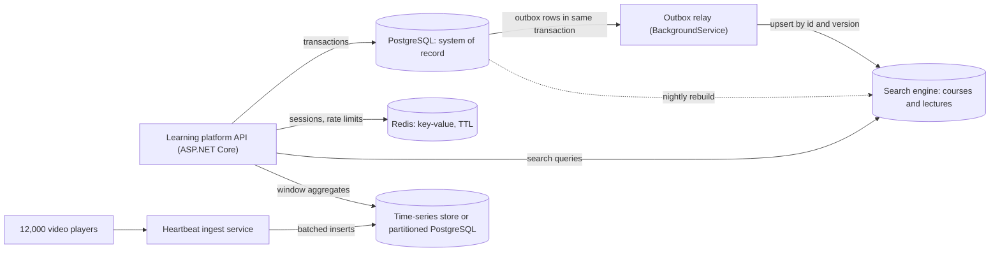
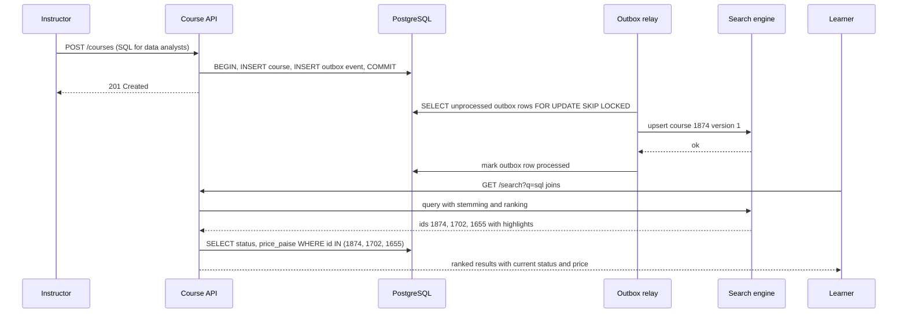

"Should we use SQL or NoSQL?" is the wrong question. "NoSQL" covers at least five very different kinds of database, each built around a particular way of reading and writing data. The right question is: **what are the access patterns, and which store serves them with the least total complexity?** Often the answer is "PostgreSQL, plus one specialised store for one job". This lesson gives you a map of the families, a way to choose, and the costs of running more than one.

## Learning objectives

By the end of this lesson you will be able to:

1. Describe the data model, typical queries, and consistency and scaling characteristics of relational, document, key-value, wide-column, graph, time-series and search databases.
2. List the access patterns of a feature and map each to a store family.
3. Explain query-first modelling (wide-column) versus entity-first modelling (relational), and why denormalisation is the norm in some stores.
4. Show how PostgreSQL covers document, key-value, graph, time-series and search needs with `jsonb`, recursive CTEs, partitioning and full-text search, and where it stops being the best tool.
5. Keep a primary store and a secondary store (for example a search index or cache) consistent with an outbox or change data capture.
6. Argue for or against adding a new database, with operational cost and failure modes in the argument.

## Prerequisites

- [Relational database fundamentals](#/lesson/m09-relational-fundamentals): tables, keys, joins.
- [Normalization and denormalization](#/lesson/m09-normalization): most non-relational stores trade normalisation for read speed.
- [PostgreSQL JSONB](#/lesson/m09-jsonb): documents inside PostgreSQL.

## Explain it like I'm a beginner

Think of the different ways a large college keeps information:

- The **fees ledger** with numbered columns, where every entry must balance and cross-reference receipts, scholarships and refunds. That is a **relational** database: strict structure, relationships, and rules checked on every entry.
- A **student file folder**: one folder per student, holding everything about them (admission form, marksheets, ID photo, certificates) together. You grab one folder and you have the whole picture. That is a **document** database.
- The **key cabinet** at the hostel gate: hook number 37 holds the key for room 37. You only ever ask "what is on hook 37?" That is a **key-value** store: unbeatable for one question, useless for any other.
- A **logbook per college bus**, where each page is a time-stamped line ("07:10 fuel 40 L, 07:45 odometer 41,204"). You always open one bus's logbook and read a stretch of time. That is a **wide-column** store (and close to a **time-series** database).
- A **wall chart of strings and pins** showing which course is a prerequisite of which, and which teacher co-teaches with whom. You follow the strings. That is a **graph** database.
- The **library catalogue**: look up "photosynthesis" and get every book and chapter that mentions it, best matches first. That is a **search** engine.

Every college uses several of these, but it keeps **one official record** (the ledger) and treat the others as convenient copies. Databases work best the same way.

## First-principles explanation

### The families at a glance

| Family | Data model | Best at | Weak at | Examples |
|---|---|---|---|---|
| Relational | Tables, rows, foreign keys, SQL | Integrity, ad-hoc queries, joins, transactions across entities | Massive write scale-out (without sharding), very variable shapes | PostgreSQL, SQL Server, MySQL |
| Document | JSON-like documents, grouped in collections | Reading and writing a whole aggregate by id, flexible shape | Cross-document joins and transactions, many-to-many | MongoDB, Azure Cosmos DB, Couchbase |
| Key-value | Opaque value by key, often in memory | Sub-millisecond get/set, TTLs, counters, sessions | Any query other than "by key" | Redis, Memcached, DynamoDB (also document-like) |
| Wide-column | Partition key + clustering columns, sorted rows per partition | Huge write rates, "rows for key K in range" | Ad-hoc queries, joins, secondary access paths | Apache Cassandra, ScyllaDB, HBase, Bigtable |
| Graph | Nodes and edges with properties | Multi-hop traversals, paths, recommendations | Bulk aggregates, very large scans | Neo4j, Amazon Neptune, Memgraph |
| Time-series | Timestamped measurements per series | Append-heavy ingest, time-window aggregates, retention, downsampling | Updates, relational queries | TimescaleDB, InfluxDB, Prometheus |
| Search | Inverted index over text and fields | Relevance-ranked full-text search, facets, fuzzy matching | Being the source of truth, transactions, strict consistency | Elasticsearch, OpenSearch, Azure AI Search |

### Relational: model the entities, query any way

You model entities and relationships once, normalise to avoid duplicates, and the query planner figures out how to answer questions you have not thought of yet. Transactions span many tables. This flexibility is why relational databases are the default for business systems: orders, invoices, payroll, bookings, enrolments. The weaknesses are scale-out of writes (which needs partitioning or sharding, see [Partitioning and sharding](#/lesson/m09-partitioning-sharding)) and data that has no fixed shape (which `jsonb` softens).

### Document: model the aggregate you read together

A document store keeps an **aggregate** (an order with its lines, a course with its modules and lessons) as one document. Reading or writing it is one operation on one key, with no joins. That matches many APIs exactly, and documents in a collection can differ in shape.

The trade-offs:

- **Data that belongs to several aggregates** is duplicated (the customer's name inside each order) or referenced by id and joined in the application.
- **Many-to-many relationships** (students and courses, authors and books) are awkward either way.
- **Transactions** are strongest within one document; multi-document transactions exist in modern document databases but cost more and are less natural.
- **Schema still exists**, it just lives in your application code. Changing it means migrating documents lazily on read, or in background jobs.

Rule: documents work well when the aggregate is the unit of almost every read and write, and relationships between aggregates are few.

### Key-value: one question, answered very fast

`GET session:7f3a`, `INCR rate:user:42:2026-10-20T10:15`, `SET otp:9810012345 482913 EX 300`. In-memory key-value stores like Redis answer in well under a millisecond on a local network and support expiry (TTL), atomic counters and simple structures (lists, sets, sorted sets, streams). Use them for caches, sessions, rate limits, leaderboards, distributed locks with care, and short-lived state such as OTPs. They are usually **not** the system of record: memory is expensive, and persistence and replication options trade durability for speed.

### Wide-column: model the query, not the entity

In Cassandra-style stores a table has a **partition key** (which node stores the row, by hash) and **clustering columns** (sort order within the partition). The only efficient query is "rows of partition P, optionally a range of clustering keys, in order":

```text
CREATE TABLE heartbeats_by_video (
  video_id    text,          -- partition key: one video's data lives together on one replica set
  day         date,          -- also part of the partition key, to bound partition size
  sent_at     timestamp,     -- clustering column: sorted within the partition
  viewer_id   text,          -- clustering column: makes each row unique
  position_s  int,
  PRIMARY KEY ((video_id, day), sent_at, viewer_id)
) WITH CLUSTERING ORDER BY (sent_at DESC, viewer_id ASC);
```

You design one table **per query**: if you also need "every video one learner watched this week", that is another table (`heartbeats_by_viewer`), written at the same time (denormalisation by design). Writes are cheap (append to a log-structured storage engine) and the cluster scales horizontally by adding nodes. Consistency is tunable per query (`ONE`, `QUORUM`, `ALL`). There are no joins and only limited secondary indexes. Wide-column stores fit very high write rates with predictable queries: telemetry, messaging inboxes, activity feeds, fraud features.

### Graph: follow relationships

When the question is "friends of friends who also took the SQL course" or "which assets are downstream of this failed water main", a graph database stores edges as direct pointers and traverses them without join tables. Query languages such as Cypher express paths naturally (`MATCH (a)-[:FEEDS*1..6]->(b)`). Graph databases shine for multi-hop, variable-depth queries on connected data: recommendations, fraud rings, network topology, dependency analysis. They are weaker at bulk aggregates over everything.

PostgreSQL handles moderate graph needs with **recursive CTEs** over an edge table, as exercise 3 shows. For a few-hop traversal over thousands or low millions of edges with good indexes, that is often enough; for deep traversals over billions of edges with complex path patterns, a native graph engine wins.

### Time-series: append, window, roll up, expire

Measurements arrive in time order, are almost never updated, are queried by time window ("last 24 hours, per 5 minutes"), and expire. Time-series databases optimise exactly this: columnar compression (often 10× or more for regular numeric data, an estimate that depends heavily on the data), automatic time partitioning, downsampling ("keep 1-minute data for 7 days, hourly for 2 years") and fast window functions. TimescaleDB is a PostgreSQL extension, so you keep SQL and joins; InfluxDB and Prometheus are separate systems with their own query languages (Prometheus is focused on monitoring metrics).

Plain PostgreSQL already covers a lot: range partitioning by time, BRIN indexes on time columns, `date_bin()` for bucketing, materialised views for roll-ups.

### Search: relevance, not equality

A search engine builds an **inverted index**: for each term, the list of documents containing it, with positions and statistics. That gives relevance ranking (BM25), stemming ("repairs" matches "repair"), synonyms, typo tolerance, highlighting and facets across millions of documents in milliseconds. A search index is a **derived copy**: rebuilt from the system of record, updated asynchronously, and allowed to be a few seconds stale.

PostgreSQL full-text search (`tsvector`, `tsquery`, GIN indexes, `ts_rank`) handles stemming, boolean queries and basic ranking well for many applications, such as searching course descriptions or support tickets within one database. Dedicated search engines win at relevance tuning, fuzzy matching, multi-language analysis at scale, and faceted navigation over large catalogues.

### Choosing by access pattern

Write down every access pattern of the feature with rough numbers, then pick the simplest store set that serves all of them:

| Access pattern | Numbers (example) | Natural fit |
|---|---|---|
| Buy courses, apply a coupon, take payment, issue a GST invoice; strict rules | 200 writes/s | Relational |
| Fetch a course's full landing page by id | 3,000 reads/s | Relational with caching, or document |
| User session and rate limits | 20,000 ops/s, TTL | Key-value |
| Video playback heartbeats: 1 per 10 s from 12,000 concurrent viewers, query by video and window | 1,200 writes/s, 13 months | Time-series (or partitioned PostgreSQL) |
| "Which courses must I finish before Deep learning?" | rare, a few hops | Graph, or recursive CTE |
| Search 2 million course and lecture descriptions by keywords with ranking | 50 queries/s | Search engine, or PostgreSQL FTS at small scale |

Questions to ask for each pattern: Is this the **system of record** or a **derived view**? What **consistency** does it need (must a user see their write immediately)? What is the **read/write ratio** and **peak rate**? What is the **data size** and **growth**? Which **queries** are known, and how many will be ad hoc?

### The cost of each extra store

Every new database adds: another thing to deploy, patch, back up, restore-test, monitor and secure; another failure mode; a synchronisation path from the system of record; data that can disagree with the source; and skills the team must learn. A rough rule: **add a store when a measured access pattern cannot be served well enough by the ones you already run**, not because a feature "feels like" a graph.

### Keeping stores consistent

The system of record (usually the relational database) commits first. Secondary stores are updated from it, never in parallel from the application:

- **Dual writes** (`save to PostgreSQL; then index in search`) look simple and are wrong: if the second write fails or the process crashes between them, the stores disagree forever.
- **Transactional outbox**: in the same database transaction as the business change, insert an "event" row into an `outbox` table. A background relay reads the outbox and updates the search index (or publishes to a broker). Retries are safe if the consumer is idempotent (index by id, with a version).
- **Change data capture (CDC)**: read the database's change log (PostgreSQL logical decoding, tools such as Debezium) and stream changes to the secondary store.
- **Periodic rebuild**: recreate the index from scratch on a schedule or on demand, as a safety net for drift.

Readers of derived stores must tolerate staleness, or fall back to the source for anything they are about to act on.

### What breaks first under load

- **Relational**: write throughput on a single primary, then lock contention on hot rows (one counter row updated by everyone).
- **Document**: hot documents (one huge, frequently updated document), unbounded arrays inside documents, and application-side joins that turn one page into 50 queries.
- **Key-value**: memory exhaustion and eviction, hot keys concentrated on one shard, and the thundering herd when a popular cached key expires.
- **Wide-column**: oversized or hot partitions (all of a celebrity's followers in one partition, a partition per day that gets too big), and tombstones from deletes slowing reads.
- **Graph**: supernodes (one node with millions of edges) that every traversal passes through.
- **Search**: indexing lag during bursts, and the cluster memory needed for large indexes and aggregations.

### When a simpler design is enough

One PostgreSQL database with `jsonb` for variable attributes, full-text search for documents, recursive CTEs for occasional graph questions, partitioning for time-series data, and an in-process cache will carry most products well past their first million users. Add Redis when you need shared, fast, expiring state across instances; add a search engine when relevance and facets become a product feature; add a time-series or wide-column store when ingest rates or retention outgrow a partitioned table. Each addition should be justified by numbers.

## Visual explanation

### One system of record, several derived stores



The API writes all business data (courses, enrolments, payments, invoices) to PostgreSQL in transactions; it is the only system of record. Sessions and rate limits live in Redis because they are short-lived, extremely frequent and keyed by one id. When a course is published or updated, the same PostgreSQL transaction writes an outbox row; a relay reads outbox rows and upserts them into the search engine, so the index is never updated unless the business change committed. Playback heartbeats bypass the relational core: an ingest service batches them into a time-series store (or a partitioned PostgreSQL table) built for append-heavy, window-queried data. The dotted nightly rebuild repairs any drift in the search index.

### Publishing a course and searching for it



The instructor's request commits the course and its outbox event atomically, then returns; the instructor does not wait for indexing. The relay picks up the event a moment later, upserts the document in the search engine keyed by course id and version (so retries and out-of-order events are harmless), and marks the event processed. When a learner searches, the search engine does what it is good at, ranking by relevance with stemming, and returns ids. The API then reads the fields that must be current (status, price) from PostgreSQL, so a course unpublished one second ago is never shown as available, and nobody sees yesterday's price, because the index lagged.

## Step-by-step example

A company building an online learning platform (courses, video lectures, certificates) lists its features and access patterns, then picks stores.

### Step 1 — list access patterns with numbers

| Feature | Access pattern | Estimate |
|---|---|---|
| Purchases and invoices | Transactions across orders, lines, coupons, payments, invoices | 150 writes/s peak |
| Course landing page | Read one course summary by id | 2,000 reads/s peak |
| Login sessions | Get/set by session id, expire after 30 min | 8,000 ops/s |
| Playback heartbeats | 12,000 concurrent viewers × 1 heartbeat / 10 s = 1,200 writes/s; read by video and time window | 104 M rows/day |
| Prerequisites | "What must I finish before course X?" | ~10 queries/min, a graph of ~5,000 courses |
| Course search | Keyword search over 400,000 course and lecture descriptions with ranking | 20 queries/s |

### Step 2 — start with PostgreSQL for everything, then challenge each row

- Purchases and invoices: relational, no question.
- Course page: a relational query with a cache in front (2,000 reads/s of the same few hundred popular courses caches extremely well). A document store would duplicate data for no gain.
- Sessions: PostgreSQL could do it, but 8,000 ops/s of tiny expiring writes is pure churn for a relational database (dead rows, vacuum). **Redis**.
- Heartbeats: 1,200 writes/s with batched inserts and range partitioning by time is comfortable for PostgreSQL ([Partitioning and sharding](#/lesson/m09-partitioning-sharding)); the TimescaleDB extension adds compression and roll-ups while staying in PostgreSQL (check that your managed PostgreSQL offers it: several cloud services do not, or only without the compression features). A separate time-series or wide-column cluster would be justified at 10–100× this rate.
- Prerequisites: a graph of 5,000 courses and 10 queries a minute: a recursive CTE over an edge table, indexed on both columns. No graph database.
- Course search: 400,000 descriptions and simple ranking: PostgreSQL full-text search with a GIN index is enough today. Plan a search engine if product asks for typo tolerance, synonyms and facet navigation.

### Step 3 — model the aggregate read as a document, inside PostgreSQL

The mobile app wants an order "as a document". Build it from relational data on read:

```sql
SELECT jsonb_build_object(
  'order_id', o.id, 'status', o.status,
  'customer', jsonb_build_object('name', c.name, 'city', c.city),
  'lines', (SELECT jsonb_agg(jsonb_build_object('sku', l.sku, 'qty', l.qty, 'unit_paise', l.unit_paise) ORDER BY l.line_no)
            FROM order_lines l WHERE l.order_id = o.id))
FROM orders o JOIN customers c ON c.id = o.customer_id
WHERE o.id = 5001;
```

The API gets a document; the database keeps integrity. If this endpoint became the hottest in the system, the same JSON could be cached, or stored as a denormalised `jsonb` read model refreshed on change.

### Step 4 — graph questions with a recursive CTE

```sql
WITH RECURSIVE upstream AS (
  SELECT prerequisite_id AS id, 1 AS hops FROM requires WHERE course_id = 8      -- Deep learning
  UNION
  SELECT d.prerequisite_id, u.hops + 1 FROM requires d JOIN upstream u ON d.course_id = u.id
)
SELECT a.name, min(u.hops) AS hops FROM upstream u JOIN courses a ON a.id = u.id
GROUP BY a.id, a.name ORDER BY hops, a.name;
```

Each iteration follows one more prerequisite link. `UNION` (not `UNION ALL`) removes duplicate rows produced at the same step, which keeps diamond shapes from multiplying rows. It does **not** protect you from cycles here: because `hops` grows on every step, a cycle keeps producing new, distinct rows forever. If the graph may contain a cycle (a data-entry mistake such as A requires B and B requires A), track the visited path in an array and stop when a node repeats, or use the `CYCLE id SET is_cycle USING path` clause (PostgreSQL 14+). A prerequisite graph should also be protected on write: reject an edge that would close a cycle.

### Step 5 — full-text search

```sql
ALTER TABLE course_docs ADD COLUMN tsv tsvector
  GENERATED ALWAYS AS (to_tsvector('english', title || ' ' || body)) STORED;
CREATE INDEX course_docs_tsv ON course_docs USING gin (tsv);

SELECT id, title FROM course_docs
WHERE tsv @@ websearch_to_tsquery('english', 'sql joins -beginner')
ORDER BY ts_rank(tsv, websearch_to_tsquery('english', 'sql joins -beginner')) DESC, id;
```

`websearch_to_tsquery` accepts what users type (quotes, `-exclude`, `or`) and stems words, so "joins" matches "join" and "joining".

### Step 6 — time windows

```sql
SELECT date_bin('1 hour', sampled_at, TIMESTAMPTZ '2026-10-20 00:00+05:30') AS hour, round(avg(mbps), 3) AS avg_mbps
FROM stream_stats WHERE video_id = 1 AND sampled_at >= '2026-10-20 00:00+05:30'
GROUP BY hour ORDER BY hour;
```

`date_bin` buckets timestamps into fixed intervals from an origin; the playground has per-video streaming bitrate samples to try it.

## Production-style C# implementation

The platform keeps PostgreSQL as the system of record and uses three secondary capabilities behind interfaces: a key-value store with TTL (Redis in production), a search index fed by a transactional outbox, and a time-series store with bucketed queries. In-memory implementations let the course checker build and run everything; comments show the real commands.

```text
Platform.Data/
  Program.cs
  Stores/KeyValue.cs
  Stores/SearchIndex.cs
  Stores/Outbox.cs
  Stores/TimeSeries.cs
```

```csharp file=Stores/KeyValue.cs
using System.Collections.Concurrent;

namespace Platform.Stores;

/// <summary>Redis equivalent: SET key value EX ttl / GET key / INCR key.</summary>
public interface IKeyValueStore
{
    void Set(string key, string value, TimeSpan ttl);
    string? Get(string key);
    long Increment(string key, TimeSpan ttlIfNew);
}

public sealed class InMemoryKeyValueStore(TimeProvider clock) : IKeyValueStore
{
    private sealed record Entry(string Value, DateTimeOffset ExpiresAt);
    private readonly ConcurrentDictionary<string, Entry> _data = new(StringComparer.Ordinal);
    private readonly object _incrGate = new();

    public void Set(string key, string value, TimeSpan ttl) => _data[key] = new Entry(value, clock.GetUtcNow() + ttl);

    public string? Get(string key)
    {
        if (!_data.TryGetValue(key, out var e)) return null;
        if (e.ExpiresAt > clock.GetUtcNow()) return e.Value;
        _data.TryRemove(new KeyValuePair<string, Entry>(key, e));   // lazy expiry, like Redis on access
        return null;
    }

    public long Increment(string key, TimeSpan ttlIfNew)
    {
        lock (_incrGate)
        {
            var current = Get(key);
            var next = (current is null ? 0 : long.Parse(current, System.Globalization.CultureInfo.InvariantCulture)) + 1;
            var expires = current is null ? clock.GetUtcNow() + ttlIfNew : _data[key].ExpiresAt;
            _data[key] = new Entry(next.ToString(System.Globalization.CultureInfo.InvariantCulture), expires);
            return next;
        }
    }
}
```

```csharp file=Stores/SearchIndex.cs
using System.Collections.Concurrent;

namespace Platform.Stores;

public sealed record SearchDoc(long Id, long Version, string Title, string Body);
public sealed record SearchHit(long Id, double Score);

/// <summary>Search engine equivalent: PUT /courses/_doc/{id}?version={v}&amp;version_type=external, then a match query.</summary>
public interface ISearchIndex
{
    /// <summary>Idempotent and order-safe: an older version never overwrites a newer one.</summary>
    bool Upsert(SearchDoc doc);
    IReadOnlyList<SearchHit> Search(string query, int limit);
}

public sealed class InMemorySearchIndex : ISearchIndex
{
    private readonly ConcurrentDictionary<long, (SearchDoc Doc, string[] Terms)> _docs = new();

    public bool Upsert(SearchDoc doc)
    {
        var terms = Analyze(doc.Title + " " + doc.Title + " " + doc.Body);   // title counted twice: a crude boost
        while (true)
        {
            if (!_docs.TryGetValue(doc.Id, out var existing))
            {
                if (_docs.TryAdd(doc.Id, (doc, terms))) return true;
                continue;
            }
            if (existing.Doc.Version >= doc.Version) return false;          // stale or duplicate event
            if (_docs.TryUpdate(doc.Id, (doc, terms), existing)) return true;
        }
    }

    public IReadOnlyList<SearchHit> Search(string query, int limit)
    {
        var q = Analyze(query).Distinct().ToArray();
        if (q.Length == 0) return Array.Empty<SearchHit>();
        return _docs.Values
            .Select(d => new SearchHit(d.Doc.Id, q.Sum(t => d.Terms.Count(x => x == t)) / Math.Sqrt(d.Terms.Length)))
            .Where(h => h.Score > 0)
            .OrderByDescending(h => h.Score).ThenBy(h => h.Id)
            .Take(limit)
            .ToList();
    }

    /// <summary>Lower-case, split on non-letters, drop short words, strip a plural 's'. A real engine uses a proper stemmer.</summary>
    public static string[] Analyze(string text) =>
        text.ToLowerInvariant()
            .Split(text.Where(c => !char.IsLetterOrDigit(c)).Distinct().ToArray(), StringSplitOptions.RemoveEmptyEntries)
            .Where(w => w.Length > 2)
            .Select(w => w.Length > 4 && w.EndsWith('s') ? w[..^1] : w)
            .ToArray();
}
```

```csharp file=Stores/Outbox.cs
using Microsoft.Extensions.Hosting;
using Microsoft.Extensions.Logging;

namespace Platform.Stores;

public sealed record OutboxEvent(long Seq, string Type, SearchDoc Payload);

/// <summary>
/// Written in the SAME transaction as the business change:
///   INSERT INTO courses ...;  INSERT INTO outbox (type, payload) VALUES ('course.upserted', $json);
/// Read by the relay:
///   SELECT seq, type, payload FROM outbox WHERE processed_at IS NULL ORDER BY seq LIMIT 100 FOR UPDATE SKIP LOCKED
/// </summary>
public interface IOutbox
{
    IReadOnlyList<OutboxEvent> TakeBatch(int max);
    void MarkProcessed(long seq);
}

public sealed class InMemoryOutbox : IOutbox
{
    private readonly List<(OutboxEvent Event, bool Done)> _rows = new();
    private readonly object _gate = new();
    private long _seq;

    public void Append(string type, SearchDoc payload) { lock (_gate) _rows.Add((new OutboxEvent(++_seq, type, payload), false)); }

    public IReadOnlyList<OutboxEvent> TakeBatch(int max)
    {
        lock (_gate) return _rows.Where(r => !r.Done).Select(r => r.Event).OrderBy(e => e.Seq).Take(max).ToList();
    }

    public void MarkProcessed(long seq)
    {
        lock (_gate)
        {
            var i = _rows.FindIndex(r => r.Event.Seq == seq);
            if (i >= 0) _rows[i] = (_rows[i].Event, true);
        }
    }
}

public sealed class OutboxRelay(IOutbox outbox, ISearchIndex index, TimeProvider clock, ILogger<OutboxRelay> log) : BackgroundService
{
    protected override async Task ExecuteAsync(CancellationToken stoppingToken)
    {
        while (!stoppingToken.IsCancellationRequested)
        {
            var moved = DrainOnce();
            await Task.Delay(moved == 0 ? TimeSpan.FromMilliseconds(500) : TimeSpan.Zero, clock, stoppingToken);
        }
    }

    public int DrainOnce()
    {
        var batch = outbox.TakeBatch(100);
        foreach (var e in batch)
        {
            try
            {
                var applied = index.Upsert(e.Payload);       // idempotent: safe to retry after a crash
                outbox.MarkProcessed(e.Seq);
                if (!applied) log.LogDebug("Skipped stale event {Seq} for doc {Id}", e.Seq, e.Payload.Id);
            }
            catch (Exception ex)
            {
                log.LogWarning(ex, "Indexing failed for outbox {Seq}; will retry", e.Seq);
                break;                                       // keep order: retry this event next round
            }
        }
        return batch.Count;
    }
}
```

```csharp file=Stores/TimeSeries.cs
namespace Platform.Stores;

public sealed record Point(string Series, DateTimeOffset At, double Value);
public sealed record Bucket(DateTimeOffset Start, int Count, double Sum, double Max);

/// <summary>
/// Time-series equivalent (PostgreSQL / TimescaleDB):
///   SELECT date_bin($bucket, sampled_at, $origin) AS start, count(*), sum(v), max(v)
///   FROM stream_stats WHERE series = $1 AND sampled_at >= $from AND sampled_at &lt; $to GROUP BY 1 ORDER BY 1
/// </summary>
public interface ITimeSeriesStore
{
    void Append(IEnumerable<Point> batch);
    IReadOnlyList<Bucket> Aggregate(string series, DateTimeOffset from, DateTimeOffset to, TimeSpan bucket, DateTimeOffset origin);
}

public sealed class InMemoryTimeSeriesStore : ITimeSeriesStore
{
    private readonly Dictionary<string, List<Point>> _bySeries = new(StringComparer.Ordinal);
    private readonly object _gate = new();

    public void Append(IEnumerable<Point> batch)
    {
        lock (_gate)
            foreach (var p in batch)
            {
                if (!_bySeries.TryGetValue(p.Series, out var list)) _bySeries[p.Series] = list = new List<Point>();
                list.Add(p);
            }
    }

    public IReadOnlyList<Bucket> Aggregate(string series, DateTimeOffset from, DateTimeOffset to, TimeSpan bucket, DateTimeOffset origin)
    {
        if (bucket <= TimeSpan.Zero) throw new ArgumentOutOfRangeException(nameof(bucket));
        List<Point> points;
        lock (_gate) points = _bySeries.TryGetValue(series, out var l) ? l.Where(p => p.At >= from && p.At < to).ToList() : new();

        return points
            .GroupBy(p => origin + TimeSpan.FromTicks((p.At - origin).Ticks / bucket.Ticks * bucket.Ticks - ((p.At - origin).Ticks % bucket.Ticks < 0 ? bucket.Ticks : 0)))
            .OrderBy(g => g.Key)
            .Select(g => new Bucket(g.Key, g.Count(), g.Sum(p => p.Value), g.Max(p => p.Value)))
            .ToList();
    }
}
```

```csharp file=Program.cs
using Platform.Stores;

var builder = WebApplication.CreateBuilder(args);
builder.Services.AddSingleton(TimeProvider.System);
builder.Services.AddSingleton<IKeyValueStore, InMemoryKeyValueStore>();
builder.Services.AddSingleton<ISearchIndex, InMemorySearchIndex>();
builder.Services.AddSingleton<InMemoryOutbox>();
builder.Services.AddSingleton<IOutbox>(sp => sp.GetRequiredService<InMemoryOutbox>());
builder.Services.AddSingleton<OutboxRelay>();
builder.Services.AddHostedService(sp => sp.GetRequiredService<OutboxRelay>());
builder.Services.AddSingleton<ITimeSeriesStore, InMemoryTimeSeriesStore>();

var app = builder.Build();

// Rate limit with a key-value counter: 30 searches per user per minute.
app.MapGet("/search", (string q, HttpRequest req, IKeyValueStore kv, ISearchIndex index, TimeProvider clock) =>
{
    var user = req.Headers["X-User"].ToString();
    var minute = clock.GetUtcNow().ToString("yyyyMMddHHmm", System.Globalization.CultureInfo.InvariantCulture);
    if (kv.Increment($"rl:search:{user}:{minute}", TimeSpan.FromMinutes(2)) > 30) return Results.StatusCode(429);
    // Real code: then load current status and price for these ids from PostgreSQL.
    return Results.Ok(index.Search(q, 20));
});

// The business write: in production one PostgreSQL transaction inserts the course AND the outbox row.
app.MapPost("/courses", (SearchDoc doc, InMemoryOutbox outbox) =>
{
    outbox.Append("course.upserted", doc);
    return Results.Accepted($"/courses/{doc.Id}");
});

app.MapPost("/playback/batch", (Point[] points, ITimeSeriesStore ts) => { ts.Append(points); return Results.Accepted(); });

app.MapGet("/playback/{series}/hourly", (string series, DateTimeOffset from, DateTimeOffset to, ITimeSeriesStore ts) =>
    Results.Ok(ts.Aggregate(series, from, to, TimeSpan.FromHours(1), new DateTimeOffset(2026, 1, 1, 0, 0, 0, TimeSpan.FromHours(5.5)))));

app.Run();
```

**Design notes.**

- Each interface names one access pattern, not a vendor. Swapping the in-memory key-value store for Redis, or the search index for a real engine, changes one registration.
- The outbox relay is the only writer to the search index. It is ordered, retries on failure, and relies on versioned upserts, so duplicates and replays are harmless.
- Search results are ids plus scores. Fields that drive decisions (status, price) are re-read from the system of record.
- The time-series store aggregates by bucket from an explicit origin, like `date_bin`, so hourly buckets align to IST midnight rather than to UTC.

:::callout type=warning title="Dual writes are not a synchronisation strategy"
`await db.SaveChangesAsync(); await search.IndexAsync(doc);` loses updates whenever the second call fails or the process dies between the two lines, and nothing ever repairs it. Write an outbox row in the same transaction, or use change data capture.
:::

## Bad design vs good design

**Bad**: a team starting a new course marketplace picks a document database "because it is flexible", stores each order as a document embedding the instructor's details and the course's details, adds Redis for caching, Elasticsearch for search, and a graph database "for relationships". Instructor payout bank details change and must be updated inside 80,000 order documents. GST invoicing and instructor-payout reconciliation need joins across orders, payments, refunds and instructors, implemented in C# with hundreds of queries. The search index is updated with dual writes and drifts. Four databases need backups, upgrades and on-call knowledge; the team has six people.

**Good**: PostgreSQL as the system of record with normalised instructors, courses, orders and payments; `jsonb` for the variable parts of course metadata (syllabus, language options, tool versions); PostgreSQL full-text search for the first year; Redis only for sessions and rate limits. When search relevance becomes a product requirement, add a search engine fed by an outbox. Each store has a documented reason tied to an access pattern and a number.

**But**: a telemetry product ingesting 2 million readings per second from smart meters across a state, queried only by meter and time window, should not force that into one relational primary. A wide-column or time-series cluster designed for that ingest, with PostgreSQL for customers and billing, is the simpler system at that scale.

:::callout type=tradeoff title="PostgreSQL feature versus dedicated store"
| Need | PostgreSQL feature | Move to a dedicated store when |
|---|---|---|
| Variable shape | `jsonb` + GIN | Aggregates are the only access path and the whole model is documents |
| Cache, sessions, counters | unlogged tables, in-process cache | Many instances need shared sub-millisecond state with TTLs |
| Graph traversal | recursive CTEs | Deep, variable-length paths over very large graphs, frequently |
| Time-series | partitioning, BRIN, `date_bin`, TimescaleDB | Ingest or retention outgrows one node, or compression and downsampling dominate |
| Full-text search | `tsvector`, GIN, `ts_rank` | Relevance tuning, typo tolerance, facets, many languages at scale |
| Massive writes by key | hash partitioning, sharding | Millions of writes/s with simple key-range queries |
:::

## Practical playground

One PostgreSQL database playing four roles: course orders (relational) to build as documents, a course-prerequisite graph, course descriptions with a full-text index, and per-video streaming bitrate samples for time-bucket queries.

:::playground type=sql title="One database, many access patterns"
```sql
CREATE TABLE customers (id bigint PRIMARY KEY, name text NOT NULL, city text NOT NULL);
CREATE TABLE orders (id bigint PRIMARY KEY, customer_id bigint NOT NULL REFERENCES customers, placed_at timestamptz NOT NULL, status text NOT NULL);
CREATE TABLE order_lines (order_id bigint NOT NULL REFERENCES orders, line_no int NOT NULL, sku text NOT NULL, qty int NOT NULL, unit_paise bigint NOT NULL,
                          PRIMARY KEY (order_id, line_no));
INSERT INTO customers VALUES (1, 'Kaveri Analytics', 'Bengaluru'), (2, 'Asha Iyer', 'Gurugram');
INSERT INTO orders VALUES (5001, 1, '2026-10-18 10:15+05:30', 'paid'), (5002, 2, '2026-10-19 16:40+05:30', 'placed');
INSERT INTO order_lines VALUES (5001, 1, 'SQL-101', 20, 49900), (5001, 2, 'PY-DS-201', 15, 129900), (5002, 1, 'ML-301', 1, 249900);

CREATE TABLE courses (id int PRIMARY KEY, name text NOT NULL, study_hours int NOT NULL);
CREATE TABLE requires (course_id int NOT NULL REFERENCES courses, prerequisite_id int NOT NULL REFERENCES courses,
                         PRIMARY KEY (course_id, prerequisite_id));
CREATE INDEX ON requires (prerequisite_id);
INSERT INTO courses VALUES
  (1, 'Computer basics', 5), (2, 'Python programming', 10), (3, 'Data analysis with pandas', 20), (4, 'Probability with Python', 30),
  (5, 'Applied statistics', 45), (6, 'Data visualisation', 40), (7, 'Machine learning foundations', 15), (8, 'Deep learning', 20),
  (9, 'Capstone: image classifier', 10), (10, 'SQL for analysts', 25);
INSERT INTO requires VALUES (2,1), (3,2), (4,3), (5,4), (6,3), (7,5), (7,6), (8,7), (9,8), (10,3);

CREATE TABLE course_docs (
  id int PRIMARY KEY, title text NOT NULL, body text NOT NULL,
  tsv tsvector GENERATED ALWAYS AS (to_tsvector('english', title || ' ' || body)) STORED
);
INSERT INTO course_docs (id, title, body) VALUES
  (1, 'Advanced SQL: joins and window functions', 'Master inner, outer and lateral joins, then window functions over real sales data.'),
  (2, 'Python for data analysis', 'Load, clean and join datasets with pandas, then plot them.'),
  (3, 'PostgreSQL performance tuning', 'Indexes, EXPLAIN plans and how the planner picks join strategies for slow SQL queries.'),
  (4, 'Excel dashboards', 'Pivot tables, charts and lookups for monthly reports.'),
  (5, 'Data visualisation with Power BI', 'Connect to SQL sources, model relationships and build dashboards.'),
  (6, 'SQL for complete beginners', 'Your first SELECT queries, filters and simple joins. A beginner course.'),
  (7, 'SQL interview preparation', 'Practise joins, self joins, anti joins and GROUP BY questions asked in SQL interviews.');
CREATE INDEX course_docs_tsv ON course_docs USING gin (tsv);

CREATE TABLE stream_stats (video_id int NOT NULL, sampled_at timestamptz NOT NULL, mbps numeric(6,3) NOT NULL, PRIMARY KEY (video_id, sampled_at));
INSERT INTO stream_stats
SELECT 1 + g % 3, TIMESTAMPTZ '2026-10-20 00:00+05:30' + g * INTERVAL '7 minutes', round((0.4 + (g * 13 % 17) / 10.0)::numeric, 3)
FROM generate_series(0, 120) AS g;

-- SELECT jsonb_pretty(jsonb_build_object('order_id', o.id, 'lines', (SELECT jsonb_agg(l) FROM order_lines l WHERE l.order_id = o.id))) FROM orders o;
-- SELECT id, title FROM course_docs WHERE tsv @@ websearch_to_tsquery('english', 'sql joins -beginner');
-- SELECT date_bin('1 hour', sampled_at, TIMESTAMPTZ '2026-10-20 00:00+05:30') AS hour, round(avg(mbps), 3)
--   FROM stream_stats WHERE video_id = 1 GROUP BY 1 ORDER BY 1;
-- WITH RECURSIVE downstream AS (SELECT course_id AS id FROM requires WHERE prerequisite_id = 4
--   UNION SELECT d.course_id FROM requires d JOIN downstream x ON d.prerequisite_id = x.id)
-- SELECT a.name FROM downstream JOIN courses a USING (id);      -- which courses build on Probability?
```
:::

## Exercises

:::exercise id=m09-relational-vs-document-ex1 difficulty=beginner kind=sql title="Serve a document from relational tables"
The mobile app wants each course order as one JSON document (`qty` is the number of seats bought). For order **5001**, return `order_id` and `doc`, where `doc` is a `jsonb` object with keys `order_id`, `status`, `customer` (an object with `name` and `city`), `lines` (an array of objects with `sku`, `qty`, `unit_paise`, in `line_no` order) and `total_paise` (sum of `qty × unit_paise`).
::setup
```sql
CREATE TABLE customers (id bigint PRIMARY KEY, name text NOT NULL, city text NOT NULL);
CREATE TABLE orders (id bigint PRIMARY KEY, customer_id bigint NOT NULL REFERENCES customers, placed_at timestamptz NOT NULL, status text NOT NULL);
CREATE TABLE order_lines (order_id bigint NOT NULL REFERENCES orders, line_no int NOT NULL, sku text NOT NULL, qty int NOT NULL, unit_paise bigint NOT NULL, PRIMARY KEY (order_id, line_no));
INSERT INTO customers VALUES (1, 'Kaveri Analytics', 'Bengaluru'), (2, 'Asha Iyer', 'Gurugram');
INSERT INTO orders VALUES (5001, 1, '2026-10-18 10:15+05:30', 'paid'), (5002, 2, '2026-10-19 16:40+05:30', 'placed');
INSERT INTO order_lines VALUES (5001, 1, 'SQL-101', 20, 49900), (5001, 2, 'PY-DS-201', 15, 129900), (5002, 1, 'ML-301', 1, 249900);
```
::check
```sql
SELECT o.id AS order_id,
       jsonb_build_object(
         'order_id', o.id,
         'status', o.status,
         'customer', jsonb_build_object('name', c.name, 'city', c.city),
         'lines', (SELECT jsonb_agg(jsonb_build_object('sku', l.sku, 'qty', l.qty, 'unit_paise', l.unit_paise) ORDER BY l.line_no)
                   FROM order_lines l WHERE l.order_id = o.id),
         'total_paise', (SELECT sum(l.qty * l.unit_paise) FROM order_lines l WHERE l.order_id = o.id)
       ) AS doc
FROM orders o JOIN customers c ON c.id = o.customer_id
WHERE o.id = 5001;
```
::acceptance
- One row with `order_id` 5001.
- `doc.customer` is `{"name": "Kaveri Analytics", "city": "Bengaluru"}` (a company buying seats for its team); `doc.lines` has two objects, `SQL-101` first.
- `doc.total_paise` is 2946500 (₹29,465: 20 seats × ₹499 + 15 seats × ₹1,299).
::hint
`jsonb_build_object('key', value, ...)` builds an object; nest calls for nested objects.
::hint
An array of objects from child rows: `jsonb_agg(jsonb_build_object(...) ORDER BY line_no)` in a subquery.
::hint
Key order in `jsonb` does not matter (it is normalised), so only the keys and values must match.
::hint
```sql
'lines', (SELECT jsonb_agg(jsonb_build_object('sku', l.sku, 'qty', l.qty, 'unit_paise', l.unit_paise) ORDER BY l.line_no)
          FROM order_lines l WHERE l.order_id = o.id)
```
::solution
```sql
SELECT o.id AS order_id,
       jsonb_build_object(
         'order_id', o.id,
         'status', o.status,
         'customer', jsonb_build_object('name', c.name, 'city', c.city),
         'lines', (SELECT jsonb_agg(jsonb_build_object('sku', l.sku, 'qty', l.qty, 'unit_paise', l.unit_paise) ORDER BY l.line_no)
                   FROM order_lines l WHERE l.order_id = o.id),
         'total_paise', (SELECT sum(l.qty * l.unit_paise) FROM order_lines l WHERE l.order_id = o.id)
       ) AS doc
FROM orders o JOIN customers c ON c.id = o.customer_id
WHERE o.id = 5001;
```
This is the document a document database would store, built on read from normalised tables. You keep foreign keys, one place to change a customer's city, and ad-hoc queries over lines, while the API still receives one aggregate. If this read becomes very hot, cache the JSON or maintain it as a `jsonb` read model, refreshed from an outbox event when the order changes.
::mistakes
- `json_agg` without `ORDER BY`: line order is then undefined.
- Joining `order_lines` in the outer query and aggregating there, which repeats the customer per line unless you `GROUP BY` correctly.
- Computing `total_paise` in rupees with floating point.
:::

:::exercise id=m09-relational-vs-document-ex2 difficulty=beginner kind=code title="A key-value store with TTL"
Implement `TtlStore`, a minimal key-value store like Redis `SET key value EX seconds` and `GET key`. `Set` stores a value with a time-to-live; `Get` returns the value if it has not expired, otherwise `null` (and removes it). `Count` returns how many unexpired keys exist. Use the injected `TimeProvider` so tests control time. A key expires exactly at `setTime + ttl` (at that instant it is already gone).
::acceptance
- `Get` returns the value before expiry and `null` at and after expiry.
- `Set` on an existing key replaces both value and expiry.
- `Count` ignores expired keys.
- A non-positive TTL throws `ArgumentOutOfRangeException`.
::hint
Store `(value, expiresAt)` per key in a dictionary.
::hint
Expired means `now >= expiresAt`.
::hint
Remove expired entries lazily in `Get`; `Count` can filter without removing.
::starter
```csharp file=TtlStore.cs
using System;
using System.Collections.Generic;
using System.Linq;

public sealed class TtlStore(TimeProvider clock)
{
    public void Set(string key, string value, TimeSpan ttl) => throw new NotImplementedException();

    public string? Get(string key) => throw new NotImplementedException();

    public int Count => throw new NotImplementedException();
}
```
::tests
```csharp file=TtlStoreTests.cs
using System;
using Xunit;

public class TtlStoreTests
{
    private sealed class ManualClock(DateTimeOffset start) : TimeProvider
    {
        public DateTimeOffset Now { get; set; } = start;
        public override DateTimeOffset GetUtcNow() => Now;
    }

    private static readonly DateTimeOffset T0 = new(2026, 10, 20, 4, 30, 0, TimeSpan.Zero);

    [Fact]
    public void Value_lives_until_ttl()
    {
        var clock = new ManualClock(T0);
        var s = new TtlStore(clock);
        s.Set("otp:9810012345", "482913", TimeSpan.FromMinutes(5));
        clock.Now = T0.AddMinutes(4).AddSeconds(59);
        Assert.Equal("482913", s.Get("otp:9810012345"));
        clock.Now = T0.AddMinutes(5);
        Assert.Null(s.Get("otp:9810012345"));
    }

    [Fact]
    public void Set_replaces_value_and_expiry()
    {
        var clock = new ManualClock(T0);
        var s = new TtlStore(clock);
        s.Set("k", "a", TimeSpan.FromSeconds(10));
        clock.Now = T0.AddSeconds(8);
        s.Set("k", "b", TimeSpan.FromSeconds(10));
        clock.Now = T0.AddSeconds(15);
        Assert.Equal("b", s.Get("k"));
    }

    [Fact]
    public void Count_ignores_expired()
    {
        var clock = new ManualClock(T0);
        var s = new TtlStore(clock);
        s.Set("a", "1", TimeSpan.FromSeconds(5));
        s.Set("b", "2", TimeSpan.FromSeconds(50));
        clock.Now = T0.AddSeconds(10);
        Assert.Equal(1, s.Count);
    }

    [Fact]
    public void Missing_key_is_null()
    {
        Assert.Null(new TtlStore(new ManualClock(T0)).Get("nope"));
    }

    [Fact]
    public void Non_positive_ttl_throws()
    {
        var s = new TtlStore(new ManualClock(T0));
        Assert.Throws<ArgumentOutOfRangeException>(() => s.Set("k", "v", TimeSpan.Zero));
    }
}
```
::solution
```csharp file=TtlStore.cs
using System;
using System.Collections.Generic;
using System.Linq;

public sealed class TtlStore(TimeProvider clock)
{
    private readonly Dictionary<string, (string Value, DateTimeOffset ExpiresAt)> _data = new(StringComparer.Ordinal);
    private readonly object _gate = new();

    public void Set(string key, string value, TimeSpan ttl)
    {
        if (ttl <= TimeSpan.Zero) throw new ArgumentOutOfRangeException(nameof(ttl));
        lock (_gate) _data[key] = (value, clock.GetUtcNow() + ttl);
    }

    public string? Get(string key)
    {
        lock (_gate)
        {
            if (!_data.TryGetValue(key, out var e)) return null;
            if (clock.GetUtcNow() >= e.ExpiresAt) { _data.Remove(key); return null; }
            return e.Value;
        }
    }

    public int Count
    {
        get
        {
            var now = clock.GetUtcNow();
            lock (_gate) return _data.Values.Count(e => now < e.ExpiresAt);
        }
    }
}
```
Redis combines this lazy expiry on access with a background sampler that deletes expired keys nobody reads, so memory is reclaimed even for keys that are never fetched again. A real store also needs eviction when memory is full (for example least-recently-used), which is why a cache must always be allowed to lose data.
::alternatives
`IMemoryCache` from `Microsoft.Extensions.Caching.Memory` already provides absolute and sliding expiry in-process. Use a shared store such as Redis when several API instances must see the same keys (sessions, rate limits).
::mistakes
- Treating `now == expiresAt` as still valid, which disagrees with most stores' semantics and with the tests.
- Using `DateTime.Now`.
- Never removing expired entries, so memory grows with every OTP ever issued.
:::

:::exercise id=m09-relational-vs-document-ex3 difficulty=intermediate kind=sql ordered=true title="A graph question with a recursive CTE"
In the learning platform's catalogue, `requires (course_id, prerequisite_id)` means a learner cannot start the course until they have completed the prerequisite. Find every course that **Deep learning** (id 8) requires, directly or indirectly, with `hops` = the **smallest** number of dependency links from activity 8. Return `name` and `hops`, ordered by `hops`, then `name`.
::setup
```sql
CREATE TABLE courses (id int PRIMARY KEY, name text NOT NULL, study_hours int NOT NULL);
CREATE TABLE requires (course_id int NOT NULL REFERENCES courses, prerequisite_id int NOT NULL REFERENCES courses, PRIMARY KEY (course_id, prerequisite_id));
INSERT INTO courses VALUES
  (1, 'Computer basics', 5), (2, 'Python programming', 10), (3, 'Data analysis with pandas', 20), (4, 'Probability with Python', 30),
  (5, 'Applied statistics', 45), (6, 'Data visualisation', 40), (7, 'Machine learning foundations', 15), (8, 'Deep learning', 20),
  (9, 'Capstone: image classifier', 10), (10, 'SQL for analysts', 25);
INSERT INTO requires VALUES (2,1), (3,2), (4,3), (5,4), (6,3), (7,5), (7,6), (8,7), (9,8), (10,3);
```
::check
```sql
WITH RECURSIVE upstream AS (
  SELECT prerequisite_id AS id, 1 AS hops FROM requires WHERE course_id = 8
  UNION
  SELECT d.prerequisite_id, u.hops + 1
  FROM requires d JOIN upstream u ON d.course_id = u.id
)
SELECT a.name, min(u.hops) AS hops
FROM upstream u JOIN courses a ON a.id = u.id
GROUP BY a.id, a.name
ORDER BY hops, a.name;
```
::acceptance
- Machine learning foundations 1; Applied statistics 2; Data visualisation 2; Data analysis with pandas 3; Probability with Python 3; Python programming 4; Computer basics 5.
- SQL for analysts and the Capstone are **not** listed (they are not prerequisites of Deep learning).
- Data analysis with pandas appears once, with the shorter of its two paths (via Data visualisation, 3 links, not via Applied statistics and Probability, 4).
::hint
Start (the anchor) with the direct prerequisites of course 8 at `hops = 1`.
::hint
The recursive step joins `requires` to the rows found so far: the prerequisites of what you already have, at `hops + 1`.
::hint
The same course can be reached by two paths with different lengths; `GROUP BY` and `min(hops)` keeps the shortest.
::hint
```sql
WITH RECURSIVE upstream AS (
  SELECT prerequisite_id AS id, 1 AS hops FROM requires WHERE course_id = 8
  UNION
  SELECT d.prerequisite_id, u.hops + 1 FROM requires d JOIN upstream u ON d.course_id = u.id
)
SELECT ... GROUP BY ... ORDER BY hops, name;
```
::solution
```sql
WITH RECURSIVE upstream AS (
  SELECT prerequisite_id AS id, 1 AS hops FROM requires WHERE course_id = 8
  UNION
  SELECT d.prerequisite_id, u.hops + 1
  FROM requires d JOIN upstream u ON d.course_id = u.id
)
SELECT a.name, min(u.hops) AS hops
FROM upstream u JOIN courses a ON a.id = u.id
GROUP BY a.id, a.name
ORDER BY hops, a.name;
```
This is a breadth-first traversal expressed in SQL. With an index on `requires (course_id)` (the primary key here) each step is an index lookup per frontier node. For a catalogue of 5,000 courses and 10 queries a minute, PostgreSQL handles this comfortably. A native graph database becomes attractive when traversals are deep and frequent across millions of nodes, or when path patterns get complex ("shortest path avoiding nodes of type X"). For a graph that might contain a cycle (a data-entry error), carry `ARRAY[id] AS path` and add `WHERE NOT d.prerequisite_id = ANY(u.path)` so the recursion terminates, or use the `CYCLE` clause.
::alternatives
To compute the **minimum study time** to finish a course (a critical path), recurse forward from courses with no prerequisites, accumulating `study_hours`, and take `max` per course: a learner can finish Deep learning after 145 study hours at the earliest in this data.
::mistakes
- `UNION ALL` on a graph with diamond shapes: duplicate rows multiply at every level.
- Assuming `UNION` stops cycles: with a growing `hops` column every row is new, so a cyclic graph loops until it runs out of memory. Use a path array or the `CYCLE` clause.
- Following edges in the wrong direction (`d.prerequisite_id = u.id`), which lists the courses that build on Deep learning instead.
:::

:::exercise id=m09-relational-vs-document-ex4 difficulty=intermediate kind=sql ordered=true title="Full-text search with stemming and ranking"
Learners type `sql joins -beginner`. Using the generated `tsv` column and `websearch_to_tsquery('english', ...)`, return the matching courses as `id` and `title`, best match first by `ts_rank`, ties broken by `id`.
::setup
```sql
CREATE TABLE course_docs (
  id int PRIMARY KEY, title text NOT NULL, body text NOT NULL,
  tsv tsvector GENERATED ALWAYS AS (to_tsvector('english', title || ' ' || body)) STORED
);
INSERT INTO course_docs (id, title, body) VALUES
  (1, 'Advanced SQL: joins and window functions', 'Master inner, outer and lateral joins, then window functions over real sales data.'),
  (2, 'Python for data analysis', 'Load, clean and join datasets with pandas, then plot them.'),
  (3, 'PostgreSQL performance tuning', 'Indexes, EXPLAIN plans and how the planner picks join strategies for slow SQL queries.'),
  (4, 'Excel dashboards', 'Pivot tables, charts and lookups for monthly reports.'),
  (5, 'Data visualisation with Power BI', 'Connect to SQL sources, model relationships and build dashboards.'),
  (6, 'SQL for complete beginners', 'Your first SELECT queries, filters and simple joins. A beginner course.'),
  (7, 'SQL interview preparation', 'Practise joins, self joins, anti joins and GROUP BY questions asked in SQL interviews.'),
  (8, 'Joins in SQL for beginners', 'A gentle beginner course on SQL joins with worked examples.');
CREATE INDEX course_docs_tsv ON course_docs USING gin (tsv);
```
::check
```sql
SELECT id, title
FROM course_docs
WHERE tsv @@ websearch_to_tsquery('english', 'sql joins -beginner')
ORDER BY ts_rank(tsv, websearch_to_tsquery('english', 'sql joins -beginner')) DESC, id;
```
::acceptance
- Returns courses 7, 1 and 3 (in rank order), and not 2 (no "sql"), 4 (neither word), 5 (no "join"), or 6 and 8 (they mention "beginner").
- "joins" in the query matches "join" in the documents (stemming), and "beginners" is excluded as well as "beginner".
::hint
`websearch_to_tsquery` turns `sql joins -beginner` into `'sql' & 'join' & !'beginn'`. Try `SELECT websearch_to_tsquery('english', 'sql joins -beginner')`.
::hint
`tsv @@ query` filters; the GIN index on `tsv` serves it.
::hint
Order by `ts_rank(tsv, query) DESC`, then `id` for a deterministic result.
::solution
```sql
SELECT id, title
FROM course_docs
WHERE tsv @@ websearch_to_tsquery('english', 'sql joins -beginner')
ORDER BY ts_rank(tsv, websearch_to_tsquery('english', 'sql joins -beginner')) DESC, id;
```
The English configuration stems "joins", "join" and "joining" to `join`, and "beginner" and "beginners" to `beginn`, and drops stop words like "and" and "of". `ts_rank` scores by term frequency: course 7 mentions joins and SQL several times, so it ranks above 1 and 3. For a few hundred thousand documents this is fast and good enough. A dedicated search engine adds BM25 relevance tuned per field (a title match worth more than a body match), typo tolerance ("jions"), synonyms ("Postgres" for "PostgreSQL"), highlighting and facet counts, at the cost of another cluster fed by an outbox.
::mistakes
- `title ILIKE '%join%'`: no stemming, no ranking, and no B-tree index use for a leading wildcard.
- `to_tsquery('english', 'sql joins -beginner')`: `to_tsquery` expects operator syntax and fails on this input; `websearch_to_tsquery` (or `plainto_tsquery`) is for user input.
- Building the `tsvector` in the `WHERE` clause on every query instead of storing and indexing it.
:::

:::exercise id=m09-relational-vs-document-ex5 difficulty=intermediate kind=code title="Query-first modelling: a wide-column partition"
Implement `WideColumnTable`, a tiny model of a Cassandra-style table with `PRIMARY KEY ((videoId), sampledAt)` holding one streaming-bitrate sample per video per instant. `Put(partitionKey, clusteringKey, value)` upserts a row (same keys overwrite). `Slice(partitionKey, from, to, limit, newestFirst)` returns rows of **one partition** with `from <= clusteringKey < to`, sorted by clustering key (descending when `newestFirst`), at most `limit` rows. `PartitionSize(partitionKey)` returns the row count. There is deliberately **no** way to query across partitions.
::acceptance
- Rows within a partition are returned sorted by clustering key in the requested direction, limited to `limit`.
- The range is half-open: `from` inclusive, `to` exclusive.
- Writing the same `(partition, clustering)` twice keeps one row with the latest value.
- Other partitions never appear in a slice.
::hint
Keep a `Dictionary<string, SortedList<DateTimeOffset, double>>` (or `SortedDictionary`) per partition: the storage engine keeps rows sorted on disk, so a slice is a contiguous read.
::hint
Upsert is `partition[clusteringKey] = value`.
::hint
For the slice, filter the sorted keys by range, reverse if `newestFirst`, then `Take(limit)`.
::starter
```csharp file=WideColumnTable.cs
using System;
using System.Collections.Generic;
using System.Linq;

public sealed record Row(string PartitionKey, DateTimeOffset ClusteringKey, double Value);

public sealed class WideColumnTable
{
    public void Put(string partitionKey, DateTimeOffset clusteringKey, double value) => throw new NotImplementedException();

    public IReadOnlyList<Row> Slice(string partitionKey, DateTimeOffset from, DateTimeOffset to, int limit, bool newestFirst)
        => throw new NotImplementedException();

    public int PartitionSize(string partitionKey) => throw new NotImplementedException();
}
```
::tests
```csharp file=WideColumnTableTests.cs
using System;
using System.Linq;
using Xunit;

public class WideColumnTableTests
{
    private static readonly DateTimeOffset T0 = new(2026, 10, 20, 0, 0, 0, TimeSpan.FromHours(5.5));

    private static WideColumnTable Seed()
    {
        var t = new WideColumnTable();
        for (var i = 0; i < 10; i++) t.Put("video-1", T0.AddMinutes(10 * i), i);
        for (var i = 0; i < 3; i++) t.Put("video-2", T0.AddMinutes(10 * i), 100 + i);
        return t;
    }

    [Fact]
    public void Newest_first_with_limit()
    {
        var rows = Seed().Slice("video-1", T0, T0.AddHours(2), 3, newestFirst: true);
        Assert.Equal(new double[] { 9, 8, 7 }, rows.Select(r => r.Value).ToArray());
    }

    [Fact]
    public void Half_open_range_oldest_first()
    {
        var rows = Seed().Slice("video-1", T0.AddMinutes(20), T0.AddMinutes(50), 100, newestFirst: false);
        Assert.Equal(new double[] { 2, 3, 4 }, rows.Select(r => r.Value).ToArray());
    }

    [Fact]
    public void Upsert_overwrites_same_keys()
    {
        var t = Seed();
        t.Put("video-1", T0, 42);
        Assert.Equal(10, t.PartitionSize("video-1"));
        Assert.Equal(42, t.Slice("video-1", T0, T0.AddMinutes(1), 1, false)[0].Value);
    }

    [Fact]
    public void Partitions_are_isolated()
    {
        var rows = Seed().Slice("video-2", T0, T0.AddHours(5), 100, false);
        Assert.Equal(3, rows.Count);
        Assert.True(rows.All(r => r.PartitionKey == "video-2"));
        Assert.Empty(Seed().Slice("video-9", T0, T0.AddHours(5), 100, false));
        Assert.Equal(0, Seed().PartitionSize("video-9"));
    }
}
```
::solution
```csharp file=WideColumnTable.cs
using System;
using System.Collections.Generic;
using System.Linq;

public sealed record Row(string PartitionKey, DateTimeOffset ClusteringKey, double Value);

public sealed class WideColumnTable
{
    private readonly Dictionary<string, SortedDictionary<DateTimeOffset, double>> _partitions = new(StringComparer.Ordinal);

    public void Put(string partitionKey, DateTimeOffset clusteringKey, double value)
    {
        if (!_partitions.TryGetValue(partitionKey, out var p))
            _partitions[partitionKey] = p = new SortedDictionary<DateTimeOffset, double>();
        p[clusteringKey] = value;
    }

    public IReadOnlyList<Row> Slice(string partitionKey, DateTimeOffset from, DateTimeOffset to, int limit, bool newestFirst)
    {
        if (limit <= 0) throw new ArgumentOutOfRangeException(nameof(limit));
        if (!_partitions.TryGetValue(partitionKey, out var p)) return Array.Empty<Row>();
        IEnumerable<KeyValuePair<DateTimeOffset, double>> rows = p.Where(kv => kv.Key >= from && kv.Key < to);
        if (newestFirst) rows = rows.Reverse();
        return rows.Take(limit).Select(kv => new Row(partitionKey, kv.Key, kv.Value)).ToList();
    }

    public int PartitionSize(string partitionKey) => _partitions.TryGetValue(partitionKey, out var p) ? p.Count : 0;
}
```
The missing feature is the lesson: there is no "all videos whose bitrate dropped below 1 Mbps in the last hour" query. In a wide-column store you would create a second table keyed for that question (for example partitioned by hour, clustered by bitrate) and write to both on ingest. The other lesson is partition size: one partition per video forever grows without bound, which is why real models add a time bucket to the partition key (`((video_id, day), sampled_at)`), keeping each partition to a day's rows.
::alternatives
A real engine finds the range start with a binary search (or an index block) instead of filtering every row; `SortedList` with `IndexOfKey`-style search, or a B-tree, gives that. The partition-plus-clustering-key shape is also exactly what a PostgreSQL composite primary key `(video_id, sampled_at)` gives you on one server.
::mistakes
- Allowing a cross-partition scan "just for admin", which in a real cluster touches every node.
- Using an unsorted dictionary and sorting on every read.
- Treating `to` as inclusive.
:::

:::exercise id=m09-relational-vs-document-ex6 difficulty=advanced kind=hld title="Choose the stores for a city infrastructure command centre"
A state's urban development department wants a command centre for a city of 4 million people. Features: (1) water connections, monthly water bills and citizen service requests with approvals and payments; (2) 60,000 IoT sensors (water pressure, flow, streetlight power) reporting every 30 s, with live dashboards and 3 years of history; (3) a water network of 180,000 pipe segments and valves where operators ask "which areas lose supply if valve V-2231 is closed?"; (4) search over 1.5 million grievance texts in English and Hindi; (5) 25,000 concurrent officer and citizen sessions with rate limiting. Choose the data stores, justify each with numbers, show how they stay consistent, and say what you deliberately did **not** add. Start from the starter graph.
::acceptance
- Shows the sensor arithmetic: 60,000 ÷ 30 s = 2,000 points/s ≈ 173 M/day; estimates storage for 3 years and the effect of compression or downsampling.
- Keeps connections, bills, service requests and payments relational (system of record).
- Chooses a time-series store (or partitioned PostgreSQL with TimescaleDB) for sensors with downsampling.
- Answers the valve question with a graph approach and explains whether PostgreSQL recursive CTEs suffice or a graph database is justified.
- Uses a search engine (or PostgreSQL FTS) for grievances with multi-language analysis, fed by an outbox or CDC.
- Uses a key-value store for sessions and rate limits.
- Names at least one store deliberately not added, and why.
::hint
Which data must never be wrong or lost, and which is a derived view?
::hint
2,000 points/s × ~20 bytes compressed per point (estimate) ≈ ? per day. And raw at ~100 bytes?
::hint
A valve-isolation query on 180,000 segments: how many hops, how often, how big is the graph?
::hint
Hindi text needs a different analyser than English. Which option supports that well?
::starter
```json
{
  "nodes": [
    { "id": "c", "type": "client", "label": "Officers and citizens", "props": { "rps": 3000 } },
    { "id": "s", "type": "client", "label": "60,000 sensors", "props": { "rps": 2000 } },
    { "id": "api", "type": "app-server", "label": "Command centre API", "props": { "instances": 6 } },
    { "id": "db", "type": "database", "label": "Database" }
  ],
  "edges": [
    { "from": "c", "to": "api", "kind": "sync" },
    { "from": "s", "to": "api", "kind": "sync" },
    { "from": "api", "to": "db", "kind": "sync" }
  ]
}
```
::solution
Reference architecture:

```json
{
  "nodes": [
    { "id": "c", "type": "client", "label": "Officers and citizens", "props": { "rps": 3000 } },
    { "id": "s", "type": "client", "label": "60,000 sensors (MQTT)", "props": { "rps": 2000 } },
    { "id": "lb", "type": "load-balancer", "label": "Load balancer", "props": { "multiAz": true } },
    { "id": "api", "type": "app-server", "label": "Command centre API", "props": { "instances": 6 } },
    { "id": "kv", "type": "cache", "label": "Redis: sessions, rate limits, live sensor values", "props": { "ttlSeconds": 1800 } },
    { "id": "pg", "type": "database", "label": "PostgreSQL: connections, bills, service requests, network graph", "props": { "replicas": 2, "multiAz": true } },
    { "id": "ing", "type": "worker", "label": "Sensor ingest (batching)", "props": { "instances": 3 } },
    { "id": "q", "type": "stream", "label": "Telemetry stream" },
    { "id": "ts", "type": "database", "label": "TimescaleDB: raw 30 days, 5-min and hourly roll-ups 3 years", "props": { "replicas": 1 } },
    { "id": "relay", "type": "worker", "label": "Outbox relay" },
    { "id": "se", "type": "search", "label": "Search engine: grievances (English + Hindi analysers)" },
    { "id": "obj", "type": "object-storage", "label": "Attachments, archived raw telemetry" },
    { "id": "mon", "type": "monitoring", "label": "Ingest lag, index lag, store health" }
  ],
  "edges": [
    { "from": "c", "to": "lb", "kind": "sync" },
    { "from": "lb", "to": "api", "kind": "sync" },
    { "from": "api", "to": "kv", "kind": "sync", "label": "session, rate limit" },
    { "from": "api", "to": "pg", "kind": "sync", "label": "transactions, valve CTE" },
    { "from": "s", "to": "q", "kind": "async", "label": "readings" },
    { "from": "q", "to": "ing", "kind": "async" },
    { "from": "ing", "to": "ts", "kind": "sync", "label": "batched COPY" },
    { "from": "ing", "to": "kv", "kind": "sync", "label": "latest value per sensor" },
    { "from": "api", "to": "ts", "kind": "sync", "label": "window queries" },
    { "from": "pg", "to": "relay", "kind": "async", "label": "outbox" },
    { "from": "relay", "to": "se", "kind": "async", "label": "upsert by id+version" },
    { "from": "api", "to": "se", "kind": "sync", "label": "grievance search" },
    { "from": "ts", "to": "obj", "kind": "async", "label": "archive" },
    { "from": "api", "to": "mon", "kind": "async" }
  ]
}
```

Reasoning:

- **Connections, bills, service requests, payments**: relational PostgreSQL, the system of record; strict integrity, approvals and money.
- **Sensors**: 60,000 ÷ 30 s = 2,000 points/s ≈ 173 M points/day ≈ 63 billion over a year, ~190 billion over 3 years. Raw at ~100 bytes ≈ 17 GB/day ≈ 19 TB for 3 years; columnar compression (an estimate of ~20 bytes/point) brings it near 4 TB, and keeping raw data only 30 days with 5-minute and hourly roll-ups for 3 years cuts it far further. TimescaleDB keeps SQL and joins with asset tables; a separate time-series database would also fit. Live dashboards read the latest value per sensor from Redis, not from the history store.
- **Valve isolation**: 180,000 segments and valves is a small graph. Store edges in PostgreSQL (`segment_links (from_id, to_id, via_valve)`) with indexes on both columns and answer with a recursive CTE that stops at closed valves; operators run it a few times an hour. No graph database: the graph is small, queries are rare, and the data must join with service requests and connections.
- **Grievance search**: 1.5 M texts in English and Hindi, ranking and typo tolerance for citizens: a search engine with per-language analysers, fed by the outbox so it only reflects committed grievances. Status and SLA fields are re-read from PostgreSQL.
- **Sessions and rate limits**: 25,000 sessions and thousands of rate-limit increments per second: Redis with TTLs.
- **Deliberately not added**: a document database (no aggregate-only access pattern that PostgreSQL `jsonb` cannot serve), a graph database (above), and a wide-column cluster (2,000 points/s is well within a time-series PostgreSQL node; revisit at ~100×).
- **Consistency**: only PostgreSQL is authoritative for business data; the search index is derived via outbox with a nightly rebuild; Redis holds only data that may be lost (sessions re-login, live values refresh within 30 s).
::mistakes
- Putting 2,000 sensor points/s into the transactional schema without partitioning or roll-ups.
- Adding a graph database for a 180,000-node network queried a few times an hour.
- Dual-writing grievances to PostgreSQL and the search engine from the API.
- Treating Redis as the store of record for anything that must survive a restart.
:::

## Automated testing

**Contract tests per store interface**: write one test suite against `IKeyValueStore`, `ISearchIndex` and `ITimeSeriesStore`, and run it against both the in-memory fake and the real store (Redis, the search engine, PostgreSQL) in CI containers. The fakes stay honest because they must pass the same tests as production.

**Outbox relay tests**: inject a search index that fails on the second event and assert that the relay stops, retries the same event next round, preserves order, and that replaying all events produces the same index (idempotency via versions).

```csharp
[Fact]
public void Replaying_outbox_twice_gives_the_same_index()
{
    var outbox = new InMemoryOutbox();
    var index = new InMemorySearchIndex();
    outbox.Append("course.upserted", new SearchDoc(1874, 1, "SQL for data analysts", "joins and grouping"));
    outbox.Append("course.upserted", new SearchDoc(1874, 2, "SQL for data analysts (2026 edition)", "joins, grouping, window functions"));
    var relay = new OutboxRelay(outbox, index, TimeProvider.System, NullLogger<OutboxRelay>.Instance);
    relay.DrainOnce();
    Assert.False(index.Upsert(new SearchDoc(1874, 1, "stale", "stale")));   // older version is rejected
}
```

**Drift detection**: a scheduled job compares counts and a sample of ids and versions between PostgreSQL and each derived store, and alerts on mismatch; the rebuild path is tested regularly, not discovered during an incident.

**Access-pattern load tests**: for each store, replay the expected peak (1,200 heartbeats/s, 8,000 session ops/s) and measure latency at p99. This is how you justify, or refute, adding a store.

## Real-world application

- **Most large web products** keep a relational database as the system of record and add Redis-style caches, a search engine and sometimes a wide-column or time-series store for specific workloads; engineering blogs across the industry describe this polyglot shape rather than "one NoSQL database for everything".
- **Messaging and activity feeds** at very large scale are classic wide-column workloads: partition by conversation or user, cluster by time, query the latest N.
- **Fraud and recommendation systems** use graph models to find rings of related accounts or "people who bought this"; many begin with SQL over edge tables and move to a graph engine when traversal depth and volume demand it.
- **Smart-city and utility platforms** combine relational asset registers, time-series telemetry and GIS; PostgreSQL with PostGIS and TimescaleDB is a common way to keep these in one SQL engine.
- **Public grievance portals and Indian-language learning apps** need full-text search across long texts in several Indian languages; PostgreSQL FTS covers basic needs, while multilingual relevance and typo tolerance push towards a search engine with language-specific analysers.

## Interview questions

:::interview
::q beginner
What does "NoSQL" mean, and why is it a poor way to choose a database?
::a
It is an umbrella for non-relational databases: document, key-value, wide-column, graph, time-series and search systems, which have very different data models, query capabilities and consistency guarantees. Choosing "NoSQL" says nothing about which access pattern you need. Choose by listing access patterns (queries, write rates, consistency, size) and picking the store family that serves them, often starting with a relational database.
::q beginner
When is a key-value store like Redis the right tool?
::a
When every access is by a single key and must be very fast: caches, sessions, rate-limit counters, OTPs, leaderboards, short-lived locks. It supports TTLs and atomic operations. It is usually not the system of record, because memory is limited and persistence is weaker than a relational database's; it must be acceptable to lose or rebuild its data.
::q intermediate
Compare modelling an order in a relational database and in a document database.
::a
Relational: `orders`, `order_lines`, `customers`, `products` tables with foreign keys, normalised; reading an order joins them, and any ad-hoc query (sales by product per city) is possible. Document: one order document embedding lines and a snapshot of customer details; one read, flexible shape, but customer changes must be propagated or accepted as snapshots, and cross-order analytics need aggregation pipelines or a separate store. Documents fit when the order is always read and written as a unit; relational fits when orders are related to many other things and queried many ways. PostgreSQL can serve both with `jsonb_build_object` or a `jsonb` read model.
::q intermediate
What is query-first modelling in a wide-column store?
::a
You design each table around one query: the partition key decides which node holds the data and must be in every query; clustering columns order rows within the partition for range reads. If you need another query shape, you create another table and write to both. Partition size must be bounded, often by adding a time bucket to the partition key. It trades flexibility and normalisation for predictable, horizontally scalable reads and writes.
::q advanced
You need search over data in PostgreSQL. How do you keep a search engine consistent with it?
::a
PostgreSQL stays the system of record. In the same transaction as each change, write an outbox row (or rely on change data capture via logical decoding). A relay or CDC connector reads changes in order and upserts documents into the search engine keyed by id with a version, so retries, duplicates and reordering cannot regress the index. Accept seconds of staleness, re-read decision-critical fields from PostgreSQL after searching, monitor indexing lag, compare counts and versions regularly, and keep a full rebuild path. Never dual-write from the API.
::q advanced
A team proposes adding a graph database for "which courses must a learner finish before this one". How do you evaluate it?
::a
Quantify: nodes and edges (5,000 courses), traversal depth (under 15 hops), query rate (tens per minute), and whether the data must join with other relational data (enrolments, progress, certificates). With those numbers a recursive CTE over an indexed edge table in PostgreSQL answers in milliseconds, with no new system, no synchronisation and no new on-call skills. A graph database is justified when graphs are large (millions to billions of edges), traversals are deep and variable and frequent, or path patterns are complex enough that SQL becomes unmaintainable. Prototype the CTE first and measure.
:::

## Summary and revision

**Key takeaways**

- Choose databases by access pattern, with numbers, not by the "SQL versus NoSQL" label.
- Relational: integrity, joins, ad-hoc queries, transactions. Document: whole aggregates by id. Key-value: one fast question by key. Wide-column: massive writes and per-partition range reads, modelled query-first. Graph: multi-hop traversals. Time-series: append, window, downsample, expire. Search: relevance-ranked text.
- PostgreSQL covers a lot: `jsonb`, recursive CTEs, partitioning and `date_bin`, full-text search, TimescaleDB.
- Keep one system of record. Feed derived stores with an outbox or CDC, versioned and idempotent; never dual-write.
- Every extra store costs operations, consistency work and skills. Add one when a measured pattern needs it.

**Terminology**: system of record, derived store, aggregate, denormalisation, partition key, clustering column, query-first modelling, inverted index, stemming, BM25, recursive CTE, downsampling, polyglot persistence, transactional outbox, change data capture.

:::flashcards
Q: What question should replace "SQL or NoSQL?"
A: What are the access patterns (queries, rates, consistency, size), and which store serves them with the least total complexity?
Q: What is a document database best at?
A: Reading and writing a whole aggregate by id, with a flexible shape and no joins.
Q: Partition key vs clustering column in a wide-column store?
A: Partition key chooses the node and must be in every query. Clustering columns sort rows inside the partition for range reads.
Q: How does PostgreSQL answer multi-hop graph questions?
A: Recursive CTEs over an indexed edge table, with a path array or the CYCLE clause to stop on cycles.
Q: Why is a search index a derived store?
A: It is rebuilt from the system of record, updated asynchronously, may lag, and must not be used for decisions without re-reading the source.
Q: Why are dual writes wrong?
A: If the second write fails or the process crashes between writes, the stores disagree permanently with nothing to repair it.
Q: What does a time-series database add over a plain table?
A: Time partitioning, compression, downsampling and retention policies, and fast time-window aggregates.
Q: When is Redis not suitable as the system of record?
A: When data must survive restarts and failures reliably, be queried other than by key, or exceed memory.
:::

## Knowledge check

:::quiz pass=70
::q single
A billing system needs GST reconciliation across invoices, payments and vendors with ad-hoc queries by finance. Best primary store?
- [x] A relational database
- [ ] A key-value store
- [ ] A wide-column store
- [ ] A search engine
> Joins, integrity and ad-hoc queries over related entities are the relational sweet spot.
::q single
A service stores 30-minute login sessions for 25,000 concurrent users across 6 API instances. Best fit?
- [ ] A document collection with a GIN index
- [x] A key-value store with TTL, such as Redis
- [ ] A graph database
- [ ] A partitioned PostgreSQL table without expiry
> Single-key access, high churn and expiry are exactly what key-value stores do best.
::q single
A messaging app must show the latest 50 messages of a conversation and ingests millions of messages per second. Which model fits best?
- [ ] One relational table with a sequence per message
- [x] Wide-column table partitioned by conversation (with a time bucket), clustered by time descending
- [ ] A graph of users and messages
- [ ] A search index
> Per-partition range reads at massive write rates is the wide-column pattern.
::q single
After saving a course, the API calls the search engine. Sometimes the call times out and the course never appears in search. Best fix?
- [ ] Retry the search call three times in the request.
- [x] Write an outbox row in the same transaction and let a relay index it idempotently.
- [ ] Make the search engine the system of record.
- [ ] Search PostgreSQL with LIKE instead.
> In-request retries still lose events on crashes. The outbox makes indexing follow every committed change.
::q multi
Which needs can PostgreSQL usually serve well without another database at moderate scale? (Select all that apply.)
- [x] Variable product attributes with filters
- [x] A few-hop prerequisite traversal over 5,000 courses
- [x] Keyword search with stemming over 400,000 documents
- [ ] Sub-millisecond shared counters at 200,000 increments per second
> jsonb, recursive CTEs and full-text search cover the first three. Very high-rate shared counters with TTLs are a key-value store's job.
::q single
In a wide-column store you can query playback heartbeats by video and time, but product now wants "every video one learner watched this week". What is the idiomatic approach?
- [ ] Add a secondary index and scan all partitions.
- [x] Create a second table keyed for that query and write to it at ingest.
- [ ] Join the heartbeats table with a learners table.
- [ ] Use ALLOW FILTERING in production.
> Query-first modelling: one table per query shape, written at the same time.
::q single
A team wants to add a graph database for a 180,000-node pipe network queried a few times an hour, joined with service requests. Best response?
- [ ] Add it: networks are graphs.
- [x] Prototype a recursive CTE in PostgreSQL first and add a graph database only if measurements demand it.
- [ ] Use a document database instead.
- [ ] Store the network in Redis.
> The graph is small and queries are rare; avoiding a new store also avoids synchronisation and operational cost.
:::

## Completion criteria

You have finished this lesson when you can:

- [ ] Score at least 70 % on the knowledge check.
- [ ] Complete exercises 1, 3 and 4 in the SQL playground, and try the `date_bin` query in the playground.
- [ ] Complete exercises 2 and 5; your downloaded project's `dotnet test` passes.
- [ ] Complete exercise 6 in the HLD canvas with the sensor arithmetic written down.
- [ ] For a feature you work on, list its access patterns with numbers and justify each store you would use.
