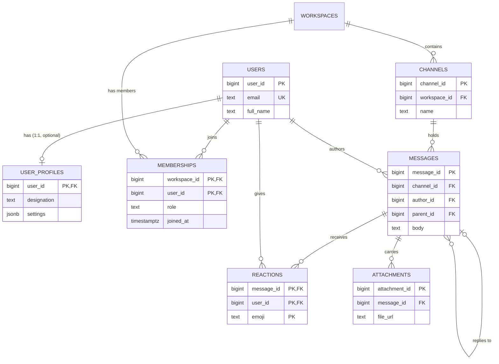
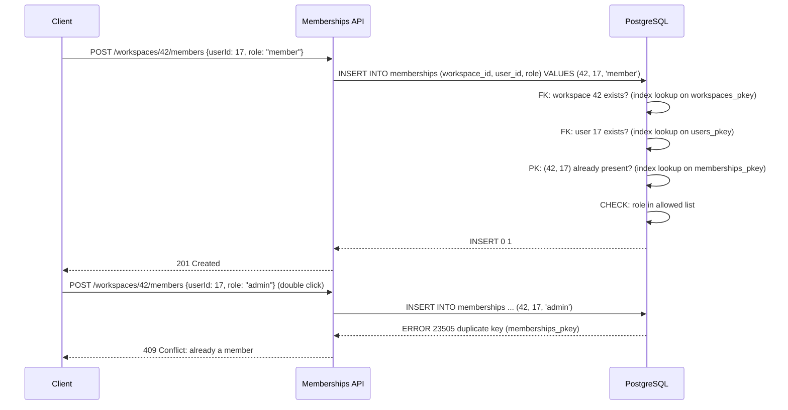

Every data model is a set of things and the links between them. A user *belongs to* a team, a channel *has* messages, a message *replies to* another message. The relational model has exactly one tool for links, the foreign key, and three shapes it can take. Get the shape wrong and you either cannot store a fact the business needs or you store the same fact in two places and watch them drift apart. This lesson teaches you to recognise the shape, place the key, and write the queries that follow.

## Learning objectives

By the end of this lesson you will be able to:

1. Identify the cardinality of a relationship from a requirement sentence (one-to-one, one-to-many, many-to-many) and spot optionality (zero-or-one versus exactly one).
2. Place the foreign key on the correct side for one-to-many, and explain the two ways to model one-to-one.
3. Design a junction table (association table) for many-to-many, including composite primary keys, relationship attributes and the indexes it needs.
4. Model self-referencing relationships (threads, org charts, categories) and query them with recursive CTEs.
5. Avoid the common anti-patterns: comma-separated ids, polymorphic foreign keys without constraints, and junction tables with surrogate keys but no uniqueness.
6. Map each shape to C# records and to EF Core navigation properties.

## Prerequisites

- [Relational database fundamentals](#/lesson/m09-relational-fundamentals): primary keys, foreign keys, constraints, joins and anti-joins.

## Explain it like I'm a beginner

Think about a school.

- Each student has **one** ID card and each ID card belongs to **one** student. That is **one-to-one** (1:1). You could print the card details on the student's record, or keep a separate card register that points back at the student. Both work; the choice depends on whether the card is optional and how often you need it.
- Each class has **many** students, but each student is in **one** class. That is **one-to-many** (1:N). On paper, you write the class name on each student's record. You never list all students on the class record, because the list would change every time a student joined or left. The reference lives on the "many" side.
- Each teacher teaches **many** subjects and each subject is taught by **many** teachers. That is **many-to-many** (M:N). Neither record can hold a single reference to the other. You need a third register, "teacher–subject assignments", with one line per pair. That third register is a **junction table**. It can also carry facts about the pair itself, such as "since 2024" or "head of subject".

The whole lesson comes down to two questions you ask about every link: *how many on each side?* and *can one side be missing?* The answers tell you where the foreign key goes and whether you need a junction table.

## First-principles explanation

### The scenario: Huddle

**Huddle** is a Slack-style team chat app used by companies and college clubs. At a food-delivery startup, for example, the engineers, the product managers and an outside design agency share one workspace. Inside a workspace there are channels (`#backend`, `#incidents`, `#hiring`), and in channels people post messages, reply in threads, attach screenshots and react with emoji. A small deployment: 400 workspaces, 25,000 users, about 3 million messages a year. Requirements, phrased the way a product manager would:

1. A user has one profile with avatar, designation and notification settings.
2. A workspace has many channels; a channel belongs to exactly one workspace.
3. Users join many workspaces; a workspace has many members; each membership has a role (`owner`, `admin`, `member`, `guest`) and a join date.
4. A channel has many messages; every message is in exactly one channel and has exactly one author.
5. A message may be a reply to another message in the same channel (threads).
6. Users react to messages with emoji; one user can react to the same message with several different emoji, but not the same emoji twice.
7. A message can have several attachments; an attachment belongs to one message.

Every one of those sentences names a relationship shape. Let us take them in order of difficulty.

### One-to-many: the foreign key lives on the many side

"A workspace has many channels; a channel belongs to exactly one workspace." The foreign key goes on `channels`, because each channel points at exactly one workspace, and a single column can hold exactly one value:

```sql
CREATE TABLE workspaces (
    workspace_id bigint GENERATED ALWAYS AS IDENTITY PRIMARY KEY,
    name         text NOT NULL,
    slug         text NOT NULL UNIQUE
);

CREATE TABLE channels (
    channel_id   bigint GENERATED ALWAYS AS IDENTITY PRIMARY KEY,
    workspace_id bigint NOT NULL REFERENCES workspaces (workspace_id) ON DELETE CASCADE,
    name         text   NOT NULL,
    is_private   boolean NOT NULL DEFAULT false,
    UNIQUE (workspace_id, name)
);
CREATE INDEX channels_workspace_idx ON channels (workspace_id);
```

Three details carry most of the design:

- **`NOT NULL` on the foreign key** encodes "exactly one". If a channel could exist without a workspace (a draft, say), the column would be nullable and the shape would be "zero-or-one to many".
- **The composite unique `(workspace_id, name)`** says channel names are unique *within a workspace*, not globally. Two workspaces (a startup and a college club) can both have `#backend`. Scoping uniqueness to the parent is one of the most common modelling needs and one of the most commonly forgotten.
- **The index on the foreign key.** PostgreSQL creates an index for primary keys and unique constraints automatically, but **not for foreign keys**. Without `channels_workspace_idx`, "list channels in workspace 42" scans the whole table, and deleting a workspace scans `channels` to check for children. Index every foreign key you will join or filter on, which is nearly all of them.

The "many" side can also point at several parents at once. `messages` points at a channel *and* an author:

```sql
CREATE TABLE users (
    user_id    bigint GENERATED ALWAYS AS IDENTITY PRIMARY KEY,
    email      text NOT NULL UNIQUE,
    full_name  text NOT NULL
);

CREATE TABLE messages (
    message_id  bigint GENERATED ALWAYS AS IDENTITY PRIMARY KEY,
    channel_id  bigint NOT NULL REFERENCES channels (channel_id) ON DELETE CASCADE,
    author_id   bigint NOT NULL REFERENCES users (user_id),
    parent_id   bigint REFERENCES messages (message_id) ON DELETE CASCADE,
    body        text NOT NULL,
    posted_at   timestamptz NOT NULL DEFAULT now()
);
CREATE INDEX messages_channel_posted_idx ON messages (channel_id, posted_at DESC);
CREATE INDEX messages_parent_idx ON messages (parent_id) WHERE parent_id IS NOT NULL;
```

The two foreign keys have different delete rules on purpose. Deleting a channel deletes its messages (`CASCADE`): messages are meaningless without their channel. Deleting a user does **not** delete their messages (default `NO ACTION`), because a conversation with holes in it is worse than a message by a deactivated user. In practice, `users` rows are rarely deleted at all; they are deactivated.

### Self-referencing one-to-many: threads and hierarchies

`parent_id` points at the same table. A reply has exactly one parent; a parent has many replies; a top-level message has `parent_id IS NULL`. This is still one-to-many, just folded onto one table. It models threads, org charts (`manager_id`), product categories (`parent_category_id`) and bill-of-materials trees.

Two things are harder with self-references. First, **a constraint cannot say "the parent must be in the same channel"**: a foreign key checks existence, not equality of other columns. You can enforce it with a composite foreign key trick: make `(message_id, channel_id)` unique on `messages`, then declare `FOREIGN KEY (parent_id, channel_id) REFERENCES messages (message_id, channel_id)`. Now a reply's `channel_id` must match its parent's. This is a useful pattern for any "child must share the parent's grandparent" rule.

Second, **walking the tree needs recursion**. To fetch a whole thread (a message and all replies, replies to replies, ...) use a recursive common table expression:

```sql
WITH RECURSIVE thread AS (
    SELECT message_id, parent_id, author_id, body, posted_at, 0 AS depth
    FROM messages WHERE message_id = 5001
    UNION ALL
    SELECT m.message_id, m.parent_id, m.author_id, m.body, m.posted_at, t.depth + 1
    FROM messages m
    JOIN thread t ON m.parent_id = t.message_id
)
SELECT * FROM thread ORDER BY depth, posted_at;
```

The first `SELECT` is the root; the second repeatedly joins children of what has been found so far until no new rows appear. Chat apps usually keep threads one level deep (replies cannot have replies), which makes the query a plain `WHERE parent_id = 5001`. Decide the depth rule up front; it changes both the schema constraints and every query.

### One-to-one: two tables or one?

"A user has one profile." The honest first question is: *why two tables at all?* If every user has a profile and you always read them together, the profile columns belong on `users`. Reasons to split:

- **Optionality**: the profile may not exist yet (zero-or-one). A separate table avoids a row full of `NULL`s.
- **Size and access pattern**: the profile holds a large `jsonb` of notification settings and a bio that the login path never needs. Keeping `users` narrow makes the hot table smaller.
- **Security or ownership**: different teams or services own the two sets of columns, or one side has stricter access.

Two ways to model it:

```sql
-- A: shared primary key. The profile's PK is also its FK. Exactly zero-or-one profile per user.
CREATE TABLE user_profiles (
    user_id     bigint PRIMARY KEY REFERENCES users (user_id) ON DELETE CASCADE,
    designation text,
    avatar_url  text,
    settings    jsonb NOT NULL DEFAULT '{}'::jsonb
);

-- B: separate key plus a UNIQUE foreign key. Same guarantee, more flexible if the profile gets its own identity later.
CREATE TABLE user_profiles_b (
    profile_id  bigint GENERATED ALWAYS AS IDENTITY PRIMARY KEY,
    user_id     bigint NOT NULL UNIQUE REFERENCES users (user_id) ON DELETE CASCADE,
    designation text
);
```

The uniqueness is what makes it one-to-one. Without `UNIQUE` (or the PK in option A), a user could have two profiles and you would have a one-to-many by accident. Option A is the common choice: simpler, one fewer index, and the id is the same on both sides. Note what neither option can enforce: that every user *has* a profile. "Exactly one" on both sides cannot be expressed with foreign keys alone, because one of the two rows must be inserted first. Either accept zero-or-one, merge the tables, or use a deferred constraint trigger.

### Many-to-many: the junction table

"Users join many workspaces; a workspace has many members." Neither side can hold the link, so a third table holds one row per pair:

```sql
CREATE TABLE memberships (
    workspace_id bigint NOT NULL REFERENCES workspaces (workspace_id) ON DELETE CASCADE,
    user_id      bigint NOT NULL REFERENCES users (user_id) ON DELETE CASCADE,
    role         text   NOT NULL DEFAULT 'member'
                 CHECK (role IN ('owner', 'admin', 'member', 'guest')),
    joined_at    timestamptz NOT NULL DEFAULT now(),
    PRIMARY KEY (workspace_id, user_id)
);
CREATE INDEX memberships_user_idx ON memberships (user_id);
```

Everything important about junction tables is in those ten lines:

- **The composite primary key `(workspace_id, user_id)`** enforces "a user is a member of a workspace at most once". A junction table without this uniqueness is a bug waiting to surface as a user listed twice.
- **Attributes of the relationship** (`role`, `joined_at`) live here, because they describe the pair, not the user or the workspace. Asha is an `owner` of one workspace and a `guest` in another; neither value belongs on `users`.
- **Two indexes for two directions.** The primary key index serves "members of workspace 42" (leading column `workspace_id`). The second index serves "workspaces of user 17". A composite B-tree index helps only queries that filter on its leading column, so you need both. See [Indexes](#/lesson/m09-indexes).
- **`CASCADE` on both sides**: if either the workspace or the user disappears, the membership is meaningless.

Should a junction table have its own surrogate `membership_id`? Only if something else needs to reference a membership (an audit table of role changes, say). Then keep the surrogate PK **and** add `UNIQUE (workspace_id, user_id)`. The uniqueness is non-negotiable; the surrogate key is optional.

Reactions are a many-to-many with a three-part key, because the requirement said "not the same emoji twice":

```sql
CREATE TABLE reactions (
    message_id bigint NOT NULL REFERENCES messages (message_id) ON DELETE CASCADE,
    user_id    bigint NOT NULL REFERENCES users (user_id) ON DELETE CASCADE,
    emoji      text   NOT NULL,
    reacted_at timestamptz NOT NULL DEFAULT now(),
    PRIMARY KEY (message_id, user_id, emoji)
);
```

If the rule were "one reaction per user per message", the key would be `(message_id, user_id)` and `emoji` would be an attribute. The requirement sentence decides the key.

### Reading the requirement sentence

A reliable method for any sentence of the form "A ... B":

1. Ask "one A has how many B?" and "one B has how many A?". Answers: one or many.
2. Ask "can an A exist with zero B?" and the reverse. This gives optionality.
3. Translate:

| A → B | B → A | Shape | Where the key goes |
|---|---|---|---|
| one | one | 1:1 | On the optional side (or merge into one table) with `UNIQUE` |
| many | one | 1:N | On the "many" side (the child), `NOT NULL` if the parent is required |
| many | many | M:N | New junction table with composite PK and one index per direction |

Watch for sentences that hide a many-to-many. "Each message has one author" is 1:N. "Each message is seen by its readers" is M:N (`message_reads`, with a `read_at` attribute). "Each attachment belongs to a message" is 1:N, until a product manager says "we want to attach the same file to several messages", at which point `attachments` becomes `files` plus a `message_files` junction. Shapes change when requirements change; the cost of the change is why you name the shape explicitly in design reviews.

### Anti-patterns and why they fail

**Comma-separated ids** (`members text = '17,42,98'`). You cannot join on it, index it, enforce that the ids exist, or add a role per member. Counting members means string parsing. Removing one member rewrites the whole string under concurrency. It is the most common beginner mistake and the hardest to migrate away from later.

**Repeating columns** (`member1_id, member2_id, ... member10_id`). The eleventh member cannot join. Queries need ten `OR`s. This is the 1NF violation [Normalization](#/lesson/m09-normalization) starts with.

**Polymorphic foreign key without a constraint** (`attachments.owner_type text, owner_id bigint` where owner may be a message or a channel). A foreign key cannot reference "one of two tables", so referential integrity is lost. Alternatives: one nullable foreign key per target with a `CHECK` that exactly one is set, or a shared parent table (`attachable_items`) that both messages and channels reference. Both keep the constraint.

**Junction table with surrogate key only.** `membership_id PRIMARY KEY` and no unique on the pair: duplicate memberships appear within weeks.

**Foreign keys without indexes.** Fine at 1,000 rows, a sequential scan per request at 10 million.

### Trade-offs and failure modes

- **Cascades are convenient and dangerous.** `ON DELETE CASCADE` from `workspaces` to `channels` to `messages` to `reactions` means one `DELETE` can remove millions of rows in a single long transaction, holding locks and generating a lot of WAL. For big parents, prefer soft-delete flags or delete children in batches by a background job.
- **Deep self-referencing trees** make "move this subtree" and "all descendants" expensive without extra structure. For deep, read-heavy hierarchies consider a materialised path column (`'1.17.204'`) or the `ltree` extension. Threads one level deep need none of that.
- **Many-to-many with heavy attributes** (an `enrolments` table with grades, attendance, fees) is really an entity in its own right. Give it a surrogate key and treat it as a first-class table; the "junction" label stops being useful.
- **Join cost grows with shape.** Fetching a channel's messages with authors and reaction counts is a three-way join. It is fast with the right indexes and a disaster as N+1 queries from an ORM; see [N+1 query problems](#/lesson/m09-n-plus-one).

### When a simpler alternative is better

If a relationship is read only ever as part of one parent, is never queried from the other side, and has no constraints of its own, a `jsonb` array on the parent can be simpler: a message's `mentions` as `jsonb` of user ids, when you never ask "all messages mentioning user 17". The moment you need the reverse query, uniqueness, or a foreign key check, build the junction table. Start with the junction table when in doubt; it is easier to flatten later than to un-flatten.

## Visual explanation

### The Huddle model



Reading the shapes: `USERS ||--o| USER_PROFILES` is one-to-zero-or-one; the profile's primary key doubles as the foreign key. `WORKSPACES` and `USERS` never touch directly; both fan out (`||--o{`) into `MEMBERSHIPS`, which is how every many-to-many appears on a diagram: two one-to-manys meeting in the middle. `MESSAGES o|--o{ MESSAGES` is the self-reference: a message has zero-or-one parent and zero-or-more replies. `REACTIONS` shows a three-column primary key, where `emoji` is part of the identity because the requirement allowed several different emoji per user per message.

### Joining a workspace: what the database checks



Each arrow inside PostgreSQL is an index lookup, which is why foreign key checks are cheap when the referenced keys are indexed (they always are, as primary or unique keys). The composite primary key does double duty: it is the uniqueness rule *and* the index that serves "list members of workspace 42". The second request shows the rule paying off: a double-click cannot create a second membership, and the API turns the `23505` into a 409 instead of a crash. If the product wanted the second call to *change* the role, the API would use `INSERT ... ON CONFLICT (workspace_id, user_id) DO UPDATE SET role = EXCLUDED.role` instead.

## Step-by-step example

Let us model a new feature end to end: **read receipts**. The requirement: "In a channel, show for each message how many members have read it, and let a user see which messages are unread."

**Step 1 — Find the shape.** One message is read by many users; one user reads many messages. Many-to-many. The relationship has an attribute: when it was read.

**Step 2 — Design the junction table.**

```sql
CREATE TABLE message_reads (
    message_id bigint NOT NULL REFERENCES messages (message_id) ON DELETE CASCADE,
    user_id    bigint NOT NULL REFERENCES users (user_id) ON DELETE CASCADE,
    read_at    timestamptz NOT NULL DEFAULT now(),
    PRIMARY KEY (message_id, user_id)
);
CREATE INDEX message_reads_user_idx ON message_reads (user_id, message_id);
```

**Step 3 — Check the numbers.** 3 million messages a year × average 12 readers each = 36 million rows a year, about 40 bytes each plus two indexes: roughly 5 GB a year (estimate). Fine for one table, but it is the biggest table in the system, and it grows with readers × messages, not with messages. For a consumer chat app with channels of 10,000 members this design would explode (10,000 rows per message). The alternative is a **per-user cursor**: `channel_reads (channel_id, user_id, last_read_message_id)`, one row per member per channel, and "unread" means `message_id > last_read_message_id`. The shape of the relationship is still M:N conceptually, but the storage is "one row per (channel, user)" instead of "one row per (message, user)". Cardinality drives the design more than the label does.

**Step 4 — Write the queries.** With the cursor design, unread count for user 17 in channel 7:

```sql
SELECT count(*)
FROM messages m
JOIN channel_reads r ON r.channel_id = m.channel_id AND r.user_id = 17
WHERE m.channel_id = 7 AND m.message_id > r.last_read_message_id;
```

"Who has read message 5001?" is now harder (anyone whose cursor is at or past it), which is the trade: the cursor design makes "my unread" cheap and "who read this" approximate. For a work tool with channels of 20 to 200 people, Huddle keeps `message_reads` and gets exact receipts. For a 10,000-member channel it would switch to cursors.

**Step 5 — Map to code.** `message_reads` is a pure junction with one attribute; in C# it is a record `MessageRead(long MessageId, long UserId, DateTimeOffset ReadAt)`, and in EF Core it is a skip navigation with a payload entity. The important point: the model in code should mirror the shape, not hide it. A `List<long> ReaderIds` on `Message` loses `read_at` and invites loading 12 million ids into memory.

## Production-style C# implementation

The compiled code models the shapes as plain C# and implements two pieces of pure logic a messaging service needs: an in-memory membership set with composite-key semantics and role rules, and a thread builder that turns flat `(message_id, parent_id)` rows into a tree. Database access is shown separately as Dapper and EF Core snippets, which the checker cannot compile.

```text
Huddle.Api/
  Program.cs
  Domain/Models.cs
  Domain/MembershipSet.cs
  Domain/ThreadBuilder.cs
```

```csharp file=Domain/Models.cs
namespace Huddle.Domain;

public enum Role { Guest, Member, Admin, Owner }

public sealed record User(long UserId, string Email, string FullName);

/// <summary>1:1 with users: same key on both sides.</summary>
public sealed record UserProfile(long UserId, string? Designation, string? AvatarUrl);

public sealed record Workspace(long WorkspaceId, string Name, string Slug);

/// <summary>1:N: the child carries the parent's key.</summary>
public sealed record Channel(long ChannelId, long WorkspaceId, string Name, bool IsPrivate);

/// <summary>M:N junction row with relationship attributes.</summary>
public sealed record Membership(long WorkspaceId, long UserId, Role Role, DateTimeOffset JoinedAt);

/// <summary>Self-referencing 1:N through ParentId.</summary>
public sealed record Message(long MessageId, long ChannelId, long AuthorId, long? ParentId, string Body, DateTimeOffset PostedAt);

/// <summary>Three-part key: a user may react with several different emoji to one message.</summary>
public sealed record Reaction(long MessageId, long UserId, string Emoji, DateTimeOffset ReactedAt);
```

```csharp file=Domain/MembershipSet.cs
namespace Huddle.Domain;

/// <summary>
/// In-memory model of the memberships junction table: composite key (workspace, user), role attribute,
/// and the business rule that a workspace always keeps at least one owner.
/// </summary>
public sealed class MembershipSet
{
    private readonly Dictionary<(long WorkspaceId, long UserId), Membership> _rows = new();

    public int Count => _rows.Count;

    /// <summary>Insert. Returns false on a duplicate pair, like SQLSTATE 23505.</summary>
    public bool TryAdd(Membership m)
    {
        if (m.JoinedAt == default) throw new ArgumentException("joined_at required", nameof(m));
        return _rows.TryAdd((m.WorkspaceId, m.UserId), m);
    }

    /// <summary>INSERT ... ON CONFLICT DO UPDATE SET role: add or change the role of an existing member.</summary>
    public Membership Upsert(long workspaceId, long userId, Role role, DateTimeOffset now)
    {
        var key = (workspaceId, userId);
        if (_rows.TryGetValue(key, out var existing))
        {
            EnsureOwnerRemains(workspaceId, userId, role);
            var updated = existing with { Role = role };
            _rows[key] = updated;
            return updated;
        }
        var created = new Membership(workspaceId, userId, role, now);
        _rows[key] = created;
        return created;
    }

    public bool Remove(long workspaceId, long userId)
    {
        if (!_rows.TryGetValue((workspaceId, userId), out var m)) return false;
        if (m.Role == Role.Owner) EnsureOwnerRemains(workspaceId, userId, Role.Guest);
        return _rows.Remove((workspaceId, userId));
    }

    /// <summary>"Members of workspace" uses the leading key column, like the PK index.</summary>
    public IReadOnlyList<Membership> OfWorkspace(long workspaceId) =>
        _rows.Values.Where(m => m.WorkspaceId == workspaceId).OrderBy(m => m.JoinedAt).ToList();

    /// <summary>"Workspaces of user" needs the second index (user_id) in SQL.</summary>
    public IReadOnlyList<Membership> OfUser(long userId) =>
        _rows.Values.Where(m => m.UserId == userId).ToList();

    private void EnsureOwnerRemains(long workspaceId, long userId, Role newRole)
    {
        if (newRole == Role.Owner) return;
        var otherOwners = _rows.Values.Count(m => m.WorkspaceId == workspaceId && m.UserId != userId && m.Role == Role.Owner);
        if (otherOwners == 0)
            throw new InvalidOperationException("A workspace must keep at least one owner.");
    }
}
```

```csharp file=Domain/ThreadBuilder.cs
namespace Huddle.Domain;

public sealed class ThreadNode(Message message)
{
    public Message Message { get; } = message;
    public List<ThreadNode> Replies { get; } = new();
    public int Depth { get; internal set; }
}

/// <summary>Builds trees from flat self-referencing rows, the in-memory equivalent of the recursive CTE.</summary>
public static class ThreadBuilder
{
    public static IReadOnlyList<ThreadNode> Build(IEnumerable<Message> rows)
    {
        var nodes = rows.ToDictionary(m => m.MessageId, m => new ThreadNode(m));
        var roots = new List<ThreadNode>();

        foreach (var node in nodes.Values)
        {
            var parentId = node.Message.ParentId;
            if (parentId is null)
            {
                roots.Add(node);
            }
            else if (nodes.TryGetValue(parentId.Value, out var parent))
            {
                parent.Replies.Add(node);
            }
            else
            {
                // Orphan: parent not in this result set (deleted, or outside the page). Treat as a root
                // rather than drop it; the caller decides whether that is acceptable.
                roots.Add(node);
            }
        }

        foreach (var root in roots) SetDepth(root, 0);
        return roots.OrderBy(r => r.Message.PostedAt).ToList();
    }

    private static void SetDepth(ThreadNode node, int depth)
    {
        node.Depth = depth;
        node.Replies.Sort((a, b) => a.Message.PostedAt.CompareTo(b.Message.PostedAt));
        foreach (var child in node.Replies) SetDepth(child, depth + 1);
    }

    public static int CountDescendants(ThreadNode node) => node.Replies.Sum(r => 1 + CountDescendants(r));
}
```

```csharp file=Program.cs
using Huddle.Domain;

var builder = WebApplication.CreateBuilder(args);
builder.Services.AddSingleton<MembershipSet>();
builder.Services.AddSingleton(TimeProvider.System);

var app = builder.Build();

app.MapPost("/workspaces/{workspaceId:long}/members", (long workspaceId, AddMember body, MembershipSet set, TimeProvider clock) =>
{
    try
    {
        var m = set.Upsert(workspaceId, body.UserId, body.Role, clock.GetUtcNow());
        return Results.Ok(m);
    }
    catch (InvalidOperationException ex)
    {
        return Results.Conflict(new { error = ex.Message });
    }
});

app.MapGet("/workspaces/{workspaceId:long}/members", (long workspaceId, MembershipSet set) => set.OfWorkspace(workspaceId));

app.MapGet("/users/{userId:long}/workspaces", (long userId, MembershipSet set) => set.OfUser(userId));

app.MapDelete("/workspaces/{workspaceId:long}/members/{userId:long}", (long workspaceId, long userId, MembershipSet set) =>
{
    try { return set.Remove(workspaceId, userId) ? Results.NoContent() : Results.NotFound(); }
    catch (InvalidOperationException ex) { return Results.Conflict(new { error = ex.Message }); }
});

app.Run();

public sealed record AddMember(long UserId, Role Role);
```

Against a real database, the upsert is one statement (Dapper; not compiled here):

```csharp
// Add or change a member's role atomically. The composite PK makes the conflict target.
await conn.ExecuteAsync(
    """
    INSERT INTO memberships (workspace_id, user_id, role)
    VALUES (@WorkspaceId, @UserId, @Role)
    ON CONFLICT (workspace_id, user_id) DO UPDATE SET role = EXCLUDED.role
    """, new { WorkspaceId = workspaceId, UserId = body.UserId, Role = body.Role.ToString().ToLowerInvariant() });
```

And the same shapes in EF Core (not compiled here), where the junction with payload is an explicit entity:

```csharp
modelBuilder.Entity<User>()
    .HasOne(u => u.Profile).WithOne(p => p.User)
    .HasForeignKey<UserProfile>(p => p.UserId);                       // 1:1, shared key

modelBuilder.Entity<Channel>()
    .HasOne(c => c.Workspace).WithMany(w => w.Channels)
    .HasForeignKey(c => c.WorkspaceId).OnDelete(DeleteBehavior.Cascade);   // 1:N

modelBuilder.Entity<Membership>()
    .HasKey(m => new { m.WorkspaceId, m.UserId });                     // M:N with payload: explicit entity
modelBuilder.Entity<Membership>().HasIndex(m => m.UserId);

modelBuilder.Entity<Message>()
    .HasOne(m => m.Parent).WithMany(m => m.Replies)
    .HasForeignKey(m => m.ParentId).OnDelete(DeleteBehavior.Cascade);      // self-reference
```

Design notes:

- **The "at least one owner" rule** lives in `MembershipSet`, not in a constraint, because it is a rule across rows ("count of owners in this workspace ≥ 1"). A `CHECK` cannot express it. In SQL you would enforce it in the application transaction with a `SELECT ... FOR UPDATE` on the workspace row to serialise concurrent role changes, or with a constraint trigger.
- **Orphans in `ThreadBuilder`** are kept as roots. When you page through messages, a reply's parent may be on another page; dropping it silently would hide messages. Make the policy explicit.
- **`OfWorkspace` and `OfUser`** exist to remind you that a junction table is queried from both sides and therefore needs both indexes.

## Bad design vs good design

**Bad**: `workspaces.member_ids text` holding `'17,42,98'` and `members.role text` holding `'17:owner,42:member'`. Adding a member is a string rewrite that loses a concurrent update. "Which workspaces is user 42 in?" is `WHERE member_ids LIKE '%42%'`, which also matches user 142 and 420 and can never use an index. Deleting a user leaves dangling ids in hundreds of strings. Roles and join dates are impossible to query. Attachments use `owner_type`/`owner_id` with no foreign key, and 3 % of them point at deleted messages.

**Good**: `memberships (workspace_id, user_id, role, joined_at)` with a composite primary key and a second index on `user_id`; `channels.workspace_id NOT NULL` with a scoped unique on `(workspace_id, name)`; `messages.parent_id` self-reference with cascade; `reactions` keyed on `(message_id, user_id, emoji)`; `attachments.message_id NOT NULL` with a real foreign key. Every "which X for this Y?" question is an indexed join, every uniqueness rule is a key, and deleting anything leaves no dangling references.

**Is the good design always right?** A read model built for one screen (a denormalised `channel_summary` with `member_count` and `last_message_at`) can legitimately flatten relationships, as long as it is derived from the normalised tables and rebuilt from them. The relational shapes are for the source of truth, not necessarily for every projection.

:::callout type=mistake title="Forgetting the index on the foreign key"
PostgreSQL indexes primary keys and unique constraints automatically. It does not index foreign key columns. A `memberships (user_id)` query or a `DELETE FROM users` with no index on `memberships.user_id` scans the whole junction table. Make "create index on every FK I query" part of your schema checklist.
:::

:::callout type=tradeoff title="Junction table or jsonb array?"
A `jsonb` array of ids on the parent is simpler for one-directional, constraint-free lists that are always read with the parent. A junction table gives you the reverse query, uniqueness, attributes, foreign key checks and sane deletes. When unsure, choose the junction table; flattening later is easy, un-flattening is a data migration.
:::

## Practical playground

The playground seeds Huddle with two workspaces, a handful of users and a threaded conversation. Try these:

1. Insert a duplicate membership `(1, 2, 'admin')` and read the error. Then do the same with `ON CONFLICT (workspace_id, user_id) DO UPDATE SET role = EXCLUDED.role` and check the row.
2. Run the recursive CTE on `message_id = 1` and confirm the depth column.
3. `EXPLAIN SELECT * FROM memberships WHERE user_id = 2;` with and without the `memberships_user_idx` index (drop it, then recreate it).
4. Count reactions per message per emoji, and try inserting the same `(message, user, emoji)` twice.
5. Delete channel 1 and watch messages, reactions and attachments cascade. Then try deleting user 2 and see the author foreign key block it.

:::playground type=sql title="Huddle: three relationship shapes"
```sql
CREATE TABLE users (
  user_id   bigint GENERATED ALWAYS AS IDENTITY PRIMARY KEY,
  email     text NOT NULL UNIQUE,
  full_name text NOT NULL
);
CREATE TABLE user_profiles (
  user_id     bigint PRIMARY KEY REFERENCES users (user_id) ON DELETE CASCADE,
  designation text,
  settings    jsonb NOT NULL DEFAULT '{}'::jsonb
);
CREATE TABLE workspaces (
  workspace_id bigint GENERATED ALWAYS AS IDENTITY PRIMARY KEY,
  name text NOT NULL,
  slug text NOT NULL UNIQUE
);
CREATE TABLE memberships (
  workspace_id bigint NOT NULL REFERENCES workspaces (workspace_id) ON DELETE CASCADE,
  user_id      bigint NOT NULL REFERENCES users (user_id) ON DELETE CASCADE,
  role         text NOT NULL DEFAULT 'member' CHECK (role IN ('owner','admin','member','guest')),
  joined_at    timestamptz NOT NULL DEFAULT now(),
  PRIMARY KEY (workspace_id, user_id)
);
CREATE INDEX memberships_user_idx ON memberships (user_id);
CREATE TABLE channels (
  channel_id   bigint GENERATED ALWAYS AS IDENTITY PRIMARY KEY,
  workspace_id bigint NOT NULL REFERENCES workspaces (workspace_id) ON DELETE CASCADE,
  name         text NOT NULL,
  is_private   boolean NOT NULL DEFAULT false,
  UNIQUE (workspace_id, name)
);
CREATE TABLE messages (
  message_id bigint GENERATED ALWAYS AS IDENTITY PRIMARY KEY,
  channel_id bigint NOT NULL REFERENCES channels (channel_id) ON DELETE CASCADE,
  author_id  bigint NOT NULL REFERENCES users (user_id),
  parent_id  bigint REFERENCES messages (message_id) ON DELETE CASCADE,
  body       text NOT NULL,
  posted_at  timestamptz NOT NULL DEFAULT now()
);
CREATE INDEX messages_channel_posted_idx ON messages (channel_id, posted_at DESC);
CREATE TABLE reactions (
  message_id bigint NOT NULL REFERENCES messages (message_id) ON DELETE CASCADE,
  user_id    bigint NOT NULL REFERENCES users (user_id) ON DELETE CASCADE,
  emoji      text NOT NULL,
  PRIMARY KEY (message_id, user_id, emoji)
);
CREATE TABLE attachments (
  attachment_id bigint GENERATED ALWAYS AS IDENTITY PRIMARY KEY,
  message_id    bigint NOT NULL REFERENCES messages (message_id) ON DELETE CASCADE,
  file_url      text NOT NULL,
  size_bytes    bigint NOT NULL CHECK (size_bytes > 0)
);

INSERT INTO users (email, full_name) VALUES
  ('asha@zestly.example', 'Asha Deshpande'), ('vikram@zestly.example', 'Vikram Singh'),
  ('meera@zestly.example', 'Meera Iyer'), ('john@agency.example', 'John Carter'), ('neha@punecoders.example', 'Neha Gupta');
INSERT INTO user_profiles (user_id, designation) VALUES (1, 'Engineering Manager'), (2, 'Backend Developer'), (3, 'Product Manager');
INSERT INTO workspaces (name, slug) VALUES ('Zestly Foods Engineering', 'zestly-eng'), ('Pune Coders Club', 'pune-coders');
INSERT INTO memberships (workspace_id, user_id, role, joined_at) VALUES
  (1, 1, 'owner',  '2026-01-10'), (1, 2, 'member', '2026-01-12'), (1, 3, 'admin', '2026-01-15'), (1, 4, 'guest', '2026-02-01'),
  (2, 1, 'admin',  '2026-03-01'), (2, 5, 'owner',  '2026-03-01'), (2, 2, 'member', '2026-03-05');
INSERT INTO channels (workspace_id, name, is_private) VALUES
  (1, 'backend', false), (1, 'incidents', false), (1, 'hiring', true), (2, 'backend', false);
INSERT INTO messages (channel_id, author_id, parent_id, body, posted_at) VALUES
  (1, 2, NULL, 'Order API p95 jumped to 2 s after the 10:00 deploy, graphs attached.', '2026-10-18 10:20+05:30'),
  (1, 1, 1,    'Looks like the new coupon query. Can you check its plan?', '2026-10-18 10:32+05:30'),
  (1, 2, 2,    'Seq scan on coupons, 380 ms per call. Adding an index now.', '2026-10-18 10:55+05:30'),
  (1, 3, 1,    'Please post a status update in #incidents for support.', '2026-10-18 11:05+05:30'),
  (2, 1, NULL, 'Incident review tomorrow at 11:00, add notes to the doc.', '2026-10-18 17:00+05:30'),
  (3, 3, NULL, 'Backend shortlist needs interview feedback by Friday.', '2026-10-17 11:00+05:30'),
  (4, 5, NULL, 'Hackathon venue confirmed for Saturday.', '2026-10-18 08:00+05:30');
INSERT INTO reactions (message_id, user_id, emoji) VALUES
  (1, 1, 'thumbs_up'), (1, 3, 'thumbs_up'), (1, 3, 'eyes'), (3, 1, 'check'), (5, 2, 'thumbs_up'), (5, 4, 'thumbs_up');
INSERT INTO attachments (message_id, file_url, size_bytes) VALUES
  (1, 's3://huddle/latency-p95.png', 241100), (1, 's3://huddle/error-rate.png', 220800), (6, 's3://huddle/shortlist.pdf', 512000);
```
:::

## Exercises

:::exercise id=m09-relationships-ex1 difficulty=beginner kind=sql ordered=true title="Members per workspace with their roles"
For each workspace, return `workspace_name`, `member_count` (number of memberships) and `owner_count` (memberships with role `owner`). Include workspaces with no members (count 0). Order by `workspace_name`.
::setup
```sql
CREATE TABLE users (user_id bigint PRIMARY KEY, full_name text NOT NULL);
CREATE TABLE workspaces (workspace_id bigint PRIMARY KEY, name text NOT NULL);
CREATE TABLE memberships (
  workspace_id bigint REFERENCES workspaces, user_id bigint REFERENCES users, role text NOT NULL,
  PRIMARY KEY (workspace_id, user_id)
);
INSERT INTO users VALUES (1,'Asha'),(2,'Vikram'),(3,'Meera'),(4,'John'),(5,'Neha');
INSERT INTO workspaces VALUES (1,'Zestly Foods Engineering'),(2,'Pune Coders Club'),(3,'Archive: Hackathon 2021');
INSERT INTO memberships VALUES (1,1,'owner'),(1,2,'member'),(1,3,'admin'),(1,4,'guest'),(2,1,'admin'),(2,5,'owner'),(2,2,'member'),(2,3,'owner');
```
::check
```sql
SELECT w.name AS workspace_name,
       count(m.user_id) AS member_count,
       count(*) FILTER (WHERE m.role = 'owner') AS owner_count
FROM workspaces w
LEFT JOIN memberships m ON m.workspace_id = w.workspace_id
GROUP BY w.workspace_id, w.name
ORDER BY w.name;
```
::acceptance
- Three rows: the archive workspace shows 0 and 0.
- Zestly Foods Engineering shows 4 members and 1 owner; Pune Coders Club shows 4 members and 2 owners.
- Columns named exactly `workspace_name`, `member_count`, `owner_count`.
::hint
"Include workspaces with no members" means an outer join from `workspaces`, not an inner join.
::hint
`count(*)` counts rows even when the join produced nulls. `count(m.user_id)` counts only real matches.
::hint
For the owner count, either `sum(CASE WHEN m.role = 'owner' THEN 1 ELSE 0 END)` or PostgreSQL's `count(*) FILTER (WHERE m.role = 'owner')`.
::hint
```sql
SELECT w.name AS workspace_name, count(m.user_id) AS member_count, count(*) FILTER (WHERE m.role = 'owner') AS owner_count
FROM workspaces w LEFT JOIN memberships m ON ... GROUP BY ... ORDER BY w.name;
```
::solution
```sql
SELECT w.name AS workspace_name,
       count(m.user_id) AS member_count,
       count(*) FILTER (WHERE m.role = 'owner') AS owner_count
FROM workspaces w
LEFT JOIN memberships m ON m.workspace_id = w.workspace_id
GROUP BY w.workspace_id, w.name
ORDER BY w.name;
```

The junction table is read from the workspace side here, which the primary key index `(workspace_id, user_id)` serves. `count(m.user_id)` is the standard way to get 0 for an unmatched outer-join row; `count(*)` would report 1 for the archive workspace because the `LEFT JOIN` still produces one row of nulls for it.
::mistakes
- Using an inner `JOIN`, which drops the empty workspace.
- `count(*)` for `member_count`, which gives 1 instead of 0 for the archive.
- Grouping by `w.name` alone; two workspaces could share a name, so group by the key.
:::

:::exercise id=m09-relationships-ex2 difficulty=beginner kind=code title="A junction set with a composite key"
Implement `ReactionSet`, an in-memory version of the `reactions` table keyed on `(messageId, userId, emoji)`.
::requirements
- `bool Add(long messageId, long userId, string emoji)`: returns `true` if the reaction was added, `false` if that exact triple already existed. Emoji comparison is case-sensitive and the emoji must be non-empty (throw `ArgumentException` otherwise).
- `bool Remove(long messageId, long userId, string emoji)`: returns whether something was removed.
- `IReadOnlyDictionary<string, int> CountsFor(long messageId)`: emoji → number of distinct users who reacted with it.
- `int DistinctReactors(long messageId)`: number of distinct users who reacted to the message with any emoji.
::acceptance
- Adding `(1, 7, "thumbs_up")` twice returns `true` then `false`.
- The same user can add `"thumbs_up"` and `"eyes"` to the same message.
- `CountsFor(1)` after users 7 and 9 add `"thumbs_up"` and user 9 adds `"eyes"` is `{thumbs_up: 2, eyes: 1}`, and `DistinctReactors(1)` is 2.
- `Add(1, 7, "")` throws `ArgumentException`.
::hint
A `HashSet` of a value tuple `(long, long, string)` gives you composite-key uniqueness for free.
::hint
`HashSet<T>.Add` returns `false` when the element is already present, which is exactly the "duplicate key" signal.
::hint
For the counts, filter the set by `messageId`, group by `emoji`, count. For distinct reactors, select `userId` and `Distinct()`.
::hint
```csharp
private readonly HashSet<(long MessageId, long UserId, string Emoji)> _rows = new();
public bool Add(long m, long u, string e) { if (string.IsNullOrEmpty(e)) throw new ArgumentException(...); return _rows.Add((m, u, e)); }
```
::starter
```csharp file=ReactionSet.cs
using System;
using System.Collections.Generic;
using System.Linq;

public sealed class ReactionSet
{
    public bool Add(long messageId, long userId, string emoji) => throw new NotImplementedException();

    public bool Remove(long messageId, long userId, string emoji) => throw new NotImplementedException();

    public IReadOnlyDictionary<string, int> CountsFor(long messageId) => throw new NotImplementedException();

    public int DistinctReactors(long messageId) => throw new NotImplementedException();
}
```
::tests
```csharp file=ReactionSetTests.cs
using System;
using Xunit;

public class ReactionSetTests
{
    [Fact]
    public void Same_triple_twice_is_a_duplicate()
    {
        var r = new ReactionSet();
        Assert.True(r.Add(1, 7, "thumbs_up"));
        Assert.False(r.Add(1, 7, "thumbs_up"));
    }

    [Fact]
    public void Different_emoji_from_same_user_is_allowed()
    {
        var r = new ReactionSet();
        Assert.True(r.Add(1, 7, "thumbs_up"));
        Assert.True(r.Add(1, 7, "eyes"));
    }

    [Fact]
    public void Counts_and_distinct_reactors()
    {
        var r = new ReactionSet();
        r.Add(1, 7, "thumbs_up");
        r.Add(1, 9, "thumbs_up");
        r.Add(1, 9, "eyes");
        r.Add(2, 9, "eyes");
        var counts = r.CountsFor(1);
        Assert.Equal(2, counts["thumbs_up"]);
        Assert.Equal(1, counts["eyes"]);
        Assert.Equal(2, counts.Count);
        Assert.Equal(2, r.DistinctReactors(1));
        Assert.Equal(1, r.DistinctReactors(2));
        Assert.Equal(0, r.DistinctReactors(3));
    }

    [Fact]
    public void Remove_then_add_again()
    {
        var r = new ReactionSet();
        r.Add(1, 7, "thumbs_up");
        Assert.True(r.Remove(1, 7, "thumbs_up"));
        Assert.False(r.Remove(1, 7, "thumbs_up"));
        Assert.True(r.Add(1, 7, "thumbs_up"));
    }

    [Fact]
    public void Empty_emoji_is_rejected()
    {
        var r = new ReactionSet();
        Assert.Throws<ArgumentException>(() => r.Add(1, 7, ""));
    }
}
```
::solution
```csharp file=ReactionSet.cs
using System;
using System.Collections.Generic;
using System.Linq;

public sealed class ReactionSet
{
    private readonly HashSet<(long MessageId, long UserId, string Emoji)> _rows = new();

    public bool Add(long messageId, long userId, string emoji)
    {
        if (string.IsNullOrEmpty(emoji)) throw new ArgumentException("emoji must be non-empty", nameof(emoji));
        return _rows.Add((messageId, userId, emoji));
    }

    public bool Remove(long messageId, long userId, string emoji) => _rows.Remove((messageId, userId, emoji));

    public IReadOnlyDictionary<string, int> CountsFor(long messageId) =>
        _rows.Where(r => r.MessageId == messageId)
             .GroupBy(r => r.Emoji)
             .ToDictionary(g => g.Key, g => g.Count());

    public int DistinctReactors(long messageId) =>
        _rows.Where(r => r.MessageId == messageId).Select(r => r.UserId).Distinct().Count();
}
```

The `HashSet` of a three-part tuple is the in-memory twin of `PRIMARY KEY (message_id, user_id, emoji)`. `CountsFor` is `SELECT emoji, count(*) FROM reactions WHERE message_id = $1 GROUP BY emoji`, and `DistinctReactors` is `count(DISTINCT user_id)`. If the business rule changed to "one reaction per user per message", the key would shrink to `(messageId, userId)` and `Add` would become an upsert that replaces the emoji.
::mistakes
- Keying on `(messageId, userId)` only, which wrongly rejects a second emoji from the same user.
- Counting rows instead of distinct users for `DistinctReactors`.
- Case-folding the emoji name when the requirement said case-sensitive.
:::

:::exercise id=m09-relationships-ex3 difficulty=intermediate kind=sql ordered=true title="Channels where two specific users can both see each other's messages"
Public channels are visible to every member of the workspace; private channels only to users listed in `channel_members`. Return the `channel_id` and `name` of every channel that **both** user 1 and user 3 can see, ordered by `channel_id`.
::setup
```sql
CREATE TABLE users (user_id bigint PRIMARY KEY, full_name text NOT NULL);
CREATE TABLE workspaces (workspace_id bigint PRIMARY KEY, name text NOT NULL);
CREATE TABLE memberships (workspace_id bigint REFERENCES workspaces, user_id bigint REFERENCES users, role text NOT NULL, PRIMARY KEY (workspace_id, user_id));
CREATE TABLE channels (channel_id bigint PRIMARY KEY, workspace_id bigint NOT NULL REFERENCES workspaces, name text NOT NULL, is_private boolean NOT NULL, UNIQUE (workspace_id, name));
CREATE TABLE channel_members (channel_id bigint REFERENCES channels, user_id bigint REFERENCES users, PRIMARY KEY (channel_id, user_id));
INSERT INTO users VALUES (1,'Asha'),(2,'Vikram'),(3,'Meera'),(4,'John'),(5,'Neha');
INSERT INTO workspaces VALUES (1,'Zestly Foods Engineering'),(2,'Pune Coders Club');
INSERT INTO memberships VALUES (1,1,'owner'),(1,2,'member'),(1,3,'admin'),(1,4,'guest'),(2,1,'admin'),(2,5,'owner'),(2,2,'member');
INSERT INTO channels VALUES
  (1,1,'backend',false),(2,1,'incidents',false),(3,1,'hiring',true),(4,1,'payroll',true),
  (5,2,'backend',false),(6,2,'organisers',true);
INSERT INTO channel_members VALUES (3,1),(3,3),(4,1),(4,2),(6,1),(6,5);
```
::check
```sql
WITH visible AS (
  SELECT c.channel_id, c.name, m.user_id
  FROM channels c
  JOIN memberships m ON m.workspace_id = c.workspace_id
  WHERE NOT c.is_private
  UNION
  SELECT c.channel_id, c.name, cm.user_id
  FROM channels c
  JOIN channel_members cm ON cm.channel_id = c.channel_id
  WHERE c.is_private
)
SELECT channel_id, name
FROM visible
WHERE user_id IN (1, 3)
GROUP BY channel_id, name
HAVING count(DISTINCT user_id) = 2
ORDER BY channel_id;
```
::acceptance
- Returns channels 1, 2 and 3 only.
- Channel 4 is excluded (user 3 is not a member of the private channel).
- Channels 5 and 6 are excluded (user 3 is not in workspace 2).
::hint
First build the set of `(channel, user)` pairs that can see each other: public channels × workspace members, plus private channels × channel members.
::hint
Two different relationship paths (via `memberships` for public, via `channel_members` for private) combine naturally with `UNION`.
::hint
"Both users" is a relational-division question: filter to the two users, group by channel, and keep groups with 2 distinct users.
::hint
```sql
WITH visible AS (... UNION ...)
SELECT channel_id, name FROM visible WHERE user_id IN (1,3)
GROUP BY channel_id, name HAVING count(DISTINCT user_id) = 2 ORDER BY channel_id;
```
::solution
```sql
WITH visible AS (
  SELECT c.channel_id, c.name, m.user_id
  FROM channels c
  JOIN memberships m ON m.workspace_id = c.workspace_id
  WHERE NOT c.is_private
  UNION
  SELECT c.channel_id, c.name, cm.user_id
  FROM channels c
  JOIN channel_members cm ON cm.channel_id = c.channel_id
  WHERE c.is_private
)
SELECT channel_id, name
FROM visible
WHERE user_id IN (1, 3)
GROUP BY channel_id, name
HAVING count(DISTINCT user_id) = 2
ORDER BY channel_id;
```

Visibility is a many-to-many between channels and users, but it is **derived** from two different relationships rather than stored. The CTE materialises that derived relationship, and then the question "which channels contain both users" becomes the standard group-and-count pattern for "all of these". `HAVING count(DISTINCT user_id) = 2` generalises: for N users, compare with N. An alternative is `INTERSECT` between the two users' visible-channel sets.
::mistakes
- Joining `channel_members` for public channels too, which hides public channels nobody was explicitly added to.
- Using `UNION ALL` and then counting rows, which double-counts a user who appears via both paths.
- Checking `user_id = 1 AND user_id = 3` on one row, which is never true.
:::

:::exercise id=m09-relationships-ex4 difficulty=intermediate kind=code title="Build thread trees and detect cross-channel replies"
Implement `ThreadIndex`, which groups flat message rows into threads and validates the self-referencing relationship.
::requirements
- `record Msg(long Id, long ChannelId, long? ParentId)`.
- `ThreadIndex(IEnumerable<Msg> rows)`.
- `IReadOnlyList<long> RootIds`: ids with `ParentId == null`, ascending.
- `IReadOnlyList<long> RepliesOf(long id)`: direct reply ids, ascending; empty list if none.
- `int ThreadSize(long rootId)`: the root plus all descendants at any depth.
- `IReadOnlyList<long> CrossChannelReplies`: ids of messages whose parent exists but is in a different channel, ascending.
- `IReadOnlyList<long> Orphans`: ids whose `ParentId` is set but not present in the rows, ascending.
::acceptance
- With rows 1(null), 2(→1), 3(→2), 4(→1), 5(null): roots are `[1, 5]`, `RepliesOf(1)` is `[2, 4]`, `ThreadSize(1)` is 4, `ThreadSize(5)` is 1.
- A reply in channel 2 to a parent in channel 1 appears in `CrossChannelReplies`.
- A reply whose parent id is 999 (absent) appears in `Orphans` and not in `CrossChannelReplies`.
::hint
Build a `Dictionary<long, Msg>` by id and a `Dictionary<long, List<long>>` of parent → children in the constructor.
::hint
`ThreadSize` is a depth-first walk: 1 + sum of sizes of children. Recursion is fine; threads are shallow.
::hint
For validation, iterate rows with a non-null parent: if the parent is missing it is an orphan; else if the channel differs it is cross-channel.
::hint
```csharp
foreach (var m in rows.Where(r => r.ParentId is not null))
{
    if (!_byId.TryGetValue(m.ParentId!.Value, out var p)) orphans.Add(m.Id);
    else if (p.ChannelId != m.ChannelId) cross.Add(m.Id);
}
```
::starter
```csharp file=ThreadIndex.cs
using System;
using System.Collections.Generic;
using System.Linq;

public sealed record Msg(long Id, long ChannelId, long? ParentId);

public sealed class ThreadIndex
{
    public ThreadIndex(IEnumerable<Msg> rows) => throw new NotImplementedException();

    public IReadOnlyList<long> RootIds => throw new NotImplementedException();

    public IReadOnlyList<long> RepliesOf(long id) => throw new NotImplementedException();

    public int ThreadSize(long rootId) => throw new NotImplementedException();

    public IReadOnlyList<long> CrossChannelReplies => throw new NotImplementedException();

    public IReadOnlyList<long> Orphans => throw new NotImplementedException();
}
```
::tests
```csharp file=ThreadIndexTests.cs
using System.Collections.Generic;
using Xunit;

public class ThreadIndexTests
{
    private static ThreadIndex Sample() => new ThreadIndex(new List<Msg>
    {
        new Msg(1, 1, null), new Msg(2, 1, 1), new Msg(3, 1, 2), new Msg(4, 1, 1), new Msg(5, 2, null),
        new Msg(6, 2, 1),      // cross-channel reply: parent 1 is in channel 1
        new Msg(7, 1, 999),    // orphan: parent not in the set
    });

    [Fact] public void Roots_are_messages_without_parent() => Assert.Equal(new long[] { 1, 5 }, Sample().RootIds);

    [Fact] public void Direct_replies_are_sorted() => Assert.Equal(new long[] { 2, 4, 6 }, Sample().RepliesOf(1));

    [Fact] public void No_replies_gives_empty_list() => Assert.Empty(Sample().RepliesOf(5));

    [Fact] public void Thread_size_counts_all_descendants()
    {
        var idx = Sample();
        Assert.Equal(5, idx.ThreadSize(1));
        Assert.Equal(1, idx.ThreadSize(5));
    }

    [Fact] public void Cross_channel_replies_are_detected() => Assert.Equal(new long[] { 6 }, Sample().CrossChannelReplies);

    [Fact] public void Orphans_are_detected_separately() => Assert.Equal(new long[] { 7 }, Sample().Orphans);
}
```
::solution
```csharp file=ThreadIndex.cs
using System;
using System.Collections.Generic;
using System.Linq;

public sealed record Msg(long Id, long ChannelId, long? ParentId);

public sealed class ThreadIndex
{
    private readonly Dictionary<long, Msg> _byId;
    private readonly Dictionary<long, List<long>> _children = new();
    private readonly List<long> _roots = new();
    private readonly List<long> _cross = new();
    private readonly List<long> _orphans = new();

    public ThreadIndex(IEnumerable<Msg> rows)
    {
        var list = rows.ToList();
        _byId = list.ToDictionary(m => m.Id);

        foreach (var m in list)
        {
            if (m.ParentId is null) { _roots.Add(m.Id); continue; }
            var pid = m.ParentId.Value;
            if (!_byId.TryGetValue(pid, out var parent)) { _orphans.Add(m.Id); continue; }
            if (parent.ChannelId != m.ChannelId) _cross.Add(m.Id);
            if (!_children.TryGetValue(pid, out var kids)) _children[pid] = kids = new List<long>();
            kids.Add(m.Id);
        }

        _roots.Sort(); _cross.Sort(); _orphans.Sort();
        foreach (var kids in _children.Values) kids.Sort();
    }

    public IReadOnlyList<long> RootIds => _roots;

    public IReadOnlyList<long> RepliesOf(long id) =>
        _children.TryGetValue(id, out var kids) ? kids : Array.Empty<long>();

    public int ThreadSize(long rootId) => 1 + RepliesOf(rootId).Sum(ThreadSize);

    public IReadOnlyList<long> CrossChannelReplies => _cross;

    public IReadOnlyList<long> Orphans => _orphans;
}
```

Cross-channel replies are exactly what a plain foreign key cannot prevent, which is why the lesson showed the composite foreign key `(parent_id, channel_id) REFERENCES messages (message_id, channel_id)`. This class is the audit you would run before adding that constraint to an existing database. Orphans cannot exist in the database at all if the foreign key is in place; they appear in code only when a page of rows excludes the parent, so the class reports them rather than failing.
::alternatives
For deep hierarchies, store a materialised path (`'1.2.3'`) or use PostgreSQL's `ltree`, so "all descendants" is a prefix query instead of recursion.
::mistakes
- Treating an orphan as cross-channel because the parent lookup returned null and the comparison was skipped incorrectly.
- Counting only direct replies in `ThreadSize`.
- Forgetting to sort child lists, which makes the result depend on input order.
:::

:::exercise id=m09-relationships-ex5 difficulty=advanced kind=sql ordered=true title="Member activity report with zero-message members"
For workspace 1, list every member with `full_name`, `role`, `messages_posted` (messages they authored in that workspace's channels) and `reactions_given` (reactions they gave to messages in that workspace). Members with no activity must appear with zeros. Order by `messages_posted` descending, then `full_name`.
::setup
```sql
CREATE TABLE users (user_id bigint PRIMARY KEY, full_name text NOT NULL);
CREATE TABLE workspaces (workspace_id bigint PRIMARY KEY, name text NOT NULL);
CREATE TABLE memberships (workspace_id bigint REFERENCES workspaces, user_id bigint REFERENCES users, role text NOT NULL, PRIMARY KEY (workspace_id, user_id));
CREATE TABLE channels (channel_id bigint PRIMARY KEY, workspace_id bigint NOT NULL REFERENCES workspaces, name text NOT NULL);
CREATE TABLE messages (message_id bigint PRIMARY KEY, channel_id bigint NOT NULL REFERENCES channels, author_id bigint NOT NULL REFERENCES users, parent_id bigint REFERENCES messages, body text NOT NULL);
CREATE TABLE reactions (message_id bigint REFERENCES messages, user_id bigint REFERENCES users, emoji text NOT NULL, PRIMARY KEY (message_id, user_id, emoji));
INSERT INTO users VALUES (1,'Asha Deshpande'),(2,'Vikram Singh'),(3,'Meera Iyer'),(4,'John Carter'),(5,'Neha Gupta');
INSERT INTO workspaces VALUES (1,'Zestly Foods Engineering'),(2,'Pune Coders Club');
INSERT INTO memberships VALUES (1,1,'owner'),(1,2,'member'),(1,3,'admin'),(1,4,'guest'),(2,1,'admin'),(2,5,'owner'),(2,2,'member');
INSERT INTO channels VALUES (1,1,'backend'),(2,1,'incidents'),(3,1,'hiring'),(4,2,'backend');
INSERT INTO messages VALUES
  (1,1,2,NULL,'Order API p95 jumped after the deploy.'),(2,1,1,1,'Check the coupon query plan.'),(3,1,2,2,'Seq scan on coupons. Adding an index.'),
  (4,1,3,1,'Post an update in #incidents.'),(5,2,1,NULL,'Incident review at 11:00.'),(6,3,3,NULL,'Backend shortlist feedback.'),
  (7,4,5,NULL,'Hackathon venue confirmed.'),(8,4,1,7,'Noted, will attend.');
INSERT INTO reactions VALUES (1,1,'thumbs_up'),(1,3,'thumbs_up'),(1,3,'eyes'),(3,1,'check'),(5,2,'thumbs_up'),(5,4,'thumbs_up'),(7,1,'thumbs_up');
```
::check
```sql
SELECT u.full_name, m.role,
       coalesce(p.cnt, 0) AS messages_posted,
       coalesce(r.cnt, 0) AS reactions_given
FROM memberships m
JOIN users u ON u.user_id = m.user_id
LEFT JOIN (
  SELECT msg.author_id, count(*) AS cnt
  FROM messages msg JOIN channels c ON c.channel_id = msg.channel_id
  WHERE c.workspace_id = 1
  GROUP BY msg.author_id
) p ON p.author_id = m.user_id
LEFT JOIN (
  SELECT rx.user_id, count(*) AS cnt
  FROM reactions rx JOIN messages msg ON msg.message_id = rx.message_id
  JOIN channels c ON c.channel_id = msg.channel_id
  WHERE c.workspace_id = 1
  GROUP BY rx.user_id
) r ON r.user_id = m.user_id
WHERE m.workspace_id = 1
ORDER BY messages_posted DESC, u.full_name;
```
::acceptance
- Four rows, one per member of workspace 1.
- Vikram Singh: 2 messages, 1 reaction. Asha Deshpande: 2 messages, 2 reactions (her reaction to message 7 in workspace 2 does not count). Meera Iyer: 2 messages, 2 reactions. John Carter: 0 messages, 1 reaction.
- Order: Asha, Meera, Vikram (2 each, alphabetical), then John.
::hint
Start from `memberships WHERE workspace_id = 1`: that is the complete list of people who must appear.
::hint
Joining `messages` and `reactions` directly to the same row set multiplies counts (a member with 2 messages and 3 reactions would produce 6 rows). Aggregate each activity in its own subquery first.
::hint
Both subqueries must restrict to workspace 1 by joining `channels`; the restriction belongs **inside** the subquery, otherwise members with no activity disappear.
::hint
`coalesce(count, 0)` turns the `NULL` from a missing outer-join match into 0.
::hint
```sql
FROM memberships m JOIN users u ON ...
LEFT JOIN (SELECT author_id, count(*) cnt FROM messages JOIN channels ... WHERE workspace_id = 1 GROUP BY author_id) p ON p.author_id = m.user_id
LEFT JOIN (SELECT user_id, count(*) cnt FROM reactions JOIN messages ... JOIN channels ... WHERE workspace_id = 1 GROUP BY user_id) r ON ...
WHERE m.workspace_id = 1
```
::solution
```sql
SELECT u.full_name, m.role,
       coalesce(p.cnt, 0) AS messages_posted,
       coalesce(r.cnt, 0) AS reactions_given
FROM memberships m
JOIN users u ON u.user_id = m.user_id
LEFT JOIN (
  SELECT msg.author_id, count(*) AS cnt
  FROM messages msg JOIN channels c ON c.channel_id = msg.channel_id
  WHERE c.workspace_id = 1
  GROUP BY msg.author_id
) p ON p.author_id = m.user_id
LEFT JOIN (
  SELECT rx.user_id, count(*) AS cnt
  FROM reactions rx JOIN messages msg ON msg.message_id = rx.message_id
  JOIN channels c ON c.channel_id = msg.channel_id
  WHERE c.workspace_id = 1
  GROUP BY rx.user_id
) r ON r.user_id = m.user_id
WHERE m.workspace_id = 1
ORDER BY messages_posted DESC, u.full_name;
```

This query touches every shape in the lesson: the M:N junction (`memberships`) is the driving table, two 1:N chains (`workspace → channels → messages` and `messages → reactions`) are aggregated separately, and the outer joins preserve inactive members. The two classic bugs here are the **fan-out trap** (joining two one-to-many relationships side by side and multiplying counts) and **filtering an outer-joined table in `WHERE`** (which turns the outer join back into an inner join and drops the zero rows). Pre-aggregating in subqueries or CTEs avoids both.
::mistakes
- Joining `messages` and `reactions` directly to the member row and counting, which multiplies the counts.
- Putting `c.workspace_id = 1` in the outer `WHERE`, which removes members with no activity.
- Counting Asha's reaction to message 7, which is in workspace 2.
:::

## Automated testing

**1. Unit tests on the in-memory models.** `MembershipSet`, `ReactionSet` and `ThreadIndex` are pure logic. Test the composite-key semantics (duplicate pair rejected, different emoji allowed), the cross-row rule (last owner cannot be demoted) and tree edge cases (orphans, empty replies).

**2. Schema tests in CI against real PostgreSQL.** Prove the shapes with negative tests: inserting a second profile for a user fails with `23505`; inserting a membership for an unknown workspace fails with `23503`; a reply to a message in another channel fails if you added the composite foreign key; deleting a channel removes its messages and reactions (count them before and after).

**3. Query tests with a hand-checked dataset.** The exercises above are exactly such tests: seed, run, compare to known numbers. Keep them as integration tests so a future "optimisation" that introduces a fan-out bug is caught by a count that doubles.

**4. Index checks.** For every foreign key, assert an index exists whose leading column is that key. A query against the catalogs `pg_constraint` and `pg_index` can do this generically and fail the build when someone adds a foreign key without an index:

```sql
SELECT c.conrelid::regclass AS table_name, a.attname AS fk_column
FROM pg_constraint c
JOIN pg_attribute a ON a.attrelid = c.conrelid AND a.attnum = ANY (c.conkey)
WHERE c.contype = 'f'
  AND NOT EXISTS (
    SELECT 1 FROM pg_index i
    WHERE i.indrelid = c.conrelid AND i.indkey[0] = a.attnum
  );
```

## Real-world application

- **Team collaboration tools** (chat, issue trackers, document workspaces) are almost entirely relationship modelling: memberships with roles, nested comments, labels as many-to-many, watchers as many-to-many with notification preferences.
- **E-commerce catalogues** use many-to-many for products ↔ categories and products ↔ tags, one-to-many for product ↔ variants, and one-to-one for product ↔ SEO metadata that is rarely read.
- **Food-delivery platforms** model restaurants ↔ cuisines and delivery partners ↔ zones (M:N, the second with shift times as relationship attributes), restaurant → menu sections → items (1:N chains), and customer referrals (`referred_by_user_id`, a self-referencing 1:N).
- **Identity and access** is the canonical M:N: users ↔ roles ↔ permissions, two junction tables, and the "effective permissions" query is a join across all five tables.
- **Social graphs** (followers) are a self-referencing many-to-many: `follows (follower_id, followee_id)` with a composite key and an index in each direction.

## Interview questions

:::interview
::q beginner
Where does the foreign key go in a one-to-many relationship, and why?
::a
On the "many" side, the child table. Each child row has exactly one parent, so a single column can hold the reference. The parent cannot hold a list of children in one column without breaking the relational model (and making joins, indexing and constraints impossible). Mark the column `NOT NULL` when the parent is mandatory, and index it, because PostgreSQL does not index foreign keys automatically.
::q beginner
What is a junction table and what must it always have?
::a
A junction (association) table represents a many-to-many relationship as one row per pair, with a foreign key to each side. It must have a uniqueness guarantee on the pair, normally a composite primary key `(a_id, b_id)`, otherwise the same pair can be stored twice. It usually needs a second index starting with the other column so the relationship can be queried from both sides, and it is the natural home for attributes of the relationship, such as a role or a join date.
::q intermediate
How do you model a one-to-one relationship, and when should you not split it into two tables?
::a
Either give the dependent table the same primary key as the parent and make it a foreign key (`user_profiles.user_id PRIMARY KEY REFERENCES users`), or give it its own key plus a `UNIQUE` foreign key. The uniqueness is what makes it one-to-one. Do not split when both sides are always present and always read together; just add the columns to the main table. Split for optional data, for large or rarely used columns that would bloat a hot table, or when different teams or access rules own the two sets of columns. Note that foreign keys can enforce "zero or one", not "exactly one on both sides".
::q intermediate
A team stores tags on articles as a comma-separated string in `articles.tags`. What problems will they hit and how would you migrate?
::a
Problems: no index can serve "articles with tag X" (a `LIKE '%x%'` scan that also matches substrings), no referential integrity (misspelled tags multiply), no attributes per tag assignment, concurrent updates overwrite each other, and counting or renaming tags is string surgery. Migration: create `tags (tag_id, name UNIQUE)` and `article_tags (article_id, tag_id, PRIMARY KEY (article_id, tag_id))` with an index on `tag_id`; backfill by splitting the strings (`string_to_table` or `regexp_split_to_table`), normalising case and trimming; run both for a short period while the application switches to the junction table (expand/contract); then drop the string column.
::q advanced
How would you model threaded comments, and how do you decide between a plain parent_id, a materialised path, and a closure table?
::a
Start with `parent_id REFERENCES comments(comment_id)`: simplest, and a recursive CTE walks the tree. It is enough when threads are shallow or you load whole threads at once. If you need "all descendants of X" or "all ancestors of X" frequently on deep trees, add a materialised path (`'12.57.903'`) and query with prefix matching, or use PostgreSQL's `ltree`; moving a subtree means rewriting paths beneath it. A closure table stores every ancestor–descendant pair, making both directions a single indexed query at the cost of O(depth) rows per node and more complex writes. Also decide whether replies to replies are allowed at all; one-level threads turn the whole problem into `WHERE parent_id = $1`.
::q advanced
A reporting query joins users to their orders and to their support tickets and the totals are wrong. What happened and how do you fix it?
::a
The query joined two independent one-to-many relationships side by side. A user with 3 orders and 2 tickets produces 3 × 2 = 6 rows, so `sum(order_total)` is doubled and `count(tickets)` is tripled. This is the fan-out (or chasm) trap. Fix by aggregating each relationship separately, in subqueries or CTEs keyed by `user_id`, and joining the aggregates to users with `LEFT JOIN` and `coalesce(..., 0)` so users with no orders or tickets still appear. `count(DISTINCT ...)` can patch counts but not sums, so pre-aggregation is the robust fix.
:::

## Summary and revision

**Key takeaways**

- Two questions decide every relationship: how many on each side, and can a side be missing?
- One-to-many: foreign key on the child, `NOT NULL` if the parent is required, and an index on it. Scope uniqueness to the parent with a composite `UNIQUE`.
- One-to-one: a `UNIQUE` foreign key or a shared primary key. Only split tables for optionality, size or ownership reasons.
- Many-to-many: a junction table with a composite primary key, an index for the other direction, and the relationship's own attributes.
- Self-references are one-to-many folded onto one table; recursive CTEs walk them; composite foreign keys can enforce "same channel as the parent".
- Cardinality, not just shape, drives storage: per-message read receipts versus per-channel cursors.
- Avoid comma-separated ids, repeating columns, polymorphic keys without constraints, and junction tables without pair uniqueness.
- Pre-aggregate independent one-to-many branches before joining them, or counts and sums multiply.

**Terminology**: cardinality, optionality, one-to-one, one-to-many, many-to-many, junction (association) table, composite key, self-referencing relationship, recursive CTE, fan-out trap, polymorphic association, materialised path, closure table.

:::flashcards
Q: In a one-to-many, which table holds the foreign key?
A: The child (the "many" side), one column pointing at its single parent.
Q: What makes a relationship one-to-one at the database level?
A: A UNIQUE constraint (or primary key) on the foreign key column.
Q: What must every junction table have?
A: Uniqueness on the pair of foreign keys, normally a composite primary key, plus an index for the reverse direction.
Q: Does PostgreSQL index foreign key columns automatically?
A: No. Only primary keys and unique constraints get indexes; add FK indexes yourself.
Q: How do you enforce that a reply is in the same channel as its parent?
A: A composite foreign key: `(parent_id, channel_id) REFERENCES messages (message_id, channel_id)`, with `(message_id, channel_id)` unique.
Q: What query feature walks a self-referencing hierarchy?
A: A recursive CTE: `WITH RECURSIVE t AS (root UNION ALL children JOIN t) SELECT ...`.
Q: What is the fan-out trap?
A: Joining two independent one-to-many relationships in one query, which multiplies rows and inflates counts and sums.
Q: How do you add-or-update a membership role in one statement?
A: `INSERT ... ON CONFLICT (workspace_id, user_id) DO UPDATE SET role = EXCLUDED.role`.
Q: Why is `'17,42,98'` in a text column a bad way to store members?
A: No joins, no indexes, no referential integrity, no per-member attributes, and concurrent updates overwrite each other.
:::

## Knowledge check

:::quiz pass=70
::q single
A requirement says "each invoice is paid by exactly one payment, and each payment settles exactly one invoice." How do you model it in PostgreSQL?
- [ ] A junction table `invoice_payments`.
- [x] A foreign key on `payments.invoice_id` with a `UNIQUE` constraint (or `invoice_id` as the payment's primary key); "exactly one" on both sides cannot be fully enforced by keys alone.
- [ ] Store the payment columns as `jsonb` on the invoice.
- [ ] Two foreign keys pointing at each other, both `NOT NULL`.
> UNIQUE on the FK gives one-to-zero-or-one. Mutual NOT NULL FKs cannot be inserted in any order; merging into one table or a deferred trigger is needed for true "exactly one" both ways.
::q single
`memberships` has `membership_id` as its primary key and columns `workspace_id`, `user_id`, `role`. Users report appearing twice in member lists. Why?
- [ ] The role column allows duplicates.
- [x] Nothing enforces uniqueness of the pair `(workspace_id, user_id)`; add a composite UNIQUE constraint (or make the pair the primary key).
- [ ] The surrogate key is too small.
- [ ] A missing index on `user_id`.
> A junction table needs uniqueness on the pair. A surrogate key alone allows duplicate relationships.
::q multi
Which statements about foreign keys and indexes in PostgreSQL are true? (Select all that apply.)
- [x] Primary keys and unique constraints create indexes automatically.
- [ ] Foreign key columns are indexed automatically.
- [x] Deleting a parent row checks the child table for references, which scans it if the FK column is not indexed.
- [x] A composite index `(workspace_id, user_id)` does not help a query that filters only on `user_id`.
> You must index FK columns yourself, and a B-tree index serves only queries that constrain its leading column(s).
::q single
A reply's `parent_id` must point at a message in the same channel. Which approach enforces it in the database?
- [ ] A `CHECK (parent_id IS NULL OR channel_id = parent.channel_id)`.
- [x] Make `(message_id, channel_id)` unique and declare `FOREIGN KEY (parent_id, channel_id) REFERENCES messages (message_id, channel_id)`.
- [ ] An index on `parent_id`.
- [ ] It cannot be enforced; only the application can check it.
> CHECK cannot see other rows. A composite foreign key makes the child's channel match the parent's.
::q single
A consumer chat app has channels with 50,000 members. The team models read receipts as `message_reads (message_id, user_id, read_at)`. What is the main problem?
- [ ] It is a many-to-many, which PostgreSQL does not support.
- [x] Rows grow as messages × readers: one popular message can produce 50,000 rows, so the table size explodes; a per-user cursor per channel scales with members × channels instead.
- [ ] Composite primary keys are slow.
- [ ] `read_at` should be `date`, not `timestamptz`.
> The relationship shape is fine; its cardinality makes the row count unmanageable. Change the storage design to cursors.
::q single
A dashboard query joins `users` to `orders` and to `tickets` in one `FROM` clause and sums `orders.total`. The totals are too high. What is the fix?
- [ ] Use `DISTINCT` on the whole row.
- [x] Aggregate orders and tickets separately (subqueries or CTEs grouped by `user_id`) and `LEFT JOIN` the aggregates to users.
- [ ] Replace `sum` with `max`.
- [ ] Add an index on `orders.user_id`.
> Two independent one-to-many joins multiply rows (fan-out). Pre-aggregate each branch before joining.
::q single
Which is the best way to model "an attachment can belong to either a message or a channel" while keeping referential integrity?
- [ ] `owner_type text, owner_id bigint` with no foreign key.
- [x] Two nullable foreign keys `message_id` and `channel_id` with `CHECK ((message_id IS NULL) <> (channel_id IS NULL))`, or a shared parent table both reference.
- [ ] Store attachments as a `jsonb` array on both tables.
- [ ] A foreign key that references two tables at once.
> A foreign key references one table. Exclusive nullable FKs or a supertype table keep the constraint; a bare `owner_type/owner_id` loses it.
:::

## Completion criteria

You have finished this lesson when you can:

- [ ] Score at least 70 % on the knowledge check.
- [ ] Complete exercises 2 and 4 with `dotnet test` passing on the downloaded projects.
- [ ] Complete the three SQL exercises and match the reference results, including the zero-activity members in exercise 5.
- [ ] Take any requirement sentence and state the shape, the optionality, where the key goes, and which indexes are needed.
- [ ] Explain the fan-out trap and the "filter in WHERE kills the outer join" bug, and show the fix for each.
