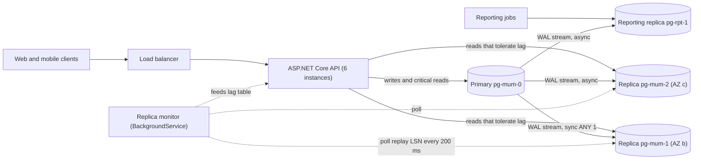
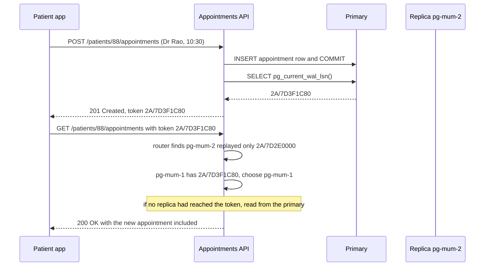

Most applications read far more than they write: a ticketing app shows seats a hundred times for every booking, a doctor's schedule page is viewed dozens of times for every appointment booked. A read replica is a copy of the database that serves those reads, so the primary can concentrate on writes. The price is that a copy is always slightly behind, and "slightly" can become seconds or minutes exactly when the system is busiest. This lesson is about getting the read capacity without showing users stale or contradictory data.

## Learning objectives

By the end of this lesson you will be able to:

1. Explain how PostgreSQL streaming replication works (WAL, sender, receiver, replay) and the difference between asynchronous and synchronous replication.
2. Name the causes of replication lag and measure it in bytes (LSN difference) and in time.
3. Describe the anomalies replicas cause: stale reads, read-your-writes violations, non-monotonic reads, and lost writes on failover.
4. Implement read routing in ASP.NET Core: primary for writes and critical reads, replicas for the rest, with read-your-writes via an LSN consistency token.
5. Size a primary-plus-replicas setup with back-of-the-envelope numbers and know what breaks first.
6. Recognise when caching, vertical scaling or a single primary is the simpler answer.

## Prerequisites

- [Transactions and ACID](#/lesson/m09-transactions-acid): commit and durability, which replication extends to other machines.
- [Isolation levels](#/lesson/m09-isolation-levels): you will meet consistency anomalies that are *not* covered by isolation levels.
- [Connection pooling](#/lesson/m09-connection-pooling): replicas mean several pools and routing between them.

## Explain it like I'm a beginner

Imagine a railway reservation office in Delhi that keeps the master register of bookings. It is too busy to answer every "is a seat free?" phone call, so it sends a **photocopy of every new page** to branch offices in Jaipur and Lucknow. Callers asking about availability phone a branch; anyone **booking** must phone Delhi.

This works well, with three catches:

- **The photocopies arrive late.** A page written at 10:00:00 might reach Jaipur at 10:00:01, or, on a bad day, at 10:02. During that gap Jaipur tells callers about seats that are already gone. That gap is **replication lag**.
- **You might not see your own booking.** You book in Delhi, then call Jaipur to check. Jaipur has not received the page yet and says "no booking found". You panic and book again. This is a **read-your-writes** violation.
- **Two branches can disagree.** You call Jaipur and see your booking, call again, get Lucknow (which is further behind), and your booking has vanished. This is a **monotonic reads** violation: time appears to go backwards.

The fixes are what you would expect in an office: after you book, the clerk tells you "for the next few minutes, call Delhi directly"; or gives you a page number ("your booking is on page 4,512") and branches only answer you if they have that page; or you are always connected to the same branch. In software, the "page number" is a position in the database's change log, called a **Log Sequence Number (LSN)**, and the technique is called **read-your-writes consistency**.

## First-principles explanation

### How streaming replication works

Every change in PostgreSQL is first written to the **write-ahead log (WAL)**, a sequential journal of changes. A commit is durable once its WAL record is flushed to disk. Physical streaming replication ships that same WAL to other servers:

1. On the primary, a **WAL sender** process streams WAL records to each replica as they are written.
2. On the replica, a **WAL receiver** writes them to the replica's own WAL and flushes them.
3. The replica's **startup process replays** the records into its data files, one by one, in order. Queries on the replica (a **hot standby**) see data as of the last replayed record.

Every position in the WAL has an LSN such as `2A/7D3F1C80`, which is just a 64-bit byte offset. The primary reports, per replica, how far it has been **sent**, **written**, **flushed** and **replayed** (`pg_stat_replication`). The difference between the primary's current LSN and a replica's replay LSN is the lag in **bytes**; `replay_lag` in the same view estimates it in **time**.

Physical replicas are byte-for-byte copies of the whole cluster and are read-only. **Logical replication** (publications and subscriptions) is different: it ships row changes for chosen tables, the subscriber is writable, and it works across major versions. It is used for migrations, selective copies and feeding other systems, not usually for read scaling.

### Asynchronous versus synchronous

By default replication is **asynchronous**: the primary commits, replies to the client, and ships WAL afterwards. Fast, but if the primary dies, the last few hundred milliseconds of commits may never reach any replica. Failing over then **loses acknowledged writes**.

**Synchronous** replication makes commits wait for replicas, configured by `synchronous_standby_names` (for example `ANY 1 (pg_b, pg_c)`: wait for any one of the two) and `synchronous_commit`:

| `synchronous_commit` | Commit waits until | Protects against | Cost (per commit, estimate) |
|---|---|---|---|
| `off` | WAL is in memory on the primary | nothing (crash can lose recent commits) | fastest |
| `local` | WAL flushed on the primary | primary crash, not primary loss | baseline |
| `remote_write` | standby has written WAL (not flushed) | primary loss, unless standby OS also crashes | + one network round trip |
| `on` (with sync standbys) | standby has flushed WAL | primary loss | + round trip + standby fsync |
| `remote_apply` | standby has **replayed** WAL | primary loss, and reads on that standby see the commit | + round trip + replay |

Two facts are easy to miss. First, synchronous replication does **not** make replicas consistent for reads unless you use `remote_apply`; with `on`, the WAL is safe on the standby but may not be replayed yet. Second, `synchronous_commit` can be set **per transaction** (`SET LOCAL synchronous_commit = remote_apply`), so you can pay the cost only for the few writes that need it.

Same-zone round trips are often around 0.5–1 ms; cross-region (Mumbai to Hyderabad) tens of milliseconds (estimates; measure yours). At 2,000 commits per second with a 30 ms cross-region synchronous wait, each commit takes at least 30 ms, so you need about 2,000 × 0.03 = 60 commits in flight at all times, which means more connections and more lock hold time. That is why synchronous replicas are usually placed in the same region, in a different availability zone.

### Why replicas lag

- **Write bursts.** A batch import or a backfill (see [Migrations and schema evolution](#/lesson/m09-migrations-evolution)) produces WAL faster than the replica replays it.
- **Single-threaded replay.** The primary applies changes with many backends in parallel; the replica replays them with one startup process. A replica on identical hardware can fall behind under heavy write load.
- **Network.** Cross-region links, bandwidth limits, packet loss.
- **Replica queries conflicting with replay.** Replay may need to remove row versions a long-running replica query still needs. PostgreSQL either **pauses replay** (up to `max_standby_streaming_delay`, default 30 s) or cancels the query. Raising the delay makes reports survive but lets lag grow; `hot_standby_feedback = on` stops the conflict by telling the primary not to vacuum those rows, which bloats the primary instead.
- **Under-sized replicas.** A replica that also serves heavy reads competes with replay for I/O.

### Measuring lag

On the primary:

```sql
SELECT application_name, state, sync_state,
       pg_wal_lsn_diff(pg_current_wal_lsn(), replay_lsn) AS lag_bytes,
       replay_lag
FROM pg_stat_replication;
```

On a replica:

```sql
SELECT pg_last_wal_replay_lsn(),
       now() - pg_last_xact_replay_timestamp() AS since_last_replayed_commit;
```

Careful with the second number: on a quiet system with no new commits, "time since the last replayed commit" grows even though the replica is fully caught up. Bytes behind is the honest measure; convert it to time with your WAL rate (for example 5 MB/s of WAL means 50 MB behind ≈ 10 s).

### The anomalies

| Anomaly | What the user sees | Typical cause |
|---|---|---|
| Stale read | Seat shown as free, booking then fails | Any async replica |
| Read-your-writes violation | "My update disappeared" right after saving | Write to primary, read from lagging replica |
| Non-monotonic reads | Data appears, then disappears on refresh | Consecutive reads hit replicas with different lag |
| Lost write on failover | Acknowledged booking gone after an outage | Async replica promoted before receiving the last WAL |
| Cross-replica constraint illusion | Read check passes on replica, write violates it on primary | "Check on replica, then write" logic |

Isolation levels do not help with any of these: they describe transactions on **one** server.

### Routing strategies

1. **Everything to the primary until it hurts.** Zero anomalies. Add replicas only when the primary's CPU or I/O is the bottleneck for reads.
2. **Classify reads.** Writes and "read then write" logic (check stock, then reserve) go to the primary. Pages that tolerate seconds of staleness (catalogue, dashboards, search, reports) go to replicas. Most systems get most of the benefit here.
3. **Sticky primary after a write (time window).** After a user writes, route that user's reads to the primary for, say, 5 seconds. Simple, but a guess: if lag exceeds the window, the anomaly returns; and it adds primary load proportional to write rate.
4. **LSN consistency token (read-your-writes, precise).** After a write commits, the API reads `pg_current_wal_lsn()` and returns it to the client (cookie, header or session). On the next read, the router sends the request to a replica whose `pg_last_wal_replay_lsn()` is at least that token, or to the primary if none is. Exact and adaptive: if replicas are caught up (usual), reads stay on replicas.
5. **Session affinity.** Pin each user to one replica for monotonic reads. Combine with the token for read-your-writes.
6. **`remote_apply` for specific writes.** The write waits until a standby has applied it, so any read on that standby sees it. Expensive; use sparingly.

The router needs fresh replay LSNs. Polling each replica every 100–250 ms is typical; between polls, the cached value is slightly old, which is safe because LSNs only grow (an old value under-estimates progress, so the router may send a read to the primary unnecessarily but never to a replica that is behind).

### Back-of-the-envelope

CityCare, a clinic-booking platform: 400,000 daily active users (patients and clinic staff) × 60 page views × ~3 queries per view ≈ 72 million reads/day ÷ 86,400 ≈ 830 reads/s average, × 4 for the morning OPD rush ≈ 3,300 reads/s. Writes: 400,000 × 5 updates ≈ 2 million/day ≈ 23/s average, ~100/s peak. Read:write ≈ 33:1.

If (estimate) one primary handles about 4,000 simple indexed reads per second at 60 % CPU alongside its writes, reads are close to the limit at peak. Two replicas, each taking ~1,500 reads/s, leave the primary with writes, critical reads and headroom. WAL volume at 100 writes/s × ~2 KB WAL per write (with indexes) ≈ 200 KB/s, trivial for replication. Lag would come from occasional bulk imports, not steady traffic.

Note what replicas do **not** fix: write throughput. Every replica replays every write. If the primary is write-bound, you need batching, partitioning or sharding ([Partitioning and sharding](#/lesson/m09-partitioning-sharding)), not replicas.

### Failover

When the primary fails, a replica is **promoted**. With async replication, the newest replica may still lack the last commits; tools such as Patroni (and managed services) pick the most advanced candidate and can refuse to promote one that is too far behind. Clients must find the new primary: Npgsql supports multi-host connection strings (`Host=pg1,pg2,pg3;Target Session Attributes=primary`) and checks which host is writable; alternatives are a virtual IP, DNS update or a proxy. The old primary must be **fenced** so it cannot accept writes after it comes back (split brain).

### What breaks first under load

1. **Lag during bursts**, and with it a spike in read-your-writes fallbacks to the primary, which then overloads the primary exactly when it is busiest. Cap the fallback rate and watch it as a metric.
2. **Replica query cancellations** ("canceling statement due to conflict with recovery") for long reports. Put reports on a dedicated replica with a longer `max_standby_streaming_delay`, and keep it out of the online pool.
3. **Disk on the primary**: a replication slot for a dead or far-behind replica retains WAL forever. Set `max_slot_wal_keep_size` and alert on retained WAL.
4. **Connection counts**: every API instance now has a pool per database server.

### When a simpler design is enough

If reads are 300 per second on a database that can do 5,000, you do not need replicas for scale; you may still want **one standby for high availability**, without routing any reads to it. If the expensive reads are the same few pages, a cache (in-process or Redis) in front of the primary removes them with less complexity. If one dashboard query is slow, an index or a materialized view beats a replica.

## Visual explanation

### Primary, replicas and the router



The API instances hold one connection pool for the primary and one per online replica. Writes, and reads that must be current (payment status, slot availability just before booking), go to the primary. Everything else goes to one of two online replicas in different availability zones. The primary streams WAL to all three replicas; one online replica is synchronous (`ANY 1`) so a primary loss does not lose acknowledged commits, the others are asynchronous. Reporting jobs use a separate replica that is allowed to lag minutes so long queries are not cancelled, and is never used for user-facing reads. The monitor polls each replica's replay LSN and gives the router an up-to-date picture of which replica has reached which position.

### Read-your-writes with an LSN token



The write commits on the primary, and the API immediately asks the primary for its current WAL position. Because the commit has already happened, that position is at or after the commit record, so any server that has replayed up to it can see the new row. The token travels back to the app (a header or cookie; in a browser app, the session works too). On the next read the router compares the token with the replay positions the monitor collected: pg-mum-2 is about 1 MB behind and is skipped, pg-mum-1 has caught up and serves the read. If neither had, the read would go to the primary. The patient sees the new 10:30 appointment immediately, while almost all reads still land on replicas.

## Step-by-step example

CityCare (the numbers from the back-of-the-envelope section) moves schedule and dashboard reads off its primary.

### Step 1 — classify every query

| Query | Freshness need | Route |
|---|---|---|
| Book or cancel an appointment, record a payment | write | primary |
| "My appointments" right after booking | own writes | token |
| Doctor's weekly schedule for clinic staff | seconds are fine | replica |
| Payment status before issuing a refund | must be current | primary |
| Monthly clinic utilisation report export | minutes are fine | reporting replica |

The default for an unclassified query is **primary**. A forgotten query is then slow, not wrong.

### Step 2 — measure lag before you route anything

Snapshot from the primary (the playground has this data):

```sql
SELECT r.replica,
       pg_wal_lsn_diff(p.current_lsn, r.replay_lsn)::bigint AS lag_bytes,
       r.replay_lag
FROM replica_status r CROSS JOIN primary_status p
ORDER BY lag_bytes;
```

pg-mum-1 is at 0 bytes, pg-mum-2 about 1.1 MB behind (0.38 s), pg-hyd-1 about 54 MB (6.2 s), the reporting replica about 1 GB (2 min 41 s), and pg-sgp-1 is still catching up. Only the first two are fit for online reads right now.

### Step 3 — return a token after writes

```csharp
// After SaveChangesAsync / COMMIT on the primary:
var lsn = await primary.ExecuteScalarAsync<string>("SELECT pg_current_wal_lsn()::text", ct);
httpContext.Response.Headers["X-Consistency-Token"] = lsn;
```

### Step 4 — route reads

The router (C# below) takes the token from the request, looks up which healthy online replicas have `replay_lsn >= token`, picks the least loaded one, and otherwise falls back to the primary. A request without a token goes to any healthy replica under the lag threshold.

### Step 5 — protect the primary from fallback storms

During a bulk import, all replicas lag, every recent writer's reads fall back to the primary, and the primary gets busier, which slows replication further. Bound it: a per-instance concurrency limit on fallback reads, and above it either wait briefly (poll until a replica reaches the token, up to 200 ms) or serve the replica with a "data may be a few seconds old" banner for non-critical pages.

### Step 6 — Npgsql connection setup

```csharp
// One multi-host data source. Npgsql discovers which host is primary and which are standbys.
var multi = new NpgsqlDataSourceBuilder(
        "Host=pg-mum-0,pg-mum-1,pg-mum-2;Database=citycare;Username=app;Load Balance Hosts=true")
    .BuildMultiHost();
NpgsqlDataSource primary  = multi.WithTargetSession(TargetSessionAttributes.Primary);
NpgsqlDataSource replicas = multi.WithTargetSession(TargetSessionAttributes.PreferStandby);
```

`PreferStandby` with `Load Balance Hosts` spreads reads across standbys, and falls back to the primary if none is available. It does not know about your token; the LSN-aware router picks the host explicitly when a token is present.

## Production-style C# implementation

The router keeps a registry of replicas (fed by a monitor that polls replay LSNs), parses and compares LSNs, and chooses a target per request. Database calls sit behind interfaces with in-memory fakes so the course checker can build and run it.

```text
CityCare.Api/
  Program.cs
  Replication/Lsn.cs
  Replication/ReplicaRegistry.cs
  Replication/ReadRouter.cs
  Replication/ReplicaMonitor.cs
```

```csharp file=Replication/Lsn.cs
using System.Diagnostics.CodeAnalysis;
using System.Globalization;

namespace CityCare.Replication;

/// <summary>A PostgreSQL WAL position such as "2A/7D3F1C80": high 32 bits / low 32 bits, in hex.</summary>
public readonly record struct Lsn(ulong Value) : IComparable<Lsn>
{
    public static readonly Lsn Zero = new(0);

    public static bool TryParse(string? text, [NotNullWhen(true)] out Lsn? lsn)
    {
        lsn = null;
        if (string.IsNullOrWhiteSpace(text) || text.Length > 17) return false;
        var slash = text.IndexOf('/');
        if (slash <= 0 || slash == text.Length - 1) return false;
        if (!uint.TryParse(text.AsSpan(0, slash), NumberStyles.AllowHexSpecifier, CultureInfo.InvariantCulture, out var hi)) return false;
        if (!uint.TryParse(text.AsSpan(slash + 1), NumberStyles.AllowHexSpecifier, CultureInfo.InvariantCulture, out var lo)) return false;
        lsn = new Lsn(((ulong)hi << 32) | lo);
        return true;
    }

    public int CompareTo(Lsn other) => Value.CompareTo(other.Value);
    public static bool operator >=(Lsn a, Lsn b) => a.Value >= b.Value;
    public static bool operator <=(Lsn a, Lsn b) => a.Value <= b.Value;
    public static bool operator >(Lsn a, Lsn b) => a.Value > b.Value;
    public static bool operator <(Lsn a, Lsn b) => a.Value < b.Value;
    public static long operator -(Lsn a, Lsn b) => (long)(a.Value - b.Value);

    public override string ToString() => $"{(uint)(Value >> 32):X}/{(uint)Value:X}";
}
```

```csharp file=Replication/ReplicaRegistry.cs
namespace CityCare.Replication;

public enum ReplicaRole { Online, Reporting }

public sealed record ReplicaState(string Name, ReplicaRole Role, bool Healthy, Lsn ReplayLsn, int InFlight, DateTimeOffset ObservedAt);

/// <summary>Thread-safe snapshot of what the monitor last saw. Readers get an immutable array.</summary>
public sealed class ReplicaRegistry
{
    private volatile ReplicaState[] _replicas = Array.Empty<ReplicaState>();
    private long _primaryLsn;

    public IReadOnlyList<ReplicaState> Replicas => _replicas;
    public Lsn PrimaryLsn => new((ulong)Interlocked.Read(ref _primaryLsn));

    public void Publish(Lsn primary, IEnumerable<ReplicaState> replicas)
    {
        Interlocked.Exchange(ref _primaryLsn, (long)primary.Value);
        _replicas = replicas.ToArray();
    }
}
```

```csharp file=Replication/ReadRouter.cs
using Microsoft.Extensions.Options;

namespace CityCare.Replication;

public enum ReadConsistency
{
    Primary,          // must be current: payments, slot availability before booking
    ReadYourWrites,   // must include this caller's writes (token), otherwise replica is fine
    Stale             // schedules, dashboards, doctor search
}

public sealed class RouterOptions
{
    /// <summary>Replicas further behind the primary than this are not used for any online read.</summary>
    public long MaxLagBytes { get; set; } = 16 * 1024 * 1024;
    /// <summary>Upper bound on how old the monitor's snapshot may be before the router stops trusting it.</summary>
    public TimeSpan MaxSnapshotAge { get; set; } = TimeSpan.FromSeconds(2);
}

public sealed record RouteDecision(string Target, string Reason);

public sealed class ReadRouter(ReplicaRegistry registry, IOptions<RouterOptions> options, TimeProvider clock)
{
    public const string PrimaryName = "primary";

    public RouteDecision Choose(ReadConsistency consistency, Lsn? token)
    {
        if (consistency == ReadConsistency.Primary) return new(PrimaryName, "consistency=primary");

        var o = options.Value;
        var now = clock.GetUtcNow();
        var primaryLsn = registry.PrimaryLsn;

        var candidates = registry.Replicas
            .Where(r => r.Role == ReplicaRole.Online && r.Healthy)
            .Where(r => now - r.ObservedAt <= o.MaxSnapshotAge)          // stale monitoring data is not trusted
            .Where(r => primaryLsn - r.ReplayLsn <= o.MaxLagBytes);

        if (consistency == ReadConsistency.ReadYourWrites && token is { } t)
            candidates = candidates.Where(r => r.ReplayLsn >= t);        // has replayed the caller's write

        var best = candidates.OrderBy(r => r.InFlight).ThenBy(r => r.Name, StringComparer.Ordinal).FirstOrDefault();
        return best is null
            ? new(PrimaryName, token is null ? "no healthy replica" : $"no replica has reached {token}")
            : new(best.Name, token is null ? "least loaded replica" : $"replica reached {token}");
    }
}
```

```csharp file=Replication/ReplicaMonitor.cs
using Microsoft.Extensions.Hosting;
using Microsoft.Extensions.Logging;

namespace CityCare.Replication;

/// <summary>
/// Primary: SELECT pg_current_wal_lsn().
/// Each replica: SELECT pg_is_in_recovery(), pg_last_wal_replay_lsn().
/// A replica that is not in recovery has been promoted; it must not be used as a replica.
/// </summary>
public interface IReplicationProbe
{
    Task<Lsn> PrimaryLsnAsync(CancellationToken ct);
    Task<(bool InRecovery, Lsn ReplayLsn)?> ReplicaAsync(string name, CancellationToken ct);
}

public sealed record ReplicaConfig(string Name, ReplicaRole Role);

public sealed class ReplicaMonitor(
    IReplicationProbe probe,
    IReadOnlyList<ReplicaConfig> replicas,
    ReplicaRegistry registry,
    IInFlightCounter inFlight,
    TimeProvider clock,
    ILogger<ReplicaMonitor> log) : BackgroundService
{
    public static readonly TimeSpan Interval = TimeSpan.FromMilliseconds(200);

    protected override async Task ExecuteAsync(CancellationToken stoppingToken)
    {
        while (!stoppingToken.IsCancellationRequested)
        {
            try { await PollOnceAsync(stoppingToken); }
            catch (Exception ex) when (ex is not OperationCanceledException)
            {
                log.LogWarning(ex, "Replica poll failed");   // registry keeps old ObservedAt, so the router stops trusting it
            }
            await Task.Delay(Interval, clock, stoppingToken);
        }
    }

    public async Task PollOnceAsync(CancellationToken ct)
    {
        var primary = await probe.PrimaryLsnAsync(ct);
        var now = clock.GetUtcNow();
        var states = new List<ReplicaState>();
        foreach (var r in replicas)
        {
            var s = await probe.ReplicaAsync(r.Name, ct);
            var healthy = s is { InRecovery: true };
            states.Add(new ReplicaState(r.Name, r.Role, healthy, s?.ReplayLsn ?? Lsn.Zero, inFlight.Get(r.Name), now));
        }
        registry.Publish(primary, states);
    }
}

public interface IInFlightCounter
{
    int Get(string target);
    IDisposable Track(string target);
}

public sealed class InFlightCounter : IInFlightCounter
{
    private readonly System.Collections.Concurrent.ConcurrentDictionary<string, int> _counts = new();
    public int Get(string target) => _counts.GetValueOrDefault(target);
    public IDisposable Track(string target)
    {
        _counts.AddOrUpdate(target, 1, (_, n) => n + 1);
        return new Release(this, target);
    }
    private sealed class Release(InFlightCounter owner, string target) : IDisposable
    {
        private int _done;
        public void Dispose() { if (Interlocked.Exchange(ref _done, 1) == 0) owner._counts.AddOrUpdate(target, 0, (_, n) => n - 1); }
    }
}

/// <summary>Fake for local runs and tests: replicas trail the primary by fixed byte offsets.</summary>
public sealed class FakeReplicationProbe(Dictionary<string, long> bytesBehind) : IReplicationProbe
{
    public Lsn Primary { get; set; } = new(0x2A_7D3F1C80);
    public Task<Lsn> PrimaryLsnAsync(CancellationToken ct) => Task.FromResult(Primary);
    public Task<(bool InRecovery, Lsn ReplayLsn)?> ReplicaAsync(string name, CancellationToken ct) =>
        Task.FromResult<(bool, Lsn)?>(bytesBehind.TryGetValue(name, out var b) ? (true, new Lsn(Primary.Value - (ulong)b)) : null);
}
```

```csharp file=Program.cs
using CityCare.Replication;

var builder = WebApplication.CreateBuilder(args);

builder.Services.AddSingleton(TimeProvider.System);
builder.Services.Configure<RouterOptions>(builder.Configuration.GetSection("Router"));
builder.Services.AddSingleton<ReplicaRegistry>();
builder.Services.AddSingleton<ReadRouter>();
builder.Services.AddSingleton<IInFlightCounter, InFlightCounter>();
builder.Services.AddSingleton<IReadOnlyList<ReplicaConfig>>(new[]
{
    new ReplicaConfig("pg-mum-1", ReplicaRole.Online),
    new ReplicaConfig("pg-mum-2", ReplicaRole.Online),
    new ReplicaConfig("pg-rpt-1", ReplicaRole.Reporting),
});
builder.Services.AddSingleton<IReplicationProbe>(new FakeReplicationProbe(new()
{
    ["pg-mum-1"] = 0, ["pg-mum-2"] = 1_121_408, ["pg-rpt-1"] = 1_027_546_240
}));
builder.Services.AddHostedService<ReplicaMonitor>();

var app = builder.Build();

app.MapPost("/patients/{patientId:int}/appointments", async (int patientId, ReplicaRegistry registry, IReplicationProbe probe, HttpResponse res, CancellationToken ct) =>
{
    // ... INSERT and COMMIT on the primary ...
    var lsn = await probe.PrimaryLsnAsync(ct);       // SELECT pg_current_wal_lsn() after the commit
    res.Headers["X-Consistency-Token"] = lsn.ToString();
    return Results.Created($"/patients/{patientId}/appointments", new { patientId, token = lsn.ToString() });
});

app.MapGet("/patients/{patientId:int}/appointments", (int patientId, HttpRequest req, ReadRouter router, IInFlightCounter inFlight) =>
{
    Lsn? token = Lsn.TryParse(req.Headers["X-Consistency-Token"], out var t) ? t : null;
    var decision = router.Choose(token is null ? ReadConsistency.Stale : ReadConsistency.ReadYourWrites, token);
    using var _ = inFlight.Track(decision.Target);
    // ... run the SELECT on the data source named decision.Target ...
    return Results.Ok(new { patientId, servedBy = decision.Target, decision.Reason });
});

app.MapGet("/payments/{paymentId:int}/status", (int paymentId, ReadRouter router) =>
    Results.Ok(new { paymentId, servedBy = router.Choose(ReadConsistency.Primary, null).Target }));

app.Run();
```

**Design notes.**

- The default is safe: an unknown or stale picture of the replicas routes to the primary. The router never sends a token-bearing read to a replica that has not proven it reached the token.
- Snapshot age matters as much as lag. If the monitor stops (network partition to the replica), `ObservedAt` stops advancing and the replica drops out after `MaxSnapshotAge`.
- `pg_is_in_recovery()` is checked so a promoted replica is never treated as a lagging copy of the old primary.
- The token is an opaque string to clients. Sign it, or keep it server-side in the session, if you do not want clients to see your WAL positions.

:::callout type=warning title="Never check on a replica and then write on the primary"
"Is the 10:30 slot free?" on a replica followed by "book it" on the primary can double-book: the replica may not show a booking made 200 ms ago. Checks that guard a write belong in the same primary transaction as the write, ideally enforced by a constraint.
:::

## Bad design vs good design

**Bad**: the team adds two replicas and a connection string with `Target Session Attributes=prefer-standby` for the whole application. Every query, including "check the refund is approved, then pay it out", now reads from a random replica. Patients report that a just-booked appointment "disappears" for a second. During a nightly import the replicas fall 90 seconds behind, and the refund job reads refunds as unapproved and skips them. When the primary fails, the async replica is promoted and the last 400 ms of approvals are lost; nobody notices until finance reconciles.

**Good**: queries are classified, with primary as the default. Online reads go to healthy replicas within a lag budget; read-your-writes uses an LSN token; reports use a dedicated replica; one same-region replica is synchronous (`ANY 1`) so failover does not lose acknowledged commits; imports are throttled on replica lag; the primary-fallback rate and replica lag are on the main dashboard.

**But**: an internal tool with 50 users and 20 queries per second does not need replicas at all. A single primary, a standby for high availability that serves no reads, and backups are simpler and have no anomalies.

:::callout type=tradeoff title="Routing strategies compared"
| Strategy | Correctness for own writes | Primary load | Complexity |
|---|---|---|---|
| All reads on primary | perfect | highest | lowest |
| Random replica | broken | lowest | low |
| Sticky primary for N seconds after a write | usually, fails if lag > N | medium | low |
| LSN token | exact | low, rises with lag | medium |
| `remote_apply` on writes | exact for that standby | slower commits | low in app, cost in latency |
| Session pinned to one replica | monotonic reads only | low | low |
:::

## Practical playground

A snapshot of a primary's position, five replicas (one reporting, one still catching up) and each user's last write position, using PostgreSQL's real `pg_lsn` type. Compute lag in bytes, find unhealthy replicas, and write the routing decision in SQL.

:::playground type=sql title="Replication lag and read routing with pg_lsn"
```sql
CREATE TABLE primary_status (captured_at timestamptz NOT NULL, current_lsn pg_lsn NOT NULL);
INSERT INTO primary_status VALUES ('2026-10-20 11:00:00+05:30', '2A/7D3F1C80');

CREATE TABLE replica_status (
  replica            text   PRIMARY KEY,
  region             text   NOT NULL,
  role               text   NOT NULL CHECK (role IN ('online', 'reporting')),
  state              text   NOT NULL,            -- as in pg_stat_replication: streaming, catchup ...
  replay_lsn         pg_lsn NOT NULL,
  replay_lag         interval,
  active_connections int    NOT NULL
);
INSERT INTO replica_status VALUES
  ('pg-mum-1', 'ap-south-1',     'online',    'streaming', '2A/7D3F1C80', interval '0.004 s',  180),
  ('pg-mum-2', 'ap-south-1',     'online',    'streaming', '2A/7D2E0000', interval '0.380 s',   40),
  ('pg-hyd-1', 'ap-south-2',     'online',    'streaming', '2A/7A000000', interval '6.2 s',     25),
  ('pg-rpt-1', 'ap-south-1',     'reporting', 'streaming', '2A/40000000', interval '00:02:41',   5),
  ('pg-sgp-1', 'ap-southeast-1', 'online',    'catchup',   '29/F0000000', NULL,                  0);

CREATE TABLE user_sessions (
  user_id        bigint PRIMARY KEY,
  home_region    text   NOT NULL,
  last_write_lsn pg_lsn NOT NULL                -- the consistency token from the user's last write
);
INSERT INTO user_sessions VALUES
  (101, 'ap-south-1',     '2A/7D3F1C80'),
  (102, 'ap-south-1',     '2A/7D000000'),
  (103, 'ap-south-2',     '2A/79FFFFFF'),
  (104, 'ap-south-2',     '2A/7B000000'),
  (105, 'ap-southeast-1', '0/0'),
  (106, 'ap-south-1',     '2A/3FFFFFFF');

-- SELECT replica, pg_wal_lsn_diff((SELECT current_lsn FROM primary_status), replay_lsn) AS lag_bytes FROM replica_status ORDER BY 2;
-- SELECT pg_size_pretty(pg_wal_lsn_diff('2A/7D3F1C80', '2A/40000000'));
-- SELECT '2A/7D3F1C80'::pg_lsn >= '2A/7D2E0000'::pg_lsn;
```
:::

## Exercises

:::exercise id=m09-replicas-ex1 difficulty=beginner kind=sql ordered=true title="Lag in bytes per replica"
Using the primary's current LSN, report each replica's lag. Return `replica`, `lag_bytes` (a `bigint`: primary LSN minus replica replay LSN) and `replay_lag`, ordered by `lag_bytes` ascending, then `replica`.
::setup
```sql
CREATE TABLE primary_status (captured_at timestamptz NOT NULL, current_lsn pg_lsn NOT NULL);
INSERT INTO primary_status VALUES ('2026-10-20 11:00:00+05:30', '2A/7D3F1C80');
CREATE TABLE replica_status (replica text PRIMARY KEY, region text NOT NULL, role text NOT NULL, state text NOT NULL, replay_lsn pg_lsn NOT NULL, replay_lag interval, active_connections int NOT NULL);
INSERT INTO replica_status VALUES
  ('pg-mum-1', 'ap-south-1',     'online',    'streaming', '2A/7D3F1C80', interval '0.004 s',  180),
  ('pg-mum-2', 'ap-south-1',     'online',    'streaming', '2A/7D2E0000', interval '0.380 s',   40),
  ('pg-hyd-1', 'ap-south-2',     'online',    'streaming', '2A/7A000000', interval '6.2 s',     25),
  ('pg-rpt-1', 'ap-south-1',     'reporting', 'streaming', '2A/40000000', interval '00:02:41',   5),
  ('pg-sgp-1', 'ap-southeast-1', 'online',    'catchup',   '29/F0000000', NULL,                  0);
```
::check
```sql
SELECT r.replica,
       pg_wal_lsn_diff(p.current_lsn, r.replay_lsn)::bigint AS lag_bytes,
       r.replay_lag
FROM replica_status r CROSS JOIN primary_status p
ORDER BY lag_bytes, r.replica;
```
::acceptance
- pg-mum-1 has 0 bytes of lag; pg-mum-2 1,121,408; pg-hyd-1 54,467,712; pg-rpt-1 1,027,546,240; pg-sgp-1 2,369,723,520.
- `lag_bytes` is a `bigint` (the function returns `numeric`, so cast it).
::hint
`pg_wal_lsn_diff(a, b)` returns the number of bytes between two LSNs. (Subtracting `pg_lsn` values with `-` also works.)
::hint
The primary status table has one row; join it to every replica with `CROSS JOIN`.
::hint
```sql
SELECT r.replica, pg_wal_lsn_diff(p.current_lsn, r.replay_lsn)::bigint AS lag_bytes, r.replay_lag
FROM replica_status r CROSS JOIN primary_status p ORDER BY ...
```
::solution
```sql
SELECT r.replica,
       pg_wal_lsn_diff(p.current_lsn, r.replay_lsn)::bigint AS lag_bytes,
       r.replay_lag
FROM replica_status r CROSS JOIN primary_status p
ORDER BY lag_bytes, r.replica;
```
`2A/7D3F1C80` means high word `0x2A`, low word `0x7D3F1C80`; the LSN is a byte position in the WAL, so the difference is bytes. pg-mum-2's 1.1 MB at 0.38 s implies roughly 3 MB/s of WAL at that moment; the reporting replica's 1 GB is minutes behind, which is fine for a monthly utilisation export and unacceptable for a patient-facing page. On a real primary you would query `pg_stat_replication` and `pg_current_wal_lsn()` instead of these snapshot tables.
::mistakes
- Comparing LSNs as text: `'9/0' > '2A/0'` as strings, but `2A/0` is the larger position.
- Using `replay_lag` alone: it is NULL for a catching-up replica and can read as small when the primary is idle.
:::

:::exercise id=m09-replicas-ex2 difficulty=beginner kind=code title="Sticky primary window after a write"
Implement `StickyPrimaryPolicy`. `RecordWrite(userId)` remembers the time of the user's latest write. `ShouldUsePrimary(userId)` returns `true` if the user wrote within the last `window` (inclusive of the boundary: exactly `window` ago still counts), and `false` otherwise or if the user never wrote. Use the injected `TimeProvider` for the clock so tests can control time.
::acceptance
- A user who never wrote reads from replicas.
- Right after a write and exactly `window` later: primary. One tick later: replica.
- A second write extends the window.
- Users are independent.
::hint
A `ConcurrentDictionary<long, DateTimeOffset>` from user id to last write time is enough.
::hint
`clock.GetUtcNow()` gives "now". Compare `now - lastWrite <= window`.
::hint
`AddOrUpdate` (or the indexer) replaces the older time on a new write.
::starter
```csharp file=StickyPrimaryPolicy.cs
using System;
using System.Collections.Concurrent;

public sealed class StickyPrimaryPolicy(TimeProvider clock, TimeSpan window)
{
    public void RecordWrite(long userId) => throw new NotImplementedException();

    public bool ShouldUsePrimary(long userId) => throw new NotImplementedException();
}
```
::tests
```csharp file=StickyPrimaryPolicyTests.cs
using System;
using Xunit;

public class StickyPrimaryPolicyTests
{
    private sealed class ManualClock(DateTimeOffset start) : TimeProvider
    {
        public DateTimeOffset Now { get; set; } = start;
        public override DateTimeOffset GetUtcNow() => Now;
    }

    private static readonly DateTimeOffset T0 = new(2026, 10, 20, 5, 30, 0, TimeSpan.Zero);

    [Fact]
    public void Never_wrote_reads_replica()
    {
        var p = new StickyPrimaryPolicy(new ManualClock(T0), TimeSpan.FromSeconds(5));
        Assert.False(p.ShouldUsePrimary(7));
    }

    [Fact]
    public void Window_boundaries()
    {
        var clock = new ManualClock(T0);
        var p = new StickyPrimaryPolicy(clock, TimeSpan.FromSeconds(5));
        p.RecordWrite(7);
        Assert.True(p.ShouldUsePrimary(7));
        clock.Now = T0.AddSeconds(5);
        Assert.True(p.ShouldUsePrimary(7));
        clock.Now = T0.AddSeconds(5).AddTicks(1);
        Assert.False(p.ShouldUsePrimary(7));
    }

    [Fact]
    public void New_write_extends_window()
    {
        var clock = new ManualClock(T0);
        var p = new StickyPrimaryPolicy(clock, TimeSpan.FromSeconds(5));
        p.RecordWrite(7);
        clock.Now = T0.AddSeconds(4);
        p.RecordWrite(7);
        clock.Now = T0.AddSeconds(8);
        Assert.True(p.ShouldUsePrimary(7));
    }

    [Fact]
    public void Users_are_independent()
    {
        var p = new StickyPrimaryPolicy(new ManualClock(T0), TimeSpan.FromSeconds(5));
        p.RecordWrite(7);
        Assert.True(p.ShouldUsePrimary(7));
        Assert.False(p.ShouldUsePrimary(8));
    }
}
```
::solution
```csharp file=StickyPrimaryPolicy.cs
using System;
using System.Collections.Concurrent;

public sealed class StickyPrimaryPolicy(TimeProvider clock, TimeSpan window)
{
    private readonly ConcurrentDictionary<long, DateTimeOffset> _lastWrite = new();

    public void RecordWrite(long userId) => _lastWrite[userId] = clock.GetUtcNow();

    public bool ShouldUsePrimary(long userId) =>
        _lastWrite.TryGetValue(userId, out var at) && clock.GetUtcNow() - at <= window;
}
```
Simple and often good enough. Its weakness is the guess: if lag ever exceeds the window (a bulk import), the anomaly returns. In a multi-instance deployment the dictionary must be shared (a cookie with the write time, or a distributed cache), because the next request may land on another API instance. Also evict old entries (for example on read when expired) so memory does not grow with every user who ever wrote.
::alternatives
Store the write time in a signed cookie instead of server memory: no shared state, and it works across instances. The LSN token (exercise 3) replaces the time guess with an exact position.
::mistakes
- Using `DateTime.Now`, which makes the logic untestable and breaks across daylight-saving changes.
- Keeping the dictionary per instance behind a load balancer without sticky sessions.
:::

:::exercise id=m09-replicas-ex3 difficulty=intermediate kind=code title="LSN-aware replica choice"
Implement `LsnRouter.Choose`. Parse PostgreSQL LSN strings (`"2A/7D3F1C80"`: two hex numbers, high and low 32 bits). Given the caller's optional token, the primary's LSN, a list of replicas and a maximum lag in bytes, return the replica name to use, or `"primary"`. A replica is eligible if it is healthy, its lag (`primary − replay`) is at most `maxLagBytes`, and, when a token is given, its replay LSN is at least the token. Among eligible replicas pick the fewest `InFlight`, then the name (ordinal). An unparsable token must route to `"primary"` (be safe, not clever).
::acceptance
- `Lsn.Parse("2A/7D3F1C80")` equals `0x2A7D3F1C80`; `"9/0"` is smaller than `"2A/0"`.
- With token `2A/7D3F1C80`, a replica at `2A/7D2E0000` is skipped and one at `2A/7D3F1C80` is chosen.
- Without a token, the least-loaded replica within the lag limit is chosen.
- No eligible replica, or an invalid token, gives `"primary"`.
::hint
Split on `/`, parse each side with `NumberStyles.AllowHexSpecifier`, combine with `((ulong)hi << 32) | lo`.
::hint
Return `false` from `TryParse` for null, missing slash, empty parts or non-hex characters.
::hint
Filter: `Healthy`, `primary - replay <= maxLagBytes`, and `replay >= token` if a token exists. Then `OrderBy(InFlight).ThenBy(Name, StringComparer.Ordinal)`.
::hint
```csharp
if (tokenText is not null && !Lsn.TryParse(tokenText, out token)) return "primary";
```
::starter
```csharp file=LsnRouter.cs
using System;
using System.Collections.Generic;
using System.Globalization;
using System.Linq;

public static class Lsn
{
    public static bool TryParse(string? text, out ulong lsn) => throw new NotImplementedException();

    public static ulong Parse(string text) =>
        TryParse(text, out var v) ? v : throw new FormatException($"Not an LSN: {text}");
}

public sealed record Replica(string Name, bool Healthy, string ReplayLsn, int InFlight);

public static class LsnRouter
{
    public static string Choose(string? tokenText, string primaryLsn, IEnumerable<Replica> replicas, long maxLagBytes)
        => throw new NotImplementedException();
}
```
::tests
```csharp file=LsnRouterTests.cs
using Xunit;

public class LsnRouterTests
{
    private static readonly Replica Mum1 = new("pg-mum-1", true, "2A/7D3F1C80", 180);
    private static readonly Replica Mum2 = new("pg-mum-2", true, "2A/7D2E0000", 40);
    private static readonly Replica Hyd1 = new("pg-hyd-1", true, "2A/7A000000", 25);
    private const string Primary = "2A/7D3F1C80";
    private const long SixteenMb = 16 * 1024 * 1024;

    [Fact]
    public void Parses_hex_halves()
    {
        Assert.Equal(0x2A7D3F1C80UL, Lsn.Parse("2A/7D3F1C80"));
        Assert.True(Lsn.Parse("9/0") < Lsn.Parse("2A/0"));
        Assert.Equal(0UL, Lsn.Parse("0/0"));
    }

    [Theory]
    [InlineData(null)]
    [InlineData("")]
    [InlineData("2A7D3F1C80")]
    [InlineData("2A/")]
    [InlineData("/7D")]
    [InlineData("ZZ/10")]
    public void Rejects_bad_lsn(string? text) => Assert.False(Lsn.TryParse(text, out _));

    [Fact]
    public void Token_skips_replicas_behind_it()
    {
        Assert.Equal("pg-mum-1", LsnRouter.Choose("2A/7D3F1C80", Primary, new[] { Mum1, Mum2, Hyd1 }, SixteenMb));
    }

    [Fact]
    public void Older_token_allows_least_loaded()
    {
        Assert.Equal("pg-mum-2", LsnRouter.Choose("2A/7D000000", Primary, new[] { Mum1, Mum2, Hyd1 }, SixteenMb));
    }

    [Fact]
    public void No_token_uses_lag_limit_and_load()
    {
        // pg-hyd-1 is ~54 MB behind: over the 16 MB limit even though it is least loaded.
        Assert.Equal("pg-mum-2", LsnRouter.Choose(null, Primary, new[] { Mum1, Mum2, Hyd1 }, SixteenMb));
    }

    [Fact]
    public void Unhealthy_is_ignored_and_fallback_is_primary()
    {
        var down = Mum1 with { Healthy = false };
        Assert.Equal("primary", LsnRouter.Choose("2A/7D3F1C80", Primary, new[] { down, Mum2 }, SixteenMb));
    }

    [Fact]
    public void Invalid_token_goes_to_primary()
    {
        Assert.Equal("primary", LsnRouter.Choose("not-an-lsn", Primary, new[] { Mum1, Mum2 }, SixteenMb));
    }

    [Fact]
    public void Ties_break_by_name()
    {
        var a = new Replica("pg-b", true, Primary, 10);
        var b = new Replica("pg-a", true, Primary, 10);
        Assert.Equal("pg-a", LsnRouter.Choose(null, Primary, new[] { a, b }, SixteenMb));
    }
}
```
::solution
```csharp file=LsnRouter.cs
using System;
using System.Collections.Generic;
using System.Globalization;
using System.Linq;

public static class Lsn
{
    public static bool TryParse(string? text, out ulong lsn)
    {
        lsn = 0;
        if (string.IsNullOrEmpty(text) || text.Length > 17) return false;
        var slash = text.IndexOf('/');
        if (slash <= 0 || slash == text.Length - 1) return false;
        if (!uint.TryParse(text.AsSpan(0, slash), NumberStyles.AllowHexSpecifier, CultureInfo.InvariantCulture, out var hi)) return false;
        if (!uint.TryParse(text.AsSpan(slash + 1), NumberStyles.AllowHexSpecifier, CultureInfo.InvariantCulture, out var lo)) return false;
        lsn = ((ulong)hi << 32) | lo;
        return true;
    }

    public static ulong Parse(string text) =>
        TryParse(text, out var v) ? v : throw new FormatException($"Not an LSN: {text}");
}

public sealed record Replica(string Name, bool Healthy, string ReplayLsn, int InFlight);

public static class LsnRouter
{
    public static string Choose(string? tokenText, string primaryLsn, IEnumerable<Replica> replicas, long maxLagBytes)
    {
        ulong? token = null;
        if (tokenText is not null)
        {
            if (!Lsn.TryParse(tokenText, out var t)) return "primary";
            token = t;
        }

        var primary = Lsn.Parse(primaryLsn);
        var best = replicas
            .Where(r => r.Healthy && Lsn.TryParse(r.ReplayLsn, out _))
            .Select(r => (Replica: r, Replay: Lsn.Parse(r.ReplayLsn)))
            .Where(x => x.Replay <= primary && (long)(primary - x.Replay) <= maxLagBytes)
            .Where(x => token is null || x.Replay >= token.Value)
            .OrderBy(x => x.Replica.InFlight)
            .ThenBy(x => x.Replica.Name, StringComparer.Ordinal)
            .Select(x => x.Replica.Name)
            .FirstOrDefault();

        return best ?? "primary";
    }
}
```
The `Replay <= primary` guard handles a monitoring race: if the replica was polled after the primary, its replay LSN can be slightly ahead of the cached primary LSN, and unsigned subtraction would wrap to a huge number. Treating that replica as "zero lag" would also be fine; the point is not to underflow.
::alternatives
Instead of falling back to the primary immediately, a read can wait up to ~200 ms for a replica to reach the token (poll `pg_last_wal_replay_lsn()` on the chosen replica). That keeps load off the primary during short lag spikes at the cost of some latency.
::mistakes
- Comparing LSN strings lexically.
- Parsing as `int`: the low half can exceed `int.MaxValue`.
- Sending invalid tokens to "any replica" instead of the primary, which silently breaks read-your-writes for a client bug.
:::

:::exercise id=m09-replicas-ex4 difficulty=intermediate kind=sql ordered=true title="Route each user's next read in SQL"
For each user session, choose where their next read goes. Eligible replicas: `role = 'online'`, `state = 'streaming'`, in the user's `home_region`, and `replay_lsn >= last_write_lsn` (the user's token). Among eligible replicas pick the one with the fewest `active_connections` (then by name). If none is eligible, the target is `'primary'`. Return `user_id` and `target`, ordered by `user_id`.
::setup
```sql
CREATE TABLE replica_status (replica text PRIMARY KEY, region text NOT NULL, role text NOT NULL, state text NOT NULL, replay_lsn pg_lsn NOT NULL, replay_lag interval, active_connections int NOT NULL);
INSERT INTO replica_status VALUES
  ('pg-mum-1', 'ap-south-1',     'online',    'streaming', '2A/7D3F1C80', interval '0.004 s',  180),
  ('pg-mum-2', 'ap-south-1',     'online',    'streaming', '2A/7D2E0000', interval '0.380 s',   40),
  ('pg-hyd-1', 'ap-south-2',     'online',    'streaming', '2A/7A000000', interval '6.2 s',     25),
  ('pg-rpt-1', 'ap-south-1',     'reporting', 'streaming', '2A/40000000', interval '00:02:41',   5),
  ('pg-sgp-1', 'ap-southeast-1', 'online',    'catchup',   '29/F0000000', NULL,                  0);
CREATE TABLE user_sessions (user_id bigint PRIMARY KEY, home_region text NOT NULL, last_write_lsn pg_lsn NOT NULL);
INSERT INTO user_sessions VALUES
  (101, 'ap-south-1', '2A/7D3F1C80'), (102, 'ap-south-1', '2A/7D000000'), (103, 'ap-south-2', '2A/79FFFFFF'),
  (104, 'ap-south-2', '2A/7B000000'), (105, 'ap-southeast-1', '0/0'),    (106, 'ap-south-1', '2A/3FFFFFFF');
```
::check
```sql
SELECT u.user_id,
       COALESCE((
         SELECT r.replica
         FROM replica_status r
         WHERE r.role = 'online'
           AND r.state = 'streaming'
           AND r.region = u.home_region
           AND r.replay_lsn >= u.last_write_lsn
         ORDER BY r.active_connections, r.replica
         LIMIT 1), 'primary') AS target
FROM user_sessions u
ORDER BY u.user_id;
```
::acceptance
- 101 → pg-mum-1 (pg-mum-2 has not reached the token), 102 → pg-mum-2 (both qualify, fewer connections), 103 → pg-hyd-1, 104 → primary, 105 → primary (the only replica in its region is still catching up), 106 → pg-mum-2 (the reporting replica is excluded).
::hint
For each user you need "the best matching replica, or nothing": a correlated subquery with `ORDER BY ... LIMIT 1`, or `LEFT JOIN LATERAL`.
::hint
`pg_lsn` values compare correctly with `>=`.
::hint
Wrap the subquery in `COALESCE(..., 'primary')`.
::hint
```sql
SELECT u.user_id, COALESCE((SELECT r.replica FROM replica_status r WHERE ... ORDER BY r.active_connections, r.replica LIMIT 1), 'primary') AS target
FROM user_sessions u ORDER BY u.user_id;
```
::solution
```sql
SELECT u.user_id,
       COALESCE((
         SELECT r.replica
         FROM replica_status r
         WHERE r.role = 'online'
           AND r.state = 'streaming'
           AND r.region = u.home_region
           AND r.replay_lsn >= u.last_write_lsn
         ORDER BY r.active_connections, r.replica
         LIMIT 1), 'primary') AS target
FROM user_sessions u
ORDER BY u.user_id;
```
The same logic as the C# router, expressed as a query. User 104 wrote at `2A/7B000000` and the only Hyderabad replica has replayed only to `2A/7A000000` (16 MB short), so the read goes to the primary. In production this decision runs in the application per request, not in SQL, but writing it as a query is a good way to check routing rules against a snapshot of real replica status during an incident review.
::mistakes
- Forgetting `role = 'online'`, which would send user 106 to the reporting replica that is minutes behind.
- Using an inner join, which drops users with no eligible replica instead of routing them to the primary.
:::

:::exercise id=m09-replicas-ex5 difficulty=advanced kind=hld title="Scale reads for a results portal on exam day"
A state examination board publishes results for 2.4 million candidates at 10:00. Expect ~1.2 million users in the first 15 minutes, each viewing their result ~4 times, plus 300 writes/s from re-evaluation requests and payment callbacks. The board also runs live dashboards for officials. Today it is one PostgreSQL primary behind an API. Design the read path: replicas (how many, sync or async, where), routing rules for each query type, caching, how a candidate sees their own re-evaluation request right after submitting it, and what happens if the primary fails at 10:05. Start from the starter graph and include your numbers.
::acceptance
- Shows the arithmetic: 1.2 M × 4 = 4.8 M views in 900 s ≈ 5,300 reads/s average, with a peak multiple (for example ×3 ≈ 16,000/s).
- Recognises results are immutable after publication and puts a cache or CDN in front, so replicas see only the remainder.
- Routes re-evaluation status with read-your-writes (token or primary), and payment status to the primary.
- Separates official dashboards onto their own replica.
- Plans failover with a synchronous standby in another zone, and states what happens to in-flight writes.
::hint
Which data changes after 10:00? Which never does?
::hint
If results are cached by roll number with a long TTL, what hit ratio could you expect when each candidate views 4 times?
::hint
For re-evaluation, the write and the subsequent read are by the same candidate: think token.
::hint
For failover, which replica is promoted, and what must the API's connection string do?
::starter
```json
{
  "nodes": [
    { "id": "c", "type": "client", "label": "Candidates", "props": { "rps": 16000 } },
    { "id": "lb", "type": "load-balancer", "label": "Load balancer" },
    { "id": "api", "type": "app-server", "label": "Results API", "props": { "instances": 4 } },
    { "id": "db", "type": "database", "label": "PostgreSQL primary" }
  ],
  "edges": [
    { "from": "c", "to": "lb", "kind": "sync" },
    { "from": "lb", "to": "api", "kind": "sync" },
    { "from": "api", "to": "db", "kind": "sync" }
  ]
}
```
::solution
Reference architecture:

```json
{
  "nodes": [
    { "id": "c", "type": "client", "label": "Candidates", "props": { "rps": 16000 } },
    { "id": "cdn", "type": "cdn", "label": "CDN for static pages and assets" },
    { "id": "lb", "type": "load-balancer", "label": "Load balancer", "props": { "multiAz": true } },
    { "id": "api", "type": "app-server", "label": "Results API", "props": { "instances": 12 } },
    { "id": "cache", "type": "cache", "label": "Result cache by roll number", "props": { "ttlSeconds": 3600 } },
    { "id": "p", "type": "database", "label": "Primary (writes, payments)", "props": { "multiAz": true } },
    { "id": "sync", "type": "read-replica", "label": "Sync standby AZ b (also serves reads)" },
    { "id": "r2", "type": "read-replica", "label": "Async replica AZ c" },
    { "id": "dash", "type": "read-replica", "label": "Dashboard replica (officials)" },
    { "id": "off", "type": "client", "label": "Officials dashboards", "props": { "rps": 50 } },
    { "id": "mon", "type": "monitoring", "label": "Lag, fallback rate, cache hit ratio" }
  ],
  "edges": [
    { "from": "c", "to": "cdn", "kind": "sync" },
    { "from": "cdn", "to": "lb", "kind": "sync", "label": "API calls only" },
    { "from": "lb", "to": "api", "kind": "sync" },
    { "from": "api", "to": "cache", "kind": "sync", "label": "result by roll no" },
    { "from": "api", "to": "sync", "kind": "sync", "label": "cache miss, RYW reads" },
    { "from": "api", "to": "r2", "kind": "sync", "label": "cache miss" },
    { "from": "api", "to": "p", "kind": "sync", "label": "writes, payment status, fallback" },
    { "from": "p", "to": "sync", "kind": "async", "label": "WAL, synchronous ANY 1" },
    { "from": "p", "to": "r2", "kind": "async", "label": "WAL" },
    { "from": "p", "to": "dash", "kind": "async", "label": "WAL" },
    { "from": "off", "to": "dash", "kind": "sync" },
    { "from": "api", "to": "mon", "kind": "async" }
  ]
}
```

Reasoning:

- **Load**: 1.2 M × 4 = 4.8 M views ÷ 900 s ≈ 5,300/s average; ×3 peak ≈ 16,000/s.
- **Cache first**: results do not change after publication. Cache each result by roll number (in-process plus a shared cache). The first view of each candidate misses, the next three hit: about 75 % hit ratio (estimate), so ~4,000/s peak reach the database, and pre-warming the cache from a replica before 10:00 pushes it higher.
- **Replicas**: two online replicas in different zones share the ~4,000/s (≈2,000 each, primary-key lookups). One is the synchronous standby (`ANY 1`), so failover loses no acknowledged re-evaluation or payment.
- **Routing**: results → cache, then replica (stale is fine, they are immutable). Re-evaluation status → read-your-writes with an LSN token returned by the submit call. Payment status and "has this candidate already paid?" → primary, inside the same transaction as the write. Official dashboards → their own replica, so heavy aggregates never slow candidates.
- **Writes**: 300/s on the primary is light; replicas do not help writes, and do not need to.
- **Failover at 10:05**: Patroni (or the managed service) promotes the synchronous standby; Npgsql's multi-host string with `Target Session Attributes=primary` finds it. In-flight transactions fail and are retried by clients with idempotency keys (payment callbacks especially). Acknowledged commits are safe because they were on the sync standby. Read capacity drops by one replica until a new one is built, which the cache absorbs.
::mistakes
- Adding ten replicas instead of a cache for immutable data.
- Serving payment status from a replica, so a candidate pays twice.
- Putting officials' heavy dashboards on the same replicas as candidates.
- Async-only replication, so a 10:05 failover can lose acknowledged payments.
:::

:::exercise id=m09-replicas-ex6 difficulty=intermediate kind=written title="Classify the reads of an expense-approval app"
For each query, choose primary, replica, replica with read-your-writes, or reporting replica, and justify it in one or two sentences: (a) an employee's "My claims" list right after submitting a claim; (b) the manager's approval screen that shows the claim amount and then approves it; (c) the finance team's monthly GST input-credit report; (d) the company-wide "policy limits" page, which changes twice a year; (e) the payment job that selects approved, unpaid claims and pays them.
::acceptance
- (a) read-your-writes; (b) primary, because a decision follows; (c) reporting replica; (d) replica or cache; (e) primary, in the same transaction that marks claims paid.
- At least one answer mentions what goes wrong with the wrong choice.
::hint
Ask, for each: "if this is 5 seconds old, what is the worst thing that happens?"
::hint
Any read that leads directly to a write decision is part of the write.
::hint
Long aggregates over a month have their own problem on replicas: conflicts with replay. Where should they run?
::solution
(a) **Replica with read-your-writes.** The employee must see the claim they just submitted; others' changes can be seconds old. Without the token they see an empty list and resubmit.

(b) **Primary.** The manager approves based on what the screen shows. If a replica shows an older amount (the employee edited it from ₹4,800 to ₹48,000 a second ago), the manager approves the wrong amount. Better still, the approve command carries the version the manager saw, and the primary rejects it if the claim changed (optimistic concurrency).

(c) **Reporting replica.** A long aggregate over a month; minutes of lag do not matter, and running it on the online replicas or primary would compete with users and risk query cancellations.

(d) **Replica, and cache it.** It changes twice a year; even an hour of staleness is acceptable, so cache with a TTL and invalidate on change.

(e) **Primary, in one transaction**: `SELECT ... WHERE status = 'approved' AND paid_at IS NULL FOR UPDATE SKIP LOCKED`, pay, mark paid. Reading from a replica could pay a claim twice (the "paid" mark has not replicated yet) or miss a just-approved claim.
::mistakes
- Treating "read-only screen" as "replica-safe" when a decision follows from it.
- Sending the payment job to a replica "because it is a batch job".
:::

## Automated testing

**Router unit tests** (exercises 2 and 3) with a manual `TimeProvider` and fixed LSNs: token routing, lag limits, unhealthy replicas, stale monitor snapshots, invalid tokens, tie-breaks. These are cheap and catch the dangerous bug (routing a token read to a lagging replica).

**Consistency tests with an injected lag.** In integration tests, wrap the replica data source in a fake that serves data "as of" a delayed snapshot (or, with real PostgreSQL, pause replay on the test replica with `SELECT pg_wal_replay_pause()`). Then assert: write, immediately read with the token, get the new row (served by the primary). Resume replay, read again, served by a replica.

```csharp
[Fact]
public async Task Own_write_is_visible_while_replica_replay_is_paused()
{
    // Arrange: pause replay on the test replica (pg_wal_replay_pause()).
    // Act: POST an appointment, take X-Consistency-Token, GET with the token.
    // Assert: response contains the new entry and servedBy == "primary".
    // Then pg_wal_replay_resume(), wait for replay to pass the token, GET again: servedBy is the replica.
}
```

**Failover drills** in staging: kill the primary under load and measure time to recovery, errors seen by clients, and whether any acknowledged write was lost (compare client-side acknowledgements with the database after promotion).

**Monitoring as tests in production**: alerts on replica lag in bytes and seconds, primary-fallback rate, replica query cancellations ("conflict with recovery"), replication slot retained WAL, and the age of the router's snapshot.

## Real-world application

- **Large social and content platforms** have written publicly about routing reads to replicas and solving read-your-writes by tracking the user's last write position or time; the LSN-token technique in this lesson is the PostgreSQL form of that idea.
- **Managed PostgreSQL services** (Azure Database for PostgreSQL, Amazon RDS and Aurora, Google Cloud SQL) offer read replicas and separate reader endpoints; they still leave read-your-writes routing to the application.
- **E-commerce sales and ticket launches** combine caching of immutable or slow-changing data with replicas for the remainder, and keep stock and payment checks on the primary.
- **Government portals** with predictable spikes (exam results, scheme enrolment deadlines) pre-warm caches and add temporary replicas before the event, then remove them.
- **Reporting isolation**: a dedicated, lag-tolerant replica for monthly reports and BI tools is one of the most common and least risky uses of replicas.

## Interview questions

:::interview
::q beginner
What is a read replica and what problem does it solve?
::a
A copy of the primary database that receives the primary's changes (via WAL streaming in PostgreSQL) and serves read-only queries. It increases read capacity, isolates heavy reports from user traffic, can serve users closer to them, and can be promoted if the primary fails. It does not increase write capacity, because every replica must apply every write.
::q beginner
What is replication lag and how do you measure it?
::a
The delay between a commit on the primary and the moment a replica has replayed it. Measure it in bytes with `pg_wal_lsn_diff(pg_current_wal_lsn(), replay_lsn)` from `pg_stat_replication` on the primary, and in time with `replay_lag` in the same view. On a replica, `now() - pg_last_xact_replay_timestamp()` is misleading on an idle system. Lag grows with write bursts, single-threaded replay, network issues and replica queries that conflict with replay.
::q intermediate
A user saves their profile and the page shows the old data. Explain and fix.
::a
The write went to the primary and the following read went to an asynchronous replica that had not replayed the commit yet: a read-your-writes violation. Fixes: route that user's reads to the primary for a few seconds after a write (simple, but a guess); return the commit's WAL position (`pg_current_wal_lsn()` after commit) as a token and only use replicas whose replay LSN has reached it, else the primary (exact); or read the response data from the write itself. For a few critical writes, `synchronous_commit = remote_apply` makes the standby apply before commit returns.
::q intermediate
What is the difference between synchronous_commit = on and remote_apply?
::a
With synchronous standbys configured, `on` waits until a standby has flushed the commit's WAL to disk: the data is safe if the primary is lost, but the standby may not have replayed it, so a read there can still miss it. `remote_apply` waits until the standby has replayed it, so reads on that standby see the commit. `remote_apply` is slower and should be set per transaction where needed (`SET LOCAL`).
::q advanced
Your replicas fall 2 minutes behind every night at 01:00, and users of the night shift complain. Diagnose and fix.
::a
Something at 01:00 produces WAL faster than replicas replay it: a bulk import, a backfill, `VACUUM FULL` or a large index build. Confirm by correlating WAL generation rate (`pg_stat_wal`, or LSN delta per minute) with lag. Fixes: batch and throttle the job on replica lag; spread it over time; make sure it does not create unnecessary WAL (avoid rewrites, use `COPY` efficiently); if replicas are under-provisioned or serving heavy queries, give them more I/O; route night-shift reads to the primary or with tokens while lag exceeds a threshold. Also check for replica query conflicts pausing replay (`max_standby_streaming_delay`).
::q advanced
Design failover for a primary with two replicas so that no acknowledged write is lost and clients reconnect automatically.
::a
Make one replica in another availability zone synchronous with `synchronous_standby_names = 'ANY 1 (r1, r2)'` and `synchronous_commit = on`, so every acknowledged commit is on at least one standby. Use a failover manager (Patroni with a consensus store, or the managed service) that promotes the most advanced synchronous standby and fences the old primary so it cannot accept writes (split brain). Clients use a multi-host connection string with `Target Session Attributes=primary` (or a proxy/virtual IP) to find the new primary. In-flight transactions fail and are retried with idempotency keys. Accept the cost: commit latency includes a cross-zone round trip, and if both standbys are down, writes block unless you allow degrading to async.
:::

## Summary and revision

**Key takeaways**

- Replicas replay the primary's WAL. They add read capacity and failover targets, never write capacity.
- Asynchronous replicas lag; synchronous replication protects durability, and only `remote_apply` makes a standby's reads include the commit.
- Measure lag in bytes (`pg_wal_lsn_diff`) as well as time.
- Anomalies: stale reads, read-your-writes violations, non-monotonic reads, lost writes on async failover. Isolation levels do not prevent them.
- Classify queries; default to the primary. Reads that guard a write belong on the primary.
- Read-your-writes: an LSN token after each write, routed to replicas that have replayed it, else the primary. Session affinity gives monotonic reads.
- Throttle bulk jobs on lag, isolate reports on their own replica, watch the primary-fallback rate.
- Caching or a standby without reads is often the simpler answer.

**Terminology**: WAL, LSN, streaming replication, hot standby, logical replication, `synchronous_commit`, `remote_apply`, replication lag, read-your-writes, monotonic reads, consistency token, failover, promotion, fencing, split brain, replication slot.

:::flashcards
Q: Do read replicas increase write capacity?
A: No. Every replica replays every write. They add read capacity, isolation and failover targets.
Q: What is an LSN?
A: Log Sequence Number: a byte position in the WAL, written like 2A/7D3F1C80 (high/low 32 bits in hex).
Q: Most honest measure of replica lag?
A: Bytes behind: pg_wal_lsn_diff(pg_current_wal_lsn(), replay_lsn). Time-based measures mislead on idle systems.
Q: synchronous_commit on vs remote_apply?
A: on waits for the standby to flush WAL (durability). remote_apply waits for it to replay (reads there see the commit).
Q: How does an LSN consistency token give read-your-writes?
A: After commit, return pg_current_wal_lsn() to the client. Next read goes only to a replica whose replay LSN is at least the token, else the primary.
Q: What is a monotonic reads violation?
A: Successive reads hit replicas with different lag, so data appears and then disappears. Fix with session affinity to one replica.
Q: Why is "check on replica, write on primary" dangerous?
A: The replica may not show a recent conflicting write, so the check passes wrongly. Checks guarding writes must run on the primary in the same transaction.
Q: Why give reports their own replica?
A: Long queries conflict with replay and get cancelled or delay replay; isolating them keeps online replicas fresh.
:::

## Knowledge check

:::quiz pass=70
::q single
After moving all reads to replicas, the primary's CPU drops but write latency does not improve. Why?
- [ ] Replicas slow down the primary's writes.
- [x] Writes are still executed on the primary; replicas only take reads.
- [ ] Replicas must be synchronous to help writes.
- [ ] The connection pool is too small.
> Replicas replay every write. If writes are the bottleneck, look at batching, indexes, partitioning or sharding.
::q single
A replica's `now() - pg_last_xact_replay_timestamp()` shows 20 minutes at 03:00, but `pg_wal_lsn_diff` shows 0 bytes. What is happening?
- [ ] The replica is 20 minutes behind.
- [x] No commits have happened recently, so the last replayed commit is old, but the replica is caught up.
- [ ] The replica's clock is wrong.
- [ ] Replication is broken.
> Time since the last replayed commit grows on an idle system. Bytes behind is the reliable measure.
::q single
A user submits a re-evaluation request and immediately sees "no requests". Which fix is exact rather than a guess?
- [ ] Route that user to the primary for 2 seconds after any write.
- [x] Return the commit's WAL LSN as a token and only read from replicas that have replayed it.
- [ ] Add more replicas.
- [ ] Use REPEATABLE READ isolation.
> The time window is a guess that fails when lag exceeds it. The LSN token is exact. Isolation levels work within one server.
::q multi
Which reads should go to the primary? (Select all that apply.)
- [x] Stock check immediately before reserving stock
- [ ] A product catalogue page
- [x] Payment status before retrying a payment
- [ ] Last month's sales report
> Reads that guard a write or a money decision belong on the primary, ideally in the same transaction. Catalogue and reports tolerate lag.
::q single
With `synchronous_standby_names = 'ANY 1 (r1, r2)'` and `synchronous_commit = on`, a commit returns. What is guaranteed?
- [ ] Both replicas show the new row to queries.
- [x] At least one standby has flushed the commit's WAL to disk.
- [ ] Both replicas have replayed the commit.
- [ ] Nothing beyond the primary's own flush.
> `on` means flushed on one standby (durability), not replayed. `remote_apply` would mean replayed.
::q single
Every night a 300 GB WAL burst from an import makes replicas lag 3 minutes and read-your-writes fallbacks overload the primary. Best first step?
- [x] Throttle the import on replica lag and cap the fallback rate.
- [ ] Turn off replication during the import.
- [ ] Switch all replicas to synchronous.
- [ ] Route all reads to replicas regardless of tokens.
> Make the bulk job a good citizen and protect the primary from fallback storms. Synchronous replicas would slow the import's commits instead.
::q single
A reporting query on a replica fails with "canceling statement due to conflict with recovery". Best fix that keeps online replicas fresh?
- [ ] Set `max_standby_streaming_delay = -1` on all replicas.
- [x] Run reports on a dedicated replica with a longer standby delay, excluded from online routing.
- [ ] Run reports on the primary.
- [ ] Disable vacuum on the primary.
> Isolating reports lets that one replica lag without affecting user-facing reads.
:::

## Completion criteria

You have finished this lesson when you can:

- [ ] Score at least 70 % on the knowledge check.
- [ ] Complete exercises 1 and 4 in the SQL playground, and explain why LSNs must not be compared as text.
- [ ] Complete exercises 2 and 3; your downloaded project's `dotnet test` passes.
- [ ] Complete exercise 5 in the HLD canvas with the arithmetic written down.
- [ ] Explain, in under two minutes, how an LSN token gives read-your-writes and what the router does when no replica has reached it.
