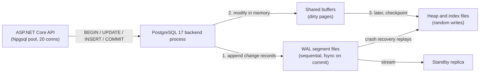
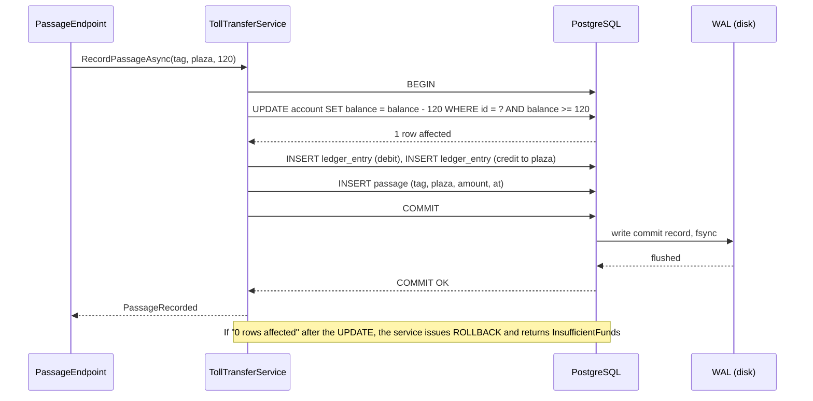

Every system that moves money, stock or seats depends on one promise from the database: *either all of these changes happen, or none of them do*. That promise is the transaction. This lesson explains what the promise covers, what it does not, and how to use it from C# without creating the two most common production problems: half-applied writes and connections stuck "idle in transaction".

## Learning objectives

By the end of this lesson you will be able to:

1. Explain each letter of ACID in plain English and say which problem it prevents.
2. Describe how PostgreSQL makes a commit durable with the write-ahead log (WAL) and what `synchronous_commit = off` trades away.
3. Write a correct multi-statement transaction in SQL, including savepoints and deferred constraints.
4. Use transactions from ASP.NET Core with Npgsql and EF Core, and keep them short.
5. Spot the three classic transaction bugs: the "check then act" race, the long-held transaction, and the dual write to a database plus a queue.
6. Reason with numbers about how long transactions cost you in connections and lock time.
7. Decide when you do *not* need a transaction, and when a transaction alone is not enough.

## Prerequisites

- [Relational database fundamentals](#/lesson/m09-relational-fundamentals): tables, primary keys, constraints.
- [One-to-one, one-to-many and many-to-many](#/lesson/m09-relationships): we will use a ledger with a parent `transfer` row and child `ledger_entry` rows.
- Helpful but not required: [Transaction boundaries and aggregate consistency](#/lesson/m08-transaction-boundaries) for the design side of "how big should a transaction be".

## Explain it like I'm a beginner

Imagine a toll plaza on the Delhi–Jaipur highway. A car with a FASTag-style tag passes. Three things must happen in the system:

1. Deduct ₹120 from the vehicle's prepaid account.
2. Record a line in the account's statement ("Toll, Manesar plaza, ₹120").
3. Record the passage itself so the barrier opens and the operator gets paid.

Now imagine the server crashes right after step 1. The driver has lost ₹120 and nothing else was written. Multiply that by one crash during a 70-passages-per-second peak and you have dozens of angry customers and a reconciliation nightmare.

A **transaction** is an envelope you put around the three steps. You say "begin", do the three writes, then say "commit". The database promises that an observer will see *either* the world before the envelope *or* the world after it. Never the half-way state. If anything goes wrong before "commit", or if you say "rollback", every change inside the envelope vanishes as if it never happened.

The analogy most people find useful is a bank cheque book with carbon copies. You do not hand over the cheque until you have written the amount, the payee and the date. If you make a mistake half-way, you tear the cheque up. Nobody ever sees the half-written cheque.

The four letters of **ACID** describe four parts of that promise:

- **Atomicity**: all or nothing. The torn-up cheque.
- **Consistency**: the rules you declared (a balance can't go negative, every entry belongs to a real account) are true before and after the envelope.
- **Isolation**: two clerks writing cheques at the same time don't see each other's half-written cheques.
- **Durability**: once the database says "committed", the change survives a power cut.

The rest of this lesson makes each letter concrete, shows how PostgreSQL implements it, and then shows the C# you would actually write.

## First-principles explanation

### Atomicity: how "all or nothing" is possible

A transaction may touch many pages on disk. Writing them "all at once" is physically impossible: the disk writes one block at a time, and a crash can land between any two blocks.

PostgreSQL solves this with the **write-ahead log (WAL)**. Before any data page is changed, a description of the change ("set balance on page 4,210, tuple 7, to 2,380") is appended to a sequential log file. A transaction *commits* by writing a single small **commit record** to the WAL and forcing it to disk (`fsync`). That one record is the atomic switch.

- Crash **before** the commit record is on disk: on restart, PostgreSQL replays the WAL, sees no commit record for transaction 48,113, and treats everything that transaction did as never having happened. Its row versions are simply invisible.
- Crash **after** the commit record: the replay re-applies any data-page changes that had not yet been written, and the transaction is complete.

So atomicity for a transaction that touched 3 rows or 3 million rows comes down to one block write. That is why `COMMIT` cost is dominated by one fsync, not by transaction size.

There is a subtle but important rule in PostgreSQL: **any error inside a transaction aborts the whole transaction**. After a failed statement, every further statement gets `ERROR: current transaction is aborted, commands ignored until end of transaction block`. You must `ROLLBACK` (or roll back to a savepoint). Other databases let you keep going after a failed statement; PostgreSQL does not. This bites people who "try an insert, and on duplicate, update" in application code inside one transaction. Use `INSERT ... ON CONFLICT` instead, or a savepoint.

### Consistency: the database enforces the rules you declared, not the ones in your head

Consistency in ACID means: if the database was in a valid state before the transaction, it is in a valid state after. "Valid" is defined by the constraints you wrote: `NOT NULL`, `CHECK (balance >= 0)`, `UNIQUE`, `FOREIGN KEY`, exclusion constraints and triggers.

Two things follow:

1. If a rule only exists in C# ("a vehicle can't have two active tags"), the database cannot protect it. Two requests arriving 2 ms apart can both pass your C# check and both insert. The fix is a `UNIQUE` partial index: `CREATE UNIQUE INDEX ON tag (vehicle_id) WHERE status = 'active'`. Push every rule you can express into the schema.
2. Constraints are normally checked **per statement**. Sometimes you need a rule to hold only at commit. A double-entry ledger is the classic case: a transfer inserts a −₹120 entry and a +₹120 entry; between the two inserts the books are unbalanced. PostgreSQL supports `DEFERRABLE INITIALLY DEFERRED` on unique, primary key, foreign key and exclusion constraints, and a `CONSTRAINT TRIGGER` for arbitrary rules. Deferred checks run at `COMMIT` instead.

### Isolation: concurrent transactions don't see each other's half-done work

PostgreSQL uses **multi-version concurrency control (MVCC)**. An `UPDATE` does not overwrite a row; it writes a *new version* of the row stamped with the writing transaction's id (`xmin`) and marks the old version as expiring (`xmax`). Each transaction decides which version it is allowed to see from a **snapshot**: the set of transaction ids that were committed when the snapshot was taken.

Consequences you will notice:

- Readers never block writers, and writers never block readers. A long report does not stop toll passages from committing.
- Writers *do* block writers on the same row. The second `UPDATE` to the same row waits until the first transaction commits or rolls back.
- Old row versions pile up until `VACUUM` cleans them. A transaction that stays open for an hour pins its snapshot, so vacuum cannot remove anything newer than that snapshot. This is the hidden cost of "idle in transaction" connections: table bloat for everyone.

The default isolation level is **Read Committed**: each *statement* takes a fresh snapshot. The next lesson, [Isolation levels and anomalies](#/lesson/m09-isolation-levels), covers Repeatable Read and Serializable and the anomalies each one allows. Here you only need the headline: the default is good enough for most work, and not good enough for "read a balance, then decide, then write" without a lock or a stronger level.

### Durability: what "committed" guarantees against a power cut

With the default settings (`fsync = on`, `synchronous_commit = on`), `COMMIT` does not return to your application until the WAL commit record has been flushed to stable storage. If the lights go out one microsecond later, the data is still there after restart.

That flush is the price. On a typical cloud SSD volume, a single fsync is in the sub-millisecond to low-millisecond range; on networked block storage it can be several milliseconds. PostgreSQL batches: if 40 transactions commit in the same few milliseconds, one fsync can cover all of them (**group commit**). That is why throughput in transactions per second is usually much higher than `1 ÷ fsync latency`.

`synchronous_commit = off` lets `COMMIT` return before the flush. The WAL writer flushes in the background about every `wal_writer_delay` (default 200 ms). The documentation's rule of thumb is that a crash can lose up to roughly three times that window of *recently committed* transactions. Crucially, it never corrupts data: you lose the last ~0.6 s of commits as a clean unit, and the database remains consistent. This is a reasonable setting for a telemetry table where losing half a second of GPS pings is fine. It is never acceptable for the ledger. You can set it per transaction (`SET LOCAL synchronous_commit = off`), so the same database can offer both.

With streaming replication, `synchronous_commit` can go further the other way: `remote_write`, `on` and `remote_apply` make commit wait for one or more standbys. That is how you survive the loss of a whole server, at the cost of a network round trip per commit. [Read replicas and replication lag](#/lesson/m09-replicas) covers it.

### What a transaction does not do

1. **It does not protect across two systems.** Writing a row and then publishing to RabbitMQ is two separate commits. If the second fails, the first has already happened. That is the dual-write problem; the fix is the [transactional outbox](#/lesson/m12-outbox).
2. **It does not make "check then act" safe by itself.** `SELECT balance` then `UPDATE balance = balance - 120` in Read Committed can let two concurrent debits both pass the check. Use a single conditional update (`UPDATE ... WHERE balance >= 120` and inspect the row count), `SELECT ... FOR UPDATE`, or a `CHECK` constraint as the last line of defence.
3. **It does not scale across a distributed system for free.** Two-phase commit between PostgreSQL and another resource exists in theory, but in .NET on Linux it is effectively unavailable and in practice slow and fragile. Design so each business operation commits in one database, and use sagas or the outbox for the rest.

### The cost model: why "short transactions" is the rule

Every open transaction holds a connection. Think in connection-seconds:

- 70 toll passages per second, each transaction open for 8 ms → 70 × 0.008 ≈ 0.56 connections busy on average. A pool of 10 is plenty.
- Same traffic, but the transaction wraps a 400 ms call to a payment gateway → 70 × 0.4 = 28 connections busy on average, and 100+ at peak. Your pool of 20 is exhausted and requests queue for a connection while the database sits mostly idle.

Same database, same traffic, 50× the connection pressure, purely from what sits *inside* the transaction. The rule: **open the transaction as late as possible, do only database work inside it, commit as early as possible**. HTTP calls, file uploads and "wait for user input" never belong inside one.

## Visual explanation

### Where the transaction lives



Read the arrows in order. The API sends statements over one pooled connection; each connection is served by one PostgreSQL backend process. The backend first appends a description of each change to the WAL (arrow 1), then changes the page in shared memory (arrow 2). The data files on disk (arrow 3) are updated lazily by checkpoints, often seconds later. Because the WAL is written sequentially and the data files randomly, this ordering turns many random writes into one sequential stream, which is both faster and safe: after a crash, the WAL is replayed onto the data files. The same WAL stream is what a standby replica consumes.

### One toll passage, end to end



Three details matter. First, the debit is a *conditional* update: the `WHERE balance >= 120` clause makes "check then act" one atomic statement, so two simultaneous passages cannot both succeed on a ₹150 balance. Second, the service checks the affected-row count; zero rows means insufficient funds and triggers a rollback. Third, `COMMIT` only returns after the WAL flush. If the service process dies between `BEGIN` and `COMMIT`, PostgreSQL notices the broken connection and rolls back automatically; nothing half-written survives.

## Step-by-step example

We will build the toll ledger in SQL, then move the same logic to C#.

### Step 1 — the schema with the rules in it

```sql
CREATE TABLE account (
  id       bigint PRIMARY KEY,
  owner    text   NOT NULL,
  balance  numeric(12,2) NOT NULL CHECK (balance >= 0)
);

CREATE TABLE transfer (
  id         bigint PRIMARY KEY,
  kind       text   NOT NULL,
  created_at timestamptz NOT NULL DEFAULT now()
);

CREATE TABLE ledger_entry (
  id          bigint PRIMARY KEY,
  transfer_id bigint NOT NULL REFERENCES transfer(id),
  account_id  bigint NOT NULL REFERENCES account(id),
  amount      numeric(12,2) NOT NULL CHECK (amount <> 0)
);
```

The `CHECK (balance >= 0)` is the last line of defence against a negative balance. Even if every application bug lines up, the database refuses the write.

### Step 2 — the happy path

```sql
BEGIN;
INSERT INTO transfer (id, kind) VALUES (9001, 'toll');
UPDATE account SET balance = balance - 120 WHERE id = 1;
UPDATE account SET balance = balance + 120 WHERE id = 900;   -- plaza settlement account
INSERT INTO ledger_entry VALUES (1, 9001, 1, -120), (2, 9001, 900, 120);
COMMIT;
```

Until `COMMIT`, another session running `SELECT balance FROM account WHERE id = 1` still sees the old balance. After `COMMIT`, it sees the new one. There is no moment at which it sees the transfer row without the entries.

### Step 3 — the failure path

Suppose account 1 has ₹100. The `UPDATE` setting it to −20 violates the `CHECK`. PostgreSQL raises an error and the transaction is aborted. Any further statement fails with "current transaction is aborted". You must `ROLLBACK`. The `transfer` row inserted a moment earlier disappears with it.

### Step 4 — savepoints for partial retry

A batch job posts 500 toll passages in one transaction to amortise the commit cost. One bad row should not throw away the other 499:

```sql
BEGIN;
SAVEPOINT row_17;
INSERT INTO ledger_entry VALUES (17, 9017, 1, -120);   -- fails: account 1 has no funds
ROLLBACK TO SAVEPOINT row_17;                           -- only row 17's work is undone
INSERT INTO ledger_entry VALUES (18, 9018, 2, -120);   -- continues
COMMIT;
```

Savepoints are cheap, but hundreds of thousands of them in one transaction do have a memory cost in the backend. For true bulk loads, validate first or use `COPY` into a staging table.

### Step 5 — deferring a constraint to commit time

We want to enforce "every transfer's entries sum to zero". Statement-level checking cannot work because the first entry alone never sums to zero. A constraint trigger that fires at commit can:

```sql
CREATE OR REPLACE FUNCTION check_transfer_balanced() RETURNS trigger AS $$
BEGIN
  IF (SELECT COALESCE(SUM(amount), 0) FROM ledger_entry WHERE transfer_id = NEW.transfer_id) <> 0 THEN
    RAISE EXCEPTION 'transfer % is not balanced', NEW.transfer_id;
  END IF;
  RETURN NULL;
END $$ LANGUAGE plpgsql;

CREATE CONSTRAINT TRIGGER transfer_balanced
  AFTER INSERT OR UPDATE OR DELETE ON ledger_entry
  DEFERRABLE INITIALLY DEFERRED
  FOR EACH ROW EXECUTE FUNCTION check_transfer_balanced();
```

Now an unbalanced transfer fails at `COMMIT`, and the whole transaction rolls back.

## Production-style C# implementation

In real code the store is PostgreSQL through Npgsql or EF Core. The checker for this course cannot reference those packages, so the compilable code below models the same concepts in memory: a unit of work (`IUnitOfWork`) with begin, commit and rollback; a store that only exposes committed state to other readers; and a service that uses them exactly as it would use a real transaction. The Npgsql and EF Core versions follow as snippets.

```text
Toll.Api/
  Program.cs
  Ledger/Models.cs
  Ledger/IUnitOfWork.cs
  Ledger/InMemoryLedgerDb.cs
  Ledger/TollTransferService.cs
```

```csharp file=Ledger/Models.cs
namespace Toll.Ledger;

public sealed record Account(long Id, string Owner, decimal Balance);

public sealed record LedgerEntry(long Id, long TransferId, long AccountId, decimal Amount);

public sealed record Passage(long Id, long TransferId, string Tag, string Plaza, decimal Amount, DateTimeOffset At);

public enum PassageOutcome { Recorded, InsufficientFunds, UnknownTag }

public sealed record PassageResult(PassageOutcome Outcome, long? TransferId);
```

```csharp file=Ledger/IUnitOfWork.cs
namespace Toll.Ledger;

/// <summary>A transaction boundary. Open it late, commit it early, and never do I/O to other systems inside it.</summary>
public interface IUnitOfWork : IAsyncDisposable
{
    ILedgerSession Session { get; }
    Task CommitAsync(CancellationToken ct = default);
    Task RollbackAsync(CancellationToken ct = default);
}

/// <summary>The statements available inside one transaction.</summary>
public interface ILedgerSession
{
    Task<Account?> FindAccountByTagAsync(string tag, CancellationToken ct = default);
    /// <summary>Conditional debit. Returns the number of rows changed: 1 on success, 0 when the balance was too low.</summary>
    Task<int> TryDebitAsync(long accountId, decimal amount, CancellationToken ct = default);
    Task CreditAsync(long accountId, decimal amount, CancellationToken ct = default);
    Task<long> InsertTransferAsync(string kind, CancellationToken ct = default);
    Task InsertEntryAsync(long transferId, long accountId, decimal amount, CancellationToken ct = default);
    Task InsertPassageAsync(long transferId, string tag, string plaza, decimal amount, DateTimeOffset at, CancellationToken ct = default);
}

public interface ILedgerDb
{
    Task<IUnitOfWork> BeginAsync(CancellationToken ct = default);
    /// <summary>Committed view, as another connection would see it.</summary>
    Account? ReadCommittedAccount(long accountId);
    IReadOnlyList<LedgerEntry> ReadCommittedEntries(long transferId);
}
```

```csharp file=Ledger/InMemoryLedgerDb.cs
using System.Collections.Concurrent;

namespace Toll.Ledger;

/// <summary>
/// An in-memory stand-in for PostgreSQL that models atomicity and read-committed visibility:
/// every write goes to a private buffer and becomes visible to others only at Commit.
/// A real implementation is NpgsqlConnection + NpgsqlTransaction; see the snippets in the lesson.
/// </summary>
public sealed class InMemoryLedgerDb : ILedgerDb
{
    private readonly object _gate = new();
    private readonly Dictionary<long, Account> _accounts = new();
    private readonly Dictionary<string, long> _tagToAccount = new();
    private readonly List<LedgerEntry> _entries = new();
    private readonly List<Passage> _passages = new();
    private long _nextTransferId = 9000;
    private long _nextEntryId = 1;

    public InMemoryLedgerDb Seed(long id, string owner, decimal balance, string? tag = null)
    {
        lock (_gate)
        {
            _accounts[id] = new Account(id, owner, balance);
            if (tag is not null) _tagToAccount[tag] = id;
        }
        return this;
    }

    public Task<IUnitOfWork> BeginAsync(CancellationToken ct = default) => Task.FromResult<IUnitOfWork>(new Tx(this));

    public Account? ReadCommittedAccount(long accountId)
    {
        lock (_gate) return _accounts.GetValueOrDefault(accountId);
    }

    public IReadOnlyList<LedgerEntry> ReadCommittedEntries(long transferId)
    {
        lock (_gate) return _entries.Where(e => e.TransferId == transferId).ToList();
    }

    public IReadOnlyList<Passage> CommittedPassages()
    {
        lock (_gate) return _passages.ToList();
    }

    private sealed class Tx(InMemoryLedgerDb db) : IUnitOfWork, ILedgerSession
    {
        // Buffered writes: nothing here is visible to ReadCommitted* until Commit.
        private readonly Dictionary<long, decimal> _pendingBalances = new();
        private readonly List<LedgerEntry> _pendingEntries = new();
        private readonly List<Passage> _pendingPassages = new();
        private readonly List<long> _pendingTransfers = new();
        private bool _finished;

        public ILedgerSession Session => this;

        private decimal CurrentBalance(long accountId)
        {
            if (_pendingBalances.TryGetValue(accountId, out var b)) return b;
            lock (db._gate) return db._accounts[accountId].Balance;
        }

        public Task<Account?> FindAccountByTagAsync(string tag, CancellationToken ct = default)
        {
            lock (db._gate)
            {
                if (!db._tagToAccount.TryGetValue(tag, out var id)) return Task.FromResult<Account?>(null);
                var a = db._accounts[id];
                return Task.FromResult<Account?>(a with { Balance = CurrentBalance(id) });
            }
        }

        public Task<int> TryDebitAsync(long accountId, decimal amount, CancellationToken ct = default)
        {
            EnsureOpen();
            var current = CurrentBalance(accountId);
            if (current < amount) return Task.FromResult(0);          // WHERE balance >= amount failed: 0 rows
            _pendingBalances[accountId] = current - amount;
            return Task.FromResult(1);
        }

        public Task CreditAsync(long accountId, decimal amount, CancellationToken ct = default)
        {
            EnsureOpen();
            _pendingBalances[accountId] = CurrentBalance(accountId) + amount;
            return Task.CompletedTask;
        }

        public Task<long> InsertTransferAsync(string kind, CancellationToken ct = default)
        {
            EnsureOpen();
            var id = Interlocked.Increment(ref db._nextTransferId);
            _pendingTransfers.Add(id);
            return Task.FromResult(id);
        }

        public Task InsertEntryAsync(long transferId, long accountId, decimal amount, CancellationToken ct = default)
        {
            EnsureOpen();
            if (amount == 0) throw new InvalidOperationException("CHECK (amount <> 0) violated");
            _pendingEntries.Add(new LedgerEntry(Interlocked.Increment(ref db._nextEntryId), transferId, accountId, amount));
            return Task.CompletedTask;
        }

        public Task InsertPassageAsync(long transferId, string tag, string plaza, decimal amount, DateTimeOffset at, CancellationToken ct = default)
        {
            EnsureOpen();
            _pendingPassages.Add(new Passage(_pendingPassages.Count + 1, transferId, tag, plaza, amount, at));
            return Task.CompletedTask;
        }

        public Task CommitAsync(CancellationToken ct = default)
        {
            EnsureOpen();
            lock (db._gate)
            {
                // Deferred constraint: every transfer must balance to zero at commit.
                foreach (var t in _pendingTransfers)
                    if (_pendingEntries.Where(e => e.TransferId == t).Sum(e => e.Amount) != 0)
                        throw new InvalidOperationException($"transfer {t} is not balanced");
                foreach (var (id, bal) in _pendingBalances)
                {
                    if (bal < 0) throw new InvalidOperationException("CHECK (balance >= 0) violated");
                    db._accounts[id] = db._accounts[id] with { Balance = bal };
                }
                db._entries.AddRange(_pendingEntries);
                db._passages.AddRange(_pendingPassages);
            }
            _finished = true;
            return Task.CompletedTask;
        }

        public Task RollbackAsync(CancellationToken ct = default)
        {
            _pendingBalances.Clear(); _pendingEntries.Clear(); _pendingPassages.Clear(); _pendingTransfers.Clear();
            _finished = true;
            return Task.CompletedTask;
        }

        // Like NpgsqlTransaction: disposing an uncommitted transaction rolls it back.
        public ValueTask DisposeAsync() => _finished ? ValueTask.CompletedTask : new ValueTask(RollbackAsync());

        private void EnsureOpen()
        {
            if (_finished) throw new InvalidOperationException("transaction already finished");
        }
    }
}
```

```csharp file=Ledger/TollTransferService.cs
using Microsoft.Extensions.Logging;

namespace Toll.Ledger;

public sealed class TollTransferService(ILedgerDb db, TimeProvider clock, ILogger<TollTransferService> log)
{
    public const long PlazaSettlementAccount = 900;

    public async Task<PassageResult> RecordPassageAsync(string tag, string plaza, decimal amount, CancellationToken ct = default)
    {
        if (amount <= 0) throw new ArgumentOutOfRangeException(nameof(amount));

        // 1. Everything that is NOT database work happens before BEGIN.
        var at = clock.GetUtcNow();

        // 2. Open late. Disposing without Commit rolls back, so an exception anywhere below leaves no trace.
        await using var uow = await db.BeginAsync(ct);
        var s = uow.Session;

        var account = await s.FindAccountByTagAsync(tag, ct);
        if (account is null) return new PassageResult(PassageOutcome.UnknownTag, null);

        // 3. Check-then-act as ONE conditional statement, not SELECT then UPDATE.
        if (await s.TryDebitAsync(account.Id, amount, ct) == 0)
        {
            await uow.RollbackAsync(ct);
            log.LogInformation("Insufficient funds for tag {Tag} at {Plaza}", tag, plaza);
            return new PassageResult(PassageOutcome.InsufficientFunds, null);
        }

        var transferId = await s.InsertTransferAsync("toll", ct);
        await s.CreditAsync(PlazaSettlementAccount, amount, ct);
        await s.InsertEntryAsync(transferId, account.Id, -amount, ct);
        await s.InsertEntryAsync(transferId, PlazaSettlementAccount, amount, ct);
        await s.InsertPassageAsync(transferId, tag, plaza, amount, at, ct);

        // 4. Commit early. Nothing after this line touches the database.
        await uow.CommitAsync(ct);
        return new PassageResult(PassageOutcome.Recorded, transferId);
    }
}
```

```csharp file=Program.cs
using Toll.Ledger;

var builder = WebApplication.CreateBuilder(args);

builder.Services.AddSingleton(TimeProvider.System);
builder.Services.AddSingleton<ILedgerDb>(_ => new InMemoryLedgerDb()
    .Seed(1, "Priya Nair", 1500m, tag: "TAG-1001")
    .Seed(2, "Rohan Mehta", 90m, tag: "TAG-1002")
    .Seed(TollTransferService.PlazaSettlementAccount, "Manesar plaza settlement", 0m));
builder.Services.AddScoped<TollTransferService>();

var app = builder.Build();

app.MapPost("/passages", async (PassageRequest req, TollTransferService svc, CancellationToken ct) =>
{
    var result = await svc.RecordPassageAsync(req.Tag, req.Plaza, req.Amount, ct);
    return result.Outcome switch
    {
        PassageOutcome.Recorded => Results.Ok(result),
        PassageOutcome.InsufficientFunds => Results.Problem("Insufficient balance", statusCode: StatusCodes.Status402PaymentRequired),
        _ => Results.NotFound(),
    };
});

app.Run();

public sealed record PassageRequest(string Tag, string Plaza, decimal Amount);
```

### The same service on real PostgreSQL with Npgsql

The shape is identical; only the session type changes. Note the conditional `UPDATE` and the row-count check.

```csharp
// Not compiled by the course checker: requires the Npgsql package.
await using var conn = await dataSource.OpenConnectionAsync(ct);
await using var tx = await conn.BeginTransactionAsync(ct);          // BEGIN (Read Committed by default)

await using var debit = new NpgsqlCommand(
    "UPDATE account SET balance = balance - @amt WHERE id = @id AND balance >= @amt", conn, tx);
debit.Parameters.AddWithValue("amt", amount);
debit.Parameters.AddWithValue("id", accountId);
if (await debit.ExecuteNonQueryAsync(ct) == 0)
{
    await tx.RollbackAsync(ct);
    return PassageOutcome.InsufficientFunds;
}
// ... INSERT transfer, ledger entries, passage, all with `conn, tx` ...
await tx.CommitAsync(ct);                                             // returns after the WAL fsync
```

If the method throws before `CommitAsync`, `await using` disposes the transaction, which sends `ROLLBACK`. If the process is killed, PostgreSQL rolls back when it notices the socket close.

### With EF Core

`SaveChangesAsync` already wraps all tracked changes in one transaction. You need an explicit transaction only when you mix raw SQL with tracked changes, or when you call `SaveChangesAsync` more than once:

```csharp
// Not compiled by the course checker: requires EF Core.
await using var tx = await dbContext.Database.BeginTransactionAsync(ct);
var rows = await dbContext.Database.ExecuteSqlAsync(
    $"UPDATE account SET balance = balance - {amount} WHERE id = {accountId} AND balance >= {amount}", ct);
if (rows == 0) { await tx.RollbackAsync(ct); return PassageOutcome.InsufficientFunds; }
dbContext.LedgerEntries.AddRange(/* ... */);
await dbContext.SaveChangesAsync(ct);
await tx.CommitAsync(ct);
```

Two warnings. First, if you enable a retrying execution strategy (`EnableRetryOnFailure`), a user-initiated transaction must be wrapped in `CreateExecutionStrategy().ExecuteAsync(...)` so the *whole* unit retries, not individual statements. Second, keep `DbContext` scoped per request; a transaction that outlives the request is almost always a bug.

:::callout type=warning title="Idle in transaction is the silent killer"
`pg_stat_activity.state = 'idle in transaction'` means a connection has sent `BEGIN` and is now doing nothing, usually because application code awaited an HTTP call, a message publish or user input inside the transaction. It holds locks, blocks `VACUUM`, and burns a pool slot. Set `idle_in_transaction_session_timeout` (for example `30s`) so PostgreSQL kills such sessions, and treat each occurrence as a bug to fix.
:::

## Bad design vs good design

**Bad: the transaction wraps everything.**

```csharp
// Anti-pattern: transaction held open across a network call and a message publish.
await using var tx = await conn.BeginTransactionAsync();
await DebitAsync(conn, tx, accountId, amount);
var receipt = await paymentGateway.NotifyAsync(accountId, amount);   // 150–900 ms over the internet
await InsertReceiptAsync(conn, tx, receipt);
await bus.PublishAsync(new PassageRecorded(accountId, amount));      // second system: not covered by tx
await tx.CommitAsync();
```

What goes wrong, in order of how soon you will see it:

1. Pool exhaustion. At 70 passages/s with ~500 ms inside the transaction, you need ~35 busy connections just for this endpoint.
2. Lock contention. The account row stays locked for 500 ms. A second passage by the same vehicle (or a top-up) waits behind it.
3. Dual write. If `CommitAsync` fails after `PublishAsync` succeeded, downstream systems believe a passage happened that the ledger never recorded.
4. Vacuum cannot clean row versions newer than the oldest open snapshot, so a few slow gateway calls per minute steadily bloat the table.

**Good: database work only, then everything else.**

```csharp
// 1. Database work in one short transaction (8–15 ms).
var result = await transferService.RecordPassageAsync(tag, plaza, amount, ct);
// 2. Side effects after commit, each made idempotent by the transfer id.
if (result.Outcome == PassageOutcome.Recorded)
    await notifications.EnqueueAsync(new PassageRecorded(result.TransferId!.Value), ct);
```

If the notification must be guaranteed, write it to an `outbox` table *inside* the same transaction and let a background relay publish it ([Transactional outbox](#/lesson/m12-outbox)). Then the only thing inside the transaction is still database work.

**Is the extra structure worth it?** For a single-user admin tool updating one row, no. `SaveChangesAsync` is already a transaction. Reach for explicit transactions when one business action touches two or more tables, or when you need the row-count check pattern. Reach for an outbox when a second system must learn about the commit reliably.

:::callout type=tradeoff title="Bigger transactions are cheaper per row, but hold locks longer"
Committing 500 ledger entries in one transaction costs one fsync instead of 500, which is why batch jobs do it. The price is that locks and row versions are held for the whole batch. Pick a batch size by time, not by row count: aim for transactions that finish in well under a second so they never block interactive traffic for long.
:::

## Practical playground

The playground seeds the toll ledger. Try these in order:

1. Run the happy-path transfer from Step 2 with new ids (`transfer 9002`, entries `3` and `4`), then check both balances.
2. Try to debit account 2 by ₹120. Watch the `CHECK` constraint fire, then run `SELECT 1;` to see "current transaction is aborted". Issue `ROLLBACK`.
3. Insert only one `ledger_entry` for a new transfer and `COMMIT`. The deferred constraint trigger should reject the commit.
4. Use `SAVEPOINT` to recover from a bad insert without losing the rest of the transaction.
5. Run `SELECT pg_current_xact_id();` twice inside one transaction and once outside; notice how the id is assigned.

:::playground type=sql title="Toll ledger with constraints"
```sql
CREATE TABLE account (
  id      bigint PRIMARY KEY,
  owner   text   NOT NULL,
  balance numeric(12,2) NOT NULL CHECK (balance >= 0)
);
CREATE TABLE transfer (
  id         bigint PRIMARY KEY,
  kind       text   NOT NULL,
  created_at timestamptz NOT NULL DEFAULT now()
);
CREATE TABLE ledger_entry (
  id          bigint PRIMARY KEY,
  transfer_id bigint NOT NULL REFERENCES transfer(id),
  account_id  bigint NOT NULL REFERENCES account(id),
  amount      numeric(12,2) NOT NULL CHECK (amount <> 0)
);
CREATE OR REPLACE FUNCTION check_transfer_balanced() RETURNS trigger AS $$
BEGIN
  IF (SELECT COALESCE(SUM(amount), 0) FROM ledger_entry WHERE transfer_id = NEW.transfer_id) <> 0 THEN
    RAISE EXCEPTION 'transfer % is not balanced', NEW.transfer_id;
  END IF;
  RETURN NULL;
END $$ LANGUAGE plpgsql;
CREATE CONSTRAINT TRIGGER transfer_balanced
  AFTER INSERT OR UPDATE ON ledger_entry
  DEFERRABLE INITIALLY DEFERRED
  FOR EACH ROW EXECUTE FUNCTION check_transfer_balanced();

INSERT INTO account VALUES (1, 'Priya Nair', 1500.00), (2, 'Rohan Mehta', 90.00), (3, 'Ananya Rao', 640.00),
                           (900, 'Manesar plaza settlement', 0.00);
INSERT INTO transfer (id, kind, created_at) VALUES
  (9001, 'toll',   '2026-10-18 08:02:00+05:30'),
  (9002, 'toll',   '2026-10-18 08:05:00+05:30'),
  (9003, 'topup',  '2026-10-18 09:00:00+05:30');
INSERT INTO ledger_entry VALUES
  (1, 9001, 1,   -120.00), (2, 9001, 900, 120.00),
  (3, 9002, 3,   -120.00), (4, 9002, 900, 120.00),
  (5, 9003, 3,    500.00), (6, 9003, 900, -500.00);
UPDATE account SET balance = 1380.00 WHERE id = 1;
UPDATE account SET balance = 1020.00 WHERE id = 3;
UPDATE account SET balance = -260.00 + 500.00 WHERE id = 900;
```
:::

## Exercises

:::exercise id=m09-transactions-acid-ex1 difficulty=beginner kind=sql ordered=true title="Find accounts whose balance disagrees with the ledger"
A reconciliation job compares each account's stored `balance` with the sum of its ledger entries plus its opening balance. The opening balances were: account 1 → 1500, account 2 → 90, account 3 → 640, account 900 → 0 (stored in `opening_balance`). Return `account_id`, `stored_balance`, `ledger_balance` (opening + sum of entries) for every account where the two differ, ordered by `account_id`.
::acceptance
- Uses a `LEFT JOIN` or subquery so accounts with no entries are still checked.
- Returns exactly the mismatched accounts, none of the balanced ones.
- Column names are exactly `account_id`, `stored_balance`, `ledger_balance`.
::hint
Start by computing `SUM(amount)` per `account_id` from `ledger_entry`.
::hint
Accounts with no entries have no rows in `ledger_entry`; `COALESCE(SUM(...), 0)` and a `LEFT JOIN` keep them in the result.
::hint
Compare `a.balance` with `o.opening_balance + COALESCE(s.total, 0)` in the `WHERE` clause.
::hint
```sql
SELECT a.id AS account_id, a.balance AS stored_balance,
       o.opening_balance + COALESCE(s.total, 0) AS ledger_balance
FROM account a JOIN opening_balance o ON o.account_id = a.id
LEFT JOIN (SELECT account_id, SUM(amount) AS total FROM ledger_entry GROUP BY account_id) s ON s.account_id = a.id
WHERE ...
```
::setup
```sql
CREATE TABLE account (id bigint PRIMARY KEY, owner text NOT NULL, balance numeric(12,2) NOT NULL);
CREATE TABLE opening_balance (account_id bigint PRIMARY KEY REFERENCES account(id), opening_balance numeric(12,2) NOT NULL);
CREATE TABLE transfer (id bigint PRIMARY KEY, kind text NOT NULL);
CREATE TABLE ledger_entry (id bigint PRIMARY KEY, transfer_id bigint NOT NULL REFERENCES transfer(id),
                           account_id bigint NOT NULL REFERENCES account(id), amount numeric(12,2) NOT NULL);
INSERT INTO account VALUES (1,'Priya Nair',1380.00),(2,'Rohan Mehta',90.00),(3,'Ananya Rao',1140.00),(900,'Plaza settlement',240.00);
INSERT INTO opening_balance VALUES (1,1500.00),(2,90.00),(3,640.00),(900,0.00);
INSERT INTO transfer VALUES (9001,'toll'),(9002,'toll'),(9003,'topup');
INSERT INTO ledger_entry VALUES
  (1,9001,1,-120.00),(2,9001,900,120.00),
  (3,9002,3,-120.00),(4,9002,900,120.00),
  (5,9003,3,500.00),(6,9003,900,-500.00);
```
::check
```sql
SELECT a.id AS account_id,
       a.balance AS stored_balance,
       o.opening_balance + COALESCE(s.total, 0) AS ledger_balance
FROM account a
JOIN opening_balance o ON o.account_id = a.id
LEFT JOIN (SELECT account_id, SUM(amount) AS total FROM ledger_entry GROUP BY account_id) s ON s.account_id = a.id
WHERE a.balance <> o.opening_balance + COALESCE(s.total, 0)
ORDER BY a.id;
```
::solution
```sql
SELECT a.id AS account_id,
       a.balance AS stored_balance,
       o.opening_balance + COALESCE(s.total, 0) AS ledger_balance
FROM account a
JOIN opening_balance o ON o.account_id = a.id
LEFT JOIN (SELECT account_id, SUM(amount) AS total FROM ledger_entry GROUP BY account_id) s ON s.account_id = a.id
WHERE a.balance <> o.opening_balance + COALESCE(s.total, 0)
ORDER BY a.id;
```
Two accounts disagree. Account 3 shows 1140 but the ledger says 640 − 120 + 500 = 1020, and account 900 shows 240 but the ledger says 120 + 120 − 500 = −260. Both are what a half-applied transaction (a debit without its matching update, or vice versa) looks like in production. A reconciliation query like this is the safety net behind every ledger, because atomicity protects you against crashes, not against application code that forgot to update one of the two tables.
::mistakes
- Using an inner `JOIN` to the aggregated entries, which silently drops account 2 (no entries) from the check.
- Comparing with `=` and forgetting the `COALESCE`, so `NULL` comparisons remove rows.
:::

:::exercise id=m09-transactions-acid-ex2 difficulty=beginner kind=code title="Implement an undo-log transaction"
`MiniDb` holds account balances in a dictionary. `UndoLogTransaction` records the old value of every balance it changes so it can restore them. Implement `Set`, `Commit` and `Rollback`, then implement `TransferService.Transfer` so that a failed transfer leaves both balances untouched.
::requirements
- `Set(account, newValue)` remembers the *first* old value of each account (later sets must not overwrite that record).
- `Rollback()` restores every remembered old value and clears the log.
- `Commit()` clears the log without restoring.
- `Transfer(from, to, amount)` debits `from`, credits `to` and commits. If `from` has insufficient funds or `to` does not exist, it rolls back and returns `false`.
::acceptance
- A successful transfer of 120 from an account with 1500 to one with 0 leaves 1380 and 120.
- A transfer of 120 from an account with 90 returns `false` and changes nothing.
- A transfer to a missing account returns `false` and leaves the source balance unchanged, even though the debit was applied first.
::hint
An undo log is a list of (key, oldValue) pairs. Rollback walks it and puts the old values back.
::hint
In `Set`, only add to the log if the key is not already in it; use `Dictionary.TryAdd`.
::hint
`Transfer` should do the debit with `Set` first, then try the credit inside the same transaction, and call `Rollback` on any failure path.
::hint
```csharp
public void Rollback()
{
    foreach (var (key, old) in _undo) _db.Balances[key] = old;
    _undo.Clear();
}
```
::starter
```csharp file=UndoLog.cs
using System;
using System.Collections.Generic;

public sealed class MiniDb
{
    public Dictionary<string, decimal> Balances { get; } = new();
}

public sealed class UndoLogTransaction
{
    private readonly MiniDb _db;
    private readonly Dictionary<string, decimal> _undo = new();
    public UndoLogTransaction(MiniDb db) => _db = db;

    public decimal Get(string account) => _db.Balances[account];
    public bool Exists(string account) => _db.Balances.ContainsKey(account);

    public void Set(string account, decimal value) => throw new NotImplementedException();
    public void Commit() => throw new NotImplementedException();
    public void Rollback() => throw new NotImplementedException();
}

public sealed class TransferService
{
    private readonly MiniDb _db;
    public TransferService(MiniDb db) => _db = db;

    public bool Transfer(string from, string to, decimal amount) => throw new NotImplementedException();
}
```
::tests
```csharp file=UndoLogTests.cs
using Xunit;

public class UndoLogTests
{
    private static MiniDb Db()
    {
        var db = new MiniDb();
        db.Balances["priya"] = 1500m;
        db.Balances["rohan"] = 90m;
        db.Balances["plaza"] = 0m;
        return db;
    }

    [Fact]
    public void Successful_transfer_moves_money()
    {
        var db = Db();
        Assert.True(new TransferService(db).Transfer("priya", "plaza", 120m));
        Assert.Equal(1380m, db.Balances["priya"]);
        Assert.Equal(120m, db.Balances["plaza"]);
    }

    [Fact]
    public void Insufficient_funds_changes_nothing()
    {
        var db = Db();
        Assert.False(new TransferService(db).Transfer("rohan", "plaza", 120m));
        Assert.Equal(90m, db.Balances["rohan"]);
        Assert.Equal(0m, db.Balances["plaza"]);
    }

    [Fact]
    public void Missing_destination_rolls_back_debit()
    {
        var db = Db();
        Assert.False(new TransferService(db).Transfer("priya", "ghost", 120m));
        Assert.Equal(1500m, db.Balances["priya"]);
        Assert.False(db.Balances.ContainsKey("ghost"));
    }

    [Fact]
    public void Rollback_restores_first_old_value_after_many_sets()
    {
        var db = Db();
        var tx = new UndoLogTransaction(db);
        tx.Set("priya", 1000m);
        tx.Set("priya", 500m);
        tx.Rollback();
        Assert.Equal(1500m, db.Balances["priya"]);
    }
}
```
::solution
```csharp file=UndoLog.cs
using System;
using System.Collections.Generic;

public sealed class MiniDb
{
    public Dictionary<string, decimal> Balances { get; } = new();
}

public sealed class UndoLogTransaction
{
    private readonly MiniDb _db;
    private readonly Dictionary<string, decimal> _undo = new();
    public UndoLogTransaction(MiniDb db) => _db = db;

    public decimal Get(string account) => _db.Balances[account];
    public bool Exists(string account) => _db.Balances.ContainsKey(account);

    public void Set(string account, decimal value)
    {
        _undo.TryAdd(account, _db.Balances[account]);   // remember only the FIRST old value
        _db.Balances[account] = value;
    }

    public void Commit() => _undo.Clear();

    public void Rollback()
    {
        foreach (var (key, old) in _undo) _db.Balances[key] = old;
        _undo.Clear();
    }
}

public sealed class TransferService
{
    private readonly MiniDb _db;
    public TransferService(MiniDb db) => _db = db;

    public bool Transfer(string from, string to, decimal amount)
    {
        var tx = new UndoLogTransaction(_db);
        if (!tx.Exists(from) || tx.Get(from) < amount) { tx.Rollback(); return false; }
        tx.Set(from, tx.Get(from) - amount);              // debit first, like the real service
        if (!tx.Exists(to)) { tx.Rollback(); return false; } // failure AFTER a write: undo log earns its keep
        tx.Set(to, tx.Get(to) + amount);
        tx.Commit();
        return true;
    }
}
```
This is a miniature of what the WAL does for PostgreSQL: record enough to undo (or in PostgreSQL's case, to decide visibility) before changing anything. The third test is the one that matters: a failure after the first write must leave no trace.
::mistakes
- Overwriting the undo record on a second `Set`, so rollback restores an intermediate value instead of the original.
- Checking the destination account *before* the debit only. It passes the tests here but hides the point; real failures happen mid-way.
::extensions
Add `Savepoint(name)` and `RollbackTo(name)` (see exercise 4).
:::

:::exercise id=m09-transactions-acid-ex3 difficulty=intermediate kind=sql ordered=true title="Detect unbalanced transfers"
A bug in an old version of the service sometimes committed a transfer with only one ledger entry. Write a query that returns `transfer_id`, `entry_count` and `net_amount` for every transfer whose entries do not sum to zero **or** that has fewer than 2 entries, ordered by `transfer_id`.
::acceptance
- Transfers with exactly balanced entries are excluded.
- A transfer with zero entries is included (with `entry_count` 0 and `net_amount` 0).
- Uses `GROUP BY` and `HAVING`, or an equivalent.
::hint
Aggregate `ledger_entry` by `transfer_id`, but start from `transfer` so transfers with no entries appear.
::hint
`LEFT JOIN ledger_entry e ON e.transfer_id = t.id`, then `COUNT(e.id)` and `COALESCE(SUM(e.amount), 0)`.
::hint
Filter with `HAVING COUNT(e.id) < 2 OR COALESCE(SUM(e.amount), 0) <> 0`.
::setup
```sql
CREATE TABLE transfer (id bigint PRIMARY KEY, kind text NOT NULL);
CREATE TABLE ledger_entry (id bigint PRIMARY KEY, transfer_id bigint NOT NULL REFERENCES transfer(id),
                           account_id bigint NOT NULL, amount numeric(12,2) NOT NULL);
INSERT INTO transfer VALUES (9001,'toll'),(9002,'toll'),(9003,'topup'),(9004,'toll'),(9005,'refund'),(9006,'toll');
INSERT INTO ledger_entry VALUES
  (1,9001,1,-120.00),(2,9001,900,120.00),
  (3,9002,3,-120.00),                      -- missing credit
  (4,9003,3,500.00),(5,9003,900,-500.00),
  (6,9004,2,-65.00),(7,9004,900,60.00),    -- rounding bug: does not balance
  (8,9005,1,120.00),(9,9005,900,-120.00);
-- 9006 has no entries at all
```
::check
```sql
SELECT t.id AS transfer_id, COUNT(e.id) AS entry_count, COALESCE(SUM(e.amount), 0) AS net_amount
FROM transfer t
LEFT JOIN ledger_entry e ON e.transfer_id = t.id
GROUP BY t.id
HAVING COUNT(e.id) < 2 OR COALESCE(SUM(e.amount), 0) <> 0
ORDER BY t.id;
```
::solution
```sql
SELECT t.id AS transfer_id, COUNT(e.id) AS entry_count, COALESCE(SUM(e.amount), 0) AS net_amount
FROM transfer t
LEFT JOIN ledger_entry e ON e.transfer_id = t.id
GROUP BY t.id
HAVING COUNT(e.id) < 2 OR COALESCE(SUM(e.amount), 0) <> 0
ORDER BY t.id;
```
Three transfers fail: 9002 (one entry, net −120), 9004 (two entries, net −5) and 9006 (no entries). In the real schema the deferred constraint trigger from the lesson would have rejected all three at `COMMIT`. This query is what you run *once* to find historical damage before you add that trigger, and what you keep as a nightly check afterwards.
::mistakes
- Starting from `ledger_entry` instead of `transfer`, which can never find 9006.
- `COUNT(*)` instead of `COUNT(e.id)`: with a `LEFT JOIN`, a transfer with no entries still produces one row, so `COUNT(*)` reports 1.
:::

:::exercise id=m09-transactions-acid-ex4 difficulty=intermediate kind=code title="Add savepoints to the undo log"
Extend the undo-log transaction with PostgreSQL-style savepoints. `Savepoint(name)` marks a point; `RollbackTo(name)` undoes only the changes made after that mark and keeps the savepoint so it can be reused; `Rollback()` still undoes everything.
::requirements
- The undo log becomes an ordered list of (key, oldValue) records.
- `Savepoint(name)` stores the current log length under that name.
- `RollbackTo(name)` undoes records from the end of the log back to the saved position, in reverse order, and truncates the log to that position.
- `RollbackTo` with an unknown name throws `InvalidOperationException`.
::acceptance
- Set A, savepoint, set B, rollback-to → A is still changed, B is restored.
- After `RollbackTo`, a full `Rollback()` still restores A.
- Setting the same key before and after a savepoint, then `RollbackTo`, restores the value as of the savepoint, not the original.
::hint
PostgreSQL savepoints are positions in the transaction's history. Model the history as a `List<(string Key, decimal Old)>`.
::hint
Because the same key can appear twice in the list (once before and once after the savepoint), the "only first old value" rule from exercise 2 must become "first old value *since the last savepoint*", or simply record every change and undo in reverse order.
::hint
Undo in reverse order: `for (var i = _log.Count - 1; i >= pos; i--) _db.Balances[_log[i].Key] = _log[i].Old;` then `_log.RemoveRange(pos, _log.Count - pos)`.
::starter
```csharp file=SavepointTx.cs
using System;
using System.Collections.Generic;

public sealed class MiniDb
{
    public Dictionary<string, decimal> Balances { get; } = new();
}

public sealed class SavepointTransaction
{
    private readonly MiniDb _db;
    private readonly List<(string Key, decimal Old)> _log = new();
    private readonly Dictionary<string, int> _savepoints = new();
    public SavepointTransaction(MiniDb db) => _db = db;

    public decimal Get(string account) => _db.Balances[account];

    public void Set(string account, decimal value)
    {
        _log.Add((account, _db.Balances[account]));
        _db.Balances[account] = value;
    }

    public void Savepoint(string name) => throw new NotImplementedException();
    public void RollbackTo(string name) => throw new NotImplementedException();
    public void Rollback() => throw new NotImplementedException();
    public void Commit() { _log.Clear(); _savepoints.Clear(); }
}
```
::tests
```csharp file=SavepointTxTests.cs
using System;
using Xunit;

public class SavepointTxTests
{
    private static MiniDb Db()
    {
        var db = new MiniDb();
        db.Balances["a"] = 100m;
        db.Balances["b"] = 200m;
        return db;
    }

    [Fact]
    public void RollbackTo_undoes_only_later_changes()
    {
        var db = Db();
        var tx = new SavepointTransaction(db);
        tx.Set("a", 50m);
        tx.Savepoint("sp1");
        tx.Set("b", 0m);
        tx.RollbackTo("sp1");
        Assert.Equal(50m, db.Balances["a"]);
        Assert.Equal(200m, db.Balances["b"]);
    }

    [Fact]
    public void Full_rollback_after_RollbackTo_restores_everything()
    {
        var db = Db();
        var tx = new SavepointTransaction(db);
        tx.Set("a", 50m);
        tx.Savepoint("sp1");
        tx.Set("b", 0m);
        tx.RollbackTo("sp1");
        tx.Rollback();
        Assert.Equal(100m, db.Balances["a"]);
        Assert.Equal(200m, db.Balances["b"]);
    }

    [Fact]
    public void Same_key_before_and_after_savepoint()
    {
        var db = Db();
        var tx = new SavepointTransaction(db);
        tx.Set("a", 80m);
        tx.Savepoint("sp1");
        tx.Set("a", 10m);
        tx.Set("a", 5m);
        tx.RollbackTo("sp1");
        Assert.Equal(80m, db.Balances["a"]);
    }

    [Fact]
    public void Savepoint_is_reusable_after_RollbackTo()
    {
        var db = Db();
        var tx = new SavepointTransaction(db);
        tx.Savepoint("sp1");
        tx.Set("a", 1m);
        tx.RollbackTo("sp1");
        tx.Set("a", 2m);
        tx.RollbackTo("sp1");
        Assert.Equal(100m, db.Balances["a"]);
    }

    [Fact]
    public void Unknown_savepoint_throws() =>
        Assert.Throws<InvalidOperationException>(() => new SavepointTransaction(Db()).RollbackTo("nope"));
}
```
::solution
```csharp file=SavepointTx.cs
using System;
using System.Collections.Generic;

public sealed class MiniDb
{
    public Dictionary<string, decimal> Balances { get; } = new();
}

public sealed class SavepointTransaction
{
    private readonly MiniDb _db;
    private readonly List<(string Key, decimal Old)> _log = new();
    private readonly Dictionary<string, int> _savepoints = new();
    public SavepointTransaction(MiniDb db) => _db = db;

    public decimal Get(string account) => _db.Balances[account];

    public void Set(string account, decimal value)
    {
        _log.Add((account, _db.Balances[account]));
        _db.Balances[account] = value;
    }

    public void Savepoint(string name) => _savepoints[name] = _log.Count;

    public void RollbackTo(string name)
    {
        if (!_savepoints.TryGetValue(name, out var pos))
            throw new InvalidOperationException($"savepoint \"{name}\" does not exist");
        UndoFrom(pos);
        // PostgreSQL keeps the savepoint after ROLLBACK TO, so it can be reused.
    }

    public void Rollback()
    {
        UndoFrom(0);
        _savepoints.Clear();
    }

    public void Commit() { _log.Clear(); _savepoints.Clear(); }

    private void UndoFrom(int pos)
    {
        for (var i = _log.Count - 1; i >= pos; i--) _db.Balances[_log[i].Key] = _log[i].Old;
        _log.RemoveRange(pos, _log.Count - pos);
    }
}
```
Recording every change (not just the first per key) and undoing in reverse order is what makes partial rollback correct. It is also closer to how a real undo log works: order matters.
::mistakes
- Undoing forwards instead of backwards, which restores the wrong value when a key changed twice after the savepoint.
- Deleting the savepoint in `RollbackTo`. PostgreSQL keeps it; `RELEASE SAVEPOINT` is the command that removes one.
:::

:::exercise id=m09-transactions-acid-ex5 difficulty=advanced kind=written title="Choose durability settings for three tables"
A vehicle-tracking platform stores three kinds of data in one PostgreSQL 17 cluster with one synchronous standby:
1. `ledger_entry`: money. ~70 writes/s.
2. `gps_ping`: one row per vehicle every 10 s from 40,000 vehicles. Losing a few seconds of pings is acceptable.
3. `audit_log`: regulatory record of who changed what. ~5 writes/s. Must survive loss of the primary server.

For each table, choose a `synchronous_commit` level (`off`, `local`, `on`, `remote_write`, `remote_apply`) and justify it in terms of what is lost on (a) a primary crash and (b) total loss of the primary's disk. Then estimate the write load in rows per second for `gps_ping` and explain how you would apply the setting per transaction rather than cluster-wide.
::acceptance
- Correctly states that `off` can lose recently committed transactions but never corrupts data.
- Distinguishes between surviving a crash (local flush) and surviving disk loss (replica acknowledgement).
- Gives a numeric estimate for `gps_ping` writes per second with the arithmetic shown.
- Shows `SET LOCAL synchronous_commit = ...` inside a transaction, or a per-role/per-database setting.
::hint
Start with what each level waits for: nothing extra, local WAL flush, standby received, standby flushed, standby applied.
::hint
40,000 vehicles ÷ 10 s gives the ping rate. Compare it to the ledger's 70/s and ask which table pays most for an fsync per commit.
::hint
`SET LOCAL` affects only the current transaction and is reset at commit or rollback, so a `gps_ping` writer can relax durability without touching the ledger's path.
::solution
**Arithmetic.** 40,000 vehicles ÷ 10 s = 4,000 pings per second on average. With batching (say, 200 pings per `INSERT`), that is 20 transactions per second, so even full durability would be affordable; the real question is latency and the fsync budget on the WAL disk.

**`gps_ping` → `off`.** A primary crash can lose up to roughly 3 × `wal_writer_delay` (default 200 ms) of committed pings, about 0.6 s, which is less than one sampling interval. The database is still consistent after recovery; no corruption. Disk loss is covered by the next ping anyway. Apply it per transaction in the ingest worker:

```sql
BEGIN;
SET LOCAL synchronous_commit = off;
INSERT INTO gps_ping (...) VALUES (...), (...), ...;
COMMIT;
```

**`ledger_entry` → `on` (the default, equivalent to `remote_flush` with a synchronous standby).** Commit waits for the local WAL flush *and* for the synchronous standby to flush. A primary crash loses nothing; loss of the primary's disk loses nothing because the standby has the commit on its own disk. Cost: one network round trip per commit, typically 1–3 ms within a region (estimate). At 70 writes/s that is trivial.

**`audit_log` → `on` or `remote_apply`.** `on` already survives disk loss. Choose `remote_apply` only if auditors will *read from the standby* and must see every committed row immediately; it adds the standby's replay time to each commit. `remote_write` (standby received the WAL in memory but has not flushed it) is a reasonable middle ground when both servers failing within milliseconds is deemed impossible, but for a regulatory table the stronger setting is cheap at 5 writes/s.

**Where to set it.** Never cluster-wide: `ALTER ROLE gps_ingest SET synchronous_commit = off` scopes it to the ingest role, and `SET LOCAL` scopes it to one transaction. The ledger and audit paths keep the default.
::mistakes
- Believing `synchronous_commit = off` can corrupt the database. It only shortens the durability window.
- Turning `fsync` off instead. That *can* corrupt data after a crash and is never acceptable in production.
- Choosing `remote_apply` everywhere "to be safe" and then wondering why commit latency doubled.
:::

## Automated testing

Transaction behaviour is worth testing at two levels.

**1. Unit tests against the in-memory model.** They run in milliseconds and pin down the service's contract: a failed debit leaves no trace, a successful passage writes exactly two balanced entries.

```csharp
public class TollTransferServiceTests
{
    private static (InMemoryLedgerDb Db, TollTransferService Svc) Build()
    {
        var db = new InMemoryLedgerDb()
            .Seed(1, "Priya", 1500m, "TAG-1")
            .Seed(2, "Rohan", 90m, "TAG-2")
            .Seed(TollTransferService.PlazaSettlementAccount, "Plaza", 0m);
        return (db, new TollTransferService(db, TimeProvider.System, NullLogger<TollTransferService>.Instance));
    }

    [Fact]
    public async Task Recorded_passage_writes_two_balanced_entries()
    {
        var (db, svc) = Build();
        var r = await svc.RecordPassageAsync("TAG-1", "Manesar", 120m);
        Assert.Equal(PassageOutcome.Recorded, r.Outcome);
        var entries = db.ReadCommittedEntries(r.TransferId!.Value);
        Assert.Equal(2, entries.Count);
        Assert.Equal(0m, entries.Sum(e => e.Amount));
        Assert.Equal(1380m, db.ReadCommittedAccount(1)!.Balance);
    }

    [Fact]
    public async Task Insufficient_funds_leaves_no_trace()
    {
        var (db, svc) = Build();
        var r = await svc.RecordPassageAsync("TAG-2", "Manesar", 120m);
        Assert.Equal(PassageOutcome.InsufficientFunds, r.Outcome);
        Assert.Equal(90m, db.ReadCommittedAccount(2)!.Balance);
        Assert.Empty(db.CommittedPassages());
    }
}
```

**2. Integration tests against real PostgreSQL** (Testcontainers or a CI service container). These are the only tests that prove the `CHECK` constraint, the deferred trigger and the conditional `UPDATE` really work. Three tests earn their keep:

- Insert an unbalanced transfer and assert that `COMMIT` throws (deferred trigger).
- Run two debits of ₹100 against a ₹150 account concurrently with `Task.WhenAll`; assert exactly one succeeds and the final balance is ₹50.
- Kill the connection mid-transaction (dispose without commit) and assert nothing was written.

Keep integration tests in a separate project so unit tests stay fast. Use one database per test class and `TRUNCATE` between tests, or wrap each test in a transaction you roll back at the end.

## Real-world application

- **Payments and wallets.** Every UPI-style transfer, wallet top-up and refund is a double-entry transaction with a conditional debit. Reconciliation queries like exercise 1 run nightly to catch application bugs that atomicity cannot.
- **Inventory and booking.** Reserving a seat, a hotel room or a bag of cement follows the same "conditional update plus child rows" shape. The `WHERE available >= requested` clause is what stops overselling.
- **Infrastructure project platforms.** Approving a monthly progress bill updates the bill status, the cumulative work-done figures and the payment schedule together. Half of that applied is worse than none, because the next bill builds on the cumulative numbers.
- **Event sourcing and outbox.** Appending events and the outbox row in one transaction is the only reliable way to make a message "eventually, exactly once" reach a broker ([Transactional outbox](#/lesson/m12-outbox)).
- **Batch imports.** Loading 2 million rows commits far faster in a few large transactions than in 2 million tiny ones because each commit is an fsync. The counter-pressure is lock duration, so batches are sized by time.

## Interview questions

:::interview
::q beginner
What does each letter of ACID guarantee, in one sentence each?
::a
**Atomicity**: all statements in the transaction take effect or none do. **Consistency**: the database moves from one state that satisfies its declared constraints to another; constraints are never left violated at commit. **Isolation**: concurrent transactions do not see each other's uncommitted changes (to a degree set by the isolation level). **Durability**: once `COMMIT` returns, the change survives a crash, because the commit record was flushed to the write-ahead log.
::q beginner
Why does PostgreSQL refuse every statement after one error inside a transaction?
::a
Because the transaction is already marked aborted; letting later statements run could leave the application thinking some work succeeded when the final `COMMIT` would in fact roll everything back. You must `ROLLBACK`, or `ROLLBACK TO SAVEPOINT` if you set one. Patterns like "try insert, catch duplicate, then update" should become `INSERT ... ON CONFLICT DO UPDATE` or be wrapped in a savepoint.
::q intermediate
How does the write-ahead log make both atomicity and durability possible?
::a
Changes are described sequentially in the WAL before the data pages are modified. A commit is a single WAL record followed by an `fsync`. If a crash happens before that record is durable, recovery replays the WAL and simply never considers that transaction committed, so its row versions are invisible: atomicity. If the crash happens after, the record is on disk and recovery re-applies any page changes that had not reached the data files: durability. Group commit lets many transactions share one fsync, which is why throughput can exceed `1 ÷ fsync latency`.
::q intermediate
A service debits a wallet with `SELECT balance` followed by `UPDATE balance = balance - x` inside a transaction. Why can the wallet still go negative, and what are three fixes?
::a
Under the default Read Committed level, two transactions can both run the `SELECT`, both see ₹150, and both run the `UPDATE` for ₹100; the second waits for the first to commit, then applies on top of it, producing −₹50. Fixes: (1) make it one statement, `UPDATE ... WHERE balance >= x`, and check the row count; (2) lock the row first with `SELECT ... FOR UPDATE` so the second reader waits and then re-reads the new balance; (3) add `CHECK (balance >= 0)` so the second update fails, and handle the error. In practice use (1) or (2) *and* (3).
::q advanced
Explain `synchronous_commit = off` to a product manager who is afraid it corrupts data, and say where you would and would not use it.
::a
It changes *when* `COMMIT` reports success, not *what* is written. With it on, commit returns after the WAL is on disk. With it off, commit returns immediately and the WAL writer flushes in the background a few hundred milliseconds later. If the server crashes in that window, the last few hundred milliseconds of commits are lost as a clean unit; everything else is intact and consistent, with no corruption, because recovery stops at the last complete WAL record. It is a good fit for high-volume, low-value telemetry (GPS pings, click events) where throughput and latency matter more than the last half second. It is never acceptable for money, bookings or audit records. It can be set per transaction or per role, so one database can serve both needs. `fsync = off` is a different setting that *can* corrupt and should stay on.
::q advanced
Your API wraps a database update and a RabbitMQ publish in one `try` block. Why is this not atomic, and what is the correct design?
::a
The database commit and the broker publish are two separate durability points; no transaction spans them. If the publish succeeds and the commit then fails (or the process dies in between), consumers act on an event the database never recorded, or vice versa. The correct design is the transactional outbox: insert the message into an `outbox` table in the *same* database transaction as the business change, then have a background relay read the outbox and publish, marking rows sent. Consumers must be idempotent because the relay may publish twice after a crash. Two-phase commit between PostgreSQL and a broker is not a practical option in .NET on Linux and would add latency and a coordinator as a failure point.
:::

## Summary and revision

**Key takeaways**

- A transaction is an all-or-nothing envelope; its atomic switch is one commit record in the WAL plus one fsync.
- Consistency means *declared* constraints hold at commit. Put rules in the schema; use deferred constraints or constraint triggers for rules that only hold at commit time.
- MVCC gives isolation without blocking readers. The default Read Committed level is fine for most work but not for "read, decide, write" on a shared row.
- Durability is a setting. `synchronous_commit = off` trades a sub-second loss window for lower latency and never corrupts; `fsync = off` can corrupt.
- Keep transactions short and database-only. Connection pressure equals rate × time inside the transaction.
- A transaction cannot span two systems; use the outbox pattern.

**Terminology**: transaction, commit, rollback, savepoint, WAL (write-ahead log), fsync, group commit, MVCC, snapshot, xmin/xmax, deferred constraint, constraint trigger, idle in transaction, dual write, outbox.

:::flashcards
Q: What single action makes a PostgreSQL transaction durable?
A: Writing its commit record to the write-ahead log and flushing (fsync) it to disk; `COMMIT` returns only after that with the default settings.
Q: What happens to later statements after an error inside a PostgreSQL transaction?
A: They all fail with "current transaction is aborted" until you issue ROLLBACK or ROLLBACK TO SAVEPOINT.
Q: How do you make a "check balance then debit" safe in one statement?
A: `UPDATE account SET balance = balance - x WHERE id = ? AND balance >= x` and check that one row was affected.
Q: What does `synchronous_commit = off` risk, and what does it not risk?
A: Losing roughly the last 3 × wal_writer_delay (about 0.6 s) of committed transactions after a crash; it never corrupts data.
Q: Why are long-running transactions harmful even if they only read?
A: They pin a snapshot, so VACUUM cannot remove row versions newer than it, causing bloat; they also hold a pooled connection.
Q: What is a deferred constraint for?
A: Rules that are legitimately false mid-transaction but must be true at COMMIT, such as "a transfer's entries sum to zero".
Q: Why is "update the database, then publish to a queue" not atomic?
A: They are two separate commits; the fix is the transactional outbox, writing the message to a table in the same transaction.
Q: Does disposing an uncommitted NpgsqlTransaction commit or roll back?
A: Rolls back, so `await using var tx = ...` plus an exception leaves no partial writes.
:::

## Knowledge check

:::quiz pass=70
::q single
A service inserts an order row, then calls a shipping API that takes 800 ms, then inserts a shipment row, all inside one transaction. At 50 orders per second, roughly how many connections are busy on average because of this endpoint?
- [ ] About 1
- [ ] About 5
- [x] About 40
- [ ] About 400
> Connections busy ≈ rate × time inside the transaction = 50 × 0.8 s = 40. Move the API call outside the transaction and the figure drops to 50 × ~0.01 s = 0.5.
::q single
PostgreSQL crashes 2 ms after `COMMIT` returned to your application. What happens to that transaction after restart?
- [x] It is fully present; recovery replays any page changes from the WAL.
- [ ] It is lost because the data files were not updated yet.
- [ ] It is partially present.
- [ ] It depends on whether a checkpoint happened.
> `COMMIT` returned only after the commit record was fsynced to the WAL (default settings), so recovery can and does re-apply the transaction's changes.
::q multi
Which of these make a PostgreSQL transaction abort so that further statements fail until `ROLLBACK`? (Select all that apply.)
- [x] A `CHECK` constraint violation on an `UPDATE`
- [x] A unique-key violation on an `INSERT`
- [ ] A `SELECT` that returns zero rows
- [ ] An `UPDATE` that matches zero rows
> Only errors abort the transaction. Zero matching rows is a normal result, not an error. That is exactly why the conditional-UPDATE-plus-row-count pattern works without exception handling.
::q single
You want "every transfer's ledger entries sum to zero" enforced by the database. Why can a normal per-statement trigger not do this?
- [ ] Triggers cannot read other rows.
- [x] After the first entry is inserted the rule is legitimately false; it only has to hold at commit, so the check must be deferred.
- [ ] PostgreSQL does not support triggers on INSERT.
- [ ] A `CHECK` constraint is required instead.
> A `CONSTRAINT TRIGGER ... DEFERRABLE INITIALLY DEFERRED` runs at COMMIT, when all entries of the transfer exist.
::q single
Which statement about `synchronous_commit = off` is correct?
- [ ] It can leave the database in a corrupt state after a crash.
- [x] It can lose the last few hundred milliseconds of committed transactions after a crash, but the database stays consistent.
- [ ] It disables the write-ahead log.
- [ ] It only affects read replicas.
> The WAL is still written; only the wait for the flush is skipped. Recovery stops at the last complete WAL record, so what remains is consistent.
::q single
A connection shows `idle in transaction` for 40 seconds in `pg_stat_activity`. What is the most likely cause?
- [ ] The database is slow.
- [x] Application code awaited something that is not database work (HTTP call, message publish, user input) between `BEGIN` and `COMMIT`.
- [ ] A checkpoint is running.
- [ ] The connection pool is too small.
> The backend is waiting for the client. Fix the code, and set `idle_in_transaction_session_timeout` as a safety net.
::q single
Two requests arrive 1 ms apart to activate a second tag for the same vehicle. Your C# code checks "no active tag exists" before inserting. Both inserts succeed. What is the right fix?
- [ ] Add a `lock` statement in C#.
- [ ] Use a longer transaction.
- [x] Add a partial unique index: `CREATE UNIQUE INDEX ON tag (vehicle_id) WHERE status = 'active'`.
- [ ] Retry the request.
> A C# `lock` works only within one process; the database constraint is the only guard that holds across instances. Consistency in ACID covers declared constraints, not rules that exist only in application code.
:::

## Completion criteria

You have finished this lesson when you can:

- [ ] Score at least 70 % on the knowledge check.
- [ ] Complete exercises 1 and 2; the undo-log tests pass.
- [ ] Complete exercise 3 or 4 and compare with the solution.
- [ ] In the playground, trigger the deferred constraint rejection at `COMMIT` and recover from a bad insert with a savepoint.
- [ ] Explain in two minutes why a transaction cannot cover a database write and a queue publish, and name the pattern that fixes it.
