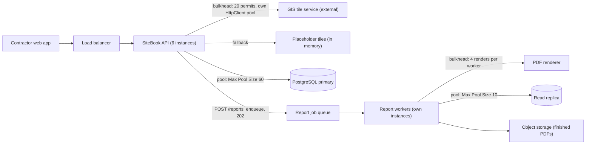
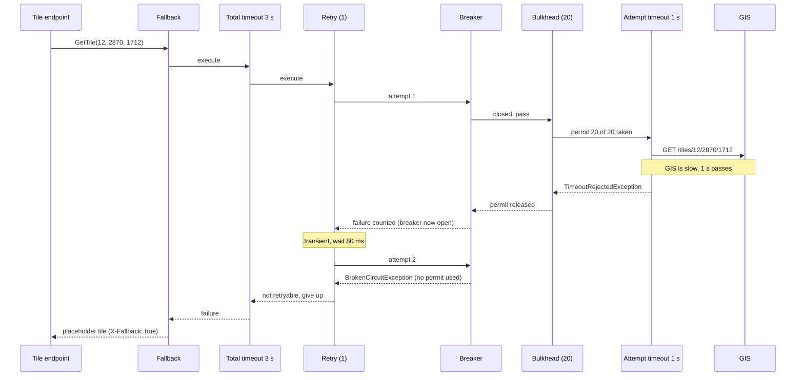

A ship's hull is divided into watertight compartments called bulkheads. If the hull is breached, water floods one compartment and the ship stays afloat. Software systems need the same thing. Without compartments, one slow dependency quietly takes all the shared connections, threads or request slots, and features that have nothing to do with it fail too. This lesson is about building the compartments, deciding what users see when a compartment is flooded (fallbacks), and stacking all the resilience tools from this module into one pipeline in the right order.

## Learning objectives

By the end of this lesson you will be able to:

1. Explain how a single slow dependency exhausts shared resources, and calculate it with Little's law.
2. Name the levels at which you can build bulkheads: in-process concurrency limits, connection pools, worker pools and queues, deployments and cells.
3. Size a bulkhead (permits and queue) from traffic and latency.
4. Implement a `SemaphoreSlim` bulkhead with a bounded queue, and a per-tenant bulkhead.
5. Design fallbacks and a fallback chain, and recognise unsafe fallbacks.
6. Compose fallback, total timeout, retry, circuit breaker, bulkhead and attempt timeout in a pipeline, and justify the order.
7. Compare the order used by Microsoft's standard HTTP resilience handler with the alternative, and pick one deliberately.

## Prerequisites

- [Timeouts, retries and backoff](#/lesson/m10-timeouts-retries).
- [Circuit breaker](#/lesson/m10-circuit-breaker).
- [Rate limiting](#/lesson/m10-rate-limiting): concurrency limiters appear again here, as bulkheads.

## Explain it like I'm a beginner

Imagine a small hospital with one shared waiting hall and 20 doctors. One day, a single slow specialist (say, an MRI that takes an hour per patient) gets a long queue. Patients for the MRI sit in the shared hall, then more arrive, and soon the hall is full. Now a patient with a sprained ankle, who needs five minutes with a general doctor, cannot even get in the door. The MRI problem has become everyone's problem.

The fix: give each department its own waiting area with a fixed number of seats. The MRI area has 10 seats. When they are full, new MRI patients are told "please book a slot for later" (a **fallback**). The general clinic keeps its own seats and keeps working normally.

That is a **bulkhead**: a fixed, separate share of a resource for each kind of work, so trouble in one area cannot spread. In software, the "seats" are things like connections, threads, worker processes or whole servers.

## First-principles explanation

### Our scenario

A project-monitoring portal for highway contractors, *SiteBook*, runs as one ASP.NET Core API (6 instances). Per instance at peak:

| Workload | RPS | Normal latency | Depends on |
|---|---|---|---|
| Dashboard reads | 200 | 40 ms | PostgreSQL |
| Map tiles for site locations | 30 | 200 ms | external GIS tile service |
| PDF progress reports | 2 | 6 s | internal renderer service |

### How one slow dependency sinks everything

Little's law again: **in flight = arrival rate × time in system**.

Normal, per instance: dashboard 200 × 0.04 = 8, tiles 30 × 0.2 = 6, reports 2 × 6 = 12. About 26 requests in flight.

The GIS service slows down to 10 s per tile (it's having a bad day). Tile requests in flight: 30 × 10 = **300**. Each one holds:

- an outbound HTTP connection (by default `SocketsHttpHandler` allows unlimited connections per server, so it opens up to 300 to GIS),
- request memory and buffers,
- a slot in any shared limit (a global concurrency limiter, a shared outbound proxy, Kestrel's connection limit if one is configured).

If any of these is shared and finite, the dashboard, which never calls GIS, starts waiting for it too. With a global concurrency cap of 256 requests per instance (a figure we chose for this example), 300 tile requests fill the whole cap and dashboard requests are rejected. A PDF problem has the same effect through different resources: the renderer slows down, and report requests pile up holding database connections from the same pool the dashboard uses.

The hidden assumption that fails is **"resources are shared fairly"**. They are not: slow work holds resources *longer*, so it naturally takes a larger and larger share. Fast work gets squeezed out.

### What gets exhausted

Common shared resources, roughly in the order they bite in .NET services:

1. **Database connection pool.** Npgsql's default `Maximum Pool Size` is 100 per connection string. A slow report query holding connections for 6 s takes them away from fast dashboard queries.
2. **Outbound connections and sockets** to one host or through one proxy or NAT gateway (each has its own connection or port limit).
3. **Concurrency limits** you configured: ASP.NET Core rate limiter policies, Kestrel limits.
4. **The thread pool**, if any code blocks a thread (`.Result`, `.Wait()`, synchronous I/O). Async code that awaits does not hold a thread while waiting, so this is mostly a "sync over async" problem.
5. **Memory and CPU.** 300 buffered tile responses or 12 concurrent PDF renderings in the same process can push memory and CPU to their limits.

### Bulkheads at four levels

**1. In-process concurrency limits (per dependency).** A semaphore with N permits around each dependency call. When all permits are taken, a few callers may wait in a short queue; the rest are rejected *immediately* and go to a fallback. Cheap and very effective. In .NET: `SemaphoreSlim`, `System.Threading.RateLimiting.ConcurrencyLimiter`, or the ASP.NET Core rate limiter's concurrency policy for inbound endpoints.

**2. Separate connection pools.** Give each dependency its own `HttpClient` (via `IHttpClientFactory`) with its own `SocketsHttpHandler.MaxConnectionsPerServer`. Give each workload its own database pool: a separate connection string (for example, a different `Application Name`) with its own `Maximum Pool Size`, so reports can never take the dashboard's connections.

**3. Separate worker pools and queues.** Move slow work out of the request path: `POST /reports` puts a job on a queue and returns `202 Accepted`; a separate report worker service, with its own CPU, memory and database pool, renders PDFs at its own pace. See [Background processing](#/lesson/m11-background-processing).

**4. Separate deployments, cells and shards.** Run separate instance groups for separate traffic classes (public API versus internal admin), or separate *cells* (complete copies of the stack) for groups of tenants, so one tenant's traffic spike or bad data cannot affect tenants in other cells. Shuffle sharding assigns each tenant to a random small subset of instances so that two tenants rarely share all their instances.

Each level isolates more and costs more. Level 1 is a few lines of code; level 4 multiplies your infrastructure.

### Sizing an in-process bulkhead

Start from Little's law with **normal** latency, then add headroom:

- Tiles: 30 RPS × 0.2 s = 6 in flight normally. Give it **20 permits** (about 3× headroom for bursts and moderate slowdowns).
- Queue: a short queue absorbs bursts. **10 queued**, waiting at most **200 ms** for a permit. A request that would wait longer gets the fallback.
- What happens when GIS slows to 10 s? At most 20 tile calls are in flight, so tile throughput falls to 20 ÷ 10 s = 2 per second. The other 28 per second are rejected in microseconds and get a placeholder tile. The dashboard is untouched, and GIS is not buried under 300 concurrent requests.

Reports: 2 RPS × 6 s = 12 in flight normally. If the renderer can only render 4 PDFs at once efficiently (CPU-bound), the bulkhead is **4 permits**, and reports should move to a queue and worker (level 3), because 2 RPS × 6 s = 12 > 4 means requests would wait constantly.

Too few permits rejects healthy traffic; too many protects nothing. Watch two metrics per bulkhead: **rejections per second** and **permits in use**. If healthy traffic gets rejected, add permits; if the bulkhead is never more than 30 % used, it can be smaller.

### Fallbacks

A bulkhead rejection, an open circuit or a timeout all need a "what now?". Fallback options:

| Fallback | SiteBook example | Good when |
|---|---|---|
| Placeholder or default | Grey "map unavailable" tile | Decorative or non-critical data |
| Cached or stale data | Yesterday's progress percentage, labelled "as of 18 Oct" | Data changes slowly, staleness is labelled |
| Reduced functionality | Hide the map, keep the table | The feature is optional |
| Deferred work | "Your report is being prepared; we'll email it" (202) | Work can happen later |
| Alternative provider | Second tile provider | A real alternative exists and is tested |
| Fast, clear error | "Reports are busy, try in 2 minutes" (503 + Retry-After) | Nothing else is honest |

**A fallback chain** tries options in order: fresh call → cached value → default. Keep chains short; every step must be cheaper and more reliable than the one before.

**Unsafe fallbacks** are the ones that hide a business decision: approving a loan when the credit-check service is down, showing a cached price that may be wrong at checkout, or "allow" when the authorisation service times out. These need explicit product sign-off, and usually the right answer is "fail clearly".

**Fallbacks need protection too.** If the fallback reads from Redis, and everyone falls back at once, Redis receives all the traffic the dependency used to get. Give the fallback its own timeout, and make sure it can handle the full load.

### Composing the pipeline: the order matters

We now have six tools. Wrapped around one outgoing call, from outermost to innermost, our recommended order is:

```text
Fallback            catches whatever is left and returns a degraded answer
  Total timeout     bounds everything below, including retries and waits
    Retry           repeats transient failures (not rejections or open circuits)
      Circuit breaker   fails fast when the dependency is known to be bad
        Bulkhead        caps concurrent attempts against the dependency
          Attempt timeout   bounds one try; its expiry counts as a failure
            → the actual call
```

Why each sits where it does:

- **Fallback outermost.** It must see *every* failure: timeouts, open circuits, bulkhead rejections and exhausted retries. Anything outside it would be unprotected.
- **Total timeout outside retry.** It bounds the sum of all attempts and backoff waits. If it were inside retry, it would be just another per-attempt timeout and the total could grow without limit.
- **Retry outside the breaker.** Each retry passes through the breaker, so when the breaker opens mid-retry the next attempt fails instantly. Configure the retry to *not* retry `BrokenCircuitException` or bulkhead rejections; those are not transient in the sense that waiting 100 ms will fix them.
- **Breaker outside the bulkhead.** When the circuit is open, calls are rejected *before* they take a permit or a queue slot. Otherwise doomed calls would occupy the bulkhead's queue.
- **Bulkhead outside the attempt timeout.** Time spent queuing for a permit is not counted as the dependency being slow, and when an attempt times out, its permit is released immediately for the next caller.
- **Attempt timeout innermost.** Its expiry is an exception the breaker sees and counts as a failure, and that retry can retry.

**What should the breaker count?** Attempt timeouts and transport errors, yes. Bulkhead rejections are *local* saturation, not evidence that the dependency is broken (the slowness that caused the saturation is already showing up as attempt timeouts). In our order, the bulkhead is inside the breaker, so make sure the breaker ignores `BulkheadRejectedException`.

### The other common order: Microsoft's standard handler

`AddStandardResilienceHandler()` in `Microsoft.Extensions.Http.Resilience` uses this order (outermost first), at the time of writing:

```text
Rate limiter (a concurrency limiter, 1,000 permits by default)
  Total request timeout
    Retry
      Circuit breaker
        Attempt timeout
```

Here the limiter is **outermost**. That caps *logical* requests in flight, including ones sleeping between retries. The trade-off:

| Bulkhead position | Caps | Pro | Con |
|---|---|---|---|
| Outermost (standard handler) | Logical operations, including retries and backoff waits | Bounds the caller's own memory and total work; simplest mental model | A permit is held while sleeping between retries; doesn't cap attempts reaching the dependency as tightly |
| Inside breaker and retry (this lesson) | Concurrent attempts to the dependency | Protects the dependency and connection pool precisely; open circuits don't consume permits | Requests waiting for a retry aren't counted, so total in-flight logical work is bounded only by the total timeout |

Both are defensible. What matters is that you choose knowingly, and that you don't get the *dangerous* orders: retry outside fallback (fallback hides the failure, so retries never trigger), total timeout inside retry (no real total), or breaker inside attempt timeout (the breaker never sees timeouts as failures).

### When a simpler design is enough

- A service with one dependency, or with dependencies that fail together (all in one database), gains little from per-dependency bulkheads; a single global concurrency limit is enough.
- If the slow work can move to a queue and worker (level 3), do that first. It isolates CPU and memory as well as connections, which an in-process semaphore cannot.
- Cells and shuffle sharding are for multi-tenant platforms with real blast-radius requirements. A single-tenant internal app does not need them.

## Visual explanation

### Architecture: SiteBook with compartments



The API keeps three compartments. Tile calls go through a 20-permit bulkhead with their own `HttpClient` connection pool, and fall back to an in-memory placeholder tile when the bulkhead or GIS's breaker rejects them. Dashboard queries use the primary database through a pool of 60 that nothing else touches. Report generation no longer runs in the API at all: the request becomes a job on a queue, and separate report workers, each limited to 4 concurrent renders and using a separate small pool against a read replica, write finished PDFs to object storage. A GIS outage now costs only map tiles; a renderer outage costs only report latency; and neither can take the dashboard's connections.

### Sequence: a tile request through the full pipeline



The first attempt takes the last free permit and times out after 1 s. The attempt timeout throws; the bulkhead releases the permit at once; the breaker counts the timeout, and that failure happens to push it over its threshold, so it opens. The retry layer considers a timeout transient and tries again after a short jittered wait, but the second attempt meets the open breaker, which rejects it without touching the bulkhead or GIS. A broken circuit is not retryable, so the retry gives up; the total timeout was never reached; and the fallback, which sees every failure, returns a placeholder tile marked as such. The user sees a grey tile after about 1.1 s instead of a spinner for 10 s, and GIS received one call instead of several.

## Step-by-step example

Let's size SiteBook's tile pipeline end to end.

1. **Normal concurrency:** 30 RPS × 0.2 s = 6. **Bulkhead:** 20 permits, queue 10, queue wait 200 ms.
2. **Attempt timeout:** GIS p99 is 450 ms → **1 s**.
3. **Retry:** 1 retry with up to 100 ms full-jitter backoff, only for timeouts and transport errors. Worst case: 1 + 0.1 + 1 = 2.1 s.
4. **Total timeout:** **3 s**, above the 2.1 s worst case plus the 200 ms queue wait, as a backstop.
5. **Breaker:** ratio 50 % over 10 s, minimum 20 calls, break 15 s (10 s ≥ 2 × 1 s attempt timeout ✔).
6. **Fallback:** placeholder tile, with a response header so the front end can show "map temporarily unavailable" once rather than per tile.
7. **Check the outage case:** GIS stops responding. In the first second, 20 attempts take permits and time out; the breaker sees 20 failures out of 20 and opens. For the next 15 s, every tile call is rejected by the breaker in microseconds, without taking permits. Then one probe per instance. GIS sees roughly 20 calls per instance at the start and one per 15 s afterwards. The dashboard's p99 does not move.

## Production-style C# implementation

We build a small pipeline library so you can see each stage, and then wire SiteBook's dependencies. In production you would usually reach for Polly v8 / `Microsoft.Extensions.Resilience`, whose shape is very similar.

```text
SiteBook.Api/
  Program.cs
  Resilience/ResilienceTypes.cs
  Resilience/Stages.cs
  Resilience/ResiliencePipeline.cs
  Maps/GisTileClient.cs
  Reports/ReportRendererClient.cs
```

### Contracts and exceptions

```csharp file=Resilience/ResilienceTypes.cs
namespace SiteBook.Resilience;

/// <summary>One layer of a pipeline. It receives the rest of the pipeline as <paramref name="next"/>
/// and decides whether, when and how often to call it.</summary>
public interface IResilienceStage
{
    string Name { get; }
    Task<T> ExecuteAsync<T>(Func<CancellationToken, Task<T>> next, CancellationToken ct);
}

public sealed class BulkheadRejectedException(string name) : Exception($"Bulkhead '{name}' is full.")
{
    public string BulkheadName { get; } = name;
}

public sealed class TimeoutRejectedException(string name, TimeSpan timeout)
    : Exception($"'{name}' timed out after {timeout.TotalMilliseconds} ms.")
{
    public TimeSpan Timeout { get; } = timeout;
}

public sealed class BrokenCircuitException(string name) : Exception($"Circuit '{name}' is open.")
{
    public string CircuitName { get; } = name;
}

public static class ResilienceFailures
{
    /// <summary>Failures a fallback may handle. Bugs (NullReferenceException and friends) are NOT in this list:
    /// a fallback must never hide a programming error.</summary>
    public static bool IsHandled(Exception ex) =>
        ex is BulkheadRejectedException or BrokenCircuitException or TimeoutRejectedException or HttpRequestException;
}
```

### The stages

```csharp file=Resilience/Stages.cs
namespace SiteBook.Resilience;

/// <summary>Cooperative timeout: cancels the token passed down. Used twice: once as the total timeout, once per attempt.</summary>
public sealed class TimeoutStage(string name, TimeSpan timeout, TimeProvider clock) : IResilienceStage
{
    public string Name => name;

    public async Task<T> ExecuteAsync<T>(Func<CancellationToken, Task<T>> next, CancellationToken ct)
    {
        using var timeoutCts = new CancellationTokenSource(timeout, clock);
        using var linked = CancellationTokenSource.CreateLinkedTokenSource(ct, timeoutCts.Token);
        try
        {
            return await next(linked.Token);
        }
        catch (OperationCanceledException) when (timeoutCts.IsCancellationRequested && !ct.IsCancellationRequested)
        {
            throw new TimeoutRejectedException(name, timeout);
        }
    }
}

public sealed class RetryStage(string name, int maxRetries, TimeSpan baseDelay, TimeProvider clock,
    Func<Exception, bool>? shouldRetry = null) : IResilienceStage
{
    // Rejections and open circuits are deliberately NOT retried: waiting 100 ms will not fix them.
    private readonly Func<Exception, bool> _shouldRetry = shouldRetry ?? (ex => ex is TimeoutRejectedException or HttpRequestException);

    public string Name => name;

    public async Task<T> ExecuteAsync<T>(Func<CancellationToken, Task<T>> next, CancellationToken ct)
    {
        for (var retry = 0; ; retry++)
        {
            try
            {
                return await next(ct);
            }
            catch (Exception ex) when (retry < maxRetries && !ct.IsCancellationRequested && _shouldRetry(ex))
            {
                var cap = baseDelay.TotalMilliseconds * Math.Pow(2, retry);
                await Task.Delay(TimeSpan.FromMilliseconds(Random.Shared.NextDouble() * cap), clock, ct);   // full jitter
            }
        }
    }
}

/// <summary>A compact consecutive-failure breaker (see the circuit breaker lesson for the ratio-based version).</summary>
public sealed class CircuitBreakerStage(string name, int failureThreshold, TimeSpan breakDuration, TimeProvider clock) : IResilienceStage
{
    private readonly object _gate = new();
    private int _failures;
    private DateTimeOffset? _openUntil;
    private bool _probeInFlight;

    public string Name => name;

    public bool IsOpen { get { lock (_gate) return _openUntil is { } until && clock.GetUtcNow() < until; } }

    public async Task<T> ExecuteAsync<T>(Func<CancellationToken, Task<T>> next, CancellationToken ct)
    {
        var isProbe = Acquire();
        try
        {
            var result = await next(ct);
            lock (_gate) { _failures = 0; _openUntil = null; _probeInFlight = false; }
            return result;
        }
        catch (Exception ex) when (!ct.IsCancellationRequested && ex is TimeoutRejectedException or HttpRequestException)
        {
            lock (_gate)
            {
                _probeInFlight = false;
                if (isProbe || ++_failures >= failureThreshold) { _openUntil = clock.GetUtcNow() + breakDuration; _failures = 0; }
            }
            throw;
        }
        catch
        {
            // Bulkhead rejections, cancellation, bugs: no verdict about the dependency's health.
            if (isProbe) lock (_gate) _probeInFlight = false;
            throw;
        }
    }

    private bool Acquire()
    {
        lock (_gate)
        {
            if (_openUntil is not { } until) return false;                     // closed
            if (clock.GetUtcNow() < until || _probeInFlight) throw new BrokenCircuitException(name);
            _probeInFlight = true;                                              // half-open: this call is the probe
            return true;
        }
    }
}

/// <summary>Caps concurrent executions. Up to maxQueue callers wait (at most queueTimeout) for a permit;
/// everyone else is rejected immediately.</summary>
public sealed class BulkheadStage(string name, int maxConcurrency, int maxQueue, TimeSpan queueTimeout) : IResilienceStage, IDisposable
{
    private readonly SemaphoreSlim _permits = new(maxConcurrency, maxConcurrency);
    private int _queued;

    public string Name => name;
    public int MaxConcurrency => maxConcurrency;
    public int InUse => maxConcurrency - _permits.CurrentCount;
    public int Queued => Volatile.Read(ref _queued);

    public async Task<T> ExecuteAsync<T>(Func<CancellationToken, Task<T>> next, CancellationToken ct)
    {
        if (!_permits.Wait(0))
        {
            if (Interlocked.Increment(ref _queued) > maxQueue)
            {
                Interlocked.Decrement(ref _queued);
                throw new BulkheadRejectedException(name);
            }
            try
            {
                if (!await _permits.WaitAsync(queueTimeout, ct)) throw new BulkheadRejectedException(name);
            }
            finally
            {
                Interlocked.Decrement(ref _queued);
            }
        }

        try { return await next(ct); }
        finally { _permits.Release(); }
    }

    public void Dispose() => _permits.Dispose();
}
```

Things to notice:

- **The fast path costs almost nothing.** `Wait(0)` takes a permit without allocating or waiting when one is free. Only when the bulkhead is busy do we touch the queue counter.
- **The queue is bounded twice:** by length (`maxQueue`) and by time (`queueTimeout`). An unbounded queue is not a bulkhead; it just moves the pile-up into memory.
- **Permits are released in `finally`**, so an exception (including a timeout) never leaks a permit. A leaked permit is a slow-motion outage: the bulkhead shrinks by one each time until it rejects everything.
- **The timeout is cooperative.** It cancels the token; the operation must pass that token to `HttpClient`. If a call ignores the token, the permit stays held until it finishes, which is honest accounting: the connection is still busy.
- **The breaker ignores bulkhead rejections**, as discussed in the ordering section.

### The pipeline

```csharp file=Resilience/ResiliencePipeline.cs
namespace SiteBook.Resilience;

/// <summary>Stages run outermost first. The fallback, when given, wraps everything.</summary>
public sealed class ResiliencePipeline(string name, IReadOnlyList<IResilienceStage> stagesOuterToInner)
{
    public string Name => name;
    public IReadOnlyList<IResilienceStage> Stages => stagesOuterToInner;

    public async Task<T> ExecuteAsync<T>(Func<CancellationToken, Task<T>> operation, Func<Exception, T>? fallback = null,
        CancellationToken ct = default)
    {
        // Build from the inside out: the innermost stage wraps the operation, the next wraps that, and so on.
        var current = operation;
        for (var i = stagesOuterToInner.Count - 1; i >= 0; i--)
        {
            var stage = stagesOuterToInner[i];
            var next = current;
            current = token => stage.ExecuteAsync(next, token);
        }

        if (fallback is null) return await current(ct);
        try
        {
            return await current(ct);
        }
        catch (Exception ex) when (!ct.IsCancellationRequested && ResilienceFailures.IsHandled(ex))
        {
            return fallback(ex);
        }
    }
}

public sealed class PipelineBuilder(string name, TimeProvider clock)
{
    private readonly List<IResilienceStage> _stages = new();

    public PipelineBuilder AddTimeout(string stageName, TimeSpan timeout) { _stages.Add(new TimeoutStage($"{name}:{stageName}", timeout, clock)); return this; }
    public PipelineBuilder AddRetry(int maxRetries, TimeSpan baseDelay) { _stages.Add(new RetryStage($"{name}:retry", maxRetries, baseDelay, clock)); return this; }
    public PipelineBuilder AddCircuitBreaker(int failureThreshold, TimeSpan breakDuration) { _stages.Add(new CircuitBreakerStage($"{name}:breaker", failureThreshold, breakDuration, clock)); return this; }
    public PipelineBuilder AddBulkhead(int maxConcurrency, int maxQueue, TimeSpan queueTimeout) { _stages.Add(new BulkheadStage($"{name}:bulkhead", maxConcurrency, maxQueue, queueTimeout)); return this; }

    public ResiliencePipeline Build() => new(name, _stages.ToArray());   // a copy: later Adds don't change built pipelines
}

/// <summary>One pipeline per dependency, shared by every request (stages hold state such as permits and breaker counts).</summary>
public sealed class PipelineRegistry(IEnumerable<ResiliencePipeline> pipelines)
{
    private readonly Dictionary<string, ResiliencePipeline> _byName = pipelines.ToDictionary(p => p.Name);
    public ResiliencePipeline Get(string name) => _byName[name];
    public IEnumerable<ResiliencePipeline> All => _byName.Values;
}
```

Composing from the inside out is the same trick ASP.NET Core uses for middleware: each stage is a decorator around "the rest of the pipeline" ([Decorator](#/lesson/m06-decorator)).

### Clients with fallbacks

```csharp file=Maps/GisTileClient.cs
using SiteBook.Resilience;

namespace SiteBook.Maps;

public sealed record Tile(byte[] Png, bool IsFallback);

public sealed class GisTileClient(HttpClient http, PipelineRegistry pipelines, ILogger<GisTileClient> logger)
{
    // A 1×1 transparent PNG stands in for a "map unavailable" tile in this example.
    private static readonly byte[] Placeholder = Convert.FromBase64String(
        "iVBORw0KGgoAAAANSUhEUgAAAAEAAAABCAQAAAC1HAwCAAAAC0lEQVR42mNkYAAAAAYAAjCB0C8AAAAASUVORK5CYII=");

    public Task<Tile> GetTileAsync(int z, int x, int y, CancellationToken ct) =>
        pipelines.Get("gis").ExecuteAsync(
            async token =>
            {
                using var response = await http.GetAsync($"tiles/{z}/{x}/{y}.png", token);
                response.EnsureSuccessStatusCode();
                return new Tile(await response.Content.ReadAsByteArrayAsync(token), IsFallback: false);
            },
            fallback: ex =>
            {
                logger.LogInformation("Tile {Z}/{X}/{Y} served from fallback: {Reason}", z, x, y, ex.GetType().Name);
                return new Tile(Placeholder, IsFallback: true);
            },
            ct);
}
```

```csharp file=Reports/ReportRendererClient.cs
using System.Net.Http.Json;
using SiteBook.Resilience;

namespace SiteBook.Reports;

public sealed record ReportRequest(Guid ProjectId, DateOnly Month);

/// <summary>Used by the report worker. No fallback: if rendering fails, the job is retried by the queue later.</summary>
public sealed class ReportRendererClient(HttpClient http, PipelineRegistry pipelines)
{
    public Task<byte[]> RenderAsync(ReportRequest request, CancellationToken ct) =>
        pipelines.Get("renderer").ExecuteAsync(async token =>
        {
            using var response = await http.PostAsJsonAsync("v1/render", request, token);
            response.EnsureSuccessStatusCode();
            return await response.Content.ReadAsByteArrayAsync(token);
        }, fallback: null, ct);
}
```

### Program.cs

```csharp file=Program.cs
using Microsoft.AspNetCore.RateLimiting;
using System.Threading.RateLimiting;
using System.Threading.RateLimiting;
using SiteBook.Maps;
using SiteBook.Reports;
using SiteBook.Resilience;

var builder = WebApplication.CreateBuilder(args);
builder.Services.AddSingleton(TimeProvider.System);

// One pipeline per dependency. Order: total timeout → retry → breaker → bulkhead → attempt timeout.
builder.Services.AddSingleton(sp => new PipelineBuilder("gis", sp.GetRequiredService<TimeProvider>())
    .AddTimeout("total", TimeSpan.FromSeconds(3))
    .AddRetry(maxRetries: 1, baseDelay: TimeSpan.FromMilliseconds(100))
    .AddCircuitBreaker(failureThreshold: 10, breakDuration: TimeSpan.FromSeconds(15))
    .AddBulkhead(maxConcurrency: 20, maxQueue: 10, queueTimeout: TimeSpan.FromMilliseconds(200))
    .AddTimeout("attempt", TimeSpan.FromSeconds(1))
    .Build());

builder.Services.AddSingleton(sp => new PipelineBuilder("renderer", sp.GetRequiredService<TimeProvider>())
    .AddTimeout("total", TimeSpan.FromSeconds(30))
    .AddCircuitBreaker(failureThreshold: 5, breakDuration: TimeSpan.FromSeconds(30))
    .AddBulkhead(maxConcurrency: 4, maxQueue: 0, queueTimeout: TimeSpan.Zero)   // no retry: rendering is expensive
    .AddTimeout("attempt", TimeSpan.FromSeconds(25))
    .Build());

builder.Services.AddSingleton<PipelineRegistry>();

// Connection-level bulkheads: each dependency has its own pool with its own cap.
builder.Services.AddHttpClient<GisTileClient>(c => c.BaseAddress = new Uri("https://tiles.example-gis.com/"))
    .ConfigurePrimaryHttpMessageHandler(() => new SocketsHttpHandler
    {
        MaxConnectionsPerServer = 20,
        ConnectTimeout = TimeSpan.FromSeconds(1),
        PooledConnectionLifetime = TimeSpan.FromMinutes(5),
    });
builder.Services.AddHttpClient<ReportRendererClient>(c => c.BaseAddress = new Uri("https://renderer.internal/"))
    .ConfigurePrimaryHttpMessageHandler(() => new SocketsHttpHandler { MaxConnectionsPerServer = 4 });

// Inbound bulkhead: report endpoints can never occupy more than 8 request slots per instance.
builder.Services.AddRateLimiter(o =>
{
    o.RejectionStatusCode = StatusCodes.Status503ServiceUnavailable;
    o.AddConcurrencyLimiter("reports", l => { l.PermitLimit = 8; l.QueueLimit = 0; });
});

var app = builder.Build();
app.UseRateLimiter();

app.MapGet("/tiles/{z:int}/{x:int}/{y:int}", async (int z, int x, int y, GisTileClient tiles, HttpContext http) =>
{
    var tile = await tiles.GetTileAsync(z, x, y, http.RequestAborted);
    if (tile.IsFallback) http.Response.Headers["X-Fallback"] = "true";
    return Results.File(tile.Png, "image/png");
});

app.MapPost("/projects/{projectId:guid}/reports", (Guid projectId, DateOnly month) =>
    // In the full design this enqueues a job for the report workers and returns 202.
    Results.Accepted($"/projects/{projectId}/reports/{month:yyyy-MM}"))
    .RequireRateLimiting("reports");

app.MapGet("/internal/bulkheads", (PipelineRegistry registry) => Results.Ok(
    registry.All.SelectMany(p => p.Stages.OfType<BulkheadStage>())
        .Select(b => new { b.Name, b.InUse, b.MaxConcurrency, b.Queued })));

app.Run();
```

**Database bulkheads** (not compiled here, since Npgsql is not available offline) are just separate pools:

```csharp
// Dashboard: fast queries on the primary, plenty of connections.
builder.Services.AddKeyedSingleton("dashboard", (_, _) => NpgsqlDataSource.Create(
    "Host=pg-primary;Database=sitebook;Application Name=dashboard;Maximum Pool Size=60;Timeout=2"));
// Reports: slow queries on a replica, a small pool so they can never starve anything else.
builder.Services.AddKeyedSingleton("reports", (_, _) => NpgsqlDataSource.Create(
    "Host=pg-replica;Database=sitebook;Application Name=reports;Maximum Pool Size=10;Timeout=5;Command Timeout=60"));
```

`Timeout` is how long a caller waits for a free connection from the pool; when it expires, the caller gets an error instead of waiting forever. That is a bulkhead with a queue timeout, built into the driver. Check that the sum of all pools across all instances stays under PostgreSQL's `max_connections` (6 instances × (60 + 10) = 420, so either raise `max_connections` deliberately or put PgBouncer in front; see [Connection pooling](#/lesson/m09-connection-pooling)).

### With the library

The same tile pipeline in Polly v8 (not compiled here):

```csharp
builder.Services.AddResiliencePipeline<string, Tile>("gis", (pipeline, ctx) => pipeline
    .AddFallback(new FallbackStrategyOptions<Tile> { FallbackAction = _ => Outcome.FromResultAsValueTask(PlaceholderTile) })
    .AddTimeout(TimeSpan.FromSeconds(3))                                    // total
    .AddRetry(new RetryStrategyOptions<Tile> { MaxRetryAttempts = 1, UseJitter = true,
        ShouldHandle = new PredicateBuilder<Tile>().Handle<TimeoutRejectedException>().Handle<HttpRequestException>() })
    .AddCircuitBreaker(new CircuitBreakerStrategyOptions<Tile> { FailureRatio = 0.5, MinimumThroughput = 20,
        ShouldHandle = new PredicateBuilder<Tile>().Handle<TimeoutRejectedException>().Handle<HttpRequestException>() })
    .AddConcurrencyLimiter(permitLimit: 20, queueLimit: 10)                 // the bulkhead
    .AddTimeout(TimeSpan.FromSeconds(1)));                                  // attempt
```

In Polly v8, as in our builder, the first strategy added is the outermost.

## Bad design vs good design

**Bad:** one `HttpClient` and one database pool for everything, PDF rendering inside the request, and a retry wrapped *outside* a fallback:

```csharp
// The fallback swallows the failure, so the retry never sees an exception and never retries anything.
await retry.ExecuteAsync(() => fallback.ExecuteAsync(() => gis.GetTileAsync(z, x, y)));
// Reports run inline: 2 RPS × 6 s = 12 renders per instance holding pooled DB connections.
app.MapGet("/projects/{id}/report", async (Guid id, NpgsqlDataSource db) => await RenderPdfInline(id, db));
```

When GIS slows, tile calls accumulate without limit on the shared client; when the renderer slows, report requests hold connections from the dashboard's pool. The ordering bug is subtle: because the fallback is inside the retry, every failure becomes a placeholder before the retry can act, so the "retry" is dead code. And if someone flips the order but puts the total timeout inside the retry, the total grows with each attempt.

**Good:** per-dependency bulkheads (in-process and connection pool), report work moved to a queue and separate workers with their own small pool, an inbound concurrency limit on report endpoints, and the pipeline ordered fallback → total timeout → retry → breaker → bulkhead → attempt timeout, with each stage's exception types chosen deliberately.

:::callout type=mistake title="A bulkhead with an unbounded queue is not a bulkhead"
`await semaphore.WaitAsync()` with no timeout and no queue limit means every caller eventually waits. Requests pile up in memory instead of in connections, latency grows without bound, and users get timeouts instead of fast fallbacks. Bound the queue by length and by time.
:::

:::callout type=tradeoff title="Isolation costs utilisation"
Compartments leave capacity idle: 20 tile permits may sit unused while the dashboard is busy. That idle capacity is the price of isolation. Size bulkheads from measured traffic, review them when traffic changes, and reserve the expensive levels (separate deployments, cells) for workloads whose blast radius really matters.
:::

## Practical playground

The starting graph is SiteBook before this lesson: one API tier calling everything, one database pool, reports rendered inline. Redesign it with compartments. Add a queue and report workers, give the tile path its own isolation and fallback, split database access, and add monitoring for bulkhead rejections. Then compare your design with the architecture diagram above.

:::playground type=hld title="Add bulkheads to SiteBook"
```json
{
  "nodes": [
    { "id": "web", "type": "client", "label": "Contractor web app", "props": { "rps": 1400 } },
    { "id": "lb", "type": "load-balancer", "label": "Load balancer" },
    { "id": "api", "type": "app-server", "label": "SiteBook API (dashboard + tiles + reports)", "props": { "instances": 6 } },
    { "id": "db", "type": "database", "label": "PostgreSQL (one shared pool)" },
    { "id": "gis", "type": "external", "label": "GIS tile service", "props": { "latencyMs": 200 } },
    { "id": "render", "type": "app-server", "label": "PDF renderer", "props": { "instances": 2, "latencyMs": 6000 } }
  ],
  "edges": [
    { "from": "web", "to": "lb", "kind": "sync" },
    { "from": "lb", "to": "api", "kind": "sync" },
    { "from": "api", "to": "db", "kind": "sync" },
    { "from": "api", "to": "gis", "kind": "sync" },
    { "from": "api", "to": "render", "kind": "sync" }
  ]
}
```
:::

Questions to answer with your design:

1. When GIS takes 10 s per tile, which nodes in *your* graph are affected, and which are not?
2. What is the maximum number of database connections your design can open across all instances?
3. Where does a user's report request wait when the renderer is slow, and what do they see?

## Exercises

:::exercise id=m10-bulkhead-ex1 difficulty=beginner kind=code title="A SemaphoreSlim bulkhead with a bounded queue"
Implement `Bulkhead.ExecuteAsync`. At most `maxConcurrency` operations run at once; up to `maxQueue` more may wait; anyone beyond that is rejected immediately with `BulkheadRejectedException`.
::requirements
- `InFlight` and `Queued` report the current numbers.
- Permits must be released even if the operation throws.
- A rejected call must not run the operation at all.
- Caller cancellation while queued throws `OperationCanceledException` and frees the queue slot.
::acceptance
- With 2 permits and a queue of 1: two calls run, the third waits, the fourth is rejected.
- When the running calls finish, the queued one runs and returns its value.
- After an operation throws, its permit is available again.
- A cancelled queued call leaves `Queued` at 0.
::hint
`SemaphoreSlim(maxConcurrency, maxConcurrency)` holds the permits. `Wait(0)` tries to take one without waiting.
::hint
If no permit is free, check (and reserve) a queue slot with `Interlocked.Increment`; undo it if the queue is full.
::hint
Release the queue slot in a `finally` around `WaitAsync`, and the permit in a `finally` around the operation.
::hint
Increment `InFlight` only after acquiring a permit, and decrement it in the same `finally` that releases the permit.
::hint
```csharp
if (!_sem.Wait(0))
{
    if (Interlocked.Increment(ref _queued) > maxQueue) { Interlocked.Decrement(ref _queued); throw new BulkheadRejectedException(); }
    try { await _sem.WaitAsync(ct); } finally { Interlocked.Decrement(ref _queued); }
}
```
::starter
```csharp file=Bulkhead.cs
using System;
using System.Threading;
using System.Threading.Tasks;

namespace BulkheadEx1;

public sealed class BulkheadRejectedException() : Exception("Bulkhead is full.");

public sealed class Bulkhead(int maxConcurrency, int maxQueue)
{
    public int InFlight => throw new NotImplementedException();
    public int Queued => throw new NotImplementedException();

    public Task<T> ExecuteAsync<T>(Func<CancellationToken, Task<T>> operation, CancellationToken ct = default) =>
        throw new NotImplementedException();
}
```
::tests
```csharp file=BulkheadTests.cs
using System;
using System.Threading;
using System.Threading.Tasks;
using Xunit;
using BulkheadEx1;

public class BulkheadTests
{
    private static TaskCompletionSource<int> Gate() => new(TaskCreationOptions.RunContinuationsAsynchronously);

    [Fact]
    public async Task Runs_queues_then_rejects()
    {
        var bulkhead = new Bulkhead(2, 1);
        var gate = Gate();
        var t1 = bulkhead.ExecuteAsync(_ => gate.Task);
        var t2 = bulkhead.ExecuteAsync(_ => gate.Task);
        Assert.Equal(2, bulkhead.InFlight);
        var t3 = bulkhead.ExecuteAsync(_ => gate.Task);
        Assert.Equal(1, bulkhead.Queued);
        var ran = false;
        await Assert.ThrowsAsync<BulkheadRejectedException>(() => bulkhead.ExecuteAsync(_ => { ran = true; return gate.Task; }));
        Assert.False(ran);
        gate.SetResult(7);
        var results = await Task.WhenAll(t1, t2, t3);
        Assert.Equal(new[] { 7, 7, 7 }, results);
        Assert.Equal(0, bulkhead.InFlight);
        Assert.Equal(0, bulkhead.Queued);
    }

    [Fact]
    public async Task Permit_is_released_when_operation_throws()
    {
        var bulkhead = new Bulkhead(1, 0);
        await Assert.ThrowsAsync<InvalidOperationException>(() => bulkhead.ExecuteAsync<int>(_ => throw new InvalidOperationException()));
        Assert.Equal(0, bulkhead.InFlight);
        Assert.Equal(5, await bulkhead.ExecuteAsync(_ => Task.FromResult(5)));
    }

    [Fact]
    public async Task Cancelled_waiter_frees_its_queue_slot()
    {
        var bulkhead = new Bulkhead(1, 1);
        var gate = Gate();
        var running = bulkhead.ExecuteAsync(_ => gate.Task);
        using var cts = new CancellationTokenSource();
        var waiting = bulkhead.ExecuteAsync(_ => Task.FromResult(1), cts.Token);
        Assert.Equal(1, bulkhead.Queued);
        cts.Cancel();
        await Assert.ThrowsAnyAsync<OperationCanceledException>(() => waiting);
        Assert.Equal(0, bulkhead.Queued);
        gate.SetResult(1);
        await running;
    }
}
```
::solution
```csharp file=Bulkhead.cs
using System;
using System.Threading;
using System.Threading.Tasks;

namespace BulkheadEx1;

public sealed class BulkheadRejectedException() : Exception("Bulkhead is full.");

public sealed class Bulkhead(int maxConcurrency, int maxQueue)
{
    private readonly SemaphoreSlim _permits = new(maxConcurrency, maxConcurrency);
    private int _queued;
    private int _inFlight;

    public int InFlight => Volatile.Read(ref _inFlight);
    public int Queued => Volatile.Read(ref _queued);

    public async Task<T> ExecuteAsync<T>(Func<CancellationToken, Task<T>> operation, CancellationToken ct = default)
    {
        if (!_permits.Wait(0))
        {
            if (Interlocked.Increment(ref _queued) > maxQueue)
            {
                Interlocked.Decrement(ref _queued);
                throw new BulkheadRejectedException();
            }
            try { await _permits.WaitAsync(ct); }
            finally { Interlocked.Decrement(ref _queued); }
        }

        Interlocked.Increment(ref _inFlight);
        try
        {
            return await operation(ct);
        }
        finally
        {
            Interlocked.Decrement(ref _inFlight);
            _permits.Release();
        }
    }
}
```

Why does the test see `InFlight == 2` immediately, without awaiting? An `async` method runs synchronously until its first incomplete `await`. `Wait(0)` succeeds synchronously and the counter is incremented before `await operation(ct)` yields. That property also makes the fast path cheap.

If `WaitAsync` is cancelled, it throws without taking a permit, so only the queue slot needs releasing, which the `finally` does. Releasing the permit there as well would *add* a permit that was never taken and silently grow the bulkhead.
::mistakes
- Calling `_permits.Release()` in a `finally` that also runs when acquiring failed, which inflates the permit count over time.
- Checking `_queued < maxQueue` and incrementing separately: two threads both see room and both enter (a race). `Interlocked.Increment` then compare avoids it.
- Using `lock` around `await` (not allowed) or `SemaphoreSlim` with no queue limit.
::extensions
Add a queue timeout (`WaitAsync(TimeSpan, CancellationToken)` returns false on timeout) and convert a timeout into `BulkheadRejectedException`.
:::

:::exercise id=m10-bulkhead-ex2 difficulty=beginner kind=written title="Find the shared compartments"
A hospital appointment API (4 instances) serves: appointment search (300 RPS, 50 ms, PostgreSQL), lab-report PDF downloads (20 RPS, 2 s, reads files from object storage and decrypts them in memory), SMS reminders sent inline when booking (15 RPS, calls an SMS provider, p99 800 ms), and an admin export (rare, 90 s queries). All share one `HttpClient` for outbound calls, one Npgsql pool (default size 100), and the same instances.

1. List every shared resource that could be exhausted, and which workload is most likely to exhaust it.
2. Use Little's law to estimate in-flight requests for each workload, normally and if the SMS provider slows to 10 s.
3. Propose bulkheads at the right level for each workload, and a fallback for each.
::acceptance
- Identifies at least the database pool, outbound connections, memory, and request slots.
- Shows the SMS in-flight calculation (15 × 0.8 normally, 15 × 10 when slow).
- Moves at least one workload out of the request path (SMS or admin export).
- Every fallback is honest and safe for a medical context.
::hint
Which workloads hold resources the longest? They take the largest share.
::hint
Why is the SMS sent inline at all? What does the user actually need to wait for?
::hint
The admin export runs 90-second queries. Which pool do they use?
::hint
PDF decryption in memory: what is the memory cost of 20 RPS × 2 s × the average file size?
::solution
1. **Shared resources:** the Npgsql pool (admin export's 90 s queries hold connections; search needs fast ones), outbound connections on the shared `HttpClient` (SMS calls pile up when the provider is slow), memory (PDF decryption: 20 RPS × 2 s = 40 concurrent PDFs; at an assumed 5 MB each that is 200 MB per instance), and request slots/CPU on the shared instances.
2. **Little's law per instance (traffic split over 4 instances):** search 75 × 0.05 ≈ 4; PDFs 5 × 2 = 10; SMS 3.75 × 0.8 = 3 normally, and 3.75 × 10 = 37.5 when the provider is slow, each holding a booking request open for 10 s; admin exports are few, but each holds a connection for 90 s.
3. **Bulkheads and fallbacks:**
   - **SMS:** take it out of the request path. Booking writes an outbox row in the same transaction and returns; a notification worker sends SMS at its own pace with its own `HttpClient` (bulkhead ~10 permits) and retries later. Fallback: delayed SMS; the confirmation screen and email still show the booking.
   - **Admin export:** separate pool (`Maximum Pool Size=3`, `Command Timeout=120`) against a read replica, run as a background job; deliver the file by link. Fallback: "your export will be ready in a few minutes".
   - **PDF downloads:** an in-process bulkhead of ~15 per instance with a short queue, and streaming decryption instead of loading whole files into memory. Fallback: "your report is being prepared, try again in a minute" (503 with `Retry-After`). Never serve another patient's cached file, and never serve an unencrypted copy.
   - **Search:** its own pool (say 40) so nothing else can starve it. Fallback: a clear error; showing stale appointment slots risks double booking, so don't.
::mistakes
- Proposing a fallback that shows cached appointment availability, which can lead to double bookings.
- Adding a semaphore around SMS but keeping it inline, so bookings still wait up to 10 s.
- Forgetting the admin export's effect on the shared pool.
:::

:::exercise id=m10-bulkhead-ex3 difficulty=intermediate kind=code title="Compose a pipeline from stages"
Implement `PipelineBuilder` and `Pipeline`. Stages are added outermost first. Executing the pipeline must enter stages in the order added, call the operation, and unwind in reverse. A stage may short-circuit (return without calling `next`).
::requirements
- `Add(stage)` returns the builder (fluent); `null` throws `ArgumentNullException`.
- `Build()` takes a snapshot: stages added later do not affect an already built pipeline.
- A pipeline with no stages just runs the operation.
- Exceptions thrown inside propagate out through every outer stage.
::acceptance
- With stages A, B, C the log is `A> B> C> op <C <B <A`.
- A short-circuiting middle stage stops inner stages and the operation from running.
- An exception from the operation still produces the exit logs (`<C <B <A`) and reaches the caller.
- Adding a stage after `Build()` does not change the built pipeline.
::hint
Think of each stage as a function that takes "the rest of the pipeline" and returns a new function.
::hint
Start with `current = operation`, then loop from the **last** stage to the first, wrapping `current` each time.
::hint
Capture loop variables in locals before building the lambda (`var stage = _stages[i]; var next = current;`), or every lambda will see the final values.
::hint
`Build()` should copy the list (`_stages.ToArray()`).
::hint
```csharp
Func<CancellationToken, Task<T>> current = operation;
for (var i = stages.Length - 1; i >= 0; i--) { var s = stages[i]; var next = current; current = t => s.ExecuteAsync(next, t); }
return current(ct);
```
::starter
```csharp file=Pipeline.cs
using System;
using System.Collections.Generic;
using System.Threading;
using System.Threading.Tasks;

namespace BulkheadEx3;

public interface IStage
{
    Task<T> ExecuteAsync<T>(Func<CancellationToken, Task<T>> next, CancellationToken ct);
}

public sealed class Pipeline
{
    internal Pipeline(IStage[] stagesOuterToInner) => throw new NotImplementedException();

    public Task<T> ExecuteAsync<T>(Func<CancellationToken, Task<T>> operation, CancellationToken ct = default) =>
        throw new NotImplementedException();
}

public sealed class PipelineBuilder
{
    public PipelineBuilder Add(IStage stage) => throw new NotImplementedException();
    public Pipeline Build() => throw new NotImplementedException();
}
```
::tests
```csharp file=PipelineTests.cs
using System;
using System.Collections.Generic;
using System.Threading;
using System.Threading.Tasks;
using Xunit;
using BulkheadEx3;

public sealed class LoggingStage(string name, List<string> log) : IStage
{
    public async Task<T> ExecuteAsync<T>(Func<CancellationToken, Task<T>> next, CancellationToken ct)
    {
        log.Add(name + ">");
        try { return await next(ct); }
        finally { log.Add("<" + name); }
    }
}

public sealed class ShortCircuitStage(List<string> log) : IStage
{
    public Task<T> ExecuteAsync<T>(Func<CancellationToken, Task<T>> next, CancellationToken ct)
    {
        log.Add("short");
        return Task.FromResult(default(T)!);
    }
}

public class PipelineTests
{
    [Fact]
    public async Task Enters_in_order_and_unwinds_in_reverse()
    {
        var log = new List<string>();
        var p = new PipelineBuilder().Add(new LoggingStage("A", log)).Add(new LoggingStage("B", log)).Add(new LoggingStage("C", log)).Build();
        var r = await p.ExecuteAsync(_ => { log.Add("op"); return Task.FromResult(1); });
        Assert.Equal(1, r);
        Assert.Equal("A> B> C> op <C <B <A", string.Join(" ", log));
    }

    [Fact]
    public async Task Short_circuit_skips_inner_stages()
    {
        var log = new List<string>();
        var p = new PipelineBuilder().Add(new LoggingStage("A", log)).Add(new ShortCircuitStage(log)).Add(new LoggingStage("C", log)).Build();
        await p.ExecuteAsync(_ => { log.Add("op"); return Task.FromResult("x"); });
        Assert.Equal("A> short <A", string.Join(" ", log));
    }

    [Fact]
    public async Task Exceptions_unwind_through_every_stage()
    {
        var log = new List<string>();
        var p = new PipelineBuilder().Add(new LoggingStage("A", log)).Add(new LoggingStage("B", log)).Build();
        await Assert.ThrowsAsync<InvalidOperationException>(() => p.ExecuteAsync<int>(_ => throw new InvalidOperationException()));
        Assert.Equal("A> B> <B <A", string.Join(" ", log));
    }

    [Fact]
    public async Task Empty_pipeline_runs_the_operation()
    {
        Assert.Equal(9, await new PipelineBuilder().Build().ExecuteAsync(_ => Task.FromResult(9)));
    }

    [Fact]
    public async Task Build_takes_a_snapshot()
    {
        var log = new List<string>();
        var builder = new PipelineBuilder().Add(new LoggingStage("A", log));
        var p = builder.Build();
        builder.Add(new LoggingStage("B", log));
        await p.ExecuteAsync(_ => Task.FromResult(0));
        Assert.Equal("A> <A", string.Join(" ", log));
    }

    [Fact]
    public void Null_stage_is_rejected() =>
        Assert.Throws<ArgumentNullException>(() => new PipelineBuilder().Add(null!));
}
```
::solution
```csharp file=Pipeline.cs
using System;
using System.Collections.Generic;
using System.Threading;
using System.Threading.Tasks;

namespace BulkheadEx3;

public interface IStage
{
    Task<T> ExecuteAsync<T>(Func<CancellationToken, Task<T>> next, CancellationToken ct);
}

public sealed class Pipeline
{
    private readonly IStage[] _stages;

    internal Pipeline(IStage[] stagesOuterToInner) => _stages = stagesOuterToInner;

    public Task<T> ExecuteAsync<T>(Func<CancellationToken, Task<T>> operation, CancellationToken ct = default)
    {
        var current = operation;
        for (var i = _stages.Length - 1; i >= 0; i--)
        {
            var stage = _stages[i];
            var next = current;
            current = token => stage.ExecuteAsync(next, token);
        }
        return current(ct);
    }
}

public sealed class PipelineBuilder
{
    private readonly List<IStage> _stages = new();

    public PipelineBuilder Add(IStage stage)
    {
        ArgumentNullException.ThrowIfNull(stage);
        _stages.Add(stage);
        return this;
    }

    public Pipeline Build() => new(_stages.ToArray());
}
```

Wrapping from the innermost stage outwards means the first stage added ends up outermost, which matches how people read a pipeline ("fallback, then timeout, then retry…"). This is exactly how ASP.NET Core composes middleware and how Polly v8 composes strategies. Because order is the whole point, the first test pins it precisely.
::alternatives
Build the composed delegate once in `Build()` per `T` (caching by type) to avoid re-wrapping on every call. It is a micro-optimisation; the allocation of a few closures per call is rarely significant next to a network call.
::mistakes
- Looping from the first stage to the last, which makes the last stage outermost.
- Capturing the loop variable `i` in the lambda.
- Returning the live list from `Build()`, so later `Add` calls mutate running pipelines.
:::

:::exercise id=m10-bulkhead-ex4 difficulty=intermediate kind=hld title="Cells for a multi-tenant SaaS"
A GST-filing SaaS serves 12,000 business tenants. Ten large tenants (accounting firms) produce 40 % of traffic, and on filing deadlines a single firm's bulk upload has twice taken the whole platform down. Today: one API tier (12 instances), one worker pool, one PostgreSQL cluster. Redesign with bulkheads at the right levels so a single tenant's surge or bad data cannot affect most other tenants. Show the graph and explain routing, sizing and the cost.
::acceptance
- Large tenants are isolated from small ones (dedicated or separate cells).
- Work per tenant is bounded inside a cell (per-tenant concurrency or rate limits).
- A routing component maps tenants to cells, and what happens when it fails is explained.
- Blast radius is quantified (what fraction of tenants a single bad tenant can affect).
- The cost of the extra isolation is discussed.
::hint
What is the smallest unit you can lose without losing everyone? That's your cell.
::hint
Do all tenants need the same isolation? The ten big firms are different from the 11,990 small ones.
::hint
Inside a cell, a noisy tenant can still hurt its neighbours. What in-process bulkhead helps?
::hint
The tenant-to-cell map must be read on every request. Where does it live, and how is it cached?
::starter
```json
{
  "nodes": [
    { "id": "users", "type": "client", "label": "Tenants (12,000)", "props": { "rps": 6000 } },
    { "id": "lb", "type": "load-balancer", "label": "Load balancer" },
    { "id": "api", "type": "app-server", "label": "API", "props": { "instances": 12 } },
    { "id": "q", "type": "queue", "label": "Upload jobs" },
    { "id": "w", "type": "worker", "label": "Workers", "props": { "instances": 8 } },
    { "id": "db", "type": "database", "label": "PostgreSQL" }
  ],
  "edges": [
    { "from": "users", "to": "lb", "kind": "sync" },
    { "from": "lb", "to": "api", "kind": "sync" },
    { "from": "api", "to": "q", "kind": "async" },
    { "from": "q", "to": "w", "kind": "async" },
    { "from": "api", "to": "db", "kind": "sync" },
    { "from": "w", "to": "db", "kind": "sync" }
  ]
}
```
::solution
```json
{
  "nodes": [
    { "id": "users", "type": "client", "label": "Tenants (12,000)", "props": { "rps": 6000 } },
    { "id": "edge", "type": "api-gateway", "label": "Cell router (tenant to cell, per-tenant rate limits)" },
    { "id": "map", "type": "cache", "label": "Tenant-to-cell map (cached, replicated)" },
    { "id": "api1", "type": "app-server", "label": "Cell 1 API (small tenants A)", "props": { "instances": 3 } },
    { "id": "q1", "type": "queue", "label": "Cell 1 jobs (per-tenant fair queues)" },
    { "id": "w1", "type": "worker", "label": "Cell 1 workers (per-tenant concurrency cap)", "props": { "instances": 2 } },
    { "id": "db1", "type": "database", "label": "Cell 1 PostgreSQL" },
    { "id": "api2", "type": "app-server", "label": "Cell 2 API (small tenants B)", "props": { "instances": 3 } },
    { "id": "db2", "type": "database", "label": "Cell 2 PostgreSQL" },
    { "id": "apiL", "type": "app-server", "label": "Large-tenant cells (2 firms each)", "props": { "instances": 6 } },
    { "id": "qL", "type": "queue", "label": "Large-tenant jobs" },
    { "id": "wL", "type": "worker", "label": "Large-tenant workers", "props": { "instances": 4 } },
    { "id": "dbL", "type": "database", "label": "Large-tenant PostgreSQL" },
    { "id": "mon", "type": "monitoring", "label": "Per-cell and per-tenant metrics" }
  ],
  "edges": [
    { "from": "users", "to": "edge", "kind": "sync" },
    { "from": "edge", "to": "map", "kind": "sync" },
    { "from": "edge", "to": "api1", "kind": "sync" },
    { "from": "edge", "to": "api2", "kind": "sync" },
    { "from": "edge", "to": "apiL", "kind": "sync" },
    { "from": "api1", "to": "q1", "kind": "async" },
    { "from": "q1", "to": "w1", "kind": "async" },
    { "from": "api1", "to": "db1", "kind": "sync" },
    { "from": "w1", "to": "db1", "kind": "sync" },
    { "from": "api2", "to": "db2", "kind": "sync" },
    { "from": "apiL", "to": "qL", "kind": "async" },
    { "from": "qL", "to": "wL", "kind": "async" },
    { "from": "apiL", "to": "dbL", "kind": "sync" },
    { "from": "wL", "to": "dbL", "kind": "sync" },
    { "from": "edge", "to": "mon", "kind": "async" }
  ]
}
```

**Cells.** Split small tenants into, say, 4 cells of about 3,000 tenants each, each a complete stack (API, queue, workers, database). Put the 10 large firms into large-tenant cells of 2 firms each (5 cells). The diagram shows two small cells and one large cell for readability.

**Blast radius.** Before: one bad tenant could affect 100 % of tenants. After: a surge from a large firm affects at most its cell-mate (1 other tenant, about 0.01 % of tenants). A bad small tenant affects at most its own cell: 25 % of small tenants, and in practice much less thanks to in-cell bulkheads.

**Inside each cell:** per-tenant rate limits at the router; per-tenant fair queuing for upload jobs (round-robin across tenants rather than FIFO, so one firm's 50,000-invoice upload doesn't starve others); a per-tenant concurrency cap in workers (exercise 5).

**Routing.** The router looks up `tenant → cell` from a small, replicated map (12,000 rows), cached in memory and refreshed every minute. If the map's store fails, the router keeps serving from its cached copy; new tenants can't be placed until it recovers. Moving a tenant between cells is a planned migration (copy data, switch the map entry, drain).

**Cost.** Nine database clusters instead of one, plus more minimum instances, more deployments and more monitoring. Cells pay off when a platform-wide outage is very expensive (filing deadlines with legal penalties). For a smaller product, the cheaper option is per-tenant limits and fair queues inside one stack, plus a separate worker pool for large tenants only.
::mistakes
- Cells that share a database: the most common shared failure point stays shared.
- Per-tenant isolation only at the API, while workers and queues remain FIFO across tenants.
- No answer for router failure, making the router the new single point of failure.
:::

:::exercise id=m10-bulkhead-ex5 difficulty=advanced kind=code title="A per-tenant bulkhead with a global cap"
Implement `TenantBulkhead`. Each tenant may run at most `perTenantLimit` operations at once, and all tenants together at most `globalLimit`. There is no queue: when either limit is reached the call is rejected immediately with `TenantBulkheadRejectedException`, whose `Reason` says which limit was hit.
::requirements
- Check and reserve both limits atomically.
- Release both counts when the operation finishes, including when it throws.
- `InFlight` (global) and `InFlightFor(tenant)` report current counts.
- Remove a tenant's entry when its count returns to zero (no memory growth with many tenants).
- Thread-safe.
::acceptance
- With global 8 and per-tenant 5: tenant A runs 5, the 6th A call is rejected with `TenantLimit` while tenant B can still run.
- When A has 5 and B has 3 in flight, tenant C is rejected with `GlobalLimit`.
- After all operations finish (some throwing), all counts are 0.
- Under 200 parallel calls for one tenant with a blocked operation, exactly `perTenantLimit` are admitted.
::hint
A `lock` plus a `Dictionary<string, int>` is the simplest correct structure; the critical section is tiny.
::hint
Inside the lock: check the tenant limit first (so the reason is precise), then the global limit, then increment both.
::hint
Decrement both in a `finally` around the operation, again under the lock. Remove the dictionary entry if it reaches 0.
::hint
Never `await` inside the lock. Reserve under the lock, release the lock, await the operation, then re-acquire the lock to release.
::hint
```csharp
lock (_gate)
{
    var mine = _perTenant.GetValueOrDefault(tenant);
    if (mine >= perTenantLimit) throw new TenantBulkheadRejectedException(RejectionReason.TenantLimit);
    if (_global >= globalLimit) throw new TenantBulkheadRejectedException(RejectionReason.GlobalLimit);
    _perTenant[tenant] = mine + 1; _global++;
}
```
::starter
```csharp file=TenantBulkhead.cs
using System;
using System.Collections.Generic;
using System.Threading;
using System.Threading.Tasks;

namespace BulkheadEx5;

public enum RejectionReason { TenantLimit, GlobalLimit }

public sealed class TenantBulkheadRejectedException(RejectionReason reason) : Exception($"Rejected: {reason}")
{
    public RejectionReason Reason { get; } = reason;
}

public sealed class TenantBulkhead(int globalLimit, int perTenantLimit)
{
    public int InFlight => throw new NotImplementedException();
    public int InFlightFor(string tenant) => throw new NotImplementedException();
    public int TrackedTenants => throw new NotImplementedException();

    public Task<T> ExecuteAsync<T>(string tenant, Func<CancellationToken, Task<T>> operation, CancellationToken ct = default) =>
        throw new NotImplementedException();
}
```
::tests
```csharp file=TenantBulkheadTests.cs
using System;
using System.Collections.Generic;
using System.Threading;
using System.Threading.Tasks;
using Xunit;
using BulkheadEx5;

public class TenantBulkheadTests
{
    private static TaskCompletionSource<int> Gate() => new(TaskCreationOptions.RunContinuationsAsynchronously);

    [Fact]
    public async Task Tenant_limit_isolates_one_tenant()
    {
        var b = new TenantBulkhead(8, 5);
        var gate = Gate();
        var running = new List<Task<int>>();
        for (var i = 0; i < 5; i++) running.Add(b.ExecuteAsync("A", _ => gate.Task));
        var ex = await Assert.ThrowsAsync<TenantBulkheadRejectedException>(() => b.ExecuteAsync("A", _ => gate.Task));
        Assert.Equal(RejectionReason.TenantLimit, ex.Reason);
        running.Add(b.ExecuteAsync("B", _ => gate.Task));
        Assert.Equal(1, b.InFlightFor("B"));
        gate.SetResult(1);
        await Task.WhenAll(running);
    }

    [Fact]
    public async Task Global_limit_applies_across_tenants()
    {
        var b = new TenantBulkhead(8, 5);
        var gate = Gate();
        var running = new List<Task<int>>();
        for (var i = 0; i < 5; i++) running.Add(b.ExecuteAsync("A", _ => gate.Task));
        for (var i = 0; i < 3; i++) running.Add(b.ExecuteAsync("B", _ => gate.Task));
        Assert.Equal(8, b.InFlight);
        var ex = await Assert.ThrowsAsync<TenantBulkheadRejectedException>(() => b.ExecuteAsync("C", _ => gate.Task));
        Assert.Equal(RejectionReason.GlobalLimit, ex.Reason);
        gate.SetResult(1);
        await Task.WhenAll(running);
    }

    [Fact]
    public async Task Counts_return_to_zero_even_after_failures()
    {
        var b = new TenantBulkhead(8, 5);
        await b.ExecuteAsync("A", _ => Task.FromResult(1));
        await Assert.ThrowsAsync<InvalidOperationException>(() => b.ExecuteAsync<int>("A", _ => throw new InvalidOperationException()));
        await Assert.ThrowsAsync<InvalidOperationException>(() => b.ExecuteAsync<int>("B", async _ => { await Task.Yield(); throw new InvalidOperationException(); }));
        Assert.Equal(0, b.InFlight);
        Assert.Equal(0, b.InFlightFor("A"));
        Assert.Equal(0, b.TrackedTenants);
    }

    [Fact]
    public async Task Exactly_the_tenant_limit_is_admitted_under_contention()
    {
        var b = new TenantBulkhead(100, 5);
        var gate = Gate();
        var admitted = 0;
        var tasks = new List<Task>();
        Parallel.For(0, 200, _ =>
        {
            var t = b.ExecuteAsync("A", async token => { Interlocked.Increment(ref admitted); return await gate.Task; });
            lock (tasks) tasks.Add(t);
        });
        Assert.Equal(5, Volatile.Read(ref admitted));
        gate.SetResult(1);
        foreach (var t in tasks) { try { await t; } catch (TenantBulkheadRejectedException) { } }
        Assert.Equal(0, b.InFlight);
    }
}
```
::solution
```csharp file=TenantBulkhead.cs
using System;
using System.Collections.Generic;
using System.Threading;
using System.Threading.Tasks;

namespace BulkheadEx5;

public enum RejectionReason { TenantLimit, GlobalLimit }

public sealed class TenantBulkheadRejectedException(RejectionReason reason) : Exception($"Rejected: {reason}")
{
    public RejectionReason Reason { get; } = reason;
}

public sealed class TenantBulkhead(int globalLimit, int perTenantLimit)
{
    private readonly object _gate = new();
    private readonly Dictionary<string, int> _perTenant = new(StringComparer.Ordinal);
    private int _global;

    public int InFlight { get { lock (_gate) return _global; } }
    public int InFlightFor(string tenant) { lock (_gate) return _perTenant.GetValueOrDefault(tenant); }
    public int TrackedTenants { get { lock (_gate) return _perTenant.Count; } }

    public async Task<T> ExecuteAsync<T>(string tenant, Func<CancellationToken, Task<T>> operation, CancellationToken ct = default)
    {
        lock (_gate)
        {
            var mine = _perTenant.GetValueOrDefault(tenant);
            if (mine >= perTenantLimit) throw new TenantBulkheadRejectedException(RejectionReason.TenantLimit);
            if (_global >= globalLimit) throw new TenantBulkheadRejectedException(RejectionReason.GlobalLimit);
            _perTenant[tenant] = mine + 1;
            _global++;
        }

        try
        {
            return await operation(ct);
        }
        finally
        {
            lock (_gate)
            {
                _global--;
                var left = _perTenant[tenant] - 1;
                if (left == 0) _perTenant.Remove(tenant); else _perTenant[tenant] = left;
            }
        }
    }
}
```

The two limits do different jobs. The **global** limit protects the dependency (or this process) from total overload. The **per-tenant** limit protects tenants from each other: with global 20 and per-tenant 5, one tenant can use at most a quarter of the capacity, and at least three other tenants can always get in. Checking the tenant limit first makes the rejection reason precise, which matters for metrics ("which tenant is noisy?") and for the error message you return.

A plain `lock` is the right tool here. The critical section is a dictionary lookup and two increments, far shorter than any network call it guards, so contention is negligible. Lock-free designs with `ConcurrentDictionary` and `Interlocked` are possible but make the "check both, then reserve both" step much harder to get right.
::alternatives
Use `System.Threading.RateLimiting.PartitionedRateLimiter.CreateChained` with a per-tenant `ConcurrencyLimiter` partition and a global one. It's built in and well tested; the trade-off is less control over rejection reasons and partition clean-up.
::mistakes
- Reserving the tenant slot, then failing the global check without undoing the tenant slot (a leak).
- Holding the lock across `await operation(ct)`, which is not allowed with `lock` and would serialise all calls anyway.
- Never removing zero entries, so 100,000 tenants over a month leave 100,000 dictionary entries.
::extensions
Allow a small per-tenant queue with fair (round-robin) release across tenants instead of first-come-first-served.
:::

## Automated testing

**1. Bulkhead behaviour with gates.** `TaskCompletionSource` lets a test hold operations "in flight" for as long as it wants, then release them all. Exercises 1 and 5 use this to check admission, queuing, rejection and release without timing-dependent sleeps.

**2. Pipeline order tests.** A logging stage (exercise 3) pins the order of a real pipeline. Add one test per dangerous order mistake: a breaker that is open must not consume a bulkhead permit; a fallback must see a bulkhead rejection; a retry must not retry `BrokenCircuitException`.

```csharp
[Fact]
public async Task Open_breaker_does_not_take_a_bulkhead_permit()
{
    var clock = TimeProvider.System;
    var breaker = new CircuitBreakerStage("b", failureThreshold: 1, breakDuration: TimeSpan.FromMinutes(1), clock);
    var bulkhead = new BulkheadStage("h", maxConcurrency: 1, maxQueue: 0, queueTimeout: TimeSpan.Zero);
    var pipeline = new ResiliencePipeline("t", new IResilienceStage[] { breaker, bulkhead });
    await Assert.ThrowsAsync<HttpRequestException>(() => pipeline.ExecuteAsync<int>(_ => throw new HttpRequestException()));
    await Assert.ThrowsAsync<BrokenCircuitException>(() => pipeline.ExecuteAsync(_ => Task.FromResult(1)));
    Assert.Equal(0, bulkhead.InUse);
}
```

**3. Load tests with a slow fake.** In staging, make one dependency slow (a fault-injection proxy adding 10 s latency to GIS) and drive realistic traffic. Assert that dashboard p99 latency and error rate do not change, and that tile requests return fallbacks within about the attempt timeout.

**4. Pool arithmetic tests.** A unit test that reads configuration and asserts `instances × (sum of pool sizes) ≤ max_connections` catches the configuration change that would overload PostgreSQL before it ships.

## Real-world application

- **Netflix's Hystrix** gave each dependency its own thread pool (a thread-pool bulkhead). Modern .NET code uses async semaphores instead, because async calls do not hold threads while waiting.
- **Microsoft's standard HTTP resilience handler** includes a concurrency limiter as its outermost stage: a bulkhead most .NET services already have, often with an untuned default of 1,000.
- **AWS publicly describes cell-based architecture and shuffle sharding** for limiting blast radius; the Azure Architecture Center documents the Bulkhead and Deployment Stamps patterns.
- **Database-per-workload pools** (separate users, `Application Name`s and pool sizes for OLTP, reporting and batch) are standard practice in PostgreSQL shops, often enforced at PgBouncer.

## Interview questions

:::interview
::q beginner
What is the bulkhead pattern?
::a
Splitting a shared resource into isolated, fixed-size compartments per workload or dependency, so a failure or slowdown in one cannot consume the resources the others need. The name comes from ship compartments that stop one breach from sinking the ship. In services: a concurrency limit per dependency, separate connection pools, separate worker pools or queues, and at the largest scale separate deployments or cells.
::q beginner
Give an example of a fallback, and one that would be dangerous.
::a
Safe: a placeholder map tile, cached and labelled data that changes slowly (yesterday's progress figure), hiding an optional section, or deferring work ("we'll email your report"). Dangerous: anything that hides a business decision, such as approving a payment when the fraud check is down, granting access when the authorisation service times out, or showing a stale price at checkout. Those need explicit product sign-off and usually should fail clearly.
::q intermediate
How would you size a bulkhead for a dependency?
::a
Little's law: concurrency = request rate × latency. At 30 RPS and 200 ms normal latency, about 6 calls are in flight; give 2–3× headroom (say 20 permits), plus a short queue bounded by length and time (10 waiters, 200 ms). Then monitor permits in use and rejections: if healthy traffic is rejected, grow it; if it is never more than a third used, shrink it. When the dependency slows to 10 s, the bulkhead caps throughput at 20 ÷ 10 = 2 RPS and fails the rest fast.
::q intermediate
Why move slow work to a queue and workers instead of just adding a semaphore?
::a
A semaphore isolates concurrency and connections inside the same process, but the slow work still shares the process's CPU, memory, thread pool and deployment with fast work, and users still wait on the request. A queue plus separate workers isolates all of those resources, smooths load (workers pull at their own pace), survives restarts if the queue is durable, and lets the API reply immediately with 202. The cost is asynchronous UX and more moving parts.
::q advanced
In what order would you compose fallback, timeouts, retry, circuit breaker and bulkhead, and why?
::a
Outer to inner: fallback, total timeout, retry, circuit breaker, bulkhead, attempt timeout. Fallback outermost so it sees every failure. Total timeout outside retry so it bounds all attempts and waits. Retry outside the breaker so an open circuit stops further attempts instantly (and the retry must not retry broken-circuit or bulkhead rejections). Breaker outside the bulkhead so open circuits don't consume permits or queue slots. Bulkhead outside the attempt timeout so queue time is not counted as dependency slowness and permits are released as soon as an attempt times out. Attempt timeout innermost so the breaker counts timeouts as failures. Microsoft's standard handler instead puts its concurrency limiter outermost, which caps logical requests including backoff waits; that's a valid alternative with different trade-offs.
::q advanced
A multi-tenant platform keeps going down when one big customer runs a bulk import. Design the isolation.
::a
Layered: per-tenant rate and concurrency limits at the edge and in workers (one tenant gets at most a fixed share), fair queuing of background jobs across tenants instead of FIFO, and a separate worker pool (or cell) for the largest tenants. For a high-stakes platform, cells: complete independent stacks, each serving a subset of tenants, with a router mapping tenant to cell; shuffle sharding can further reduce overlap. Quantify blast radius (one tenant can affect at most its cell), cache the routing map so the router isn't a single point of failure, and weigh the cost: more databases, deployments and operational work.
:::

## Summary and revision

**Key takeaways**

- Slow work holds resources longer, so it takes an ever larger share of anything shared: connections, pools, slots, memory. Little's law quantifies it.
- Bulkheads at four levels: in-process concurrency limits, separate connection pools, separate worker pools and queues, separate deployments or cells. More isolation costs more.
- Size from rate × normal latency with headroom; bound the queue by length and time; release permits in `finally`; monitor in-use and rejections.
- Fallbacks: placeholders, labelled stale data, reduced features, deferred work, alternatives, or clear errors. Never fake an essential decision. Protect the fallback too.
- Recommended order: fallback → total timeout → retry → circuit breaker → bulkhead → attempt timeout. Don't retry rejections or open circuits; don't count bulkhead rejections as breaker failures.
- The standard .NET handler puts its concurrency limiter outermost; know the trade-off.

**Terminology:** bulkhead, compartment, permit, bounded queue, connection-pool isolation, worker pool, cell, shuffle sharding, blast radius, fallback, fallback chain, resilience pipeline, noisy neighbour.

:::flashcards
Q: Why does a slow dependency take more than its share of shared resources?
A: Each request holds resources for longer, so by Little's law (in flight = rate × duration) its in-flight count grows with latency.
Q: Name four levels of bulkhead.
A: In-process concurrency limits, separate connection pools, separate worker pools/queues, separate deployments or cells.
Q: How do you size an in-process bulkhead?
A: Normal concurrency = rate × normal latency, then 2–3× headroom, plus a short queue bounded by length and time.
Q: Recommended pipeline order (outer to inner)?
A: Fallback, total timeout, retry, circuit breaker, bulkhead, attempt timeout.
Q: Why put the circuit breaker outside the bulkhead?
A: So calls rejected by an open circuit never take a permit or queue slot.
Q: Should a bulkhead rejection count as a circuit breaker failure?
A: Usually no: it is local saturation, not proof the dependency is broken; the slowness already shows up as attempt timeouts.
Q: Where does Microsoft's standard HTTP resilience handler put its concurrency limiter?
A: Outermost, capping logical requests (including those waiting between retries).
Q: What makes an unbounded semaphore queue harmful?
A: Requests pile up in memory instead, latency grows without limit, and users get slow timeouts instead of fast fallbacks.
:::

## Knowledge check

:::quiz pass=70
::q single
A tile service slows from 200 ms to 10 s. Tiles arrive at 30 RPS per instance and there is no bulkhead. Roughly how many tile calls are in flight per instance?
- [ ] 6
- [ ] 30
- [x] 300
- [ ] 3,000
> Little's law: 30 RPS × 10 s = 300. With a 20-permit bulkhead it would be capped at 20, and the rest would get a fallback.
::q single
Dashboard queries start timing out whenever monthly reports are generated, although the dashboard never calls the renderer. What is the most likely shared resource?
- [ ] The CDN.
- [x] The database connection pool, held for seconds by slow report queries.
- [ ] DNS.
- [ ] The load balancer's TLS certificates.
> Separate pools (and ideally a replica and separate workers for reports) remove the coupling.
::q single
A pipeline is written as Retry(Fallback(Call)). What happens when the call fails?
- [ ] The retry retries, then the fallback runs.
- [x] The fallback converts the failure into a fallback value, so the retry never sees a failure and never retries.
- [ ] Both run in parallel.
- [ ] The failure propagates to the caller.
> The fallback must be outermost so it handles what remains after the other strategies have done their work.
::q multi
Which statements about our recommended order (fallback → total timeout → retry → breaker → bulkhead → attempt timeout) are true? (Select all that apply.)
- [x] An open circuit rejects calls before they take a bulkhead permit.
- [x] Attempt timeouts are seen by the breaker as failures.
- [ ] The total timeout bounds only the first attempt.
- [x] Time spent waiting for a bulkhead permit is not counted against the attempt timeout.
> The total timeout is outside the retry so that it bounds all attempts and backoff waits together.
::q single
Which fallback is acceptable for a payment authorisation service that is timing out?
- [ ] Approve the payment and check later.
- [ ] Show the last cached authorisation result.
- [x] A fast, clear error offering another payment method.
- [ ] Retry indefinitely until it succeeds.
> Approving or reusing stale results hides a business and fraud-risk decision. Fail clearly and quickly.
::q single
A bulkhead uses `await semaphore.WaitAsync()` with no timeout and no queue limit. The dependency slows down. What do users experience?
- [ ] Immediate fallbacks.
- [x] Requests wait in an ever-growing in-memory queue, and users get slow timeouts instead of fast fallbacks.
- [ ] The semaphore automatically grows.
- [ ] The dependency speeds up.
> A bulkhead must bound its queue by length and time; otherwise it only moves the pile-up from connections into memory.
::q single
Six API instances each use a dashboard pool of 60 and a reports pool of 10 against one PostgreSQL server. What must you check?
- [ ] That each pool is at least 100.
- [x] That 6 × (60 + 10) = 420 connections fit within PostgreSQL's max_connections (or that a pooler like PgBouncer sits in front).
- [ ] That both pools use the same connection string.
- [ ] Nothing; pools are independent of the server.
> Bulkheads on the client side still add up on the server. Do the arithmetic across all instances.
:::

## Completion criteria

You have finished this lesson when you can:

- [ ] Score at least 70 % on the knowledge check.
- [ ] Complete exercises 1 and 3 with all tests passing.
- [ ] Complete exercise 2 and compare your design with the solution.
- [ ] Complete exercise 4 or 5.
- [ ] Explain, without notes, why the circuit breaker sits outside the bulkhead and the attempt timeout sits inside it.
