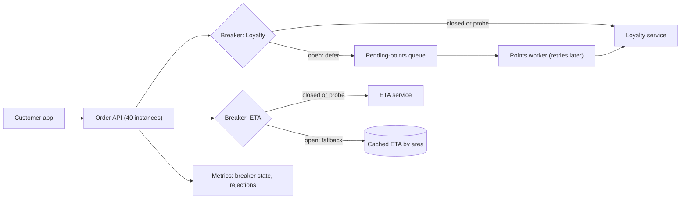
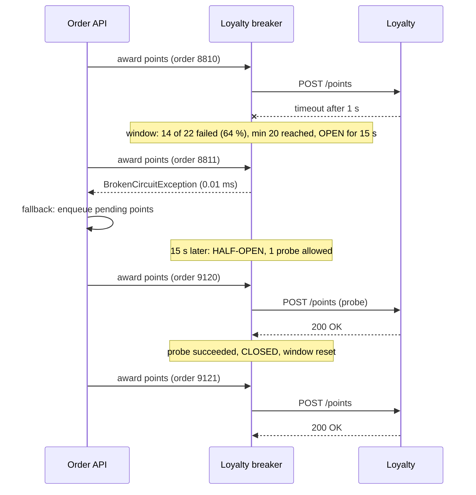

A timeout limits how long one call can hurt you. But when a dependency is completely down, every single request still waits for its full timeout, and every retry adds load to a service that is trying to restart. A circuit breaker notices the pattern ("most calls to Loyalty are failing") and stops making the calls for a while. Callers get an instant answer (an error or a fallback), and the dependency gets breathing room. This lesson builds the breaker as a state machine, tunes it with real numbers, and designs the fallbacks that make it useful.

## Learning objectives

By the end of this lesson you will be able to:

1. Explain the problem a circuit breaker solves that timeouts and retries do not.
2. Describe the closed, open and half-open states and every transition between them.
3. Choose between consecutive-failure and failure-ratio thresholds, and size the minimum throughput, sampling window and break duration from traffic numbers.
4. Decide what counts as a failure (and what must not: 4xx responses, caller cancellation).
5. Implement a thread-safe breaker in C# with a rolling window and limited half-open probes, and put it in an `HttpClient` pipeline.
6. Design fallbacks (cached data, defaults, deferred work, degraded features) and know when a fallback is dangerous.
7. Combine a breaker with retries correctly, and keep breakers out of health checks.

## Prerequisites

- [Timeouts, retries and backoff](#/lesson/m10-timeouts-retries): the breaker builds on timeouts, and must be combined with retries carefully.
- [State pattern](#/lesson/m06-state): the breaker is a small state machine.

## Explain it like I'm a beginner

Your home has a circuit breaker (an MCB) in the electrical panel. If a faulty heater draws too much current, the breaker **trips** and cuts power to that circuit. That protects the wiring from overheating. The rest of the house keeps working. You don't keep flicking the switch back on every second while the heater is still faulty; you wait, then try once. If it trips again, you wait longer.

A software circuit breaker does the same for a remote service:

- **Closed** (power flowing): calls go through normally. The breaker quietly counts how many fail.
- **Open** (tripped): too many calls failed recently. For the next, say, 15 seconds, the breaker refuses calls *instantly* without even trying. Your app shows a fallback ("Points will be added soon") instead of making users wait.
- **Half-open** (testing): after 15 seconds, the breaker lets **one** test call through. If it works, the breaker closes again. If it fails, it opens for another 15 seconds.

The analogy has one important difference: a home breaker protects the *wiring*; a software breaker protects *both sides*. Your service stops wasting threads waiting, and the failing service stops being hammered while it recovers.

## First-principles explanation

### Our scenario

A food-delivery **Order API** (40 instances in peak hours; let's look at one instance) calls:

- **Loyalty** to award points after each order: about 20 calls per second per instance, p99 150 ms, timeout 1 s.
- **ETA** (a maps-based delivery-time estimate) for the order screen: about 60 calls per second, p99 120 ms, timeout 500 ms.

Loyalty is a nice-to-have. An order must never fail because points could not be awarded.

### The problem a breaker solves

Loyalty goes down for 45 seconds (a bad deployment). Without a breaker, on one instance:

- Every Loyalty call waits the full 1 s timeout. In flight: 20 RPS × 1 s = 20 calls at all times (Little's law), each holding a connection and memory, and adding a second to the order response.
- With one retry each, Loyalty receives 40 calls per second from this instance, × 40 instances = 1,600 calls per second, while it is trying to restart. Recovery is slower; it may never recover if it crashes again under the load (a retry storm).
- Over 45 s: 900 orders each wasted at least 1 s waiting for a call that was always going to fail.

With a breaker that opens after a few seconds of mostly-failures:

- Calls fail in microseconds instead of 1 s. Orders complete at normal speed with "points pending".
- Loyalty receives only a trickle of probe calls (one every 15 s per instance, 40 instances ≈ 3 per second in total) instead of 1,600 per second.

A timeout bounds the damage of *one* call. A breaker bounds the damage of *a known-bad dependency*.

### The three states

```text
            failures cross the threshold
  CLOSED ─────────────────────────────────▶ OPEN
    ▲                                         │
    │ probe succeeds                          │ break duration elapses
    │                                         ▼
    └──────────────────────────────────── HALF-OPEN
                probe fails ──▶ back to OPEN (new break period)
```

- **Closed:** every call goes through. Outcomes are recorded in a sampling window. When the failure threshold is crossed, the breaker opens.
- **Open:** every call is rejected immediately with a "broken circuit" error (in Polly, `BrokenCircuitException`). No remote call is made. After the **break duration** the breaker moves to half-open. A good implementation does this lazily: the next call after the break period finds that time has passed.
- **Half-open:** a limited number of trial calls (**probes**), often just one, are allowed through. Other calls are still rejected. If the probes succeed, the breaker closes and the window is reset. If a probe fails, it opens again for another break duration.

### Choosing the threshold

**Consecutive failures** ("open after 5 failures in a row"): simple, and good for low-traffic dependencies. Weakness: one success in between resets the count, so a dependency failing 80 % of the time may never trip it.

**Failure ratio over a sampling window** ("open when ≥ 50 % of calls in the last 10 s failed, if there were at least 20 calls"): the standard for busy dependencies. Three numbers:

1. **Failure ratio.** 50 % is a common starting point for a dependency that is either working or broken. Lower (10–20 %) for critical paths where partial failure already hurts; Microsoft's standard HTTP resilience handler defaults to 10 %.
2. **Minimum throughput.** Without it, 1 failure out of the first 1 call is a 100 % failure ratio, and a quiet breaker opens on a single blip. With 20 calls per second over 10 s, the window sees about 200 calls; a minimum of 20 means "at least one second's worth of evidence".
3. **Sampling duration.** Long enough to smooth noise, short enough to react. 10–30 s is typical. It should be at least about twice the attempt timeout, so slow failures (timeouts) have time to show up in the window.

**How fast does it open?** Loyalty at 20 RPS, ratio 50 %, minimum 20, window 10 s. When Loyalty fails completely, timeouts complete 1 s after each call starts. After about 1–2 s, the window holds ≥ 20 calls, mostly failures, and the breaker opens. Most of the 45-second outage is spent failing fast.

### Break duration and half-open probes

- **Break duration** is how long the dependency gets to rest: 5–30 s is typical. Too short, and probes fire while it is still down; too long, and you keep serving fallbacks after it has recovered.
- **Adaptive break duration:** double the break after each failed probe (15 s → 30 s → 60 s, capped), and reset it after a success. A long outage then costs very few probes.
- **Probe count:** allow 1 (or a few) concurrent probe calls. If half-open let everything through, 20 RPS of real traffic would hit a dependency that may still be sick.
- **Jitter across instances:** with 40 instances opening at the same moment, all 40 probe at the same moment. A little randomness in the break duration (±20 %) spreads that out.

### What counts as a failure

Count only failures that say something about the dependency's health:

| Outcome | Count as failure? | Reason |
|---|---|---|
| Timeout, connection refused/reset | Yes | The dependency is slow or down |
| 500, 502, 503, 504 | Yes | Server-side trouble |
| 429 Too Many Requests | Usually yes | It is overloaded; backing off helps it |
| 400, 404, 409, 422 | **No** | Your request was wrong, or the answer is "no" |
| 401, 403 | **No** (alert instead) | A credentials problem, not an outage |
| Caller cancelled | **No** | Nobody waited; says nothing about the dependency |

Counting 4xx is a classic mistake: a client bug that sends bad requests would open the breaker and block *good* requests too.

### Breaker scope: one per what?

A breaker should cover **one failure domain**: something that fails as a unit.

- One per **dependency** (Loyalty, ETA) is the default.
- One per **host or partition** when a dependency has independent parts. A payment router talking to 12 banks needs 12 breakers; one shared breaker would let one bank's outage block payments to the other 11.
- Breakers are **per instance**: each of the 40 Order API instances decides for itself. That's usually fine, and it avoids a shared-state dependency. The cost is that each instance must observe the failure itself before opening.

### Fallbacks: what happens when the breaker is open

The breaker only says "don't call". The fallback says "do this instead". Options, best first:

1. **Defer the work.** Put "award 40 points for order 8812" on a durable queue; a worker applies it when Loyalty recovers. The user sees "points pending". (This needs an idempotent consumer, so replaying is safe.)
2. **Serve stale data.** Show the last cached ETA for this restaurant and area, labelled as approximate.
3. **Use a safe default.** "Delivery in 30–40 minutes."
4. **Degrade the feature.** Hide the recommendations carousel.
5. **Fail clearly.** For a dependency that is essential (payment), return a fast, honest error ("payments are temporarily unavailable"). Fast failure still beats a 30-second spinner.

**Rules for fallbacks:** the fallback must not depend on the thing that failed, must be cheaper than the original call, and must be correct for the business. Showing a stale *price* or an approved-by-default *fraud check* is a business decision, not an engineering shortcut. Test fallbacks regularly; a fallback that only runs during outages is usually broken when you need it.

### Combining breakers with retries and timeouts

- **Timeout inside the breaker:** each attempt's timeout must be visible to the breaker as a failure.
- **Retry outside the breaker:** if the breaker is open, the retry sees `BrokenCircuitException` immediately. **Do not retry broken-circuit errors** (or wait the remaining break time); retrying them just spins.
- So the order from outside to inside is: fallback → retry → circuit breaker → attempt timeout → the call. The [bulkhead lesson](#/lesson/m10-bulkhead) adds the remaining pieces and explains the full ordering.

### Breakers and health checks

Do **not** make your service's readiness probe fail because a breaker is open. If Loyalty is down and every Order API instance reports "not ready", the load balancer or Kubernetes removes *all* of them, and a nice-to-have dependency has taken down ordering. Report breaker states as metrics and in a diagnostics endpoint, and alert on them. Readiness should reflect whether *this* instance can serve its core job.

### When a simpler design is enough

- **Low-traffic internal calls** (a few per minute) gain little: a timeout and a clear error are enough, because there is almost no load to shed.
- **Queue consumers** often do better by pausing consumption when a dependency is down (the queue holds the work) than by wrapping each message in a breaker.
- **If an outage of the dependency always means your request must fail**, and the timeout is short, a breaker mostly improves latency of failures. That's still worth having for busy paths, but it is not urgent for quiet ones.

## Visual explanation

### Architecture



Each dependency has its own breaker inside every Order API instance. When the Loyalty breaker is closed (or letting a probe through), the call goes to Loyalty. When it is open, the order still succeeds: the points award is written to a pending-points queue, and a separate worker applies it later, at its own pace, once Loyalty is healthy. The ETA breaker's fallback is different because the data is different: a cached estimate for the delivery area is good enough for a few minutes. Both breakers report their state to metrics, which drive alerts. Readiness checks are not connected to them.

### Sequence: tripping, failing fast, and recovering



The first call times out, and that failure pushes the window over the threshold: more than 50 % of at least 20 recent calls failed, so the breaker opens. The very next call is rejected without touching the network; the Order API catches the exception and runs its fallback, enqueueing the points award. Fifteen seconds later, the next call finds the break period over, becomes the single probe, and succeeds, so the breaker closes and starts a fresh window. If the probe had failed, the breaker would have opened again for another break period, and Loyalty would have seen just one call per break period from this instance.

## Step-by-step example

Let's tune a breaker for the **ETA** service with numbers.

1. **Traffic:** 60 RPS per instance. Timeout 500 ms.
2. **Sampling duration:** 10 s (at least 2 × the timeout, and enough to see 600 calls).
3. **Minimum throughput:** 30 calls (half a second of traffic). Small enough to react quickly, big enough to ignore a single blip.
4. **Failure ratio:** ETA's normal error rate is 0.2 %. During partial outages (one of its three nodes down) it is about 33 %, which we can tolerate with retries. Choose 50 %: open only when it is mostly broken.
5. **Break duration:** 10 s, with ±20 % jitter, doubling on repeated failure up to 60 s.
6. **Half-open probes:** 1.
7. **Fallback:** cached ETA for the area (refreshed every 5 minutes when healthy), else "30–40 min".
8. **Check the outcome during a 2-minute ETA outage:** the breaker opens within about a second; then roughly one probe every 10–60 s per instance. Over 40 instances that is a few probes per second in total, instead of 2,400 RPS of doomed calls.

Contrast with **Loyalty at night**, when traffic is 0.2 RPS per instance. A minimum throughput of 20 calls would take 100 s to fill the 10 s window, which can never happen, so the breaker would never open. At low traffic, a consecutive-failure threshold (open after 5 failures in a row) works better, or a longer window. Good libraries let you choose per dependency.

## Production-style C# implementation

```text
Orders.Api/
  Program.cs
  Resilience/CircuitBreakerTypes.cs
  Resilience/RollingOutcomeWindow.cs
  Resilience/CircuitBreaker.cs
  Resilience/CircuitBreakerHandler.cs
  Loyalty/LoyaltyClient.cs
```

### Types and options

```csharp file=Resilience/CircuitBreakerTypes.cs
namespace Orders.Resilience;

public enum CircuitState { Closed, Open, HalfOpen }

public sealed class CircuitBreakerOptions
{
    public double FailureRatio { get; set; } = 0.5;
    public int MinimumThroughput { get; set; } = 20;
    public TimeSpan SamplingDuration { get; set; } = TimeSpan.FromSeconds(10);
    public int SamplingBuckets { get; set; } = 10;
    public TimeSpan BreakDuration { get; set; } = TimeSpan.FromSeconds(15);
    public TimeSpan MaxBreakDuration { get; set; } = TimeSpan.FromSeconds(120);
    public int HalfOpenMaxProbes { get; set; } = 1;
}

/// <summary>Thrown instead of calling the dependency while the circuit is open.</summary>
public sealed class BrokenCircuitException(string circuitName, TimeSpan retryAfter)
    : Exception($"Circuit '{circuitName}' is open; retry after {retryAfter.TotalSeconds:0.#} s.")
{
    public string CircuitName { get; } = circuitName;
    public TimeSpan RetryAfter { get; } = retryAfter;
}

/// <summary>Permission to make one call. Probes are the trial calls made in half-open state.</summary>
public readonly record struct CircuitPermit(bool IsProbe);
```

### A rolling window of outcomes

```csharp file=Resilience/RollingOutcomeWindow.cs
namespace Orders.Resilience;

/// <summary>Successes and failures over the last SamplingDuration, kept in fixed-size time buckets.
/// Memory is constant whatever the traffic. Not thread-safe: the breaker locks around it.</summary>
public sealed class RollingOutcomeWindow
{
    private sealed class Bucket { public long Index = long.MinValue; public int Successes; public int Failures; }
    private readonly Bucket[] _buckets;
    private readonly long _bucketMs;

    public RollingOutcomeWindow(TimeSpan samplingDuration, int bucketCount)
    {
        ArgumentOutOfRangeException.ThrowIfLessThan(bucketCount, 1);
        _buckets = Enumerable.Range(0, bucketCount).Select(_ => new Bucket()).ToArray();
        _bucketMs = Math.Max(1, (long)samplingDuration.TotalMilliseconds / bucketCount);
    }

    public void Record(bool success, long nowMs)
    {
        var index = nowMs / _bucketMs;
        var b = _buckets[(int)(index % _buckets.Length)];
        if (b.Index != index) { b.Index = index; b.Successes = 0; b.Failures = 0; }
        if (success) b.Successes++; else b.Failures++;
    }

    public (int Total, int Failures) Snapshot(long nowMs)
    {
        var current = nowMs / _bucketMs;
        int total = 0, failures = 0;
        foreach (var b in _buckets)
            if (b.Index > current - _buckets.Length) { total += b.Successes + b.Failures; failures += b.Failures; }
        return (total, failures);
    }

    public void Reset() { foreach (var b in _buckets) b.Index = long.MinValue; }
}
```

Ten buckets of one second each: when the clock moves into a new second, the oldest bucket is recycled. The window "slides" one bucket at a time, which is accurate enough for a breaker.

### The breaker

```csharp file=Resilience/CircuitBreaker.cs
namespace Orders.Resilience;

public sealed class CircuitBreaker
{
    private readonly object _gate = new();
    private readonly CircuitBreakerOptions _o;
    private readonly TimeProvider _clock;
    private readonly Func<Exception, bool> _shouldHandle;
    private readonly RollingOutcomeWindow _window;
    private CircuitState _state = CircuitState.Closed;
    private DateTimeOffset _openUntil;
    private TimeSpan _currentBreak;
    private int _probesInFlight;

    public CircuitBreaker(string name, CircuitBreakerOptions options, TimeProvider clock, Func<Exception, bool>? shouldHandle = null)
    {
        Name = name;
        _o = options;
        _clock = clock;
        _shouldHandle = shouldHandle ?? (ex => ex is HttpRequestException or TimeoutException);
        _window = new RollingOutcomeWindow(options.SamplingDuration, options.SamplingBuckets);
        _currentBreak = options.BreakDuration;
    }

    public string Name { get; }

    /// <summary>Raised after a transition, outside the lock: (from, to).</summary>
    public event Action<CircuitState, CircuitState>? StateChanged;

    public CircuitState State
    {
        get { lock (_gate) return _state == CircuitState.Open && _clock.GetUtcNow() >= _openUntil ? CircuitState.HalfOpen : _state; }
    }

    public bool TryAcquire(out CircuitPermit permit, out TimeSpan retryAfter)
    {
        (CircuitState, CircuitState)? changed = null;
        try
        {
            lock (_gate)
            {
                var now = _clock.GetUtcNow();
                if (_state == CircuitState.Open)
                {
                    if (now < _openUntil) { permit = default; retryAfter = _openUntil - now; return false; }
                    changed = Transition(CircuitState.HalfOpen);          // lazily, on the first call after the break
                }
                if (_state == CircuitState.HalfOpen)
                {
                    if (_probesInFlight >= _o.HalfOpenMaxProbes) { permit = default; retryAfter = TimeSpan.FromSeconds(1); return false; }
                    _probesInFlight++;
                    permit = new CircuitPermit(IsProbe: true);
                    retryAfter = TimeSpan.Zero;
                    return true;
                }
                permit = new CircuitPermit(IsProbe: false);
                retryAfter = TimeSpan.Zero;
                return true;
            }
        }
        finally { Raise(changed); }
    }

    public void RecordSuccess(CircuitPermit permit) => Record(permit, success: true);
    public void RecordFailure(CircuitPermit permit) => Record(permit, success: false);

    /// <summary>The call ended without a verdict (for example, the caller cancelled). Frees a probe slot.</summary>
    public void RecordIgnored(CircuitPermit permit)
    {
        if (!permit.IsProbe) return;
        lock (_gate) if (_probesInFlight > 0) _probesInFlight--;
    }

    public async Task<T> ExecuteAsync<T>(Func<CancellationToken, Task<T>> action, CancellationToken ct = default)
    {
        if (!TryAcquire(out var permit, out var retryAfter)) throw new BrokenCircuitException(Name, retryAfter);
        try
        {
            var result = await action(ct);
            RecordSuccess(permit);
            return result;
        }
        catch (Exception ex) when (!ct.IsCancellationRequested && _shouldHandle(ex))
        {
            RecordFailure(permit);
            throw;
        }
        catch
        {
            RecordIgnored(permit);     // 4xx-style exceptions, cancellation: no verdict on health
            throw;
        }
    }

    private void Record(CircuitPermit permit, bool success)
    {
        (CircuitState, CircuitState)? changed = null;
        lock (_gate)
        {
            var nowMs = _clock.GetUtcNow().ToUnixTimeMilliseconds();
            if (permit.IsProbe)
            {
                if (_probesInFlight > 0) _probesInFlight--;
                if (_state != CircuitState.HalfOpen) return;              // a stale probe result
                if (success)
                {
                    _window.Reset();
                    _currentBreak = _o.BreakDuration;                     // recovered: back to the base break
                    changed = Transition(CircuitState.Closed);
                }
                else
                {
                    // Still failing: rest it longer this time (15 s, 30 s, 60 s … up to the cap).
                    _currentBreak = TimeSpan.FromTicks(Math.Min(_currentBreak.Ticks * 2, _o.MaxBreakDuration.Ticks));
                    changed = Open(_currentBreak);
                }
            }
            else if (_state == CircuitState.Closed)
            {
                _window.Record(success, nowMs);
                var (total, failures) = _window.Snapshot(nowMs);
                if (!success && total >= _o.MinimumThroughput && (double)failures / total >= _o.FailureRatio)
                    changed = Open(_currentBreak);
            }
            // Results of normal calls that finish while Open or HalfOpen are ignored.
        }
        Raise(changed);
    }

    private (CircuitState, CircuitState) Open(TimeSpan breakFor)
    {
        _openUntil = _clock.GetUtcNow() + breakFor;
        _probesInFlight = 0;
        return Transition(CircuitState.Open);
    }

    private (CircuitState, CircuitState) Transition(CircuitState to)
    {
        var from = _state;
        _state = to;
        return (from, to);
    }

    private void Raise((CircuitState From, CircuitState To)? change)
    {
        if (change is { } c && c.From != c.To) StateChanged?.Invoke(c.From, c.To);
    }
}
```

Design choices worth noticing:

- **Lazy transitions.** No timer moves the breaker from open to half-open; the first call after the break period does. No background thread, nothing to dispose.
- **Permits separate probes from normal calls.** A slow normal call that started before the breaker opened, and finishes during half-open, must not decide whether the dependency has recovered. Only a probe's result counts in half-open.
- **Only failures can trip it.** The threshold is checked when a failure is recorded, so a success never opens the breaker.
- **Events are raised outside the lock**, so a subscriber that logs slowly (or calls back into the breaker) cannot deadlock or stall all callers.
- **Doubling break duration** on failed probes, reset on recovery, means a long outage costs only a handful of probes.

### In the HttpClient pipeline

```csharp file=Resilience/CircuitBreakerHandler.cs
using System.Net;

namespace Orders.Resilience;

/// <summary>Counts 5xx, 408, 429, attempt timeouts and connection failures as failures. Other responses are
/// successes from the breaker's point of view, because the dependency answered.</summary>
public sealed class CircuitBreakerHandler(CircuitBreaker breaker, TimeSpan attemptTimeout) : DelegatingHandler
{
    protected override async Task<HttpResponseMessage> SendAsync(HttpRequestMessage request, CancellationToken cancellationToken)
    {
        if (!breaker.TryAcquire(out var permit, out var retryAfter))
            throw new BrokenCircuitException(breaker.Name, retryAfter);

        // The handler owns the attempt timeout. HttpClient.Timeout cancels the SAME token the caller passed in,
        // so inside a handler an HttpClient timeout is indistinguishable from the caller giving up.
        using var attemptCts = new CancellationTokenSource(attemptTimeout);
        using var linked = CancellationTokenSource.CreateLinkedTokenSource(cancellationToken, attemptCts.Token);

        HttpResponseMessage response;
        try
        {
            response = await base.SendAsync(request, linked.Token);
        }
        catch (OperationCanceledException) when (attemptCts.IsCancellationRequested && !cancellationToken.IsCancellationRequested)
        {
            breaker.RecordFailure(permit);       // our attempt timeout fired: the dependency is slow
            throw new TimeoutException($"'{breaker.Name}' did not answer within {attemptTimeout.TotalMilliseconds} ms.");
        }
        catch (OperationCanceledException)
        {
            breaker.RecordIgnored(permit);       // the caller (or an outer deadline) gave up: no verdict
            throw;
        }
        catch (HttpRequestException)
        {
            breaker.RecordFailure(permit);       // connection refused, reset, DNS failure
            throw;
        }

        if (IsFailure(response.StatusCode)) breaker.RecordFailure(permit);
        else breaker.RecordSuccess(permit);
        return response;
    }
    public static bool IsFailure(HttpStatusCode status) =>
        (int)status >= 500 || status is HttpStatusCode.RequestTimeout or HttpStatusCode.TooManyRequests;
}
```

### The client with its fallback

```csharp file=Loyalty/LoyaltyClient.cs
using System.Text;
using System.Text.Json;
using System.Threading.Channels;
using Orders.Resilience;

namespace Orders.Loyalty;

public sealed record PointsAward(string OrderId, string CustomerId, int Points);
public enum AwardOutcome { Awarded, Deferred }

/// <summary>Durable in production (a queue or an outbox table); a Channel keeps the example self-contained.</summary>
public sealed class PendingPointsQueue
{
    private readonly Channel<PointsAward> _channel = Channel.CreateBounded<PointsAward>(10_000);
    public bool TryEnqueue(PointsAward award) => _channel.Writer.TryWrite(award);
    public ChannelReader<PointsAward> Reader => _channel.Reader;
}

public sealed class LoyaltyClient(HttpClient http, PendingPointsQueue pending, ILogger<LoyaltyClient> logger)
{
    public async Task<AwardOutcome> AwardAsync(PointsAward award, CancellationToken ct)
    {
        try
        {
            using var request = new HttpRequestMessage(HttpMethod.Post, "v1/points")
            {
                Content = new StringContent(JsonSerializer.Serialize(award), Encoding.UTF8, "application/json"),
            };
            request.Headers.Add("Idempotency-Key", $"points-{award.OrderId}");   // safe to replay later
            using var response = await http.SendAsync(request, ct);
            response.EnsureSuccessStatusCode();
            return AwardOutcome.Awarded;
        }
        catch (Exception ex) when (ex is BrokenCircuitException or HttpRequestException or TimeoutException
                                   || (ex is OperationCanceledException && !ct.IsCancellationRequested))
        {
            // Fallback: the order must never fail because of loyalty points.
            if (!pending.TryEnqueue(award))
                logger.LogError("Pending-points queue full; points for order {OrderId} need manual repair", award.OrderId);
            else
                logger.LogInformation("Loyalty unavailable ({Reason}); deferred points for order {OrderId}", ex.GetType().Name, award.OrderId);
            return AwardOutcome.Deferred;
        }
    }
}
```

The idempotency key is what makes deferral safe. The worker that drains the pending queue may replay an award that actually succeeded (for example a call that timed out after Loyalty had already applied it), and the key makes the replay harmless.

### Program.cs

```csharp file=Program.cs
using Orders.Loyalty;
using Orders.Resilience;

var builder = WebApplication.CreateBuilder(args);

builder.Services.AddSingleton(TimeProvider.System);
builder.Services.AddSingleton<PendingPointsQueue>();

// One breaker per failure domain, as a keyed singleton so it outlives HttpClient handler rotation.
builder.Services.AddKeyedSingleton("loyalty", (sp, _) =>
{
    var breaker = new CircuitBreaker("loyalty", new CircuitBreakerOptions
    {
        FailureRatio = 0.5,
        MinimumThroughput = 20,
        SamplingDuration = TimeSpan.FromSeconds(10),
        BreakDuration = TimeSpan.FromSeconds(15),
    }, sp.GetRequiredService<TimeProvider>());
    var log = sp.GetRequiredService<ILoggerFactory>().CreateLogger("CircuitBreaker");
    breaker.StateChanged += (from, to) => log.LogWarning("Circuit {Name}: {From} -> {To}", breaker.Name, from, to);
    return breaker;
});

builder.Services.AddHttpClient<LoyaltyClient>(c =>
    {
        c.BaseAddress = new Uri("https://loyalty.internal/");
        c.Timeout = TimeSpan.FromSeconds(3);                  // outer backstop only; the attempt timeout is below
    })
    .AddHttpMessageHandler(sp => new CircuitBreakerHandler(
        sp.GetRequiredKeyedService<CircuitBreaker>("loyalty"), attemptTimeout: TimeSpan.FromSeconds(1)));

var app = builder.Build();

app.MapPost("/orders/{orderId}/complete", async (string orderId, string customerId, LoyaltyClient loyalty, CancellationToken ct) =>
{
    var outcome = await loyalty.AwardAsync(new PointsAward(orderId, customerId, Points: 40), ct);
    return Results.Ok(new { orderId, points = outcome == AwardOutcome.Awarded ? "awarded" : "pending" });
});

// Diagnostics, not readiness: an open breaker must not take this instance out of rotation.
app.MapGet("/internal/breakers", ([FromKeyedServices("loyalty")] CircuitBreaker loyalty) =>
    Results.Ok(new[] { new { name = loyalty.Name, state = loyalty.State.ToString() } }));

app.Run();
```

**Why a keyed singleton?** `IHttpClientFactory` recycles message handlers every couple of minutes. If the breaker lived inside the handler, its state would be thrown away with it. Keeping the breaker as a singleton and passing it into each new handler preserves state across rotations.

**Why does the handler own the attempt timeout?** A common bug: relying on `HttpClient.Timeout` and treating every `OperationCanceledException` as a failure, or (the opposite bug) treating every cancellation as "the caller gave up". `HttpClient` implements its timeout by cancelling the token it hands to the handler chain, so the handler cannot tell a timeout from a user who closed the app. With its own timer, the handler knows exactly which one happened: its own timeout is a failure, anything else is ignored. Polly's timeout strategy solves the same problem by throwing `TimeoutRejectedException`.

### With the library

In production you would usually let `Microsoft.Extensions.Http.Resilience` (Polly v8) do this. A custom pipeline for Loyalty (not compiled here):

```csharp
builder.Services.AddHttpClient<LoyaltyClient>(c => c.BaseAddress = new Uri("https://loyalty.internal/"))
    .AddResilienceHandler("loyalty", pipeline =>
    {
        pipeline.AddCircuitBreaker(new HttpCircuitBreakerStrategyOptions
        {
            // The default ShouldHandle already counts 5xx, 408, 429, HttpRequestException and
            // TimeoutRejectedException, and ignores other 4xx responses.
            FailureRatio = 0.5,
            MinimumThroughput = 20,
            SamplingDuration = TimeSpan.FromSeconds(10),
            BreakDuration = TimeSpan.FromSeconds(15),
            // BreakDurationGenerator can grow the break on repeated failures.
        });
        pipeline.AddTimeout(TimeSpan.FromSeconds(1));    // inner: each attempt's timeout is seen by the breaker
    });
```

## Bad design vs good design

**Bad:** a "breaker" implemented as a static boolean flag:

```csharp
static bool loyaltyDown;
if (!loyaltyDown)
{
    try { await http.PostAsJsonAsync("v1/points", award); }
    catch { loyaltyDown = true; _ = Task.Delay(60_000).ContinueWith(_ => loyaltyDown = false); }
}
```

What goes wrong: a single failure (even a 400 caused by a bad request, because `catch` catches everything) disables loyalty for a full minute. There is no ratio, no minimum throughput, no half-open probe, so after the minute *all* traffic rushes back at once. The flag is not thread-safe (no memory barrier), every failure schedules another timer, and when `loyaltyDown` is true, points are silently dropped: no fallback, no log, no metric.

**Good:** the implementation above. A failure ratio with minimum throughput, health-relevant failures only, lazy half-open with one probe, growing break durations, state changes logged, a fallback that defers the work durably with an idempotency key, and diagnostics that don't affect readiness.

:::callout type=mistake title="Retrying a broken circuit"
A retry loop around a breaker that catches `BrokenCircuitException` and retries after 200 ms just spins until its attempts run out. Configure the retry to ignore broken-circuit errors, or to wait the remaining break time if the call is worth waiting for.
:::

:::callout type=tradeoff title="Per-instance breakers versus a shared breaker"
Per-instance breakers need no coordination and fail independently, but each of 40 instances must observe failures before it opens, and each probes separately. A shared breaker state (in Redis, say) reacts once for everyone but adds a dependency to your resilience mechanism. Almost everyone uses per-instance breakers; add jitter to break durations so probes don't synchronise.
:::

## Practical playground

The simulator sends 20 requests per second to a dependency that has an outage from second 30 to 75. Compare runs with the breaker off and on.

:::playground type=sim sim=circuit title="Circuit breaker during an outage" breaker=true failureThreshold=0.5 windowSec=10 minRequests=20 openSec=10 halfOpenProbes=5 rps=20 outageFailure=0.9 timeoutMs=2000
:::

Try this:

1. Turn the breaker **off**. How many requests wait for the 2 s timeout during the outage? What is the total wasted waiting time?
2. Turn it **on** with the defaults. How quickly after second 30 does it open? How many calls reach the dependency while it is open?
3. Set `openSec` to 2, then to 30. What happens to the number of probe calls during the outage, and to how long the breaker stays open *after* the dependency recovers at second 75?
4. Raise `minRequests` to 300. Why does the breaker now open late, or not at all?
5. Lower `outageFailure` to 0.4 (a partial outage) with a 0.5 threshold. Does it open? Is that what you want?

## Exercises

:::exercise id=m10-circuit-breaker-ex1 difficulty=beginner kind=code title="A consecutive-failure breaker"
Implement `ConsecutiveFailureBreaker`, the simplest correct breaker. It opens after `threshold` failures in a row, rejects calls during `breakDuration`, then allows exactly one probe in half-open.
::requirements
- `State` reports `Open` until the break has elapsed, then `HalfOpen`.
- `AllowRequest()` returns false while open, true for exactly one caller in half-open (later callers get false until the probe reports), and true when closed.
- `RecordSuccess()` resets the failure count; in half-open it closes the breaker.
- `RecordFailure()` in closed increments the count and opens at the threshold; in half-open it reopens for a fresh `breakDuration`.
- Use the injected `TimeProvider`.
::acceptance
- With threshold 3: two failures and a success leave it closed; three failures in a row open it.
- While open, `AllowRequest()` is false.
- After the break, the first `AllowRequest()` is true and the second is false.
- Probe success closes it; probe failure reopens it for a full new break duration.
::hint
Keep three fields: the state, the consecutive failure count, and the time the break ends.
::hint
Compute half-open lazily: if the state is open and now ≥ break end, treat it as half-open.
::hint
Track whether a probe is already in flight with a `bool`, so only one caller gets `true` in half-open.
::hint
```csharp
public bool AllowRequest()
{
    lock (_gate)
    {
        if (_state == CircuitState.Open && _clock.GetUtcNow() >= _openUntil) { _state = CircuitState.HalfOpen; _probing = false; }
        if (_state == CircuitState.Open) return false;
        if (_state == CircuitState.HalfOpen) { if (_probing) return false; _probing = true; }
        return true;
    }
}
```
::starter
```csharp file=ConsecutiveFailureBreaker.cs
using System;

namespace BreakerEx1;

public enum CircuitState { Closed, Open, HalfOpen }

public sealed class ManualClock(DateTimeOffset start) : TimeProvider
{
    private DateTimeOffset _now = start;
    public override DateTimeOffset GetUtcNow() => _now;
    public void Advance(TimeSpan by) => _now += by;
}

public sealed class ConsecutiveFailureBreaker(int threshold, TimeSpan breakDuration, TimeProvider clock)
{
    public CircuitState State => throw new NotImplementedException();
    public bool AllowRequest() => throw new NotImplementedException();
    public void RecordSuccess() => throw new NotImplementedException();
    public void RecordFailure() => throw new NotImplementedException();
}
```
::tests
```csharp file=ConsecutiveFailureBreakerTests.cs
using System;
using Xunit;
using BreakerEx1;

public class ConsecutiveFailureBreakerTests
{
    private static (ConsecutiveFailureBreaker, ManualClock) Make()
    {
        var clock = new ManualClock(new DateTimeOffset(2026, 2, 1, 10, 0, 0, TimeSpan.Zero));
        return (new ConsecutiveFailureBreaker(3, TimeSpan.FromSeconds(15), clock), clock);
    }

    [Fact]
    public void Success_resets_the_streak()
    {
        var (b, _) = Make();
        b.RecordFailure(); b.RecordFailure(); b.RecordSuccess(); b.RecordFailure(); b.RecordFailure();
        Assert.Equal(CircuitState.Closed, b.State);
        Assert.True(b.AllowRequest());
    }

    [Fact]
    public void Opens_after_threshold_and_rejects()
    {
        var (b, _) = Make();
        b.RecordFailure(); b.RecordFailure(); b.RecordFailure();
        Assert.Equal(CircuitState.Open, b.State);
        Assert.False(b.AllowRequest());
    }

    [Fact]
    public void Half_open_allows_exactly_one_probe()
    {
        var (b, clock) = Make();
        for (var i = 0; i < 3; i++) b.RecordFailure();
        clock.Advance(TimeSpan.FromSeconds(15));
        Assert.Equal(CircuitState.HalfOpen, b.State);
        Assert.True(b.AllowRequest());
        Assert.False(b.AllowRequest());
    }

    [Fact]
    public void Probe_success_closes()
    {
        var (b, clock) = Make();
        for (var i = 0; i < 3; i++) b.RecordFailure();
        clock.Advance(TimeSpan.FromSeconds(16));
        b.AllowRequest();
        b.RecordSuccess();
        Assert.Equal(CircuitState.Closed, b.State);
        Assert.True(b.AllowRequest());
        Assert.True(b.AllowRequest());
    }

    [Fact]
    public void Probe_failure_reopens_for_a_full_break()
    {
        var (b, clock) = Make();
        for (var i = 0; i < 3; i++) b.RecordFailure();
        clock.Advance(TimeSpan.FromSeconds(15));
        b.AllowRequest();
        b.RecordFailure();
        Assert.Equal(CircuitState.Open, b.State);
        clock.Advance(TimeSpan.FromSeconds(14));
        Assert.False(b.AllowRequest());
        clock.Advance(TimeSpan.FromSeconds(1));
        Assert.True(b.AllowRequest());
    }
}
```
::solution
A small state machine behind one lock. Half-open is computed lazily from the clock.

```csharp file=ConsecutiveFailureBreaker.cs
using System;

namespace BreakerEx1;

public enum CircuitState { Closed, Open, HalfOpen }

public sealed class ManualClock(DateTimeOffset start) : TimeProvider
{
    private DateTimeOffset _now = start;
    public override DateTimeOffset GetUtcNow() => _now;
    public void Advance(TimeSpan by) => _now += by;
}

public sealed class ConsecutiveFailureBreaker(int threshold, TimeSpan breakDuration, TimeProvider clock)
{
    private readonly object _gate = new();
    private CircuitState _state = CircuitState.Closed;
    private int _failures;
    private DateTimeOffset _openUntil;
    private bool _probing;

    public CircuitState State
    {
        get { lock (_gate) { Refresh(); return _state; } }
    }

    public bool AllowRequest()
    {
        lock (_gate)
        {
            Refresh();
            if (_state == CircuitState.Open) return false;
            if (_state == CircuitState.HalfOpen)
            {
                if (_probing) return false;
                _probing = true;
            }
            return true;
        }
    }

    public void RecordSuccess()
    {
        lock (_gate)
        {
            Refresh();
            _failures = 0;
            if (_state == CircuitState.HalfOpen) { _state = CircuitState.Closed; _probing = false; }
        }
    }

    public void RecordFailure()
    {
        lock (_gate)
        {
            Refresh();
            if (_state == CircuitState.HalfOpen) { Open(); return; }
            if (_state == CircuitState.Closed && ++_failures >= threshold) Open();
        }
    }

    private void Open()
    {
        _state = CircuitState.Open;
        _openUntil = clock.GetUtcNow() + breakDuration;
        _failures = 0;
        _probing = false;
    }

    private void Refresh()
    {
        if (_state == CircuitState.Open && clock.GetUtcNow() >= _openUntil) { _state = CircuitState.HalfOpen; _probing = false; }
    }
}
```

This is enough for low-traffic dependencies. Its weakness shows at high traffic: a dependency failing 80 % of the time still produces occasional successes, each resetting the streak, so it may never open. The ratio-based window in exercise 3 fixes that.
::mistakes
- Using a timer to move from open to half-open (one timer per breaker, plus disposal and race conditions).
- Letting every caller through in half-open, so a still-sick dependency gets full traffic.
- Not resetting `_probing` when reopening, so the breaker is stuck refusing forever.
::extensions
Add a `StateChanged` event raised outside the lock, and a test that it fires exactly once per transition.
:::

:::exercise id=m10-circuit-breaker-ex2 difficulty=beginner kind=written title="Tune three breakers"
Choose the threshold type (consecutive or ratio), failure ratio, minimum throughput, sampling duration, break duration and fallback for each dependency. Show one calculation per case.

1. **Search** in an e-commerce app: 2,000 RPS per instance, p99 80 ms, timeout 300 ms. Fallback possible: popular products.
2. **SMS provider** for order notifications: 3 RPS per instance by day, 0.1 RPS at night, timeout 2 s.
3. **Card payment gateway** at checkout: 50 RPS per instance, p99 1.2 s, timeout 2 s. No acceptable "fake success" fallback.
::acceptance
- Search uses a ratio with a minimum throughput that fills quickly; the fallback is stated.
- SMS recognises that night traffic makes ratio thresholds unreliable, and defers messages.
- Payment fails fast with an honest error, and discusses a lower ratio or a per-route breaker.
- Each sampling duration is at least 2× the timeout.
::hint
How many calls does each window see at that traffic? Compare that with your minimum throughput.
::hint
Which dependencies have a fallback that is honest from the user's point of view?
::hint
At 0.1 RPS, how long would it take to collect 20 calls?
::hint
For payment, ask what "failure" really means: one bank or card network down, or the whole gateway?
::solution
1. **Search:** ratio 50 %, minimum throughput 200 (a tenth of a second of traffic), sampling 10 s (≥ 2 × 300 ms easily; the window sees about 20,000 calls), break 5 s with jitter. Fallback: cached "popular products" and a banner "search is slow right now". Short break, because search recovers quickly and the traffic is high enough to probe cheaply.
2. **SMS:** consecutive failures (5 in a row), break 30 s doubling to 5 minutes. At 0.1 RPS, collecting 20 calls takes 200 s, so a 10 s ratio window would never reach the minimum at night. Fallback: messages stay in the outbound queue and are sent when the breaker closes. Users get the SMS late rather than never. Sampling for any ratio policy by day would be at least 4 s; 30 s is more sensible.
3. **Payment:** ratio 20 % (partial failure already loses money), minimum 50 (1 s of traffic), sampling 15 s (≥ 2 × 2 s), break 10 s, one probe. Fallback: a fast, honest error ("Card payments are temporarily unavailable — try UPI"), offering an alternative method if one exists. If the gateway reports per-network or per-bank failures, use one breaker per network or bank so a single issuer's outage does not block all cards.
::mistakes
- A minimum throughput the night traffic can never reach, so the breaker silently never opens.
- A fallback for payments that pretends the payment succeeded.
- Sampling windows shorter than the timeout, so timeouts arrive after the window that should have counted them.
:::

:::exercise id=m10-circuit-breaker-ex3 difficulty=intermediate kind=code title="Failure-ratio window with minimum throughput"
Implement `FailureRatioWindow`, the decision part of a ratio-based breaker. It records outcomes in one-second buckets over a sliding window and reports whether the breaker should trip.
::requirements
- `Record(bool success)` adds an outcome to the current one-second bucket (time from the injected `TimeProvider`).
- `ShouldTrip()` is true only when total outcomes in the window ≥ `minimumThroughput` and failures ÷ total ≥ `failureRatio`.
- Outcomes older than `window` (whole seconds) are forgotten.
- `Reset()` forgets everything.
::acceptance
- 10 failures with a minimum of 20: no trip.
- 12 failures and 8 successes (60 %) with ratio 0.5 and minimum 20: trip.
- 9 failures and 11 successes (45 %): no trip.
- Failures recorded 11 s ago (window 10 s) no longer count.
- After `Reset()`, `ShouldTrip()` is false.
::hint
This is the same ring-of-buckets structure as a retry budget: `buckets[second % N]`, each remembering its own second.
::hint
Reset a bucket when you write to it and its stored second is not the current second.
::hint
When summing, include a bucket only if its second is greater than `now − N`.
::hint
Watch the integer division trap: compute the ratio with `(double)failures / total`.
::starter
```csharp file=FailureRatioWindow.cs
using System;

namespace BreakerEx3;

public sealed class ManualClock(DateTimeOffset start) : TimeProvider
{
    private DateTimeOffset _now = start;
    public override DateTimeOffset GetUtcNow() => _now;
    public void Advance(TimeSpan by) => _now += by;
}

public sealed class FailureRatioWindow(double failureRatio, int minimumThroughput, TimeSpan window, TimeProvider clock)
{
    public void Record(bool success) => throw new NotImplementedException();
    public bool ShouldTrip() => throw new NotImplementedException();
    public void Reset() => throw new NotImplementedException();
}
```
::tests
```csharp file=FailureRatioWindowTests.cs
using System;
using Xunit;
using BreakerEx3;

public class FailureRatioWindowTests
{
    private static (FailureRatioWindow, ManualClock) Make()
    {
        var clock = new ManualClock(new DateTimeOffset(2026, 4, 1, 8, 0, 0, TimeSpan.Zero));
        return (new FailureRatioWindow(0.5, 20, TimeSpan.FromSeconds(10), clock), clock);
    }

    private static void Add(FailureRatioWindow w, int failures, int successes)
    {
        for (var i = 0; i < failures; i++) w.Record(false);
        for (var i = 0; i < successes; i++) w.Record(true);
    }

    [Fact]
    public void Below_minimum_throughput_never_trips()
    {
        var (w, _) = Make();
        Add(w, 10, 0);
        Assert.False(w.ShouldTrip());
    }

    [Fact]
    public void Trips_at_ratio_with_enough_calls()
    {
        var (w, _) = Make();
        Add(w, 12, 8);
        Assert.True(w.ShouldTrip());
    }

    [Fact]
    public void Below_ratio_does_not_trip()
    {
        var (w, _) = Make();
        Add(w, 9, 11);
        Assert.False(w.ShouldTrip());
    }

    [Fact]
    public void Counts_across_buckets_inside_window()
    {
        var (w, clock) = Make();
        for (var s = 0; s < 5; s++) { Add(w, 3, 1); clock.Advance(TimeSpan.FromSeconds(1)); }
        Assert.True(w.ShouldTrip());                 // 15 failures of 20 across 5 buckets
    }

    [Fact]
    public void Old_outcomes_expire()
    {
        var (w, clock) = Make();
        Add(w, 20, 0);
        clock.Advance(TimeSpan.FromSeconds(11));
        Add(w, 1, 0);
        Assert.False(w.ShouldTrip());
    }

    [Fact]
    public void Reset_clears_everything()
    {
        var (w, _) = Make();
        Add(w, 30, 0);
        w.Reset();
        Assert.False(w.ShouldTrip());
    }
}
```
::solution
```csharp file=FailureRatioWindow.cs
using System;

namespace BreakerEx3;

public sealed class ManualClock(DateTimeOffset start) : TimeProvider
{
    private DateTimeOffset _now = start;
    public override DateTimeOffset GetUtcNow() => _now;
    public void Advance(TimeSpan by) => _now += by;
}

public sealed class FailureRatioWindow
{
    private sealed class Bucket { public long Second = long.MinValue; public int Successes; public int Failures; }

    private readonly double _ratio;
    private readonly int _min;
    private readonly TimeProvider _clock;
    private readonly Bucket[] _buckets;
    private readonly object _gate = new();

    public FailureRatioWindow(double failureRatio, int minimumThroughput, TimeSpan window, TimeProvider clock)
    {
        _ratio = failureRatio;
        _min = minimumThroughput;
        _clock = clock;
        _buckets = new Bucket[Math.Max(1, (int)Math.Ceiling(window.TotalSeconds))];
        for (var i = 0; i < _buckets.Length; i++) _buckets[i] = new Bucket();
    }

    public void Record(bool success)
    {
        lock (_gate)
        {
            var now = _clock.GetUtcNow().ToUnixTimeSeconds();
            var b = _buckets[(int)(now % _buckets.Length)];
            if (b.Second != now) { b.Second = now; b.Successes = 0; b.Failures = 0; }
            if (success) b.Successes++; else b.Failures++;
        }
    }

    public bool ShouldTrip()
    {
        lock (_gate)
        {
            var now = _clock.GetUtcNow().ToUnixTimeSeconds();
            int total = 0, failures = 0;
            foreach (var b in _buckets)
                if (b.Second > now - _buckets.Length) { total += b.Successes + b.Failures; failures += b.Failures; }
            return total >= _min && total > 0 && (double)failures / total >= _ratio;
        }
    }

    public void Reset()
    {
        lock (_gate) foreach (var b in _buckets) b.Second = long.MinValue;
    }
}
```

Memory is one small object per second of window, whatever the traffic: 10 buckets whether you see 20 or 20,000 calls per second. The minimum-throughput check comes first; without it, the first failure of the day is a "100 % failure ratio".
::mistakes
- `failures / total` with integers, which is 0 for anything below 100 %.
- Storing every outcome in a list (memory grows with traffic).
- Forgetting the minimum throughput, so quiet periods trip on one error.
:::

:::exercise id=m10-circuit-breaker-ex4 difficulty=intermediate kind=hld title="Breakers and fallbacks for a home-screen aggregator"
A travel app's home screen is built by a BFF (backend for frontend) that calls four services in parallel: Profile (essential), Offers (nice to have), Recommendations (nice to have, slow: p99 900 ms), and Wallet balance (essential for the "Pay" button, owned by a partner). Peak is 4,000 RPS across 10 BFF instances. Extend the graph with breakers and fallbacks, and state per dependency: what counts as failure, the breaker settings, and the fallback. Explain what the user sees if each one is down.
::acceptance
- One breaker per dependency, with settings justified by that dependency's traffic and latency.
- A fallback per dependency that is honest to the user; essential ones fail clearly but quickly.
- Readiness of the BFF does not depend on breaker states.
- At least one calculation (calls per window per instance, or load avoided during an outage).
::hint
Per instance, each dependency sees 400 RPS. How many calls is that in a 10 s window?
::hint
What can be cached safely, and for how long? Offers may change hourly; a wallet balance must not be stale for payments.
::hint
"Essential" doesn't mean "no breaker": it means "no fake data". A fast error is still better than a hung screen.
::hint
Recommendations is slow. What timeout would you give it, and what does that imply for its sampling window?
::starter
```json
{
  "nodes": [
    { "id": "app", "type": "client", "label": "Travel app", "props": { "rps": 4000 } },
    { "id": "bff", "type": "app-server", "label": "Home BFF", "props": { "instances": 10 } },
    { "id": "profile", "type": "app-server", "label": "Profile" },
    { "id": "offers", "type": "app-server", "label": "Offers" },
    { "id": "recs", "type": "app-server", "label": "Recommendations", "props": { "latencyMs": 900 } },
    { "id": "wallet", "type": "external", "label": "Wallet (partner)" }
  ],
  "edges": [
    { "from": "app", "to": "bff", "kind": "sync" },
    { "from": "bff", "to": "profile", "kind": "sync" },
    { "from": "bff", "to": "offers", "kind": "sync" },
    { "from": "bff", "to": "recs", "kind": "sync" },
    { "from": "bff", "to": "wallet", "kind": "sync" }
  ]
}
```
::solution
```json
{
  "nodes": [
    { "id": "app", "type": "client", "label": "Travel app", "props": { "rps": 4000 } },
    { "id": "bff", "type": "app-server", "label": "Home BFF (breaker per dependency)", "props": { "instances": 10 } },
    { "id": "profile", "type": "app-server", "label": "Profile (timeout 300 ms, ratio 20 %)" },
    { "id": "pcache", "type": "cache", "label": "Profile summary cache (10 min)", "props": { "ttlSeconds": 600 } },
    { "id": "offers", "type": "app-server", "label": "Offers (timeout 300 ms, ratio 50 %)" },
    { "id": "ocache", "type": "cache", "label": "Last good offers (1 h)", "props": { "ttlSeconds": 3600 } },
    { "id": "recs", "type": "app-server", "label": "Recommendations (timeout 1.2 s, ratio 50 %)", "props": { "latencyMs": 900 } },
    { "id": "wallet", "type": "external", "label": "Wallet (timeout 800 ms, ratio 20 %)" },
    { "id": "mon", "type": "monitoring", "label": "Breaker state metrics and alerts" }
  ],
  "edges": [
    { "from": "app", "to": "bff", "kind": "sync" },
    { "from": "bff", "to": "profile", "kind": "sync" },
    { "from": "bff", "to": "pcache", "kind": "sync", "label": "fallback" },
    { "from": "bff", "to": "offers", "kind": "sync" },
    { "from": "bff", "to": "ocache", "kind": "sync", "label": "fallback" },
    { "from": "bff", "to": "recs", "kind": "sync" },
    { "from": "bff", "to": "wallet", "kind": "sync" },
    { "from": "bff", "to": "mon", "kind": "async" }
  ]
}
```

**Traffic per breaker:** 4,000 ÷ 10 = 400 RPS per dependency per instance, so a 10 s window sees about 4,000 calls. A minimum throughput of 100 (a quarter-second of traffic) reacts fast without tripping on blips.

| Dependency | Failure = | Settings | Fallback | User sees |
|---|---|---|---|---|
| Profile | timeout, 5xx | ratio 20 %, window 10 s, break 5 s | cached name/avatar summary | normal header; edit-profile disabled |
| Offers | timeout, 5xx | ratio 50 %, window 10 s, break 10 s | last good offers, hidden if older than 1 h | slightly stale offers or none |
| Recommendations | timeout (1.2 s), 5xx | ratio 50 %, window 20 s (≥ 2 × 1.2 s with margin), break 15 s | omit the section | home screen without the carousel |
| Wallet | timeout (800 ms), 5xx, 429 | ratio 20 %, window 10 s, break 10 s, 1 probe | **no fake balance**: show "Balance unavailable", disable Pay, offer other methods | honest message, rest of screen works |

**Load avoided:** during a 2-minute Recommendations outage, without a breaker each instance holds 400 RPS × 1.2 s = 480 waiting calls and the home screen takes 1.2 s longer. With the breaker, after about 1 s the section is omitted in microseconds; Recommendations sees one probe per 15 s per instance.

**Readiness:** the BFF's readiness reflects its own ability to serve; breaker states go to metrics. Otherwise a Recommendations outage would make every BFF instance "not ready" and take down the whole home screen.
::mistakes
- One breaker for all four calls: an Offers outage would also block Wallet.
- A cached wallet balance as a fallback for payments.
- A 10 s sampling window with a 1.2 s timeout and few calls, which reacts slowly to timeouts.
:::

:::exercise id=m10-circuit-breaker-ex5 difficulty=advanced kind=code title="Limited probes and growing break durations"
Implement `AdaptiveBreaker`, a breaker with an explicit open/half-open API that (a) allows at most `maxProbes` concurrent probes in half-open, and (b) doubles the break duration after each failed probe, up to `maxBreak`, resetting to `baseBreak` after a successful probe.
::requirements
- `Trip()` opens the breaker for the current break duration (the caller decides when to trip; that logic is not part of this exercise).
- `TryAcquireProbe()` returns false while open; in half-open, true for up to `maxProbes` callers at once.
- `ReportProbe(bool success)`: success closes the breaker and resets the break to `baseBreak`; failure doubles the break (capped at `maxBreak`) and reopens for that doubled duration.
- `CurrentBreak` exposes the duration of the current (or most recent) open period.
- `State` is `Closed`, `Open` or `HalfOpen` (half-open computed lazily from the clock).
- Thread-safe.
::acceptance
- With `maxProbes` 2, half-open grants two probes and refuses the third.
- Failed probes give open periods of 10 s, 20 s, 40 s, then 60 s (cap), 60 s.
- A successful probe closes it, and the next `Trip()` opens for 10 s again.
- Under contention (100 parallel callers in half-open), exactly `maxProbes` probes are granted.
::hint
Separate "how long is *this* open period" from "how long will the *next* one be".
::hint
`Trip()` opens for the current break. A failed probe first sets `_currentBreak = min(_currentBreak × 2, maxBreak)`, then opens for it. Write out the expected sequence 10, 20, 40, 60, 60 and check your order of operations against it.
::hint
Track `_probesInFlight`; reset it to 0 whenever you open or close.
::hint
A probe report that arrives when the breaker is not half-open (for example after another probe already reopened it) should only release its slot.
::hint
```csharp
if (success) { _state = Closed; _currentBreak = baseBreak; }
else { _currentBreak = TimeSpan.FromTicks(Math.Min(_currentBreak.Ticks * 2, maxBreak.Ticks)); OpenFor(_currentBreak); }
```
::starter
```csharp file=AdaptiveBreaker.cs
using System;

namespace BreakerEx5;

public enum CircuitState { Closed, Open, HalfOpen }

public sealed class ManualClock(DateTimeOffset start) : TimeProvider
{
    private DateTimeOffset _now = start;
    public override DateTimeOffset GetUtcNow() => _now;
    public void Advance(TimeSpan by) => _now += by;
}

public sealed class AdaptiveBreaker(TimeSpan baseBreak, TimeSpan maxBreak, int maxProbes, TimeProvider clock)
{
    public CircuitState State => throw new NotImplementedException();
    public TimeSpan CurrentBreak => throw new NotImplementedException();
    public void Trip() => throw new NotImplementedException();
    public bool TryAcquireProbe() => throw new NotImplementedException();
    public void ReportProbe(bool success) => throw new NotImplementedException();
}
```
::tests
```csharp file=AdaptiveBreakerTests.cs
using System;
using System.Threading;
using System.Threading.Tasks;
using Xunit;
using BreakerEx5;

public class AdaptiveBreakerTests
{
    private static (AdaptiveBreaker, ManualClock) Make(int probes = 1)
    {
        var clock = new ManualClock(new DateTimeOffset(2026, 7, 1, 0, 0, 0, TimeSpan.Zero));
        return (new AdaptiveBreaker(TimeSpan.FromSeconds(10), TimeSpan.FromSeconds(60), probes, clock), clock);
    }

    [Fact]
    public void Starts_closed_and_trip_opens()
    {
        var (b, _) = Make();
        Assert.Equal(CircuitState.Closed, b.State);
        b.Trip();
        Assert.Equal(CircuitState.Open, b.State);
        Assert.False(b.TryAcquireProbe());
    }

    [Fact]
    public void Half_open_limits_concurrent_probes()
    {
        var (b, clock) = Make(probes: 2);
        b.Trip();
        clock.Advance(TimeSpan.FromSeconds(10));
        Assert.Equal(CircuitState.HalfOpen, b.State);
        Assert.True(b.TryAcquireProbe());
        Assert.True(b.TryAcquireProbe());
        Assert.False(b.TryAcquireProbe());
    }

    [Fact]
    public void Failed_probes_double_the_break_up_to_the_cap()
    {
        var (b, clock) = Make();
        b.Trip();
        var observed = new System.Collections.Generic.List<int>();
        for (var i = 0; i < 5; i++)
        {
            // Find how long this open period lasts, one second at a time.
            var seconds = 0;
            while (b.State == CircuitState.Open) { clock.Advance(TimeSpan.FromSeconds(1)); seconds++; }
            observed.Add(seconds);
            Assert.True(b.TryAcquireProbe());
            b.ReportProbe(false);
        }
        Assert.Equal(new[] { 10, 20, 40, 60, 60 }, observed.ToArray());
    }

    [Fact]
    public void Successful_probe_closes_and_resets_break()
    {
        var (b, clock) = Make();
        b.Trip();
        clock.Advance(TimeSpan.FromSeconds(10));
        b.TryAcquireProbe();
        b.ReportProbe(false);                      // this failed probe reopens for 20 s
        clock.Advance(TimeSpan.FromSeconds(20));
        b.TryAcquireProbe();
        b.ReportProbe(true);
        Assert.Equal(CircuitState.Closed, b.State);
        Assert.Equal(TimeSpan.FromSeconds(10), b.CurrentBreak);
        b.Trip();
        clock.Advance(TimeSpan.FromSeconds(10));
        Assert.Equal(CircuitState.HalfOpen, b.State);
    }

    [Fact]
    public void Probe_limit_holds_under_contention()
    {
        var (b, clock) = Make(probes: 3);
        b.Trip();
        clock.Advance(TimeSpan.FromSeconds(10));
        var granted = 0;
        Parallel.For(0, 100, _ => { if (b.TryAcquireProbe()) Interlocked.Increment(ref granted); });
        Assert.Equal(3, granted);
    }
}
```
::solution
The subtle part is the order of operations on a failed probe. `Trip()` uses the base break (10 s). Each failed probe must use a *longer* break than the one before, so it doubles first and then opens: 10 → 20 → 40 → 80, capped at 60. Opening first and doubling afterwards shifts the whole sequence by one step (10, 10, 20, 40 …), and the test that pins the full sequence catches exactly that.

```csharp file=AdaptiveBreaker.cs
using System;

namespace BreakerEx5;

public enum CircuitState { Closed, Open, HalfOpen }

public sealed class ManualClock(DateTimeOffset start) : TimeProvider
{
    private DateTimeOffset _now = start;
    public override DateTimeOffset GetUtcNow() => _now;
    public void Advance(TimeSpan by) => _now += by;
}

public sealed class AdaptiveBreaker(TimeSpan baseBreak, TimeSpan maxBreak, int maxProbes, TimeProvider clock)
{
    private readonly object _gate = new();
    private CircuitState _state = CircuitState.Closed;
    private DateTimeOffset _openUntil;
    private TimeSpan _currentBreak = baseBreak;
    private int _probesInFlight;

    public CircuitState State { get { lock (_gate) { Refresh(); return _state; } } }

    /// <summary>The duration of the current (or most recent) open period.</summary>
    public TimeSpan CurrentBreak { get { lock (_gate) return _currentBreak; } }

    public void Trip()
    {
        lock (_gate) OpenFor(_currentBreak);
    }

    public bool TryAcquireProbe()
    {
        lock (_gate)
        {
            Refresh();
            if (_state != CircuitState.HalfOpen || _probesInFlight >= maxProbes) return false;
            _probesInFlight++;
            return true;
        }
    }

    public void ReportProbe(bool success)
    {
        lock (_gate)
        {
            Refresh();
            if (_probesInFlight > 0) _probesInFlight--;
            if (_state != CircuitState.HalfOpen) return;          // another probe already decided
            if (success)
            {
                _state = CircuitState.Closed;
                _probesInFlight = 0;
                _currentBreak = baseBreak;
            }
            else
            {
                _currentBreak = TimeSpan.FromTicks(Math.Min(_currentBreak.Ticks * 2, maxBreak.Ticks));
                OpenFor(_currentBreak);
            }
        }
    }

    private void OpenFor(TimeSpan duration)
    {
        _state = CircuitState.Open;
        _openUntil = clock.GetUtcNow() + duration;
        _probesInFlight = 0;
    }

    private void Refresh()
    {
        if (_state == CircuitState.Open && clock.GetUtcNow() >= _openUntil) _state = CircuitState.HalfOpen;
    }
}
```
::alternatives
Add ±20 % random jitter to each open period (with an injected random source) so that 40 instances that opened together do not probe together.
::mistakes
- Doubling *after* opening, which shifts the whole sequence by one step.
- Not capping the break, so a day-long outage leads to week-long breaks.
- Letting a late probe result reopen a breaker that another probe already closed.
:::

## Automated testing

Breakers are state machines driven by time and outcomes: test them as such.

**1. Transition tests with a manual clock.** One test per arrow in the state diagram: closed → open at the threshold, open → half-open after the break, half-open → closed on probe success, half-open → open on probe failure. Exercises 1 and 5 show the style.

**2. Classification tests.** Through `CircuitBreakerHandler`, with a scripted inner handler: 503s count as failures, 404s do not, caller cancellation does not, a `TimeoutException` does.

```csharp
[Fact]
public async Task Not_found_does_not_trip_the_breaker()
{
    var breaker = new CircuitBreaker("t", new CircuitBreakerOptions { MinimumThroughput = 2 }, TimeProvider.System);
    var handler = new CircuitBreakerHandler(breaker, TimeSpan.FromSeconds(1)) { InnerHandler = new StatusHandler(HttpStatusCode.NotFound) };

    var client = new HttpClient(handler) { BaseAddress = new Uri("http://test/") };
    for (var i = 0; i < 10; i++) await client.GetAsync("x");
    Assert.Equal(CircuitState.Closed, breaker.State);
}
```

**3. Fallback tests.** Force the breaker open (trip it in the test) and assert the client returns `Deferred` and enqueues the award, and that the order endpoint still returns 200.

**4. Concurrency tests.** Many parallel callers in half-open; assert only the configured number of probes reach the dependency.

**5. Game days.** In staging, stop the Loyalty service for two minutes and watch: breaker opens within seconds, order latency stays flat, pending queue fills, then drains after recovery. Without this rehearsal, the fallback path is untested code.

## Real-world application

- **Netflix's Hystrix** (now in maintenance mode) popularised breakers plus fallbacks plus bulkheads for service calls; its ideas live on in resilience4j (Java) and Polly (.NET).
- **Microsoft.Extensions.Http.Resilience** puts a circuit breaker in its standard HTTP pipeline by default, so many .NET services already have one, often with defaults nobody has reviewed.
- **Service meshes and proxies** (Envoy's outlier detection, for example) eject individual unhealthy *hosts* from a load-balancing pool: a per-host breaker at the network layer.
- **Payment routing** in India commonly routes around a bank or network that is failing, which is per-partition breaking driven by success-rate metrics.

## Interview questions

:::interview
::q beginner
What problem does a circuit breaker solve that a timeout does not?
::a
A timeout bounds how long one call waits. When a dependency is fully down, every call still waits the whole timeout, and retries keep hammering the dependency while it tries to recover. A breaker notices that most recent calls failed and stops calling for a while: callers fail in microseconds (and use a fallback), and the dependency gets breathing room. It bounds the damage of a known-bad dependency, not of one call.
::q beginner
Describe the three states of a circuit breaker.
::a
Closed: calls pass and outcomes are recorded; crossing the threshold opens it. Open: calls are rejected immediately without contacting the dependency, for the break duration. Half-open: after the break, a limited number of probe calls go through; success closes the breaker, failure reopens it for another break.
::q intermediate
Why do ratio-based breakers need a minimum throughput, and how would you size it?
::a
Without one, a single failure among very few calls is a 100 % failure ratio, so a quiet breaker trips on one blip. The minimum says "only judge when you have enough evidence". Size it from traffic: at 20 RPS and a 10 s window the window sees about 200 calls; a minimum of 20 (one second's worth) reacts quickly. Make sure traffic can actually reach it: at 0.1 RPS a minimum of 20 is never reached in 10 s, so use consecutive failures or a longer window for low-traffic dependencies.
::q intermediate
Which outcomes should count as breaker failures?
::a
Those that indicate the dependency's health: timeouts, connection failures, 5xx, and usually 429. Not 4xx business responses (400, 404, 409, 422): a client bug would otherwise open the breaker and block valid traffic. Not caller cancellation: it says nothing about the dependency. 401/403 should raise an alert rather than trip the breaker.
::q advanced
How should a circuit breaker interact with retries and health checks?
::a
Order: retry outside, breaker inside, attempt timeout innermost, so each attempt's timeout counts toward the breaker and the retry sees broken-circuit rejections. The retry should not retry `BrokenCircuitException` (or should wait the remaining break time), or it just spins. Breaker states belong in metrics and diagnostics, not in readiness probes: if an open breaker on a nice-to-have dependency marks every instance unready, the orchestrator removes them all and the breaker has caused a full outage.
::q advanced
A payment router talks to 12 banks through one HTTP client with one circuit breaker. What goes wrong and how do you fix it?
::a
The breaker covers 12 independent failure domains. When one bank fails, its failures can push the shared ratio over the threshold and block payments to the other 11 healthy banks; conversely, a bank with little traffic can fail completely without moving the shared ratio. Fix: one breaker per bank (keyed by bank code), each with settings fitting that bank's volume, plus routing logic that sends payments to an alternative path when a bank's breaker is open. Add jitter to break durations across instances, monitor per-bank success rates, and alert on each breaker.
:::

## Summary and revision

**Key takeaways**

- A breaker stops calling a failing dependency: fail fast for callers, rest for the dependency.
- **Closed** records outcomes; **open** rejects instantly for the break duration; **half-open** allows limited probes that decide.
- Thresholds: consecutive failures for low traffic; failure ratio + minimum throughput + sampling window for busy dependencies. Sampling ≥ 2 × attempt timeout.
- Count only health signals as failures: timeouts, connection errors, 5xx, usually 429. Never 4xx business answers or caller cancellation.
- One breaker per failure domain (dependency, host, bank). Per-instance is normal; add jitter.
- Fallbacks: defer durably, serve stale data, safe defaults, degrade, or fail clearly. Never fake an essential answer.
- Retry outside, breaker inside, timeout innermost. Don't retry broken-circuit errors. Keep breakers out of readiness checks.

**Terminology:** closed, open, half-open, probe, break duration, failure ratio, minimum throughput, sampling duration, failure domain, fallback, BrokenCircuitException.

:::flashcards
Q: What are the three circuit breaker states?
A: Closed (calls pass, outcomes recorded), Open (calls rejected immediately for the break duration), Half-open (limited probes decide whether to close or reopen).
Q: Why have a minimum throughput?
A: So the breaker only judges with enough evidence; otherwise one failure out of one call is a 100 % failure ratio.
Q: Should a 404 count as a breaker failure?
A: No. It is a valid answer; counting it lets client bugs open the breaker for everyone.
Q: Retry and breaker: which is outside?
A: Retry outside, breaker inside, attempt timeout innermost. Don't retry BrokenCircuitException.
Q: Why not fail readiness when a breaker is open?
A: All instances would be removed from the load balancer, turning a dependency outage into a full outage.
Q: Rule of thumb for sampling duration?
A: At least about twice the attempt timeout, so timeouts are counted in the window that should see them.
Q: What makes deferring work a safe fallback?
A: A durable queue plus an idempotency key, so replaying the work later cannot apply it twice.
Q: When is a consecutive-failure threshold better than a ratio?
A: For low-traffic dependencies, where a ratio window rarely reaches its minimum throughput.
:::

## Knowledge check

:::quiz pass=70
::q single
Loyalty is down for 45 seconds. The Order API calls it 20 times per second with a 1 s timeout and no breaker. What is the main harm to the Order API itself?
- [ ] None; timeouts protect it completely.
- [x] About 20 calls are always in flight waiting a full second each, adding latency to every order and holding connections, while retries add load to Loyalty.
- [ ] The database fills up.
- [ ] Loyalty's failures are cached.
> Little's law: 20 RPS × 1 s = 20 waiting calls continuously. A breaker turns these into microsecond rejections plus a fallback.
::q single
A breaker uses a 50 % failure ratio with no minimum throughput. At 03:00, the first call of the hour fails. What happens?
- [ ] Nothing; one failure is ignored.
- [x] The breaker opens, because 1 failure out of 1 call is a 100 % failure ratio.
- [ ] It moves to half-open.
- [ ] It logs a warning only.
> This is why ratio-based breakers need a minimum throughput, and why low-traffic dependencies often use consecutive-failure thresholds.
::q multi
Which outcomes should usually be recorded as breaker failures? (Select all that apply.)
- [x] Attempt timeout.
- [x] 503 Service Unavailable.
- [ ] 422 Unprocessable Entity.
- [ ] The caller cancelled the request.
- [x] Connection refused.
> 422 is the dependency correctly rejecting a bad request. Caller cancellation says nothing about the dependency's health.
::q single
In half-open state, 20 requests arrive at once. What should a well-designed breaker do?
- [ ] Let all 20 through to test thoroughly.
- [x] Let one (or a small configured number) through as probes and reject the rest until the probes decide.
- [ ] Reject all 20 and stay half-open forever.
- [ ] Close immediately.
> A still-sick dependency would be overwhelmed by full traffic. Limited probes test recovery cheaply.
::q single
A retry policy wraps a circuit breaker. The breaker is open for 15 s. The retry policy retries every exception 3 times with 200 ms backoff. What happens?
- [ ] The retries succeed once the breaker closes.
- [x] The retries burn through their attempts in under a second, each rejected instantly, then fail anyway.
- [ ] The breaker closes because of the retries.
- [ ] The retries are queued until the breaker closes.
> Configure retries to skip BrokenCircuitException, or to wait the remaining break time when the call is worth waiting for.
::q single
Your Kubernetes readiness probe returns "unhealthy" whenever any circuit breaker is open. Recommendations (a nice-to-have) goes down. What happens?
- [ ] Only the recommendations feature is affected.
- [x] Every instance reports unready, so Kubernetes removes all of them from service and the whole API goes down.
- [ ] Kubernetes restarts Recommendations.
- [ ] The breaker closes faster.
> Report breaker states as metrics and alerts; readiness should reflect whether this instance can do its core job.
::q single
A payment router uses one breaker for all 12 banks. Bank A (40 % of traffic) goes down. What is the best fix?
- [ ] Raise the shared failure threshold to 90 %.
- [x] One breaker per bank, with routing to alternatives when a bank's breaker is open.
- [ ] Remove the breaker.
- [ ] Add more retries.
> Each bank is its own failure domain. A shared breaker either blocks the healthy banks or ignores a failing small one.
:::

## Completion criteria

You have finished this lesson when you can:

- [ ] Score at least 70 % on the knowledge check.
- [ ] Complete exercises 1 and 3 with all tests passing.
- [ ] Complete exercise 2 and compare your settings with the solution.
- [ ] Complete exercise 4 or 5.
- [ ] Draw the three-state diagram from memory and explain what happens to a slow call that finishes after the breaker has opened.
