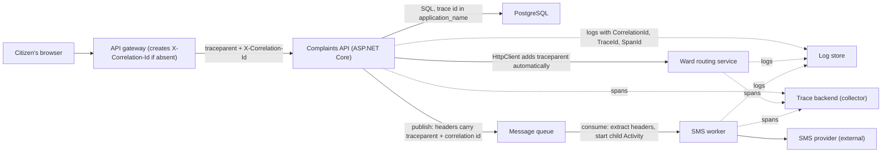
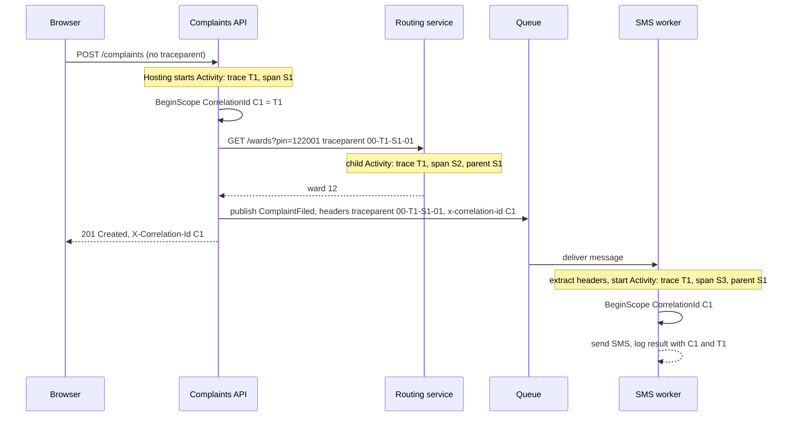
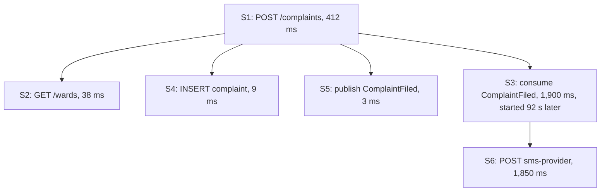

A citizen files a water-supply complaint on a state grievance portal at 10:42. By 10:44 she has no SMS confirmation. The request passed through a gateway, the complaints API, a routing service that picked the right municipal ward, a message queue, and an SMS worker. Each of those wrote log lines. Somewhere in roughly 40,000 lines logged that minute is the story of her complaint. Without a shared identifier stitched through every hop, finding that story is a two-hour grep. With one, it is a single search. This lesson is about that identifier: what it is, the standard that defines how it travels, and how .NET carries it for you when you let it.

## Learning objectives

By the end of this lesson you will be able to:

1. Explain the difference between a request ID, a correlation ID, a trace ID and a span ID, and say which one you need for which question.
2. Read a W3C `traceparent` header and name its four fields.
3. Describe how .NET's `Activity` class represents a span and how ASP.NET Core and `HttpClient` propagate it without extra code.
4. Attach a correlation ID to every log line in a request using logging scopes, and return it to the caller.
5. Carry trace context and correlation IDs through a message queue, where there is no HTTP header to ride on.
6. Estimate the volume of trace data a system produces and choose a sampling strategy.
7. Decide when a simple correlation ID in logs is enough and when you need full distributed tracing.

## Prerequisites

- [HTTP fundamentals](#/lesson/m10-http-fundamentals): headers, and how a request passes through proxies.
- [Logging and observability](#/lesson/m03-logging): `ILogger<T>`, structured logging and log levels.
- [Synchronous versus asynchronous communication](#/lesson/m10-sync-async): the queue hop is where most correlation schemes break.

## Explain it like I'm a beginner

Think of a courier parcel. It is handed from a pickup agent to a sorting hub to a long-distance truck to a local hub to a delivery rider. Every handover is a different company, building and computer system. Yet you can type one tracking number on a website and see every step. That works because the tracking number is written on the parcel and every system that touches it records "parcel 7X3 seen here at 10:42".

A request moving through your services is the parcel. The **correlation ID** is the tracking number. Every service that touches the request writes the ID into its logs. Later, one search for the ID shows the whole journey.

Now imagine the courier also wants to know *how long* each leg took and *which leg* each scan belongs to. "Seen at the hub" is not enough; they want "truck leg started 10:50, ended 14:10, and it was the child of the overall journey". That is **distributed tracing**: the journey is a *trace*, each leg is a *span*, and each span records its parent, start time and duration. The tracking number becomes the **trace ID**, and each leg gets its own **span ID**.

There is a standard for writing these IDs on the parcel. It is called **W3C Trace Context**, and it defines one HTTP header, `traceparent`, that every modern framework understands. .NET understands it natively: ASP.NET Core reads it on the way in, `HttpClient` writes it on the way out, and the class that holds the current span is called `Activity`.

So you need surprisingly little code. What you need instead is understanding of what travels where, and a plan for the places the standard does not reach, such as message queues and background jobs.

## First-principles explanation

### Four identifiers, four questions

| Identifier | Scope | Question it answers | Where it comes from |
|---|---|---|---|
| **Request ID** (`HttpContext.TraceIdentifier`) | One HTTP request inside one process | "Which Kestrel connection and request was this?" | Kestrel generates it, for example `0HN5GK3...:00000003` |
| **Correlation ID** | One business operation, across every service and queue it touches | "Show me everything that happened because of this user action" | Generated at the edge (gateway or first service), or supplied by the client |
| **Trace ID** | One end-to-end trace, 16 bytes | Same as correlation ID, but defined by the W3C standard | The first span in the trace generates it |
| **Span ID** | One unit of work inside a trace, 8 bytes | "Which exact step is this log line or timing about?" | Each new `Activity` generates one |

In a system that uses W3C Trace Context everywhere, the trace ID *is* a perfectly good correlation ID, and many teams simply log it as such. Teams keep a separate `X-Correlation-Id` for three reasons: legacy services that do not speak `traceparent`; business processes that span more than one trace (a complaint filed today and escalated tomorrow by a scheduled job share a correlation ID but not a trace); and the human-friendly habit of letting a support agent paste one ID from a customer's error screen.

The request ID is the one people confuse most. `HttpContext.TraceIdentifier` is unique per request *in that process*. It does not travel. It is useful for matching a Kestrel-level log to an application log on the same machine, and for nothing else.

### The traceparent header

The W3C Trace Context recommendation defines two headers. `traceparent` is the one that matters day to day:

```text
traceparent: 00-4bf92f3577b34da6a3ce929d0e0e4736-00f067aa0ba902b7-01
             │  │                                │                │
             │  │                                │                └─ trace-flags (01 = sampled)
             │  │                                └─ parent-id: 16 hex chars (8 bytes), the caller's span
             │  └─ trace-id: 32 hex chars (16 bytes), same for the whole trace
             └─ version: 00
```

Rules worth memorising: the header is exactly 55 characters; all hex is lowercase; a trace ID or parent ID of all zeros is invalid; a receiver that gets a malformed header must start a new trace rather than fail the request. The second header, `tracestate`, carries vendor-specific key–value pairs and should be passed along unchanged if you do not understand it.

### Activity: .NET's span

`System.Diagnostics.Activity` is the .NET type for "a span". It has a `TraceId`, a `SpanId`, a `ParentSpanId`, a start time, a duration, tags (key–value attributes) and baggage (key–value pairs that *propagate* to children and across process boundaries). `Activity.Current` is an `AsyncLocal`, which means it follows your code through `await` without being passed as a parameter. Whoever is running right now can ask "what span am I in?".

Two pieces of the framework do the heavy lifting:

- **ASP.NET Core hosting** starts an `Activity` for each incoming request. If the request carries a valid `traceparent`, the new activity becomes a child of that remote span (same trace ID, parent ID taken from the header). If not, it starts a new trace. This happens when logging is enabled or when an `ActivityListener` is registered, which in practice is always.
- **`HttpClient`** attaches `traceparent` (and `baggage`) to every outgoing request when `Activity.Current` is set. No handler to write, no header to remember.

That covers synchronous HTTP hops end to end. Where you *do* write code is: adding your own spans around meaningful work (`ActivitySource.StartActivity("ChargeCard")`), pushing the IDs into your logs, and crossing non-HTTP boundaries.

### Correlation in logs: scopes

A trace backend (Jaeger, Tempo, Application Insights, Zipkin) shows spans. Your logs are still where the detail lives: the exception message, the ward that was chosen, the SMS provider's response code. The link between the two is to put the trace ID and correlation ID on *every* log line.

Doing that by hand (`_logger.LogInformation("{CorrelationId} routed complaint", id)`) fails the first time someone forgets. The reliable way is a **logging scope**: `using (_logger.BeginScope(new Dictionary<string, object> { ["CorrelationId"] = id }))` at the top of the request. Every log call inside the scope, in every class, automatically carries the property. With a JSON console formatter or Serilog, the property becomes a searchable field. The .NET console logger also stamps `TraceId` and `SpanId` from `Activity.Current` when `ActivityTrackingOptions` is configured, which is the default in `WebApplication.CreateBuilder`.

### Crossing a queue

HTTP gives you a header. A message on RabbitMQ, Kafka, Azure Service Bus or SQS has *message headers* or *properties*, but nothing fills them automatically. You must:

1. **Inject** on publish: write `traceparent` (from `Activity.Current`), `tracestate` and your correlation ID into the message headers.
2. **Extract** on consume: parse `traceparent` from the headers, start a new `Activity` with that parent, push the correlation ID into a logging scope, and *then* process the message.

The consumer's span is a child of the producer's span even though it may run on a different machine, minutes later. Trace backends draw this as a link across time, which is exactly what you want when asking "why did the SMS go out 90 seconds after the complaint was filed?". The OpenTelemetry instrumentation libraries for most brokers do this injection and extraction for you; the lesson's code shows what they do under the hood so you can do it where no library exists.

### Scheduled jobs and the start of a trace

A nightly reconciliation job has no incoming request. It should start a *new* trace per unit of work (per batch, or per record if they are expensive) and generate a correlation ID. If the job is processing something a user did earlier, consider carrying that original correlation ID in the database row so the job's logs can be joined to the user's. This is the "business process spanning multiple traces" case, and it is why correlation IDs outlive traces.

### How much data is this?

Estimate before you turn tracing on everywhere. Suppose the grievance platform handles 3 million requests per day. 3,000,000 ÷ 86,400 s ≈ 35 requests per second on average; assume a 3× peak of about 105 RPS. Each request produces about 6 spans (gateway, API, routing call, database query, publish, consume). At roughly 400 bytes per span (estimate; depends heavily on tags), that is 105 × 6 × 400 ≈ 250 KB/s at peak and about 7 GB per day. Keeping 30 days is about 210 GB. Not frightening, but not free either.

Two levers control it:

- **Head-based sampling** decides at the start of a trace (the `trace-flags` bit) whether to keep it, for example 10 %. Cheap and simple; the decision propagates so every service agrees. The cost is that the 1 % of requests that fail may be in the 90 % you dropped.
- **Tail-based sampling** buffers complete traces at a collector and keeps the slow or failed ones plus a sample of the rest. Catches every error, but needs a collector with memory for the buffer window and adds operational complexity.

Logs are a separate budget. If each request writes 8 log lines of about 300 bytes, that is 3,000,000 × 8 × 300 ≈ 7.2 GB per day before compression. Correlation IDs add perhaps 40 bytes per line, about 1 GB per day. Keep them; the cost of *not* being able to find a request is measured in engineer-hours.

### When a plain correlation ID is enough

If you run one API and one database, a correlation ID in a logging scope plus the database's own slow-query log answers almost every question. Add full distributed tracing when: you have three or more services on a request path, latency problems appear that no single service's logs explain, or asynchronous hops make "what happened after the user clicked" hard to reconstruct. Even then, start by logging the trace ID everywhere. The spans can come later; the IDs in logs cannot be added retroactively.

:::callout type=mistake title="The most common correlation bug"
A service accepts `X-Correlation-Id` from any caller, including the public internet, and logs it as-is. An attacker sends a 10 KB header full of newlines and quotes, and your log pipeline chokes or your dashboard renders injected HTML. Validate the incoming value (length cap, allowed characters) and generate a fresh one if it fails. Treat it like any other user input.
:::

## Visual explanation

### Architecture: where identifiers are created and carried



Follow the solid arrows: the gateway creates the correlation ID if the browser did not send one, and the first server span creates the trace ID. The API calls the routing service over HTTP, where `HttpClient` propagates `traceparent` for free. The queue hop (API → queue → worker) is the one where your code must inject and extract. The dotted arrows show that every service writes logs and spans tagged with the same IDs to shared stores, so one trace ID pulls together the whole picture.

### Sequence: one complaint, end to end



The browser sends nothing, so the API's hosting layer starts trace T1. Every later participant shares T1. The routing call is a direct child (parent S1). The worker runs later and elsewhere, yet by extracting the headers it also becomes a child of S1 in trace T1. The response carries the correlation ID back to the browser so a support screen can display it. One search for `C1` or `T1` finds all five participants' logs.

### What the trace backend draws



A trace is a tree of spans. The API span S1 has three children that ran inside it and one child (S3) that ran 92 seconds later on the worker. Looking at this tree, the "no SMS for two minutes" complaint explains itself: the queue was backed up for 92 seconds and the SMS provider took 1.85 seconds. Neither fact is visible from any one service's logs.

## Step-by-step example

We will add correlation to the complaints API in four steps.

### Step 1 — observe what you already have

Run a plain ASP.NET Core app, make a request, and log something. With the default console logger you already see `TraceId` and `SpanId` on each line, because hosting created an `Activity` and the logger's activity tracking is on. Call another service with `HttpClient` and that service's logs show the *same* `TraceId`. You wrote zero lines for this.

### Step 2 — add a correlation ID that reaches the client

Write a small middleware: read `X-Correlation-Id` if valid, otherwise use the trace ID; store it in a scoped `ICorrelationContext`; add it to the response headers; wrap the rest of the pipeline in a logging scope. Now support staff can read the ID off an error page and search for it.

### Step 3 — carry it through the queue

Wrap the publish call so it injects `traceparent`, `tracestate` and `x-correlation-id` into the message headers. In the worker, extract them, start a child `Activity`, open a logging scope, and process.

### Step 4 — add spans where timing matters

Create one `ActivitySource` for the service and wrap expensive steps: `using var activity = source.StartActivity("RouteToWard")`. Add tags (`activity?.SetTag("ward.id", 12)`). These appear as child spans in the trace tree.

## Production-style C# implementation

Project layout:

```text
Complaints.Api/
  Program.cs
  Correlation/
    TraceParent.cs
    ICorrelationContext.cs
    CorrelationIdMiddleware.cs
    CorrelationHeaderHandler.cs
  Messaging/
    MessageEnvelope.cs
    TracePropagation.cs
    InMemoryMessageBus.cs
    SmsWorker.cs
```

```csharp file=Correlation/TraceParent.cs
using System.Diagnostics;

namespace Complaints.Api.Correlation;

/// <summary>Parsed W3C traceparent header: 00-{trace-id 32 hex}-{parent-id 16 hex}-{flags 2 hex}.</summary>
public sealed record TraceParent(ActivityTraceId TraceId, ActivitySpanId ParentId, ActivityTraceFlags Flags)
{
    public static bool TryParse(string? value, out TraceParent? parsed)
    {
        parsed = null;
        if (value is null || value.Length != 55 || value[2] != '-' || value[35] != '-' || value[52] != '-') return false;
        if (value[0] != '0' || value[1] != '0') return false;                 // only version 00 is defined
        var traceHex = value.AsSpan(3, 32);
        var spanHex = value.AsSpan(36, 16);
        var flagsHex = value.AsSpan(53, 2);
        if (!IsLowerHex(traceHex) || !IsLowerHex(spanHex) || !IsLowerHex(flagsHex)) return false;
        if (traceHex.IndexOfAnyExcept('0') < 0 || spanHex.IndexOfAnyExcept('0') < 0) return false;   // all zeros is invalid

        var flags = Convert.ToByte(flagsHex.ToString(), 16);
        parsed = new TraceParent(ActivityTraceId.CreateFromString(traceHex), ActivitySpanId.CreateFromString(spanHex), (ActivityTraceFlags)flags);
        return true;
    }

    public override string ToString() => $"00-{TraceId.ToHexString()}-{ParentId.ToHexString()}-{(byte)Flags:x2}";

    private static bool IsLowerHex(ReadOnlySpan<char> s)
    {
        foreach (var c in s) if (!(c is >= '0' and <= '9' or >= 'a' and <= 'f')) return false;
        return true;
    }
}
```

```csharp file=Correlation/ICorrelationContext.cs
namespace Complaints.Api.Correlation;

/// <summary>Per-request holder for the correlation id. Registered as scoped so any service in the request can read it.</summary>
public interface ICorrelationContext
{
    string CorrelationId { get; }
}

public sealed class CorrelationContext : ICorrelationContext
{
    public string CorrelationId { get; private set; } = string.Empty;
    public void Set(string id) => CorrelationId = id;
}
```

```csharp file=Correlation/CorrelationIdMiddleware.cs
using System.Diagnostics;

namespace Complaints.Api.Correlation;

public sealed class CorrelationIdMiddleware(RequestDelegate next, ILogger<CorrelationIdMiddleware> logger)
{
    public const string HeaderName = "X-Correlation-Id";
    private const int MaxLength = 64;

    public async Task InvokeAsync(HttpContext context, CorrelationContext correlation)
    {
        var incoming = context.Request.Headers[HeaderName].ToString();
        var id = IsAcceptable(incoming)
            ? incoming
            : Activity.Current?.TraceId.ToHexString() ?? Guid.NewGuid().ToString("N");

        correlation.Set(id);
        Activity.Current?.SetBaggage("correlation.id", id);            // baggage rides along with traceparent on HttpClient calls
        Activity.Current?.SetTag("correlation.id", id);

        context.Response.OnStarting(() =>
        {
            context.Response.Headers[HeaderName] = id;
            return Task.CompletedTask;
        });

        var scope = new Dictionary<string, object>
        {
            ["CorrelationId"] = id,
            ["TraceId"] = Activity.Current?.TraceId.ToHexString() ?? string.Empty,
        };
        using (logger.BeginScope(scope))
        {
            await next(context);
        }
    }

    /// <summary>The header is user input. Accept only short, URL-safe values; otherwise generate our own.</summary>
    internal static bool IsAcceptable(string? value)
    {
        if (string.IsNullOrEmpty(value) || value.Length > MaxLength) return false;
        foreach (var c in value)
            if (!(char.IsAsciiLetterOrDigit(c) || c is '-' or '_' or '.')) return false;
        return true;
    }
}
```

```csharp file=Correlation/CorrelationHeaderHandler.cs
namespace Complaints.Api.Correlation;

/// <summary>Adds X-Correlation-Id to outgoing HTTP calls. traceparent is added by HttpClient itself
/// whenever Activity.Current is set, so only the custom header needs a handler.</summary>
public sealed class CorrelationHeaderHandler(ICorrelationContext correlation) : DelegatingHandler
{
    protected override Task<HttpResponseMessage> SendAsync(HttpRequestMessage request, CancellationToken ct)
    {
        if (!string.IsNullOrEmpty(correlation.CorrelationId) && !request.Headers.Contains(CorrelationIdMiddleware.HeaderName))
            request.Headers.TryAddWithoutValidation(CorrelationIdMiddleware.HeaderName, correlation.CorrelationId);
        return base.SendAsync(request, ct);
    }
}
```

```csharp file=Messaging/MessageEnvelope.cs
namespace Complaints.Api.Messaging;

/// <summary>What actually travels on the broker: a type name, a serialized body, and headers.
/// Every real broker (RabbitMQ, Kafka, Service Bus) has an equivalent header or property bag.</summary>
public sealed record MessageEnvelope(string Type, string Body, Dictionary<string, string> Headers);
```

```csharp file=Messaging/TracePropagation.cs
using System.Diagnostics;
using Complaints.Api.Correlation;

namespace Complaints.Api.Messaging;

/// <summary>Inject and extract trace context on message headers. This is what the OpenTelemetry broker
/// instrumentation does for you; written out so you can do it where no instrumentation exists.</summary>
public static class TracePropagation
{
    public const string TraceParentHeader = "traceparent";
    public const string TraceStateHeader = "tracestate";
    public const string CorrelationHeader = "x-correlation-id";

    public static void Inject(IDictionary<string, string> headers, Activity? current, string correlationId)
    {
        if (current is not null)
        {
            headers[TraceParentHeader] = new TraceParent(current.TraceId, current.SpanId, current.ActivityTraceFlags).ToString();
            if (!string.IsNullOrEmpty(current.TraceStateString)) headers[TraceStateHeader] = current.TraceStateString;
        }
        headers[CorrelationHeader] = correlationId;
    }

    /// <summary>Starts a consumer activity whose parent is the producer's span, or a new root if no valid header exists.</summary>
    public static Activity StartConsumerActivity(string name, IReadOnlyDictionary<string, string> headers)
    {
        var activity = new Activity(name);
        if (headers.TryGetValue(TraceParentHeader, out var tp) && TraceParent.TryParse(tp, out var parent) && parent is not null)
        {
            activity.SetParentId(parent.TraceId, parent.ParentId, parent.Flags);
            if (headers.TryGetValue(TraceStateHeader, out var ts)) activity.TraceStateString = ts;
        }
        activity.SetTag("messaging.operation", "process");
        return activity.Start();
    }

    public static string ExtractCorrelationId(IReadOnlyDictionary<string, string> headers, Activity activity) =>
        headers.TryGetValue(CorrelationHeader, out var id) && CorrelationIdMiddleware.IsAcceptable(id)
            ? id
            : activity.TraceId.ToHexString();
}
```

```csharp file=Messaging/InMemoryMessageBus.cs
using System.Threading.Channels;

namespace Complaints.Api.Messaging;

public interface IMessageBus
{
    ValueTask PublishAsync(MessageEnvelope envelope, CancellationToken ct);
    IAsyncEnumerable<MessageEnvelope> ReadAllAsync(CancellationToken ct);
}

/// <summary>Stand-in for a broker. The headers dictionary plays the role of RabbitMQ BasicProperties.Headers
/// or Kafka record headers.</summary>
public sealed class InMemoryMessageBus : IMessageBus
{
    private readonly Channel<MessageEnvelope> _channel = Channel.CreateUnbounded<MessageEnvelope>();
    public ValueTask PublishAsync(MessageEnvelope envelope, CancellationToken ct) => _channel.Writer.WriteAsync(envelope, ct);
    public IAsyncEnumerable<MessageEnvelope> ReadAllAsync(CancellationToken ct) => _channel.Reader.ReadAllAsync(ct);
}
```

```csharp file=Messaging/SmsWorker.cs
using System.Diagnostics;

namespace Complaints.Api.Messaging;

/// <summary>Consumes ComplaintFiled messages. Each message is processed inside a child Activity of the
/// producer's span and a logging scope carrying the original correlation id.</summary>
public sealed class SmsWorker(IMessageBus bus, ILogger<SmsWorker> logger) : BackgroundService
{
    protected override async Task ExecuteAsync(CancellationToken stoppingToken)
    {
        await foreach (var envelope in bus.ReadAllAsync(stoppingToken))
        {
            using var activity = TracePropagation.StartConsumerActivity("SmsWorker.Process", envelope.Headers);
            var correlationId = TracePropagation.ExtractCorrelationId(envelope.Headers, activity);

            using (logger.BeginScope(new Dictionary<string, object> { ["CorrelationId"] = correlationId, ["TraceId"] = activity.TraceId.ToHexString() }))
            {
                try
                {
                    logger.LogInformation("Sending SMS for {MessageType}: {Body}", envelope.Type, envelope.Body);
                    await Task.Delay(20, stoppingToken);                     // pretend to call the SMS provider
                    activity.SetTag("sms.status", "sent");
                }
                catch (Exception ex) when (ex is not OperationCanceledException)
                {
                    activity.SetStatus(ActivityStatusCode.Error, ex.Message);
                    logger.LogError(ex, "SMS send failed");
                }
            }
        }
    }
}
```

```csharp file=Program.cs
using System.Diagnostics;
using Complaints.Api.Correlation;
using Complaints.Api.Messaging;

var builder = WebApplication.CreateBuilder(args);

// Console logs include scopes, so CorrelationId and TraceId appear on every line inside the middleware's scope.
builder.Logging.AddSimpleConsole(o => { o.IncludeScopes = true; o.TimestampFormat = "HH:mm:ss.fff "; });

builder.Services.AddScoped<CorrelationContext>();
builder.Services.AddScoped<ICorrelationContext>(sp => sp.GetRequiredService<CorrelationContext>());
builder.Services.AddTransient<CorrelationHeaderHandler>();
builder.Services.AddHttpClient("wards", c => c.BaseAddress = new Uri("https://wards.internal/"))
                .AddHttpMessageHandler<CorrelationHeaderHandler>();

builder.Services.AddSingleton(new ActivitySource("Complaints.Api"));
builder.Services.AddSingleton<IMessageBus, InMemoryMessageBus>();
builder.Services.AddHostedService<SmsWorker>();

var app = builder.Build();

app.UseMiddleware<CorrelationIdMiddleware>();

app.MapPost("/complaints", async (ComplaintRequest req, ICorrelationContext corr, ActivitySource source, IMessageBus bus,
                                  ILogger<Program> log, CancellationToken ct) =>
{
    var id = $"CMP-{Random.Shared.Next(100000, 999999)}";

    using (var routing = source.StartActivity("RouteToWard"))
    {
        routing?.SetTag("complaint.pincode", req.Pincode);
        await Task.Delay(10, ct);                                  // would be: await wardsClient.GetAsync(...)
        routing?.SetTag("ward.id", 12);
    }

    var headers = new Dictionary<string, string>();
    TracePropagation.Inject(headers, Activity.Current, corr.CorrelationId);
    await bus.PublishAsync(new MessageEnvelope("ComplaintFiled", $"{{\"id\":\"{id}\",\"phone\":\"{req.Phone}\"}}", headers), ct);

    log.LogInformation("Filed complaint {ComplaintId} for pincode {Pincode}", id, req.Pincode);
    return TypedResults.Created($"/complaints/{id}", new { id, correlationId = corr.CorrelationId });
});

app.Run();

public sealed record ComplaintRequest(string Description, string Pincode, string Phone);
```

**What the console shows** for one request (abridged): the middleware's scope puts `CorrelationId` and `TraceId` on the API's log line, and the worker's own scope puts the *same* values on its line 20 milliseconds later, even though it runs on a different thread with no HTTP context:

```text
10:42:07.113 info: Program[0]
      => SpanId:7d1c... TraceId:4bf92f35...e4736 ParentId:0000000000000000
      => CorrelationId:4bf92f35...e4736 TraceId:4bf92f35...e4736
      Filed complaint CMP-482913 for pincode 122001
10:42:07.139 info: Complaints.Api.Messaging.SmsWorker[0]
      => CorrelationId:4bf92f35...e4736 TraceId:4bf92f35...e4736
      Sending SMS for ComplaintFiled: {"id":"CMP-482913","phone":"98100xxxxx"}
```

### Exporting spans with OpenTelemetry

The code above creates spans; nothing collects them yet. In production you add the OpenTelemetry packages (NuGet, so not part of the compiled set) and register exporters:

```csharp
// Packages: OpenTelemetry.Extensions.Hosting, OpenTelemetry.Instrumentation.AspNetCore,
//           OpenTelemetry.Instrumentation.Http, OpenTelemetry.Exporter.OpenTelemetryProtocol
builder.Services.AddOpenTelemetry()
    .ConfigureResource(r => r.AddService("complaints-api"))
    .WithTracing(t => t
        .AddSource("Complaints.Api")               // our ActivitySource
        .AddAspNetCoreInstrumentation()            // server spans for each request
        .AddHttpClientInstrumentation()            // client spans for outgoing calls
        .SetSampler(new ParentBasedSampler(new TraceIdRatioBasedSampler(0.10)))   // keep 10 % of new traces
        .AddOtlpExporter());                       // to a collector, Tempo, Jaeger, etc.
```

`ParentBasedSampler` honours the `trace-flags` bit from upstream: if the gateway decided to sample a trace, every service keeps it, so you never get half a trace.

### Propagating to PostgreSQL

The database does not understand `traceparent`, but you can still correlate slow-query logs with traces. Npgsql exposes `ApplicationName`, and PostgreSQL logs it with each statement; setting it per connection is expensive, so the usual approach is a comment prefix on the SQL: `/* traceparent='00-...' */ SELECT ...`. The `sqlcommenter` convention standardises this. Spot checks only; do not do it on hot paths unless your log volume can take it.

## Bad design vs good design

**Bad: pass `correlationId` as a method parameter everywhere.** Every service method, repository and helper grows an extra argument. The first developer to forget it on a new code path breaks the chain, and the type signature noise is permanent. Use `Activity.Current`, baggage and a scoped `ICorrelationContext`; the ambient context is exactly what `AsyncLocal` is for.

**Bad: log the ID manually in each `LogInformation` call.** It works until someone forgets. A logging scope at the pipeline boundary makes the property automatic for every line beneath it.

**Bad: generate a fresh correlation ID in each service.** Each service's logs are internally consistent and completely un-joinable. The rule is: *accept if valid, generate only if absent*.

**Bad: trust any incoming header.** Discussed above. Validate length and characters.

**Good:** the implementation above. One middleware, one scoped holder, one scope, automatic HTTP propagation, explicit inject/extract on the queue, and spans only around work worth timing.

:::callout type=tradeoff title="Correlation ID or trace ID: do you need both?"
If every component speaks W3C Trace Context and your trace retention matches your log retention, the trace ID alone is enough and simpler. Keep a separate correlation ID when legacy systems cannot propagate `traceparent`, when a business process spans several traces (user action today, scheduled follow-up tomorrow), or when you want an ID that is safe to show customers and does not reveal your sampling decisions.
:::

## Practical playground

This runnable program simulates a producer and a consumer in one process. It starts a root activity, injects headers into a message, then "consumes" the message and starts a child activity from those headers. Run it and check that the trace IDs match and the consumer's parent is the producer's span. Then break the `traceparent` string (change a character to `Z`) and see the consumer start a brand-new trace instead of failing.

:::playground type=csharp title="Trace context across a message"
```csharp file=Program.cs
using System;
using System.Collections.Generic;
using System.Diagnostics;

public static class Program
{
    public static void Main()
    {
        Activity.DefaultIdFormat = ActivityIdFormat.W3C;

        // Producer side: the API handling POST /complaints.
        using var producer = new Activity("POST /complaints").Start();
        var headers = new Dictionary<string, string>
        {
            ["traceparent"] = $"00-{producer.TraceId.ToHexString()}-{producer.SpanId.ToHexString()}-01",
            ["x-correlation-id"] = producer.TraceId.ToHexString(),
        };
        Console.WriteLine($"producer trace={producer.TraceId} span={producer.SpanId}");
        producer.Stop();

        // Consumer side: the worker, possibly minutes later on another machine.
        var consumer = new Activity("SmsWorker.Process");
        if (headers.TryGetValue("traceparent", out var tp) && ActivityContext.TryParse(tp, null, out var parentCtx))
            consumer.SetParentId(parentCtx.TraceId, parentCtx.SpanId, parentCtx.TraceFlags);
        consumer.Start();
        Console.WriteLine($"consumer trace={consumer.TraceId} span={consumer.SpanId} parent={consumer.ParentSpanId}");
        Console.WriteLine($"same trace? {consumer.TraceId == producer.TraceId}; parent is producer? {consumer.ParentSpanId == producer.SpanId}");
        Console.WriteLine($"correlation id on consumer: {headers["x-correlation-id"]}");
        consumer.Stop();
    }
}
```
:::

## Exercises

:::exercise id=m10-correlation-ex1 difficulty=beginner kind=code title="Parse a W3C traceparent header"
Implement `TraceParent.TryParse` and `ToString`. A valid header is exactly 55 characters: `00-` + 32 lowercase hex characters + `-` + 16 lowercase hex characters + `-` + 2 hex characters. A trace ID or parent ID that is all zeros is invalid. Only version `00` is accepted.
::requirements
- Return `false` (and `null`) for `null`, wrong length, wrong separators, uppercase hex, non-hex characters, version other than `00`, and all-zero IDs.
- `ToString()` reproduces the canonical lowercase form.
::acceptance
- The sample header from the W3C specification parses and round-trips through `ToString()`.
- All invalid cases in the tests return `false` without throwing.
::hint
Check the length and the three `-` positions (indexes 2, 35 and 52) before anything else.
::hint
`ActivityTraceId.CreateFromString(ReadOnlySpan<char>)` and `ActivitySpanId.CreateFromString(...)` build the IDs from hex; `ToHexString()` goes the other way.
::hint
`ReadOnlySpan<char>.IndexOfAnyExcept('0') < 0` is a compact test for "all zeros".
::hint
```csharp
var traceHex = value.AsSpan(3, 32);
var spanHex = value.AsSpan(36, 16);
var flagsHex = value.AsSpan(53, 2);
```
::starter
```csharp file=TraceParent.cs
using System;
using System.Diagnostics;

namespace CorrelationKata;

public sealed record TraceParent(ActivityTraceId TraceId, ActivitySpanId ParentId, ActivityTraceFlags Flags)
{
    public static bool TryParse(string? value, out TraceParent? parsed)
    {
        throw new NotImplementedException();
    }

    public override string ToString() => throw new NotImplementedException();
}
```
::tests
```csharp file=TraceParentTests.cs
using System.Diagnostics;
using CorrelationKata;
using Xunit;

public class TraceParentTests
{
    private const string Sample = "00-4bf92f3577b34da6a3ce929d0e0e4736-00f067aa0ba902b7-01";

    [Fact]
    public void Parses_the_w3c_sample()
    {
        Assert.True(TraceParent.TryParse(Sample, out var tp));
        Assert.NotNull(tp);
        Assert.Equal("4bf92f3577b34da6a3ce929d0e0e4736", tp!.TraceId.ToHexString());
        Assert.Equal("00f067aa0ba902b7", tp.ParentId.ToHexString());
        Assert.Equal(ActivityTraceFlags.Recorded, tp.Flags);
    }

    [Fact]
    public void Round_trips_through_ToString()
    {
        TraceParent.TryParse(Sample, out var tp);
        Assert.Equal(Sample, tp!.ToString());
    }

    [Theory]
    [InlineData(null)]
    [InlineData("")]
    [InlineData("00-4bf92f3577b34da6a3ce929d0e0e4736-00f067aa0ba902b7")]
    [InlineData("01-4bf92f3577b34da6a3ce929d0e0e4736-00f067aa0ba902b7-01")]
    [InlineData("00-4BF92F3577B34DA6A3CE929D0E0E4736-00f067aa0ba902b7-01")]
    [InlineData("00-4bf92f3577b34da6a3ce929d0e0e47zz-00f067aa0ba902b7-01")]
    [InlineData("00-00000000000000000000000000000000-00f067aa0ba902b7-01")]
    [InlineData("00-4bf92f3577b34da6a3ce929d0e0e4736-0000000000000000-01")]
    [InlineData("00_4bf92f3577b34da6a3ce929d0e0e4736_00f067aa0ba902b7_01")]
    public void Rejects_invalid_values(string? value)
    {
        Assert.False(TraceParent.TryParse(value, out var tp));
        Assert.Null(tp);
    }

    [Fact]
    public void Unsampled_flag_parses_as_none()
    {
        Assert.True(TraceParent.TryParse("00-4bf92f3577b34da6a3ce929d0e0e4736-00f067aa0ba902b7-00", out var tp));
        Assert.Equal(ActivityTraceFlags.None, tp!.Flags);
    }
}
```
::solution
Validate structure first, then characters, then the all-zero rule, and only then allocate the IDs.

```csharp file=TraceParent.cs
using System;
using System.Diagnostics;

namespace CorrelationKata;

public sealed record TraceParent(ActivityTraceId TraceId, ActivitySpanId ParentId, ActivityTraceFlags Flags)
{
    public static bool TryParse(string? value, out TraceParent? parsed)
    {
        parsed = null;
        if (value is null || value.Length != 55 || value[2] != '-' || value[35] != '-' || value[52] != '-') return false;
        if (value[0] != '0' || value[1] != '0') return false;
        var traceHex = value.AsSpan(3, 32);
        var spanHex = value.AsSpan(36, 16);
        var flagsHex = value.AsSpan(53, 2);
        if (!IsLowerHex(traceHex) || !IsLowerHex(spanHex) || !IsLowerHex(flagsHex)) return false;
        if (traceHex.IndexOfAnyExcept('0') < 0 || spanHex.IndexOfAnyExcept('0') < 0) return false;

        var flags = Convert.ToByte(flagsHex.ToString(), 16);
        parsed = new TraceParent(ActivityTraceId.CreateFromString(traceHex), ActivitySpanId.CreateFromString(spanHex), (ActivityTraceFlags)flags);
        return true;
    }

    public override string ToString() => $"00-{TraceId.ToHexString()}-{ParentId.ToHexString()}-{(byte)Flags:x2}";

    private static bool IsLowerHex(ReadOnlySpan<char> s)
    {
        foreach (var c in s) if (!(c is >= '0' and <= '9' or >= 'a' and <= 'f')) return false;
        return true;
    }
}
```

In production you can also use `ActivityContext.TryParse(traceparent, tracestate, out var ctx)`, which the BCL provides. Writing it once by hand is how you learn what the 55 characters mean.
::mistakes
- Accepting uppercase hex. The specification requires lowercase; some senders violate it, and you may choose to be lenient, but then say so.
- Throwing `FormatException` on bad input. The specification says a receiver must ignore an invalid header and start a new trace; `TryParse` must never throw.
- Forgetting the all-zero check, which lets an invalid trace poison downstream correlation.
::extensions
Add `TryParse` support for `tracestate` (comma-separated `key=value` list, max 32 entries) and preserve unknown entries.
:::

:::exercise id=m10-correlation-ex2 difficulty=beginner kind=written title="Which identifier answers which question?"
A support engineer gets five questions in a day. For each, say which identifier (request ID, correlation ID, trace ID or span ID) is the right one to search for, and why.

1. "A customer says her payment at 10:42 failed. She has an error code on screen that reads `CMP-4bf92f35`."
2. "Why did this one `POST /complaints` take 4 seconds? Which step was slow?"
3. "Kestrel logged a connection reset. Which of our application logs on this machine belong to that request?"
4. "A complaint filed on Monday was escalated by the nightly job on Tuesday. Show me both days' logs together."
5. "The SMS worker logged an exception. Which API request originally caused this message to be published?"
::acceptance
- Item 3 names the request ID (`HttpContext.TraceIdentifier`) and explains that it does not cross processes.
- Item 2 names span IDs within a trace, read in a trace viewer.
- Item 4 explains why a correlation ID may outlive a single trace.
- Items 1 and 5 use the correlation ID or trace ID carried across services.
::hint
Start from scope: one process, one request, one trace, or one business process.
::hint
Timing and "which step" questions are about spans; "find everything" questions are about trace or correlation IDs.
::hint
A nightly job starts a new trace. What identifier can still link it to Monday's request?
::solution
1. **Correlation ID.** The customer-facing error code is the correlation ID shown by the UI. Search logs across all services for it.
2. **Trace ID, then span IDs.** Open the trace in the tracing backend. The waterfall shows each span's duration; the slow child span (perhaps the routing call or the database insert) is the answer. Logs alone do not show timing relationships.
3. **Request ID.** `HttpContext.TraceIdentifier` is unique per request within one process and appears in Kestrel's own logs, so it joins Kestrel-level events to application logs on that machine. It does not travel to other services.
4. **Correlation ID.** The nightly job starts a *new trace* for each unit of work, so the trace IDs differ. If the job reads the complaint's original correlation ID from the database row and logs it, both days' logs share it. This is the case where a correlation ID is deliberately broader than a trace.
5. **Trace ID or correlation ID from the message headers.** The worker extracted `traceparent` and `x-correlation-id` from the message and logged them; either leads back to the API request that published it. In a trace viewer, the worker span appears as a late child of the API span.
::mistakes
- Treating `TraceIdentifier` as a distributed ID. It is per-process and is not propagated.
- Expecting one trace to cover a multi-day business process.
:::

:::exercise id=m10-correlation-ex3 difficulty=intermediate kind=code title="Inject and extract trace context on message headers"
Implement `TracePropagation.Inject` and `TracePropagation.StartConsumerActivity`. `Inject` writes `traceparent` (built from the current activity's trace ID, span ID and flags), `tracestate` (if the activity has one) and `x-correlation-id` into the message headers. `StartConsumerActivity` creates and starts an `Activity` whose parent is taken from the `traceparent` header; if the header is missing or invalid, it starts a new root activity.
::requirements
- `traceparent` format: `00-{traceId}-{spanId}-{flags:x2}`.
- When `current` is `null`, `Inject` still writes `x-correlation-id`.
- `StartConsumerActivity` must never throw on bad headers.
- Use `ActivityContext.TryParse` or your own parser for extraction.
::acceptance
- The consumer activity's `TraceId` equals the producer's, and its `ParentSpanId` equals the producer's `SpanId`.
- With no `traceparent` header, the consumer activity has a non-default `TraceId` and an empty parent.
- The correlation ID round-trips unchanged.
::hint
`Activity.TraceId.ToHexString()` and `Activity.SpanId.ToHexString()` give lowercase hex; `(byte)activity.ActivityTraceFlags` gives the flags byte.
::hint
`ActivityContext.TryParse(traceparent, tracestate, out var ctx)` parses the header for you.
::hint
Create the consumer with `new Activity(name)`, call `SetParentId(ctx.TraceId, ctx.SpanId, ctx.TraceFlags)` *before* `Start()`, then return the started activity.
::hint
```csharp
var activity = new Activity(name);
if (headers.TryGetValue("traceparent", out var tp) && ActivityContext.TryParse(tp, null, out var ctx))
    activity.SetParentId(ctx.TraceId, ctx.SpanId, ctx.TraceFlags);
return activity.Start();
```
::starter
```csharp file=TracePropagation.cs
using System;
using System.Collections.Generic;
using System.Diagnostics;

namespace CorrelationKata;

public static class TracePropagation
{
    public const string TraceParentHeader = "traceparent";
    public const string TraceStateHeader = "tracestate";
    public const string CorrelationHeader = "x-correlation-id";

    public static void Inject(IDictionary<string, string> headers, Activity? current, string correlationId)
    {
        throw new NotImplementedException();
    }

    public static Activity StartConsumerActivity(string name, IReadOnlyDictionary<string, string> headers)
    {
        throw new NotImplementedException();
    }
}
```
::tests
```csharp file=TracePropagationTests.cs
using System.Collections.Generic;
using System.Diagnostics;
using CorrelationKata;
using Xunit;

public class TracePropagationTests
{
    public TracePropagationTests() => Activity.DefaultIdFormat = ActivityIdFormat.W3C;

    [Fact]
    public void Inject_writes_traceparent_and_correlation()
    {
        using var producer = new Activity("produce").Start();
        producer.ActivityTraceFlags = ActivityTraceFlags.Recorded;
        var headers = new Dictionary<string, string>();

        TracePropagation.Inject(headers, producer, "corr-123");

        Assert.Equal($"00-{producer.TraceId.ToHexString()}-{producer.SpanId.ToHexString()}-01", headers["traceparent"]);
        Assert.Equal("corr-123", headers["x-correlation-id"]);
        producer.Stop();
    }

    [Fact]
    public void Inject_without_activity_still_writes_correlation()
    {
        var headers = new Dictionary<string, string>();
        TracePropagation.Inject(headers, null, "corr-9");
        Assert.Equal("corr-9", headers["x-correlation-id"]);
        Assert.False(headers.ContainsKey("traceparent"));
    }

    [Fact]
    public void Consumer_joins_the_producers_trace()
    {
        using var producer = new Activity("produce").Start();
        var headers = new Dictionary<string, string>();
        TracePropagation.Inject(headers, producer, "corr-1");
        producer.Stop();

        using var consumer = TracePropagation.StartConsumerActivity("consume", headers);

        Assert.Equal(producer.TraceId, consumer.TraceId);
        Assert.Equal(producer.SpanId, consumer.ParentSpanId);
        Assert.NotEqual(producer.SpanId, consumer.SpanId);
        consumer.Stop();
    }

    [Fact]
    public void Consumer_without_headers_starts_a_new_root()
    {
        using var consumer = TracePropagation.StartConsumerActivity("consume", new Dictionary<string, string>());
        Assert.NotEqual(default, consumer.TraceId);
        Assert.Equal(default, consumer.ParentSpanId);
        consumer.Stop();
    }

    [Fact]
    public void Consumer_ignores_garbage_traceparent()
    {
        var headers = new Dictionary<string, string> { ["traceparent"] = "not-a-header" };
        using var consumer = TracePropagation.StartConsumerActivity("consume", headers);
        Assert.NotEqual(default, consumer.TraceId);
        consumer.Stop();
    }
}
```
::solution
```csharp file=TracePropagation.cs
using System;
using System.Collections.Generic;
using System.Diagnostics;

namespace CorrelationKata;

public static class TracePropagation
{
    public const string TraceParentHeader = "traceparent";
    public const string TraceStateHeader = "tracestate";
    public const string CorrelationHeader = "x-correlation-id";

    public static void Inject(IDictionary<string, string> headers, Activity? current, string correlationId)
    {
        if (current is not null)
        {
            headers[TraceParentHeader] = $"00-{current.TraceId.ToHexString()}-{current.SpanId.ToHexString()}-{(byte)current.ActivityTraceFlags:x2}";
            if (!string.IsNullOrEmpty(current.TraceStateString)) headers[TraceStateHeader] = current.TraceStateString;
        }
        headers[CorrelationHeader] = correlationId;
    }

    public static Activity StartConsumerActivity(string name, IReadOnlyDictionary<string, string> headers)
    {
        var activity = new Activity(name);
        headers.TryGetValue(TraceStateHeader, out var traceState);
        if (headers.TryGetValue(TraceParentHeader, out var tp) && ActivityContext.TryParse(tp, traceState, out var ctx))
        {
            activity.SetParentId(ctx.TraceId, ctx.SpanId, ctx.TraceFlags);
            if (traceState is not null) activity.TraceStateString = traceState;
        }
        return activity.Start();
    }
}
```

The consumer becomes a child of the producer's span even though it starts later and elsewhere. In a real worker, wrap the whole message handler in `using var activity = StartConsumerActivity(...)` and open a logging scope with the correlation ID immediately after.
::alternatives
With OpenTelemetry installed, `Propagators.DefaultTextMapPropagator.Inject(...)` and `.Extract(...)` do the same with a carrier delegate, and the broker instrumentation packages call them for you. Use those in production; this exercise shows what they do.
::mistakes
- Calling `Start()` before `SetParentId`, which throws because the parent cannot be changed after start.
- Reusing the producer's span ID as the consumer's span ID. Every span must have its own ID; the producer's goes in `ParentSpanId`.
- Using `ActivitySource.StartActivity` in a unit test without an `ActivityListener`, which returns `null` and makes every assertion fail.
::extensions
Add `baggage` propagation: serialise `Activity.Baggage` as `key1=value1,key2=value2` into a `baggage` header on inject, and restore it with `AddBaggage` on extract.
:::

:::exercise id=m10-correlation-ex4 difficulty=intermediate kind=hld title="Observability pipeline for a five-service request path"
The grievance platform handles 3 million requests a day (about 35 RPS average, 105 RPS peak). A request touches a gateway, the complaints API, a routing service, a queue and an SMS worker. Extend the starter graph with the components that collect logs and traces, show where correlation IDs and trace context are created and propagated, and decide a sampling policy. Include one arithmetic estimate of trace or log volume.
::acceptance
- A collector or agent receives spans from every service, and a log store receives logs from every service.
- The point where the correlation ID and trace are created is identified (gateway or first service).
- The queue hop explicitly shows inject/extract of headers.
- A sampling policy is stated with its trade-off (head vs tail), and an estimate of daily volume is shown.
- Logs carry the trace ID so logs and traces can be joined.
::hint
Which component sees the request first and can create an ID if the client did not send one?
::hint
6 spans per request × about 400 bytes × 3 million requests: what is that per day? What does 10 % head sampling make it?
::hint
Head sampling drops 90 % of errors too. What would it take to keep all failed traces?
::hint
Logs and traces are joined on the trace ID. Where must the trace ID be put so the join works?
::starter
```json
{
  "nodes": [
    { "id": "u", "type": "client", "label": "Citizens (web and mobile)", "props": { "rps": 105 } },
    { "id": "gw", "type": "api-gateway", "label": "API gateway" },
    { "id": "api", "type": "app-server", "label": "Complaints API", "props": { "instances": 3 } },
    { "id": "rt", "type": "app-server", "label": "Ward routing service", "props": { "instances": 2 } },
    { "id": "q", "type": "queue", "label": "Message queue" },
    { "id": "w", "type": "worker", "label": "SMS worker", "props": { "instances": 2 } },
    { "id": "db", "type": "database", "label": "PostgreSQL" }
  ],
  "edges": [
    { "from": "u", "to": "gw", "kind": "sync" },
    { "from": "gw", "to": "api", "kind": "sync" },
    { "from": "api", "to": "rt", "kind": "sync" },
    { "from": "api", "to": "db", "kind": "sync" },
    { "from": "api", "to": "q", "kind": "async" },
    { "from": "q", "to": "w", "kind": "async" }
  ]
}
```
::solution
```json
{
  "nodes": [
    { "id": "u", "type": "client", "label": "Citizens (web and mobile)", "props": { "rps": 105 } },
    { "id": "gw", "type": "api-gateway", "label": "API gateway: validate or create X-Correlation-Id, start trace" },
    { "id": "api", "type": "app-server", "label": "Complaints API (middleware scope: CorrelationId, TraceId)", "props": { "instances": 3 } },
    { "id": "rt", "type": "app-server", "label": "Ward routing service (child span via traceparent)", "props": { "instances": 2 } },
    { "id": "q", "type": "queue", "label": "Message queue (headers: traceparent, x-correlation-id)" },
    { "id": "w", "type": "worker", "label": "SMS worker (extract headers, child Activity)", "props": { "instances": 2 } },
    { "id": "db", "type": "database", "label": "PostgreSQL" },
    { "id": "col", "type": "monitoring", "label": "OpenTelemetry collector: tail sampling (all errors + 10 % of rest)" },
    { "id": "tr", "type": "monitoring", "label": "Trace backend (30-day retention)" },
    { "id": "lg", "type": "monitoring", "label": "Log store (JSON logs with TraceId, CorrelationId)" }
  ],
  "edges": [
    { "from": "u", "to": "gw", "kind": "sync" },
    { "from": "gw", "to": "api", "kind": "sync", "label": "traceparent + X-Correlation-Id" },
    { "from": "api", "to": "rt", "kind": "sync", "label": "HttpClient propagates traceparent" },
    { "from": "api", "to": "db", "kind": "sync" },
    { "from": "api", "to": "q", "kind": "async", "label": "inject headers on publish" },
    { "from": "q", "to": "w", "kind": "async", "label": "extract headers on consume" },
    { "from": "gw", "to": "col", "kind": "async", "label": "spans" },
    { "from": "api", "to": "col", "kind": "async", "label": "spans" },
    { "from": "rt", "to": "col", "kind": "async", "label": "spans" },
    { "from": "w", "to": "col", "kind": "async", "label": "spans" },
    { "from": "col", "to": "tr", "kind": "async" },
    { "from": "api", "to": "lg", "kind": "async", "label": "logs" },
    { "from": "rt", "to": "lg", "kind": "async", "label": "logs" },
    { "from": "w", "to": "lg", "kind": "async", "label": "logs" },
    { "from": "gw", "to": "lg", "kind": "async", "label": "access logs" }
  ]
}
```

**Creation point.** The gateway is the first component to see every request, so it validates an incoming `X-Correlation-Id` (length and character rules) or creates one, and starts the trace. Everything downstream *accepts, never regenerates*.

**Propagation.** Gateway → API and API → routing are HTTP, so `traceparent` travels automatically with ASP.NET Core and `HttpClient`; the custom correlation header needs the `DelegatingHandler`. API → queue → worker needs explicit inject on publish and extract on consume, as in exercise 3.

**Volume.** 3,000,000 requests × 6 spans × 400 bytes ≈ 7.2 GB of spans per day unsampled (estimate). Logs: 3,000,000 × 8 lines × 300 bytes ≈ 7.2 GB per day; adding `TraceId` and `CorrelationId` to each line costs about 1 GB per day more. Thirty days of unsampled spans is about 216 GB.

**Sampling.** Head-based 10 % would cut spans to about 720 MB per day but discard 90 % of failed requests, which is exactly what support needs. Choose *tail-based* sampling at the collector: keep every trace with an error or with latency over 2 seconds, plus 10 % of the rest. Cost: the collector buffers each trace for its decision window (say 30 seconds), roughly 105 RPS × 30 s × 6 spans × 400 bytes ≈ 7.6 MB of buffer at peak, which is trivial. Complexity: traces must all reach the *same* collector instance for a decision, so either run one collector or route by trace ID.

**Joining logs and traces.** Every log line carries `TraceId` via the logging scope (and the console logger's activity tracking). The log store indexes it, so a trace view can link to "logs for this trace" and vice versa.
::mistakes
- Each service generating its own correlation ID, which makes logs un-joinable.
- Head sampling at 1 % to save money, then discovering that the one failing request a customer reports was not sampled.
- Forgetting the queue hop, so the worker's spans start a new trace and the "why was the SMS late?" question becomes unanswerable.
:::

:::exercise id=m10-correlation-ex5 difficulty=advanced kind=sql ordered=true title="Find slow multi-service requests from correlated logs"
You have a `logs` table with one row per log line, each tagged with the `correlation_id` carried through the system. For every correlation ID that appears in **at least two different services**, compute the end-to-end duration as the difference between the latest and earliest log timestamp in milliseconds. Return `correlation_id`, `services` (number of distinct services) and `duration_ms` (integer) for those with `duration_ms > 2000`, slowest first.
::acceptance
- Only correlation IDs seen in two or more services are considered.
- `duration_ms` is an integer number of milliseconds.
- Only rows with duration greater than 2,000 ms are returned.
- Ordered by `duration_ms` descending.
::hint
Group by `correlation_id`; use `COUNT(DISTINCT service)` and `MAX(ts) - MIN(ts)`.
::hint
`EXTRACT(EPOCH FROM interval)` gives seconds as a numeric; multiply by 1000 and cast to `int`.
::hint
Conditions on aggregates go in `HAVING`, not `WHERE`.
::setup
```sql
CREATE TABLE logs (
    ts             timestamptz NOT NULL,
    service        text NOT NULL,
    level          text NOT NULL,
    correlation_id text NOT NULL,
    message        text NOT NULL
);

INSERT INTO logs VALUES
  ('2026-10-19 10:42:07.100+00', 'gateway',     'info',  'c-001', 'request received'),
  ('2026-10-19 10:42:07.113+00', 'complaints',  'info',  'c-001', 'filed complaint CMP-482913'),
  ('2026-10-19 10:42:07.150+00', 'routing',     'info',  'c-001', 'ward 12'),
  ('2026-10-19 10:43:39.500+00', 'sms-worker',  'info',  'c-001', 'sms sent'),
  ('2026-10-19 10:45:00.000+00', 'gateway',     'info',  'c-002', 'request received'),
  ('2026-10-19 10:45:00.040+00', 'complaints',  'info',  'c-002', 'filed complaint CMP-482914'),
  ('2026-10-19 10:45:01.900+00', 'sms-worker',  'info',  'c-002', 'sms sent'),
  ('2026-10-19 10:50:10.000+00', 'complaints',  'warn',  'c-003', 'validation failed'),
  ('2026-10-19 10:50:14.000+00', 'complaints',  'info',  'c-003', 'retry accepted'),
  ('2026-10-19 11:00:00.000+00', 'gateway',     'info',  'c-004', 'request received'),
  ('2026-10-19 11:00:00.020+00', 'complaints',  'error', 'c-004', 'routing timeout'),
  ('2026-10-19 11:00:05.020+00', 'routing',     'error', 'c-004', 'upstream unavailable'),
  ('2026-10-19 11:05:00.000+00', 'gateway',     'info',  'c-005', 'request received'),
  ('2026-10-19 11:05:02.000+00', 'sms-worker',  'info',  'c-005', 'sms sent');
```
::check
```sql
SELECT correlation_id,
       COUNT(DISTINCT service) AS services,
       (EXTRACT(EPOCH FROM (MAX(ts) - MIN(ts))) * 1000)::int AS duration_ms
FROM logs
GROUP BY correlation_id
HAVING COUNT(DISTINCT service) >= 2
   AND (EXTRACT(EPOCH FROM (MAX(ts) - MIN(ts))) * 1000)::int > 2000
ORDER BY duration_ms DESC;
```
::solution
```sql
SELECT correlation_id,
       COUNT(DISTINCT service) AS services,
       (EXTRACT(EPOCH FROM (MAX(ts) - MIN(ts))) * 1000)::int AS duration_ms
FROM logs
GROUP BY correlation_id
HAVING COUNT(DISTINCT service) >= 2
   AND (EXTRACT(EPOCH FROM (MAX(ts) - MIN(ts))) * 1000)::int > 2000
ORDER BY duration_ms DESC;
```

Expected rows: `c-001` (4 services, 92,400 ms: the SMS went out 92 seconds after the request), then `c-004` (3 services, 5,020 ms: a routing timeout). `c-002` is excluded because it took 1,900 ms. `c-003` is excluded because it touched only one service even though it took 4 seconds. `c-005` is exactly 2,000 ms, which is not greater than 2,000.

This query is what a correlation ID buys you: a cross-service latency report from plain logs, without a tracing backend. It also shows the limitation: you learn *that* `c-001` was slow, but not *which hop* was slow. Spans answer that.
::mistakes
- Filtering `duration_ms` in `WHERE`, which is not allowed for aggregates.
- Counting rows instead of distinct services, so a single chatty service qualifies.
- Casting before multiplying, which truncates fractional seconds to whole seconds.
:::

## Automated testing

Three layers, each cheap.

**Pure parsing and propagation** (exercises 1 and 3): no framework, no listeners. `new Activity(...).Start()` works without any `ActivityListener`, which keeps these tests fast and deterministic. Always `Stop()` activities you start, or `Activity.Current` leaks into the next test on the same thread.

**Middleware**: construct `DefaultHttpContext`, call `InvokeAsync` with a `RequestDelegate` that records the scoped `CorrelationContext`, and assert the response header. Test the three branches: valid incoming header is kept; invalid (too long, bad characters) is replaced; absent is generated.

```csharp
[Fact]
public async Task Invalid_incoming_header_is_replaced()
{
    var ctx = new DefaultHttpContext();
    ctx.Request.Headers["X-Correlation-Id"] = new string('x', 500);
    var holder = new CorrelationContext();
    var mw = new CorrelationIdMiddleware(_ => Task.CompletedTask, NullLogger<CorrelationIdMiddleware>.Instance);

    await mw.InvokeAsync(ctx, holder);

    Assert.NotEqual(new string('x', 500), holder.CorrelationId);
    Assert.True(CorrelationIdMiddleware.IsAcceptable(holder.CorrelationId));
}
```

**Log capture**: register a test `ILoggerProvider` that records scopes with each entry, run a request through `WebApplicationFactory`, and assert that every captured entry carries the same `CorrelationId`. This is the test that catches a code path that escapes the scope (for example, work queued with `Task.Run` after the response is sent).

**Worker**: publish an envelope with known headers to the in-memory bus, run the worker for one message, and assert that the activity it created has the expected `TraceId`. You can observe the worker's activities with an `ActivityListener` whose `ActivityStarted` callback records them.

## Real-world application

- **API gateways and reverse proxies** (YARP, Envoy, cloud gateways) can generate and forward `X-Request-Id` or `X-Correlation-Id` and already propagate `traceparent`. Put the "create if absent" rule there so no service ever sees a request without an ID.
- **Payment and banking integrations** commonly require a client reference on every call and echo it back; it doubles as both idempotency key and correlation ID. See [Idempotency keys](#/lesson/m10-idempotency).
- **Government service portals** that integrate several departments' systems lean heavily on correlation IDs because the departments rarely share a tracing backend. The ID in logs is the lowest common denominator that still works.
- **OpenTelemetry** is now the default way to export spans from .NET; its instrumentation libraries for ASP.NET Core, `HttpClient`, Npgsql, RabbitMQ and Kafka do the inject/extract work shown in this lesson. The [Logs, metrics, traces and OpenTelemetry](#/lesson/m14-observability) lesson covers the backends and dashboards.
- **Infrastructure monitoring platforms** that ingest site data from mobile apps, drones and contractor portals need correlation across uploads, processing jobs and report generation that may be hours apart. A correlation ID stored on the upload record and reused by each job's logs is what makes a "why is my report missing?" question answerable.

## Interview questions

:::interview
::q beginner
What is a correlation ID and why do distributed systems need one?
::a
A correlation ID is a single identifier attached to one user action and carried through every service, queue and job that handles it, and written into every log line along the way. Without it, debugging a request that crossed five services means matching timestamps across five log streams. With it, one search returns the complete story. It is created once at the edge (gateway or first service) and *accepted, never regenerated* by everything downstream.
::q beginner
What are the four fields of a W3C `traceparent` header?
::a
`version-traceid-parentid-flags`, for example `00-4bf92f3577b34da6a3ce929d0e0e4736-00f067aa0ba902b7-01`. Version is `00`; the trace ID is 16 bytes (32 hex characters) and identifies the whole trace; the parent ID is 8 bytes (16 hex characters) and is the caller's span ID; the flags byte has one defined bit, "sampled". The header is 55 characters, all hex is lowercase, and all-zero IDs are invalid.
::q intermediate
How does trace context travel between two ASP.NET Core services without any code from you?
::a
ASP.NET Core's hosting layer starts a `System.Diagnostics.Activity` for every request. If the request carries a valid `traceparent`, the activity takes its trace ID and uses the header's parent ID as `ParentSpanId`; otherwise it starts a new trace. `Activity.Current` is an `AsyncLocal`, so it follows the code through awaits. When the service calls another over `HttpClient`, the built-in diagnostics handler reads `Activity.Current` and writes `traceparent` (and `baggage`) on the outgoing request. The downstream service's hosting layer then repeats the process. You only add code for custom headers, for logging scopes, and for non-HTTP hops.
::q intermediate
Why do logging scopes matter for correlation, and what goes wrong without them?
::a
A scope (`ILogger.BeginScope`) attaches properties to every log call made while it is open, in any class, without each call site mentioning them. Open one at the start of the request with the correlation ID and trace ID, and every line in the request carries them. Without scopes you rely on developers adding the ID to every log statement manually; the first forgotten call site produces an orphan log line that cannot be joined to the request, usually exactly the error line you needed.
::q advanced
A message is published inside an HTTP request and consumed 90 seconds later by a worker. How do you make the worker's logs and spans part of the same trace, and what are the pitfalls?
::a
On publish, inject `traceparent` (from `Activity.Current`), `tracestate` and the correlation ID into the message headers. On consume, extract them, create an `Activity` with `SetParentId(traceId, spanId, flags)` before `Start()`, open a logging scope with the correlation ID, and then process. The consumer span becomes a child of the publishing span even though it runs later on another machine. Pitfalls: broker instrumentation may or may not do this for you, so verify; batch consumers that process 100 messages in one loop must start one activity per message, not one per batch; a retried message should keep the original headers; and a message that lingers for hours means the trace in the backend may already be "closed" or sampled out, so make the sampler parent-based and keep retention longer than the queue's maximum age. Finally, validate the extracted headers as untrusted input.
::q advanced
You have 3 million requests a day across five services. Compare head-based and tail-based sampling for this system and recommend one.
::a
At about 6 spans × 400 bytes per request, unsampled tracing is roughly 7 GB per day, about 210 GB for 30 days (estimate). Head-based sampling decides at the trace root (the `sampled` flag) and propagates the decision, so it is cheap, consistent and needs no infrastructure; at 10 % it cuts volume to about 700 MB per day. Its flaw is that it is blind: 90 % of failures and slow requests are dropped too, which defeats the purpose for support. Tail-based sampling buffers complete traces at a collector and keeps those with errors or high latency plus a percentage of the rest. It needs a collector tier with enough memory for the decision window (105 RPS × 30 s × 6 × 400 bytes is only a few megabytes) and consistent routing of a trace's spans to the same collector. For a public service platform where every failed request may become a complaint, I would recommend tail-based with "all errors, all over 2 seconds, 10 % of the rest", and keep head-based as the fallback if the collector tier is not available.
:::

## Summary and revision

**Key takeaways**

- Four IDs, four scopes: request ID (one process), span ID (one step), trace ID (one end-to-end trace), correlation ID (one business operation, possibly several traces).
- W3C `traceparent` is 55 characters: `00-traceid-parentid-flags`. Invalid headers are ignored, not rejected.
- .NET's `Activity` is a span; ASP.NET Core creates one per request and `HttpClient` propagates it. You write code only for custom headers, logging scopes and non-HTTP hops.
- Use a logging scope at the pipeline boundary so every log line carries the IDs automatically.
- Queues and jobs break propagation unless you inject headers on publish and extract on consume.
- Validate incoming correlation headers; they are user input.
- Estimate volume before enabling tracing everywhere; choose head-based sampling for simplicity or tail-based to keep every error.

**Terminology**: correlation ID, trace, span, `traceparent`, `tracestate`, baggage, `Activity`, `ActivitySource`, logging scope, context propagation, head-based and tail-based sampling.

:::flashcards
Q: Request ID vs correlation ID?
A: Request ID (HttpContext.TraceIdentifier) is unique per request inside one process and does not travel; a correlation ID is carried across every service and queue for one business operation.
Q: What are the fields of traceparent?
A: version (00), trace-id (32 hex), parent-id (16 hex, the caller's span), trace-flags (2 hex, bit 0 = sampled). 55 characters total.
Q: What .NET type represents a span?
A: System.Diagnostics.Activity, with TraceId, SpanId, ParentSpanId, tags and baggage; Activity.Current is an AsyncLocal.
Q: Which two framework pieces propagate traceparent for free?
A: ASP.NET Core hosting (reads it and starts a child Activity) and HttpClient (writes it on outgoing requests).
Q: How do you get the correlation ID onto every log line without touching each call?
A: Open an ILogger.BeginScope with the ID at the start of the request; all log calls inside the scope carry it.
Q: What must you do at a message queue hop?
A: Inject traceparent and the correlation ID into message headers on publish; extract them and start a child Activity on consume.
Q: What should a receiver do with a malformed traceparent?
A: Ignore it and start a new trace. Never fail the request.
Q: Head-based vs tail-based sampling in one line each?
A: Head: decide at the root, cheap and consistent but blind to errors. Tail: decide at a collector after seeing the whole trace, keeps every error but needs buffering infrastructure.
:::

## Knowledge check

:::quiz pass=70
::q single
A support agent has the correlation ID from a customer's error screen. Logs from the API show it, but the SMS worker's logs show a different trace ID and no correlation ID. What is the most likely cause?
- [ ] The customer typed the ID wrong.
- [x] The publisher did not inject the headers into the message, or the consumer did not extract them, so the worker started a new trace.
- [ ] Kestrel does not support correlation IDs.
- [ ] The worker runs on a different machine, which always breaks correlation.
> HTTP hops propagate automatically; queue hops need explicit inject and extract. Different machines are fine when the headers travel.
::q single
Which header value is a valid W3C traceparent?
- [ ] `00-4BF92F3577B34DA6A3CE929D0E0E4736-00f067aa0ba902b7-01`
- [x] `00-4bf92f3577b34da6a3ce929d0e0e4736-00f067aa0ba902b7-01`
- [ ] `00-00000000000000000000000000000000-00f067aa0ba902b7-01`
- [ ] `4bf92f3577b34da6a3ce929d0e0e4736-00f067aa0ba902b7`
> Lowercase hex, exactly 55 characters, version 00, and no all-zero IDs.
::q multi
Which of these propagate automatically in a standard ASP.NET Core 10 app with default logging? (Select all that apply.)
- [x] `traceparent` on outgoing `HttpClient` requests when `Activity.Current` is set.
- [x] Incoming `traceparent` becoming the parent of the request's `Activity`.
- [ ] `X-Correlation-Id` on outgoing `HttpClient` requests.
- [ ] Trace context on RabbitMQ or Kafka messages.
> Custom headers need a DelegatingHandler; message brokers need inject/extract (or an instrumentation library).
::q single
Why open a logging scope in middleware rather than passing the correlation ID to each log call?
- [ ] Scopes are faster.
- [x] Every log call inside the scope carries the property automatically, so no call site can forget it.
- [ ] Scopes encrypt the ID.
- [ ] `ILogger` does not accept extra parameters.
> Manual inclusion fails the first time someone forgets; the forgotten line is usually the one you needed.
::q single
A service receives `X-Correlation-Id: <script>alert(1)</script>` from the public internet. What should it do?
- [ ] Log it as-is; it is just a string.
- [x] Reject it (length and character rules) and generate a fresh ID.
- [ ] Return 400 and refuse the request.
- [ ] Forward it unchanged to downstream services.
> The header is user input. Validate it, replace it if invalid, and never fail the request over a diagnostic header.
::q single
You enable 5 % head-based sampling. A customer reports a failed request. What is the probability the trace was kept, roughly?
- [ ] 100 %, because errors are always kept.
- [x] About 5 %, because head-based sampling decides before knowing the outcome.
- [ ] 0 %.
- [ ] 50 %.
> Head sampling is blind to outcome. Tail-based sampling at a collector can keep all errors.
::q single
A nightly job escalates complaints filed the previous day. How should its logs be linked to the original request?
- [ ] Reuse the original trace ID for the job's spans.
- [x] Start a new trace per unit of work, but log the original correlation ID read from the complaint record.
- [ ] It cannot be done.
- [ ] Use `HttpContext.TraceIdentifier`.
> A trace represents one causal chain of spans in a bounded time window; a correlation ID can span days and traces.
:::

## Completion criteria

You have finished this lesson when you can:

- [ ] Score at least 70 % on the knowledge check.
- [ ] Complete exercises 1 and 3; the downloaded projects' `dotnet test` should pass.
- [ ] Complete exercise 4 or 5 and compare your answer with the solution.
- [ ] Read a `traceparent` header aloud and name each field without looking.
- [ ] Explain in under two minutes why queue hops break correlation and what code fixes it.
