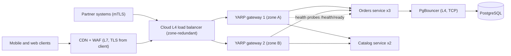
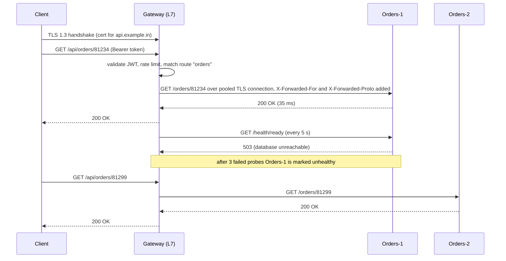

Open almost any production architecture diagram and you will see a box labelled "LB", another labelled "gateway", and maybe an "nginx" or "proxy" between them. Teams often cannot say exactly what each one does, or why they need all three. This lesson separates them clearly, shows what each costs in latency and complexity, and shows how to build a gateway in .NET without turning it into a second monolith.

## Learning objectives

By the end of this lesson you will be able to:

1. Explain the difference between a forward proxy, a reverse proxy, a load balancer and an API gateway.
2. Compare layer-4 and layer-7 load balancing and choose one for a given workload.
3. Choose where to terminate TLS (at the edge, at the gateway, or end-to-end) and explain the trade-offs.
4. Configure ASP.NET Core to trust `X-Forwarded-*` headers safely, only from known proxies.
5. List the responsibilities that belong in a gateway and the ones that do not.
6. Configure a YARP-based gateway with routes, clusters, health checks and transforms.
7. Spot gateway anti-patterns: business logic at the edge, one shared gateway for every team, and too many hops.

## Prerequisites

- [HTTP fundamentals](#/lesson/m10-http-fundamentals): headers, connections, keep-alive and HTTP/2.
- [Load balancing algorithms](#/lesson/m11-load-balancing): round robin, least connections and consistent hashing. This lesson focuses on *where* load balancers sit and *what layer* they work at, not on algorithms.
- [Stateless services](#/lesson/m11-stateless): load balancing is easy only when any instance can serve any request.

## Explain it like I'm a beginner

Picture a large hospital in Delhi.

- At the main gate there is a **security guard** who checks everyone's bag and sends people through one of several entrance doors so no single door gets crowded. The guard does not care *why* you are visiting. This is a **load balancer**: it spreads arriving traffic across several identical servers.
- Inside is a **reception desk**. You say "I need cardiology" and the receptionist reads your slip, checks your appointment, gives you a visitor badge and points you to the third floor. The receptionist understands *what you are asking for*. This is an **API gateway**: one front door that routes each request to the right service and handles shared chores such as checking identity.
- Patients never walk into the doctors' private corridor. Everything goes through the front. A front-of-house stand-in that receives requests on behalf of the servers behind it is a **reverse proxy**. Both the load balancer and the gateway are kinds of reverse proxy.

Now the less obvious part. A guard who only looks at the outside of bags is fast but cannot read the slip in your pocket. That is a **layer-4** load balancer: it sees network addresses and ports, not HTTP. A receptionist who reads every slip can route smartly but is slower. That is a **layer-7** load balancer or gateway: it understands HTTP paths, headers and cookies.

Finally, someone has to open the sealed envelope you carry (the encrypted connection, **TLS**) to read what is inside. Opening it at the front desk is called **TLS termination**. Who opens it, and whether it gets resealed before going upstairs, is a security decision.

## First-principles explanation

### Forward proxy versus reverse proxy

Both sit between a client and a server. The difference is **who they work for**.

| | Forward proxy | Reverse proxy |
|---|---|---|
| Works on behalf of | Clients | Servers |
| Who configures it | The client side (corporate network, browser settings) | The service owner |
| Typical uses | Corporate web filtering, egress control, caching for a branch office | Load balancing, TLS termination, routing, caching, protecting backends |
| Client knows it exists? | Usually yes | Usually no: it looks like the real server |

In the [webhooks lesson](#/lesson/m10-webhooks), the egress proxy that blocks private IP addresses is a forward proxy. Everything else in this lesson is a reverse proxy.

### What every reverse proxy gives you

Even a plain reverse proxy (nginx, IIS with ARR, Envoy, HAProxy, YARP) brings real benefits:

- **One public address** for many backends, so backends can be replaced, scaled or moved without clients noticing.
- **Hiding the backends**: servers keep private IP addresses and are not directly reachable from the internet.
- **Connection management**: the proxy keeps long-lived, pooled connections to backends, while clients come and go. A thousand phones on slow 4G each holding a connection open no longer tie up a thousand server threads (buffering slow clients).
- **TLS termination**, **compression**, **static file caching** and **request size limits** in one place.

### Load balancers: layer 4 versus layer 7

The "layer" refers to the OSI model. Layer 4 is transport (TCP and UDP). Layer 7 is the application protocol (HTTP, gRPC, WebSocket).

**Layer-4 (L4) load balancers** route **connections**. They look at the source and destination IP and port, pick a backend, and forward the packets of that connection there. They do not read HTTP.

- Very fast and cheap per byte, and they work for *any* TCP or UDP protocol: PostgreSQL, Redis, MQTT, custom binary protocols, raw TLS.
- Can pass TLS straight through without decrypting it.
- Cannot route by URL, add headers, retry a failed HTTP request, or look at cookies.
- Balance per connection, not per request. With HTTP/2 or gRPC, one client connection can carry thousands of requests, and an L4 balancer sends all of them to one backend. This is a classic cause of uneven load for gRPC services.

**Layer-7 (L7) load balancers** route **requests**. They terminate the client's connection, parse HTTP, pick a backend for each request, and open (or reuse) a separate connection to it.

- Route by host, path, header, method or cookie: `/api/orders/*` to the orders service, `/static/*` to a CDN origin.
- Balance each request individually, even when they arrive on one HTTP/2 connection.
- Can retry idempotent requests on another backend, add or remove headers, compress, cache, enforce limits, and see HTTP status codes for health and metrics.
- Must decrypt TLS to read HTTP, and do more work per request.

| Need | L4 | L7 |
|---|---|---|
| Non-HTTP protocol (PostgreSQL, MQTT) | Yes | No |
| Route by URL path or host name | No | Yes |
| Spread gRPC/HTTP/2 requests evenly | Poorly (per connection) | Yes (per request) |
| Keep TLS encrypted end-to-end with no inspection | Yes (passthrough) | Only by re-encrypting |
| Very high throughput at the lowest cost | Best | Good |
| Sticky sessions by cookie | No (only by client IP) | Yes |

Cloud names map onto this: Azure Load Balancer and AWS Network Load Balancer are L4; Azure Application Gateway, AWS Application Load Balancer and Azure Front Door are L7.

### TLS termination: where to open the envelope

There are three common placements:

1. **Terminate at the edge, plain HTTP inside.** The load balancer or gateway decrypts, then talks HTTP to backends on a private network. Simplest and cheapest, and backends need no certificates. The risk: anyone who gets onto the internal network can read traffic. Many compliance regimes (card payments, health data) no longer accept this.
2. **Terminate and re-encrypt.** The edge decrypts (so it can route and inspect), then opens a new TLS connection to each backend. Traffic is encrypted on every hop. You pay for certificates on backends and a second handshake, though pooled backend connections make that handshake rare.
3. **TLS passthrough.** An L4 balancer forwards encrypted bytes untouched, and the backend terminates TLS. True end-to-end encryption, and the only option if the backend must see the client certificate itself. But the balancer cannot route by path or see HTTP status codes.

A common modern default is option 2: terminate at the edge for routing and web-application-firewall inspection, re-encrypt to backends, and often use mutual TLS (both sides present certificates) between internal services through a service mesh.

Some numbers to reason with (estimates, not benchmarks): a TLS 1.3 handshake costs one extra network round trip on top of TCP's one. Between Chennai and a Mumbai data centre (roughly 20–30 ms round trip), a fresh connection spends about 50 ms on handshakes before the first byte of the request. With keep-alive and connection reuse, that cost is paid once per connection, not per request. That is a large part of why a proxy that keeps warm connections to backends makes things *faster*, despite adding a hop.

### The hop you added: forwarded headers

When a proxy forwards a request, the backend sees the **proxy's** IP address as the client, and sees `http` even if the user used `https`. So the proxy adds headers:

```text
X-Forwarded-For:   203.0.113.7, 10.0.1.5      (client, then each proxy)
X-Forwarded-Proto: https
X-Forwarded-Host:  api.example.in
```

RFC 7239 standardises this as one `Forwarded` header, but the `X-Forwarded-*` family is far more common.

The danger: **anyone can send these headers**. If the backend blindly trusts `X-Forwarded-For`, an attacker sets it to `127.0.0.1` and bypasses an "admin only from localhost" rule, or spoofs their IP to dodge rate limits. ASP.NET Core's forwarded-headers middleware only honours these headers when the request came from an address you listed in `KnownProxies` (or a known network), and processes the `X-Forwarded-For` list from right to left, stopping at the first address that is not a trusted proxy. Configure it explicitly; never "trust everything".

### API gateways: a reverse proxy with opinions

An **API gateway** is an L7 reverse proxy that understands your API as a product. The classic responsibilities, grouped by the Azure architecture patterns:

**Gateway routing**: one public host, many services. `/orders/*` to the orders service, `/catalog/*` to catalog, `/v2/payments/*` to the new payments deployment.

**Gateway offloading** (cross-cutting concerns done once):

- TLS termination and HTTP/2 or HTTP/3 to clients.
- Authentication: validate the JWT or API key once at the edge, reject anonymous traffic before it reaches services. (Services should still check authorisation for their own data.)
- Rate limiting and quotas per API key or tenant ([rate limiting](#/lesson/m10-rate-limiting)).
- Request size limits, IP allow-lists, basic WAF rules.
- CORS, compression, response caching for public GETs.
- Observability: one place to log every request with a correlation id and to measure latency per route ([correlation](#/lesson/m10-correlation)).

**Gateway aggregation**: one client call fans out to several services and combines the answers. Useful for mobile clients on high-latency networks, but it is the responsibility most likely to grow into an anti-pattern. A dedicated **backend for frontend (BFF)** per client type is usually a better home ([gateway and BFF](#/lesson/m16-gateway-bff)).

**API management** products (Azure API Management, Kong, Apigee and similar) add a developer portal, subscription keys, usage analytics, monetisation and policy editors on top ([Azure API Management](#/lesson/m15-apim)).

### Gateway anti-patterns

1. **Business logic in the gateway.** "If the order total is over ₹50,000, call the fraud service" written as a gateway policy. Now an edge component that every team shares contains domain rules that nobody can unit-test, version or own. The gateway should know *where* requests go, not *what they mean*.
2. **One gateway to rule them all.** A single gateway configuration owned by a platform team, which every product team must change through tickets to add a route. It becomes an organisational bottleneck, and one bad config deploy takes down every API. Prefer gateway configuration owned per team (separate route files or separate gateway instances per domain), deployed through the same pipeline as the service.
3. **Chatty aggregation.** A gateway endpoint that calls eight services sequentially to build a home screen. All the latency and availability problems of a [synchronous chain](#/lesson/m10-sync-async), now hidden in an edge config.
4. **Single point of failure.** One gateway instance, or one zone. The gateway sits in series with *every* request, so its availability caps everything. Run at least two instances across zones, behind an L4 or cloud load balancer.
5. **Too many hops.** CDN → WAF → cloud L7 balancer → API management → YARP gateway → service mesh sidecar → service. Each hop adds latency (often a millisecond or less inside a data centre, much more if it crosses regions), another timeout to tune, another config, another bill. Every box must earn its place.
6. **Timeouts that do not nest.** The gateway times out at 30 s, the service at 60 s. Users get errors while the service keeps working, and retries at the gateway duplicate work. Timeouts should *shrink* as you go inward ([timeouts and retries](#/lesson/m10-timeouts-retries)).

### YARP: a reverse proxy toolkit for .NET

YARP (Yet Another Reverse Proxy) is Microsoft's open-source reverse-proxy library, built on ASP.NET Core and Kestrel. Because it is just an ASP.NET Core app, you add gateway concerns with the middleware you already know: authentication, `AddRateLimiter`, output caching, OpenTelemetry. Its configuration has two core ideas:

- **Routes**: match incoming requests (path, host, headers, methods) and point to a cluster, with optional transforms such as "remove the `/api/orders` prefix".
- **Clusters**: a set of destinations (backend addresses), a load-balancing policy (for example `PowerOfTwoChoices`, `LeastRequests`, `RoundRobin`), and active and passive health checks.

```json
{
  "ReverseProxy": {
    "Routes": {
      "orders": {
        "ClusterId": "orders",
        "AuthorizationPolicy": "authenticated",
        "RateLimiterPolicy": "per-client",
        "Match": { "Path": "/api/orders/{**rest}" },
        "Transforms": [ { "PathPattern": "/orders/{**rest}" } ]
      },
      "catalog": {
        "ClusterId": "catalog",
        "Match": { "Path": "/api/catalog/{**rest}", "Methods": [ "GET" ] },
        "Transforms": [ { "PathRemovePrefix": "/api" } ]
      }
    },
    "Clusters": {
      "orders": {
        "LoadBalancingPolicy": "PowerOfTwoChoices",
        "HealthCheck": {
          "Active": { "Enabled": true, "Interval": "00:00:05", "Timeout": "00:00:02", "Path": "/health/ready" }
        },
        "HttpRequest": { "ActivityTimeout": "00:00:10" },
        "Destinations": {
          "orders-1": { "Address": "https://orders-1.internal:8443/" },
          "orders-2": { "Address": "https://orders-2.internal:8443/" }
        }
      },
      "catalog": {
        "Destinations": { "catalog-1": { "Address": "https://catalog.internal:8443/" } }
      }
    }
  }
}
```

```csharp
// Program.cs of a YARP gateway (needs the Yarp.ReverseProxy NuGet package; not compiled here)
builder.Services.AddReverseProxy().LoadFromConfig(builder.Configuration.GetSection("ReverseProxy"));
builder.Services.AddAuthentication().AddJwtBearer();
builder.Services.AddAuthorization(o => o.AddPolicy("authenticated", p => p.RequireAuthenticatedUser()));
builder.Services.AddRateLimiter(o => o.AddFixedWindowLimiter("per-client", w => { w.PermitLimit = 100; w.Window = TimeSpan.FromSeconds(1); }));

var app = builder.Build();
app.UseAuthentication();
app.UseAuthorization();
app.UseRateLimiter();
app.MapReverseProxy();
app.Run();
```

YARP can also load routes from code or a database (custom `IProxyConfigProvider`), which is how you let teams own their own route definitions, or feed destinations from service discovery ([service discovery](#/lesson/m10-service-discovery)).

### What breaks first under load

- **Connection limits and ephemeral ports.** A proxy opening a fresh backend connection per request runs out of source ports (about 28,000 to 64,000 per destination IP and port, depending on OS settings) at a few thousand requests per second. Connection pooling and HTTP/2 to backends fix this.
- **Slow backends hold proxy resources.** By Little's law, 5,000 requests per second × 2 s of backend latency = 10,000 concurrent requests held at the proxy. Timeouts and per-route concurrency limits keep one slow service from exhausting the gateway for everyone.
- **TLS handshakes during a reconnect storm.** After a deploy or failover, every client reconnects at once. Session resumption and gradual connection draining spread this out.
- **The gateway's own deploys.** A config error in a shared gateway is a global outage. Validate configs in CI, roll out gradually, and keep the previous config ready to restore.

### When a simpler design is enough

- **One service, one region**: a managed L7 load balancer (or IIS / nginx in front of Kestrel) gives you TLS termination and health checks. You do not need an API gateway product. See [reverse proxies and IIS hosting](#/lesson/m15-reverse-proxy-iis).
- **A modular monolith**: routing happens inside the app. A gateway in front of one deployable is mostly an extra hop.
- **Internal service-to-service calls**: often no gateway at all. Use service discovery and client-side or platform load balancing (Kubernetes Services), with a mesh only if you need mTLS and traffic policy everywhere.
- Add a gateway when you have several services behind one public API, external API consumers who need keys and quotas, or cross-cutting concerns you are currently copying into every service.

## Visual explanation

### Architecture: the layers in front of your services



Clients reach a **CDN with a web application firewall**, which terminates the client's TLS close to the user, blocks obvious attacks and caches public content. Partner systems that use client certificates bypass the CDN and arrive at the **L4 load balancer** directly, so their TLS reaches the gateway intact. The L4 balancer is cheap and zone-redundant, and it spreads *connections* across two **YARP gateway** instances in two zones, so the gateway is not a single point of failure. Each gateway does the L7 work: re-encrypts to backends, validates tokens, applies rate limits, and routes `/api/orders/*` to the **orders** cluster and `/api/catalog/*` to **catalog**, balancing per request. The dotted arrow is the gateway's **active health check**: an instance that fails its readiness probe stops receiving requests. On the far right, **PgBouncer** is an L4 proxy for PostgreSQL connections: database traffic is not HTTP, so an L7 component could not help there.

### Sequence: TLS termination, forwarding and ejecting an unhealthy backend



The client completes a **TLS handshake with the gateway**, not with the orders service: the gateway holds the public certificate. The gateway validates the token, applies the rate limit and matches the route, then **rewrites the path** (`/api/orders/...` becomes `/orders/...`) and forwards over an **already-open, pooled TLS connection**, so no new handshake is needed. It adds forwarded headers so the service knows the real client IP and that the original scheme was HTTPS. Meanwhile, the gateway probes each destination. When Orders-1 reports `503` three times, the gateway stops routing to it, and the next request goes to Orders-2. The client never sees the failure.

## Step-by-step example

**Scenario.** QuickHire, a fictional job portal connecting shop, warehouse and delivery workers with employers across Indian cities, has grown from one ASP.NET Core app into four services: identity, jobs, payments and notifications. Mobile apps currently call four different host names. Peak traffic is 6,000 requests per second during the morning hiring window (7–9 a.m.).

### Step 1 — Count the work at the edge

```text
6,000 RPS peak; average backend latency 80 ms
Concurrent requests at the edge (Little's law): 6,000 × 0.08 = 480
Mobile clients with keep-alive: assume 150,000 open client connections at peak
```

The interesting number is 150,000 client connections versus 480 concurrent requests. A proxy that holds client connections and keeps a small pool of backend connections (say 50 per backend instance) shields the services from the connection count.

### Step 2 — Choose the layers

- A **CDN** for app assets and the public job-search GET endpoints.
- A **cloud L4 load balancer** in front of the gateway (cheap, zone-redundant, no TLS work).
- A **YARP gateway**, three instances across two zones (each sized for the full peak alone, so one zone can be lost).
- No separate API management product yet: there are no third-party API consumers.

### Step 3 — Place TLS

Terminate at the gateway (public certificate for `api.quickhire.example`), re-encrypt to services using internal certificates. Payments traffic must stay encrypted on every hop for the payment partner's compliance review.

### Step 4 — Decide gateway responsibilities

In: routing by path, JWT validation, per-user rate limiting (60 requests a minute on `/jobs/apply`), request size limit (1 MB, except 10 MB for document uploads), correlation id, access logs.

Out: "workers under 18 cannot apply for night shifts" (a jobs-domain rule, so it stays in the jobs service), response aggregation for the home screen (goes into a mobile BFF owned by the app team).

### Step 5 — Configure the backends to trust the gateway

Each service enables forwarded headers with the gateway's subnet as the only trusted network, so `HttpContext.Connection.RemoteIpAddress` is the worker's real IP for rate limiting and audit logs, and URL generation produces `https://` links.

### Step 6 — Plan for failure

Gateway timeout 10 s, services 8 s, database calls 5 s (timeouts nest). Active health checks every 5 s. Config changes deployed by the pipeline to one gateway instance first, with a smoke test before the rest.

## Production-style C# implementation

YARP is a NuGet package, so the compiled code below implements the core ideas by hand in a small, readable form: a route table with prefix matching and path rewriting, destination selection that skips unhealthy backends, a forwarder that strips hop-by-hop headers and adds forwarded headers, and the backend-side configuration that trusts only known proxies. In production you would use YARP for the gateway and keep only the backend configuration.

```text
EdgeGateway/
  Program.cs
  Routing/RouteTable.cs
  Routing/ClusterRegistry.cs
  Forwarding/HeaderPolicy.cs
  Forwarding/RequestForwarder.cs
  Backend/TrustedProxySetup.cs
```

```csharp file=Routing/RouteTable.cs
namespace EdgeGateway.Routing;

public sealed record GatewayRoute(string Id, string PathPrefix, string ClusterId, string? RewritePrefix = null,
    IReadOnlySet<string>? Methods = null);

public sealed record RouteMatch(GatewayRoute Route, string DownstreamPath);

/// <summary>Longest-prefix match, the way most gateways resolve overlapping routes.</summary>
public sealed class RouteTable(IEnumerable<GatewayRoute> routes)
{
    private readonly GatewayRoute[] _routes = routes.OrderByDescending(r => r.PathPrefix.Length).ToArray();

    public RouteMatch? Match(string method, string path)
    {
        foreach (var route in _routes)
        {
            if (!IsPrefixOnSegmentBoundary(path, route.PathPrefix)) continue;
            if (route.Methods is { Count: > 0 } m && !m.Contains(method)) continue;

            string rest = path[route.PathPrefix.Length..];
            string downstream = (route.RewritePrefix ?? route.PathPrefix) + rest;
            return new RouteMatch(route, downstream.Length == 0 ? "/" : downstream);
        }
        return null;
    }

    // "/api/orders" must match "/api/orders" and "/api/orders/7", but not "/api/ordersXYZ".
    private static bool IsPrefixOnSegmentBoundary(string path, string prefix) =>
        path.StartsWith(prefix, StringComparison.OrdinalIgnoreCase) &&
        (path.Length == prefix.Length || prefix.EndsWith('/') || path[prefix.Length] == '/');
}
```

```csharp file=Routing/ClusterRegistry.cs
using System.Collections.Concurrent;

namespace EdgeGateway.Routing;

public sealed class Destination(string id, Uri address)
{
    private int _inFlight;
    public string Id => id;
    public Uri Address => address;
    public volatile bool Healthy = true;
    public int InFlight => Volatile.Read(ref _inFlight);
    public void Begin() => Interlocked.Increment(ref _inFlight);
    public void End() => Interlocked.Decrement(ref _inFlight);
}

/// <summary>Picks a destination with "power of two choices": sample two healthy destinations at
/// random and take the one with fewer in-flight requests. Nearly as good as least-requests,
/// without scanning every destination or herding onto one.</summary>
public sealed class ClusterRegistry
{
    private readonly ConcurrentDictionary<string, Destination[]> _clusters = new();

    public void Set(string clusterId, params Destination[] destinations) => _clusters[clusterId] = destinations;

    public IReadOnlyList<Destination> All(string clusterId) =>
        _clusters.TryGetValue(clusterId, out var d) ? d : Array.Empty<Destination>();

    public Destination? Pick(string clusterId, Random random)
    {
        var healthy = All(clusterId).Where(d => d.Healthy).ToArray();
        if (healthy.Length == 0) return null;
        if (healthy.Length == 1) return healthy[0];
        var a = healthy[random.Next(healthy.Length)];
        var b = healthy[random.Next(healthy.Length)];
        return a.InFlight <= b.InFlight ? a : b;
    }
}
```

```csharp file=Forwarding/HeaderPolicy.cs
namespace EdgeGateway.Forwarding;

/// <summary>Headers that describe one connection, not the message. A proxy must not forward them
/// (RFC 9110 section 7.6.1), plus any header named inside the Connection header.</summary>
public static class HeaderPolicy
{
    private static readonly HashSet<string> HopByHop = new(StringComparer.OrdinalIgnoreCase)
    {
        "Connection", "Keep-Alive", "Proxy-Connection", "Proxy-Authenticate", "Proxy-Authorization",
        "TE", "Trailer", "Transfer-Encoding", "Upgrade"
    };

    public static bool ShouldForward(string headerName, IReadOnlySet<string> namedInConnection) =>
        !HopByHop.Contains(headerName) && !namedInConnection.Contains(headerName) && !headerName.Equals("Host", StringComparison.OrdinalIgnoreCase);

    public static IReadOnlySet<string> ParseConnectionHeader(string? connectionHeader) =>
        (connectionHeader ?? "").Split(',', StringSplitOptions.RemoveEmptyEntries | StringSplitOptions.TrimEntries)
            .ToHashSet(StringComparer.OrdinalIgnoreCase);

    public static string AppendForwardedFor(string? existing, string clientIp) =>
        string.IsNullOrWhiteSpace(existing) ? clientIp : $"{existing}, {clientIp}";
}
```

```csharp file=Forwarding/RequestForwarder.cs
using EdgeGateway.Routing;

namespace EdgeGateway.Forwarding;

/// <summary>A deliberately small forwarder to show what a reverse proxy does per request.
/// It buffers nothing large, copies headers through HeaderPolicy and adds X-Forwarded-*.</summary>
public sealed class RequestForwarder(IHttpClientFactory httpFactory, ILogger<RequestForwarder> log)
{
    public const string ClientName = "gateway-backends";

    public async Task ForwardAsync(HttpContext context, Destination destination, string downstreamPath)
    {
        var target = new Uri(destination.Address, downstreamPath + context.Request.QueryString);
        using var request = new HttpRequestMessage(new HttpMethod(context.Request.Method), target);

        if (context.Request.ContentLength > 0 || context.Request.Headers.TransferEncoding.Count > 0)
            request.Content = new StreamContent(context.Request.Body);

        var named = HeaderPolicy.ParseConnectionHeader(context.Request.Headers.Connection);
        foreach (var (name, value) in context.Request.Headers)
        {
            if (!HeaderPolicy.ShouldForward(name, named)) continue;
            if (!request.Headers.TryAddWithoutValidation(name, value.ToArray()))
                request.Content?.Headers.TryAddWithoutValidation(name, value.ToArray());
        }

        string clientIp = context.Connection.RemoteIpAddress?.ToString() ?? "unknown";
        request.Headers.Remove("X-Forwarded-For");
        request.Headers.TryAddWithoutValidation("X-Forwarded-For",
            HeaderPolicy.AppendForwardedFor(context.Request.Headers["X-Forwarded-For"], clientIp));
        request.Headers.TryAddWithoutValidation("X-Forwarded-Proto", context.Request.Scheme);
        request.Headers.TryAddWithoutValidation("X-Forwarded-Host", context.Request.Host.Value);

        destination.Begin();
        try
        {
            HttpClient http = httpFactory.CreateClient(ClientName);
            using var response = await http.SendAsync(request, HttpCompletionOption.ResponseHeadersRead, context.RequestAborted);
            context.Response.StatusCode = (int)response.StatusCode;
            var responseNamed = HeaderPolicy.ParseConnectionHeader(response.Headers.Connection.FirstOrDefault());
            foreach (var h in response.Headers.Concat(response.Content.Headers))
                if (HeaderPolicy.ShouldForward(h.Key, responseNamed))
                    context.Response.Headers[h.Key] = h.Value.ToArray();
            await response.Content.CopyToAsync(context.Response.Body, context.RequestAborted);
        }
        catch (HttpRequestException ex)
        {
            log.LogWarning(ex, "Destination {Destination} failed", destination.Id);
            destination.Healthy = false;   // passive health check: eject on connection failure
            context.Response.StatusCode = StatusCodes.Status502BadGateway;
        }
        catch (TaskCanceledException) when (!context.RequestAborted.IsCancellationRequested)
        {
            context.Response.StatusCode = StatusCodes.Status504GatewayTimeout;
        }
        finally
        {
            destination.End();
        }
    }
}
```

Note the status codes: **502 Bad Gateway** when the backend could not be reached or answered nonsense, **504 Gateway Timeout** when it did not answer in time. Distinguishing them in dashboards tells you instantly whether a service is down or slow.

```csharp file=Backend/TrustedProxySetup.cs
using System.Net;
using Microsoft.AspNetCore.HttpOverrides;

namespace EdgeGateway.Backend;

public static class TrustedProxySetup
{
    /// <summary>For services that sit behind the gateway: honour X-Forwarded-For/Proto/Host,
    /// but only when the immediate caller is one of our proxies.</summary>
    public static IServiceCollection AddTrustedProxies(this IServiceCollection services, IEnumerable<IPAddress> proxies,
        IEnumerable<System.Net.IPNetwork>? networks = null)
    {
        services.Configure<ForwardedHeadersOptions>(o =>
        {
            o.ForwardedHeaders = ForwardedHeaders.XForwardedFor | ForwardedHeaders.XForwardedProto | ForwardedHeaders.XForwardedHost;
            o.ForwardLimit = 2;   // CDN + gateway; ignore anything further left in the chain
            o.KnownProxies.Clear();
            o.KnownIPNetworks.Clear();   // .NET 10 name; KnownNetworks is obsolete
            foreach (var p in proxies) o.KnownProxies.Add(p);
            // The middleware only walks past an X-Forwarded-For entry when the hop that added it is trusted.
            // With a CDN in front, its published egress ranges must be listed too, or the CDN's IP becomes "the client".
            foreach (var n in networks ?? []) o.KnownIPNetworks.Add(n);
            o.AllowedHosts = ["api.quickhire.example"];   // reject spoofed X-Forwarded-Host values
        });
        return services;
    }
}
```

```csharp file=Program.cs
using System.Net;
using System.Threading.RateLimiting;
using EdgeGateway.Backend;
using EdgeGateway.Forwarding;
using EdgeGateway.Routing;

var builder = WebApplication.CreateBuilder(args);

builder.Services.AddHttpClient(RequestForwarder.ClientName, c => c.Timeout = TimeSpan.FromSeconds(10))
    .ConfigurePrimaryHttpMessageHandler(() => new SocketsHttpHandler
    {
        AllowAutoRedirect = false,              // a proxy passes redirects to the client; it does not follow them
        UseCookies = false,                     // never mix cookies between users
        PooledConnectionLifetime = TimeSpan.FromMinutes(2),   // pick up DNS changes
        MaxConnectionsPerServer = 200,
        EnableMultipleHttp2Connections = true
    });
builder.Services.AddSingleton<RequestForwarder>();
builder.Services.AddSingleton(new RouteTable(
[
    new GatewayRoute("orders", "/api/orders", "orders", RewritePrefix: "/orders"),
    new GatewayRoute("catalog", "/api/catalog", "catalog", RewritePrefix: "/catalog", Methods: new HashSet<string> { "GET" }),
]));
builder.Services.AddSingleton(_ =>
{
    var registry = new ClusterRegistry();
    registry.Set("orders", new Destination("orders-1", new Uri("http://localhost:5101/")), new Destination("orders-2", new Uri("http://localhost:5102/")));
    registry.Set("catalog", new Destination("catalog-1", new Uri("http://localhost:5201/")));
    return registry;
});

// Offloaded concern: one rate limit at the edge, partitioned by client IP.
builder.Services.AddRateLimiter(o =>
{
    o.RejectionStatusCode = StatusCodes.Status429TooManyRequests;
    o.GlobalLimiter = PartitionedRateLimiter.Create<HttpContext, string>(ctx =>
        RateLimitPartition.GetFixedWindowLimiter(ctx.Connection.RemoteIpAddress?.ToString() ?? "unknown",
            _ => new FixedWindowRateLimiterOptions { PermitLimit = 100, Window = TimeSpan.FromSeconds(1) }));
});

// The same project shows the backend-side setting a service behind this gateway would use.
builder.Services.AddTrustedProxies(
    [IPAddress.Parse("10.0.1.10"), IPAddress.Parse("10.0.2.10")],          // the gateway instances
    [System.Net.IPNetwork.Parse("198.51.100.0/24")]);                      // example CDN egress range

var app = builder.Build();

app.UseForwardedHeaders();
app.UseRateLimiter();

app.MapGet("/gateway/health", () => Results.Ok("ok"));

app.Map("/{**path}", async (HttpContext ctx, RouteTable routes, ClusterRegistry clusters, RequestForwarder forwarder) =>
{
    var match = routes.Match(ctx.Request.Method, ctx.Request.Path.Value ?? "/");
    if (match is null) { ctx.Response.StatusCode = StatusCodes.Status404NotFound; return; }

    var destination = clusters.Pick(match.Route.ClusterId, Random.Shared);
    if (destination is null) { ctx.Response.StatusCode = StatusCodes.Status503ServiceUnavailable; return; }

    await forwarder.ForwardAsync(ctx, destination, match.DownstreamPath);
});

app.Run();
```

What a real gateway adds beyond this sketch: active health probing on a timer, retries of idempotent requests on another destination, streaming request bodies with back-pressure, HTTP/2 and WebSocket upgrade handling, configuration reload without restarts, and metrics per route and destination. That list is exactly why you use YARP (or another mature proxy) rather than writing your own.

## Bad design vs good design

**Bad: the gateway that knows too much.**

```text
Route /api/checkout:
  1. Validate JWT
  2. Call /customers/{id}, if customer.tier == "gold" add header X-Discount: 10
  3. Call /cart/{id}, sum line totals
  4. If total > 50000, call /fraud/score, reject if score > 0.8
  5. Forward to /orders with the computed total
```

Problems:

- Discount and fraud rules live in a gateway policy file. Nobody unit-tests it; the orders team cannot see it; the platform team does not understand it.
- Three sequential calls before the request even reaches the orders service, all in the critical path of every checkout.
- The orders service trusts a header (`X-Discount`) that any internal caller could set.
- A typo in this policy breaks *every* API behind the gateway on deploy.

**Good:** the gateway validates the token, applies rate limits, routes `/api/checkout` to the orders service and adds a correlation id. The orders service owns discount and fraud rules in tested code, calls what it needs with its own timeouts, and checks authorisation itself. Gateway routes for each team live in that team's repository and are deployed by its pipeline.

**Also bad: the "trust everything" backend.**

```csharp
builder.Services.Configure<ForwardedHeadersOptions>(o =>
{
    o.ForwardedHeaders = ForwardedHeaders.All;
    o.KnownIPNetworks.Clear(); // "it didn't work, so I cleared these"
    o.KnownProxies.Clear();    // now ANY caller can set X-Forwarded-For
});
```

If the backend is ever reachable without going through the gateway (a misconfigured security group, an internal attacker), clients can spoof their IP and scheme. Always list the proxies you trust.

:::callout type=mistake title="Sticky sessions as a crutch"
Cookie-based session affinity at an L7 balancer makes in-memory session state "work". It also unbalances load (one instance gets all the heavy users), breaks when that instance restarts, and complicates deploys. Move state to a shared store and keep services stateless; use affinity only for genuinely connection-oriented cases such as some WebSocket setups.
:::

:::callout type=tradeoff title="Managed cloud gateway or self-hosted YARP?"
A managed gateway or API management service gives you a portal, keys, analytics and patching with no servers to run, but adds per-call cost, its own latency, and limits on custom logic. YARP gives full control and plain C# extensibility, and runs anywhere .NET runs, but your team operates, scales and secures it. Many teams use both: a managed edge for public API products, YARP for internal routing and BFFs.
:::

## Practical playground

The load balancer simulator shows why the L7 choice of algorithm matters once requests are spread individually. Start with round robin and one slow backend (a service instance on a noisy host), and watch its queue grow because it gets the same share as the fast ones. Switch to least connections and compare p95 latency. Then imagine an L4 balancer with HTTP/2 clients: whole connections, not requests, would land on that slow server.

:::playground type=sim sim=loadbalancer title="Round robin versus least connections behind a gateway" algorithm=rr servers=4 slowServers=1 slowFactor=0.4 loadPct=0.8
:::

## Exercises

:::exercise id=m10-gateways-proxies-lb-ex1 difficulty=beginner kind=code title="Find the real client IP from X-Forwarded-For"
Backends behind proxies need the real client address for rate limiting and audit logs, but must not trust spoofed values.
::requirements
- `ClientIpResolver.Resolve(string remoteAddress, string? xForwardedFor, IReadOnlySet<string> trustedProxies)`.
- If `remoteAddress` is not a trusted proxy, return `remoteAddress` and ignore the header entirely.
- Otherwise walk the `X-Forwarded-For` list **from right to left**, skipping addresses that are trusted proxies, and return the first untrusted one.
- If every address is trusted (or the header is empty), return the left-most address, or `remoteAddress` if there is none.
- Trim whitespace around entries.
::acceptance
- Direct call from `203.0.113.7` with header `1.2.3.4` returns `203.0.113.7` (spoof ignored).
- From trusted `10.0.1.10` with header `198.51.100.20` returns `198.51.100.20`.
- From trusted `10.0.1.10` with header `6.6.6.6, 198.51.100.20, 10.0.2.10` (where `10.0.2.10` is trusted) returns `198.51.100.20`, not the spoofed `6.6.6.6`.
- From trusted `10.0.1.10` with no header returns `10.0.1.10`.
::hint
Who added each entry? The right-most entry was added by the proxy closest to you, which you trust. The left-most entry was written by whoever sent the first request: possibly an attacker.
::hint
Split on commas, trim, then iterate with a `for` loop from the last index down to 0.
::hint
Stop at the first address that is not in `trustedProxies`. Everything to its left was supplied by that untrusted party.
::hint
```csharp
var parts = (xff ?? "").Split(',', StringSplitOptions.RemoveEmptyEntries | StringSplitOptions.TrimEntries);
for (int i = parts.Length - 1; i >= 0; i--) if (!trusted.Contains(parts[i])) return parts[i];
```
::starter
```csharp file=ClientIpResolver.cs
using System;
using System.Collections.Generic;

public static class ClientIpResolver
{
    public static string Resolve(string remoteAddress, string? xForwardedFor, IReadOnlySet<string> trustedProxies) =>
        throw new NotImplementedException();
}
```
::tests
```csharp file=ClientIpResolverTests.cs
using System.Collections.Generic;
using Xunit;

public class ClientIpResolverTests
{
    private static readonly IReadOnlySet<string> Trusted = new HashSet<string> { "10.0.1.10", "10.0.2.10" };

    [Fact] public void Untrusted_caller_header_ignored() =>
        Assert.Equal("203.0.113.7", ClientIpResolver.Resolve("203.0.113.7", "1.2.3.4", Trusted));

    [Fact] public void Single_hop() =>
        Assert.Equal("198.51.100.20", ClientIpResolver.Resolve("10.0.1.10", "198.51.100.20", Trusted));

    [Fact] public void Spoofed_left_entry_ignored() =>
        Assert.Equal("198.51.100.20", ClientIpResolver.Resolve("10.0.1.10", "6.6.6.6, 198.51.100.20, 10.0.2.10", Trusted));

    [Fact] public void No_header_returns_remote() =>
        Assert.Equal("10.0.1.10", ClientIpResolver.Resolve("10.0.1.10", null, Trusted));

    [Fact] public void All_trusted_returns_leftmost() =>
        Assert.Equal("10.0.2.10", ClientIpResolver.Resolve("10.0.1.10", "10.0.2.10", Trusted));

    [Fact] public void Whitespace_is_trimmed() =>
        Assert.Equal("198.51.100.20", ClientIpResolver.Resolve("10.0.1.10", "  198.51.100.20 ,10.0.2.10 ", Trusted));
}
```
::solution
```csharp file=ClientIpResolver.cs
using System;
using System.Collections.Generic;

public static class ClientIpResolver
{
    public static string Resolve(string remoteAddress, string? xForwardedFor, IReadOnlySet<string> trustedProxies)
    {
        if (!trustedProxies.Contains(remoteAddress)) return remoteAddress;

        string[] chain = (xForwardedFor ?? "").Split(',', StringSplitOptions.RemoveEmptyEntries | StringSplitOptions.TrimEntries);
        if (chain.Length == 0) return remoteAddress;

        for (int i = chain.Length - 1; i >= 0; i--)
            if (!trustedProxies.Contains(chain[i])) return chain[i];

        return chain[0];
    }
}
```

This is the same right-to-left rule ASP.NET Core's `ForwardedHeadersMiddleware` applies with `KnownProxies`. In production, compare parsed `IPAddress` values (and networks, such as `10.0.0.0/16`) rather than strings, so `::ffff:10.0.1.10` and `10.0.1.10` are treated as the same address.
::mistakes
- Taking the left-most entry, which is exactly the value an attacker controls.
- Trusting the header even when the request did not come from a proxy.
- Using the IP for security decisions (admin access) at all; prefer authentication, and use the IP for rate limiting and logging.
::extensions
Accept CIDR ranges in the trusted set using `System.Net.IPNetwork.Parse("10.0.0.0/16").Contains(address)`.
:::

:::exercise id=m10-gateways-proxies-lb-ex2 difficulty=beginner kind=written title="L4 or L7? Six scenarios"
For each scenario, choose an L4 load balancer, an L7 load balancer (or gateway), or both, and give one reason.

1. Spreading connections from 40 application servers across three PgBouncer instances.
2. Sending `/api/*` to an ASP.NET Core cluster and `/` to a static React site origin.
3. A gRPC service where each client opens one long-lived HTTP/2 connection and sends thousands of calls on it.
4. An MQTT broker cluster receiving readings from 200,000 smart electricity meters.
5. A bank partner that requires mutual TLS and wants your service (not a proxy) to verify its client certificate.
6. A public API that needs per-customer rate limits by API key.
::acceptance
- Items 1 and 4 choose L4, because the protocols are not HTTP.
- Items 2 and 6 choose L7, because routing or limits depend on HTTP content.
- Item 3 explains that L4 balances per connection and would pin all calls to one backend.
- Item 5 discusses TLS passthrough (L4) versus terminating and forwarding the client certificate in a header (L7).
::hint
First ask: is the protocol HTTP? If not, L7 HTTP features cannot help.
::hint
Second ask: does the routing decision depend on something inside the request (path, header, key)?
::hint
For gRPC, think about what "one connection, many requests" means for a balancer that only sees connections.
::solution
1. **L4.** PostgreSQL's wire protocol is not HTTP; an L4 balancer spreads TCP connections. (PgBouncer itself is also an L4-style connection proxy.)
2. **L7.** Path-based routing requires reading the HTTP request.
3. **L7** (or client-side load balancing). An L4 balancer picks a backend once per connection, so a client with one HTTP/2 connection sends 100 % of its calls to one instance. An L7 proxy balances each gRPC call.
4. **L4.** MQTT is a long-lived TCP protocol; connection-level balancing is what you want, often with TLS terminated at the broker or the L4 balancer.
5. **L4 with TLS passthrough** if the service itself must perform the TLS client-certificate check. Alternatively, an **L7** gateway can verify the certificate and forward it (or its thumbprint) in a header to the service, which then must trust only the gateway, a weaker but common design.
6. **L7 gateway.** The API key is in an HTTP header; per-key quotas need request-level visibility. Often an L4 or cloud load balancer sits in front of the gateway instances as well, so the answer is "both".
::mistakes
- Choosing L7 for database traffic.
- Assuming an L4 balancer spreads gRPC calls evenly.
- Forgetting that L7 requires TLS termination at the proxy, which matters for item 5.
:::

:::exercise id=m10-gateways-proxies-lb-ex3 difficulty=intermediate kind=code title="Gateway route matching with rewrites"
Implement the routing core of a gateway: longest-prefix match on segment boundaries, method filters, and prefix rewriting.
::requirements
- `Router(IEnumerable<RouteRule> rules)` and `RouteResult? Match(string method, string path)`.
- `RouteRule(string Id, string Prefix, string Cluster, string? Rewrite, string[]? Methods)`.
- A prefix matches only on a segment boundary: `/api/orders` matches `/api/orders` and `/api/orders/7`, not `/api/ordersX`.
- When several rules match, the **longest prefix** wins.
- If `Methods` is set, the HTTP method must be in it (case-insensitive).
- `Rewrite` replaces the matched prefix; `null` keeps the path unchanged. An empty result becomes `/`. Query strings are not part of the path.
::acceptance
- `GET /api/orders/7` with rule `/api/orders → /orders` returns cluster `orders`, path `/orders/7`.
- `/api/orders/reports/2026` prefers a more specific `/api/orders/reports` rule.
- `POST /api/catalog` on a GET-only rule falls through to the next matching rule, or `null`.
- `/api/ordersX` does not match `/api/orders`.
- Rewrite `""` on `/legacy` with path `/legacy` returns `/`.
::hint
Sort rules by prefix length, descending, once in the constructor. Then the first match is the longest.
::hint
Segment boundary check: after `StartsWith`, the next character must be `/` or the path must end there.
::hint
Downstream path = `(rule.Rewrite ?? rule.Prefix) + path.Substring(rule.Prefix.Length)`.
::hint
Compare methods with `StringComparer.OrdinalIgnoreCase` so `get` and `GET` both work.
::starter
```csharp file=Router.cs
using System;
using System.Collections.Generic;
using System.Linq;

public sealed record RouteRule(string Id, string Prefix, string Cluster, string? Rewrite = null, string[]? Methods = null);
public sealed record RouteResult(string RuleId, string Cluster, string DownstreamPath);

public sealed class Router(IEnumerable<RouteRule> rules)
{
    public RouteResult? Match(string method, string path) => throw new NotImplementedException();
}
```
::tests
```csharp file=RouterTests.cs
using Xunit;

public class RouterTests
{
    private static Router R() => new(new[]
    {
        new RouteRule("orders", "/api/orders", "orders", "/orders"),
        new RouteRule("reports", "/api/orders/reports", "reporting", "/reports"),
        new RouteRule("catalog-read", "/api/catalog", "catalog", null, new[] { "GET", "HEAD" }),
        new RouteRule("legacy", "/legacy", "legacy-app", ""),
    });

    [Fact]
    public void Rewrites_prefix()
    {
        var m = R().Match("GET", "/api/orders/7");
        Assert.Equal("orders", m!.Cluster);
        Assert.Equal("/orders/7", m.DownstreamPath);
    }

    [Fact] public void Longest_prefix_wins() => Assert.Equal("reporting", R().Match("GET", "/api/orders/reports/2026")!.Cluster);

    [Fact] public void Segment_boundary() => Assert.Null(R().Match("GET", "/api/ordersX"));

    [Fact] public void Method_filter() => Assert.Null(R().Match("POST", "/api/catalog/items"));

    [Fact] public void Method_is_case_insensitive() => Assert.Equal("catalog", R().Match("get", "/api/catalog/items")!.Cluster);

    [Fact] public void Null_rewrite_keeps_path() => Assert.Equal("/api/catalog/items", R().Match("GET", "/api/catalog/items")!.DownstreamPath);

    [Fact] public void Empty_rewrite_becomes_root() => Assert.Equal("/", R().Match("GET", "/legacy")!.DownstreamPath);

    [Fact] public void Exact_prefix_matches() => Assert.Equal("/orders", R().Match("GET", "/api/orders")!.DownstreamPath);

    [Fact] public void No_match_is_null() => Assert.Null(R().Match("GET", "/unknown"));
}
```
::solution
```csharp file=Router.cs
using System;
using System.Collections.Generic;
using System.Linq;

public sealed record RouteRule(string Id, string Prefix, string Cluster, string? Rewrite = null, string[]? Methods = null);
public sealed record RouteResult(string RuleId, string Cluster, string DownstreamPath);

public sealed class Router(IEnumerable<RouteRule> rules)
{
    private readonly RouteRule[] _rules = rules.OrderByDescending(r => r.Prefix.Length).ToArray();

    public RouteResult? Match(string method, string path)
    {
        foreach (var rule in _rules)
        {
            if (!path.StartsWith(rule.Prefix, StringComparison.OrdinalIgnoreCase)) continue;
            bool boundary = path.Length == rule.Prefix.Length || rule.Prefix.EndsWith('/') || path[rule.Prefix.Length] == '/';
            if (!boundary) continue;
            if (rule.Methods is { Length: > 0 } methods && !methods.Contains(method, StringComparer.OrdinalIgnoreCase)) continue;

            string downstream = (rule.Rewrite ?? rule.Prefix) + path[rule.Prefix.Length..];
            return new RouteResult(rule.Id, rule.Cluster, downstream.Length == 0 ? "/" : downstream);
        }
        return null;
    }
}
```

Sorting once makes matching O(number of rules) per request, which is fine for dozens of routes. Gateways with thousands of routes (multi-tenant platforms) use a prefix tree (trie) or the ASP.NET Core routing engine, as YARP does.
::mistakes
- Plain `StartsWith` without the boundary check, which routes `/api/ordersexport` to orders.
- Matching in registration order, so a broad rule registered first shadows specific ones.
- Rewriting with `string.Replace`, which replaces *every* occurrence of the prefix, including inside later segments.
::extensions
Add host-based matching (`api.example.in` vs `partners.example.in`) and route templates with parameters like `/api/tenants/{tenantId}/orders`.
:::

:::exercise id=m10-gateways-proxies-lb-ex4 difficulty=intermediate kind=code title="Proxy header hygiene"
A reverse proxy must remove connection-specific headers and add forwarding headers. Implement the header transform.
::requirements
- `ProxyHeaders.Prepare(IReadOnlyDictionary<string, string> incoming, string clientIp, string scheme, string host)` returns a new dictionary (case-insensitive keys) of headers to send upstream.
- Remove hop-by-hop headers: `Connection`, `Keep-Alive`, `Proxy-Connection`, `Proxy-Authenticate`, `Proxy-Authorization`, `TE`, `Trailer`, `Transfer-Encoding`, `Upgrade`, **and** any header listed in the incoming `Connection` header.
- Remove `Host` (the client library sets the upstream host).
- `X-Forwarded-For`: append `clientIp` to any existing value with `", "`.
- `X-Forwarded-Proto` and `X-Forwarded-Host`: set to `scheme` and `host` (overwrite incoming values).
- Keep all other headers unchanged.
::acceptance
- `Connection: keep-alive, X-Debug-Token` removes both `Connection` and `X-Debug-Token`.
- An existing `X-Forwarded-For: 198.51.100.20` becomes `198.51.100.20, 10.0.1.10`.
- `Authorization`, `Accept` and `X-Correlation-Id` pass through unchanged.
- Header names are matched case-insensitively.
::hint
Build a set of "names to drop": the fixed hop-by-hop list plus the comma-separated values of `Connection`.
::hint
Create the output with `new Dictionary<string, string>(StringComparer.OrdinalIgnoreCase)`.
::hint
Copy everything not in the drop set, then set the three `X-Forwarded-*` values last.
::hint
Read the incoming dictionary case-insensitively too: it may have been built with a case-sensitive comparer, so search keys with `string.Equals(..., OrdinalIgnoreCase)`.
::starter
```csharp file=ProxyHeaders.cs
using System;
using System.Collections.Generic;
using System.Linq;

public static class ProxyHeaders
{
    public static Dictionary<string, string> Prepare(IReadOnlyDictionary<string, string> incoming, string clientIp, string scheme, string host) =>
        throw new NotImplementedException();
}
```
::tests
```csharp file=ProxyHeadersTests.cs
using System.Collections.Generic;
using Xunit;

public class ProxyHeadersTests
{
    private static Dictionary<string, string> Incoming() => new()
    {
        ["Host"] = "api.example.in",
        ["connection"] = "keep-alive, X-Debug-Token",
        ["Keep-Alive"] = "timeout=5",
        ["X-Debug-Token"] = "abc",
        ["Transfer-Encoding"] = "chunked",
        ["Upgrade"] = "h2c",
        ["Authorization"] = "Bearer xyz",
        ["Accept"] = "application/json",
        ["X-Correlation-Id"] = "c-1",
        ["X-Forwarded-For"] = "198.51.100.20",
        ["X-Forwarded-Proto"] = "http",
    };

    [Fact]
    public void Removes_hop_by_hop_and_named_headers()
    {
        var h = ProxyHeaders.Prepare(Incoming(), "10.0.1.10", "https", "api.example.in");
        Assert.False(h.ContainsKey("Connection"));
        Assert.False(h.ContainsKey("Keep-Alive"));
        Assert.False(h.ContainsKey("X-Debug-Token"));
        Assert.False(h.ContainsKey("Transfer-Encoding"));
        Assert.False(h.ContainsKey("Upgrade"));
        Assert.False(h.ContainsKey("Host"));
    }

    [Fact]
    public void Keeps_end_to_end_headers()
    {
        var h = ProxyHeaders.Prepare(Incoming(), "10.0.1.10", "https", "api.example.in");
        Assert.Equal("Bearer xyz", h["Authorization"]);
        Assert.Equal("application/json", h["accept"]);
        Assert.Equal("c-1", h["X-Correlation-Id"]);
    }

    [Fact]
    public void Appends_and_sets_forwarded_headers()
    {
        var h = ProxyHeaders.Prepare(Incoming(), "10.0.1.10", "https", "api.example.in");
        Assert.Equal("198.51.100.20, 10.0.1.10", h["X-Forwarded-For"]);
        Assert.Equal("https", h["X-Forwarded-Proto"]);
        Assert.Equal("api.example.in", h["X-Forwarded-Host"]);
    }

    [Fact]
    public void Starts_forwarded_for_when_absent()
    {
        var h = ProxyHeaders.Prepare(new Dictionary<string, string> { ["Accept"] = "*/*" }, "203.0.113.7", "https", "api.example.in");
        Assert.Equal("203.0.113.7", h["X-Forwarded-For"]);
    }
}
```
::solution
```csharp file=ProxyHeaders.cs
using System;
using System.Collections.Generic;
using System.Linq;

public static class ProxyHeaders
{
    private static readonly string[] HopByHop =
        ["Connection", "Keep-Alive", "Proxy-Connection", "Proxy-Authenticate", "Proxy-Authorization", "TE", "Trailer", "Transfer-Encoding", "Upgrade", "Host"];

    public static Dictionary<string, string> Prepare(IReadOnlyDictionary<string, string> incoming, string clientIp, string scheme, string host)
    {
        string? Get(string name) =>
            incoming.FirstOrDefault(kv => string.Equals(kv.Key, name, StringComparison.OrdinalIgnoreCase)).Value;

        var drop = new HashSet<string>(HopByHop, StringComparer.OrdinalIgnoreCase);
        foreach (var named in (Get("Connection") ?? "").Split(',', StringSplitOptions.RemoveEmptyEntries | StringSplitOptions.TrimEntries))
            drop.Add(named);
        drop.Add("X-Forwarded-For");
        drop.Add("X-Forwarded-Proto");
        drop.Add("X-Forwarded-Host");

        var result = new Dictionary<string, string>(StringComparer.OrdinalIgnoreCase);
        foreach (var (name, value) in incoming)
            if (!drop.Contains(name)) result[name] = value;

        string? existingFor = Get("X-Forwarded-For");
        result["X-Forwarded-For"] = string.IsNullOrWhiteSpace(existingFor) ? clientIp : $"{existingFor}, {clientIp}";
        result["X-Forwarded-Proto"] = scheme;
        result["X-Forwarded-Host"] = host;
        return result;
    }
}
```

Why remove `Transfer-Encoding` and `Upgrade`? They describe how bytes move on *this* connection. The upstream connection has its own framing (it may even be HTTP/2, where these headers are forbidden). Forwarding them can cause request smuggling bugs, where proxy and backend disagree about where one request ends and the next begins.
::mistakes
- Forgetting headers named inside `Connection`, a known way to smuggle debug or internal headers past a proxy.
- Overwriting `X-Forwarded-For` instead of appending, which loses the chain needed by trusted-proxy resolution downstream.
- Passing `X-Forwarded-Proto: http` from the client through unchanged, so the backend thinks HTTPS traffic was plain HTTP (or the reverse).
::extensions
Also strip incoming `X-Internal-*` headers that only your gateway is allowed to set (for example, an authenticated user id), so clients cannot impersonate the gateway.
:::

:::exercise id=m10-gateways-proxies-lb-ex5 difficulty=advanced kind=hld title="Design the edge for a public college-admissions API"
A national college-admissions platform exposes a public API for colleges, coaching and comparison apps, and independent developers: the live seat matrix, last year's cut-off ranks, and college information brochures. Requirements:

- 25,000 RPS peak (mostly GETs), 1,500 RPS of authenticated writes from college admin apps (seat updates, admission confirmations).
- 3,000 third-party API keys with per-key quotas; a developer portal.
- Partner banks submit application-fee payment confirmations over mutual TLS.
- Brochure PDFs (average 8 MB) are downloaded heavily on the last day of registration.
- Five backend services owned by three teams; one gRPC service for campus and exam-centre map tiles.
- 99.95 % availability target across two zones.

The starter has a single nginx box in front of everything. Design the edge: layers, where TLS terminates, which component does what, and how teams change routes safely. Show your arithmetic.
::acceptance
- Separates CDN, L4 and L7 responsibilities with a reason for each.
- States where TLS terminates for public clients and for mTLS partners.
- Removes the single point of failure and survives the loss of one zone.
- Keeps business logic out of the gateway and describes per-team route ownership.
- Handles the gRPC service so calls are balanced per request.
- Includes RPS, bandwidth or connection arithmetic.
::hint
What fraction of the 25,000 GETs and the PDF bytes can a CDN absorb?
::hint
Bandwidth on the last registration day: downloads per second × 8 MB. Should that ever reach your gateway?
::hint
Who verifies the bank's client certificate, and what does the backend need to know about it?
::hint
API keys and quotas for 3,000 developers is an API management feature. Do you build it into YARP or buy it?
::starter
```json
{
  "nodes": [
    { "id": "clients", "type": "client", "label": "Apps, partners, developers", "props": { "rps": 26500 } },
    { "id": "nginx", "type": "load-balancer", "label": "Single nginx VM" },
    { "id": "seats", "type": "app-server", "label": "Seat-matrix API" },
    { "id": "brochures", "type": "app-server", "label": "Brochure API" },
    { "id": "payments", "type": "app-server", "label": "Payments API" },
    { "id": "tiles", "type": "app-server", "label": "Map tiles (gRPC)" },
    { "id": "db", "type": "database", "label": "PostgreSQL" },
    { "id": "files", "type": "object-storage", "label": "Brochure PDFs" }
  ],
  "edges": [
    { "from": "clients", "to": "nginx", "kind": "sync" },
    { "from": "nginx", "to": "seats", "kind": "sync" },
    { "from": "nginx", "to": "brochures", "kind": "sync" },
    { "from": "nginx", "to": "payments", "kind": "sync" },
    { "from": "nginx", "to": "tiles", "kind": "sync" },
    { "from": "seats", "to": "db", "kind": "sync" },
    { "from": "brochures", "to": "files", "kind": "sync", "label": "stream PDF through API" }
  ]
}
```
::solution
```json
{
  "nodes": [
    { "id": "clients", "type": "client", "label": "Apps and developers", "props": { "rps": 25000 } },
    { "id": "banks", "type": "client", "label": "Partner banks (mTLS)", "props": { "rps": 50 } },
    { "id": "dns", "type": "dns", "label": "DNS (health-checked)" },
    { "id": "cdn", "type": "cdn", "label": "CDN + WAF (TLS for public clients)" },
    { "id": "apim", "type": "api-gateway", "label": "API management (keys, quotas, portal)", "props": { "instances": 2, "multiAz": true } },
    { "id": "nlb", "type": "load-balancer", "label": "L4 load balancer (zone-redundant, TLS passthrough for banks)", "props": { "multiAz": true } },
    { "id": "yarp", "type": "api-gateway", "label": "YARP gateway (routing, JWT, per-route limits)", "props": { "instances": 4, "multiAz": true } },
    { "id": "seats", "type": "app-server", "label": "Seat-matrix API", "props": { "instances": 6, "multiAz": true } },
    { "id": "brochures", "type": "app-server", "label": "Brochure API (issues signed URLs)", "props": { "instances": 3, "multiAz": true } },
    { "id": "payments", "type": "app-server", "label": "Payments API (verifies client cert)", "props": { "instances": 3, "multiAz": true } },
    { "id": "tiles", "type": "app-server", "label": "Map tiles (gRPC, per-call balancing)", "props": { "instances": 4, "multiAz": true } },
    { "id": "cache", "type": "cache", "label": "Redis (seat-matrix read cache)", "props": { "ttlSeconds": 60 } },
    { "id": "db", "type": "database", "label": "PostgreSQL HA", "props": { "replicas": 2, "multiAz": true } },
    { "id": "files", "type": "object-storage", "label": "Brochure PDFs (zone-redundant)", "props": { "multiAz": true } },
    { "id": "mon", "type": "monitoring", "label": "Per-route latency, 5xx, 502 vs 504" }
  ],
  "edges": [
    { "from": "clients", "to": "dns", "kind": "sync" },
    { "from": "dns", "to": "cdn", "kind": "sync" },
    { "from": "cdn", "to": "apim", "kind": "sync", "label": "cache misses, re-encrypted" },
    { "from": "cdn", "to": "files", "kind": "sync", "label": "PDF via signed URL, cached at edge" },
    { "from": "apim", "to": "nlb", "kind": "sync" },
    { "from": "banks", "to": "nlb", "kind": "sync", "label": "mTLS, passthrough" },
    { "from": "nlb", "to": "yarp", "kind": "sync" },
    { "from": "nlb", "to": "payments", "kind": "sync", "label": "bank traffic, TLS end-to-end" },
    { "from": "yarp", "to": "seats", "kind": "sync" },
    { "from": "yarp", "to": "brochures", "kind": "sync" },
    { "from": "yarp", "to": "tiles", "kind": "sync", "label": "HTTP/2, per-request" },
    { "from": "seats", "to": "cache", "kind": "sync" },
    { "from": "seats", "to": "db", "kind": "sync" },
    { "from": "brochures", "to": "db", "kind": "sync" },
    { "from": "payments", "to": "db", "kind": "sync" },
    { "from": "yarp", "to": "mon", "kind": "async" }
  ]
}
```

**Arithmetic (estimates to validate with load tests).**

```text
Public GETs: 25,000 RPS; assume 70 % are cacheable at the CDN for 30–60 s → 7,500 RPS reach API management
Writes: 1,500 RPS, never cached → about 9,000 RPS through the gateway tier at peak
YARP: assume ~3,000 RPS per instance at comfortable CPU → 3 needed; 4 across 2 zones, so one zone (2 instances)
      still carries ~6,000 RPS; add autoscaling to cover full peak after a zone loss
Last registration day: 400 downloads/s × 8 MB = 3.2 GB/s ≈ 25.6 Gbit/s → must be served by the CDN from object storage,
      never streamed through the API (the old design would saturate the nginx VM's network many times over)
```

**Responsibilities.**

- **CDN + WAF**: TLS for public clients near the user, caching of public GETs and PDFs, bot and WAF rules. The brochure API returns a short-lived **signed URL**; the CDN fetches the PDF from object storage once and serves it to thousands.
- **API management**: API keys, per-key quotas for 3,000 developers, the developer portal and usage analytics. Buying this beats rebuilding it in YARP.
- **L4 load balancer**: zone-redundant entry to the private network; **TLS passthrough** for banks, so the payments service verifies the client certificate itself and the certificate never has to be trusted from a header.
- **YARP gateway**: internal routing by path, JWT validation for college admin apps, per-route concurrency limits, re-encryption to services, correlation ids. gRPC tiles are routed over HTTP/2 with **per-request** balancing, fixing the L4 per-connection pinning problem.
- **No business rules** at any edge layer. Route definitions live in each team's repository as YARP config fragments, validated in CI and loaded by a config provider; a bad route affects only that team's prefix.

**Availability.** Every edge layer runs in two zones with at least two instances. Serial chain for a cached GET: CDN only. For an uncached request: CDN 0.9999 × APIM 0.9995 × L4 0.9999 × YARP tier 0.99995 × service tier 0.9999 × DB 0.9995 ≈ 0.9987, which misses 99.95 %. Closing the gap: serve reads from Redis and CDN so the DB is off most read paths, use APIM and DB tiers with higher SLAs (or multi-region for APIM), and lean on fast failover (MTTR). Stating that the first draft misses the target, and how to close it, is part of the answer.
::mistakes
- Streaming large files through the gateway and API instead of signed URLs and a CDN.
- Terminating the bank's mTLS at a shared edge and passing "verified=true" in a header that internal callers could also set.
- Putting gRPC behind an L4-only balancer and wondering why one instance runs at 90 % CPU.
- Building API-key management and a developer portal into a custom gateway.
:::

## Automated testing

**Unit tests** cover routing tables, header transforms and client-IP resolution, as in exercises 1, 3 and 4. They are fast and catch the most dangerous bugs (spoofable headers, wrong routes).

**Gateway integration tests.** Start the gateway with `WebApplicationFactory<Program>` and point its clusters at in-process fake backends (a second minimal API on a random port, or a custom `HttpMessageHandler` injected through `IHttpClientFactory`). Assert:

- `GET /api/orders/7` reaches the orders fake with path `/orders/7` and an `X-Forwarded-For` header.
- A backend that throws a connection error yields `502`; one that sleeps past the timeout yields `504`.
- After the rate limit, the gateway returns `429` without calling the backend.
- Hop-by-hop headers sent by the client never reach the backend.

**Backend tests for forwarded headers.** Send a request with `X-Forwarded-For: 6.6.6.6` from an untrusted address in a `TestServer` and assert `HttpContext.Connection.RemoteIpAddress` is unchanged. Then configure the test server's remote address as a known proxy and assert it changes. `TestServer` lets you set `HttpContext.Connection.RemoteIpAddress` through a small startup filter.

**Configuration tests.** Gateways fail most often because of configuration, not code. In CI: load the YARP JSON, assert every route's `ClusterId` exists, no two routes have identical match criteria, every cluster has at least two destinations in production, and every route has an authorisation policy or is explicitly marked public.

**Load tests.** Run a short load test (k6, JMeter, Azure Load Testing) through the full edge before major events, such as the last day of a registration window, and watch p99 latency per hop.

## Real-world application

- **Cloud platforms** offer the layers as managed services: L4 network load balancers, L7 application load balancers or application gateways, global front doors with CDN and WAF, and API management products. Architectures commonly chain two or three of them.
- **Envoy, nginx, HAProxy and Traefik** are widely used open-source reverse proxies; Envoy also powers service meshes and several managed gateways.
- **YARP** is used to build gateways and BFFs in .NET shops, and to migrate legacy systems gradually: route `/new/*` to the rewritten service and everything else to the old app (the [strangler fig](#/lesson/m16-strangler-acl) approach).
- **Kubernetes ingress controllers and the Gateway API** are reverse proxies configured with Kubernetes resources, so each team can own its `HTTPRoute` objects. That is per-team route ownership built into the platform.
- **Government and university platforms** often expose many departmental systems under one domain; a gateway with per-department routes, one identity provider and central rate limiting is a common modernisation step before any service is rewritten.

## Interview questions

:::interview
::q beginner
What is the difference between a forward proxy and a reverse proxy?
::a
A forward proxy acts on behalf of clients: they send their outbound requests through it (corporate filtering, egress control). A reverse proxy acts on behalf of servers: clients think they are talking to the server, and the proxy forwards to backends. Load balancers and API gateways are reverse proxies. Reverse proxies hide backends, terminate TLS, pool connections and route traffic.
::q beginner
What is the difference between an L4 and an L7 load balancer?
::a
L4 works at the transport layer: it balances TCP/UDP connections using IPs and ports, without reading the application protocol. It is fast, protocol-agnostic and can pass TLS through untouched. L7 understands HTTP (or gRPC): it terminates the connection, reads paths, headers and cookies, balances individual requests, can retry, rewrite and cache, and sees status codes. Use L4 for non-HTTP protocols and raw throughput; L7 for content-based routing and per-request balancing, especially with HTTP/2 and gRPC.
::q intermediate
Where would you terminate TLS, and why?
::a
Usually at the edge (CDN or gateway) so the proxy can route, apply WAF rules and validate tokens, and then re-encrypt to backends so traffic is encrypted on every hop. Pure edge termination with plain HTTP inside is simpler but exposes traffic to anyone on the internal network and fails many compliance reviews. TLS passthrough with an L4 balancer gives true end-to-end encryption and lets the backend verify client certificates, but gives up L7 features. Connection pooling to backends makes the extra internal handshakes rare.
::q intermediate
Your ASP.NET Core service behind a gateway logs the gateway's IP for every request and generates `http://` links. What is wrong and how do you fix it safely?
::a
The service sees the proxy's connection, not the client's. Enable `UseForwardedHeaders` with `ForwardedHeaders.XForwardedFor | XForwardedProto | XForwardedHost`, and add the gateway's addresses to `KnownProxies` (or its subnet as a known network), with an appropriate `ForwardLimit` and `AllowedHosts`. Do not clear the known lists to "make it work": then any caller can spoof `X-Forwarded-For`. Place the middleware early, before authentication, HSTS and anything that uses the scheme or remote IP.
::q advanced
Which responsibilities belong in an API gateway, and what are the anti-patterns?
::a
Belong: routing, TLS, authentication (token validation), coarse authorisation (authenticated or not, scopes), rate limits and quotas, request size limits, CORS, caching of public responses, correlation ids and access logs, and sometimes light aggregation. Anti-patterns: business rules in gateway policies (untestable, unowned), one shared gateway config that every team must change through a central team (an organisational and blast-radius bottleneck), chatty aggregation that recreates a synchronous chain at the edge, a single instance or zone (the gateway is in series with every request), stacking redundant proxy layers, and timeouts that do not shrink inward. Prefer per-team route ownership and a BFF for client-specific aggregation.
::q advanced
A gRPC service behind a cloud L4 load balancer shows one instance at 90 % CPU and others nearly idle. Explain and fix.
::a
gRPC uses long-lived HTTP/2 connections and multiplexes many calls on each. An L4 balancer chooses a backend per connection, so a handful of busy clients with one connection each pin all their calls to whichever instances they happened to land on, and new instances added by autoscaling get no traffic until clients reconnect. Fixes: put an L7 proxy (Envoy, YARP, a cloud L7 balancer with HTTP/2 support) in front to balance per call; or use client-side load balancing with service discovery so each client spreads calls across all instances; and set a maximum connection age on the server so clients periodically reconnect and rebalance.
:::

## Summary and revision

**Key takeaways**

- A reverse proxy stands in for servers; load balancers and API gateways are specialised reverse proxies. A forward proxy stands in for clients.
- L4 balances connections and works for any TCP/UDP protocol; L7 balances requests and can route by path, header and cookie. gRPC and HTTP/2 need L7 (or client-side) balancing to spread calls.
- Terminate TLS where you need to inspect traffic, and usually re-encrypt to backends; use passthrough when the backend must see the client certificate.
- Trust `X-Forwarded-*` headers only from known proxies, and resolve the client IP from right to left.
- Gateways should route, authenticate, limit and observe. They should not hold business rules, and their config should be owned per team.
- Every edge layer is in series with every request: run at least two instances across zones, nest timeouts, and make each extra hop justify itself.
- YARP builds a .NET gateway from routes and clusters, with ASP.NET Core middleware for auth, rate limiting and telemetry.

**Terminology**: forward proxy, reverse proxy, load balancer, L4, L7, TLS termination, TLS passthrough, re-encryption, mutual TLS, hop-by-hop headers, `X-Forwarded-For`, `KnownProxies`, API gateway, gateway routing, gateway offloading, gateway aggregation, BFF, YARP route, YARP cluster, active and passive health checks, 502, 504.

:::flashcards
Q: Forward proxy versus reverse proxy in one line?
A: A forward proxy acts for clients (outbound); a reverse proxy acts for servers (inbound), hiding the backends.
Q: What does an L4 load balancer balance, and what can it not see?
A: TCP/UDP connections; it cannot see HTTP paths, headers or cookies.
Q: Why do gRPC services behind an L4 balancer often get uneven load?
A: Many calls share one long-lived HTTP/2 connection, and L4 balances per connection, so calls are pinned to one backend.
Q: What are three TLS placement options?
A: Terminate at the edge with plain HTTP inside, terminate and re-encrypt to backends, or L4 passthrough with the backend terminating.
Q: How should a backend read the real client IP behind proxies?
A: Use forwarded-headers middleware with KnownProxies/known networks, reading X-Forwarded-For from right to left and stopping at the first untrusted address.
Q: Name four responsibilities that belong in an API gateway.
A: Routing, TLS, authentication/token validation, rate limiting and quotas (also logging, CORS, size limits, caching).
Q: Name two gateway anti-patterns.
A: Business logic in gateway policies; one shared, centrally owned gateway config for every team (also chatty aggregation, single instance).
Q: 502 versus 504 at a gateway?
A: 502 Bad Gateway: the backend could not be reached or gave an invalid response. 504 Gateway Timeout: it did not respond in time.
Q: What are YARP routes and clusters?
A: Routes match incoming requests and apply transforms; clusters are sets of destinations with load-balancing and health-check settings.
:::

## Knowledge check

:::quiz pass=70
::q single
You need to spread connections from 60 app servers across three PgBouncer instances. Which component fits?
- [x] An L4 load balancer.
- [ ] An L7 API gateway with path routing.
- [ ] A CDN.
- [ ] A forward proxy.
> PostgreSQL's protocol is not HTTP, so L7 HTTP features cannot help. L4 balances TCP connections.
::q single
A backend enables forwarded headers and clears `KnownProxies` and `KnownIPNetworks` so that
 "the real IP shows up". What risk did it create?
- [ ] Higher latency.
- [x] Any client that can reach the backend can spoof its IP and scheme via X-Forwarded-* headers.
- [ ] TLS stops working.
- [ ] The gateway can no longer route requests.
> Forwarded headers must only be honoured from proxies you list. Otherwise rate limits, audit logs and IP rules can be bypassed.
::q single
A team wants the gateway to apply "orders over ₹50,000 need a fraud check" as a gateway policy. What is the best response?
- [ ] Good idea; the gateway sees every request.
- [x] Keep that rule in the orders service, where it can be tested, versioned and owned; the gateway should only route, authenticate and limit.
- [ ] Put it in the CDN instead.
- [ ] Put it in the L4 load balancer.
> Business rules in shared edge configuration are an anti-pattern: untestable, unowned, and a single change can break every API.
::q single
Users report errors after 30 s, but logs show the service finishing successfully after 45 s. The gateway timeout is 30 s and the service's own timeout is 60 s. What is the problem?
- [ ] The service is too fast.
- [x] Timeouts do not nest: the outer layer gives up before the inner one, so work completes after the user has already seen an error (and may have retried).
- [ ] The CDN is caching errors.
- [ ] HTTP/2 is disabled.
> Inner timeouts should be shorter than outer ones so failures surface consistently and work is not wasted.
::q multi
Which are good reasons to terminate TLS at an L7 gateway? (Select all that apply.)
- [x] To route requests by path and host.
- [x] To validate bearer tokens and apply rate limits per user.
- [x] To apply WAF inspection to request contents.
- [ ] So the backend can verify the partner's client certificate itself.
> If the backend must verify the client certificate directly, use TLS passthrough; a terminating gateway would see the certificate instead.
::q single
A gateway returns 504 for 2 % of requests to the reports service and 502 for none. What does that suggest?
- [ ] The reports service is unreachable.
- [x] The reports service is reachable but some requests exceed the gateway's timeout.
- [ ] The gateway's certificate expired.
- [ ] Clients are sending bad requests.
> 504 means no response in time; 502 means the backend could not be reached or responded invalidly.
::q single
A small company runs one ASP.NET Core app on two VMs behind a cloud L7 load balancer. A consultant proposes adding an API gateway product, a YARP layer and a service mesh. What is the best assessment?
- [ ] Do all three for future scale.
- [x] Each layer adds latency, cost and failure modes; with one app, the load balancer already provides TLS, health checks and routing. Add a gateway when there are several services or external API consumers.
- [ ] Remove the load balancer and expose the VMs directly.
- [ ] Replace the app with microservices first.
> Every box in the request path must earn its place. Start simple and add layers when a concrete need appears.
:::

## Completion criteria

You have finished this lesson when you can:

- [ ] Score at least 70 % on the knowledge check.
- [ ] Complete exercises 1, 3 and 4 so that `dotnet test` passes.
- [ ] Draw the edge of a system you know and label each box as L4, L7, gateway or CDN, with where TLS terminates.
- [ ] Configure forwarded headers in an ASP.NET Core app with explicit known proxies, and explain why clearing them is dangerous.
- [ ] Name three things you would refuse to put in a gateway, and say where each belongs instead.
