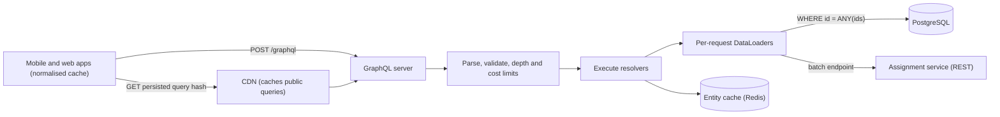
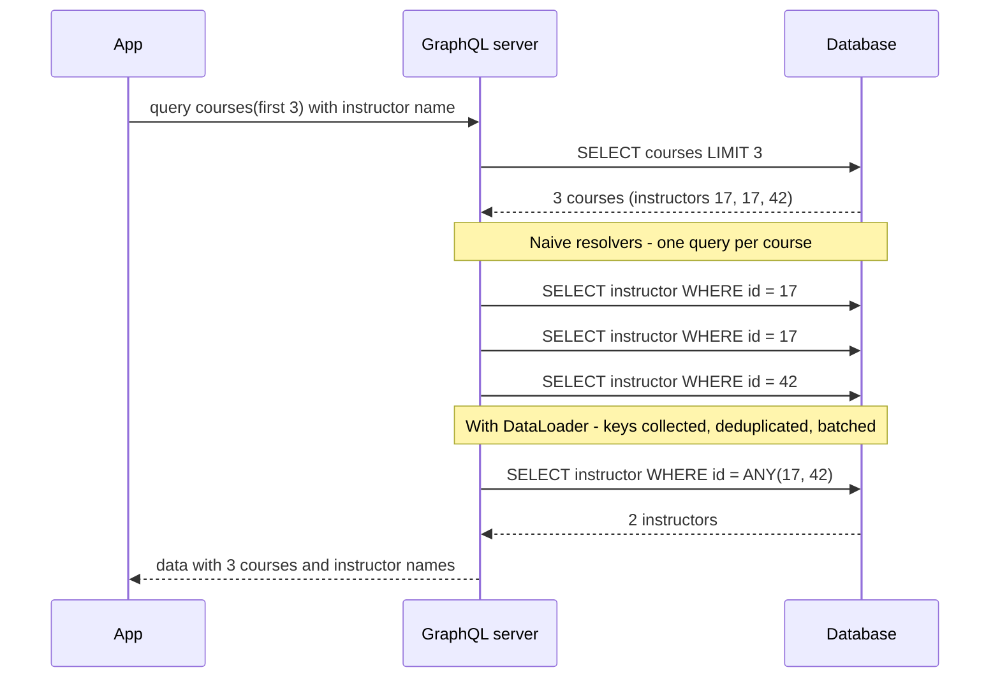

GraphQL is often introduced as "a better REST". It isn't better or worse; it moves work. With REST, the *server* decides the shape of each response and the client stitches several responses together. With GraphQL, the *client* describes exactly the shape it wants in one request, and the server does the stitching. That is a great deal for a mobile screen on a slow network, and a new set of problems for the server team: query costs that clients control, database round trips that multiply quietly, and responses that ordinary HTTP caches can't store. This lesson covers both sides.

## Learning objectives

By the end of this lesson you will be able to:

1. Explain over-fetching and under-fetching, and count the round trips and bytes they cost on a real screen.
2. Read and write a GraphQL schema (types, non-null, lists, arguments, queries, mutations) and the queries clients send.
3. Describe how a GraphQL server executes a query with resolvers, and why that naturally causes N+1 database calls.
4. Implement a batching DataLoader and show that it turns N+1 calls into 2.
5. Explain why HTTP caching is hard with GraphQL and which techniques recover it (persisted queries, client normalised caches, server-side caching).
6. Protect a GraphQL server with depth limits, complexity (cost) limits, pagination caps and trusted documents.
7. Decide when GraphQL is worth it and when REST or gRPC is the simpler choice.

## Prerequisites

- [REST API design](#/lesson/m10-rest-design): resources, status codes, pagination, Problem Details.
- [N+1 query problems](#/lesson/m09-n-plus-one): why one query per row is slow.

## Explain it like I'm a beginner

Imagine the "My courses" screen of an online learning app, the kind a college student opens between lectures. Think of the app collecting the screen's data the way you collect lunch at a busy college canteen.

**The REST way** is a set menu at several counters. Counter 1 gives you "the list of my courses" — but each plate comes with everything: name, syllabus, fee, language, 30 other fields the screen doesn't need (*over-fetching*). It doesn't include the instructor's name, so you walk to counter 2 for each course's instructor, then to counter 3 for each course's assignments (*under-fetching*: one response wasn't enough, so you make more trips).

**The GraphQL way** is a single counter with an order form. You write exactly what you want:

> For my 10 courses: the code, the progress percentage, the instructor's name, and the next two assignments.

You hand it over once and get back one tray with exactly that, arranged the way you wrote it.

The catch is behind the counter. The kitchen now receives custom orders it can't predict. If a cook fetches each instructor's details one at a time — walking to the store room 10 times for 10 courses — the kitchen gets slow (*the N+1 problem*). A smart cook collects all 10 instructor names first and makes one trip (*DataLoader batching*). And the kitchen needs rules, or someone will order "every course, with every assignment, with every submission, with every comment on every submission" and block the kitchen for everyone (*query depth and cost limits*).

## First-principles explanation

### What GraphQL is

GraphQL is a query language for APIs plus a runtime that executes those queries against a **typed schema**. It was developed at Facebook for mobile apps and open-sourced in 2015; the specification is now maintained by the GraphQL Foundation. Key properties:

- **One endpoint**, typically `POST /graphql`. The query in the body says what to fetch.
- **A schema** is the contract: every type, field and argument, with nullability.
- **The client selects fields**. The response mirrors the query's shape exactly.
- **Introspection**: the schema is queryable, which powers tooling (autocomplete, typed client generation).

A schema for our scenario — a student dashboard on an online course platform (think of a university's e-learning portal, or a site like Coursera or SWAYAM):

```graphql
type Query {
  courses(first: Int = 10, after: String): CourseConnection!
  course(code: ID!): Course
}

type Course {
  code: ID!
  name: String!
  progress: Float!          # percent complete, 0–100
  instructor: Instructor!
  assignments(first: Int = 5): [Assignment!]!
  pendingAssignments(status: AssignmentStatus = PENDING): Int!
  unreadAnnouncements: Int!
}

type Instructor { id: ID!  name: String!  city: String! }

type Assignment { name: String!  due: Date!  submitted: Boolean! }

enum AssignmentStatus { PENDING SUBMITTED GRADED LATE }

type CourseConnection {
  edges: [CourseEdge!]!
  pageInfo: PageInfo!
}
type CourseEdge { cursor: String!  node: Course! }
type PageInfo { hasNextPage: Boolean!  endCursor: String }

type Mutation {
  recordProgress(input: RecordProgressInput!): RecordProgressPayload!
}
input RecordProgressInput { courseCode: ID!  progress: Float!  asOf: Date! }
type RecordProgressPayload { course: Course  errors: [UserError!]! }
type UserError { field: String  message: String! }

scalar Date
```

And a query the mobile app sends:

```graphql
query DashboardScreen {
  courses(first: 10) {
    edges {
      node {
        code
        progress
        instructor { name }
        assignments(first: 2) { name due submitted }
      }
    }
    pageInfo { hasNextPage endCursor }
  }
}
```

Notes on the schema design:

- `!` means **non-null**. Make a field non-null only if it can *never* fail to resolve: if a non-null field errors, the null propagates to its parent, potentially wiping out a whole list.
- Lists are paginated with **connections** (edges, nodes, cursors, `pageInfo`), a convention from Relay. It is keyset pagination ([see REST design](#/lesson/m10-rest-design)) in GraphQL clothing.
- Mutations take a single `input` object and return a **payload** with the changed object *and* user-facing errors. This lets you evolve inputs without breaking clients and report business-rule failures as data.

### Over-fetching and under-fetching, with numbers

The dashboard screen with a REST API designed resource by resource (estimates for illustration):

- `GET /v1/courses?limit=10` → 10 courses × ~2 KB of fields each = 20 KB, of which the screen uses ~3 fields (*over-fetching*).
- For each course, `GET /v1/instructors/{id}` → 10 calls (*under-fetching*).
- For each course, `GET /v1/courses/{code}/assignments?limit=2` → 10 calls.

That is **21 requests**. On 4G with an 80 ms RTT, even with HTTP/2 multiplexing the calls are in **3 dependent waves** (courses first, then instructors and assignments in parallel): ≥ 3 × 80 = 240 ms of pure latency, plus per-request overhead. With HTTP/1.1 and 6 connections it's worse.

With GraphQL: **1 request**, ~3 KB response, ~1 RTT plus server time.

REST can fix this too — a purpose-built `GET /v1/dashboard-screen` endpoint (a **Backend for Frontend**, [see BFF](#/lesson/m16-gateway-bff)), or `?fields=` and `?include=instructor` parameters. That's often the simplest answer when you have one or two clients. GraphQL shines when **many different clients and screens** need different slices of a connected data graph and you don't want to build an endpoint per screen.

### How execution works: resolvers

The server parses the query text into a syntax tree, **validates** it against the schema (unknown fields, wrong argument types, and limit rules are rejected before any data is touched), then **executes** it. Execution walks the selection tree; each field has a **resolver** — a function that returns that field's value given its parent object:

- `Query.courses(first: 10)` → reads 10 courses.
- `Course.instructor` → called **once per course**, with that course as parent.
- `Course.assignments(first: 2)` → called **once per course**.
- Scalar fields like `code` → usually just read a property.

Top-level `Query` fields may run in parallel; top-level `Mutation` fields run **serially**, in order, as the spec requires.

The response:

```json
{
  "data": {
    "courses": {
      "edges": [
        { "node": { "code": "DSA-101", "progress": 62.5,
                    "instructor": { "name": "Priya Raman" },
                    "assignments": [ { "name": "Linked list lab", "due": "2026-11-15", "submitted": false } ] } }
      ],
      "pageInfo": { "hasNextPage": true, "endCursor": "YXJyYXk6OQ==" }
    }
  }
}
```

### Errors are part of the data

If `assignments` fails for one course, a GraphQL server can still return everything else, with an `errors` array that points at the failing path:

```json
{
  "data": { "courses": { "edges": [ { "node": { "code": "DSA-101", "assignments": null } } ] } },
  "errors": [ { "message": "Assignment service unavailable", "path": ["courses", "edges", 0, "node", "assignments"] } ]
}
```

This **partial success** is powerful for dashboards (one broken widget doesn't blank the screen) but it changes monitoring: many servers return HTTP `200` even when `errors` is present, so a 5xx-rate dashboard won't see the failure. The GraphQL-over-HTTP specification (with the `application/graphql-response+json` media type) uses 4xx for requests that fail validation entirely and 200 for partial results; either way, **monitor the `errors` array**, not just status codes. Business-rule failures in mutations ("progress can't go backwards") belong in the payload's `errors: [UserError!]!`, not in top-level `errors`.

### The N+1 problem, server side

GraphQL moves the client's 21 round trips *inside* your server. The naive resolver for `Course.instructor`:

```csharp
// Runs once per course: 10 courses → 10 queries
public Task<Instructor> GetInstructor([Parent] Course p, AppDb db) =>
    db.Instructors.SingleAsync(c => c.Id == p.InstructorId);
```

For `courses(first: 10)` that's 1 query for courses + 10 for instructors + 10 for assignments = **21 database queries** per request. With `first: 50` it's 101. With nested lists (courses → assignments → assignees) it grows multiplicatively. At 200 requests per second, 21 queries each is 4,200 queries per second — mostly tiny, latency-bound round trips that keep connection-pool slots busy ([see connection pooling](#/lesson/m09-connection-pooling)).

### DataLoader: batch and cache per request

**DataLoader** (named after the original JavaScript library from Facebook) fixes this with two ideas:

1. **Batching.** Resolvers don't fetch; they ask a loader for a key (`instructorLoader.LoadAsync(17)`) and get a promise (a `Task`). The loader collects all keys requested while the current level of the query is being resolved, then makes **one** call: `SELECT * FROM instructor WHERE id = ANY(@ids)`. Each waiting resolver receives its own item.
2. **Per-request caching (deduplication).** If 10 courses share 3 instructors, the batch contains 3 ids, not 10, and repeated loads of the same key within the request return the same task.

Result: 1 (courses) + 1 (instructors) + 1 (assignments) = **3 queries**, whatever `first` is. The cache is **per request**, not global: it exists to deduplicate within one query's execution, not to replace a real cache, and sharing it between users would leak data and serve stale values.

Batching changes your repository contract: every loader needs a "get many by keys" method that returns results keyed by id (`IReadOnlyDictionary<int, Instructor>`), and for one-to-many relations, a lookup (`ILookup<string, Assignment>`). Missing keys must map to `null`, not shift positions.

### Why caching is harder

REST gets HTTP caching almost for free: `GET /v1/courses/DSA-101` has a URL, a CDN can key on it, `ETag`s work ([see HTTP fundamentals](#/lesson/m10-http-fundamentals)). GraphQL breaks this:

- Queries usually go as `POST` to one URL. HTTP caches don't cache `POST`.
- Every client query is a different shape, so even a `GET /graphql?query=...` URL has low reuse.
- One response mixes public data (instructor name) and private data (my grades), with different freshness.

Techniques that recover caching:

| Technique | How it works | Good for |
|---|---|---|
| **Persisted / trusted documents** | At build time, the client registers each query; at runtime it sends only a hash (`GET /graphql?id=sha256:ab12...&variables=...`). | CDN caching of public queries; also a security allowlist |
| **Client normalised cache** (Apollo Client, Relay, urql) | The client stores objects by `__typename` + `id`, so a `Instructor:17` fetched by one query satisfies another. | Fewer requests from one app |
| **Server-side response cache** | Cache whole responses keyed by (document hash, variables, user scope). | Expensive, popular, public queries |
| **Field- or entity-level cache** | Cache resolver results or loader batches in Redis with TTLs. | Hot entities shared across many queries |
| **`@cacheControl`-style hints** | Schema annotations compute a response's max-age from its least cacheable field (supported by some servers). | Mixed public/private responses |

None of these is as simple as `Cache-Control: max-age=60` on a URL. If your data is mostly public and read-heavy (catalogues, timetables), that's a real argument for REST.

### Protecting the server: depth, complexity and limits

Clients control the query, so a single request can be enormously expensive:

```graphql
query Bomb {
  courses(first: 100) { edges { node {
    assignments(first: 100) { name
      course { assignments(first: 100) { name
        course { assignments(first: 100) { name } } } } } } } }
}
```

That's 100 × 100 × 100 × 100 = 100 million assignment resolutions from one small request — an accidental or deliberate denial of service. Defences, in layers:

1. **Pagination caps.** Every list field takes `first`, with a maximum (say 50). No unbounded lists in the schema.
2. **Depth limit.** Reject queries nested deeper than, say, 8–10 levels during validation.
3. **Complexity (cost) analysis.** Assign each field a cost, multiply child costs by list sizes (`first`), and reject queries above a budget *before executing*. Depth alone isn't enough: a shallow query with `first: 1000` on three sibling lists is wide, not deep.
4. **Trusted documents** for first-party apps: the server only executes queries registered at build time. Third parties get a public schema with stricter limits.
5. **Timeouts and cancellation** on execution, and on every downstream call.
6. **Rate limiting by cost**, not by request count: 1 request costing 5,000 points should count as much as 50 requests costing 100 ([see rate limiting](#/lesson/m10-rate-limiting)).
7. **Introspection** off in production for private APIs, as one layer of reducing surface — not as a security boundary.

Also remember **authorisation per field and per object**: a query can reach any object through relationships (`course → instructor → payoutAccount`), so checks belong in resolvers or a policy layer, not only at the endpoint.

### Versioning and evolution

GraphQL APIs usually aren't versioned in the URL. Instead, you **add** fields freely (clients only get what they ask for, so additions are invisible to old clients) and **deprecate** old ones with `@deprecated(reason: "...")`, then remove them once usage — which you can measure per field — drops to zero. Removing a field, changing its type, or making a nullable field non-null in input are breaking changes. See [API contracts and versioning](#/lesson/m10-versioning-contracts).

### When GraphQL is worth it, and when it isn't

**Good fit**

- Several client apps (Android, iOS, web, partner portal) with different screens over the same connected data.
- Read-heavy dashboards that combine many entities.
- A team willing to invest in schema design, DataLoaders, cost limits and per-field observability.

**Poor fit / simpler alternatives**

- One client and a handful of screens: a BFF with REST endpoints per screen is simpler.
- Public, cacheable, read-mostly data: REST + CDN wins.
- File upload/download and streaming: REST or dedicated endpoints.
- High-throughput internal service-to-service calls: [gRPC](#/lesson/m10-grpc) is faster and simpler.
- Simple CRUD admin APIs.

### Trade-offs

| You gain | You pay |
|---|---|
| One round trip for nested data; no over-fetching | Server must defend against expensive queries |
| Strong typed contract and tooling (codegen, introspection) | Schema design is a real skill; mistakes (nullability) are hard to undo |
| Evolution by addition and deprecation, usage per field | HTTP caching mostly lost; need persisted queries and app-level caches |
| Partial results instead of all-or-nothing | 200-with-errors complicates monitoring and alerting |
| Clients move fast without new endpoints | N+1 patterns hide in resolvers; DataLoaders needed everywhere |

## Visual explanation

### Architecture



Apps send **registered (persisted) queries** by hash with `GET`, so the **CDN** can cache public results such as the course catalogue and instructor directory;
 personalised queries go as `POST` straight to the **GraphQL server**. Every request is first **parsed and validated**, which is where depth and cost limits reject abusive queries before any data access. **Execution** calls resolvers, which never hit the database directly for related objects; they go through **per-request DataLoaders**, which batch keys into one `ANY(@ids)` SQL query or one call to the assignment service's batch endpoint. A shared **Redis entity cache** holds hot, slow-changing objects across requests. The DataLoader cache dies with the request; the Redis cache does not.

### Sequence: naive resolvers versus DataLoader



The first query returns three courses that reference instructors 17, 17 and 42. Naive resolvers run once per course and issue three separate queries — two of them identical. With a DataLoader, each resolver only *registers* its key; when the level finishes, the loader deduplicates to {17, 42} and issues **one** query, then hands each resolver its instructor. With 50 courses the naive path makes 50 queries; the loader still makes one.

## Step-by-step example

**Goal**: serve the dashboard screen for a college's e-learning portal: 5,000 students and teachers across 120 courses.

**Step 1 — estimate load.** 5,000 users × 20 screen loads/day = 100,000 queries/day ≈ 1.2 per second on average; evening study-hour peak, say 10× → ~12 queries per second. Small. The risk isn't volume, it's *cost per query*.

**Step 2 — count resolver work per query.** `courses(first: 10)` with instructor and 2 assignments: naive = 21 DB round trips; at ~1 ms each inside one data centre plus pool waits, maybe 25–40 ms (estimate). With DataLoaders: 3 round trips.

**Step 3 — set limits.** Max `first` = 50. Depth ≤ 8. Cost: each field 1, list fields multiply children by `first` (default 10). Ignoring the connection wrapper fields, the dashboard query costs 1 + 10 × (code 1 + progress 1 + instructor (1 + 1) + assignments (1 + 2 × 3)) = 1 + 10 × 11 = 111 points (we'll compute this in code). Budget: 1,000 for first-party apps.

**Step 4 — decide caching.** The course catalogue and instructor directory (public, changes weekly): persisted query via `GET`, CDN `max-age=3600`. The dashboard screen (per student's courses and progress): no CDN; DataLoaders plus a Redis cache for instructors with a 10-minute TTL.

**Step 5 — monitoring.** Log each operation's name, cost, duration and error count; alert on `errors` rate per operation, not only HTTP 5xx.

## Production-style C# implementation

Production .NET GraphQL servers usually use **Hot Chocolate** or **GraphQL.NET**. Those libraries aren't available in this course's offline checker, so the compiled code below implements the two pieces that matter most for system design — a **batching DataLoader** and **depth/cost analysis** — plus a small executor and endpoint that model what a GraphQL server does with a parsed selection tree. Then we show the equivalent Hot Chocolate setup.

```text
Learning.Api/
  Program.cs
  Learning/Models.cs
  Learning/Repositories.cs
  GraphQL/BatchDataLoader.cs
  GraphQL/QueryAnalysis.cs
  GraphQL/DashboardExecutor.cs
```

```csharp file=Learning/Models.cs
namespace Learning.Domain;

public sealed record Course(string Code, string Name, int InstructorId, decimal Progress);

public sealed record Instructor(int Id, string Name, string City);

public sealed record Assignment(string CourseCode, string Name, DateOnly Due, bool Submitted);
```

```csharp file=Learning/Repositories.cs
namespace Learning.Domain;

public interface ICourseRepository
{
    Task<IReadOnlyList<Course>> ListAsync(int first, CancellationToken ct);
}

/// <summary>Batch-shaped contracts: one call for many keys. This is what DataLoaders need.</summary>
public interface IInstructorRepository
{
    Task<IReadOnlyDictionary<int, Instructor>> GetByIdsAsync(IReadOnlyList<int> ids, CancellationToken ct);
}

public interface IAssignmentRepository
{
    Task<IReadOnlyDictionary<string, IReadOnlyList<Assignment>>> GetByCourseCodesAsync(IReadOnlyList<string> codes, CancellationToken ct);
}

/// <summary>In-memory data with call counters, so tests and logs can show N+1 versus batched access.</summary>
public sealed class InMemoryLearningStore : ICourseRepository, IInstructorRepository, IAssignmentRepository
{
    private readonly List<Course> _courses =
    [
        new("DSA-101", "Data Structures in C#", 17, 62.5m),
        new("DSA-102", "Algorithms in C#", 17, 41.0m),
        new("SQL-201", "PostgreSQL for Developers", 42, 78.2m),
    ];
    private readonly Dictionary<int, Instructor> _instructors = new()
    {
        [17] = new(17, "Priya Raman", "Pune"),
        [42] = new(42, "Arjun Mehta", "Nagpur"),
    };
    private readonly List<Assignment> _assignments =
    [
        new("DSA-101", "Linked list lab", new DateOnly(2026, 11, 15), false),
        new("DSA-101", "Hash map quiz", new DateOnly(2027, 1, 30), false),
        new("SQL-201", "Index tuning project", new DateOnly(2026, 12, 1), false),
    ];

    public int InstructorCalls { get; private set; }
    public int AssignmentCalls { get; private set; }

    public Task<IReadOnlyList<Course>> ListAsync(int first, CancellationToken ct) =>
        Task.FromResult<IReadOnlyList<Course>>(_courses.Take(first).ToList());

    public Task<IReadOnlyDictionary<int, Instructor>> GetByIdsAsync(IReadOnlyList<int> ids, CancellationToken ct)
    {
        InstructorCalls++;   // SQL: SELECT * FROM instructor WHERE id = ANY(@ids)
        IReadOnlyDictionary<int, Instructor> found = ids.Where(_instructors.ContainsKey).Distinct().ToDictionary(id => id, id => _instructors[id]);
        return Task.FromResult(found);
    }

    public Task<IReadOnlyDictionary<string, IReadOnlyList<Assignment>>> GetByCourseCodesAsync(IReadOnlyList<string> codes, CancellationToken ct)
    {
        AssignmentCalls++;    // SQL: SELECT * FROM assignment WHERE course_code = ANY(@codes) ORDER BY due
        IReadOnlyDictionary<string, IReadOnlyList<Assignment>> result = codes.Distinct().ToDictionary(
            code => code,
            code => (IReadOnlyList<Assignment>)_assignments.Where(m => m.CourseCode == code).OrderBy(m => m.Due).ToList());
        return Task.FromResult(result);
    }
}
```

```csharp file=GraphQL/BatchDataLoader.cs
namespace Learning.GraphQL;

/// <summary>Per-request batching loader. Resolvers call LoadAsync; the executor calls DispatchAsync
/// once per execution level, which fetches all pending keys in ONE call. Not thread-safe by design:
/// one instance per request, used by one executor.</summary>
public sealed class BatchDataLoader<TKey, TValue>(
    Func<IReadOnlyList<TKey>, CancellationToken, Task<IReadOnlyDictionary<TKey, TValue>>> fetchMany)
    where TKey : notnull
{
    private readonly Dictionary<TKey, TaskCompletionSource<TValue?>> _requested = new();
    private readonly List<TKey> _pending = new();

    public int BatchCount { get; private set; }

    public Task<TValue?> LoadAsync(TKey key)
    {
        if (_requested.TryGetValue(key, out var existing)) return existing.Task;   // per-request dedupe/cache
        var tcs = new TaskCompletionSource<TValue?>(TaskCreationOptions.RunContinuationsAsynchronously);
        _requested[key] = tcs;
        _pending.Add(key);
        return tcs.Task;
    }

    public async Task DispatchAsync(CancellationToken ct)
    {
        if (_pending.Count == 0) return;
        var keys = _pending.ToArray();
        _pending.Clear();
        BatchCount++;
        try
        {
            var found = await fetchMany(keys, ct);
            foreach (var key in keys)
                _requested[key].TrySetResult(found.TryGetValue(key, out var value) ? value : default);
        }
        catch (Exception ex)
        {
            foreach (var key in keys) _requested[key].TrySetException(ex);   // every waiter sees the failure
        }
    }
}
```

```csharp file=GraphQL/QueryAnalysis.cs
namespace Learning.GraphQL;

/// <summary>A parsed field selection. A real server builds this tree from the query text.</summary>
public sealed record FieldSelection(string Name, IReadOnlyList<FieldSelection>? Children = null, int? First = null)
{
    public IReadOnlyList<FieldSelection> Fields => Children ?? [];
}

public sealed record QueryLimits(int MaxDepth, int MaxCost, int MaxFirst, int DefaultListSize);

public sealed record AnalysisResult(int Depth, long Cost, IReadOnlyList<string> Errors)
{
    public bool Allowed => Errors.Count == 0;
}

/// <summary>Validation-time protection: runs before any resolver touches data.</summary>
public sealed class QueryAnalyzer(IReadOnlySet<string> listFields, QueryLimits limits)
{
    public AnalysisResult Analyze(FieldSelection root)
    {
        var errors = new List<string>();
        var depth = Depth(root);
        var cost = Cost(root, errors);
        if (depth > limits.MaxDepth) errors.Add($"Query depth {depth} exceeds the maximum of {limits.MaxDepth}.");
        if (cost > limits.MaxCost) errors.Add($"Query cost {cost} exceeds the budget of {limits.MaxCost}.");
        return new AnalysisResult(depth, cost, errors);
    }

    private static int Depth(FieldSelection f) => 1 + (f.Fields.Count == 0 ? 0 : f.Fields.Max(Depth));

    // cost(field) = 1 + multiplier × Σ cost(children); multiplier = first (or default) for list fields.
    private long Cost(FieldSelection f, List<string> errors)
    {
        if (f.First is { } first && (first < 1 || first > limits.MaxFirst))
            errors.Add($"'{f.Name}' asks for first: {first}; allowed range is 1..{limits.MaxFirst}.");
        long multiplier = listFields.Contains(f.Name) ? Math.Clamp(f.First ?? limits.DefaultListSize, 1, limits.MaxFirst) : 1;
        long children = 0;
        foreach (var child in f.Fields) children += Cost(child, errors);
        return 1 + multiplier * children;
    }
}
```

```csharp file=GraphQL/DashboardExecutor.cs
using Learning.Domain;

namespace Learning.GraphQL;

public sealed class UnknownFieldException(string field) : Exception($"Cannot query field '{field}'.");

/// <summary>Executes { courses(first) { code name progress instructor { ... } assignments(first) { ... } } }
/// level by level: resolve courses, register all child loads, dispatch each loader once, then fill rows.</summary>
public sealed class DashboardExecutor(ICourseRepository courses, IInstructorRepository instructors, IAssignmentRepository assignments)
{
    public async Task<List<Dictionary<string, object?>>> ExecuteCoursesAsync(FieldSelection coursesField, CancellationToken ct)
    {
        var instructorLoader = new BatchDataLoader<int, Instructor>(instructors.GetByIdsAsync);
        var assignmentLoader = new BatchDataLoader<string, IReadOnlyList<Assignment>>(assignments.GetByCourseCodesAsync);

        var list = await courses.ListAsync(coursesField.First ?? 10, ct);
        var rows = new List<Dictionary<string, object?>>(list.Count);
        var deferred = new List<Func<Task>>();   // fill-ins that run after the loaders dispatch

        foreach (var p in list)
        {
            var row = new Dictionary<string, object?>();
            foreach (var field in coursesField.Fields)
            {
                switch (field.Name)
                {
                    case "code": row["code"] = p.Code; break;
                    case "name": row["name"] = p.Name; break;
                    case "progress": row["progress"] = p.Progress; break;
                    case "instructor":
                        var instructorTask = instructorLoader.LoadAsync(p.InstructorId);
                        deferred.Add(async () => row["instructor"] = ProjectInstructor(await instructorTask, field));
                        break;
                    case "assignments":
                        var assignmentsTask = assignmentLoader.LoadAsync(p.Code);
                        deferred.Add(async () => row["assignments"] = ProjectAssignments(await assignmentsTask, field));
                        break;
                    default: throw new UnknownFieldException(field.Name);
                }
            }
            rows.Add(row);
        }

        await instructorLoader.DispatchAsync(ct);   // one batch for all instructors on this level
        await assignmentLoader.DispatchAsync(ct);    // one batch for all assignment lists
        foreach (var fill in deferred) await fill(); // tasks are complete; runs sequentially, no shared-state races
        return rows;
    }

    private static Dictionary<string, object?>? ProjectInstructor(Instructor? c, FieldSelection selection)
    {
        if (c is null) return null;
        var result = new Dictionary<string, object?>();
        foreach (var f in selection.Fields)
            result[f.Name] = f.Name switch
            {
                "id" => c.Id,
                "name" => c.Name,
                "city" => c.City,
                _ => throw new UnknownFieldException(f.Name),
            };
        return result;
    }

    private static List<Dictionary<string, object?>> ProjectAssignments(IReadOnlyList<Assignment>? all, FieldSelection selection) =>
        (all ?? []).Take(selection.First ?? 5).Select(m =>
        {
            var result = new Dictionary<string, object?>();
            foreach (var f in selection.Fields)
                result[f.Name] = f.Name switch
                {
                    "name" => m.Name,
                    "due" => m.Due,
                    "submitted" => m.Submitted,
                    _ => throw new UnknownFieldException(f.Name),
                };
            return result;
        }).ToList();
}
```

```csharp file=Program.cs
using Learning.Domain;
using Learning.GraphQL;

var builder = WebApplication.CreateBuilder(args);

builder.Services.AddProblemDetails();
builder.Services.AddSingleton<InMemoryLearningStore>();
builder.Services.AddSingleton<ICourseRepository>(sp => sp.GetRequiredService<InMemoryLearningStore>());
builder.Services.AddSingleton<IInstructorRepository>(sp => sp.GetRequiredService<InMemoryLearningStore>());
builder.Services.AddSingleton<IAssignmentRepository>(sp => sp.GetRequiredService<InMemoryLearningStore>());
builder.Services.AddScoped<DashboardExecutor>();   // scoped: loaders live for one request
builder.Services.AddSingleton(new QueryAnalyzer(
    new HashSet<string> { "courses", "assignments" },
    new QueryLimits(MaxDepth: 8, MaxCost: 1_000, MaxFirst: 50, DefaultListSize: 10)));

var app = builder.Build();
app.UseExceptionHandler();

// Teaching endpoint: accepts an already-parsed selection tree. A real server accepts GraphQL text at /graphql.
app.MapPost("/graphql-model", async (FieldSelection root, QueryAnalyzer analyzer, DashboardExecutor executor, ILogger<Program> log, CancellationToken ct) =>
{
    if (root.Name != "courses")
        return Results.Ok(new { errors = new[] { new { message = $"Cannot query field '{root.Name}' on type 'Query'." } } });

    var analysis = analyzer.Analyze(root);
    log.LogInformation("GraphQL operation depth {Depth} cost {Cost} allowed {Allowed}", analysis.Depth, analysis.Cost, analysis.Allowed);
    if (!analysis.Allowed)
        return Results.Json(new { errors = analysis.Errors.Select(e => new { message = e }) }, statusCode: StatusCodes.Status400BadRequest);

    try
    {
        var rows = await executor.ExecuteCoursesAsync(root, ct);
        return Results.Ok(new { data = new { courses = rows } });
    }
    catch (UnknownFieldException ex)
    {
        return Results.Json(new { errors = new[] { new { message = ex.Message } } }, statusCode: StatusCodes.Status400BadRequest);
    }
});

app.Run();

public partial class Program;
```

How this maps to a real GraphQL server:

- `FieldSelection` is the **selection set** the parser produces; `QueryAnalyzer` is a **validation rule** (Hot Chocolate and GraphQL.NET both ship depth and cost rules).
- `DashboardExecutor` resolves **level by level** and dispatches loaders between levels — the same strategy real executors use to make batching work automatically.
- `BatchDataLoader` is **scoped to a request** via the scoped executor. Registering a loader as a singleton would share its cache across users: a data leak and a stale-data bug.

The same server with **Hot Chocolate** 14 or later, using its source-generated style (attribute and option names change between major versions; check the docs for the version you use):

```csharp
// Program.cs
builder.Services
    .AddGraphQLServer()
    .AddTypes()                                   // generated: registers [QueryType], [ObjectType<T>] and [DataLoader] code
    .AddMaxExecutionDepthRule(8)
    .ModifyCostOptions(o => { o.MaxFieldCost = 1_000; o.EnforceCostLimits = true; })
    .ModifyPagingOptions(o => { o.MaxPageSize = 50; o.DefaultPageSize = 10; });
app.MapGraphQL();   // POST/GET /graphql

// Root query
[QueryType]
public static partial class CourseQueries
{
    [UsePaging]
    public static IQueryable<Course> GetCourses(AppDb db) => db.Courses.OrderBy(c => c.Code);
}

// Extra fields on Course, resolved through a loader
[ObjectType<Course>]
public static partial class CourseNode
{
    public static Task<Instructor?> GetInstructorAsync(
        [Parent] Course course, IInstructorByIdDataLoader loader, CancellationToken ct) =>
        loader.LoadAsync(course.InstructorId, ct);
}

// The source generator turns this method into IInstructorByIdDataLoader (batching + per-request cache)
internal static class InstructorDataLoaders
{
    [DataLoader]
    public static Task<Dictionary<int, Instructor>> GetInstructorByIdAsync(
        IReadOnlyList<int> ids, AppDb db, CancellationToken ct) =>
        db.Instructors.Where(i => ids.Contains(i.Id)).ToDictionaryAsync(i => i.Id, ct);   // SQL: WHERE id = ANY(@ids)
}
```

The shape is the same as our model: resolvers ask a loader for a key; the framework's batch scheduler dispatches; validation rules enforce depth and cost before execution.

## Bad design vs good design

**Bad**

```graphql
type Query {
  allCourses: [Course]                 # unbounded, nullable list of nullable items
  submissionsForEverything: [Submission]
}
type Course {
  id: Int                                # database id, nullable
  instructor: Instructor                 # resolver does SELECT ... WHERE id = @id per course
  submissions: [Submission]              # every submission ever, no pagination
}
type Mutation {
  updateCourse(id: Int, name: String, progress: Float, status: String): Boolean
}
```

Problems: unbounded lists invite huge responses; nullable-everything gives clients no guarantees; per-object resolvers cause N+1; a `Boolean` mutation result hides *what* changed and *why* it failed; `status: String` accepts any value; a mutation with many loose arguments can't evolve without breaking.

**Good**: the schema at the top of this lesson — connections with `first`/`after` caps, non-null where truly guaranteed, enums, input objects, payloads with `UserError`s, DataLoaders behind every relationship, and depth/cost limits at validation time.

**Is GraphQL itself worth it here?** For one mobile app and one dashboard owned by one team, a BFF with two REST endpoints (`GET /v1/dashboard-screen`, `GET /v1/courses/{code}/details`) gets most of the benefit with plain HTTP caching and no cost analysis. Choose GraphQL when the number of client screens and teams makes "one endpoint per screen" unmanageable.

:::callout type=warning title="The DataLoader cache is per request"
Never register a DataLoader (or anything holding its cache) as a singleton. A shared loader cache returns one user's data to another and never sees updates. For cross-request caching, use a real cache with TTLs and invalidation.
:::

:::callout type=tradeoff title="Depth limits are not enough"
A depth-3 query with three sibling lists of `first: 1000` can cost far more than a depth-10 query of single objects. Use cost analysis with list multipliers, plus page-size caps, plus timeouts.
:::

## Practical playground

The starter graph is a GraphQL gateway that resolves the dashboard screen by calling three REST services per course, with no batching or caching. Improve it in the HLD canvas: add batching to the downstream calls, decide what can go through a CDN with persisted queries, add an entity cache, and put cost-based rate limiting in front. Annotate each edge with calls per GraphQL request before and after.

:::playground type=hld title="Make the learning-dashboard GraphQL gateway efficient"
```json
{
  "nodes": [
    { "id": "apps", "type": "client", "label": "Mobile + web apps", "props": { "rps": 12 } },
    { "id": "gql", "type": "api-gateway", "label": "GraphQL gateway (naive resolvers)", "props": { "instances": 2 } },
    { "id": "pkg", "type": "app-server", "label": "Course service (REST)" },
    { "id": "con", "type": "app-server", "label": "Instructor service (REST, GET by id only)" },
    { "id": "mil", "type": "app-server", "label": "Assignment service (REST)" },
    { "id": "db", "type": "database", "label": "PostgreSQL" }
  ],
  "edges": [
    { "from": "apps", "to": "gql", "kind": "sync", "label": "POST /graphql" },
    { "from": "gql", "to": "pkg", "kind": "sync", "label": "1 call" },
    { "from": "gql", "to": "con", "kind": "sync", "label": "1 call per course" },
    { "from": "gql", "to": "mil", "kind": "sync", "label": "1 call per course" },
    { "from": "pkg", "to": "db", "kind": "sync" },
    { "from": "con", "to": "db", "kind": "sync" },
    { "from": "mil", "to": "db", "kind": "sync" }
  ]
}
```
:::

## Exercises

:::exercise id=m10-graphql-ex1 difficulty=beginner kind=written title="Count the round trips: REST screen versus one GraphQL query"
A student's "This week" screen shows: the student's name; their 5 upcoming assignments (title, due date, maximum marks); for each assignment, the course name and the count of unanswered questions in that assignment's discussion thread.

The existing REST API (open it in the **API design playground**, `#/playground/api`, and model these endpoints if you want to see the lint view) has:

- `GET /v1/me` → 4 KB of profile fields.
- `GET /v1/assignments?assignee=me&due=upcoming&limit=5` → 5 × 3 KB.
- `GET /v1/courses/{code}` → 6 KB each (syllabus, fees, instructors, ...).
- `GET /v1/assignments/{id}/questions?status=open` → full question objects, average 4 questions × 2 KB.

1. Count the requests, dependent waves and bytes for one screen load. With a 100 ms RTT, what's the minimum latency?
2. Write the GraphQL query for the screen (invent sensible field names).
3. Name one REST-only alternative that would also fix the problem, and say when you'd prefer it.
::acceptance
- Counts 1 + 1 + 5 + 5 = 12 requests (or fewer if several assignments belong to the same course and course calls are deduplicated) in 2–3 dependent waves, and roughly 4 + 15 + 30 + 40 = 89 KB.
- Minimum latency ≥ 2 waves × 100 ms (3 waves if `/me` is needed before the list), stated with reasoning.
- The GraphQL query selects only the needed fields, uses `first: 5`, and asks for a question *count*, not question objects.
- Proposes a BFF/screen endpoint or `include`/`fields` parameters, with a reason to prefer it (one client, cacheability, simplicity).
::hint
Draw which calls depend on the result of an earlier call. Calls with no dependency can run in parallel in the same wave.
::hint
Course codes and assignment ids come from the assignment list, so course and question calls can't start until that list returns.
::hint
Over-fetching: the screen needs a number of open questions, but the API returns full question objects.
::hint
```graphql
query ThisWeek { me { name upcomingAssignments(first: 5) { edges { node { title due maxMarks course { name } openQuestionCount } } } } }
```
::solution
**1. REST cost.** Wave 1: `/v1/me` and `/v1/assignments?assignee=me` (the list can use "me" without waiting) — 2 requests. Wave 2: 5 course calls + 5 question calls in parallel — 10 requests (fewer course calls if assignments share courses). Total **12 requests in 2 waves**; at 100 ms RTT, at least **200 ms** of network latency before server time, more on HTTP/1.1 where 10 parallel requests exceed 6 connections. Bytes: 4 + 15 + 30 + 40 = **~89 KB**, of which the screen uses perhaps 2 KB.

**2. GraphQL.**

```graphql
query ThisWeek {
  me {
    name
    upcomingAssignments(first: 5) {
      edges {
        node {
          title
          due
          maxMarks
          course { name }
          openQuestionCount
        }
      }
    }
  }
}
```

One request, one RTT (~100 ms) plus server time, and a response of roughly 1–2 KB. The server must use DataLoaders for `course` and a batched count query for `openQuestionCount` (`SELECT assignment_id, count(*) FROM question WHERE assignment_id = ANY(@ids) AND status = 'open' GROUP BY assignment_id`).

**3. REST alternative.** A BFF endpoint `GET /v1/me/week` that returns exactly this screen, or `GET /v1/assignments?assignee=me&limit=5&include=course&fields=title,due,maxMarks` plus an `openQuestionCount` field on assignments. Prefer it when there's one client app, when the response is cacheable per user with `ETag`, or when the team doesn't want to run GraphQL infrastructure (cost limits, DataLoaders, new monitoring).
::mistakes
- Counting all 12 calls as sequential (1.2 s) — independent calls run in parallel.
- Writing a GraphQL query that fetches `questions { ... }` and counts on the client, keeping the over-fetching.
- Forgetting the server-side cost: the GraphQL query is one round trip for the client but many lookups for the server.
:::

:::exercise id=m10-graphql-ex2 difficulty=beginner kind=code title="Reject queries that are too deep"
Implement depth calculation and a depth-limit check over a parsed selection tree.
::requirements
- `Selection(string Name, Selection[] Children)` is given.
- `DepthLimit.Depth(Selection root)`: a field with no children has depth 1; otherwise 1 + the maximum depth of its children.
- `DepthLimit.Check(Selection root, int maxDepth)` returns `null` if allowed, or an error message containing both the actual depth and the maximum.
- `maxDepth < 1` throws `ArgumentOutOfRangeException`.
::acceptance
- `courses { code }` has depth 2.
- `courses { code instructor { name } }` has depth 3 (the deepest branch counts, not the sum).
- With `maxDepth = 3`, a depth-4 query returns a message mentioning 4 and 3.
::hint
This is the height of a tree. Recursion is the natural fit.
::hint
`children.Length == 0 ? 1 : 1 + children.Max(Depth)`.
::hint
Very deep malicious queries could overflow the stack with naive recursion. Real servers bound depth while parsing; for this exercise, recursion is fine.
::starter
```csharp file=DepthLimit.cs
using System;
using System.Linq;

public sealed record Selection(string Name, Selection[] Children)
{
    public static Selection Leaf(string name) => new(name, Array.Empty<Selection>());
}

public static class DepthLimit
{
    public static int Depth(Selection root) => throw new NotImplementedException();
    public static string? Check(Selection root, int maxDepth) => throw new NotImplementedException();
}
```
::tests
```csharp file=DepthLimitTests.cs
using System;
using Xunit;

public class DepthLimitTests
{
    private static Selection S(string name, params Selection[] children) => new(name, children);
    private static Selection L(string name) => Selection.Leaf(name);

    [Fact] public void Leaf_is_depth_one() => Assert.Equal(1, DepthLimit.Depth(L("code")));

    [Fact] public void One_level() => Assert.Equal(2, DepthLimit.Depth(S("courses", L("code"))));

    [Fact] public void Deepest_branch_counts() =>
        Assert.Equal(3, DepthLimit.Depth(S("courses", L("code"), S("instructor", L("name")), L("name"))));

    [Fact]
    public void Too_deep_is_rejected_with_numbers()
    {
        var q = S("courses", S("assignments", S("course", L("code"))));
        var error = DepthLimit.Check(q, 3);
        Assert.NotNull(error);
        Assert.Contains("4", error);
        Assert.Contains("3", error);
    }

    [Fact] public void Within_limit_is_allowed() => Assert.Null(DepthLimit.Check(S("courses", L("code")), 3));

    [Fact] public void Invalid_max_throws() => Assert.Throws<ArgumentOutOfRangeException>(() => DepthLimit.Check(L("x"), 0));
}
```
::solution
```csharp file=DepthLimit.cs
using System;
using System.Linq;

public sealed record Selection(string Name, Selection[] Children)
{
    public static Selection Leaf(string name) => new(name, Array.Empty<Selection>());
}

public static class DepthLimit
{
    public static int Depth(Selection root) =>
        root.Children.Length == 0 ? 1 : 1 + root.Children.Max(Depth);

    public static string? Check(Selection root, int maxDepth)
    {
        if (maxDepth < 1) throw new ArgumentOutOfRangeException(nameof(maxDepth));
        var depth = Depth(root);
        return depth > maxDepth ? $"Query depth {depth} exceeds the maximum allowed depth of {maxDepth}." : null;
    }
}
```

Depth limits stop "cyclic" queries (`course → assignments → course → assignments ...`) cheaply. Real servers also count fragments after expanding them, since a fragment can hide nesting.
::mistakes
- Summing children's depths instead of taking the maximum.
- Counting the operation (`query { ... }`) as a level inconsistently between client docs and server — document your definition.
:::

:::exercise id=m10-graphql-ex3 difficulty=intermediate kind=code title="Build a batching, deduplicating DataLoader"
Implement the loader that turns N+1 lookups into one batch per execution level.
::requirements
- `Loader<TKey, TValue>(Func<IReadOnlyList<TKey>, Task<IReadOnlyDictionary<TKey, TValue>>> fetch)`.
- `Load(TKey key)` returns a `Task<TValue?>` and does **not** call `fetch`.
- `DispatchAsync()` calls `fetch` **once** with all distinct pending keys (in first-requested order), then completes every waiting task; keys missing from the result complete with `default`.
- Loading a key already requested in this loader returns the **same** task (per-request cache) and does not add it to a later batch.
- If `fetch` throws, every task in that batch faults with the same exception.
- `DispatchAsync()` with nothing pending does not call `fetch`.
::acceptance
- 10 loads of 3 distinct keys → one `fetch` call with exactly those 3 keys.
- A missing key yields `null`.
- Loading key 17 again after dispatch returns the completed task and doesn't trigger another fetch.
- A failing fetch faults all tasks of that batch.
::hint
You need two collections: everything requested so far (key → `TaskCompletionSource`) and the keys waiting for the next dispatch.
::hint
Return `tcs.Task` from `Load`. Complete it in `DispatchAsync` with `TrySetResult` or `TrySetException`.
::hint
Use `TaskCreationOptions.RunContinuationsAsynchronously` so awaiting resolvers don't run inside your loop.
::hint
```csharp
var keys = _pending.ToArray(); _pending.Clear();
var found = await _fetch(keys);
foreach (var k in keys) _all[k].TrySetResult(found.TryGetValue(k, out var v) ? v : default);
```
::starter
```csharp file=Loader.cs
using System;
using System.Collections.Generic;
using System.Threading.Tasks;

public sealed class Loader<TKey, TValue> where TKey : notnull
{
    private readonly Func<IReadOnlyList<TKey>, Task<IReadOnlyDictionary<TKey, TValue>>> _fetch;

    public Loader(Func<IReadOnlyList<TKey>, Task<IReadOnlyDictionary<TKey, TValue>>> fetch) => _fetch = fetch;

    public Task<TValue?> Load(TKey key) => throw new NotImplementedException();

    public Task DispatchAsync() => throw new NotImplementedException();
}
```
::tests
```csharp file=LoaderTests.cs
using System;
using System.Collections.Generic;
using System.Linq;
using System.Threading.Tasks;
using Xunit;

public class LoaderTests
{
    private static readonly Dictionary<int, string> Instructors = new() { [17] = "Priya Raman", [42] = "Arjun Mehta", [99] = "Sara Thomas" };

    private sealed class Counting
    {
        public List<int[]> Batches { get; } = new();
        public Task<IReadOnlyDictionary<int, string>> Fetch(IReadOnlyList<int> keys)
        {
            Batches.Add(keys.ToArray());
            IReadOnlyDictionary<int, string> found = keys.Where(Instructors.ContainsKey).ToDictionary(k => k, k => Instructors[k]);
            return Task.FromResult(found);
        }
    }

    [Fact]
    public async Task Ten_loads_three_keys_one_batch()
    {
        var c = new Counting();
        var loader = new Loader<int, string>(c.Fetch);
        var keys = new[] { 17, 17, 42, 17, 99, 42, 17, 99, 42, 17 };
        var tasks = keys.Select(loader.Load).ToList();
        Assert.Empty(c.Batches);

        await loader.DispatchAsync();
        var names = await Task.WhenAll(tasks);

        Assert.Single(c.Batches);
        Assert.Equal(new[] { 17, 42, 99 }, c.Batches[0]);
        Assert.Equal("Priya Raman", names[0]);
        Assert.Equal("Sara Thomas", names[4]);
    }

    [Fact]
    public async Task Missing_key_is_null()
    {
        var loader = new Loader<int, string>(new Counting().Fetch);
        var t = loader.Load(5);
        await loader.DispatchAsync();
        Assert.Null(await t);
    }

    [Fact]
    public async Task Cached_key_is_not_fetched_again()
    {
        var c = new Counting();
        var loader = new Loader<int, string>(c.Fetch);
        var first = loader.Load(17);
        await loader.DispatchAsync();
        var again = loader.Load(17);
        await loader.DispatchAsync();
        Assert.Same(first, again);
        Assert.Single(c.Batches);
    }

    [Fact]
    public async Task Empty_dispatch_does_not_fetch()
    {
        var c = new Counting();
        await new Loader<int, string>(c.Fetch).DispatchAsync();
        Assert.Empty(c.Batches);
    }

    [Fact]
    public async Task Failure_faults_every_waiter()
    {
        var loader = new Loader<int, string>(_ => throw new InvalidOperationException("db down"));
        var a = loader.Load(1);
        var b = loader.Load(2);
        await loader.DispatchAsync();
        await Assert.ThrowsAsync<InvalidOperationException>(() => a);
        await Assert.ThrowsAsync<InvalidOperationException>(() => b);
    }
}
```
::solution
```csharp file=Loader.cs
using System;
using System.Collections.Generic;
using System.Threading.Tasks;

public sealed class Loader<TKey, TValue> where TKey : notnull
{
    private readonly Func<IReadOnlyList<TKey>, Task<IReadOnlyDictionary<TKey, TValue>>> _fetch;
    private readonly Dictionary<TKey, TaskCompletionSource<TValue?>> _all = new();
    private readonly List<TKey> _pending = new();

    public Loader(Func<IReadOnlyList<TKey>, Task<IReadOnlyDictionary<TKey, TValue>>> fetch) => _fetch = fetch;

    public Task<TValue?> Load(TKey key)
    {
        if (_all.TryGetValue(key, out var existing)) return existing.Task;
        var tcs = new TaskCompletionSource<TValue?>(TaskCreationOptions.RunContinuationsAsynchronously);
        _all[key] = tcs;
        _pending.Add(key);
        return tcs.Task;
    }

    public async Task DispatchAsync()
    {
        if (_pending.Count == 0) return;
        var keys = _pending.ToArray();
        _pending.Clear();
        try
        {
            var found = await _fetch(keys);
            foreach (var key in keys)
                _all[key].TrySetResult(found.TryGetValue(key, out var value) ? value : default);
        }
        catch (Exception ex)
        {
            foreach (var key in keys) _all[key].TrySetException(ex);
        }
    }
}
```

The fetch function maps to `SELECT ... WHERE id = ANY(@ids)` or a downstream batch endpoint. Because results come back as a dictionary, order and missing rows can't misalign values with keys — a classic bug when batch APIs return lists.
::mistakes
- Calling `fetch` inside `Load` — that's just N+1 with extra steps.
- Returning a list from the batch call and matching by position; a missing row shifts every later value.
- Making the loader a singleton "for performance", sharing one user's cached data with everyone.
- Letting `DispatchAsync` throw instead of faulting the waiters, so some resolvers hang forever.
::extensions
Add a `maxBatchSize` (for example 500) that splits large key sets into several fetches, since `ANY(@ids)` with 50,000 ids is itself a problem.
:::

:::exercise id=m10-graphql-ex4 difficulty=intermediate kind=code title="Compute query cost with list multipliers"
Depth limits miss wide queries. Implement cost analysis that multiplies the cost of a list's children by its page size.
::requirements
- `Field(string Name, Field[] Children, int? First = null)` is given; `CostCalculator(ISet<string> listFields, int defaultPageSize, int maxPageSize)`.
- `Cost(Field f) = 1 + multiplier × Σ Cost(child)`; the multiplier is `First ?? defaultPageSize` for fields in `listFields`, and 1 otherwise.
- `First` greater than `maxPageSize` or less than 1 throws `ArgumentOutOfRangeException` naming the field.
- `Check(Field root, long budget)` returns `null` if `Cost(root) <= budget`, otherwise a message containing the cost and the budget.
::acceptance
- `courses(first: 10) { code }` costs 1 + 10 × 1 = 11.
- `courses(first: 10) { code instructor { name } assignments(first: 2) { name due } }` costs 1 + 10 × (1 + 2 + (1 + 2 × 2)) = 81.
- A list without `first` uses the default page size.
- `first: 500` with max 50 throws.
::hint
Write the recursion exactly as the formula; test with the 11 example first.
::hint
`instructor { name }` is not a list: 1 + 1 × 1 = 2.
::hint
`assignments(first: 2) { name due }` = 1 + 2 × (1 + 1) = 5. Add `code` (1) and `instructor { name }` (2) for an inner sum of 8, so the total is 1 + 10 × 8 = 81.
::hint
```csharp
long multiplier = _listFields.Contains(f.Name) ? f.First ?? _defaultPageSize : 1;
long children = 0;
foreach (var child in f.Children) children += Cost(child);
return 1 + multiplier * children;
```
::starter
```csharp file=CostCalculator.cs
using System;
using System.Collections.Generic;

public sealed record Field(string Name, Field[] Children, int? First = null);

public sealed class CostCalculator
{
    private readonly ISet<string> _listFields;
    private readonly int _defaultPageSize;
    private readonly int _maxPageSize;

    public CostCalculator(ISet<string> listFields, int defaultPageSize, int maxPageSize)
    {
        _listFields = listFields;
        _defaultPageSize = defaultPageSize;
        _maxPageSize = maxPageSize;
    }

    public long Cost(Field f) => throw new NotImplementedException();
    public string? Check(Field root, long budget) => throw new NotImplementedException();
}
```
::tests
```csharp file=CostCalculatorTests.cs
using System;
using System.Collections.Generic;
using Xunit;

public class CostCalculatorTests
{
    private static Field F(string name, params Field[] children) => new(name, children);
    private static Field List(string name, int? first, params Field[] children) => new(name, children, first);
    private static CostCalculator Calc() => new(new HashSet<string> { "courses", "assignments" }, defaultPageSize: 10, maxPageSize: 50);

    [Fact] public void Simple_list() => Assert.Equal(11, Calc().Cost(List("courses", 10, F("code"))));

    [Fact]
    public void Nested_lists_multiply() =>
        Assert.Equal(81, Calc().Cost(List("courses", 10, F("code"), F("instructor", F("name")), List("assignments", 2, F("name"), F("due")))));

    [Fact] public void Default_page_size_applies() => Assert.Equal(21, Calc().Cost(List("courses", null, F("code"), F("name"))));

    [Fact] public void Non_list_has_multiplier_one() => Assert.Equal(3, Calc().Cost(F("instructor", F("name"), F("city"))));

    [Fact]
    public void Page_size_above_max_throws()
    {
        var ex = Assert.Throws<ArgumentOutOfRangeException>(() => Calc().Cost(List("courses", 500, F("code"))));
        Assert.Contains("courses", ex.Message);
    }

    [Fact]
    public void Budget_check_reports_numbers()
    {
        var wide = List("courses", 50, List("assignments", 50, F("name")));   // 1 + 50 × (1 + 50 × 1) = 2551
        var message = Calc().Check(wide, 1000);
        Assert.NotNull(message);
        Assert.Contains("2551", message);
        Assert.Contains("1000", message);
        Assert.Null(Calc().Check(List("courses", 10, F("code")), 1000));
    }
}
```
::solution
```csharp file=CostCalculator.cs
using System;
using System.Collections.Generic;

public sealed record Field(string Name, Field[] Children, int? First = null);

public sealed class CostCalculator
{
    private readonly ISet<string> _listFields;
    private readonly int _defaultPageSize;
    private readonly int _maxPageSize;

    public CostCalculator(ISet<string> listFields, int defaultPageSize, int maxPageSize)
    {
        _listFields = listFields;
        _defaultPageSize = defaultPageSize;
        _maxPageSize = maxPageSize;
    }

    public long Cost(Field f)
    {
        if (f.First is { } first && (first < 1 || first > _maxPageSize))
            throw new ArgumentOutOfRangeException(nameof(f), $"Field '{f.Name}' requests first: {first}; allowed 1..{_maxPageSize}.");

        long multiplier = _listFields.Contains(f.Name) ? f.First ?? _defaultPageSize : 1;
        long children = 0;
        foreach (var child in f.Children) children += Cost(child);
        return 1 + multiplier * children;
    }

    public string? Check(Field root, long budget)
    {
        var cost = Cost(root);
        return cost > budget ? $"Query cost {cost} exceeds the budget of {budget}." : null;
    }
}
```

This is a simplified version of the cost models in GraphQL servers and public GraphQL APIs: they assign per-field weights (a field backed by a search call might cost 10), use `first`/`last` as multipliers, and expose the computed cost so clients can see their budget usage. Rate limits can then be expressed in cost points per minute.
::mistakes
- Adding list sizes instead of multiplying, which hugely underestimates nested lists.
- Ignoring lists without `first` (they should use the default, or be rejected).
- Computing cost *after* execution — by then the damage is done.
:::

:::exercise id=m10-graphql-ex5 difficulty=advanced kind=hld title="A GraphQL gateway over existing REST services"
A large online course platform wants one GraphQL API for two apps: its public catalogue app (course listings, seats left, class timetables, instructor profiles; no login needed) and its learners' and teachers' app (my submissions, my grades, the teacher's grading queue). Behind it are four existing REST services: Courses, Instructors, Submissions and Materials (lecture notes and files). Traffic estimates: the catalogue app peaks at 3,000 queries per second during enrolment week, mostly the same few public queries; the learners' and teachers' app runs at 50 queries per second, all personalised.

Design the gateway: batching to downstream services, caching for public and private queries, protection against expensive queries, and authorisation. Show calls per query before and after, with arithmetic.
::acceptance
- Public catalogue queries are persisted (trusted documents) and cacheable at a CDN via `GET`, with a TTL justified by how fast catalogue data (seats left, timetables) changes.
- Downstream services get batch endpoints (or the gateway uses DataLoaders over existing list filters), with calls-per-query arithmetic.
- Learner and teacher queries bypass shared caches; authorisation is enforced per object/field, not only at the gateway.
- Depth, cost and page-size limits are stated with numbers; third-party or unregistered queries get stricter limits or are rejected.
- At least two failure modes (one downstream service down, cache stampede when enrolment opens) with mitigations, including partial results.
::hint
What fraction of the 3,000 queries per second are identical? That decides whether a CDN can absorb them.
::hint
The Instructors service only has `GET /instructors/{id}`. What change (or loader) avoids one call per course?
::hint
If the Materials service is down, should the whole query fail? Think about nullable fields and the `errors` array.
::hint
Add `cdn` (persisted public queries), `api-gateway` (GraphQL with limits), `cache` (entity cache), `rate-limiter` (cost-based), and batch edges to each service.
::starter
```json
{
  "nodes": [
    { "id": "catalogue", "type": "client", "label": "Public catalogue app", "props": { "rps": 3000 } },
    { "id": "learner", "type": "client", "label": "Learners' and teachers' app", "props": { "rps": 50 } },
    { "id": "gql", "type": "api-gateway", "label": "GraphQL gateway", "props": { "instances": 2 } },
    { "id": "crs", "type": "app-server", "label": "Courses service" },
    { "id": "ins", "type": "app-server", "label": "Instructors service (GET by id)" },
    { "id": "sub", "type": "app-server", "label": "Submissions service" },
    { "id": "mat", "type": "app-server", "label": "Materials service" }
  ],
  "edges": [
    { "from": "catalogue", "to": "gql", "kind": "sync" },
    { "from": "learner", "to": "gql", "kind": "sync" },
    { "from": "gql", "to": "crs", "kind": "sync" },
    { "from": "gql", "to": "ins", "kind": "sync" },
    { "from": "gql", "to": "sub", "kind": "sync" },
    { "from": "gql", "to": "mat", "kind": "sync" }
  ]
}
```
::solution
```json
{
  "nodes": [
    { "id": "catalogue", "type": "client", "label": "Public catalogue app (trusted documents only)", "props": { "rps": 3000 } },
    { "id": "learner", "type": "client", "label": "Learners' and teachers' app (OIDC tokens)", "props": { "rps": 50 } },
    { "id": "cdn", "type": "cdn", "label": "CDN: GET /graphql?id=hash, max-age=60", "props": { "ttlSeconds": 60 } },
    { "id": "rl", "type": "rate-limiter", "label": "Cost-based limiter (points per minute per client)" },
    { "id": "gql", "type": "api-gateway", "label": "GraphQL gateway: depth 8, cost 1000, first max 50, DataLoaders", "props": { "instances": 3, "multiAz": true } },
    { "id": "redis", "type": "cache", "label": "Entity cache: instructors 10 min, courses 60 s" },
    { "id": "crs", "type": "app-server", "label": "Courses service (+ GET /courses?ids=)" },
    { "id": "ins", "type": "app-server", "label": "Instructors service (+ GET /instructors?ids=)" },
    { "id": "sub", "type": "app-server", "label": "Submissions service (authz by learner or teacher)" },
    { "id": "mat", "type": "app-server", "label": "Materials service (nullable in schema)" },
    { "id": "mon", "type": "monitoring", "label": "Per-operation cost, latency, errors[]" }
  ],
  "edges": [
    { "from": "catalogue", "to": "cdn", "kind": "sync", "label": "~95% hits" },
    { "from": "cdn", "to": "gql", "kind": "sync", "label": "~150 rps misses" },
    { "from": "learner", "to": "rl", "kind": "sync", "label": "POST, private" },
    { "from": "rl", "to": "gql", "kind": "sync" },
    { "from": "gql", "to": "redis", "kind": "sync" },
    { "from": "gql", "to": "crs", "kind": "sync", "label": "1 batch per level" },
    { "from": "gql", "to": "ins", "kind": "sync", "label": "1 batch per level" },
    { "from": "gql", "to": "sub", "kind": "sync", "label": "1 batch, user token forwarded" },
    { "from": "gql", "to": "mat", "kind": "sync", "label": "timeout 300 ms" },
    { "from": "gql", "to": "mon", "kind": "async" }
  ]
}
```

**Caching public queries.** Catalogue queries are a small set of registered documents ("courses by department", "timetable for a course"). They go as `GET /graphql?id=<sha256>&variables={"department":"computer-science"}` so the CDN keys on the URL. Seats left and timetables change over minutes, not milliseconds, so `max-age=60` is acceptable; the enrolment mutation itself re-checks seats in the database, so a slightly stale "12 seats left" never oversells a class. If ~95 % of 3,000 rps hit the CDN (assumption), the gateway sees ~150 rps of public traffic.

**Batching arithmetic.** A catalogue query for 20 courses with instructor names, naive: 1 (courses) + 20 (instructors) = 21 downstream calls. With an instructors batch endpoint and a DataLoader: 2 calls, and with the Redis entity cache for instructors (10-minute TTL) often 1. At 150 rps of misses: naive 150 × 21 = 3,150 downstream calls per second versus 150 × 2 = ~300.

**Learner and teacher queries.** Always `POST`, never CDN-cached, `Cache-Control: private, no-store` on responses. The gateway forwards the user's identity to the Submissions service, which enforces "only my own submissions" for learners and "only courses I teach" for teachers. That is authorisation per object, not only "is logged in" at the gateway, because GraphQL lets queries reach objects through any relationship.

**Limits.** Depth ≤ 8, cost ≤ 1,000 points, `first` ≤ 50 on every list, execution timeout 2 s, downstream timeouts 300–500 ms. Catalogue traffic accepts only trusted documents; unregistered queries are rejected for the catalogue client id. Signed-in users get a cost budget of, say, 20,000 points per minute per user.

**Failure modes.** (1) Materials service down: `materials` fields are nullable, so the gateway returns partial data with an `errors` entry; the app shows "notes unavailable" and the rest works. (2) Enrolment opens at 10:00 and the team purges the CDN to show fresh seat counts: thousands of misses arrive at once (a stampede). Mitigate with request coalescing at the CDN or gateway (one origin fetch per key), `stale-while-revalidate`, and a short Redis cache on the gateway. (3) A gateway instance fails: three instances across zones behind the CDN and load balancer.
::mistakes
- Letting the CDN cache `POST` responses of signed-in users, or caching by query text without the user's scope.
- Relying on the gateway to authorise "is this my submission" while the Submissions service trusts the gateway blindly with no identity.
- Making every downstream-backed field non-null, so one slow service blanks the whole screen.
:::
:::exercise id=m10-graphql-ex6 difficulty=advanced kind=written title="Review a schema before it ships"
A school group proposes this schema for a public fee-billing API (parents see and pay term-fee bills; the accounts office issues them). List at least six problems, explain the consequence of each, and propose a corrected schema.

```graphql
type Query {
  bills: [Bill]
  bill(id: Int): Bill
  searchEverything(text: String): [SearchResult]
}
type Bill {
  id: Int
  amount: Float
  status: String
  student: Student
  lineItems: [LineItem]
  payments: [Payment]
}
type Mutation {
  createBill(studentId: Int, amount: Float, items: String): Boolean
  setBillStatus(id: Int, status: String): Bill
}
```
::acceptance
- Flags unbounded lists and proposes connections with `first`/`after` and a maximum.
- Flags `Float` for money and proposes a decimal/money scalar (or integer paise) with a currency.
- Flags `status: String` and proposes an enum; flags `setBillStatus` as a generic state setter and proposes explicit action mutations.
- Flags `Boolean` mutation results and loose arguments, proposing input objects and payloads with user errors.
- Discusses nullability choices and exposing database integer ids (proposes `ID!`, opaque ids).
- Mentions cost of `searchEverything` and how to bound or remove it.
::hint
Read each field and ask: how big can this get, what type is really meant, and what does a client do when it fails?
::hint
Money in floating point: what is 0.1 + 0.2?
::hint
Compare `setBillStatus(status: "PAID")` with an `issueBill` or `recordPayment` mutation: which one can carry its own permissions and errors?
::hint
Payloads: `type IssueBillPayload { bill: Bill  errors: [UserError!]! }`.
::solution
**Problems and consequences**

1. **Unbounded lists** (`bills`, `lineItems`, `payments`, `searchEverything`): responses and server work grow without limit; a single query can DoS the server. → Connections with `first` (max 50) and `after`.
2. **`Float` for money**: binary floating point can't represent ₹0.10 exactly; sums drift. → `amount: Money!` where `Money { amountMinor: Long!, currency: Currency! }`, or a `Decimal` scalar serialised as a string.
3. **`status: String`**: any typo is valid; clients can't switch exhaustively. → `enum BillStatus { DRAFT ISSUED PARTIALLY_PAID PAID CANCELLED }`.
4. **`setBillStatus`**: a generic setter hides business rules and permissions (who may mark a bill paid? a parent must never be able to). → `issueBill`, `cancelBill(reason)`, `recordPayment(input)` — each with its own authorisation and errors.
5. **`Boolean` results and loose args** (`items: String`!): clients learn nothing about what changed or why it failed; adding an argument later is awkward. → `createBill(input: CreateBillInput!): CreateBillPayload!` with `bill` and `errors: [UserError!]!`.
6. **Nullability everywhere**: clients must null-check everything, and the server gives no guarantees. Decide per field: `id: ID!`, `status: BillStatus!`; keep fields backed by other services (e.g. `student`) nullable or handle errors deliberately, since a non-null failure nulls the parent.
7. **`Int` database ids**: leak volume and invite enumeration; tie clients to storage. → Opaque `ID!` (e.g. global ids).
8. **`searchEverything`**: unbounded cost across types, hard to secure. → Remove from the public schema, or `searchBills(query: String!, first: Int = 10): BillConnection!` backed by a search index with its own cost weight.

**Corrected schema (excerpt)**

```graphql
type Query {
  bills(first: Int = 20, after: String, status: BillStatus): BillConnection!
  bill(id: ID!): Bill
}
type Bill {
  id: ID!
  number: String!
  status: BillStatus!
  amount: Money!
  student: Student
  lineItems(first: Int = 50, after: String): LineItemConnection!
  payments(first: Int = 20, after: String): PaymentConnection!
}
type Money { amountMinor: Long!  currency: Currency! }
enum BillStatus { DRAFT ISSUED PARTIALLY_PAID PAID CANCELLED }
type Mutation {
  createBill(input: CreateBillInput!): CreateBillPayload!
  issueBill(input: IssueBillInput!): IssueBillPayload!
  recordPayment(input: RecordPaymentInput!): RecordPaymentPayload!
}
type UserError { field: [String!]  code: String!  message: String! }
type IssueBillPayload { bill: Bill  errors: [UserError!]! }
```

(`Long` and `Currency` are custom scalars/enums you would define.) Add `@deprecated` rather than removing fields once clients exist, and publish the cost weights.
::mistakes
- Making everything non-null "for type safety" without thinking about error propagation.
- Fixing money by switching to `String` with no format contract.
- Keeping `setBillStatus` "for flexibility".
:::

## Automated testing

1. **Unit-test the building blocks.** The loader (batch count, dedupe, missing keys, failures) and the analyzer (depth, cost, page caps) are plain classes, as in exercises 2–4.
2. **Assert query counts, not just results.** The most valuable GraphQL test checks that a list query performs a *constant* number of data calls regardless of page size:

```csharp
[Fact]
public async Task Dashboard_query_uses_one_batch_per_relationship()
{
    var store = new InMemoryLearningStore();
    var executor = new DashboardExecutor(store, store, store);
    var query = new FieldSelection("courses", First: 3, Children:
    [
        new("code"),
        new("instructor", [new("name")]),
        new("assignments", [new("name"), new("due")], First: 2),
    ]);

    var rows = await executor.ExecuteCoursesAsync(query, CancellationToken.None);

    Assert.Equal(3, rows.Count);
    Assert.Equal(1, store.InstructorCalls);   // not 3
    Assert.Equal(1, store.AssignmentCalls);    // not 3
    Assert.Equal("Priya Raman", ((Dictionary<string, object?>)rows[1]["instructor"]!)["name"]);
}
```

With a real server and EF Core, the equivalent test counts SQL commands with a `DbCommandInterceptor` and asserts the number stays at 3 for `first: 5` and `first: 50`.

3. **Schema snapshot tests.** Export the schema SDL in CI and diff it; removed fields, type changes and nullability changes are breaking ([see versioning](#/lesson/m10-versioning-contracts)). Tools such as GraphQL Inspector automate this.
4. **Limit tests.** Send a deep query, a wide query and a query with `first: 10000`, and assert they are rejected during validation with clear errors — and that no data access happened.
5. **Authorisation tests per path.** For sensitive objects, test reaching them through every relationship (`course → instructor → payoutAccount`, `instructor → courses → submissions → grade`), not just the top-level field.

## Real-world application

- **Large consumer apps** adopted GraphQL to serve many mobile screens and app versions from one schema; the original motivation at Facebook was exactly the mobile over/under-fetching problem.
- **Public developer APIs** (for example, code-hosting and e-commerce platforms) offer GraphQL alongside REST and publish explicit cost/point-based rate limits — a public example of the cost analysis in this lesson.
- **Enterprise "data graphs"** put a GraphQL gateway (sometimes federated across teams' subgraphs) in front of many REST or gRPC services, mainly to serve UIs.
- **Online learning platforms**: courses, instructors, assignments, submissions, grades and payments are a natural graph; GraphQL fits when many apps (student mobile app, teacher portal, admin console, partner colleges) need different slices. For a single portal, a BFF is usually simpler.
- **Service-to-service** traffic rarely uses GraphQL; gRPC or REST is the norm there.

## Interview questions

:::interview
::q beginner
What problems does GraphQL solve compared with a typical REST API?
::a
Over-fetching (REST returns fixed representations with fields the client doesn't need) and under-fetching (a screen needs several related resources, so the client makes many requests, often in dependent waves). In GraphQL the client sends one query describing exactly the fields and nested relationships it needs, against a typed schema, and gets a response of exactly that shape. It also gives strong tooling via introspection and evolution through adding fields and deprecating old ones, instead of URL versions.
::q beginner
What is a resolver?
::a
A function that produces the value of one field, given its parent object, arguments and context. The server walks the query's selection tree and calls the resolver for each selected field: `Query.courses` returns courses, then `Course.instructor` runs once per course, and so on. Scalar fields often resolve to a property. Because relationship resolvers run per parent object, naive implementations cause N+1 data access.
::q intermediate
Explain the N+1 problem in GraphQL and how DataLoader solves it.
::a
For `courses(first: 50) { instructor { name } }`, a naive `instructor` resolver runs a query per course: 1 + 50 queries. DataLoader makes resolvers request keys from a per-request loader instead; it collects all keys requested while a level executes, deduplicates them, and issues one batched call (`WHERE id = ANY(@ids)`), then resolves each waiting resolver with its item. Result: one query per relationship per level, independent of page size. The loader's cache is per request (for dedupe and consistency within a query), never global; the batch function must return results keyed by id so missing rows don't misalign.
::q intermediate
Why is HTTP caching harder with GraphQL, and what can you do about it?
::a
Queries are usually `POST`s to one URL, every query shape differs, and responses mix public and private data, so CDNs and browser caches can't key or store them like REST `GET`s. Mitigations: persisted/trusted documents sent by hash via `GET` so public queries become cacheable URLs; client-side normalised caches keyed by type and id; server-side response caches keyed by document hash, variables and user scope; entity/field caches in Redis behind resolvers; cache-control hints computed from fields. If the data is mostly public and read-heavy, REST with HTTP caching may simply be the better fit.
::q advanced
How do you protect a public GraphQL API from expensive or malicious queries?
::a
Layered: require pagination on every list with a maximum `first`; enforce depth limits and, more importantly, cost analysis with list multipliers at validation time, rejecting queries above a budget before executing; apply execution timeouts and cancellation; rate-limit by cost points per client rather than request count; for first-party apps accept only trusted (persisted) documents; limit aliases and batching of operations per request; disable or restrict introspection for private APIs; enforce authorisation per object/field because any object is reachable through relationships; and monitor per-operation cost, latency and error rates. Publishing the cost model lets well-behaved clients stay within budget.
::q advanced
A team wants to replace all internal REST and messaging between 30 microservices with GraphQL. What's your view?
::a
I'd push back. GraphQL's strengths — client-shaped queries over a connected graph, one round trip for UIs — matter at the client edge, not for service-to-service calls where the caller is code with fixed needs. Internally you'd pay GraphQL's costs (query parsing, cost limits, resolver N+1 management, weaker HTTP caching, 200-with-errors monitoring) for little benefit; gRPC or REST give simpler, faster, strongly typed contracts, and asynchronous messaging handles events and decoupling, which GraphQL doesn't replace (subscriptions are for clients, not durable integration). A good split is GraphQL (or a BFF) at the edge for UIs, composing internal services that speak gRPC/REST, with events over a broker. Exceptions exist (a federated graph owned per team), but they need strong platform investment.
:::

## Summary and revision

**Key takeaways**

- GraphQL lets clients choose fields and nesting in one request against a typed schema; the server does the stitching.
- It removes client-side over- and under-fetching, but moves the cost into the server, where N+1 hides in resolvers.
- DataLoaders batch and deduplicate keys per execution level, per request: N+1 becomes one call per relationship.
- HTTP caching mostly disappears; use persisted queries via `GET`, normalised client caches and server-side entity caches.
- Protect the server with page caps, depth limits, cost analysis with list multipliers, timeouts, trusted documents and cost-based rate limits.
- Errors can be partial (`data` + `errors`); monitor the errors array. Business errors belong in mutation payloads.
- Prefer a BFF/REST for few clients or public cacheable data, and gRPC for internal service calls.

**Terminology**: schema, SDL, type, field, argument, non-null, connection, resolver, selection set, introspection, mutation payload, user error, DataLoader, batching, persisted/trusted documents, normalised cache, query depth, query cost/complexity.

:::flashcards
Q: What is over-fetching versus under-fetching?
A: Over-fetching: the response has fields you don't need. Under-fetching: one response isn't enough, so you make more requests.
Q: Why does GraphQL cause N+1 on the server?
A: Relationship resolvers run once per parent object, each doing its own data access unless batched.
Q: What two things does a DataLoader do?
A: Batches all keys requested in an execution level into one call, and deduplicates/caches keys within the request.
Q: Why must a DataLoader be per request?
A: Its cache would otherwise leak data between users and serve stale values.
Q: Why aren't depth limits enough?
A: Wide queries (several lists with large page sizes) are expensive without being deep; cost analysis multiplies by page sizes.
Q: How can public GraphQL queries be cached at a CDN?
A: Persisted/trusted documents sent by hash with GET, so each query plus variables is a cacheable URL.
Q: Where should business-rule failures of a mutation go?
A: In the mutation payload's errors list (UserError), not only the top-level errors array.
Q: What happens when a non-null field fails to resolve?
A: Null propagates to the nearest nullable parent, possibly removing a whole object or list item.
:::

## Knowledge check

:::quiz pass=70
::q single
A dashboard query `courses(first: 50) { instructor { name } }` makes 51 database queries. What is the standard fix?
- [ ] Increase the database connection pool.
- [x] Resolve `instructor` through a per-request DataLoader that batches ids into one query.
- [ ] Make `instructor` a scalar field.
- [ ] Cache the whole response in a CDN.
> The problem is per-parent data access. Batching turns 50 instructor queries into one.
::q single
Your team registers the instructor DataLoader as a singleton to "share the cache". What goes wrong?
- [ ] Nothing; it improves performance.
- [x] Cached values leak across users and requests and never refresh after updates.
- [ ] DataLoaders can't be registered in DI.
- [ ] Queries become N+1 again.
> The DataLoader cache is meant for one request. Cross-request caching needs a real cache with TTLs, invalidation and per-user scoping.
::q single
Which query is the most expensive under a cost model with list multipliers?
- [ ] `course(code: "X") { instructor { name city } }` (depth 3)
- [ ] `courses(first: 10) { code }`
- [x] `courses(first: 50) { assignments(first: 50) { name } discussions(first: 50) { title } }`
- [ ] `course(code: "X") { assignments(first: 5) { name } }`
> 1 + 50 × ((1 + 50) + (1 + 50)) = 5,101 points, even though it's only depth 3. Depth limits alone would allow it.
::q single
A public course-catalogue app sends the same "courses in my department" GraphQL query thousands of times per second during enrolment week. What best reduces origin load?
- [ ] Switch the query to POST.
- [x] Register it as a persisted query and send it by hash with GET so a CDN can cache it per department.

- [ ] Increase the depth limit.
- [ ] Disable introspection.
> GET with a stable URL (hash + variables) makes the response cacheable by ordinary HTTP caches.
::q multi
Which statements about GraphQL errors are true? (Select all that apply.)
- [x] A response can contain both `data` and `errors`.
- [x] Monitoring only HTTP 5xx rates can miss failing GraphQL fields.
- [ ] A field error always fails the whole query.
- [x] Business-rule failures in mutations are often returned in the mutation's payload.
> Partial success is normal in GraphQL. Watch the errors array per operation, and model expected business failures as data.
::q single
One team, one web app, five screens, mostly public data that changes hourly. What do you recommend?
- [ ] GraphQL with federation.
- [x] REST endpoints shaped for the screens (a BFF), with HTTP caching.
- [ ] gRPC from the browser.
- [ ] GraphQL with subscriptions.
> GraphQL's benefits grow with the number of clients and screens. Here, simple REST plus a CDN is cheaper to build and run.
::q single
Which schema change is breaking for existing clients?
- [ ] Adding a new optional field `Course.region`.
- [ ] Adding a new enum value that clients don't receive yet.
- [x] Removing the field `Course.progress`.
- [ ] Marking a field `@deprecated`.
> Clients that select the removed field will fail validation. Deprecate, measure usage, then remove.
:::

## Completion criteria

You have finished this lesson when you can:

- [ ] Score at least 70 % on the knowledge check.
- [ ] Pass the tests for exercises 2, 3 and 4.
- [ ] Complete exercise 1 with correct request, wave and byte counts.
- [ ] Complete exercise 5 or 6 and compare with the solution.
- [ ] Explain, with a diagram, how a DataLoader turns 1 + N queries into 2 — and why its cache must be per request.
