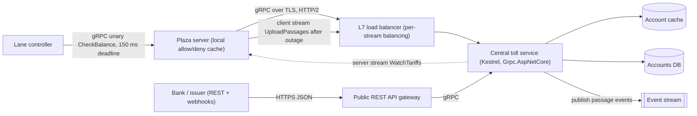
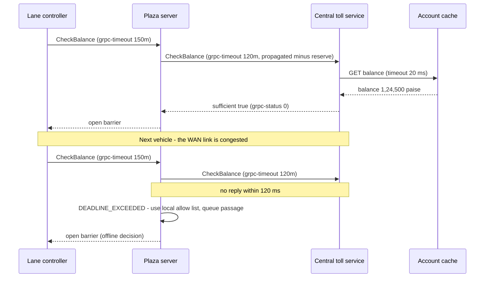

When one service calls another thousands of times per second, the details REST leaves open — field names repeated in every JSON message, hand-written clients, "what does a timeout mean here?" — start to cost real money and real outages. gRPC answers them with a strict contract file, generated clients in every major language, a compact binary format, HTTP/2 multiplexing, streaming, and deadlines built into the protocol. This lesson shows what actually travels on the wire, which call type fits which job, and the operational traps (load balancing, deadlines, browser support) that decide whether gRPC helps or hurts.

## Learning objectives

By the end of this lesson you will be able to:

1. Write a `.proto` contract and explain how Protocol Buffers encode it (field numbers, wire types, varints) and how to evolve it safely.
2. Describe how a gRPC call maps onto HTTP/2: path, headers, length-prefixed messages, and `grpc-status` trailers.
3. Choose between unary, server-streaming, client-streaming and bidirectional calls for real scenarios.
4. Set and propagate deadlines, map failures to gRPC status codes, and decide which failures are retryable.
5. Explain why L4 load balancers spread gRPC traffic badly, and fix it with L7 proxies or client-side balancing.
6. Implement gRPC services and clients with `Grpc.AspNetCore`, and decide when REST, GraphQL or messaging fits better.

## Prerequisites

- [HTTP fundamentals](#/lesson/m10-http-fundamentals): HTTP/2 streams, multiplexing, keep-alive, idempotency.
- [REST API design](#/lesson/m10-rest-design): resources, status codes, contracts.

## Explain it like I'm a beginner

Think about two ways of sending instructions between offices.

**REST with JSON** is like sending a letter in plain language: "Dear Toll Office, please check the balance for tag number 34161FA8..., the amount is ninety-five rupees." Anyone can read it, which is lovely for strangers. But writing out every label in full, every time, between two offices that talk 10,000 times a minute, is slow and wasteful.

**gRPC** is like the two offices agreeing on a **printed form** in advance. Box 1 is the tag number, box 2 is the amount in paise. The form itself (the `.proto` file) is shared once. After that, each message is just the box numbers and values, packed tightly — no labels. Both offices have a machine (the generated code) that fills in and reads the form automatically, so nobody makes spelling mistakes.

Two more ideas make it powerful:

- **One phone line, many conversations.** Instead of dialling a new call per question, both offices keep one line open and run many conversations on it at once (HTTP/2 multiplexing).
- **"I need an answer within 150 ms."** Every request carries a deadline. If the answer can't arrive in time, everyone stops working on it, instead of finishing work nobody is waiting for any more.

The cost: a stranger can't read the form without the shared definition, and web browsers can't use the phone line directly. That is why gRPC is mostly used *between your own services*, not as a public API.

## First-principles explanation

### What gRPC is

gRPC is an open-source RPC (remote procedure call) framework, originally from Google and now a CNCF project. "RPC" means the client calls what looks like a local method — `await client.CheckBalanceAsync(request)` — and the framework sends it across the network. The pieces:

1. **An interface definition** in a `.proto` file: services, methods and message types.
2. **Protocol Buffers (protobuf)** as the default serialisation: compact, typed, binary.
3. **Generated code**: server base classes and client stubs for C#, Go, Java, Python, and more.
4. **HTTP/2** as the transport, giving multiplexed streams, flow control and trailers.
5. **Built-in semantics** for deadlines, cancellation, status codes, metadata (headers) and streaming.

### The running example: an electronic toll network

Our scenario is a national electronic toll collection system — *a system like FASTag*; we reason from public principles, not anyone's internal design. Each toll plaza has lane controllers and a plaza server. A central tolling platform holds tag accounts. The interactions:

- A vehicle enters a lane: the plaza must know **within ~150 ms** whether the tag is valid and has enough balance, or the boom barrier stays down and traffic backs up.
- Every passage must be recorded centrally, even if the plaza lost connectivity for an hour.
- Tariff changes (new rates from 1 April, festival exemptions) must reach all plazas quickly.
- During a lane's operation, events (vehicle detected, tag read, exemption claimed) and decisions flow continuously both ways.

Rough sizing (estimates for the exercise): 1,000 plazas × 10 lanes × 6 vehicles per lane per minute at peak = 60,000 passages/minute = **1,000 passages per second**, each needing one balance check and one passage record.

### The contract: a `.proto` file

```proto
syntax = "proto3";

package toll.v1;
option csharp_namespace = "Tolling.Grpc.V1";

import "google/protobuf/timestamp.proto";

service TollService {
  rpc CheckBalance (BalanceRequest) returns (BalanceReply);            // unary
  rpc WatchTariffs (TariffWatchRequest) returns (stream TariffUpdate);  // server streaming
  rpc UploadPassages (stream Passage) returns (UploadSummary);         // client streaming
  rpc LaneSession (stream LaneEvent) returns (stream LaneDecision);    // bidirectional
}

message BalanceRequest {
  string tag_id = 1;
  int64 amount_paise = 2;      // money as integer paise, never float
  string plaza_id = 3;
}

message BalanceReply {
  bool sufficient = 1;
  int64 balance_paise = 2;
  reserved 3;                  // was string holder_name; removed for privacy. Never reuse 3.
  reserved "holder_name";
}

message Passage {
  string passage_id = 1;       // idempotency: plaza-generated unique id
  string tag_id = 2;
  string plaza_id = 3;
  int32 lane = 4;
  VehicleClass vehicle_class = 5;
  int64 charged_paise = 6;
  google.protobuf.Timestamp passed_at = 7;
}

enum VehicleClass {
  VEHICLE_CLASS_UNSPECIFIED = 0;   // proto3 enums must start at 0; reserve it for "unknown"
  VEHICLE_CLASS_CAR = 1;
  VEHICLE_CLASS_LCV = 2;
  VEHICLE_CLASS_BUS_TRUCK = 3;
}

message UploadSummary { int32 accepted = 1; int32 duplicates = 2; }
message TariffWatchRequest { string plaza_id = 1; int64 known_version = 2; }
message TariffUpdate { int64 version = 1; map<int32, int64> paise_by_class = 2; }
message LaneEvent { string lane_id = 1; oneof kind { string tag_read = 2; string exemption_code = 3; } }
message LaneDecision { string lane_id = 1; bool open_barrier = 2; string reason = 3; }
```

The **field numbers** (`= 1`, `= 2`) are the contract, not the names. Names exist only in generated code; on the wire, only numbers travel.

### How protobuf encodes a message

Each field is written as a **tag** followed by a value. The tag is a varint of `(field_number << 3) | wire_type`:

| Wire type | Id | Used for |
|---|---|---|
| VARINT | 0 | `int32`, `int64`, `uint*`, `bool`, `enum` |
| I64 | 1 | `fixed64`, `double` |
| LEN | 2 | `string`, `bytes`, embedded messages, packed repeated fields |
| I32 | 5 | `fixed32`, `float` |

A **varint** stores an integer in 7-bit groups, least significant first, with the top bit of each byte meaning "more bytes follow". Small numbers take one byte:

- `1` → `01`
- `150` → `96 01` (150 = 0b1_0010110 → low 7 bits `0010110` with continuation bit = `0x96`, then `0000001` = `0x01`)
- `9500` → `9C 4A`

Our `BalanceRequest { tag_id = "34161FA820328EE80B5A9C21", amount_paise = 9500, plaza_id = "MH-PLZ-0412" }`:

```text
0A 18 <24 bytes of tag_id>        field 1, LEN, length 24
10 9C 4A                          field 2, VARINT, 9500
1A 0B <11 bytes of plaza_id>      field 3, LEN, length 11
```

That's **42 bytes**. The same data as compact JSON (`{"tagId":"...","amountPaise":9500,"plazaId":"..."}`) is **79 bytes**, and it must be parsed character by character. Savings are biggest for messages with many small numeric fields and repeated messages; for messages dominated by long strings, the gap is smaller. Compression narrows it further — measure your own payloads before claiming numbers.

Consequences worth remembering:

- **Field numbers 1–15** fit in a one-byte tag; use them for frequent fields.
- **Default values aren't sent** in proto3 (0, empty string, false). A receiver can't tell "0" from "not set" unless you mark the field `optional` (which tracks presence) or use wrapper types.
- **Unknown fields are skipped and preserved.** An old reader ignores fields it doesn't know; that's what makes adding fields safe.
- Negative `int32`/`int64` values take 10 bytes as varints; use `sint32`/`sint64` (zigzag encoding) for fields that are often negative.

### Evolving the contract safely

| Change | Safe? | Why |
|---|---|---|
| Add a new field with a new number | Yes | Old readers skip it; new readers see the default from old writers |
| Remove a field and `reserved` its number and name | Yes | Prevents accidental reuse |
| Rename a field (same number) | Wire-safe | Names aren't on the wire, but JSON transcoding and generated code change |
| Change a field's number | **No** | Old and new code read different fields |
| Reuse a removed field's number for a new meaning | **No** | Old messages are misread silently — the worst kind of bug |
| Change `int32` to `int64` | Mostly | Same wire type; values outside 32-bit range get truncated by old readers |
| Change `string` to `int64` | **No** | Different wire types |
| Add a value to an enum | Careful | Old readers see an unknown value; always define `..._UNSPECIFIED = 0` and handle unknowns |
| Add a method to a service | Yes | Old clients never call it |
| Rename a package, service or method | **No** | The HTTP/2 path changes (`/toll.v1.TollService/CheckBalance`) |

For breaking changes, add a new package version (`toll.v2`) and run both side by side ([see API contracts and versioning](#/lesson/m10-versioning-contracts)). Tools like `buf breaking` can check proto changes in CI.

### How a call travels over HTTP/2

A unary call is one HTTP/2 stream:

```text
HEADERS   :method POST
          :path /toll.v1.TollService/CheckBalance
          content-type application/grpc
          grpc-timeout 150m                ← deadline: 150 milliseconds
          te trailers
          authorization Bearer ...          ← metadata
DATA      00 | 00 00 00 2A | <42 bytes>    ← compressed flag, 4-byte big-endian length, message
------------------------------------------- response
HEADERS   :status 200
          content-type application/grpc
DATA      00 | 00 00 00 05 | <5 bytes>
HEADERS   grpc-status 0                    ← trailers: the real result of the call
          grpc-message (optional)
```

Three details matter for design:

1. **The HTTP status is almost always 200.** The call's outcome is in the `grpc-status` **trailer**. Proxies and monitoring that only look at HTTP status codes see "everything is fine". Your dashboards must read gRPC status.
2. **Each message is length-prefixed** (5-byte header: 1 byte compressed flag + 4 bytes length). That's how many messages can flow on one stream for streaming calls. Servers cap message size (ASP.NET Core's default receive limit is 4 MB) to protect memory.
3. **Browsers can't read HTTP/2 trailers through `fetch`**, so browsers can't speak native gRPC. Options: **gRPC-Web** (a variant with trailers moved into the body, supported in ASP.NET Core via `Grpc.AspNetCore.Web`), or **JSON transcoding** (`Microsoft.AspNetCore.Grpc.JsonTranscoding`), which exposes the same service as REST/JSON using `google.api.http` annotations.

### The four call types

| Type | Shape | Toll example | Other good fits |
|---|---|---|---|
| **Unary** | 1 request → 1 response | `CheckBalance` at the lane | Most service calls |
| **Server streaming** | 1 request → stream of responses | `WatchTariffs`: plaza subscribes once, receives updates as they happen | Live prices, progress of a long job, change feeds |
| **Client streaming** | stream of requests → 1 response | `UploadPassages`: plaza back online streams 40,000 buffered passages, gets one summary | Telemetry upload, bulk import |
| **Bidirectional** | both sides stream independently | `LaneSession`: lane sends events, centre sends decisions, on one long-lived stream | Chat, collaborative sessions, game state |

Streams are not free. A long-lived stream holds a connection slot and server memory, ties a client to one backend (so load balancing happens only when streams are created), and must survive deployments and network blips: you need **reconnect with resume** (`known_version` in `TariffWatchRequest`) and **idempotent records** (`passage_id`) so a retried upload doesn't double-charge. If you only need "tell me when it changes" for a handful of plazas, polling every 30 s may be simpler and cheaper.

### Deadlines and cancellation

A **deadline** is an absolute point in time by which the client needs the answer. gRPC sends it as the `grpc-timeout` header (remaining time, e.g. `150m` = 150 ms) and both sides enforce it:

- The client stops waiting and gets `DEADLINE_EXCEEDED`.
- The server's `ServerCallContext.CancellationToken` fires, so work can stop.
- With **deadline propagation**, when service A (deadline 150 ms) calls service B, B gets *what is left* of A's deadline, not a fresh timeout. Without propagation, B might spend 2 s on a request whose original caller gave up 1.85 s ago — wasted work that piles up during incidents.

Deadline budgeting for the lane check (estimates):

```text
Lane controller deadline:                     150 ms
 - network lane → plaza server:                 2 ms
 - plaza server → central (regional DC):       25 ms RTT
 - reserve for the reply and the barrier:      20 ms
 => central CheckBalance must answer within   ~100 ms
    central → account cache (Redis):            1–2 ms
    central → account DB on cache miss:        10–20 ms
```

If the remaining budget is below what a useful attempt needs, **fail fast** instead of calling downstream at all. And have a plan for failure: the plaza falls back to a locally cached allow/deny list and records the passage for later settlement.

**Always set a deadline.** The default in most gRPC clients is *no deadline*: a hung server holds the caller's request forever.

### Status codes and retries

gRPC has 17 status codes. The ones you'll use:

| Code | Name | Meaning | Retry? |
|---|---|---|---|
| 0 | `OK` | Success | — |
| 1 | `CANCELLED` | Caller cancelled | No |
| 3 | `INVALID_ARGUMENT` | Bad request content | No |
| 4 | `DEADLINE_EXCEEDED` | Ran out of time | Rarely: the budget is spent; the work may have happened |
| 5 | `NOT_FOUND` | Unknown entity | No |
| 6 | `ALREADY_EXISTS` | Duplicate create | No (often means a previous attempt succeeded) |
| 7 | `PERMISSION_DENIED` | Authenticated but not allowed | No |
| 8 | `RESOURCE_EXHAUSTED` | Quota, rate limit, message too large | Only with back-off, if it's a quota |
| 9 | `FAILED_PRECONDITION` | System not in the required state | No, until state changes |
| 10 | `ABORTED` | Concurrency conflict | Yes, at a higher level (re-read and retry the transaction) |
| 13 | `INTERNAL` | Server bug or broken invariant | No |
| 14 | `UNAVAILABLE` | Transient: server down, overloaded, connection lost | **Yes**, with back-off — if the call is idempotent |
| 16 | `UNAUTHENTICATED` | Missing or invalid credentials | No (refresh the token first) |

gRPC clients can retry automatically from a **service config** (`MaxAttempts`, back-off, `RetryableStatusCodes = UNAVAILABLE`), and support **hedging** (sending a second copy of a slow request to another backend and taking the first answer) — only for idempotent methods. `UploadPassages` is safe to retry only because each `Passage` carries a `passage_id` the server deduplicates on. The same idempotency and retry-budget rules from [Timeouts, retries and backoff](#/lesson/m10-timeouts-retries) apply.

When a proxy in the middle returns a plain HTTP error without `grpc-status`, clients map it: `400 → INTERNAL`, `401 → UNAUTHENTICATED`, `403 → PERMISSION_DENIED`, `404 → UNIMPLEMENTED`, `429`, `502`, `503`, `504 → UNAVAILABLE`, anything else `→ UNKNOWN`.

### Load balancing: the classic gRPC trap

HTTP/2 keeps **one long-lived connection** and multiplexes every call over it. An **L4 (TCP) load balancer** picks a backend per *connection*. So:

- A client with one connection sends *all* its RPCs to *one* backend.
- When you scale from 3 to 6 backends, existing connections stay where they are; the new instances sit idle until clients reconnect.
- A few busy clients can overload one backend while others idle.

Fixes:

1. **L7 (HTTP/2-aware) proxy** — Envoy, NGINX, YARP, a service mesh sidecar (Linkerd, Istio), or a cloud L7 load balancer with gRPC support — that balances **per request (per stream)**.
2. **Client-side load balancing** — the client resolves all backend addresses (DNS returning multiple A records, or a service registry) and spreads calls itself; `Grpc.Net.Client` supports this with `dns:///` addresses and a `RoundRobinConfig` ([see service discovery](#/lesson/m10-service-discovery)).
3. **Connection limits and recycling** — `MaxConnectionAge`-style limits on the server side or periodic reconnects so connections rebalance over time.

Also mind **`MaxConcurrentStreams`**: Kestrel allows 100 concurrent streams per HTTP/2 connection by default. A client making 300 concurrent calls on one connection queues the rest — unless `SocketsHttpHandler.EnableMultipleHttp2Connections = true`, which opens more connections when the limit is reached.

### Why gRPC is mostly internal

| Concern | gRPC | REST/JSON |
|---|---|---|
| Browser support | gRPC-Web or transcoding needed | Native |
| Human debugging | Binary; needs `grpcurl`/reflection | `curl`, browser |
| HTTP caching and CDNs | No (POST, binary) | Yes |
| Contract and codegen | Strong, built in | OpenAPI, optional |
| Throughput and latency between services | Lower overhead, multiplexing, streaming | Higher overhead |
| Partner integrations | They need your `.proto` and a gRPC stack | Any HTTP client |

So the common architecture is **REST (or GraphQL) at the edge** for browsers, mobile apps and partners, and **gRPC inside** between services that you own, with JSON transcoding where one gRPC service must also be callable as REST. For fire-and-forget events and decoupling in time, neither replaces a message broker ([see sync vs async](#/lesson/m10-sync-async)).

### When a simpler option is enough

- Five services calling each other a few times per second: REST with `HttpClient`, OpenAPI-generated clients and sensible timeouts is perfectly adequate.
- A public API: REST.
- Events that the receiver can process later: a queue or stream, not a streaming RPC.
- gRPC pays off when call volume is high, latency budgets are tight, polyglot teams share contracts, or you need streaming with flow control.

### Trade-offs

| You gain | You pay |
|---|---|
| Compact binary messages, typed contracts, generated clients | Not human-readable; tooling needed to inspect traffic |
| Multiplexing and streaming on HTTP/2 | L4 load balancers balance badly; long streams need resume logic |
| Deadlines, cancellation and status codes built in | Teams must actually set deadlines and map statuses; HTTP-level monitoring misleads |
| Safe evolution by field numbers | Discipline: `reserved`, no reuse, `UNSPECIFIED` enum values |
| One contract for many languages | Browser and partner access need gRPC-Web or transcoding |

## Visual explanation

### Architecture



Lane controllers call their **plaza server** with a short unary call; the plaza server keeps a local allow/deny list so lanes keep working if the WAN fails. The plaza server talks gRPC over TLS to an **L7 load balancer** that understands HTTP/2 and balances *each call*, not each connection, across the **central toll service** instances. Those use a cache and the accounts database for balance checks. The dotted arrow is a long-lived **server stream**: each plaza subscribes once and receives tariff updates as they're published. After an outage, the plaza replays its buffered passages through a **client stream**. Recorded passages are published to an **event stream** for billing and analytics — asynchronous, not RPC. Outside partners never see gRPC: they use a **REST gateway** that translates to internal gRPC calls.

### Sequence: deadline propagation and failure



The lane gives the plaza 150 ms. The plaza **propagates** the deadline, keeping 30 ms in reserve for its own fallback, so the central service knows it has 120 ms and its own cache call gets an even shorter timeout. The first vehicle is approved online. For the second, the WAN is congested: at 120 ms the plaza's call fails with `DEADLINE_EXCEEDED`, the central service's cancellation token fires (it stops working on an answer nobody will read), and the plaza still has 30 ms to decide from its local list and queue the passage for later upload. The barrier opens on time either way.

## Step-by-step example

**1 — Size the traffic.** 1,000 balance checks per second at peak (from the estimate above), plus 1,000 passage records per second. Each check request is ~42 bytes of protobuf; with HTTP/2 framing and compressed headers (HPACK) perhaps ~100–150 bytes on the wire (estimate). Bandwidth is trivial; **latency and connection behaviour** are what matter.

**2 — Choose call types.** Balance check: unary with a deadline. Passage records: unary per passage when online (simple, idempotent by `passage_id`), client streaming for backlog upload after an outage. Tariffs: server streaming with a `known_version` for resume. Lane session: bidirectional only if the plaza vendor needs continuous two-way flow; otherwise stay with unary calls — simpler to load-balance and debug.

**3 — Set deadlines from the user-facing budget.** 150 ms at the lane, 120 ms at the centre, 20 ms for the cache, and a fail-fast rule: if less than 15 ms remain, don't call the database.

**4 — Plan connections.** 1,000 plazas each keep 1–2 HTTP/2 connections to the centre: ~2,000 connections spread by an L7 load balancer across, say, 6 instances. At 1,000 RPS the per-connection rate is tiny; the L7 balancer ensures calls spread per request even though connections are long-lived.

**5 — Retries.** `UNAVAILABLE` → retry once to another instance with a 10–20 ms back-off if budget remains; `DEADLINE_EXCEEDED` → no retry, fall back locally. Passage uploads are retried freely because the server deduplicates by `passage_id`.

**6 — Observability.** Record per-method gRPC status counts and latency percentiles; alert on `UNAVAILABLE` and `DEADLINE_EXCEEDED` rates, not HTTP 5xx.

## Production-style C# implementation

`Grpc.AspNetCore` isn't available in this course's offline checker, so the compiled code below shows **what gRPC does under the hood** using only the BCL and ASP.NET Core: protobuf varint encoding, the 5-byte message framing, `grpc-timeout` parsing, status-code mapping, and a minimal endpoint that speaks the real gRPC wire format for one unary method (with trailers). It is for understanding, not for production. After it, the real `Grpc.AspNetCore` server and client code is shown as snippets.

```text
Tolling.Core/
  Program.cs
  Wire/ProtoWire.cs
  Wire/GrpcFrame.cs
  Wire/GrpcTimeoutHeader.cs
  Wire/GrpcStatus.cs
  Balances/BalanceMessages.cs
  Balances/TagBalanceStore.cs
  Balances/RawCheckBalanceEndpoint.cs
```

```csharp file=Wire/ProtoWire.cs
using System.Text;

namespace Tolling.Wire;

public enum WireType { Varint = 0, I64 = 1, Len = 2, I32 = 5 }

/// <summary>The handful of protobuf encoding rules needed for simple messages.</summary>
public static class ProtoWire
{
    public static void WriteVarint(Stream s, ulong value)
    {
        while (value >= 0x80)
        {
            s.WriteByte((byte)(value | 0x80));   // low 7 bits + "more bytes follow"
            value >>= 7;
        }
        s.WriteByte((byte)value);
    }

    public static ulong ReadVarint(ReadOnlySpan<byte> data, ref int pos)
    {
        ulong result = 0;
        for (var shift = 0; shift < 64; shift += 7)
        {
            if (pos >= data.Length) throw new FormatException("Truncated varint.");
            var b = data[pos++];
            result |= (ulong)(b & 0x7F) << shift;
            if ((b & 0x80) == 0) return result;
        }
        throw new FormatException("Varint is longer than 10 bytes.");
    }

    public static void WriteTag(Stream s, int fieldNumber, WireType type) =>
        WriteVarint(s, ((ulong)fieldNumber << 3) | (ulong)type);

    // proto3: default values (0, "", false) are not written at all.
    public static void WriteString(Stream s, int field, string value)
    {
        if (value.Length == 0) return;
        var bytes = Encoding.UTF8.GetBytes(value);
        WriteTag(s, field, WireType.Len);
        WriteVarint(s, (ulong)bytes.Length);
        s.Write(bytes);
    }

    public static void WriteInt64(Stream s, int field, long value)
    {
        if (value == 0) return;
        WriteTag(s, field, WireType.Varint);
        WriteVarint(s, unchecked((ulong)value));
    }

    public static void WriteBool(Stream s, int field, bool value)
    {
        if (!value) return;
        WriteTag(s, field, WireType.Varint);
        WriteVarint(s, 1);
    }

    public static string ReadString(ReadOnlySpan<byte> data, ref int pos)
    {
        var length = checked((int)ReadVarint(data, ref pos));
        if (pos + length > data.Length) throw new FormatException("Truncated length-delimited field.");
        var text = Encoding.UTF8.GetString(data.Slice(pos, length));
        pos += length;
        return text;
    }

    /// <summary>Unknown fields are skipped: this is what makes adding fields backward compatible.</summary>
    public static void Skip(ReadOnlySpan<byte> data, ref int pos, WireType type)
    {
        switch (type)
        {
            case WireType.Varint: ReadVarint(data, ref pos); break;
            case WireType.I64: pos += 8; break;
            case WireType.I32: pos += 4; break;
            case WireType.Len: pos += checked((int)ReadVarint(data, ref pos)); break;
            default: throw new FormatException($"Unsupported wire type {(int)type}.");
        }
        if (pos > data.Length) throw new FormatException("Truncated field.");
    }
}
```

```csharp file=Wire/GrpcFrame.cs
using System.Buffers.Binary;

namespace Tolling.Wire;

/// <summary>gRPC length-prefixed message: 1 byte compressed flag + 4 bytes big-endian length + payload.</summary>
public static class GrpcFrame
{
    public const int HeaderSize = 5;

    public static byte[] Encode(ReadOnlySpan<byte> message, bool compressed = false)
    {
        var frame = new byte[HeaderSize + message.Length];
        frame[0] = compressed ? (byte)1 : (byte)0;
        BinaryPrimitives.WriteUInt32BigEndian(frame.AsSpan(1, 4), (uint)message.Length);
        message.CopyTo(frame.AsSpan(HeaderSize));
        return frame;
    }

    /// <summary>Reads one complete frame from the start of the buffer, if present.</summary>
    public static bool TryRead(ReadOnlySpan<byte> buffer, int maxMessageSize, out byte[] message, out bool compressed, out int consumed)
    {
        message = [];
        compressed = false;
        consumed = 0;
        if (buffer.Length < HeaderSize) return false;

        var length = BinaryPrimitives.ReadUInt32BigEndian(buffer.Slice(1, 4));
        if (length > maxMessageSize) throw new InvalidDataException($"Message of {length} bytes exceeds the limit of {maxMessageSize}.");
        if (buffer.Length < HeaderSize + length) return false;

        compressed = buffer[0] == 1;
        message = buffer.Slice(HeaderSize, (int)length).ToArray();
        consumed = HeaderSize + (int)length;
        return true;
    }
}
```

```csharp file=Wire/GrpcTimeoutHeader.cs
using System.Globalization;

namespace Tolling.Wire;

/// <summary>grpc-timeout: up to 8 ASCII digits followed by a unit H, M, S, m (ms), u (µs) or n (ns).</summary>
public static class GrpcTimeoutHeader
{
    public static bool TryParse(string? value, out TimeSpan timeout)
    {
        timeout = default;
        if (string.IsNullOrEmpty(value) || value.Length < 2 || value.Length > 9) return false;
        if (!long.TryParse(value.AsSpan(0, value.Length - 1), NumberStyles.None, CultureInfo.InvariantCulture, out var amount)) return false;

        long? ticks = value[^1] switch
        {
            'H' => amount * TimeSpan.TicksPerHour,
            'M' => amount * TimeSpan.TicksPerMinute,
            'S' => amount * TimeSpan.TicksPerSecond,
            'm' => amount * TimeSpan.TicksPerMillisecond,
            'u' => amount * 10,          // 1 µs = 10 ticks
            'n' => amount / 100,         // 1 tick = 100 ns
            _ => null,
        };
        if (ticks is null) return false;
        timeout = TimeSpan.FromTicks(ticks.Value);
        return true;
    }
}

/// <summary>Computes how much of an incoming deadline to hand to a downstream call.</summary>
public sealed class DeadlineBudget(TimeProvider clock)
{
    /// <returns>The child timeout, or null if too little time remains to make a useful call (fail fast).</returns>
    public TimeSpan? ChildTimeout(DateTimeOffset deadline, TimeSpan reserve, TimeSpan minimumUseful)
    {
        var child = deadline - clock.GetUtcNow() - reserve;
        return child >= minimumUseful ? child : null;
    }
}
```

```csharp file=Wire/GrpcStatus.cs
namespace Tolling.Wire;

public enum GrpcStatusCode
{
    Ok = 0, Cancelled = 1, Unknown = 2, InvalidArgument = 3, DeadlineExceeded = 4, NotFound = 5,
    AlreadyExists = 6, PermissionDenied = 7, ResourceExhausted = 8, FailedPrecondition = 9, Aborted = 10,
    OutOfRange = 11, Unimplemented = 12, Internal = 13, Unavailable = 14, DataLoss = 15, Unauthenticated = 16,
}

public static class GrpcStatusRules
{
    /// <summary>What a client assumes when a proxy answers with plain HTTP and no grpc-status
    /// (from the gRPC "HTTP to gRPC status code mapping" document).</summary>
    public static GrpcStatusCode FromHttpStatus(int httpStatus) => httpStatus switch
    {
        400 => GrpcStatusCode.Internal,
        401 => GrpcStatusCode.Unauthenticated,
        403 => GrpcStatusCode.PermissionDenied,
        404 => GrpcStatusCode.Unimplemented,
        429 or 502 or 503 or 504 => GrpcStatusCode.Unavailable,
        _ => GrpcStatusCode.Unknown,
    };

    /// <summary>Transport-level automatic retry: only UNAVAILABLE, and only for idempotent methods.</summary>
    public static bool IsRetryable(GrpcStatusCode code, bool idempotent) => idempotent && code == GrpcStatusCode.Unavailable;
}
```

```csharp file=Balances/BalanceMessages.cs
using Tolling.Wire;

namespace Tolling.Balances;

/// <summary>Hand-written equivalent of the generated class for message BalanceRequest.</summary>
public sealed record BalanceRequest(string TagId, long AmountPaise, string PlazaId)
{
    public byte[] ToBytes()
    {
        using var s = new MemoryStream();
        ProtoWire.WriteString(s, 1, TagId);
        ProtoWire.WriteInt64(s, 2, AmountPaise);
        ProtoWire.WriteString(s, 3, PlazaId);
        return s.ToArray();
    }

    public static BalanceRequest Parse(ReadOnlySpan<byte> data)
    {
        string tag = "", plaza = "";
        long amount = 0;
        var pos = 0;
        while (pos < data.Length)
        {
            var key = ProtoWire.ReadVarint(data, ref pos);
            var field = (int)(key >> 3);
            var type = (WireType)(key & 7);
            switch (field)
            {
                case 1 when type == WireType.Len: tag = ProtoWire.ReadString(data, ref pos); break;
                case 2 when type == WireType.Varint: amount = unchecked((long)ProtoWire.ReadVarint(data, ref pos)); break;
                case 3 when type == WireType.Len: plaza = ProtoWire.ReadString(data, ref pos); break;
                default: ProtoWire.Skip(data, ref pos, type); break;   // unknown or newer field
            }
        }
        return new BalanceRequest(tag, amount, plaza);
    }
}

public sealed record BalanceReply(bool Sufficient, long BalancePaise)
{
    public byte[] ToBytes()
    {
        using var s = new MemoryStream();
        ProtoWire.WriteBool(s, 1, Sufficient);
        ProtoWire.WriteInt64(s, 2, BalancePaise);
        return s.ToArray();
    }
}
```

```csharp file=Balances/TagBalanceStore.cs
using System.Collections.Concurrent;

namespace Tolling.Balances;

public interface ITagBalanceStore
{
    ValueTask<long?> GetBalancePaiseAsync(string tagId, CancellationToken ct);
}

/// <summary>Stand-in for a Redis-backed account cache in front of the accounts database.</summary>
public sealed class InMemoryTagBalanceStore : ITagBalanceStore
{
    private readonly ConcurrentDictionary<string, long> _balances = new(StringComparer.OrdinalIgnoreCase)
    {
        ["34161FA820328EE80B5A9C21"] = 124_500,   // ₹1,245.00
        ["34161FA820328EE80B5A9C22"] = 3_000,     // ₹30.00
    };

    public ValueTask<long?> GetBalancePaiseAsync(string tagId, CancellationToken ct)
    {
        ct.ThrowIfCancellationRequested();
        return ValueTask.FromResult(_balances.TryGetValue(tagId, out var b) ? b : (long?)null);
    }
}
```

```csharp file=Balances/RawCheckBalanceEndpoint.cs
using Tolling.Wire;

namespace Tolling.Balances;

/// <summary>Speaks the real gRPC wire format for one unary method, to show what Grpc.AspNetCore does for you.
/// In production, use the generated TollService.TollServiceBase instead (see the snippets below).</summary>
public static class RawCheckBalanceEndpoint
{
    private const int MaxMessageBytes = 64 * 1024;

    public static IEndpointRouteBuilder MapRawCheckBalance(this IEndpointRouteBuilder app)
    {
        app.MapPost("/toll.v1.TollService/CheckBalance", HandleAsync);
        return app;
    }

    private static async Task HandleAsync(HttpContext http, ITagBalanceStore store, ILogger<BalanceRequest> log)
    {
        http.Response.StatusCode = StatusCodes.Status200OK;     // gRPC outcome travels in the trailers
        http.Response.ContentType = "application/grpc";
        if (!http.Response.SupportsTrailers())
        {
            http.Response.StatusCode = StatusCodes.Status505HttpVersionNotsupported;   // gRPC requires HTTP/2
            return;
        }

        using var cts = CancellationTokenSource.CreateLinkedTokenSource(http.RequestAborted);
        if (GrpcTimeoutHeader.TryParse(http.Request.Headers["grpc-timeout"].ToString(), out var timeout)) cts.CancelAfter(timeout);

        try
        {
            using var body = new MemoryStream();
            await http.Request.Body.CopyToAsync(body, cts.Token);
            var bytes = body.GetBuffer().AsSpan(0, (int)body.Length);
            if (!GrpcFrame.TryRead(bytes, MaxMessageBytes, out var payload, out var compressed, out _) || compressed)
            {
                Finish(http, GrpcStatusCode.Internal, "Expected exactly one uncompressed message.");
                return;
            }

            var request = BalanceRequest.Parse(payload);
            if (string.IsNullOrWhiteSpace(request.TagId) || request.AmountPaise <= 0)
            {
                Finish(http, GrpcStatusCode.InvalidArgument, "tag_id and a positive amount_paise are required.");
                return;
            }

            var balance = await store.GetBalancePaiseAsync(request.TagId, cts.Token);
            if (balance is null)
            {
                Finish(http, GrpcStatusCode.NotFound, "Unknown tag.");
                return;
            }

            var reply = new BalanceReply(balance.Value >= request.AmountPaise, balance.Value);
            await http.Response.Body.WriteAsync(GrpcFrame.Encode(reply.ToBytes()), cts.Token);
            Finish(http, GrpcStatusCode.Ok, null);
        }
        catch (InvalidDataException ex)
        {
            Finish(http, GrpcStatusCode.ResourceExhausted, ex.Message);
        }
        catch (FormatException)
        {
            Finish(http, GrpcStatusCode.Internal, "Malformed protobuf message.");
        }
        catch (OperationCanceledException) when (!http.RequestAborted.IsCancellationRequested)
        {
            log.LogWarning("CheckBalance exceeded its deadline of {Timeout}", timeout);
            Finish(http, GrpcStatusCode.DeadlineExceeded, "Deadline exceeded.");
        }
    }

    private static void Finish(HttpContext http, GrpcStatusCode status, string? message)
    {
        http.Response.AppendTrailer("grpc-status", ((int)status).ToString());
        if (message is not null) http.Response.AppendTrailer("grpc-message", Uri.EscapeDataString(message));
    }
}
```

```csharp file=Program.cs
using Microsoft.AspNetCore.Server.Kestrel.Core;
using Tolling.Balances;
using Tolling.Wire;

var builder = WebApplication.CreateBuilder(args);

builder.WebHost.ConfigureKestrel(kestrel =>
{
    // HTTP/2 only (h2c) for internal gRPC traffic; terminate TLS at the mesh/sidecar or use HTTPS here.
    kestrel.ListenAnyIP(5001, listen => listen.Protocols = HttpProtocols.Http2);
    // Plain HTTP/1.1 port for health probes and metrics scrapers.
    kestrel.ListenAnyIP(8080, listen => listen.Protocols = HttpProtocols.Http1);
    kestrel.Limits.Http2.MaxStreamsPerConnection = 100;
    kestrel.Limits.Http2.KeepAlivePingDelay = TimeSpan.FromSeconds(30);   // detect dead connections
    kestrel.Limits.Http2.KeepAlivePingTimeout = TimeSpan.FromSeconds(10);
});

builder.Services.AddSingleton(TimeProvider.System);
builder.Services.AddSingleton<DeadlineBudget>();
builder.Services.AddSingleton<ITagBalanceStore, InMemoryTagBalanceStore>();
builder.Services.AddHealthChecks();

var app = builder.Build();

app.MapRawCheckBalance();          // in production: app.MapGrpcService<TollServiceImpl>();
app.MapHealthChecks("/healthz");

app.Run();
```

### The same service with `Grpc.AspNetCore`

In a real project you add the `Grpc.AspNetCore` package, put the `.proto` file in the project, and let the build generate the classes:

```xml
<ItemGroup>
  <Protobuf Include="Protos\toll.proto" GrpcServices="Server" />
</ItemGroup>
```

```csharp
// Program.cs (server)
builder.Services.AddGrpc(o =>
{
    o.EnableDetailedErrors = builder.Environment.IsDevelopment();   // never leak exception text in production
    o.MaxReceiveMessageSize = 1 * 1024 * 1024;
    o.Interceptors.Add<GrpcMetricsInterceptor>();                   // cross-cutting: logging, metrics, auth checks
});
builder.Services.AddGrpcHealthChecks();                             // Grpc.AspNetCore.HealthChecks
var app = builder.Build();
app.MapGrpcService<TollServiceImpl>();
app.MapGrpcHealthChecksService();

// The service: one override per rpc in the .proto
public sealed class TollServiceImpl(ITagBalanceStore balances, IPassageLedger ledger, ITariffFeed tariffs) : TollService.TollServiceBase
{
    public override async Task<BalanceReply> CheckBalance(BalanceRequest request, ServerCallContext context)
    {
        if (string.IsNullOrWhiteSpace(request.TagId) || request.AmountPaise <= 0)
            throw new RpcException(new Status(StatusCode.InvalidArgument, "tag_id and a positive amount_paise are required"));

        var balance = await balances.GetBalancePaiseAsync(request.TagId, context.CancellationToken)   // fires at the deadline
            ?? throw new RpcException(new Status(StatusCode.NotFound, "Unknown tag"));
        return new BalanceReply { Sufficient = balance >= request.AmountPaise, BalancePaise = balance };
    }

    public override async Task<UploadSummary> UploadPassages(IAsyncStreamReader<Passage> requestStream, ServerCallContext context)
    {
        var summary = new UploadSummary();
        await foreach (var passage in requestStream.ReadAllAsync(context.CancellationToken))
        {
            if (await ledger.TryRecordAsync(passage, context.CancellationToken)) summary.Accepted++;   // dedupe on passage_id
            else summary.Duplicates++;
        }
        return summary;
    }

    public override async Task WatchTariffs(TariffWatchRequest request, IServerStreamWriter<TariffUpdate> responseStream, ServerCallContext context)
    {
        // Resume: first send anything newer than the version the plaza already has, then live updates.
        await foreach (var update in tariffs.SubscribeAsync(request.PlazaId, request.KnownVersion, context.CancellationToken))
            await responseStream.WriteAsync(update, context.CancellationToken);
    }
}
```

```csharp
// Program.cs (plaza server, the client)
builder.Services
    .AddGrpcClient<TollService.TollServiceClient>(o => o.Address = new Uri("dns:///toll-core.internal:5001"))
    .ConfigureChannel(channel =>
    {
        channel.Credentials = ChannelCredentials.Insecure;   // mTLS handled by the service mesh in this setup
        channel.ServiceConfig = new ServiceConfig
        {
            LoadBalancingConfigs = { new RoundRobinConfig() },   // client-side balancing across DNS results
            MethodConfigs =
            {
                new MethodConfig
                {
                    Names = { MethodName.Default },
                    RetryPolicy = new RetryPolicy
                    {
                        MaxAttempts = 2,
                        InitialBackoff = TimeSpan.FromMilliseconds(10),
                        MaxBackoff = TimeSpan.FromMilliseconds(50),
                        BackoffMultiplier = 2,
                        RetryableStatusCodes = { StatusCode.Unavailable },
                    },
                },
            },
        };
    })
    .ConfigurePrimaryHttpMessageHandler(() => new SocketsHttpHandler
    {
        EnableMultipleHttp2Connections = true,          // more than 100 concurrent calls → open another connection
        KeepAlivePingDelay = TimeSpan.FromSeconds(60),
        KeepAlivePingTimeout = TimeSpan.FromSeconds(30),
        PooledConnectionIdleTimeout = Timeout.InfiniteTimeSpan,
    })
    .EnableCallContextPropagation(o => o.SuppressContextNotFoundErrors = true);   // pass deadline + cancellation on

// Calling it, always with a deadline
try
{
    var reply = await client.CheckBalanceAsync(
        new BalanceRequest { TagId = tagId, AmountPaise = 9_500, PlazaId = plazaId },
        deadline: DateTime.UtcNow.AddMilliseconds(120),
        cancellationToken: ct);
    return reply.Sufficient ? LaneDecision.Open : LaneDecision.Deny("insufficient balance");
}
catch (RpcException ex) when (ex.StatusCode is StatusCode.DeadlineExceeded or StatusCode.Unavailable)
{
    return localLists.Decide(tagId);   // offline fallback; passage is queued for later upload
}
```

For browser or partner access to the same service, add `Microsoft.AspNetCore.Grpc.JsonTranscoding` and annotate methods with `option (google.api.http) = { post: "/v1/balances:check" body: "*" };`, or `Grpc.AspNetCore.Web` with `app.UseGrpcWeb()` for gRPC-Web clients.

## Bad design vs good design

**Bad**

```csharp
// No deadline, new channel per call, retries on every error, int field reused
public async Task<bool> CanPass(string tag, long amount)
{
    using var channel = GrpcChannel.ForAddress("http://toll-core:5001");   // new HTTP/2 connection each time
    var client = new TollService.TollServiceClient(channel);
    for (var i = 0; i < 5; i++)
    {
        try { return (await client.CheckBalanceAsync(new BalanceRequest { TagId = tag, AmountPaise = amount })).Sufficient; }
        catch (RpcException) { }   // retries INVALID_ARGUMENT, PERMISSION_DENIED, DEADLINE... five times
    }
    return false;
}
```

```proto
message BalanceReply {
  bool sufficient = 1;
  int64 balance_paise = 2;
  string risk_band = 3;   // field 3 used to be holder_name — old plazas now show risk bands as names
}
```

What goes wrong: every call pays a TCP + TLS + HTTP/2 handshake; with no deadline a hung server holds the lane forever; blind retries multiply load exactly when the central service is struggling (a retry storm) and retry non-retryable errors; and reusing field 3 makes old clients misread a new field as an old one — silently. Behind an L4 load balancer, the long-lived connections would also pin plazas to single instances.

**Good**: one long-lived, factory-managed client per target; a deadline on every call, derived from the caller's budget and propagated; retries only for `UNAVAILABLE` on idempotent methods, with a tiny budget; L7 or client-side load balancing; `reserved` for removed fields; a local fallback for the lane.

**Is gRPC worth it here?** Yes: thousands of calls per second, strict latency budgets, streaming needs, and contracts shared with plaza-software vendors in other languages. For the issuer-bank integration (a few calls per second, external partners), REST with webhooks remains the better choice.

:::callout type=mistake title="HTTP 200 does not mean success"
gRPC puts the result in the `grpc-status` trailer. A gateway dashboard showing "100 % HTTP 200" can hide 30 % `UNAVAILABLE`. Export gRPC status per method from your services and proxies.
:::

:::callout type=tradeoff title="Streams versus unary calls"
Streams avoid per-message overhead and give push delivery, but they pin a client to one backend, complicate deployments (every rollout drops streams), and need resume logic. Use them where pushing or bulk flow genuinely matters; otherwise prefer unary calls.
:::

## Practical playground

The starter graph shows plazas calling the central toll service through an L4 (TCP) load balancer with no local fallback. In the HLD canvas, fix the load-balancing problem, add the tariff stream and the passage backlog path, decide where REST stays (partners), and add an asynchronous path for billing. Label each edge with the gRPC call type and its deadline.

:::playground type=hld title="Toll network over gRPC"
```json
{
  "nodes": [
    { "id": "plazas", "type": "client", "label": "1,000 plaza servers", "props": { "rps": 1000 } },
    { "id": "l4", "type": "load-balancer", "label": "TCP (L4) load balancer" },
    { "id": "core", "type": "app-server", "label": "Central toll service (gRPC)", "props": { "instances": 6 } },
    { "id": "db", "type": "database", "label": "Accounts DB", "props": { "replicas": 1 } },
    { "id": "bank", "type": "external", "label": "Issuer banks" }
  ],
  "edges": [
    { "from": "plazas", "to": "l4", "kind": "sync", "label": "long-lived HTTP/2" },
    { "from": "l4", "to": "core", "kind": "sync" },
    { "from": "core", "to": "db", "kind": "sync" },
    { "from": "core", "to": "bank", "kind": "sync", "label": "gRPC?" }
  ]
}
```
:::

## Exercises

:::exercise id=m10-grpc-ex1 difficulty=beginner kind=code title="Encode protobuf varints and tags"
Implement the varint and tag encoding every protobuf message relies on.
::requirements
- `Varint.Encode(ulong value)` returns the varint bytes (7 bits per byte, least significant group first, top bit set on all but the last byte).
- `Varint.Decode(ReadOnlySpan<byte> data, out int bytesRead)` decodes one varint from the start of `data`. It throws `FormatException` if the data ends before the last byte, or the varint is longer than 10 bytes.
- `Varint.Tag(int fieldNumber, int wireType)` returns the encoded tag bytes for `(fieldNumber << 3) | wireType`. Field numbers below 1 throw `ArgumentOutOfRangeException`.
::acceptance
- `Encode(0)` = `00`, `Encode(1)` = `01`, `Encode(150)` = `96 01`, `Encode(300)` = `AC 02`.
- `Encode(ulong.MaxValue)` is 10 bytes and decodes back to the same value.
- `Tag(1, 0)` = `08`; `Tag(2, 2)` = `12`; `Tag(16, 0)` takes 2 bytes.
- Decoding `96` alone throws `FormatException`.
::hint
Each output byte carries 7 bits of the value. What goes in the 8th bit?
::hint
Loop: while the value is ≥ 0x80, emit `(value & 0x7F) | 0x80` and shift right by 7. Then emit the remainder.
::hint
Decoding is the reverse: accumulate `(b & 0x7F) << shift`, stop when a byte has its top bit clear.
::hint
Why does field 16 need two bytes? `16 << 3 = 128`, which doesn't fit in 7 bits. That's why the most frequent fields should use numbers 1–15.
::starter
```csharp file=Varint.cs
using System;
using System.Collections.Generic;

public static class Varint
{
    public static byte[] Encode(ulong value) => throw new NotImplementedException();
    public static ulong Decode(ReadOnlySpan<byte> data, out int bytesRead) => throw new NotImplementedException();
    public static byte[] Tag(int fieldNumber, int wireType) => throw new NotImplementedException();
}
```
::tests
```csharp file=VarintTests.cs
using System;
using Xunit;

public class VarintTests
{
    [Theory]
    [InlineData(0UL, "00")]
    [InlineData(1UL, "01")]
    [InlineData(127UL, "7F")]
    [InlineData(128UL, "8001")]
    [InlineData(150UL, "9601")]
    [InlineData(300UL, "AC02")]
    [InlineData(9500UL, "9C4A")]
    public void Encodes_known_values(ulong value, string hex) => Assert.Equal(hex, Convert.ToHexString(Varint.Encode(value)));

    [Fact]
    public void Max_value_round_trips_in_ten_bytes()
    {
        var bytes = Varint.Encode(ulong.MaxValue);
        Assert.Equal(10, bytes.Length);
        Assert.Equal(ulong.MaxValue, Varint.Decode(bytes, out var read));
        Assert.Equal(10, read);
    }

    [Fact]
    public void Decode_reads_only_the_first_varint()
    {
        Assert.Equal(150UL, Varint.Decode(new byte[] { 0x96, 0x01, 0x08 }, out var read));
        Assert.Equal(2, read);
    }

    [Fact] public void Truncated_input_throws() => Assert.Throws<FormatException>(() => Varint.Decode(new byte[] { 0x96 }, out _));

    [Fact]
    public void Overlong_input_throws()
    {
        var eleven = new byte[11];
        for (var i = 0; i < 10; i++) eleven[i] = 0x80;
        eleven[10] = 0x01;
        Assert.Throws<FormatException>(() => Varint.Decode(eleven, out _));
    }

    [Fact] public void Tag_field1_varint() => Assert.Equal("08", Convert.ToHexString(Varint.Tag(1, 0)));
    [Fact] public void Tag_field2_len() => Assert.Equal("12", Convert.ToHexString(Varint.Tag(2, 2)));
    [Fact] public void Tag_field16_needs_two_bytes() => Assert.Equal(2, Varint.Tag(16, 0).Length);
    [Fact] public void Tag_field0_is_invalid() => Assert.Throws<ArgumentOutOfRangeException>(() => Varint.Tag(0, 0));
}
```
::solution
```csharp file=Varint.cs
using System;
using System.Collections.Generic;

public static class Varint
{
    public static byte[] Encode(ulong value)
    {
        var bytes = new List<byte>(10);
        while (value >= 0x80)
        {
            bytes.Add((byte)((value & 0x7F) | 0x80));
            value >>= 7;
        }
        bytes.Add((byte)value);
        return bytes.ToArray();
    }

    public static ulong Decode(ReadOnlySpan<byte> data, out int bytesRead)
    {
        ulong result = 0;
        for (var i = 0; i < 10; i++)
        {
            if (i >= data.Length) throw new FormatException("Truncated varint.");
            var b = data[i];
            result |= (ulong)(b & 0x7F) << (7 * i);
            if ((b & 0x80) == 0)
            {
                bytesRead = i + 1;
                return result;
            }
        }
        throw new FormatException("Varint is longer than 10 bytes.");
    }

    public static byte[] Tag(int fieldNumber, int wireType)
    {
        if (fieldNumber < 1) throw new ArgumentOutOfRangeException(nameof(fieldNumber), "Field numbers start at 1.");
        return Encode(((ulong)fieldNumber << 3) | (uint)wireType);
    }
}
```

A 64-bit value needs at most ⌈64 / 7⌉ = 10 bytes. Protobuf also caps field numbers at 2^29 − 1, and reserves 19000–19999 for the implementation.
::mistakes
- Emitting the most significant group first (that's big-endian; varints are little-endian groups).
- Forgetting the continuation bit on all but the last byte.
- Accepting unbounded varints, which lets a malicious message spin a decoder.
::extensions
Add zigzag encoding for `sint64`: `(n << 1) ^ (n >> 63)`, and show that −1 encodes in 1 byte instead of 10.
:::

:::exercise id=m10-grpc-ex2 difficulty=beginner kind=written title="Pick call types and write the contract"
A state electricity distribution company is building internal services for smart meters. For each requirement, choose unary, server streaming, client streaming or bidirectional, and justify it. Then write the `.proto` for two of them and answer the evolution questions.

1. The billing service asks the meter-data service for one consumer's last 3 months of readings.
2. A data concentrator in a substation uploads 50,000 buffered readings after a 6-hour network outage.
3. The operations dashboard needs every outage alert in a district as it happens.
4. A field technician's handheld runs a commissioning session: the handheld sends test commands, the meter service sends back measurement results while the test continues.
5. The tariff service is asked "what is the rate for consumer category LT-2 on 2026-10-19?"

Evolution questions: (a) You want to remove `meter_make` (field 4) from `Reading`. What do you do? (b) Product wants `reading_kwh` to become a decimal with 3 places instead of `int64` watt-hours. Is changing the type safe? (c) You add `TARIFF_CATEGORY_EV_CHARGING = 7` to an enum. What must old clients handle?

You can sketch the REST equivalent of requirement 1 in the **API design playground** (`#/playground/api`) to compare the two contracts.
::acceptance
- 1 and 5 unary; 2 client streaming; 3 server streaming; 4 bidirectional — or a reasoned alternative (for example, unary batches for 2).
- `.proto` uses `int64` or a decimal/units message for energy, `google.protobuf.Timestamp` for times, an `..._UNSPECIFIED = 0` enum value, and an idempotency id for uploaded readings.
- (a) Remove and `reserved 4; reserved "meter_make";`. (b) Not safe in place; add a new field (or a v2 message) and deprecate the old one. (c) Old clients receive an unknown enum value and must treat it as unspecified/unknown rather than crash.
::hint
Ask two questions per requirement: how many messages does each side send, and does the receiver need them as they happen?
::hint
For the outage backlog, what happens if the upload fails at reading 31,000? How does the server avoid counting readings twice when the concentrator retries?
::hint
For money and energy, avoid `float`/`double`. Integer smallest units (watt-hours, paise) are the usual choice.
::hint
Sample: `rpc UploadReadings (stream Reading) returns (UploadSummary);` with `string reading_id = 1;` for deduplication.
::solution
**Call types**

| # | Type | Why |
|---|---|---|
| 1 | Unary (`GetReadings(consumer_id, from, to)`) | One question, one bounded answer. Paginate if 3 months can be large (e.g. 15-minute interval data = ~8,600 readings). Server streaming is a reasonable alternative for very large ranges. |
| 2 | Client streaming (`UploadReadings`) | One sender, many messages, one summary. Alternative: unary batches of 1,000, which are simpler to retry and load-balance — often the better choice. |
| 3 | Server streaming (`WatchOutages(district, since_event_id)`) | Push as events happen; resume from the last event id after reconnect. |
| 4 | Bidirectional (`CommissioningSession`) | Both sides send independently on one session. |
| 5 | Unary (`GetRate(category, date)`) | Simple lookup; cache the answer. |

**Contract (excerpt)**

```proto
syntax = "proto3";
package meters.v1;
import "google/protobuf/timestamp.proto";

service MeterDataService {
  rpc GetReadings (GetReadingsRequest) returns (GetReadingsResponse);
  rpc UploadReadings (stream Reading) returns (UploadSummary);
}

message Reading {
  string reading_id = 1;                       // concentrator-generated, unique: server dedupes on it
  string meter_id = 2;
  google.protobuf.Timestamp read_at = 3;
  reserved 4; reserved "meter_make";          // (a) removed field
  int64 energy_wh = 5;                         // watt-hours, integer
  ReadingQuality quality = 6;
}

enum ReadingQuality {
  READING_QUALITY_UNSPECIFIED = 0;
  READING_QUALITY_ACTUAL = 1;
  READING_QUALITY_ESTIMATED = 2;
}

message GetReadingsRequest { string consumer_id = 1; google.protobuf.Timestamp from = 2; google.protobuf.Timestamp to = 3; int32 page_size = 4; string page_token = 5; }
message GetReadingsResponse { repeated Reading readings = 1; string next_page_token = 2; }
message UploadSummary { int32 accepted = 1; int32 duplicates = 2; string last_reading_id = 3; }
```

**Evolution.** (a) Delete the field and add `reserved 4; reserved "meter_make";` so nobody reuses the number or name. (b) Changing `int64` to a decimal representation in place is unsafe; integer watt-hours already give 3 decimal places of kWh, so keep `energy_wh`. If a new representation is truly needed, add a new field (e.g. `Decimal energy_kwh = 7` as a units+nanos message), populate both during migration, and deprecate the old one. (c) Old clients see the value `7` as an unknown enum value (C# keeps the integer); code must have a default branch that treats it as unknown and must not crash or reject the message.
::mistakes
- Choosing bidirectional streaming for everything "to be flexible" — it's the hardest to load-balance, test and deploy.
- `double reading_kwh` — floating point for billing quantities.
- Renumbering fields to "tidy up".
:::

:::exercise id=m10-grpc-ex3 difficulty=intermediate kind=code title="Read gRPC frames from arbitrary network chunks"
Network reads don't respect message boundaries. Implement a reader that accepts chunks of bytes and returns complete gRPC messages.
::requirements
- `GrpcFrameReader(int maxMessageSize)`; `IReadOnlyList<GrpcMessage> Push(ReadOnlySpan<byte> chunk)` returns all messages completed by this chunk (possibly none, possibly several).
- Frame: 1-byte compressed flag (0 or 1), 4-byte big-endian length, then the payload.
- A frame whose declared length exceeds `maxMessageSize` throws `InvalidDataException` as soon as the header is seen (don't wait for the body).
- A compressed flag other than 0 or 1 throws `InvalidDataException`.
- `HasPartialFrame` is true when buffered bytes don't yet form a complete frame.
- `GrpcFrameReader.Encode(byte[] payload, bool compressed = false)` builds a frame (used by tests).
::acceptance
- Two frames in one chunk → two messages.
- One frame split byte by byte → one message on the last byte, none before.
- A zero-length message is valid.
- A header declaring 10 MB with a 1 MB limit throws immediately.
::hint
Keep a growing buffer (`List<byte>` or `MemoryStream`) of unconsumed bytes.
::hint
After appending a chunk, loop: if at least 5 bytes are buffered, read the length; if the whole frame is there, cut it out and continue.
::hint
`BinaryPrimitives.ReadUInt32BigEndian` reads the length. Validate the flag and length before waiting for the payload.
::hint
```csharp
while (_buffer.Count >= 5)
{
    var length = (int)BinaryPrimitives.ReadUInt32BigEndian(header);
    if (_buffer.Count < 5 + length) break;
    // slice out payload, remove 5 + length bytes
}
```
::starter
```csharp file=GrpcFrameReader.cs
using System;
using System.Buffers.Binary;
using System.Collections.Generic;
using System.IO;

public sealed record GrpcMessage(bool Compressed, byte[] Payload);

public sealed class GrpcFrameReader
{
    private readonly int _maxMessageSize;

    public GrpcFrameReader(int maxMessageSize) => _maxMessageSize = maxMessageSize;

    public bool HasPartialFrame => throw new NotImplementedException();

    public IReadOnlyList<GrpcMessage> Push(ReadOnlySpan<byte> chunk) => throw new NotImplementedException();

    public static byte[] Encode(byte[] payload, bool compressed = false)
    {
        var frame = new byte[5 + payload.Length];
        frame[0] = compressed ? (byte)1 : (byte)0;
        BinaryPrimitives.WriteUInt32BigEndian(frame.AsSpan(1, 4), (uint)payload.Length);
        payload.CopyTo(frame, 5);
        return frame;
    }
}
```
::tests
```csharp file=GrpcFrameReaderTests.cs
using System;
using System.IO;
using System.Linq;
using Xunit;

public class GrpcFrameReaderTests
{
    [Fact]
    public void Two_frames_in_one_chunk()
    {
        var bytes = GrpcFrameReader.Encode(new byte[] { 1, 2, 3 }).Concat(GrpcFrameReader.Encode(new byte[] { 9 }, compressed: true)).ToArray();
        var messages = new GrpcFrameReader(1024).Push(bytes);
        Assert.Equal(2, messages.Count);
        Assert.Equal(new byte[] { 1, 2, 3 }, messages[0].Payload);
        Assert.False(messages[0].Compressed);
        Assert.True(messages[1].Compressed);
    }

    [Fact]
    public void Byte_by_byte_delivery()
    {
        var frame = GrpcFrameReader.Encode(new byte[] { 10, 20, 30, 40 });
        var reader = new GrpcFrameReader(1024);
        for (var i = 0; i < frame.Length - 1; i++)
        {
            Assert.Empty(reader.Push(frame.AsSpan(i, 1)));
            Assert.True(reader.HasPartialFrame);
        }
        var last = reader.Push(frame.AsSpan(frame.Length - 1, 1));
        Assert.Equal(new byte[] { 10, 20, 30, 40 }, Assert.Single(last).Payload);
        Assert.False(reader.HasPartialFrame);
    }

    [Fact]
    public void Frame_split_across_header_and_body_with_next_frame_start()
    {
        var a = GrpcFrameReader.Encode(new byte[] { 1, 1, 1 });
        var b = GrpcFrameReader.Encode(new byte[] { 2, 2 });
        var all = a.Concat(b).ToArray();
        var reader = new GrpcFrameReader(1024);
        Assert.Empty(reader.Push(all.AsSpan(0, 3)));
        Assert.Single(reader.Push(all.AsSpan(3, 7)));     // completes a, starts b
        Assert.Equal(new byte[] { 2, 2 }, Assert.Single(reader.Push(all.AsSpan(10))).Payload);
    }

    [Fact] public void Empty_message_is_valid() => Assert.Empty(Assert.Single(new GrpcFrameReader(10).Push(GrpcFrameReader.Encode(Array.Empty<byte>()))).Payload);

    [Fact]
    public void Oversized_frame_is_rejected_from_header_alone()
    {
        var header = new byte[] { 0, 0x00, 0xA0, 0x00, 0x00 };   // 10,485,760 bytes declared
        Assert.Throws<InvalidDataException>(() => new GrpcFrameReader(1024 * 1024).Push(header));
    }

    [Fact] public void Bad_flag_is_rejected() => Assert.Throws<InvalidDataException>(() => new GrpcFrameReader(10).Push(new byte[] { 7, 0, 0, 0, 0 }));
}
```
::solution
```csharp file=GrpcFrameReader.cs
using System;
using System.Buffers.Binary;
using System.Collections.Generic;
using System.IO;

public sealed record GrpcMessage(bool Compressed, byte[] Payload);

public sealed class GrpcFrameReader
{
    private readonly int _maxMessageSize;
    private readonly List<byte> _buffer = new();

    public GrpcFrameReader(int maxMessageSize) => _maxMessageSize = maxMessageSize;

    public bool HasPartialFrame => _buffer.Count > 0;

    public IReadOnlyList<GrpcMessage> Push(ReadOnlySpan<byte> chunk)
    {
        foreach (var b in chunk) _buffer.Add(b);
        var messages = new List<GrpcMessage>();

        while (_buffer.Count >= 5)
        {
            var flag = _buffer[0];
            if (flag > 1) throw new InvalidDataException($"Invalid compressed flag {flag}.");

            Span<byte> lengthBytes = stackalloc byte[4];
            for (var i = 0; i < 4; i++) lengthBytes[i] = _buffer[1 + i];
            var length = BinaryPrimitives.ReadUInt32BigEndian(lengthBytes);
            if (length > _maxMessageSize)
                throw new InvalidDataException($"Message of {length} bytes exceeds the limit of {_maxMessageSize}.");

            var total = 5 + (int)length;
            if (_buffer.Count < total) break;   // wait for more bytes

            var payload = _buffer.GetRange(5, (int)length).ToArray();
            _buffer.RemoveRange(0, total);
            messages.Add(new GrpcMessage(flag == 1, payload));
        }
        return messages;
    }

    public static byte[] Encode(byte[] payload, bool compressed = false)
    {
        var frame = new byte[5 + payload.Length];
        frame[0] = compressed ? (byte)1 : (byte)0;
        BinaryPrimitives.WriteUInt32BigEndian(frame.AsSpan(1, 4), (uint)payload.Length);
        payload.CopyTo(frame, 5);
        return frame;
    }
}
```

Real implementations use `System.IO.Pipelines` (`PipeReader`) to avoid copying, but the logic is the same: check the header, enforce the size limit *before* buffering the body (so a client can't make you allocate 2 GB), and loop because one read can contain several messages. In gRPC, exceeding the limit ends the call with `RESOURCE_EXHAUSTED`.
::mistakes
- Assuming one network read = one message.
- Allocating the declared length before checking it against the limit.
- Reading only the first frame from a chunk that contains two.
:::

:::exercise id=m10-grpc-ex4 difficulty=intermediate kind=code title="Parse, format and budget gRPC deadlines"
Implement the `grpc-timeout` header and the rule for how much of a deadline to pass on.
::requirements
- `GrpcTimeout.Parse(string value)` accepts 1–8 ASCII digits followed by `H`, `M`, `S`, `m` (milliseconds), `u` (microseconds) or `n` (nanoseconds); anything else throws `FormatException`.
- `GrpcTimeout.Format(TimeSpan timeout)` uses the **largest unit that represents the value exactly** (checking `H`, `M`, `S`, `m`, `u`, `n` in that order) whose value fits in 8 digits. Negative or zero timeouts throw `ArgumentOutOfRangeException`.
- `GrpcTimeout.ChildTimeout(TimeSpan remaining, TimeSpan reserve, TimeSpan minimumUseful)` returns `remaining − reserve`, or `null` when that is less than `minimumUseful` (fail fast).
::acceptance
- `Parse("150m")` = 150 ms; `Parse("2S")` = 2 s; `Parse("1500u")` = 1.5 ms; `Parse("100n")` = 1 tick.
- `Format(150 ms)` = `"150m"`, `Format(2 s)` = `"2S"`, `Format(90 s)` = `"90S"`, `Format(1 h)` = `"1H"`, `Format(1.5 ms)` = `"1500u"`.
- `Parse("123456789m")` (9 digits), `Parse("10x")`, `Parse("m")` and `Parse("-5S")` throw.
- `ChildTimeout(120 ms, 30 ms, 15 ms)` = 90 ms; `ChildTimeout(40 ms, 30 ms, 15 ms)` = null.
::hint
Convert everything to `TimeSpan` ticks: 1 tick = 100 ns, so `u` = 10 ticks and `n` = 1/100 tick.
::hint
For formatting, a unit represents the value exactly if `ticks % unitTicks == 0` (for `n`, every tick count is exact: multiply by 100).
::hint
Check the 8-digit limit with `value <= 99_999_999`.
::hint
```csharp
(char Unit, long Ticks)[] units = { ('H', TimeSpan.TicksPerHour), ('M', TimeSpan.TicksPerMinute), ('S', TimeSpan.TicksPerSecond), ('m', TimeSpan.TicksPerMillisecond), ('u', 10) };
```
::starter
```csharp file=GrpcTimeout.cs
using System;
using System.Globalization;

public static class GrpcTimeout
{
    public static TimeSpan Parse(string value) => throw new NotImplementedException();
    public static string Format(TimeSpan timeout) => throw new NotImplementedException();
    public static TimeSpan? ChildTimeout(TimeSpan remaining, TimeSpan reserve, TimeSpan minimumUseful) => throw new NotImplementedException();
}
```
::tests
```csharp file=GrpcTimeoutTests.cs
using System;
using Xunit;

public class GrpcTimeoutTests
{
    [Fact] public void Parses_milliseconds() => Assert.Equal(TimeSpan.FromMilliseconds(150), GrpcTimeout.Parse("150m"));
    [Fact] public void Parses_seconds() => Assert.Equal(TimeSpan.FromSeconds(2), GrpcTimeout.Parse("2S"));
    [Fact] public void Parses_hours_and_minutes() { Assert.Equal(TimeSpan.FromHours(1), GrpcTimeout.Parse("1H")); Assert.Equal(TimeSpan.FromMinutes(3), GrpcTimeout.Parse("3M")); }
    [Fact] public void Parses_microseconds() => Assert.Equal(TimeSpan.FromTicks(15_000), GrpcTimeout.Parse("1500u"));
    [Fact] public void Parses_nanoseconds() => Assert.Equal(TimeSpan.FromTicks(1), GrpcTimeout.Parse("100n"));

    [Theory]
    [InlineData("123456789m")]
    [InlineData("10x")]
    [InlineData("m")]
    [InlineData("-5S")]
    [InlineData("")]
    public void Rejects_invalid(string value) => Assert.Throws<FormatException>(() => GrpcTimeout.Parse(value));

    [Fact] public void Formats_ms() => Assert.Equal("150m", GrpcTimeout.Format(TimeSpan.FromMilliseconds(150)));
    [Fact] public void Formats_seconds() => Assert.Equal("2S", GrpcTimeout.Format(TimeSpan.FromSeconds(2)));
    [Fact] public void Formats_90_seconds() => Assert.Equal("90S", GrpcTimeout.Format(TimeSpan.FromSeconds(90)));
    [Fact] public void Formats_hour() => Assert.Equal("1H", GrpcTimeout.Format(TimeSpan.FromHours(1)));
    [Fact] public void Formats_fraction_of_ms() => Assert.Equal("1500u", GrpcTimeout.Format(TimeSpan.FromTicks(15_000)));
    [Fact] public void Format_round_trips() => Assert.Equal(TimeSpan.FromMilliseconds(1234), GrpcTimeout.Parse(GrpcTimeout.Format(TimeSpan.FromMilliseconds(1234))));
    [Fact] public void Format_rejects_zero() => Assert.Throws<ArgumentOutOfRangeException>(() => GrpcTimeout.Format(TimeSpan.Zero));

    [Fact] public void Child_gets_remaining_minus_reserve() =>
        Assert.Equal(TimeSpan.FromMilliseconds(90), GrpcTimeout.ChildTimeout(TimeSpan.FromMilliseconds(120), TimeSpan.FromMilliseconds(30), TimeSpan.FromMilliseconds(15)));

    [Fact] public void Fails_fast_when_budget_too_small() =>
        Assert.Null(GrpcTimeout.ChildTimeout(TimeSpan.FromMilliseconds(40), TimeSpan.FromMilliseconds(30), TimeSpan.FromMilliseconds(15)));
}
```
::solution
```csharp file=GrpcTimeout.cs
using System;
using System.Globalization;

public static class GrpcTimeout
{
    private const long MaxValue = 99_999_999;
    private static readonly (char Unit, long Ticks)[] Units =
    {
        ('H', TimeSpan.TicksPerHour), ('M', TimeSpan.TicksPerMinute), ('S', TimeSpan.TicksPerSecond),
        ('m', TimeSpan.TicksPerMillisecond), ('u', 10),
    };

    public static TimeSpan Parse(string value)
    {
        if (value is null || value.Length < 2 || value.Length > 9) throw new FormatException("grpc-timeout must be 1-8 digits plus a unit.");
        var digits = value.AsSpan(0, value.Length - 1);
        foreach (var c in digits) if (c is < '0' or > '9') throw new FormatException("grpc-timeout value must be ASCII digits.");
        var amount = long.Parse(digits, NumberStyles.None, CultureInfo.InvariantCulture);

        return value[^1] switch
        {
            'H' => TimeSpan.FromTicks(amount * TimeSpan.TicksPerHour),
            'M' => TimeSpan.FromTicks(amount * TimeSpan.TicksPerMinute),
            'S' => TimeSpan.FromTicks(amount * TimeSpan.TicksPerSecond),
            'm' => TimeSpan.FromTicks(amount * TimeSpan.TicksPerMillisecond),
            'u' => TimeSpan.FromTicks(amount * 10),
            'n' => TimeSpan.FromTicks(amount / 100),
            _ => throw new FormatException($"Unknown grpc-timeout unit '{value[^1]}'."),
        };
    }

    public static string Format(TimeSpan timeout)
    {
        if (timeout <= TimeSpan.Zero) throw new ArgumentOutOfRangeException(nameof(timeout), "Timeout must be positive.");
        var ticks = timeout.Ticks;
        foreach (var (unit, unitTicks) in Units)
            if (ticks % unitTicks == 0 && ticks / unitTicks <= MaxValue)
                return (ticks / unitTicks).ToString(CultureInfo.InvariantCulture) + unit;

        var nanos = ticks * 100;
        if (nanos <= MaxValue) return nanos.ToString(CultureInfo.InvariantCulture) + "n";
        // Not exactly representable in 8 digits: round up to whole microseconds, then coarser units.
        foreach (var (unit, unitTicks) in Units.Reverse())
        {
            var value = (ticks + unitTicks - 1) / unitTicks;
            if (value <= MaxValue) return value.ToString(CultureInfo.InvariantCulture) + unit;
        }
        throw new ArgumentOutOfRangeException(nameof(timeout), "Timeout too large for grpc-timeout.");
    }

    public static TimeSpan? ChildTimeout(TimeSpan remaining, TimeSpan reserve, TimeSpan minimumUseful)
    {
        var child = remaining - reserve;
        return child >= minimumUseful ? child : null;
    }
}
```

The header carries a *relative* timeout because clocks on two machines don't agree; each hop converts it back to an absolute deadline using its own clock. The fail-fast rule matters most during incidents: when the upstream is slow, remaining budgets shrink, and refusing to start doomed calls keeps downstream load from growing.
::mistakes
- Passing the original timeout to every hop instead of what remains — total time then exceeds the caller's budget.
- Sending absolute timestamps between machines with skewed clocks.
- Accepting more than 8 digits or a minus sign.
::extensions
Write an `IHttpClientFactory` `DelegatingHandler` that reads the incoming request's deadline from `HttpContext` and applies `ChildTimeout` to outgoing REST calls too.
:::

:::exercise id=m10-grpc-ex5 difficulty=advanced kind=hld title="Fix gRPC load balancing for a fleet-tracking platform"
A logistics company's 40,000 trucks report GPS positions every 10 seconds to an ingestion service over gRPC (client streaming per truck, one long-lived stream each). The ingestion service runs on 8 pods behind a cloud TCP (L4) load balancer and forwards positions to a tracking service with unary gRPC calls. After scaling ingestion from 8 to 16 pods during a festival rush, 8 pods stay nearly idle and 3 pods hit 95 % CPU. Tracking-service calls also time out under load, with no deadlines set.

Redesign the communication. Show the load arithmetic, how streams and calls are balanced, deadlines, and what happens during a rolling deployment.
::acceptance
- Computes the message rate (40,000 ÷ 10 = 4,000 positions/s) and per-pod load before and after rebalancing.
- Explains why L4 balancing pins long-lived HTTP/2 connections and streams, and why new pods stay idle.
- Introduces L7 balancing or client-side balancing, plus a connection-age limit or stream recycling so streams spread over time.
- Sets deadlines for ingestion → tracking calls with a reason, and limits retries to `UNAVAILABLE` with a budget.
- Describes deployment behaviour: graceful shutdown (GOAWAY), clients reconnecting with jitter, and no data loss (buffering or idempotent position ids).
- Considers whether a message stream (Kafka-style) between ingestion and tracking is better than synchronous unary calls.
::hint
With L4, the balancer only acts when a TCP connection opens. When do trucks open new connections?
::hint
Even with an L7 proxy, a *stream* stays on one backend for its whole life. How do you make long streams move?
::hint
Is the tracking service's work something ingestion must wait for? If not, what's the asynchronous alternative?
::hint
Add an L7 gateway (or mesh), a max-connection-age setting, a stream between ingestion and tracking, and label deadlines on remaining sync calls.
::starter
```json
{
  "nodes": [
    { "id": "trucks", "type": "client", "label": "40,000 trucks (1 gRPC stream each)", "props": { "rps": 4000 } },
    { "id": "l4", "type": "load-balancer", "label": "Cloud TCP load balancer (L4)" },
    { "id": "ingest", "type": "app-server", "label": "Ingestion service (gRPC)", "props": { "instances": 16 } },
    { "id": "track", "type": "app-server", "label": "Tracking service (gRPC unary, no deadlines)", "props": { "instances": 6 } },
    { "id": "db", "type": "database", "label": "Positions DB" }
  ],
  "edges": [
    { "from": "trucks", "to": "l4", "kind": "sync", "label": "long-lived HTTP/2" },
    { "from": "l4", "to": "ingest", "kind": "sync" },
    { "from": "ingest", "to": "track", "kind": "sync", "label": "unary per position" },
    { "from": "track", "to": "db", "kind": "sync" }
  ]
}
```
::solution
```json
{
  "nodes": [
    { "id": "trucks", "type": "client", "label": "40,000 trucks (stream, reconnect with jitter, buffer offline)", "props": { "rps": 4000 } },
    { "id": "gw", "type": "load-balancer", "label": "L7 gRPC load balancer (per-stream), max connection age 30 min", "props": { "multiAz": true } },
    { "id": "ingest", "type": "app-server", "label": "Ingestion (validate, dedupe position_id, ack)", "props": { "instances": 16, "multiAz": true } },
    { "id": "stream", "type": "stream", "label": "Positions topic (partitioned by truck_id)" },
    { "id": "track", "type": "worker", "label": "Tracking consumers (latest position, geofences)", "props": { "instances": 6 } },
    { "id": "cache", "type": "cache", "label": "Latest position per truck" },
    { "id": "db", "type": "database", "label": "Positions history (time-partitioned)" },
    { "id": "api", "type": "app-server", "label": "Tracking query API (unary gRPC, 200 ms deadline)", "props": { "instances": 3 } },
    { "id": "mon", "type": "monitoring", "label": "gRPC status per method, streams per pod" }
  ],
  "edges": [
    { "from": "trucks", "to": "gw", "kind": "sync", "label": "client stream" },
    { "from": "gw", "to": "ingest", "kind": "sync", "label": "balanced per stream" },
    { "from": "ingest", "to": "stream", "kind": "async", "label": "4,000 msgs/s" },
    { "from": "stream", "to": "track", "kind": "async" },
    { "from": "track", "to": "cache", "kind": "sync" },
    { "from": "track", "to": "db", "kind": "sync", "label": "batched inserts" },
    { "from": "api", "to": "cache", "kind": "sync" },
    { "from": "ingest", "to": "mon", "kind": "async" }
  ]
}
```

**Arithmetic.** 40,000 trucks ÷ 10 s = **4,000 positions/s**. Balanced across 16 pods = 250/s and 2,500 streams per pod. Before the fix, connections opened before the scale-out stayed on the original 8 pods (~5,000 streams each), and the uneven connection churn concentrated load on 3 of them.

**Why it happened.** An L4 balancer picks a backend when a TCP connection opens. Trucks keep one HTTP/2 connection for hours, so the 8 new pods receive only the few trucks that happen to reconnect. Even an L7 balancer assigns a *stream* to one pod for its lifetime.

**Fixes.** (1) An L7 gRPC-aware balancer (or a mesh) so new streams go to the least-loaded pod. (2) A **maximum connection age** (e.g. 30 minutes ± jitter) on the server side: the pod sends HTTP/2 GOAWAY, trucks reconnect and are rebalanced gradually; the truck's client resumes its stream without losing positions because unacknowledged positions are buffered and every position has a `position_id` the ingestion service deduplicates. (3) Readiness gates so a new pod receives streams only when warm.

**Ingestion → tracking.** The tracking work doesn't need to complete before acknowledging the truck, so replace 4,000 synchronous unary calls/s with a **partitioned stream** (by `truck_id`, preserving per-truck order). That removes the timeout cascade entirely: if tracking is slow, the topic absorbs the backlog. The remaining synchronous calls (the dispatcher's tracking query API) get a 200 ms deadline, retries only on `UNAVAILABLE` with at most 1 retry, and a retry budget of ~10 %.

**Rolling deployment.** Each pod, on SIGTERM, stops accepting new streams (readiness off), sends GOAWAY, gives open streams a drain window (e.g. 30 s) to finish their current batch, then exits. Trucks reconnect with randomised back-off (0–5 s) to avoid a thundering herd of 2,500 reconnects hitting one pod at once.
::mistakes
- "Fix" by adding even more pods behind the same L4 balancer.
- Setting a very short max connection age (seconds), causing constant reconnect storms and handshake CPU.
- Retrying `DEADLINE_EXCEEDED` calls to the tracking service, doubling load at the worst moment.
:::

:::exercise id=m10-grpc-ex6 difficulty=advanced kind=code title="A stream-aware HTTP/2 connection picker"
Model what a client-side gRPC balancer does: spread calls across backends and HTTP/2 connections, respecting the server's maximum concurrent streams, and stop using a backend that reports `UNAVAILABLE`.
::requirements
- `Http2ConnectionPicker(IReadOnlyList<string> backends, int maxStreamsPerConnection, int maxConnectionsPerBackend)`.
- `Lease? Acquire()`: among **available** backends, pick the one with the fewest active streams (ties: earlier in the list). Within it, use the existing connection with the fewest active streams that is below the limit; if all are full and the backend has fewer than `maxConnectionsPerBackend` connections, open a new connection (connection ids start at 1 and increase globally). Skip backends that are completely full. Return `null` if nothing can take the call.
- `Release(Lease lease)` frees one stream; releasing a lease for an ejected backend is ignored.
- `MarkUnavailable(string backend)` ejects the backend and drops its connections; `MarkAvailable(string backend)` brings it back with no connections.
- `ActiveStreams(string backend)` returns the current count.
::acceptance
- Two backends, 2 streams per connection, 1 connection each: four acquires go A, B, A, B; the fifth returns null; after releasing one A lease, the next acquire goes to A.
- One backend, 2 streams per connection, 2 connections: three acquires use connections 1, 1, 2.
- After `MarkUnavailable("A")`, new calls go only to B, and releasing an old A lease doesn't throw.
::hint
Keep, per backend, a list of connections with their active stream counts, plus an "available" flag.
::hint
First choose the backend (fewest active streams), then the connection inside it.
::hint
"Fewest active streams, ties by list order" is `backends.Where(available && hasCapacity).OrderBy(active).First()` — `OrderBy` is stable.
::hint
A backend has capacity if any connection has fewer than the maximum streams, or it can open another connection.
::starter
```csharp file=Http2ConnectionPicker.cs
using System;
using System.Collections.Generic;
using System.Linq;

public sealed record Lease(string Backend, int ConnectionId);

public sealed class Http2ConnectionPicker
{
    public Http2ConnectionPicker(IReadOnlyList<string> backends, int maxStreamsPerConnection, int maxConnectionsPerBackend) =>
        throw new NotImplementedException();

    public Lease? Acquire() => throw new NotImplementedException();
    public void Release(Lease lease) => throw new NotImplementedException();
    public void MarkUnavailable(string backend) => throw new NotImplementedException();
    public void MarkAvailable(string backend) => throw new NotImplementedException();
    public int ActiveStreams(string backend) => throw new NotImplementedException();
}
```
::tests
```csharp file=Http2ConnectionPickerTests.cs
using System.Linq;
using Xunit;

public class Http2ConnectionPickerTests
{
    [Fact]
    public void Spreads_by_active_streams_and_respects_limits()
    {
        var p = new Http2ConnectionPicker(new[] { "A", "B" }, maxStreamsPerConnection: 2, maxConnectionsPerBackend: 1);
        var leases = Enumerable.Range(0, 4).Select(_ => p.Acquire()!).ToList();
        Assert.Equal(new[] { "A", "B", "A", "B" }, leases.Select(l => l.Backend).ToArray());
        Assert.Null(p.Acquire());

        p.Release(leases[0]);
        Assert.Equal("A", p.Acquire()!.Backend);
    }

    [Fact]
    public void Opens_new_connection_when_full()
    {
        var p = new Http2ConnectionPicker(new[] { "A" }, maxStreamsPerConnection: 2, maxConnectionsPerBackend: 2);
        var ids = Enumerable.Range(0, 3).Select(_ => p.Acquire()!.ConnectionId).ToArray();
        Assert.Equal(new[] { 1, 1, 2 }, ids);
        Assert.Equal(3, p.ActiveStreams("A"));
    }

    [Fact]
    public void Ejected_backend_gets_no_new_calls()
    {
        var p = new Http2ConnectionPicker(new[] { "A", "B" }, 10, 1);
        var onA = p.Acquire()!;
        Assert.Equal("A", onA.Backend);
        p.MarkUnavailable("A");
        Assert.Equal("B", p.Acquire()!.Backend);
        Assert.Equal("B", p.Acquire()!.Backend);
        p.Release(onA);                         // must not throw
        Assert.Equal(0, p.ActiveStreams("A"));
    }

    [Fact]
    public void Recovered_backend_is_used_again()
    {
        var p = new Http2ConnectionPicker(new[] { "A", "B" }, 10, 1);
        p.MarkUnavailable("A");
        p.Acquire();
        p.MarkAvailable("A");
        Assert.Equal("A", p.Acquire()!.Backend);   // A has 0 streams, B has 1
    }

    [Fact]
    public void Nothing_available_returns_null()
    {
        var p = new Http2ConnectionPicker(new[] { "A" }, 1, 1);
        p.MarkUnavailable("A");
        Assert.Null(p.Acquire());
    }
}
```
::solution
```csharp file=Http2ConnectionPicker.cs
using System;
using System.Collections.Generic;
using System.Linq;

public sealed record Lease(string Backend, int ConnectionId);

public sealed class Http2ConnectionPicker
{
    private sealed class Connection(int id) { public int Id { get; } = id; public int Active { get; set; } }

    private sealed class Backend(string name)
    {
        public string Name { get; } = name;
        public bool Available { get; set; } = true;
        public List<Connection> Connections { get; } = new();
        public int Active => Connections.Sum(c => c.Active);
    }

    private readonly List<Backend> _backends;
    private readonly int _maxStreams;
    private readonly int _maxConnections;
    private int _nextConnectionId = 1;

    public Http2ConnectionPicker(IReadOnlyList<string> backends, int maxStreamsPerConnection, int maxConnectionsPerBackend)
    {
        if (maxStreamsPerConnection < 1 || maxConnectionsPerBackend < 1) throw new ArgumentOutOfRangeException(nameof(maxStreamsPerConnection));
        _backends = backends.Select(b => new Backend(b)).ToList();
        _maxStreams = maxStreamsPerConnection;
        _maxConnections = maxConnectionsPerBackend;
    }

    public Lease? Acquire()
    {
        var backend = _backends.Where(b => b.Available && HasCapacity(b)).OrderBy(b => b.Active).FirstOrDefault();
        if (backend is null) return null;

        var connection = backend.Connections.Where(c => c.Active < _maxStreams).OrderBy(c => c.Active).FirstOrDefault();
        if (connection is null)
        {
            connection = new Connection(_nextConnectionId++);
            backend.Connections.Add(connection);
        }
        connection.Active++;
        return new Lease(backend.Name, connection.Id);
    }

    public void Release(Lease lease)
    {
        var connection = _backends.FirstOrDefault(b => b.Name == lease.Backend)?.Connections.FirstOrDefault(c => c.Id == lease.ConnectionId);
        if (connection is { Active: > 0 }) connection.Active--;
    }

    public void MarkUnavailable(string backend)
    {
        var b = Find(backend);
        b.Available = false;
        b.Connections.Clear();   // in a real client: close connections, let in-flight calls fail with UNAVAILABLE
    }

    public void MarkAvailable(string backend) => Find(backend).Available = true;

    public int ActiveStreams(string backend) => Find(backend).Active;

    private bool HasCapacity(Backend b) => b.Connections.Any(c => c.Active < _maxStreams) || b.Connections.Count < _maxConnections;

    private Backend Find(string name) => _backends.FirstOrDefault(b => b.Name == name) ?? throw new ArgumentException($"Unknown backend {name}.", nameof(name));
}
```

This combines two behaviours `Grpc.Net.Client` offers: client-side balancing across resolved addresses (here "least active streams" rather than round robin) and `EnableMultipleHttp2Connections`, which opens extra connections when `MaxConcurrentStreams` is reached. Real balancers also reconnect ejected backends with back-off, and use health checks rather than a single `UNAVAILABLE` to decide ejection.
::mistakes
- Balancing by connection count instead of active streams — the same blind spot as an L4 load balancer.
- Ignoring the per-connection stream limit, so calls queue invisibly inside one connection.
- Throwing when a lease from an ejected backend is released, which crashes calls that were in flight during the ejection.
:::

## Automated testing

1. **Wire-level unit tests** (as in exercises 1, 3 and 4) for any custom encoding, framing or header logic. Most teams won't write these — the libraries do it — but they're the fastest way to understand failures in captures.
2. **Service tests with an in-memory server.** In a real project, `WebApplicationFactory<Program>` plus `GrpcChannel.ForAddress(factory.Server.BaseAddress, new GrpcChannelOptions { HttpHandler = factory.Server.CreateHandler() })` runs the real gRPC pipeline in memory:

```csharp
[Fact]
public async Task CheckBalance_returns_not_found_for_unknown_tag()
{
    using var channel = GrpcChannel.ForAddress(factory.Server.BaseAddress,
        new GrpcChannelOptions { HttpHandler = factory.Server.CreateHandler() });
    var client = new TollService.TollServiceClient(channel);

    var ex = await Assert.ThrowsAsync<RpcException>(() =>
        client.CheckBalanceAsync(new BalanceRequest { TagId = "UNKNOWN", AmountPaise = 9500 },
            deadline: DateTime.UtcNow.AddSeconds(2)).ResponseAsync);

    Assert.Equal(StatusCode.NotFound, ex.StatusCode);
}

[Fact]
public async Task Slow_store_produces_deadline_exceeded()
{
    // Replace ITagBalanceStore with a fake that awaits Task.Delay(500, ct) via WithWebHostBuilder(...).
    var ex = await Assert.ThrowsAsync<RpcException>(() =>
        client.CheckBalanceAsync(validRequest, deadline: DateTime.UtcNow.AddMilliseconds(100)).ResponseAsync);
    Assert.Equal(StatusCode.DeadlineExceeded, ex.StatusCode);
}
```

3. **Contract checks in CI.** Run `buf breaking` (or an equivalent) against the main branch so removing a field without `reserved`, renumbering, or changing types fails the build.
4. **Streaming tests** for resume: start `WatchTariffs` with `known_version = 5`, assert versions 6..n arrive first; cancel mid-stream and assert the server's cancellation token fired and resources were released.
5. **Load tests** with a gRPC-capable tool (for example `ghz`) through the *real* load balancer, watching per-pod request distribution — this is how the L4 pinning problem is caught before production.

## Real-world application

- **Microservice platforms** commonly standardise on gRPC for internal calls and keep REST/GraphQL at the edge; service meshes (Envoy-based or Linkerd) provide the per-request HTTP/2 balancing and mTLS gRPC needs.
- **Cloud provider APIs** are often defined in protobuf and exposed both as gRPC and as REST/JSON through transcoding — the same pattern ASP.NET Core's JSON transcoding supports.
- **Kubernetes** components and many CNCF projects (etcd, containerd) use gRPC for their APIs.
- **Infrastructure and IoT systems** — toll plazas, smart meters, traffic sensors, drone telemetry — benefit from compact messages, streaming upload after outages, and deadlines on edge-to-centre calls, while partner-facing integrations stay REST.
- **ASP.NET Core** has first-class support: `Grpc.AspNetCore` on Kestrel, `Grpc.Net.Client` with client-side load balancing and retries, gRPC-Web, JSON transcoding, health checks and OpenTelemetry instrumentation.

## Interview questions

:::interview
::q beginner
What is gRPC and how is it different from REST?
::a
gRPC is an RPC framework: you define services and messages in a `.proto` file, generate client and server code, and call remote methods like local ones. It uses Protocol Buffers (compact binary, typed) over HTTP/2 (multiplexed streams), supports four call types including streaming, and has built-in deadlines, cancellation and status codes. REST models resources over HTTP with standard methods and usually JSON; it's human-readable, browser-native and cacheable. gRPC fits high-volume internal service calls; REST fits public APIs, browsers and partners.
::q beginner
Name the four gRPC call types with an example each.
::a
Unary — one request, one response (check a balance). Server streaming — one request, a stream of responses (subscribe to tariff updates). Client streaming — a stream of requests, one response (upload buffered passages after an outage). Bidirectional streaming — both sides stream independently on one call (an interactive lane session or chat).
::q intermediate
How do you evolve a protobuf contract without breaking clients?
::a
Field numbers are the contract. Add new fields with new numbers (old readers skip unknown fields); never change a field's number or wire type; when removing a field, mark its number and name `reserved` so they're never reused; start enums with an `_UNSPECIFIED = 0` value and handle unknown values; don't rename packages, services or methods (they form the HTTP/2 path). For breaking changes, publish a new package version (`v2`) side by side. Check changes automatically in CI with a breaking-change detector.
::q intermediate
What are deadlines in gRPC and why should they be propagated?
::a
A deadline is the point in time by which the caller needs a result; it's sent as `grpc-timeout` and enforced on both sides — the client gets `DEADLINE_EXCEEDED` and the server's cancellation token fires. Propagation passes the *remaining* time to downstream calls (minus a reserve), so a chain never works longer than the original caller will wait. Without it, downstream services keep doing work whose result nobody will read, which amplifies load during incidents. Always set deadlines (the default is often none), and fail fast if too little budget remains.
::q advanced
Your gRPC service scaled from 4 to 12 pods, but most new pods receive almost no traffic. Why, and what do you do?
::a
gRPC uses long-lived HTTP/2 connections with many calls multiplexed on each. An L4 load balancer balances connections, not calls, so existing clients stay pinned to the original pods and new pods only get newly opened connections. Fixes: put an HTTP/2-aware L7 proxy or service mesh in front that balances per request; or use client-side load balancing (resolve all pod addresses via DNS/registry and round-robin or least-request across them); add a maximum connection age so connections recycle and rebalance gradually; enable multiple HTTP/2 connections when concurrent streams exceed the server limit; and verify with load tests that look at per-pod distribution. Long-lived streams also need recycling or they stay pinned regardless.
::q advanced
When would you not use gRPC?
::a
For public or partner APIs where any HTTP client must work and documentation/curl-ability matter; for browser clients without a gRPC-Web or transcoding layer; for read-heavy public data that benefits from HTTP caching and CDNs; for low-volume integrations where REST with OpenAPI is simpler; and for asynchronous workflows where the receiver can process later — a message broker gives durability, buffering and decoupling that streaming RPC doesn't. Also if your infrastructure (load balancers, proxies, observability) can't handle HTTP/2 and gRPC status properly, adopting gRPC may cause more incidents than it prevents.
:::

## Summary and revision

**Key takeaways**

- gRPC = `.proto` contract + protobuf binary encoding + generated code + HTTP/2 + deadlines and status codes.
- Protobuf sends field numbers and compact values, not names; evolve by adding fields, `reserved` for removals, never renumber.
- A call is an HTTP/2 stream: path `/package.Service/Method`, length-prefixed messages, result in the `grpc-status` trailer.
- Choose unary by default; use server, client or bidirectional streaming only when pushing or bulk flow really matters, with resume and idempotency.
- Set a deadline on every call and propagate the remaining budget; retry only `UNAVAILABLE` on idempotent calls, within a budget.
- Long-lived HTTP/2 connections defeat L4 load balancing; use L7 proxies, meshes or client-side balancing, and recycle connections.
- gRPC is primarily internal; use REST/GraphQL at the edge, gRPC-Web or JSON transcoding for browsers and partners, and messaging for async work.

**Terminology**: RPC, Protocol Buffers, field number, wire type, varint, `reserved`, unary, server streaming, client streaming, bidirectional streaming, metadata, trailers, `grpc-status`, deadline, `grpc-timeout`, propagation, `UNAVAILABLE`, `DEADLINE_EXCEEDED`, L4 vs L7 balancing, client-side load balancing, gRPC-Web, JSON transcoding.

:::flashcards
Q: What actually identifies a protobuf field on the wire?
A: Its field number (with a wire type), not its name.
Q: How is a gRPC message framed inside HTTP/2 DATA frames?
A: 1-byte compressed flag + 4-byte big-endian length + the protobuf payload.
Q: Where is a gRPC call's real status?
A: In the grpc-status trailer; the HTTP status is usually 200.
Q: What does grpc-timeout: 150m mean?
A: 150 milliseconds remain before the call's deadline.
Q: Which gRPC status is normally safe to retry automatically?
A: UNAVAILABLE, and only for idempotent methods.
Q: Why do new pods sit idle behind an L4 load balancer with gRPC?
A: L4 balances connections, and gRPC clients keep long-lived HTTP/2 connections carrying all their calls.
Q: How do browsers call gRPC services?
A: Through gRPC-Web or JSON transcoding, because browsers can't access HTTP/2 trailers.
Q: What must you do when removing a field from a proto message?
A: Mark its number and name reserved so they can never be reused.
:::

## Knowledge check

:::quiz pass=70
::q single
A team removes field `holder_name = 3` and later adds `risk_band = 3` (also a string). Old clients start showing risk bands as holder names. What rule was broken?
- [ ] Strings must not be used in protobuf.
- [x] A removed field number must be reserved and never reused.
- [ ] Fields must be renamed, not removed.
- [ ] Field numbers must be sequential.
> Old clients still interpret field 3 as holder_name. Reserving the number prevents exactly this silent misreading.
::q single
The lane controller has a 150 ms budget and calls the plaza server, which calls the central service. What deadline should the central call get?
- [ ] A fresh 150 ms.
- [ ] No deadline, to avoid false failures.
- [x] The remaining time minus a reserve for the plaza's own fallback, e.g. about 120 ms.
- [ ] 5 seconds, the library default.
> Propagating the remaining budget keeps the chain within the caller's limit and leaves time for a fallback.
::q single
A dashboard shows 100 % HTTP 200 for gRPC traffic, yet plazas report failures. Most likely explanation?
- [ ] The dashboard is caching.
- [x] gRPC failures are reported in the `grpc-status` trailer while the HTTP status stays 200.
- [ ] HTTP/2 doesn't support errors.
- [ ] The plazas use HTTP/1.1.
> Monitor gRPC status codes per method, not HTTP status codes.
::q single
Which call type best fits "a substation concentrator uploads 50,000 buffered readings and wants one summary"?
- [ ] Unary
- [ ] Server streaming
- [x] Client streaming
- [ ] Bidirectional streaming
> Many messages from the client, one response from the server. Unary batches are a simpler alternative; bidirectional adds complexity with no benefit here.
::q multi
Which statements about gRPC load balancing are true? (Select all that apply.)
- [x] An L4 load balancer picks a backend per TCP connection.
- [x] Client-side load balancing can spread calls across backends resolved by DNS.
- [ ] A long-lived stream is rebalanced across pods for every message.
- [x] A maximum connection age helps connections rebalance after scaling.
> A stream stays on one backend for its lifetime; balancing happens when streams or connections are created.
::q single
A call fails with `INVALID_ARGUMENT`. Should the client retry automatically?
- [ ] Yes, up to 5 times.
- [x] No; the same request will fail again.
- [ ] Yes, after a longer deadline.
- [ ] Only if it is a streaming call.
> Only transient failures like UNAVAILABLE are retryable, and only for idempotent operations.
::q single
A partner bank needs to call your balance service a few times per second from their existing Java middleware that only does REST. Best option?
- [ ] Require them to adopt gRPC.
- [x] Expose a REST endpoint, for example via JSON transcoding or a REST gateway in front of the gRPC service.
- [ ] Use gRPC-Web from their servers.
- [ ] Share the database.
> Keep gRPC internal and offer partners the protocol they can consume; transcoding keeps one implementation.
:::

## Completion criteria

You have finished this lesson when you can:

- [ ] Score at least 70 % on the knowledge check.
- [ ] Pass the tests for exercises 1, 3 and 4.
- [ ] Complete exercise 2 with a valid `.proto` and correct evolution answers.
- [ ] Complete exercise 5 or 6 and compare with the solution.
- [ ] Explain, at a whiteboard, how a unary gRPC call looks on the wire and why L4 load balancers spread gRPC traffic badly.
