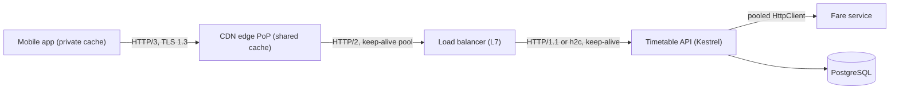
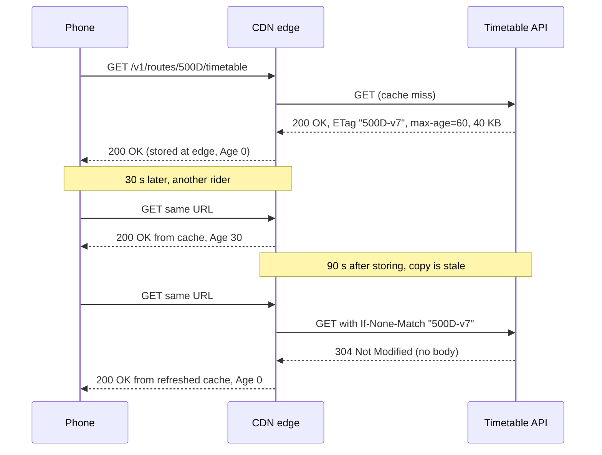
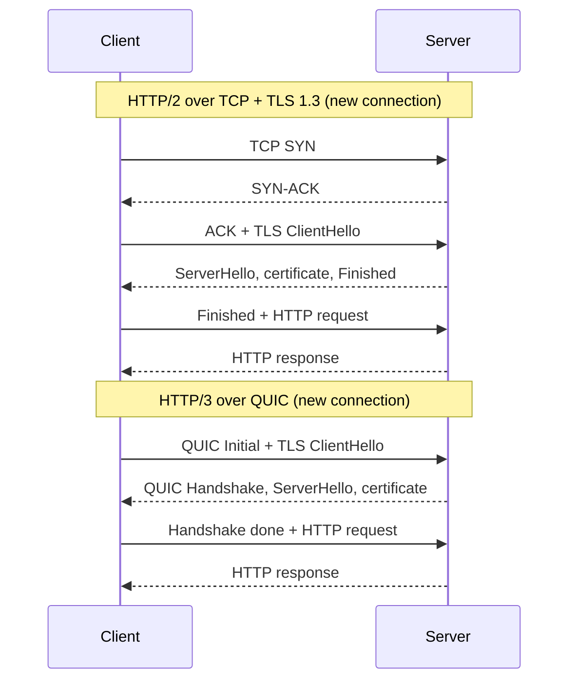

Almost every system you will design talks HTTP somewhere: browsers to your API, your API to a payment gateway, a CDN to your origin, one microservice to another. Most "mysterious" production problems at this layer come from a handful of misunderstood details: a retried `POST` that charges twice, a `200 OK` that hides an error, a cache that never caches, or a mobile app that spends 300 ms shaking hands before sending a single byte. This lesson makes those details concrete.

## Learning objectives

By the end of this lesson you will be able to:

1. Describe the parts of an HTTP request and response (method, target, headers, body, status) and what each one is for.
2. Classify methods as safe and/or idempotent, and use that to decide what a client may retry.
3. Pick the right status code for common situations, including the often-confused 401/403, 400/422, 409/412 and 502/503/504.
4. Use `Cache-Control`, `ETag`, `If-None-Match` and `If-Match` so clients and CDNs skip downloads and editors don't overwrite each other.
5. Explain persistent connections (keep-alive), why `HttpClient` must be reused, and what HTTP/2 and HTTP/3 change.
6. Estimate the latency cost of TCP and TLS handshakes with simple round-trip arithmetic.
7. Implement conditional GET and conditional PUT in an ASP.NET Core minimal API.

## Prerequisites

- [HTTP request and response lifecycle](#/lesson/m03-request-lifecycle): you should know how a request travels through Kestrel and middleware to an endpoint.
- [Latency numbers and latency budgets](#/lesson/m11-latency-numbers): we will count round trips (RTTs) and turn them into milliseconds.

No networking background beyond "a client sends a request and gets a response" is needed.

## Explain it like I'm a beginner

Think of HTTP as a very strict courier form.

You (the client) fill in a form and hand it to the courier. The form has a few boxes:

- **What you want done** — "fetch", "replace", "delete", "create" (the *method*: `GET`, `PUT`, `DELETE`, `POST`).
- **Which thing you mean** — the address of the item, like `/v1/routes/500D/timetable` (the *target* or *URI*).
- **Notes for the courier** — "I already have version 7, only send it if it changed", "I accept Hindi or English", "here is my ID card" (the *headers*).
- **The parcel itself**, if you are sending something (the *body*).

The reply form has a **three-digit result code** (the *status code*): 200 means "here you go", 404 means "no such item", 503 means "we're closed right now, try later". It also has notes ("keep this for 60 seconds before asking again") and possibly a parcel.

Two everyday ideas make HTTP fast:

1. **Don't send what the other side already has.** If your phone already holds today's bus timetable, it can ask "has version 7 changed?" and get a tiny "no" (`304 Not Modified`) instead of the whole timetable again. That is *conditional requests* plus *caching*.
2. **Don't re-introduce yourself every time.** Opening a secure connection is like going through security at an office: the first visit takes a while; once you have a visitor badge you walk straight in. Reusing an open connection (*keep-alive*) means paying the security check once, not on every request.

Hold on to those two ideas. Almost everything in this lesson is a precise version of them.

## First-principles explanation

### What a message really contains

HTTP/1.1 is text you can read. A real request from a bus-tracking app looks like this:

```http
GET /v1/routes/500D/timetable HTTP/1.1
Host: api.citybus.example
Accept: application/json
Accept-Encoding: br, gzip
If-None-Match: "500D-v7"
User-Agent: CityBus/4.2 (Android 14)
```

And a reply:

```http
HTTP/1.1 304 Not Modified
ETag: "500D-v7"
Cache-Control: public, max-age=60, stale-while-revalidate=30
Date: Mon, 19 Oct 2026 06:15:02 GMT
```

HTTP/2 and HTTP/3 send the *same meaning* in a compact binary encoding with compressed headers (HPACK in HTTP/2, QPACK in HTTP/3). The semantics (methods, status codes, headers) are defined once, in RFC 9110, and shared by all three versions. So everything about methods, status codes and caching applies whichever version is on the wire.

### Methods: safe and idempotent

Two properties decide how freely a method can be repeated:

- **Safe** — the client is asking to *read*, not change anything. `GET`, `HEAD`, `OPTIONS` (and the rarely used `TRACE`). A crawler or a prefetching browser may call safe methods without asking the user.
- **Idempotent** — doing it twice has the *same intended effect* as doing it once. All safe methods, plus `PUT` and `DELETE`. "Set the timetable to X" twice still leaves X. "Delete route 500D" twice still leaves it deleted (the second call may return 404, but the server state is the same).

| Method | Typical use | Safe | Idempotent | Body? |
|---|---|---|---|---|
| `GET` | Read a resource | Yes | Yes | No (proxies may drop it) |
| `HEAD` | Same as GET, headers only | Yes | Yes | No |
| `OPTIONS` | What can I do here? CORS pre-flight | Yes | Yes | Rare |
| `PUT` | Replace the resource at this URI | No | Yes | Yes |
| `DELETE` | Remove the resource | No | Yes | Rare |
| `POST` | Create, or run a process | No | **No** | Yes |
| `PATCH` | Partial update | No | Not by definition | Yes |

Why does this matter for system design? **Networks fail in the middle.** A client sends `POST /payments`, the server charges ₹1,250 via UPI, and the response is lost when the phone switches from Wi-Fi to 4G. The client sees a timeout. It does not know whether the charge happened. Retrying a `PUT` is harmless; retrying that `POST` may charge twice. The fix for `POST` is an **idempotency key** — a client-generated unique id the server remembers — covered in [Idempotency keys](#/lesson/m10-idempotency).

Idempotency is about *server state*, not about the response. A second `DELETE` returning `404` instead of `204` is still idempotent.

### Status codes: the five families

The first digit tells the client what kind of answer it got; that alone drives most client logic.

- **1xx informational** — rare in application code (`101 Switching Protocols` upgrades to WebSockets; `103 Early Hints` lets a browser start preloading).
- **2xx success** — `200 OK`, `201 Created` (with a `Location` header pointing at the new resource), `202 Accepted` (queued, not done yet), `204 No Content`.
- **3xx redirection** — `301`/`308` moved permanently, `302`/`307` temporarily (`307`/`308` keep the method and body; `301`/`302` historically let clients turn a POST into a GET). `304 Not Modified` answers a conditional GET.
- **4xx client error** — the request is wrong; repeating it unchanged will fail again (except `408` and `429`).
- **5xx server error** — the server or something behind it failed; a retry *might* work.

The pairs people confuse most:

| Pair | Difference |
|---|---|
| `401` vs `403` | 401: "I don't know who you are" (missing or invalid credentials). 403: "I know who you are, and you're not allowed." |
| `400` vs `422` | 400: the request is malformed (bad JSON, wrong type). 422: well-formed but fails business validation ("departure time 25:00"). Many APIs use 400 for both; pick one rule and stick to it. |
| `404` vs `410` | 410 says "it existed and is gone for good" — useful for search engines and caches. |
| `409` vs `412` | 409: conflicts with the current state ("route already exists", "inspection already approved"). 412: a precondition header you sent (`If-Match`) did not hold. |
| `429` vs `503` | 429: *you* are sending too much. 503: *the server* is overloaded or in maintenance. Both may carry `Retry-After`. |
| `502` vs `503` vs `504` | 502: a gateway got a bad answer from upstream. 503: service unavailable. 504: a gateway timed out waiting for upstream. All three usually come from a load balancer or proxy, which tells you *where* to look. |

A classic anti-pattern is "200 with an error inside": `200 OK` plus `{ "success": false }`. Caches will happily cache it, monitoring counts it as success, and retry libraries won't retry it. Use the status code for what it is meant for, and put details in a standard error body ([Problem Details](#/lesson/m10-rest-design)).

### Headers that shape behaviour

Headers are where most of HTTP's power lives:

- **Content negotiation**: `Accept`, `Accept-Encoding`, `Accept-Language` from the client; `Content-Type`, `Content-Encoding`, `Content-Language` in the answer.
- **Identity**: `Authorization: Bearer <token>` or a cookie.
- **Caching**: `Cache-Control`, `ETag`, `Last-Modified`, `Age`, `Vary`, `Expires` (legacy).
- **Conditional requests**: `If-None-Match`, `If-Modified-Since` (for reads), `If-Match`, `If-Unmodified-Since` (for writes).
- **Tracing**: `traceparent` (W3C Trace Context) so one request can be followed across services ([see correlation](#/lesson/m10-correlation)).
- **Back-off hints**: `Retry-After` on 429 and 503.

### HTTP caching, precisely

A cache stores a response and reuses it for later requests. There are two kinds:

- **Private caches** live in one user's browser or app.
- **Shared caches** serve many users: CDNs, reverse proxies, corporate proxies.

`Cache-Control` tells each kind what it may do:

| Directive | Meaning |
|---|---|
| `max-age=60` | Fresh for 60 seconds after it was generated. |
| `s-maxage=300` | Same, but only for shared caches (overrides `max-age` there). |
| `public` | Any cache may store it, even if the request had `Authorization`. |
| `private` | Only the end user's own cache may store it. CDNs must not. |
| `no-cache` | You *may* store it, but must check with the server (revalidate) before every reuse. The name misleads many people. |
| `no-store` | Do not store it anywhere. Use for bank statements, OTP screens, anything sensitive. |
| `must-revalidate` | Once stale, never serve it without checking — not even when the origin is down. |
| `stale-while-revalidate=30` | For 30 s after expiry, serve the stale copy instantly while refreshing in the background (RFC 5861). |
| `immutable` | Content at this URL never changes (fingerprinted files like `app.3f9a1c.js`), so don't even revalidate. |

**Freshness** is simple arithmetic: a response is fresh while its *current age* is less than its *freshness lifetime*. Current age = the `Age` header it arrived with + time spent in this cache. If a CDN stored a timetable 40 seconds ago with `max-age=60`, it has 20 seconds of freshness left.

When a cached copy goes stale, the cache does not have to download everything again. It **revalidates** with a conditional request:

- The server sent `ETag: "500D-v7"` (an *entity tag*, a version label for this representation).
- The cache asks `If-None-Match: "500D-v7"`.
- If nothing changed, the server answers `304 Not Modified` with no body — a few hundred bytes instead of, say, 40 KB.

Strong vs weak ETags: `"abc"` is strong (byte-for-byte identical), `W/"abc"` is weak (semantically equivalent, e.g. same data but different gzip output). `If-None-Match` uses *weak* comparison (so `W/"abc"` matches `"abc"`); `If-Match` uses *strong* comparison (weak tags never match), because a write must be based on exactly what you read.

**`Vary`** tells caches which request headers change the response. `Vary: Accept-Encoding` keeps a Brotli and a gzip copy separately. `Vary: Authorization` effectively disables shared caching. Forgetting `Vary: Accept-Language` on a localised page is how Hindi users end up seeing the English page someone else cached.

### Conditional writes: optimistic concurrency over HTTP

The same ETag mechanism protects writes. Two depot managers open the 500D timetable (both see `"500D-v7"`). Priya adds a 06:40 departure and saves with `If-Match: "500D-v7"`; the server applies it and the ETag becomes `"500D-v8"`. Arjun saves his edit with `If-Match: "500D-v7"`; the server answers **412 Precondition Failed** instead of silently overwriting Priya's change. Arjun's app reloads and merges. If a client sends no `If-Match` at all, the server can insist with **428 Precondition Required**. This is optimistic locking (no locks held while people think), expressed in HTTP.

### Connections: keep-alive and pooling

HTTP runs over a connection. For HTTP/1.1 and HTTP/2 that is TCP, usually wrapped in TLS. Opening one costs round trips before any data flows:

- **TCP handshake**: 1 RTT (SYN, SYN-ACK, then ACK with data).
- **TLS 1.2 full handshake**: 2 more RTTs.
- **TLS 1.3 full handshake**: 1 more RTT. TLS 1.3 *resumption* with **0-RTT early data** can send the request with the first flight — but early data can be replayed by an attacker, so servers should accept it only for safe, idempotent requests.
- **QUIC (HTTP/3)**: transport and TLS 1.3 handshakes are combined into 1 RTT, or 0-RTT on resumption.

**Persistent connections** (keep-alive) are the default in HTTP/1.1: after a response, the connection stays open for the next request. Kestrel keeps idle connections for 130 seconds by default (`KeepAliveTimeout`). A load balancer usually has its own idle timeout (often 60 s on cloud load balancers — check yours), and the side that closes first can cause occasional "connection reset" errors on the other side. A common rule: the server behind a load balancer should have a *longer* idle timeout than the load balancer, so the load balancer always closes first.

In .NET, the client side of this story is **`HttpClient`**. Each `HttpClient` owns a pool of connections (in its `SocketsHttpHandler`). Two classic bugs:

1. **`new HttpClient()` per request** — each instance opens new connections and leaves old sockets in `TIME_WAIT` for up to a few minutes. Under load you run out of ephemeral ports (*socket exhaustion*) and pay a fresh TCP+TLS handshake on every call.
2. **One static `HttpClient` forever** — connections are reused, but they never re-resolve DNS. When the service you call fails over to a new IP, you keep talking to the old one.

The fix is either `IHttpClientFactory` (which recycles handlers, by default every 2 minutes) or a long-lived client whose `SocketsHttpHandler` has `PooledConnectionLifetime` set (for example 5 minutes), so connections are recycled and DNS is re-checked.

### HTTP/1.1 vs HTTP/2 vs HTTP/3

| | HTTP/1.1 | HTTP/2 | HTTP/3 |
|---|---|---|---|
| Transport | TCP (+TLS) | TCP + TLS (h2), or cleartext h2c inside trusted networks | QUIC over UDP, TLS 1.3 built in |
| Encoding | Text | Binary frames | Binary frames |
| Concurrency per connection | One request at a time; browsers open ~6 connections per host | Many *streams* multiplexed on one connection | Many streams, each independent |
| Head-of-line blocking | At HTTP level: a slow response blocks the next | Solved at HTTP level, but one lost TCP packet stalls *all* streams | Solved: a lost packet stalls only its own stream |
| Header compression | None | HPACK | QPACK |
| Connection migration | No | No | Yes: survives a phone switching from Wi-Fi to 4G (connection IDs, not IP:port) |
| Discovery | — | ALPN during the TLS handshake | `Alt-Svc` header or DNS HTTPS records; clients then try QUIC |

What this means in practice:

- **Browsers and mobile apps** on lossy networks benefit most from HTTP/3: fewer handshake round trips and no TCP head-of-line blocking. A train passenger's phone losing 2 % of packets is exactly the case it was designed for.
- **Service-to-service** traffic in one data centre has tiny RTTs (often well under 1 ms) and almost no loss, so HTTP/2's win is mostly *multiplexing* — one connection carries hundreds of concurrent calls. This is why [gRPC](#/lesson/m10-grpc) is built on HTTP/2.
- **HTTP/3 is not free**: UDP is sometimes blocked by corporate firewalls (clients fall back to HTTP/2), QUIC uses more CPU per byte than kernel-optimised TCP in many stacks today, and on Linux Kestrel needs the `libmsquic` library installed. Enable it at the edge (CDN or gateway) first; your internal services rarely need it.

### What happens without these ideas

- Without correct method semantics, retries become dangerous and caches unpredictable.
- Without caching headers, every app launch downloads everything again: a timetable API with 2 million daily users × 5 launches × 40 KB = 400 GB/day of egress that could mostly be `304`s or CDN hits.
- Without connection reuse, a service calling a partner API 500 times per second performs 500 TLS handshakes per second, adding both latency and CPU on both sides.

### Trade-offs

| You gain | You pay |
|---|---|
| Long `max-age` → fewer requests, lower cost | Users may see stale data for that long; purging CDNs is slow and sometimes costly |
| `ETag` revalidation → small responses | Still one round trip per check; the server must compute the ETag cheaply |
| HTTP/2 multiplexing → fewer connections | One connection becomes a single point of congestion; L4 load balancers balance *connections*, not requests |
| HTTP/3 → faster on bad networks | UDP blocking, extra CPU, newer tooling, harder debugging |
| Keep-alive → no repeated handshakes | Idle connections hold memory and file descriptors; timeouts must be aligned |

## Visual explanation

### Architecture: where caching and TLS happen



Read it left to right. The **mobile app** keeps its own private cache and talks HTTP/3 to the nearest **CDN edge** — the expensive TLS handshake happens over a short distance (say Pune phone to a Mumbai PoP) instead of all the way to the origin. The **CDN** is a shared cache: one fresh copy of the 500D timetable serves thousands of riders. On a miss or revalidation it forwards to the **load balancer** over a small pool of long-lived HTTP/2 connections, so the edge-to-origin handshake cost is paid rarely. The **load balancer** terminates TLS (or re-encrypts) and keeps persistent connections to each **API** instance. The API itself calls the **fare service** through a pooled `HttpClient`, and reads from **PostgreSQL**. Each arrow is a separate HTTP hop with its own timeouts, keep-alive settings and protocol version — they do not have to match.

### Sequence: conditional GET through a CDN



The first request misses the edge and goes to the origin, which returns the full 40 KB body with an `ETag` and `max-age=60`. A second rider 30 seconds later gets the edge's copy instantly; the `Age: 30` header tells the phone how old it is. After 60 seconds the copy is stale, so on the next request the edge **revalidates** instead of re-downloading: it sends `If-None-Match`, the origin answers `304` with no body, and the edge resets the copy's age and serves it. The origin did a cheap version check rather than building and sending the whole timetable again.

### Sequence: handshake round trips on a new connection



Count the arrows from the client that must wait for an answer. Over TCP with TLS 1.3, the client waits for SYN-ACK (1 RTT) and for the server's TLS reply (1 RTT) before it can send the request, and then waits for the response (1 RTT): **3 RTTs** to the first byte of data. With QUIC, transport and TLS setup share one exchange: **2 RTTs**. With TLS 1.2 instead of 1.3, add one more round trip to the TCP case (4 RTTs). On a reused keep-alive connection, all of this disappears and you pay **1 RTT**.

## Step-by-step example

**Scenario.** A city bus agency runs a timetable API for its rider app. Numbers (estimates for the exercise, not measurements):

- 2 million daily active riders, 5 app opens each, each open fetches 3 route timetables.
- Average timetable JSON: 40 KB uncompressed, about 8 KB with Brotli.
- Timetables change a few times a day; live bus positions come from a separate real-time feed.
- Typical mobile RTT to the origin data centre in Mumbai from other Indian cities: estimate 60–100 ms; we'll use 80 ms.

### Step 1 — count the traffic

2,000,000 × 5 × 3 = 30 million timetable requests per day.
30,000,000 ÷ 86,400 s ≈ 350 requests per second on average. Morning peak (8–10 am) is perhaps 4× average: about 1,400 RPS.

### Step 2 — the naive version

No caching headers, no compression, a new connection per app open. Bytes per day: 30 M × 40 KB = 1.2 TB of egress. Each app open on a fresh connection pays 4 RTTs (TCP + TLS 1.2 + request) = 320 ms before the first timetable arrives.

### Step 3 — compress and set `Cache-Control`

Brotli takes 40 KB down to ~8 KB: 30 M × 8 KB = 240 GB/day. Add `Cache-Control: public, max-age=60, stale-while-revalidate=30` and a CDN. Since 1,400 RPS at peak hit only a few hundred popular routes, the CDN answers most requests itself. If the edge hit ratio is 95 %, the origin sees 1,400 × 0.05 = 70 RPS at peak instead of 1,400.

### Step 4 — add `ETag` revalidation

When an edge copy expires, the edge sends `If-None-Match`. Because timetables change only a few times a day, nearly all revalidations return `304` with no body. The app does the same for its private cache: on launch it revalidates instead of downloading 8 KB × 3.

### Step 5 — fix connection cost

Serve the API through the CDN over HTTP/3 with TLS 1.3. A cold app open now pays 2 RTTs to a nearby PoP (perhaps 20 ms RTT from Pune to a Mumbai edge, estimate): 40 ms instead of 320 ms to origin. Subsequent requests in the same session reuse the connection: 1 RTT each.

### Step 6 — protect writes

The depot managers' admin screen uses `PUT` with `If-Match`. Concurrent edits produce `412` instead of lost updates.

The result: the same feature, roughly 5× fewer bytes, ~20× fewer origin requests at peak, and a first paint several hundred milliseconds faster — with no new servers. Those ratios come from the assumed numbers above; your real ones depend on traffic shape.

## Production-style C# implementation

We build the origin side of the timetable API: conditional GET with `ETag` and `Cache-Control`, conditional PUT with `If-Match`/`412`/`428`, Problem Details errors, Kestrel protocols and limits, response compression, and an outbound `HttpClient` configured for connection reuse.

```text
Transit.Api/
  Program.cs
  Timetables/Timetable.cs
  Timetables/TimetableStore.cs
  Http/EntityTags.cs
  Http/TimetableEndpoints.cs
  Http/FareServiceClient.cs
```

```csharp file=Timetables/Timetable.cs
namespace Transit.Timetables;

/// <summary>A route's timetable. Version increases on every change and drives the ETag.</summary>
public sealed record Timetable(string RouteId, int Version, DateTimeOffset UpdatedAt, IReadOnlyList<TimeOnly> Departures);

/// <summary>Body of PUT: the full replacement list of departures.</summary>
public sealed record TimetableUpdate(IReadOnlyList<TimeOnly> Departures);

public enum UpdateOutcome { Updated, NotFound, VersionMismatch }

public sealed record UpdateResult(UpdateOutcome Outcome, Timetable? Current);
```

```csharp file=Timetables/TimetableStore.cs
namespace Transit.Timetables;

public interface ITimetableStore
{
    Timetable? Find(string routeId);

    /// <summary>Atomically replaces departures if the stored version still equals expectedVersion.</summary>
    UpdateResult TryUpdate(string routeId, int expectedVersion, IReadOnlyList<TimeOnly> departures);
}

/// <summary>In-memory stand-in for a PostgreSQL table with a version column.
/// The real version would run: UPDATE timetables SET ..., version = version + 1
/// WHERE route_id = @id AND version = @expected.</summary>
public sealed class InMemoryTimetableStore : ITimetableStore
{
    private readonly Lock _gate = new();
    private readonly TimeProvider _clock;
    private readonly Dictionary<string, Timetable> _routes = new(StringComparer.OrdinalIgnoreCase);

    public InMemoryTimetableStore(TimeProvider clock)
    {
        _clock = clock;
        var now = clock.GetUtcNow();
        _routes["500D"] = new Timetable("500D", 7, now, [new TimeOnly(6, 0), new TimeOnly(6, 20), new TimeOnly(6, 40)]);
        _routes["335E"] = new Timetable("335E", 3, now, [new TimeOnly(5, 45), new TimeOnly(6, 30)]);
    }

    public Timetable? Find(string routeId)
    {
        lock (_gate) return _routes.GetValueOrDefault(routeId);
    }

    public UpdateResult TryUpdate(string routeId, int expectedVersion, IReadOnlyList<TimeOnly> departures)
    {
        lock (_gate)
        {
            if (!_routes.TryGetValue(routeId, out var current)) return new UpdateResult(UpdateOutcome.NotFound, null);
            if (current.Version != expectedVersion) return new UpdateResult(UpdateOutcome.VersionMismatch, current);
            var updated = current with { Version = current.Version + 1, UpdatedAt = _clock.GetUtcNow(), Departures = departures.ToArray() };
            _routes[routeId] = updated;
            return new UpdateResult(UpdateOutcome.Updated, updated);
        }
    }
}
```

```csharp file=Http/EntityTags.cs
using Transit.Timetables;

namespace Transit.Http;

/// <summary>ETag helpers following RFC 9110 section 13.</summary>
public static class EntityTags
{
    /// <summary>Strong ETag built from the version: cheap to compute, no need to hash the body.</summary>
    public static string For(Timetable t) => $"\"{t.RouteId}-v{t.Version}\"";

    /// <summary>If-None-Match uses WEAK comparison: W/"x" matches "x".</summary>
    public static bool IfNoneMatchHits(string? header, string currentEtag)
    {
        if (string.IsNullOrWhiteSpace(header)) return false;
        if (header.Trim() == "*") return true;
        var current = StripWeak(currentEtag);
        foreach (var candidate in Split(header))
            if (StripWeak(candidate) == current) return true;
        return false;
    }

    /// <summary>If-Match uses STRONG comparison: weak tags never match.</summary>
    public static bool IfMatchHits(string? header, string currentEtag)
    {
        if (string.IsNullOrWhiteSpace(header)) return false;
        if (header.Trim() == "*") return true;
        if (currentEtag.StartsWith("W/", StringComparison.Ordinal)) return false;
        foreach (var candidate in Split(header))
            if (!candidate.StartsWith("W/", StringComparison.Ordinal) && candidate == currentEtag) return true;
        return false;
    }

    private static string[] Split(string header) =>
        header.Split(',', StringSplitOptions.TrimEntries | StringSplitOptions.RemoveEmptyEntries);

    private static string StripWeak(string tag) =>
        tag.StartsWith("W/", StringComparison.Ordinal) ? tag[2..] : tag;
}
```

```csharp file=Http/TimetableEndpoints.cs
using Microsoft.AspNetCore.Http.HttpResults;
using Transit.Timetables;

namespace Transit.Http;

public static class TimetableEndpoints
{
    private const string CachePolicy = "public, max-age=60, stale-while-revalidate=30";

    public static IEndpointRouteBuilder MapTimetables(this IEndpointRouteBuilder app)
    {
        var group = app.MapGroup("/v1/routes/{routeId}/timetable").WithTags("Timetables");
        group.MapGet("/", Get);
        group.MapPut("/", Put);
        return app;
    }

    // GET: 200 with ETag + Cache-Control, or 304 if the client's copy is current.
    private static IResult Get(string routeId, HttpContext http, ITimetableStore store)
    {
        var timetable = store.Find(routeId);
        if (timetable is null) return NotFound(routeId);

        var etag = EntityTags.For(timetable);
        var headers = http.Response.Headers;
        headers.ETag = etag;
        headers.CacheControl = CachePolicy;
        headers.LastModified = timetable.UpdatedAt.ToString("R");
        headers.Vary = "Accept-Encoding";

        if (EntityTags.IfNoneMatchHits(http.Request.Headers.IfNoneMatch, etag))
            return TypedResults.StatusCode(StatusCodes.Status304NotModified);

        return TypedResults.Ok(timetable);
    }

    // PUT: full replacement, guarded by If-Match. 428 if missing, 412 if stale.
    private static IResult Put(string routeId, TimetableUpdate body, HttpContext http, ITimetableStore store)
    {
        if (body.Departures is null || body.Departures.Count == 0)
            return TypedResults.ValidationProblem(new Dictionary<string, string[]>
            {
                ["departures"] = ["At least one departure is required."],
            });
        if (!body.Departures.SequenceEqual(body.Departures.Order()))
            return TypedResults.ValidationProblem(new Dictionary<string, string[]>
            {
                ["departures"] = ["Departures must be in ascending time order."],
            });

        string? ifMatch = http.Request.Headers.IfMatch;
        if (string.IsNullOrWhiteSpace(ifMatch))
            return TypedResults.Problem(statusCode: StatusCodes.Status428PreconditionRequired,
                title: "If-Match header required",
                detail: "Send the ETag you last read so concurrent edits cannot overwrite each other.");

        var current = store.Find(routeId);
        if (current is null) return NotFound(routeId);
        if (!EntityTags.IfMatchHits(ifMatch, EntityTags.For(current))) return Stale(current);

        var result = store.TryUpdate(routeId, current.Version, body.Departures);
        switch (result.Outcome)
        {
            case UpdateOutcome.Updated:
                http.Response.Headers.ETag = EntityTags.For(result.Current!);
                return TypedResults.Ok(result.Current);
            case UpdateOutcome.NotFound:
                return NotFound(routeId);
            default:
                return Stale(result.Current!); // someone else won the race between Find and TryUpdate
        }
    }

    private static ProblemHttpResult NotFound(string routeId) =>
        TypedResults.Problem(statusCode: StatusCodes.Status404NotFound, title: "Route not found",
            detail: $"No timetable exists for route '{routeId}'.");

    private static ProblemHttpResult Stale(Timetable current) =>
        TypedResults.Problem(statusCode: StatusCodes.Status412PreconditionFailed, title: "Timetable changed",
            detail: $"The timetable is now at {EntityTags.For(current)}. Reload, merge your change and retry.");
}
```

```csharp file=Http/FareServiceClient.cs
using System.Net;
using System.Net.Http.Json;

namespace Transit.Http;

public sealed record FareQuote(string From, string To, decimal Amount);

/// <summary>Typed client for an internal fare service. Created by IHttpClientFactory,
/// so connections are pooled and handlers are recycled.</summary>
public sealed class FareServiceClient(HttpClient http)
{
    public async Task<FareQuote?> GetFareAsync(string from, string to, CancellationToken ct)
    {
        var url = $"/v1/fares?from={Uri.EscapeDataString(from)}&to={Uri.EscapeDataString(to)}";
        using var response = await http.GetAsync(url, HttpCompletionOption.ResponseHeadersRead, ct);
        if (response.StatusCode == HttpStatusCode.NotFound) return null;
        response.EnsureSuccessStatusCode();
        return await response.Content.ReadFromJsonAsync<FareQuote>(ct);
    }
}

public static class OutboundHttpSetup
{
    public static IServiceCollection AddFareClient(this IServiceCollection services, Uri baseAddress)
    {
        services.AddHttpClient<FareServiceClient>(client =>
            {
                client.BaseAddress = baseAddress;
                client.Timeout = TimeSpan.FromSeconds(3);                     // never wait forever
                client.DefaultRequestVersion = HttpVersion.Version20;         // prefer HTTP/2 multiplexing
                client.DefaultVersionPolicy = HttpVersionPolicy.RequestVersionOrLower;
            })
            .ConfigurePrimaryHttpMessageHandler(() => new SocketsHttpHandler
            {
                PooledConnectionLifetime = TimeSpan.FromMinutes(5),      // re-resolve DNS periodically
                PooledConnectionIdleTimeout = TimeSpan.FromSeconds(50),  // close before the LB's 60 s idle timeout
                MaxConnectionsPerServer = 50,
                EnableMultipleHttp2Connections = true,                   // open a 2nd connection past 100 streams
                AutomaticDecompression = DecompressionMethods.All,
            })
            .SetHandlerLifetime(Timeout.InfiniteTimeSpan);               // PooledConnectionLifetime does the recycling
        return services;
    }
}
```

```csharp file=Program.cs
using Microsoft.AspNetCore.ResponseCompression;
using Microsoft.AspNetCore.Server.Kestrel.Core;
using Transit.Http;
using Transit.Timetables;

var builder = WebApplication.CreateBuilder(args);

builder.WebHost.ConfigureKestrel(kestrel =>
{
    kestrel.Limits.KeepAliveTimeout = TimeSpan.FromSeconds(130);   // longer than the load balancer's idle timeout
    kestrel.Limits.RequestHeadersTimeout = TimeSpan.FromSeconds(30);
    kestrel.Limits.Http2.MaxStreamsPerConnection = 100;
    // HTTP/3 needs TLS and, on Linux, libmsquic. Clients that can't use it fall back to 1.1/2.
    kestrel.ConfigureEndpointDefaults(listen => listen.Protocols = HttpProtocols.Http1AndHttp2AndHttp3);
});

builder.Services.AddProblemDetails();
builder.Services.AddResponseCompression(options =>
{
    options.EnableForHttps = true; // safe here: timetables contain no secrets (see BREACH note below)
    options.Providers.Add<BrotliCompressionProvider>();
    options.Providers.Add<GzipCompressionProvider>();
});
builder.Services.AddSingleton(TimeProvider.System);
builder.Services.AddSingleton<ITimetableStore, InMemoryTimetableStore>();
builder.Services.AddFareClient(new Uri(builder.Configuration["Fares:BaseUrl"] ?? "https://fares.internal.example"));

var app = builder.Build();

app.UseExceptionHandler();    // unhandled exceptions become 500 Problem Details
app.UseStatusCodePages();     // bare 4xx/5xx get a Problem Details body too
app.UseResponseCompression();
app.MapTimetables();

app.Run();
```

Notes on the choices:

- **ETag from the version number** costs nothing to compute. Hashing the serialised body also works but means building the full response just to answer `304`, which removes half the benefit.
- **`stale-while-revalidate=30`** lets the CDN answer instantly for 30 s after expiry while it refreshes in the background, so riders never wait on a revalidation.
- **`Vary: Accept-Encoding`** because compression produces different bytes for Brotli and gzip clients.
- **Compression over HTTPS** can leak secrets through the BREACH attack when a response mixes attacker-controlled input with secrets (like CSRF tokens). Public timetables are fine; for authenticated pages that echo user input, think before enabling it.
- **The outbound client** sets a timeout, prefers HTTP/2, recycles connections every 5 minutes, and closes idle ones before a typical 60-second load balancer timeout would.
- **ASP.NET Core does not answer `HEAD` automatically** for `MapGet` endpoints. If clients need `HEAD`, map it explicitly with `MapMethods(..., ["HEAD"], ...)`.

For responses whose body is expensive to build, ASP.NET Core's **output caching** middleware (`AddOutputCache`) can store responses in the server and serve them for repeated requests; it complements, not replaces, the `Cache-Control` headers that downstream caches read. See [Caching in ASP.NET Core](#/lesson/m03-caching).

## Bad design vs good design

**Bad**

```csharp
app.MapPost("/getTimetable", async (RouteRequest req, AppDb db) =>
{
    var client = new HttpClient();                              // new pool per request
    var fare = await client.GetStringAsync($"https://fares/v1?route={req.RouteId}");
    var t = await db.LoadAsync(req.RouteId);
    if (t is null) return Results.Ok(new { success = false, error = "not found" });   // 200 with an error
    return Results.Ok(new { success = true, data = t, fare });   // no ETag, no Cache-Control
});
```

What goes wrong:

- `POST` for a read: CDNs and browsers will not cache it, and retry libraries treat it as unsafe.
- `200` for "not found": monitoring shows 100 % success during an outage of the data source; clients must parse bodies to detect errors.
- A new `HttpClient` per request: socket exhaustion under load and a fresh TLS handshake to the fare service on every call.
- No caching headers: every app open downloads the full payload.
- No timeout on the outbound call: one slow fare service hangs every timetable request.

**Good**: the implementation above — `GET` on a resource URI, real status codes with Problem Details, `ETag` + `Cache-Control`, conditional writes, a factory-managed `HttpClient` with a timeout.

**When is the simpler version fine?** An internal admin tool used by ten people on the office network does not need a CDN, `stale-while-revalidate` or HTTP/3. Correct methods and status codes are still worth the five minutes; the caching and protocol tuning can wait until traffic or latency justifies them.

:::callout type=mistake title="no-cache does not mean do not cache"
`Cache-Control: no-cache` allows storing and requires revalidation before each reuse. If you mean "never store this" (OTP pages, bank statements), use `no-store`. Mixing them up either leaks sensitive pages into shared caches or throws away free performance.
:::

:::callout type=tradeoff title="Long max-age versus fast corrections"
A `max-age` of one day on timetables cuts traffic further, but a wrong timetable stays wrong for a day unless you purge the CDN. A short `max-age` plus cheap `ETag` revalidation usually gives most of the benefit with minutes, not hours, of staleness. For files that truly never change, fingerprint the URL and use `max-age=31536000, immutable`.
:::

## Practical playground

The simulator below models a cache in front of an origin. Treat the cache as the CDN edge and the origin as the timetable API. Move the hit ratio from 0.5 to 0.95 and watch the origin load and average latency; then lower the TTL and see how many more requests reach the origin. Relate each setting to a header: TTL is `max-age`/`s-maxage`, and a revalidation that returns `304` is a "miss" that costs a round trip but almost no bandwidth.

:::playground type=sim sim=cache title="CDN caching in front of the timetable API" hitRatio=0.9 rps=1400 dbCapacityRps=400 dbLatencyMs=40 cacheLatencyMs=5 ttlSeconds=60
:::

## Exercises

:::exercise id=m10-http-fundamentals-ex1 difficulty=beginner kind=code title="Match If-None-Match and If-Match correctly"
Implement the two ETag comparison functions that decide between `304`/`200` on reads and `412`/success on writes.
::requirements
- `ETagMatcher.IfNoneMatch(string? header, string current)` uses **weak** comparison: `W/"a"` matches `"a"`.
- `ETagMatcher.IfMatch(string? header, string current)` uses **strong** comparison: a weak tag on either side never matches.
- Both accept a comma-separated list of tags and the wildcard `*`.
- A null, empty or whitespace header returns `false`.
::acceptance
- `IfNoneMatch("\"v1\", \"v2\"", "\"v2\"")` is true.
- `IfNoneMatch("W/\"v2\"", "\"v2\"")` is true, but `IfMatch("W/\"v2\"", "\"v2\"")` is false.
- `IfMatch("*", "\"v9\"")` is true.
- `IfNoneMatch(null, "\"v1\"")` is false.
::hint
Read RFC 9110 section 8.8.3.2: there are exactly two comparison functions. Which header uses which, and why would a write need the stricter one?
::hint
Split the header on commas and trim each entry. Handle `*` before splitting.
::hint
Weak comparison = compare after removing a leading `W/` from both. Strong comparison = neither may start with `W/`, and the strings must be equal.
::hint
```csharp
static string Strip(string t) => t.StartsWith("W/") ? t[2..] : t;
foreach (var tag in header.Split(',', StringSplitOptions.TrimEntries | StringSplitOptions.RemoveEmptyEntries))
    if (Strip(tag) == Strip(current)) return true;
```
::starter
```csharp file=ETagMatcher.cs
using System;

public static class ETagMatcher
{
    public static bool IfNoneMatch(string? header, string current) => throw new NotImplementedException();
    public static bool IfMatch(string? header, string current) => throw new NotImplementedException();
}
```
::tests
```csharp file=ETagMatcherTests.cs
using Xunit;

public class ETagMatcherTests
{
    [Fact] public void Exact_match_hits() => Assert.True(ETagMatcher.IfNoneMatch("\"v2\"", "\"v2\""));
    [Fact] public void List_is_supported() => Assert.True(ETagMatcher.IfNoneMatch("\"v1\", \"v2\"", "\"v2\""));
    [Fact] public void Different_tag_misses() => Assert.False(ETagMatcher.IfNoneMatch("\"v1\"", "\"v2\""));
    [Fact] public void Weak_matches_for_reads() => Assert.True(ETagMatcher.IfNoneMatch("W/\"v2\"", "\"v2\""));
    [Fact] public void Weak_current_matches_for_reads() => Assert.True(ETagMatcher.IfNoneMatch("\"v2\"", "W/\"v2\""));
    [Fact] public void Weak_never_matches_for_writes() => Assert.False(ETagMatcher.IfMatch("W/\"v2\"", "\"v2\""));
    [Fact] public void Weak_current_never_matches_for_writes() => Assert.False(ETagMatcher.IfMatch("\"v2\"", "W/\"v2\""));
    [Fact] public void Strong_matches_for_writes() => Assert.True(ETagMatcher.IfMatch("\"v1\",\"v2\"", "\"v2\""));
    [Fact] public void Wildcard_matches_both() { Assert.True(ETagMatcher.IfMatch("*", "\"v9\"")); Assert.True(ETagMatcher.IfNoneMatch(" * ", "\"v9\"")); }
    [Theory]
    [InlineData(null)]
    [InlineData("")]
    [InlineData("   ")]
    public void Missing_header_is_false(string? header) { Assert.False(ETagMatcher.IfNoneMatch(header, "\"v1\"")); Assert.False(ETagMatcher.IfMatch(header, "\"v1\"")); }
}
```
::solution
Two comparison functions, one per header. Reads tolerate weak tags because a semantically equivalent copy is good enough to display; writes need the exact version you read.

```csharp file=ETagMatcher.cs
using System;

public static class ETagMatcher
{
    public static bool IfNoneMatch(string? header, string current)
    {
        if (string.IsNullOrWhiteSpace(header)) return false;
        if (header.Trim() == "*") return true;
        var target = Strip(current);
        foreach (var tag in Split(header))
            if (Strip(tag) == target) return true;
        return false;
    }

    public static bool IfMatch(string? header, string current)
    {
        if (string.IsNullOrWhiteSpace(header)) return false;
        if (header.Trim() == "*") return true;
        if (IsWeak(current)) return false;
        foreach (var tag in Split(header))
            if (!IsWeak(tag) && tag == current) return true;
        return false;
    }

    private static string[] Split(string header) =>
        header.Split(',', StringSplitOptions.TrimEntries | StringSplitOptions.RemoveEmptyEntries);

    private static bool IsWeak(string tag) => tag.StartsWith("W/", StringComparison.Ordinal);
    private static string Strip(string tag) => IsWeak(tag) ? tag[2..] : tag;
}
```
::mistakes
- Comparing the raw header string to the ETag, which fails as soon as a client sends two tags.
- Using weak comparison for `If-Match`: a weak tag only promises "equivalent", so two writers could both pass.
- Forgetting that the quotes are part of the ETag value: `"v2"` and `v2` are different strings.
::extensions
Add `IfModifiedSince(string? header, DateTimeOffset lastModified)` that parses an HTTP-date and returns true when the resource has *not* changed since then (ignore it when `If-None-Match` is present, as RFC 9110 requires).
:::

:::exercise id=m10-http-fundamentals-ex2 difficulty=beginner kind=written title="Methods and status codes for a tender portal"
A state government's e-tender portal is adding an API. Open the **API design playground** (`#/playground/api`) and model these eight operations as endpoints. For each, choose the method, path, success status code and the main error status codes, and say whether a client may blindly retry it after a timeout.

1. Read one tender's details.
2. List open tenders in a district.
3. A contractor submits a bid (money is involved: bid security of ₹2,00,000).
4. Replace a draft bid's documents list in full.
5. Withdraw (delete) a draft bid.
6. A contractor tries to view another contractor's bid.
7. A bid arrives one second after the deadline.
8. The document-scanning service behind the API times out.

Use the playground's lint panel and fix every error it reports. Paste your final table into your notes.
::acceptance
- Reads use `GET` with no body; the list is paginated.
- Bid submission is `POST` returning `201 Created` with a `Location` header and requires an `Idempotency-Key`.
- Full replacement uses `PUT` (idempotent), withdrawal uses `DELETE` returning `204`.
- Case 6 uses `403` (or `404` if you deliberately hide existence) with a reason; case 7 uses `409` or `422` with a reason, not `400` or `500`.
- Case 8 is `504` if the API acts as a gateway to that service, or `503`, with `Retry-After` considered.
- Retry answer is correct for each row: safe/idempotent yes, `POST` only with an idempotency key.
::hint
Start from the method table in this lesson: which operations only read, which replace, which create?
::hint
For each row, ask "if this request ran twice, would the world look different?" That answers the retry column.
::hint
Who is wrong in case 7: the client's request format, or the state of the tender? That separates 400 from 409/422.
::hint
A sample row: `POST /v1/tenders/{tenderId}/bids` → `201` + `Location: /v1/bids/{bidId}`; errors 400, 401, 403, 409 (deadline passed); retry only with the same `Idempotency-Key`.
::solution
| # | Endpoint | Success | Errors | Blind retry? |
|---|---|---|---|---|
| 1 | `GET /v1/tenders/{tenderId}` | 200 (+ ETag) | 404 | Yes (safe) |
| 2 | `GET /v1/tenders?district=pune&status=open&limit=50&cursor=...` | 200 | 400 (bad filter) | Yes (safe) |
| 3 | `POST /v1/tenders/{tenderId}/bids` with `Idempotency-Key` | 201 + Location | 400, 401, 403, 409, 422 | Only with the same idempotency key |
| 4 | `PUT /v1/bids/{bidId}/documents` with `If-Match` | 200 or 204 | 400, 404, 409 (bid already submitted), 412, 428 | Yes (idempotent), and `If-Match` prevents lost updates |
| 5 | `DELETE /v1/bids/{bidId}` | 204 | 404, 409 (already submitted) | Yes (idempotent; a second call may return 404) |
| 6 | `GET /v1/bids/{bidId}` by another contractor | — | 403, or 404 to avoid revealing that the bid exists | Retrying is pointless |
| 7 | `POST .../bids` after the deadline | — | 409 Conflict (state of the tender forbids it) or 422; never 500 | No — it will fail the same way |
| 8 | Scanner timeout | — | 504 Gateway Timeout if the API proxies the scanner; 503 + `Retry-After` if the API itself is degraded | Safe methods yes; the bid POST only with the key |

Why `404` is a legitimate choice in case 6: in tenders, revealing that *a* bid exists for a tender can leak competitive information. Many systems return 404 for "exists but not yours" for that reason; document the choice.
::mistakes
- `POST /getTender` or `/submitBid` — the method is the verb; the path names the resource.
- Returning `200` for every outcome with a `success` flag inside.
- Using `400` for the deadline case: the request was well-formed; the tender's *state* rejected it.
- Calling bid submission retry-safe without an idempotency key.
:::

:::exercise id=m10-http-fundamentals-ex3 difficulty=intermediate kind=code title="Is this cached response still fresh?"
Write the freshness logic a cache uses (RFC 9111) for a private cache (a phone) and a shared cache (a CDN).
::requirements
- `Freshness.MayStore(string cacheControl, CacheKind kind)`: false for `no-store`; false for `private` when `kind` is `Shared`; otherwise true.
- `Freshness.Lifetime(string cacheControl, CacheKind kind)`: for a shared cache, `s-maxage` wins over `max-age`; otherwise `max-age`. Returns `null` when neither is present.
- `Freshness.IsFresh(CachedResponse r, DateTimeOffset now, CacheKind kind)`: false if `no-cache` is present (must revalidate); otherwise current age = `r.AgeOnArrivalSeconds` + seconds since `r.StoredAt`, and the response is fresh when age < lifetime. No lifetime means not fresh.
- Directive names are case-insensitive; ignore unknown directives and extra spaces.
::acceptance
- `public, max-age=60` stored 30 s ago is fresh; stored 61 s ago is stale.
- `max-age=60, s-maxage=600` stored 120 s ago is fresh for `Shared` and stale for `Private`.
- `Age: 50` on arrival plus 15 s in the cache makes a `max-age=60` response stale.
- `no-cache, max-age=600` is never fresh; `no-store` may not be stored.
::hint
Turn the header into a dictionary first: directive name → optional value.
::hint
`"max-age=60"` splits on the first `=`; `"no-store"` has no value. Lower-case the names.
::hint
Current age = age on arrival + (now − stored at). Compare it with the lifetime in seconds.
::hint
```csharp
var d = Parse(cacheControl);
if (kind == CacheKind.Shared && d.TryGetValue("s-maxage", out var s) && int.TryParse(s, out var sm)) return TimeSpan.FromSeconds(sm);
if (d.TryGetValue("max-age", out var m) && int.TryParse(m, out var ma)) return TimeSpan.FromSeconds(ma);
return null;
```
::starter
```csharp file=Freshness.cs
using System;
using System.Collections.Generic;

public enum CacheKind { Private, Shared }

public sealed record CachedResponse(string CacheControl, DateTimeOffset StoredAt, int AgeOnArrivalSeconds);

public static class Freshness
{
    public static bool MayStore(string cacheControl, CacheKind kind) => throw new NotImplementedException();
    public static TimeSpan? Lifetime(string cacheControl, CacheKind kind) => throw new NotImplementedException();
    public static bool IsFresh(CachedResponse response, DateTimeOffset now, CacheKind kind) => throw new NotImplementedException();
}
```
::tests
```csharp file=FreshnessTests.cs
using System;
using Xunit;

public class FreshnessTests
{
    private static readonly DateTimeOffset T0 = new(2026, 10, 19, 6, 0, 0, TimeSpan.Zero);

    [Fact] public void Fresh_within_max_age() =>
        Assert.True(Freshness.IsFresh(new CachedResponse("public, max-age=60", T0, 0), T0.AddSeconds(30), CacheKind.Private));

    [Fact] public void Stale_after_max_age() =>
        Assert.False(Freshness.IsFresh(new CachedResponse("public, max-age=60", T0, 0), T0.AddSeconds(61), CacheKind.Private));

    [Fact] public void Shared_cache_uses_s_maxage() =>
        Assert.True(Freshness.IsFresh(new CachedResponse("max-age=60, s-maxage=600", T0, 0), T0.AddSeconds(120), CacheKind.Shared));

    [Fact] public void Private_cache_ignores_s_maxage() =>
        Assert.False(Freshness.IsFresh(new CachedResponse("max-age=60, s-maxage=600", T0, 0), T0.AddSeconds(120), CacheKind.Private));

    [Fact] public void Age_on_arrival_counts() =>
        Assert.False(Freshness.IsFresh(new CachedResponse("max-age=60", T0, 50), T0.AddSeconds(15), CacheKind.Private));

    [Fact] public void No_cache_is_never_fresh() =>
        Assert.False(Freshness.IsFresh(new CachedResponse("no-cache, max-age=600", T0, 0), T0, CacheKind.Private));

    [Fact] public void No_lifetime_is_not_fresh() =>
        Assert.False(Freshness.IsFresh(new CachedResponse("public", T0, 0), T0, CacheKind.Shared));

    [Fact] public void Case_and_spaces_are_ignored() =>
        Assert.Equal(TimeSpan.FromSeconds(90), Freshness.Lifetime("  Public ,MAX-AGE=90 ", CacheKind.Private));

    [Fact] public void No_store_cannot_be_stored() => Assert.False(Freshness.MayStore("no-store", CacheKind.Private));

    [Fact] public void Private_not_in_shared_cache()
    {
        Assert.False(Freshness.MayStore("private, max-age=60", CacheKind.Shared));
        Assert.True(Freshness.MayStore("private, max-age=60", CacheKind.Private));
    }
}
```
::solution
Parse once into a dictionary, then apply the rules in order of precedence.

```csharp file=Freshness.cs
using System;
using System.Collections.Generic;

public enum CacheKind { Private, Shared }

public sealed record CachedResponse(string CacheControl, DateTimeOffset StoredAt, int AgeOnArrivalSeconds);

public static class Freshness
{
    public static bool MayStore(string cacheControl, CacheKind kind)
    {
        var d = Parse(cacheControl);
        if (d.ContainsKey("no-store")) return false;
        if (kind == CacheKind.Shared && d.ContainsKey("private")) return false;
        return true;
    }

    public static TimeSpan? Lifetime(string cacheControl, CacheKind kind)
    {
        var d = Parse(cacheControl);
        if (kind == CacheKind.Shared && TryInt(d, "s-maxage", out var shared)) return TimeSpan.FromSeconds(shared);
        if (TryInt(d, "max-age", out var maxAge)) return TimeSpan.FromSeconds(maxAge);
        return null;
    }

    public static bool IsFresh(CachedResponse response, DateTimeOffset now, CacheKind kind)
    {
        var d = Parse(response.CacheControl);
        if (d.ContainsKey("no-cache")) return false;
        var lifetime = Lifetime(response.CacheControl, kind);
        if (lifetime is null) return false;
        var age = response.AgeOnArrivalSeconds + (now - response.StoredAt).TotalSeconds;
        return age < lifetime.Value.TotalSeconds;
    }

    private static bool TryInt(Dictionary<string, string?> d, string key, out int value)
    {
        value = 0;
        return d.TryGetValue(key, out var raw) && int.TryParse(raw?.Trim('"'), out value) && value >= 0;
    }

    private static Dictionary<string, string?> Parse(string header)
    {
        var result = new Dictionary<string, string?>(StringComparer.OrdinalIgnoreCase);
        foreach (var part in header.Split(',', StringSplitOptions.TrimEntries | StringSplitOptions.RemoveEmptyEntries))
        {
            var eq = part.IndexOf('=');
            if (eq < 0) result[part] = null;
            else result[part[..eq].Trim()] = part[(eq + 1)..].Trim();
        }
        return result;
    }
}
```

Real caches add more rules — heuristic freshness when only `Last-Modified` is present, `must-revalidate`, `stale-while-revalidate`, and `Expires` as a fallback — but this is the core every one of them shares.
::mistakes
- Forgetting the `Age` header, so a CDN copy that was already 50 s old is treated as brand new by the phone.
- Treating `no-cache` as "do not store".
- Letting a shared cache store `private` responses — a classic way to show one user's account page to another.
::extensions
Add `stale-while-revalidate`: return a three-state result (`Fresh`, `StaleButServe`, `MustRevalidate`).
:::

:::exercise id=m10-http-fundamentals-ex4 difficulty=intermediate kind=hld title="Make the timetable API fast on bad mobile networks"
The starter shows riders' phones calling the timetable API directly in a Mumbai data centre over HTTP/1.1 with TLS 1.2 and no caching. Peak is 1,400 RPS; average response 40 KB uncompressed. Riders across Maharashtra complain that the first screen takes more than a second on 4G.

Redesign the path so the first screen appears faster and origin load drops, and annotate each edge with protocol and cache behaviour.
::acceptance
- Shows where TLS terminates and why that location reduces handshake latency, with RTT arithmetic.
- States `Cache-Control` and `ETag` behaviour for timetables and explains why live bus positions are *not* cached the same way.
- Estimates origin RPS after the change from an assumed edge hit ratio, with arithmetic.
- Names at least two failure modes (for example, CDN serving stale data after a correction, UDP blocked so HTTP/3 falls back) and a mitigation for each.
::hint
Which part of the 1-second delay is handshakes, and how many RTTs does each protocol need?
::hint
A CDN edge near the rider shortens every handshake RTT, not just cached responses.
::hint
Timetables change a few times per day; bus positions change every few seconds. Do they deserve the same headers, or even the same transport?
::hint
Add a `cdn` node (HTTP/3, TLS 1.3, `s-maxage=60`), keep a pooled HTTP/2 connection from edge to origin, and send live positions through a separate real-time path.
::starter
```json
{
  "nodes": [
    { "id": "riders", "type": "client", "label": "Rider app (4G, HTTP/1.1 + TLS 1.2)", "props": { "rps": 1400 } },
    { "id": "lb", "type": "load-balancer", "label": "Load balancer (Mumbai)" },
    { "id": "api", "type": "app-server", "label": "Timetable + live positions API", "props": { "instances": 4 } },
    { "id": "db", "type": "database", "label": "PostgreSQL" }
  ],
  "edges": [
    { "from": "riders", "to": "lb", "kind": "sync", "label": "new connection per app open" },
    { "from": "lb", "to": "api", "kind": "sync" },
    { "from": "api", "to": "db", "kind": "sync" }
  ]
}
```
::solution
```json
{
  "nodes": [
    { "id": "riders", "type": "client", "label": "Rider app (private cache, HTTP/3 with fallback)", "props": { "rps": 1400 } },
    { "id": "dns", "type": "dns", "label": "DNS (HTTPS record advertises h3)" },
    { "id": "cdn", "type": "cdn", "label": "CDN edge PoPs: TLS 1.3 + QUIC, caches timetables (s-maxage=60, SWR=30)", "props": { "ttlSeconds": 60 } },
    { "id": "lb", "type": "load-balancer", "label": "Origin L7 LB (HTTP/2 pool from CDN)", "props": { "multiAz": true } },
    { "id": "api", "type": "app-server", "label": "Timetable API (ETag from version, Brotli)", "props": { "instances": 2 } },
    { "id": "rt", "type": "websocket-gateway", "label": "Live positions (SSE/WebSocket, no CDN caching)", "props": { "instances": 2 } },
    { "id": "redis", "type": "cache", "label": "Latest bus positions" },
    { "id": "db", "type": "database", "label": "PostgreSQL (timetables, version column)", "props": { "replicas": 1 } }
  ],
  "edges": [
    { "from": "riders", "to": "dns", "kind": "sync" },
    { "from": "riders", "to": "cdn", "kind": "sync", "label": "HTTP/3, 2 RTT cold, 1 RTT warm" },
    { "from": "cdn", "to": "lb", "kind": "sync", "label": "~5% misses + 304 revalidations" },
    { "from": "lb", "to": "api", "kind": "sync" },
    { "from": "api", "to": "db", "kind": "sync" },
    { "from": "riders", "to": "rt", "kind": "sync", "label": "long-lived stream" },
    { "from": "rt", "to": "redis", "kind": "sync" }
  ]
}
```

**Handshake arithmetic (estimates).** Rider in Nagpur to Mumbai origin: RTT ≈ 80 ms. HTTP/1.1 + TLS 1.2 on a new connection: TCP 1 + TLS 2 + request 1 = 4 RTT = 320 ms before the first byte, plus 40 KB on a slow link. With a Nagpur or nearby edge at, say, 20 ms RTT and HTTP/3: 2 RTT = 40 ms; on a warm connection 1 RTT = 20 ms. Edge-to-origin connections are pre-established and reused, so their handshakes are not on the user's path.

**Caching.** Timetables: `Cache-Control: public, max-age=60, s-maxage=60, stale-while-revalidate=30`, `ETag` from the version column, `Vary: Accept-Encoding`. Brotli reduces 40 KB to roughly 8 KB. Live positions change every few seconds and are per-route streams, so they bypass the CDN cache and use a real-time channel ([see real-time](#/lesson/m10-realtime)).

**Origin load.** With a 95 % edge hit ratio (assumption): 1,400 × 0.05 = 70 RPS reach the origin, most of them `304`s. Two API instances are plenty; keep a third for deployments if your SLO demands it.

**Failure modes.**
1. A wrong timetable is published: stale for up to 60 + 30 s. Mitigation: publish triggers a CDN purge of that route's URL; keep `max-age` short.
2. UDP blocked on some networks: clients fall back to HTTP/2 over TCP automatically; monitor the h3 share.
3. Origin down: `stale-while-revalidate` (and `stale-if-error`, if your CDN supports it) keeps serving the last timetable — acceptable for timetables, not for prices.
4. CDN outage: DNS failover to the origin load balancer, which must be sized for at least a degraded share of peak, with rate limiting.
::mistakes
- Caching live positions at the CDN with a long TTL, showing buses where they were minutes ago.
- Adding a CDN but leaving `Cache-Control: no-cache` or `private` on the origin, so nothing is cached.
- Forgetting that the CDN-to-origin hop also needs keep-alive; otherwise every miss pays a full handshake to the origin.
:::

:::exercise id=m10-http-fundamentals-ex5 difficulty=advanced kind=code title="Decide whether a failed HTTP call may be retried"
Build the decision logic an outbound HTTP client uses before retrying. It must be safe for money-moving calls and respect the server's back-off hints.
::requirements
- `RetryAdvisor.Decide(string method, bool hasIdempotencyKey, AttemptOutcome outcome, int attempt, DateTimeOffset now)` returns `RetryDecision(bool Retry, TimeSpan Delay, string Reason)`.
- `attempt` is the number of attempts already made (1 after the first failure). Never retry when `attempt >= 3`.
- A request is *repeatable* if the method is `GET`, `HEAD`, `OPTIONS`, `PUT` or `DELETE` (case-insensitive), or `hasIdempotencyKey` is true.
- `ConnectFailed` (the request never left the client): always retry.
- `TimedOutAfterSend`: retry only if repeatable.
- `HttpStatus`: `429` → retry any method (the server refused before doing work); `408`, `502`, `503`, `504` → retry only if repeatable; anything else → no retry.
- Delay: if `RetryAfter` is present, it is either delta-seconds (`"5"`) or an HTTP-date (`"Mon, 19 Oct 2026 06:00:30 GMT"`); use it (never negative). Otherwise use exponential back-off: 200 ms × 2^(attempt − 1).
- If the delay would exceed 30 seconds, do not retry.
::acceptance
- A `POST` without a key that timed out after sending is **not** retried.
- The same `POST` with an idempotency key is retried after 200 ms on the first attempt.
- `429` with `Retry-After: 5` on a `POST` is retried after 5 s.
- `503` with an HTTP-date 10 s in the future yields a 10 s delay.
- `Retry-After: 120` gives up.
- `500` and `400` are not retried; a fourth attempt is never made.
::hint
Separate three questions: *may* I repeat this request at all? *should* I, given the failure? *when*?
::hint
"Connect failed" is special: no bytes reached the server, so even a `POST` cannot have had an effect.
::hint
`int.TryParse` for delta-seconds; `DateTimeOffset.TryParseExact(value, "r", CultureInfo.InvariantCulture, DateTimeStyles.AssumeUniversal, out var date)` for HTTP-dates.
::hint
Write `bool Repeatable()` and `TimeSpan? ParseRetryAfter()` helpers first; then `Decide` is a short `switch` on `outcome.Kind`.
::hint
```csharp
var delay = ParseRetryAfter(outcome.RetryAfter, now) ?? TimeSpan.FromMilliseconds(200 * Math.Pow(2, attempt - 1));
if (delay > TimeSpan.FromSeconds(30)) return new(false, TimeSpan.Zero, "server asked us to wait too long");
```
::starter
```csharp file=RetryAdvisor.cs
using System;
using System.Globalization;

public enum FailureKind { ConnectFailed, TimedOutAfterSend, HttpStatus }

public sealed record AttemptOutcome(FailureKind Kind, int StatusCode = 0, string? RetryAfter = null);

public sealed record RetryDecision(bool Retry, TimeSpan Delay, string Reason);

public static class RetryAdvisor
{
    public const int MaxAttempts = 3;
    public static readonly TimeSpan MaxDelay = TimeSpan.FromSeconds(30);

    public static RetryDecision Decide(string method, bool hasIdempotencyKey, AttemptOutcome outcome, int attempt, DateTimeOffset now) =>
        throw new NotImplementedException();
}
```
::tests
```csharp file=RetryAdvisorTests.cs
using System;
using Xunit;

public class RetryAdvisorTests
{
    private static readonly DateTimeOffset Now = new(2026, 10, 19, 6, 0, 20, TimeSpan.Zero);

    [Fact] public void Post_timeout_without_key_is_not_retried() =>
        Assert.False(RetryAdvisor.Decide("POST", false, new AttemptOutcome(FailureKind.TimedOutAfterSend), 1, Now).Retry);

    [Fact] public void Post_timeout_with_key_is_retried_with_backoff()
    {
        var d = RetryAdvisor.Decide("POST", true, new AttemptOutcome(FailureKind.TimedOutAfterSend), 1, Now);
        Assert.True(d.Retry);
        Assert.Equal(TimeSpan.FromMilliseconds(200), d.Delay);
    }

    [Fact] public void Backoff_doubles() =>
        Assert.Equal(TimeSpan.FromMilliseconds(400), RetryAdvisor.Decide("GET", false, new AttemptOutcome(FailureKind.HttpStatus, 503), 2, Now).Delay);

    [Fact] public void Connect_failure_is_always_retried() =>
        Assert.True(RetryAdvisor.Decide("post", false, new AttemptOutcome(FailureKind.ConnectFailed), 1, Now).Retry);

    [Fact] public void Too_many_attempts_stop() =>
        Assert.False(RetryAdvisor.Decide("GET", false, new AttemptOutcome(FailureKind.ConnectFailed), 3, Now).Retry);

    [Fact] public void Status_429_on_post_uses_retry_after_seconds()
    {
        var d = RetryAdvisor.Decide("POST", false, new AttemptOutcome(FailureKind.HttpStatus, 429, "5"), 1, Now);
        Assert.True(d.Retry);
        Assert.Equal(TimeSpan.FromSeconds(5), d.Delay);
    }

    [Fact] public void Status_503_uses_http_date()
    {
        var d = RetryAdvisor.Decide("GET", false, new AttemptOutcome(FailureKind.HttpStatus, 503, "Mon, 19 Oct 2026 06:00:30 GMT"), 1, Now);
        Assert.True(d.Retry);
        Assert.Equal(TimeSpan.FromSeconds(10), d.Delay);
    }

    [Fact] public void Past_http_date_means_no_wait() =>
        Assert.Equal(TimeSpan.Zero, RetryAdvisor.Decide("GET", false, new AttemptOutcome(FailureKind.HttpStatus, 503, "Mon, 19 Oct 2026 05:00:00 GMT"), 1, Now).Delay);

    [Fact] public void Long_retry_after_gives_up() =>
        Assert.False(RetryAdvisor.Decide("GET", false, new AttemptOutcome(FailureKind.HttpStatus, 503, "120"), 1, Now).Retry);

    [Fact] public void Status_503_on_post_without_key_is_not_retried() =>
        Assert.False(RetryAdvisor.Decide("POST", false, new AttemptOutcome(FailureKind.HttpStatus, 503), 1, Now).Retry);

    [Theory]
    [InlineData(500)]
    [InlineData(400)]
    [InlineData(404)]
    public void Non_transient_statuses_are_not_retried(int status) =>
        Assert.False(RetryAdvisor.Decide("GET", false, new AttemptOutcome(FailureKind.HttpStatus, status), 1, Now).Retry);

    [Fact] public void Put_and_delete_are_repeatable()
    {
        Assert.True(RetryAdvisor.Decide("PUT", false, new AttemptOutcome(FailureKind.TimedOutAfterSend), 1, Now).Retry);
        Assert.True(RetryAdvisor.Decide("delete", false, new AttemptOutcome(FailureKind.HttpStatus, 504), 1, Now).Retry);
    }
}
```
::solution
```csharp file=RetryAdvisor.cs
using System;
using System.Globalization;

public enum FailureKind { ConnectFailed, TimedOutAfterSend, HttpStatus }

public sealed record AttemptOutcome(FailureKind Kind, int StatusCode = 0, string? RetryAfter = null);

public sealed record RetryDecision(bool Retry, TimeSpan Delay, string Reason);

public static class RetryAdvisor
{
    public const int MaxAttempts = 3;
    public static readonly TimeSpan MaxDelay = TimeSpan.FromSeconds(30);

    public static RetryDecision Decide(string method, bool hasIdempotencyKey, AttemptOutcome outcome, int attempt, DateTimeOffset now)
    {
        if (attempt >= MaxAttempts) return No("attempt budget used up");
        var repeatable = IsIdempotent(method) || hasIdempotencyKey;

        var allowed = outcome.Kind switch
        {
            FailureKind.ConnectFailed => true,                    // nothing reached the server
            FailureKind.TimedOutAfterSend => repeatable,           // server may have done the work
            FailureKind.HttpStatus => outcome.StatusCode switch
            {
                429 => true,                                       // rejected before doing work
                408 or 502 or 503 or 504 => repeatable,
                _ => false,
            },
            _ => false,
        };
        if (!allowed) return No($"{outcome.Kind} {outcome.StatusCode} is not safe or useful to retry for {method}");

        var delay = ParseRetryAfter(outcome.RetryAfter, now)
                    ?? TimeSpan.FromMilliseconds(200 * Math.Pow(2, attempt - 1));
        if (delay > MaxDelay) return No($"server asked us to wait {delay.TotalSeconds:0} s");
        return new RetryDecision(true, delay, "transient failure on a repeatable request");
    }

    private static bool IsIdempotent(string method) => method.ToUpperInvariant() is "GET" or "HEAD" or "OPTIONS" or "PUT" or "DELETE";

    private static TimeSpan? ParseRetryAfter(string? value, DateTimeOffset now)
    {
        if (string.IsNullOrWhiteSpace(value)) return null;
        if (int.TryParse(value, NumberStyles.None, CultureInfo.InvariantCulture, out var seconds)) return TimeSpan.FromSeconds(seconds);
        if (DateTimeOffset.TryParseExact(value.Trim(), "r", CultureInfo.InvariantCulture, DateTimeStyles.AssumeUniversal, out var at))
        {
            var wait = at - now;
            return wait < TimeSpan.Zero ? TimeSpan.Zero : wait;
        }
        return null;
    }

    private static RetryDecision No(string reason) => new(false, TimeSpan.Zero, reason);
}
```

In production you would add **jitter** (random spread) to the back-off so thousands of clients don't retry in lock-step, and a **retry budget** so retries never exceed, say, 10 % of traffic. Both are covered in [Timeouts, retries and backoff with jitter](#/lesson/m10-timeouts-retries). In .NET, `Microsoft.Extensions.Http.Resilience` (built on Polly) implements this logic for `HttpClient`; this exercise shows what it has to decide.
::mistakes
- Retrying every timeout, including non-idempotent `POST`s — the double-charge bug.
- Treating "connect failed" like "timed out": the first is always safe, the second is not.
- Ignoring `Retry-After` and hammering a server that has just told you it is overloaded.
- Parsing HTTP-dates with the local culture or time zone.
::extensions
Add full jitter: `delay = random(0, base × 2^attempt)`, with an injected `Random` so tests stay deterministic.
:::

:::exercise id=m10-http-fundamentals-ex6 difficulty=advanced kind=written title="Latency budget for a cold start on a train"
A rider on a commuter train opens a ticketing app. Assume (estimates): DNS lookup already cached; RTT to the nearest CDN edge 40 ms; RTT to the origin 120 ms; 2 % packet loss; the home screen needs 3 API calls that can run in parallel, each with a small response.

Compute time-to-first-response for these setups, then recommend one and explain what can still go wrong:

1. Direct to origin, HTTP/1.1, TLS 1.2, new connection.
2. Direct to origin, HTTP/2, TLS 1.3, new connection.
3. Via CDN edge, HTTP/3 (QUIC), new connection, edge holds a warm connection to the origin; responses are cacheable at the edge.
4. Same as 3, but the app resumes a recent session with 0-RTT.

Then: which of the three home-screen calls would you allow in 0-RTT early data, and why?
::acceptance
- Correct RTT counts: 4, 3, 2 and 1 (to the server answering), with milliseconds.
- Explains that HTTP/1.1 needs several connections (or serialises) for 3 parallel calls, while HTTP/2/3 multiplex on one.
- Mentions TCP head-of-line blocking under 2 % loss and why QUIC helps.
- Restricts 0-RTT to safe, idempotent requests because early data can be replayed.
- Names at least one remaining risk (UDP blocked, cache miss to origin, cold edge).
::hint
Write the handshake steps as a list of "wait for reply" events; each is one RTT.
::hint
For the cacheable case, which server answers: the edge or the origin? Use that RTT.
::hint
What happens on a cache miss in setup 3? Add the edge-to-origin RTT on a warm connection.
::hint
0-RTT data has no protection against replay. Which of "get my profile", "list today's trains" and "book this ticket" is harmless if run twice?
::solution
**1. HTTP/1.1 + TLS 1.2 to origin:** TCP (1) + TLS (2) + request (1) = 4 RTT × 120 ms = **480 ms**. Three parallel calls need three connections (each paying the same 480 ms in parallel, plus more handshakes' CPU) or run one after another on one connection (480 + 120 + 120 = 720 ms).

**2. HTTP/2 + TLS 1.3 to origin:** TCP (1) + TLS (1) + request (1) = 3 RTT × 120 = **360 ms**. All three calls are multiplexed on one connection. But with 2 % loss, one lost TCP segment stalls all three streams until it is retransmitted (TCP head-of-line blocking); the tail can be noticeably worse than 360 ms.

**3. HTTP/3 via edge, cacheable:** QUIC + TLS (1) + request (1) = 2 RTT × 40 ms = **80 ms** when the edge has the responses. A miss adds the warm edge-to-origin round trip: about 80 + 120 = 200 ms. Loss on one stream does not stall the others.

**4. 0-RTT resumption:** the request rides with the first flight: 1 RTT × 40 = **40 ms** for cached responses.

**Recommendation:** setup 3 with 0-RTT for safe calls. It wins on every count that matters on a train: fewer round trips, a short RTT to the edge, independent streams under loss, and connection migration when the phone changes towers or switches to Wi-Fi.

**0-RTT policy:** allow "list today's trains" (public, safe) and possibly "get my profile" (safe, but consider whether replaying it leaks anything — usually fine). Never "book this ticket": an attacker who captures the early data could replay it. ASP.NET Core/Kestrel and most CDNs let you disable early data or reject non-idempotent requests sent in it (the `425 Too Early` status exists for this).

**What can still go wrong:** UDP blocked on some networks (fallback to setup 2 costs ~360 ms); a cold edge PoP with no cached copy; the edge-to-origin connection being cold after a deployment; certificate chains so large they need extra round trips — keep chains short.
::mistakes
- Counting TLS 1.3 as two round trips, or forgetting the request's own round trip.
- Assuming HTTP/2 removes all head-of-line blocking.
- Allowing 0-RTT for payment or booking calls.
:::

## Automated testing

Test HTTP behaviour at three levels.

**1. Pure logic** — ETag comparison, freshness and retry decisions are plain functions. Unit-test them as in the exercises; they need no server.

**2. Endpoint behaviour with `WebApplicationFactory`** (from `Microsoft.AspNetCore.Mvc.Testing`, in a real test project). These tests run the whole pipeline in memory:

```csharp
public class TimetableHttpTests(WebApplicationFactory<Program> factory) : IClassFixture<WebApplicationFactory<Program>>
{
    [Fact]
    public async Task Second_get_with_etag_returns_304_without_body()
    {
        var client = factory.CreateClient();
        var first = await client.GetAsync("/v1/routes/500D/timetable");
        Assert.Equal(HttpStatusCode.OK, first.StatusCode);
        var etag = first.Headers.ETag!.Tag;
        Assert.Contains("max-age=60", first.Headers.CacheControl!.ToString());

        var request = new HttpRequestMessage(HttpMethod.Get, "/v1/routes/500D/timetable");
        request.Headers.IfNoneMatch.Add(new EntityTagHeaderValue(etag));
        var second = await client.SendAsync(request);

        Assert.Equal(HttpStatusCode.NotModified, second.StatusCode);
        Assert.Equal(0, (await second.Content.ReadAsByteArrayAsync()).Length);
    }

    [Fact]
    public async Task Put_without_if_match_is_428_and_stale_if_match_is_412()
    {
        var client = factory.CreateClient();
        var body = JsonContent.Create(new { departures = new[] { "06:00:00", "06:30:00" } });
        Assert.Equal((HttpStatusCode)428, (await client.PutAsync("/v1/routes/500D/timetable", body)).StatusCode);

        var stale = new HttpRequestMessage(HttpMethod.Put, "/v1/routes/500D/timetable") { Content = body };
        stale.Headers.IfMatch.Add(new EntityTagHeaderValue("\"500D-v1\""));
        Assert.Equal(HttpStatusCode.PreconditionFailed, (await client.SendAsync(stale)).StatusCode);
    }
}
```

(For top-level `Program.cs`, add `public partial class Program;` at the end so the test project can reference it.)

**3. Outbound client behaviour** — test `FareServiceClient` with a fake `HttpMessageHandler` that returns canned responses: a 404 maps to `null`, a 500 throws, and the request URL is correctly escaped. Never call real partner APIs from unit tests.

Edge cases worth a test: an `If-None-Match` list containing the current tag; a weak tag in `If-Match`; a `PUT` racing another `PUT` (call `TryUpdate` twice with the same expected version and assert one `VersionMismatch`); unknown route returns a Problem Details body with `status: 404`; responses carry `Vary: Accept-Encoding`.

## Real-world application

- **Public transport and maps apps** cache static data (stops, routes, timetables) aggressively with ETags and serve live positions over a separate stream. The split between "changes daily" and "changes every second" is the main design decision.
- **Government portals during peak days** (exam results, tax filing deadlines) survive mostly because static and semi-static pages are served from a CDN with sensible `Cache-Control`; the origin handles only the personalised requests.
- **Payment and booking APIs** publish exactly which calls are safe to retry and require idempotency keys on `POST`, because mobile networks guarantee timeouts at scale.
- **Collaborative admin tools** (timetable editors, BOQ editors on infrastructure projects, CMS editors) use `ETag` + `If-Match` to stop silent overwrites between two people editing the same record.
- **Large web properties** enable HTTP/3 at the CDN; public reports from CDN operators and browser vendors show a significant share of browser traffic now uses it. Inside data centres, HTTP/2 (often via gRPC) remains the norm.

## Interview questions

:::interview
::q beginner
What is the difference between a safe and an idempotent HTTP method? Give examples.
::a
A **safe** method does not change server state: `GET`, `HEAD`, `OPTIONS`. An **idempotent** method can be repeated with the same intended effect as doing it once: all safe methods plus `PUT` and `DELETE`. `POST` is neither, and `PATCH` is not idempotent by definition. It matters for retries: after a timeout, a client can safely retry `GET`, `PUT` or `DELETE`, but retrying `POST` might create a duplicate order or charge — unless the API supports idempotency keys.
::q beginner
When do you return 401 versus 403?
::a
`401 Unauthorized` means the request isn't authenticated — no credentials, or invalid/expired ones; the response should carry a `WWW-Authenticate` header and the client should log in or refresh its token. `403 Forbidden` means the server knows who you are and you are not allowed to do this; logging in again won't help. Some APIs return `404` instead of `403` to avoid revealing that a resource exists.
::q intermediate
Explain how ETags and `Cache-Control` work together to make a mobile app fast.
::a
`Cache-Control: max-age=N` lets the app (and CDNs) reuse a response for N seconds without any network call. When it goes stale, the client revalidates with `If-None-Match: <etag>`; if the server's current ETag matches, it returns `304 Not Modified` with no body. So fresh copies cost zero round trips and stale-but-unchanged copies cost one small round trip instead of a full download. Add `s-maxage` for CDNs, `private` for per-user data, `no-store` for sensitive data, `Vary` for headers that change the response, and generate ETags cheaply (for example from a version column).
::q intermediate
Why shouldn't you create a new `HttpClient` for every request in ASP.NET Core, and what is the opposite mistake?
::a
Each new `HttpClient` (with its own handler) opens new TCP/TLS connections; disposed sockets linger in `TIME_WAIT`, which under load exhausts ephemeral ports, and every call pays a full handshake. The opposite mistake is a single static `HttpClient` that lives forever: its pooled connections never re-resolve DNS, so after a failover it keeps calling the old IP. Use `IHttpClientFactory` (typed or named clients), or a long-lived client with `SocketsHttpHandler.PooledConnectionLifetime` set to a few minutes. Also always set a timeout.
::q advanced
Compare HTTP/1.1, HTTP/2 and HTTP/3. When would you enable HTTP/3, and where would you not bother?
::a
HTTP/1.1 is text, one outstanding request per connection, so browsers open ~6 connections per host. HTTP/2 is binary, multiplexes many streams on one TCP connection with HPACK header compression, but a single lost TCP packet stalls every stream (TCP head-of-line blocking). HTTP/3 runs over QUIC on UDP: TLS 1.3 is built in (1-RTT setup, 0-RTT resumption), streams are independent so loss affects only one stream, and connections survive IP changes. Enable HTTP/3 at the edge (CDN, public gateway) for mobile and lossy networks. Inside a data centre — low RTT, almost no loss — HTTP/2 gives the multiplexing benefit with mature tooling, and HTTP/3's extra CPU, UDP firewall issues and operational unfamiliarity rarely pay off. Always keep HTTP/2 or 1.1 fallback because UDP is blocked on some networks.
::q advanced
A partner reports that your payment API "sometimes charges customers twice". Walk through how HTTP semantics could cause this and how you would fix it end to end.
::a
Likely sequence: the partner's client sends `POST /payments`; the server commits the charge; the response is lost or arrives after the client's timeout (or a proxy returns 504 while the backend continues); the client's retry policy re-sends the `POST`; a second charge is made. Fixes: (1) require an `Idempotency-Key` header on money-moving `POST`s and store key → result atomically with the payment, so a retry returns the original response; (2) document which status codes are retryable and that `POST` retries must reuse the key; (3) align timeouts — the gateway's timeout must be longer than the backend's, and the client's longer than the gateway's, to reduce "ghost successes"; (4) disallow non-idempotent requests in TLS 0-RTT early data (`425 Too Early`); (5) add reconciliation and monitoring that detects duplicate charges by (customer, amount, merchant reference, short window). Also check that no middleware retries `POST`s automatically.
:::

## Summary and revision

**Key takeaways**

- HTTP semantics (methods, status codes, headers) are shared by HTTP/1.1, 2 and 3; only the wire format and transport differ.
- Safe methods only read. Idempotent methods can be repeated. `POST` needs an idempotency key to be retried safely.
- Status codes are for machines: use the right family so caches, retries and monitoring behave correctly. No "200 with an error".
- `Cache-Control` decides who may store a response and for how long; `ETag` + `If-None-Match` turns re-downloads into `304`s; `ETag` + `If-Match` prevents lost updates (`412`/`428`).
- Connection setup costs round trips: TCP 1, TLS 1.2 two, TLS 1.3 one, QUIC combined. Keep connections alive and reuse `HttpClient` handlers.
- HTTP/2 multiplexes; HTTP/3 also removes TCP head-of-line blocking and survives network switches. Use HTTP/3 at the edge first.

**Terminology**: safe, idempotent, status code families, Problem Details, `Cache-Control`, freshness lifetime, `Age`, revalidation, `ETag` (strong/weak), conditional request, `Vary`, keep-alive, connection pool, socket exhaustion, multiplexing, head-of-line blocking, ALPN, QUIC, 0-RTT.

:::flashcards
Q: Which HTTP methods are idempotent?
A: GET, HEAD, OPTIONS, TRACE, PUT and DELETE. POST and PATCH are not (by definition).
Q: What does Cache-Control: no-cache actually mean?
A: The response may be stored, but must be revalidated with the server before each reuse. "Never store" is no-store.
Q: What does a 304 Not Modified response carry?
A: Headers (such as ETag and Cache-Control) but no body; the client reuses its cached copy.
Q: Which comparison does If-Match use, and why?
A: Strong comparison, so a write is applied only to exactly the version the client read.
Q: 412 vs 428?
A: 412 Precondition Failed: the If-Match you sent no longer holds. 428 Precondition Required: you must send a precondition such as If-Match.
Q: How many round trips before the first request on a new TCP + TLS 1.3 connection?
A: Two (TCP 1, TLS 1), then the request itself takes a third. QUIC combines transport and TLS into one.
Q: What problem does HTTP/3 solve that HTTP/2 doesn't?
A: TCP head-of-line blocking: in HTTP/3 a lost packet stalls only its own stream, and connections survive IP changes.
Q: Two HttpClient mistakes?
A: New HttpClient per request (socket exhaustion, handshakes) and one static client forever (stale DNS). Use IHttpClientFactory or PooledConnectionLifetime.
:::

## Knowledge check

:::quiz pass=70
::q single
A mobile app sends `POST /v1/orders` and times out after 10 seconds. The server may or may not have created the order. What should the client do?
- [ ] Retry immediately; POST is designed for retries.
- [x] Retry only if the request carried an idempotency key that the server honours; otherwise check the order status first.
- [ ] Switch to GET and retry.
- [ ] Never retry any request after a timeout.
> POST is neither safe nor idempotent. An idempotency key lets the server recognise the retry and return the original result instead of creating a second order.
::q single
Your API returns `Cache-Control: private, max-age=300` on a user's account page. What happens at the CDN?
- [ ] The CDN caches it for 300 seconds for all users.
- [x] The CDN must not store it; only the user's browser may cache it for 300 seconds.
- [ ] Nobody may cache it.
- [ ] The CDN caches it but revalidates every time.
> `private` restricts storage to the end user's own cache. This is what prevents one user's page being served to another.
::q single
A CDN copy of a timetable has `max-age=60`. It arrived with `Age: 20` and has been stored for 45 seconds. Is it fresh?
- [ ] Yes, 45 < 60.
- [x] No, its current age is 65 seconds.
- [ ] Yes, because Age is ignored by CDNs.
- [ ] It depends on the ETag.
> Current age = Age on arrival (20) + time in this cache (45) = 65 seconds, which exceeds the 60-second lifetime, so the CDN must revalidate.
::q single
Two editors load the same record (ETag `"v4"`). Editor A saves with `If-Match: "v4"` successfully. Editor B then saves with `If-Match: "v4"`. What should the server return?
- [ ] 200, last write wins.
- [ ] 409 Conflict.
- [x] 412 Precondition Failed.
- [ ] 428 Precondition Required.
> B's precondition (the resource is still at "v4") no longer holds. 428 is for a missing precondition; 409 is for conflicts with state that aren't expressed as a precondition header.
::q single
A load balancer reports many `502` errors with "connection reset by peer" from your Kestrel servers, mostly after quiet periods. The LB's idle timeout is 350 s; Kestrel's KeepAliveTimeout is 130 s. Most likely cause?
- [ ] HTTP/3 is misconfigured.
- [x] Kestrel closes idle connections before the load balancer does, and the LB reuses a connection that is being closed.
- [ ] The database is slow.
- [ ] TLS 1.3 is unsupported.
> The side that keeps connections longer must not be the one reusing them blindly. Make the backend's idle timeout longer than the load balancer's, so the load balancer always closes first.
::q multi
Which statements about HTTP/2 and HTTP/3 are true? (Select all that apply.)
- [x] HTTP/2 multiplexes many requests on one TCP connection.
- [x] With HTTP/2, a lost TCP packet can stall all streams on that connection.
- [x] HTTP/3 runs over QUIC, which includes TLS 1.3.
- [ ] HTTP/3 changes status codes and method semantics.
> Semantics are shared across versions (RFC 9110). HTTP/3 changes the transport, not the meaning of messages.
::q single
A service calls a partner API 800 times per second using `new HttpClient()` inside each request handler. After a few minutes under load, calls start failing with socket errors. What is the best fix?
- [ ] Increase the server's CPU.
- [ ] Wrap each HttpClient in `using` so it is disposed.
- [x] Use `IHttpClientFactory` (or one long-lived client with `PooledConnectionLifetime`) so connections are pooled and reused.
- [ ] Switch the partner call to HTTP/1.0.
> Disposing doesn't help: closed sockets still sit in TIME_WAIT. The fix is connection reuse through a shared, recycled handler.
::q single
Which request is acceptable to send in TLS 1.3 0-RTT early data?
- [x] `GET /v1/trains?date=2026-10-19`
- [ ] `POST /v1/bookings`
- [ ] `POST /v1/payments`
- [ ] `PATCH /v1/profile`
> Early data can be replayed by an attacker, so only safe, idempotent requests belong in it.
:::

## Completion criteria

You have finished this lesson when you can:

- [ ] Score at least 70 % on the knowledge check.
- [ ] Complete exercises 1 and 3 with all tests passing in your downloaded project.
- [ ] Complete exercise 2 in the API design playground with no lint errors.
- [ ] Complete at least one of exercises 4–6 and compare your answer with the solution.
- [ ] Explain, with RTT arithmetic, why a CDN edge with HTTP/3 makes a cold app start faster.
