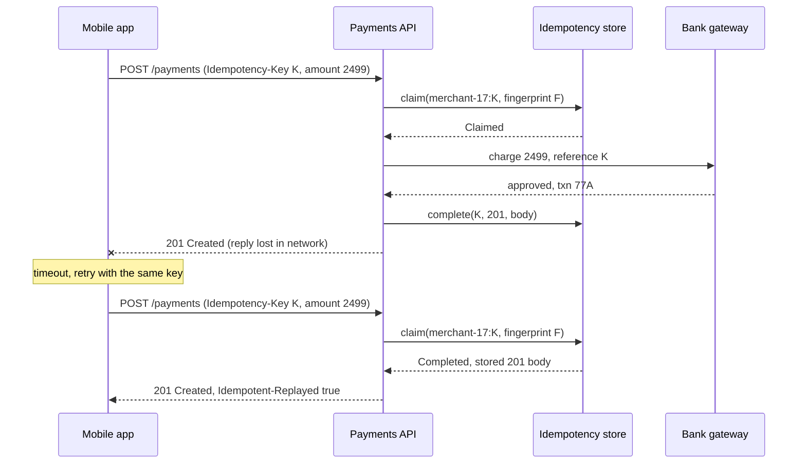
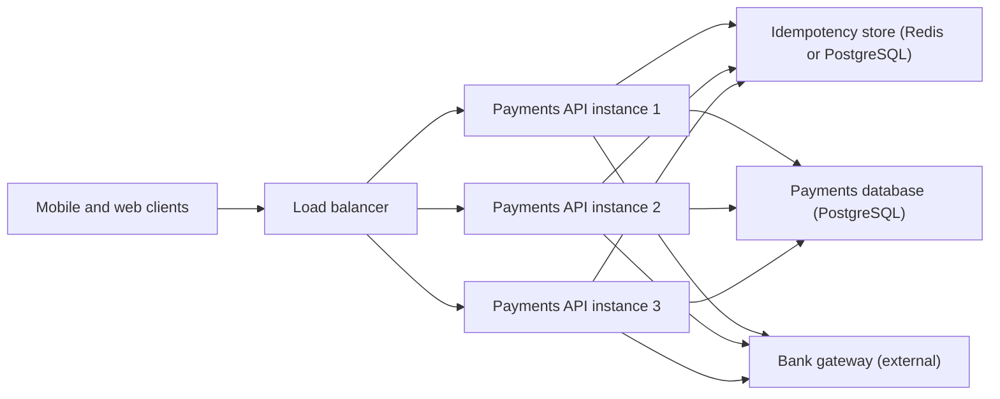
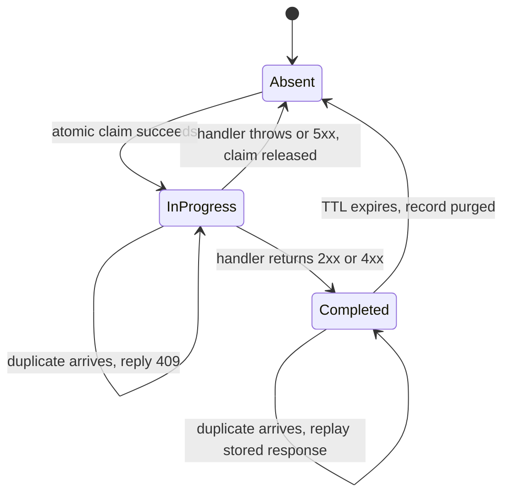

A customer taps "Pay ₹2,499" on a train-ticket app. The request reaches your server, the bank approves the charge, and then the mobile network drops before the reply arrives. The app sees a timeout. What should it do? If it retries, the customer may be charged twice. If it does not, the customer may have paid for a ticket they never receive. Idempotency keys resolve this dilemma: the client can retry as many times as it likes, and the server guarantees the money moves once. This lesson shows exactly how that guarantee is built, where it breaks, and how to ship it as an ASP.NET Core endpoint filter.

## Learning objectives

By the end of this lesson you will be able to:

1. Explain in plain words why retries are unsafe for `POST` and how an idempotency key makes them safe.
2. Describe the five moving parts: key, scope, request fingerprint, claim record and stored response.
3. Handle the three awkward cases: two identical requests arriving at the same instant, the same key reused with a different body, and a key whose first attempt crashed halfway.
4. Choose a store (PostgreSQL, Redis or in-memory), set a sensible expiry, and estimate the storage cost.
5. Implement idempotency as an ASP.NET Core endpoint filter with an in-memory store, and describe the PostgreSQL and Redis variants.
6. Decide when an idempotency key is unnecessary because the operation is naturally idempotent.

## Prerequisites

- [HTTP fundamentals](#/lesson/m10-http-fundamentals): which methods are idempotent by definition, and what headers are.
- [REST API design](#/lesson/m10-rest-design): resource naming and status codes such as 409 and 422.
- [Timeouts, retries and backoff](#/lesson/m10-timeouts-retries): the client-side half of this story. Retries are only safe if the server does its part, which is this lesson.

Helpful but optional: [Transactions and ACID](#/lesson/m09-transactions-acid), because the claim record and the business write ideally commit together.

## Explain it like I'm a beginner

Imagine a government office counter where you submit a form to get a certificate. You hand the form over, the clerk takes it, then the power goes out. You don't know whether your form was processed. If you fill a fresh form and submit again, you may end up with two certificates, two fees, and a confused clerk.

Now imagine every form has a **token number** printed on it, and the clerk keeps a register. Before doing any work, the clerk looks up the token. If it is already in the register with a result, the clerk hands you a copy of that result and does nothing else. If it is in the register but marked "being processed", the clerk says "wait a minute, your earlier form is still being handled". Only if the token is not there does the clerk write it down and start work.

That token is an **idempotency key**. The register is the **idempotency store**. "Idempotent" simply means "doing it twice has the same effect as doing it once" (the technical term comes from mathematics: a function *f* where *f(f(x)) = f(x)*).

Some operations are naturally idempotent. Setting your profile's phone number to 98100-12345 twice leaves one phone number. Deleting order 42 twice leaves it deleted. But "create a payment of ₹2,499" is not: doing it twice moves ₹4,998. For those operations the client must attach a key, and the server must keep a register.

Three rules make the register work:

1. **One key, one piece of work.** The server does the work at most once per key.
2. **Same key, same answer.** A retry gets the same response as the original, including the same payment ID.
3. **Same key, different request = error.** If someone reuses a key with a different amount, the server refuses, because it cannot know which one was intended.

## First-principles explanation

### Why timeouts make retries dangerous

A client that sends a request and receives no reply is in one of three situations, and it cannot tell which:

- The request never reached the server (safe to retry).
- The server processed it, but the reply was lost (retry would duplicate).
- The server is still processing it (retry would race the original).

This is the "two generals" problem in miniature. No amount of client cleverness fixes it, because the information the client needs is on the server. The idempotency key moves the decision to the only place that has the information.

### The five parts

| Part | What it is | Who owns it |
|---|---|---|
| **Key** | A unique string the client generates per *intent*, usually a UUID v4. Sent as the `Idempotency-Key` header. The IETF draft defines the value as a Structured Field string, so the canonical form is quoted: `Idempotency-Key: "8e03978e-40d5-43e8-bc93-6894a57f9324"`. | Client |
| **Scope** | The key is unique per client, not globally. Two merchants may both send key `abc`; they must not collide. The server prefixes the key with the *authenticated* client ID, never with an ID from a header the caller controls. | Server |
| **Fingerprint** | A hash of the request (method, path, body, client). Lets the server detect a reused key with a different payload. | Server |
| **Claim record** | A row or cache entry saying "key X is in progress" or "key X completed with this response". Written *before* the work starts. | Server |
| **Stored response** | The status code and body of the first successful attempt, replayed on retries. | Server |

The word *intent* matters. A client should create one key when the user taps "Pay", and reuse that same key for every retry of that tap. A new tap (a new intent) gets a new key. Mobile apps typically persist the key to local storage before sending, so that even an app restart reuses it.

### The happy path in order

1. Client generates key `K`, stores it locally, sends `POST /payments` with `Idempotency-Key: K` and a JSON body.
2. Server computes the scoped key `merchant-17:K` and the fingerprint `F = sha256(method + path + client + body)`.
3. Server atomically inserts a claim record `(merchant-17:K, F, InProgress, expires in 24 h)`. "Atomically" means: if two requests try at once, exactly one insert succeeds.
4. Server runs the business logic (charges the bank, writes the payment row).
5. Server updates the record to `Completed` with the response `201 Created {"id":"pay_9f3",...}` and returns it.

### The three awkward paths

**Concurrent duplicates.** The client's first request is slow; its retry arrives while step 4 is still running on another instance. The retry's insert fails because the record exists in `InProgress`. The correct answer is not to wait on the first attempt (that ties up a thread and can deadlock across instances) and not to do the work again. Return `409 Conflict` with `Retry-After: 1`, and let the client try again in a second, by which time the original has completed and the response can be replayed. These status codes are the ones the IETF `Idempotency-Key` draft recommends: `400` when a required key is missing, `409` while the first request is still being processed, and `422` when a key is reused with a different payload (next paragraph). Use them, and document them, so client libraries can react without guessing.

**Fingerprint mismatch.** Key `K` arrives with amount 2,499, then again with amount 24,990. Same key, different body. This is almost always a client bug (a key reused across intents). Return `422 Unprocessable Content` with a problem-details body saying the key was used with a different payload. Never process the second request, and never replay the first response for it: that would silently tell the client "your ₹24,990 payment succeeded" when ₹2,499 moved.

**Crash mid-flight.** The server claims the key, calls the bank, and the process dies before step 5. The record is stuck in `InProgress`. Options:

- *Release on failure:* if the handler throws or returns 5xx, delete the claim so the next retry starts fresh. This is simple and matches most retry policies: a 5xx is "please try again".
- *Timeout the claim:* an `InProgress` record older than, say, 60 seconds is treated as abandoned, and the next request may take over the key.
- *Reconcile:* if the bank call itself may have succeeded, the retry must first ask the bank "did you see reference K?" before charging again. This is why payment gateways accept a client reference on every charge: the idempotency key is forwarded downstream so the whole chain is idempotent.

:::callout type=warning title="The claim must be atomic"
The bug that defeats most home-grown implementations is "check then insert": `SELECT` to see if the key exists, then `INSERT` if not. Two requests can both pass the `SELECT` before either `INSERT` runs. Use a single atomic operation: a primary key with `INSERT ... ON CONFLICT DO NOTHING`, Redis `SET key value NX PX 86400000`, or `ConcurrentDictionary.TryAdd` in a single process. Whichever store you pick, the question to ask is "does *one* operation both test and set?"
:::

### What to store, and what to replay

Store the status code, content type and body of the final response, but only for outcomes that represent a finished decision:

- **2xx**: definitely store and replay. The retry must receive the *same* resource ID.
- **4xx that depends on the request** (validation error, insufficient funds): storing is reasonable, since the same request will fail the same way. Many teams store these too so the client gets a consistent answer.
- **5xx and exceptions**: do not store; release the key so a retry can succeed once the fault clears.

Add a response header such as `Idempotent-Replayed: true` on replays. It costs nothing and makes debugging dramatically easier.

### Expiry

Keys cannot live forever, or the table grows without bound. Pick a TTL longer than any realistic retry window. Mobile apps typically give up within minutes; batch integrations may retry for hours after an outage. **24 hours** is a common default; some payment providers keep keys for longer. The IETF draft for the `Idempotency-Key` header leaves the retention period to the server and recommends documenting it.

Back-of-the-envelope for a mid-sized payments API: 2,000,000 payments per day ÷ 86,400 s ≈ 23 requests per second on average, perhaps 5× that at peak (≈ 115 RPS). Each record is roughly 1 KB (key, fingerprint, a 500-byte JSON response, timestamps). 2,000,000 × 1 KB ≈ 2 GB per day. With a 24-hour TTL the store holds around 2 GB at steady state. That fits comfortably in one Redis instance or a single PostgreSQL table with a daily purge, so the store is rarely the expensive part. What *is* expensive is a missing store: one duplicate charge per 10,000 payments at ₹2,500 average is ₹500,000 of refunds and support work per day at this volume.

### Choosing a store

| Store | Atomic claim | Survives restart | Shared across instances | Notes |
|---|---|---|---|---|
| In-memory `ConcurrentDictionary` | Yes (`TryAdd`) | No | No | Fine for one instance, tests, and prototypes. Dangerous behind a load balancer. |
| Redis | `SET NX PX` | Depends on persistence settings | Yes | Fast (sub-millisecond in the same data centre). TTL is built in. Fire-and-forget persistence may lose the last few writes after a crash. |
| PostgreSQL | `INSERT ... ON CONFLICT DO NOTHING` | Yes | Yes | Lets you commit the claim *and* the business write in one transaction, which removes a whole class of partial-failure bugs. Needs a purge job for expiry. |

The PostgreSQL option has a quiet superpower. If the `payments` row and the `idempotency_keys` row are written in the same transaction, there is no window where one exists without the other. The crash-mid-flight case disappears for the database part (the bank call still needs reconciliation).

### When you don't need a key

- `GET`, `HEAD`, `OPTIONS`: safe methods, nothing to protect.
- `PUT` with the full representation and `DELETE` by ID: idempotent by HTTP's definition. Retrying is already safe. (A `DELETE` retry may return 404 instead of 204; clients should treat both as success.)
- `POST` where the body carries a natural unique identifier. If the client sends `POST /orders` with its own `orderNumber` and the table has a unique constraint on it, the duplicate simply fails with a constraint violation that you can map to "return the existing order". That *is* an idempotency key, just under a different name.

Use an explicit `Idempotency-Key` header when the operation creates a server-generated identity (payment ID, booking reference) or has an external side effect (money movement, SMS, email).

## Visual explanation

### Sequence: first attempt, lost reply, replayed retry



Read it top to bottom. The first attempt does real work: claim, charge, complete. The reply is lost, so the app retries *with the same key*. This time the store already holds a completed record with a matching fingerprint, so the API returns the stored body and never touches the bank. The customer sees one payment, one ID, and the app behaves as if the first reply had arrived.

### Architecture: where the store sits



The load balancer may send the retry to a different instance from the original. That is why the store must be *shared*: an in-process dictionary on instance 1 knows nothing about a claim made on instance 2. Every instance checks and writes the same store. The payments database and the bank gateway are the things being protected; the store is the register that protects them.

### Lifecycle of one key



A key starts absent. The first request moves it to in progress; the outcome moves it to completed or back to absent. Duplicates never change the state; they only read it. Expiry is the only way out of completed, which is why the TTL must exceed the longest retry window.

## Step-by-step example

We will build the idempotency layer for `POST /payments` in four steps, then look at the full code.

### Step 1 — the unprotected endpoint

```csharp
app.MapPost("/payments", async (CreatePaymentRequest req, PaymentService svc, CancellationToken ct) =>
{
    var payment = await svc.CreateAsync(req, ct);   // charges the bank, inserts a row
    return TypedResults.Created($"/payments/{payment.Id}", payment);
});
```

Every retry charges again. In testing nobody notices, because test clients rarely time out.

### Step 2 — read and validate the key

The filter reads `Idempotency-Key`. Missing key → `400 Bad Request` (for money-moving endpoints, make it mandatory). Longer than 255 characters → 400. Then it builds the scoped key from the authenticated client ID, so two clients can never collide.

### Step 3 — fingerprint and claim

The filter hashes method, path, client ID and the raw body with SHA-256, and asks the store to claim the key with that fingerprint. The store answers one of four things: `Claimed` (go ahead), `InProgress` (409), `Completed` (replay), `FingerprintMismatch` (422).

### Step 4 — run, capture, complete

If claimed, the filter calls the real handler, captures the result's status and JSON body, stores them, and returns. If the handler throws or returns 5xx, the filter releases the claim.

One subtlety: minimal API endpoint filters run *after* parameter binding, which means the request body has already been read by the time the filter sees it. The fix is a one-line middleware that calls `Request.EnableBuffering()` before routing, so the body can be rewound and read again.

## Production-style C# implementation

Project layout:

```text
Payments.Api/
  Program.cs
  Idempotency/
    IdempotencyModels.cs
    IIdempotencyStore.cs
    InMemoryIdempotencyStore.cs
    RequestFingerprint.cs
    IdempotencyFilter.cs
  Payments/
    PaymentService.cs
```

```csharp file=Idempotency/IdempotencyModels.cs
namespace Payments.Api.Idempotency;

public enum IdempotencyState { InProgress, Completed }

/// <summary>The part of the first response that is replayed to retries.</summary>
public sealed record StoredResponse(int StatusCode, string? ContentType, string? Body);

public sealed record IdempotencyRecord(
    string ScopedKey,
    string Fingerprint,
    IdempotencyState State,
    StoredResponse? Response,
    DateTimeOffset CreatedAt,
    DateTimeOffset ExpiresAt);

public enum ClaimOutcome
{
    /// <summary>No live record existed. The caller owns the key and must run the work.</summary>
    Claimed,
    /// <summary>Another request with the same key and fingerprint is still running.</summary>
    InProgress,
    /// <summary>The work already finished; replay <see cref="ClaimResult.Existing"/>.</summary>
    Completed,
    /// <summary>The key exists but was used with a different request body.</summary>
    FingerprintMismatch,
}

public sealed record ClaimResult(ClaimOutcome Outcome, IdempotencyRecord? Existing);

public sealed class IdempotencyOptions
{
    public string HeaderName { get; set; } = "Idempotency-Key";
    public TimeSpan Ttl { get; set; } = TimeSpan.FromHours(24);
    public int MaxKeyLength { get; set; } = 255;
    /// <summary>When true, requests without the header are rejected with 400.</summary>
    public bool Required { get; set; } = true;
}
```

```csharp file=Idempotency/IIdempotencyStore.cs
namespace Payments.Api.Idempotency;

/// <summary>A shared register of idempotency keys. Implementations must make TryClaimAsync atomic:
/// if two callers claim the same key at once, exactly one receives <see cref="ClaimOutcome.Claimed"/>.</summary>
public interface IIdempotencyStore
{
    Task<ClaimResult> TryClaimAsync(string scopedKey, string fingerprint, TimeSpan ttl, CancellationToken ct);
    Task CompleteAsync(string scopedKey, StoredResponse response, CancellationToken ct);
    /// <summary>Removes an in-progress claim so a retry can start over (used after a 5xx or exception).</summary>
    Task ReleaseAsync(string scopedKey, CancellationToken ct);
}
```

```csharp file=Idempotency/InMemoryIdempotencyStore.cs
namespace Payments.Api.Idempotency;

/// <summary>Single-process store. Correct for one instance and for tests; behind a load balancer use
/// the PostgreSQL or Redis store described in the lesson.</summary>
public sealed class InMemoryIdempotencyStore(TimeProvider clock) : IIdempotencyStore
{
    private readonly Dictionary<string, IdempotencyRecord> _records = new(StringComparer.Ordinal);
    private readonly object _gate = new();

    public Task<ClaimResult> TryClaimAsync(string scopedKey, string fingerprint, TimeSpan ttl, CancellationToken ct)
    {
        var now = clock.GetUtcNow();
        lock (_gate)
        {
            if (_records.TryGetValue(scopedKey, out var existing) && existing.ExpiresAt > now)
            {
                if (!string.Equals(existing.Fingerprint, fingerprint, StringComparison.Ordinal))
                    return Task.FromResult(new ClaimResult(ClaimOutcome.FingerprintMismatch, existing));
                return Task.FromResult(new ClaimResult(
                    existing.State == IdempotencyState.Completed ? ClaimOutcome.Completed : ClaimOutcome.InProgress,
                    existing));
            }

            // Absent or expired: take ownership. Test-and-set happens under one lock, so it is atomic.
            _records[scopedKey] = new IdempotencyRecord(scopedKey, fingerprint, IdempotencyState.InProgress, null, now, now + ttl);
            return Task.FromResult(new ClaimResult(ClaimOutcome.Claimed, null));
        }
    }

    public Task CompleteAsync(string scopedKey, StoredResponse response, CancellationToken ct)
    {
        lock (_gate)
        {
            if (_records.TryGetValue(scopedKey, out var rec))
                _records[scopedKey] = rec with { State = IdempotencyState.Completed, Response = response };
        }
        return Task.CompletedTask;
    }

    public Task ReleaseAsync(string scopedKey, CancellationToken ct)
    {
        lock (_gate) { _records.Remove(scopedKey); }
        return Task.CompletedTask;
    }

    /// <summary>Call from a timer to drop expired records. Redis does this for you; PostgreSQL needs a purge job.</summary>
    public int Purge()
    {
        var now = clock.GetUtcNow();
        lock (_gate)
        {
            var dead = _records.Where(kv => kv.Value.ExpiresAt <= now).Select(kv => kv.Key).ToList();
            foreach (var k in dead) _records.Remove(k);
            return dead.Count;
        }
    }
}
```

```csharp file=Idempotency/RequestFingerprint.cs
using System.Security.Cryptography;
using System.Text;

namespace Payments.Api.Idempotency;

public static class RequestFingerprint
{
    /// <summary>SHA-256 over a canonical string: METHOD, path, client id and the SHA-256 of the body.
    /// Hashing the body first keeps the canonical string small for large payloads.</summary>
    public static string Compute(string method, string path, string clientId, ReadOnlySpan<byte> body)
    {
        var bodyHash = Convert.ToHexStringLower(SHA256.HashData(body));
        var canonical = $"{method.ToUpperInvariant()}\n{path}\n{clientId}\n{bodyHash}";
        return Convert.ToHexStringLower(SHA256.HashData(Encoding.UTF8.GetBytes(canonical)));
    }
}
```

```csharp file=Idempotency/IdempotencyFilter.cs
using System.Text.Json;
using Microsoft.Extensions.Options;

namespace Payments.Api.Idempotency;

/// <summary>Endpoint filter that makes a POST endpoint safe to retry. Requires request buffering to be
/// enabled earlier in the pipeline (see Program.cs) so the body can be re-read for the fingerprint.</summary>
public sealed class IdempotencyFilter(
    IIdempotencyStore store,
    IOptions<IdempotencyOptions> options,
    ILogger<IdempotencyFilter> logger) : IEndpointFilter
{
    private static readonly JsonSerializerOptions JsonOptions = new(JsonSerializerDefaults.Web);

    public async ValueTask<object?> InvokeAsync(EndpointFilterInvocationContext context, EndpointFilterDelegate next)
    {
        var http = context.HttpContext;
        var o = options.Value;

        var rawKey = http.Request.Headers[o.HeaderName].ToString().Trim();
        // The IETF draft defines the value as a Structured Field string ("..."); many clients still send a bare
        // token. Accept both and compare the unquoted value.
        if (rawKey.Length >= 2 && rawKey[0] == '"' && rawKey[^1] == '"') rawKey = rawKey[1..^1];
        if (string.IsNullOrWhiteSpace(rawKey))
        {
            if (!o.Required) return await next(context);
            return Results.Problem(detail: $"The '{o.HeaderName}' header is required for this operation.",
                                   statusCode: StatusCodes.Status400BadRequest);
        }
        if (rawKey.Length > o.MaxKeyLength)
            return Results.Problem(detail: $"'{o.HeaderName}' must be at most {o.MaxKeyLength} characters.",
                                   statusCode: StatusCodes.Status400BadRequest);

        // Scope the key to the authenticated caller so two clients can never collide. Never take the scope from a
        // header the caller controls: anyone could then claim another client's key and read its stored response.
        var clientId = http.User.Identity is { IsAuthenticated: true, Name: { Length: > 0 } name } ? name : "anonymous";
        var scopedKey = $"{clientId}:{rawKey}";

        var body = await ReadBodyAsync(http.Request, http.RequestAborted);
        var fingerprint = RequestFingerprint.Compute(http.Request.Method, http.Request.Path, clientId, body);

        var claim = await store.TryClaimAsync(scopedKey, fingerprint, o.Ttl, http.RequestAborted);
        switch (claim.Outcome)
        {
            case ClaimOutcome.Completed:
            {
                var stored = claim.Existing!.Response!;
                http.Response.Headers["Idempotent-Replayed"] = "true";
                logger.LogInformation("Replayed idempotent response for {ScopedKey}", scopedKey);
                return Results.Content(stored.Body ?? string.Empty,
                                       contentType: stored.ContentType ?? "application/json",
                                       statusCode: stored.StatusCode);
            }
            case ClaimOutcome.InProgress:
                http.Response.Headers.RetryAfter = "1";
                return Results.Problem(detail: "A request with this Idempotency-Key is still being processed. Retry shortly.",
                                       statusCode: StatusCodes.Status409Conflict);
            case ClaimOutcome.FingerprintMismatch:
                return Results.Problem(detail: "This Idempotency-Key was already used with a different request payload.",
                                       statusCode: StatusCodes.Status422UnprocessableEntity);
        }

        // Claimed: we own the key. Run the handler and record the outcome.
        try
        {
            var result = await next(context);
            var captured = Capture(result);
            if (captured is null || captured.StatusCode >= 500)
            {
                // Unknown result shape, or a server fault: let the next retry start over.
                await store.ReleaseAsync(scopedKey, CancellationToken.None);
                return result;
            }
            await store.CompleteAsync(scopedKey, captured, CancellationToken.None);
            return result;
        }
        catch
        {
            await store.ReleaseAsync(scopedKey, CancellationToken.None);
            throw;
        }
    }

    private static async Task<byte[]> ReadBodyAsync(HttpRequest request, CancellationToken ct)
    {
        if (!request.Body.CanSeek) return [];               // buffering was not enabled; fingerprint without body
        request.Body.Position = 0;
        using var ms = new MemoryStream();
        await request.Body.CopyToAsync(ms, ct);
        request.Body.Position = 0;
        return ms.ToArray();
    }

    /// <summary>Turns a minimal-API result into something we can store. Only JSON-shaped results are captured;
    /// files, redirects and streams return null and are not cached.</summary>
    private static StoredResponse? Capture(object? result)
    {
        switch (result)
        {
            case null:
                return new StoredResponse(StatusCodes.Status200OK, null, null);
            case IValueHttpResult valued when result is IStatusCodeHttpResult sc:
                return new StoredResponse(sc.StatusCode ?? StatusCodes.Status200OK, "application/json",
                                          valued.Value is null ? null : JsonSerializer.Serialize(valued.Value, JsonOptions));
            case IStatusCodeHttpResult sc:
                return new StoredResponse(sc.StatusCode ?? StatusCodes.Status200OK, null, null);
            case IResult:
                return null;
            default:
                return new StoredResponse(StatusCodes.Status200OK, "application/json", JsonSerializer.Serialize(result, JsonOptions));
        }
    }
}
```

```csharp file=Payments/PaymentService.cs
using System.Collections.Concurrent;

namespace Payments.Api.Payments;

public sealed record CreatePaymentRequest(string OrderId, long AmountPaise, string Currency);
public sealed record Payment(string Id, string OrderId, long AmountPaise, string Currency, string Status, DateTimeOffset CreatedAt);

/// <summary>Stand-in for the real service that talks to a bank gateway and PostgreSQL.</summary>
public sealed class PaymentService(TimeProvider clock, ILogger<PaymentService> logger)
{
    private readonly ConcurrentDictionary<string, Payment> _payments = new();

    public async Task<Payment> CreateAsync(CreatePaymentRequest req, CancellationToken ct)
    {
        if (req.AmountPaise <= 0) throw new ArgumentOutOfRangeException(nameof(req), "Amount must be positive.");
        await Task.Delay(50, ct);                       // pretend to call the bank
        var payment = new Payment($"pay_{Guid.NewGuid():N}"[..12], req.OrderId, req.AmountPaise, req.Currency, "captured", clock.GetUtcNow());
        _payments[payment.Id] = payment;
        logger.LogInformation("Captured {Amount} paise for order {OrderId} as {PaymentId}", req.AmountPaise, req.OrderId, payment.Id);
        return payment;
    }

    public Payment? Find(string id) => _payments.GetValueOrDefault(id);
}
```

```csharp file=Program.cs
using Payments.Api.Idempotency;
using Payments.Api.Payments;

var builder = WebApplication.CreateBuilder(args);

builder.Services.AddSingleton(TimeProvider.System);
builder.Services.Configure<IdempotencyOptions>(builder.Configuration.GetSection("Idempotency"));
builder.Services.AddSingleton<IIdempotencyStore, InMemoryIdempotencyStore>();   // swap for Redis/PostgreSQL in production
builder.Services.AddSingleton<PaymentService>();
builder.Services.AddProblemDetails();

var app = builder.Build();
app.UseExceptionHandler();

// Filters run after model binding has consumed the body. Buffering lets the filter rewind and hash it.
app.Use(async (context, next) =>
{
    context.Request.EnableBuffering();
    await next(context);
});

var payments = app.MapGroup("/payments");

payments.MapPost("/", async (CreatePaymentRequest req, PaymentService svc, CancellationToken ct) =>
{
    var payment = await svc.CreateAsync(req, ct);
    return TypedResults.Created($"/payments/{payment.Id}", payment);
})
.AddEndpointFilter<IdempotencyFilter>();

payments.MapGet("/{id}", (string id, PaymentService svc) =>
    svc.Find(id) is { } p ? Results.Ok(p) : Results.NotFound());

app.Run();
```

**Why a filter and not middleware?** A filter attaches to exactly the endpoints that need it (`POST /payments`, not `GET /payments/{id}`), it has access to the typed result the handler returned, and it is testable without an HTTP server. Middleware would need to buffer the *response* stream to capture the body, which is more code and more copying. The price is that the filter only captures JSON-shaped results; that is fine for an API that returns DTOs.

### The PostgreSQL variant

Replace the in-memory store with a table and one atomic statement. This snippet uses Npgsql-style code and is not part of the compiled set:

```sql
CREATE TABLE idempotency_keys (
    scoped_key   text PRIMARY KEY,
    fingerprint  text NOT NULL,
    state        smallint NOT NULL,          -- 0 = in progress, 1 = completed
    status_code  int,
    content_type text,
    body         text,
    created_at   timestamptz NOT NULL DEFAULT now(),
    expires_at   timestamptz NOT NULL
);
CREATE INDEX idempotency_keys_expires_idx ON idempotency_keys (expires_at);
```

```csharp
// Claim: one statement, atomic thanks to the primary key.
const string claimSql = """
    INSERT INTO idempotency_keys (scoped_key, fingerprint, state, expires_at)
    VALUES (@key, @fp, 0, now() + @ttl)
    ON CONFLICT (scoped_key) DO NOTHING
    RETURNING scoped_key;
    """;
// If RETURNING yields a row we are Claimed. Otherwise SELECT the existing row and compare fingerprint/state.
```

Run the claim, the `payments` insert and the completion update inside one transaction, and the record can never say "completed" without the payment row existing. A small `BackgroundService` purges expired keys in batches every few minutes. PostgreSQL has no `LIMIT` on `DELETE`, so limit a sub-select instead, which keeps each transaction (and its locks and WAL) small:

```sql
DELETE FROM idempotency_keys
WHERE scoped_key IN (SELECT scoped_key FROM idempotency_keys WHERE expires_at < now() LIMIT 5000);
```

At very high volume, partitioning the table by day and dropping old partitions is cheaper still.

### The Redis variant

```csharp
// StackExchange.Redis, not part of the compiled set.
// Claim: SET key "<fingerprint>|inprogress" NX PX 86400000  → true means Claimed.
var claimed = await db.StringSetAsync(scopedKey, $"{fingerprint}|0", TimeSpan.FromHours(24), When.NotExists);
if (!claimed)
{
    var existing = (string?)await db.StringGetAsync(scopedKey);   // parse fingerprint, state and stored body
}
// Complete: SET key "<fingerprint>|1|<status>|<body>" KEEPTTL
```

Redis gives you the TTL for free and a sub-millisecond round trip. Its weakness is durability: with default persistence a crash can lose the last second or so of writes, which means a completed key might vanish and a retry would do the work again. For money, prefer PostgreSQL or Redis with `appendfsync always`, or forward the key to the bank so the downstream is idempotent too.

## Bad design vs good design

**Bad: dedupe by "same amount and order in the last minute".** A team without keys writes `SELECT 1 FROM payments WHERE order_id = @o AND amount = @a AND created_at > now() - interval '1 minute'`. It catches some duplicates and creates new bugs: a legitimate second payment of the same amount is rejected, a retry after 61 seconds goes through, and two concurrent requests both pass the check.

**Bad: key stored only in memory on each instance.** Works in development with one process. In production with three instances behind a load balancer, roughly two thirds of retries land on an instance that has never seen the key.

**Bad: replaying the stored response without checking the fingerprint.** Client bug reuses key `K` for a ₹24,990 payment; the server cheerfully replies "201 Created, ₹2,499 captured". The app shows the user a success screen for the wrong amount.

**Good:** the implementation above. Atomic claim in a shared store, fingerprint compared on every hit, 409 for in-flight duplicates, 422 for mismatches, release on 5xx, TTL longer than the retry window, and `Idempotent-Replayed` on replays so support staff can see what happened.

:::callout type=tradeoff title="Simpler is sometimes enough"
If your `POST` body already carries a client-chosen unique identifier (an order number, a UPI transaction reference), a `UNIQUE` constraint plus "on duplicate, return the existing row" gives you most of the benefit with no extra store. Reach for a full idempotency layer when the resource ID is server-generated, when the handler has external side effects, or when you need the exact original response replayed.
:::

## Practical playground

Explore the atomic claim in SQL. The table below is seeded with one completed key and one in-progress key. Try the claim statement with a new key (one row returned), with an existing key (zero rows), and then query the existing row to see what the API would do next. Try also a purge of expired keys relative to a fixed "now".

:::playground type=sql title="Claiming idempotency keys in PostgreSQL"
```sql
CREATE TABLE idempotency_keys (
    scoped_key   text PRIMARY KEY,
    fingerprint  text NOT NULL,
    state        smallint NOT NULL,
    status_code  int,
    body         text,
    created_at   timestamptz NOT NULL,
    expires_at   timestamptz NOT NULL
);

INSERT INTO idempotency_keys VALUES
  ('merchant-17:5e1a', 'f0a1', 1, 201, '{"id":"pay_9f3","amountPaise":249900}', '2026-10-19 09:00:00+00', '2026-10-20 09:00:00+00'),
  ('merchant-17:7bc2', 'c9d8', 0, NULL, NULL, '2026-10-19 09:58:30+00', '2026-10-20 09:58:30+00'),
  ('merchant-42:5e1a', 'aa17', 1, 422, '{"title":"Insufficient funds"}', '2026-10-17 08:00:00+00', '2026-10-18 08:00:00+00');

-- 1. Claim a brand-new key: returns one row.
INSERT INTO idempotency_keys (scoped_key, fingerprint, state, created_at, expires_at)
VALUES ('merchant-17:new1', 'b2b2', 0, '2026-10-19 10:00:00+00', '2026-10-20 10:00:00+00')
ON CONFLICT (scoped_key) DO NOTHING
RETURNING scoped_key;

-- 2. Claim an existing key: returns zero rows, so the API must SELECT and decide (replay, 409 or 422).
INSERT INTO idempotency_keys (scoped_key, fingerprint, state, created_at, expires_at)
VALUES ('merchant-17:5e1a', 'f0a1', 0, '2026-10-19 10:00:00+00', '2026-10-20 10:00:00+00')
ON CONFLICT (scoped_key) DO NOTHING
RETURNING scoped_key;

SELECT scoped_key, state, status_code, body FROM idempotency_keys ORDER BY scoped_key;
```
:::

## Exercises

:::exercise id=m10-idempotency-ex1 difficulty=beginner kind=code title="Compute a request fingerprint"
Implement `RequestFingerprint.Compute`. It must return a lowercase hexadecimal SHA-256 digest of a canonical string built from the HTTP method (upper-cased), the path, the client ID and the lowercase hex SHA-256 of the body, joined by newline characters.
::requirements
- Canonical string: `METHOD\npath\nclientId\nbodyHashHex`.
- The method comparison is case-insensitive (`post` and `POST` give the same fingerprint).
- Output is 64 lowercase hex characters.
::acceptance
- Same inputs always give the same output.
- Changing a single byte of the body changes the output.
- Changing the client ID changes the output.
- `post` and `POST` give identical output.
::hint
`System.Security.Cryptography.SHA256.HashData(ReadOnlySpan<byte>)` returns the 32-byte digest in one call.
::hint
`Convert.ToHexStringLower(byte[])` gives lowercase hex. Hash the body first, then build the canonical string.
::hint
Encode the canonical string with `Encoding.UTF8.GetBytes` and hash the result.
::hint
```csharp
var bodyHash = Convert.ToHexStringLower(SHA256.HashData(body));
var canonical = $"{method.ToUpperInvariant()}\n{path}\n{clientId}\n{bodyHash}";
```
::starter
```csharp file=RequestFingerprint.cs
using System;
using System.Security.Cryptography;
using System.Text;

namespace IdempotencyKata;

public static class RequestFingerprint
{
    public static string Compute(string method, string path, string clientId, ReadOnlySpan<byte> body)
    {
        throw new NotImplementedException();
    }
}
```
::tests
```csharp file=RequestFingerprintTests.cs
using System.Text;
using IdempotencyKata;
using Xunit;

public class RequestFingerprintTests
{
    private static byte[] B(string s) => Encoding.UTF8.GetBytes(s);

    [Fact]
    public void Same_inputs_same_output()
    {
        var a = RequestFingerprint.Compute("POST", "/payments", "m17", B("{\"amount\":2499}"));
        var b = RequestFingerprint.Compute("POST", "/payments", "m17", B("{\"amount\":2499}"));
        Assert.Equal(a, b);
    }

    [Fact]
    public void Output_is_64_lowercase_hex_chars()
    {
        var f = RequestFingerprint.Compute("POST", "/payments", "m17", B("x"));
        Assert.Equal(64, f.Length);
        Assert.Matches("^[0-9a-f]{64}$", f);
    }

    [Fact]
    public void Body_change_changes_output() =>
        Assert.NotEqual(
            RequestFingerprint.Compute("POST", "/payments", "m17", B("{\"amount\":2499}")),
            RequestFingerprint.Compute("POST", "/payments", "m17", B("{\"amount\":2498}")));

    [Fact]
    public void Client_change_changes_output() =>
        Assert.NotEqual(
            RequestFingerprint.Compute("POST", "/payments", "m17", B("{}")),
            RequestFingerprint.Compute("POST", "/payments", "m42", B("{}")));

    [Fact]
    public void Method_is_case_insensitive() =>
        Assert.Equal(
            RequestFingerprint.Compute("post", "/payments", "m17", B("{}")),
            RequestFingerprint.Compute("POST", "/payments", "m17", B("{}")));
}
```
::solution
Hash the body first so the canonical string stays small even for large payloads, then hash the canonical string.

```csharp file=RequestFingerprint.cs
using System;
using System.Security.Cryptography;
using System.Text;

namespace IdempotencyKata;

public static class RequestFingerprint
{
    public static string Compute(string method, string path, string clientId, ReadOnlySpan<byte> body)
    {
        var bodyHash = Convert.ToHexStringLower(SHA256.HashData(body));
        var canonical = $"{method.ToUpperInvariant()}\n{path}\n{clientId}\n{bodyHash}";
        return Convert.ToHexStringLower(SHA256.HashData(Encoding.UTF8.GetBytes(canonical)));
    }
}
```

Why include the client ID when the key is already scoped by client? Defence in depth: if a future refactor changes how keys are scoped, the fingerprint still refuses cross-client replays.
::mistakes
- Hashing the JSON *after* re-serialising it. Two clients may format the same JSON differently; hash the raw bytes you received, and document that the fingerprint is byte-exact.
- Including volatile headers (`Date`, `User-Agent`) in the fingerprint, so every retry mismatches.
- Using `GetHashCode()` instead of a cryptographic hash. It is randomised per process in .NET and collides easily.
::extensions
Add an optional `IEnumerable<KeyValuePair<string,string>>` of headers to include (for example `Content-Type`), sorted by name before hashing so order does not matter.
:::

:::exercise id=m10-idempotency-ex2 difficulty=beginner kind=written title="Which operations need a key?"
For each operation below, state whether it is already idempotent, whether it needs an `Idempotency-Key`, or whether a natural unique identifier in the body would do the job. Give one sentence of reasoning each.

1. `GET /invoices/42`
2. `PUT /users/7/address` with the full address in the body.
3. `DELETE /sessions/abc`
4. `POST /payments` with `{ "orderId": "ORD-991", "amountPaise": 249900 }`
5. `POST /orders` where the client supplies its own `orderNumber` that is unique per client.
6. `POST /notifications/sms` sending an OTP to a phone number.
7. `PATCH /inventory/sku-12` with `{ "op": "increment", "by": 5 }`
::acceptance
- Items 1, 2 and 3 are identified as idempotent by HTTP semantics.
- Item 7 is identified as non-idempotent despite using PATCH.
- Item 5 is identified as solvable with a unique constraint.
- Items 4 and 6 are identified as needing an explicit key, with the external side effect named.
::hint
Ask "what is the state of the world after doing this twice versus once?"
::hint
The HTTP method is a hint, not a guarantee. A `PATCH` that increments is not idempotent; a `POST` that upserts by a client-supplied ID is.
::hint
A natural unique identifier in the body is an idempotency key in disguise if the server enforces uniqueness and returns the existing resource on conflict.
::solution
1. **Idempotent.** `GET` is safe; it changes nothing.
2. **Idempotent.** A full-representation `PUT` sets the address to the same value however many times it runs.
3. **Idempotent.** The session is gone after the first call; a retry may return 404, which the client should treat as success.
4. **Needs a key.** Each call creates a new payment with a server-generated ID and moves money at the bank. Nothing in the body makes the second call a no-op.
5. **Unique constraint is enough.** `UNIQUE (client_id, order_number)` plus "on conflict, return the existing order" gives the same guarantee. The order number *is* the key.
6. **Needs a key.** Sending an OTP twice annoys users and costs money. There is no natural identifier, so the client must supply one per send intent.
7. **Not idempotent, needs a key or a redesign.** "Increment by 5" twice adds 10. Either require a key, or change the API to "set quantity to N" with an expected-version check, which is idempotent.
::mistakes
- Assuming `PATCH` or `PUT` are always idempotent. Only full-representation `PUT` is idempotent by definition.
- Treating a `DELETE` retry that returns 404 as a failure and retrying forever.
:::

:::exercise id=m10-idempotency-ex3 difficulty=intermediate kind=hld title="Idempotency for a multi-instance payments API"
A payments API runs 3 instances behind a load balancer and handles 2 million payments a day with a peak of about 150 RPS. The mobile app retries failed requests up to 3 times over 30 seconds; a batch partner retries for up to 6 hours after an outage. Extend the starter graph so that retries are safe across all instances. State where the idempotency records live, the TTL, how a crash between the bank call and the database write is handled, and show one arithmetic estimate (store size or operations per second).
::acceptance
- The idempotency store is shared across all instances (not per-process).
- The TTL is justified against the longest retry window (6 hours), with a margin.
- The crash-between-bank-and-database case is handled explicitly (release, reconcile, or transactional claim).
- At least one estimate: records per day and store size, or store operations per second at peak.
- The store's failure mode is stated (fail closed for a money endpoint, with reasoning).
::hint
The retry may arrive at a different instance. What does that imply for an in-memory dictionary?
::hint
The longest retry window is 6 hours. A 24-hour TTL leaves a comfortable margin; what does 2 million records per day cost at about 1 KB each?
::hint
If you keep the keys in the same PostgreSQL database as the payments, the claim and the payment insert can share a transaction. What is still not covered by that transaction?
::hint
Forward the idempotency key to the bank as the transaction reference, so a reconciliation query can ask "did reference K already succeed?" before charging again.
::starter
```json
{
  "nodes": [
    { "id": "app", "type": "client", "label": "Mobile app and batch partner", "props": { "rps": 150 } },
    { "id": "lb", "type": "load-balancer", "label": "Load balancer" },
    { "id": "api", "type": "app-server", "label": "Payments API", "props": { "instances": 3 } },
    { "id": "db", "type": "database", "label": "PostgreSQL (payments)" },
    { "id": "bank", "type": "external", "label": "Bank gateway" }
  ],
  "edges": [
    { "from": "app", "to": "lb", "kind": "sync" },
    { "from": "lb", "to": "api", "kind": "sync" },
    { "from": "api", "to": "db", "kind": "sync" },
    { "from": "api", "to": "bank", "kind": "sync" }
  ]
}
```
::solution
```json
{
  "nodes": [
    { "id": "app", "type": "client", "label": "Mobile app and batch partner", "props": { "rps": 150 } },
    { "id": "lb", "type": "load-balancer", "label": "Load balancer" },
    { "id": "api", "type": "app-server", "label": "Payments API (idempotency filter)", "props": { "instances": 3 } },
    { "id": "db", "type": "database", "label": "PostgreSQL: payments + idempotency_keys (same transaction)", "props": { "multiAz": true } },
    { "id": "bank", "type": "external", "label": "Bank gateway (reference = idempotency key)" },
    { "id": "purge", "type": "scheduler", "label": "Purge job: expires_at < now()" },
    { "id": "mon", "type": "monitoring", "label": "Replay rate, 409/422 counts, stuck in-progress keys" }
  ],
  "edges": [
    { "from": "app", "to": "lb", "kind": "sync", "label": "Idempotency-Key header" },
    { "from": "lb", "to": "api", "kind": "sync" },
    { "from": "api", "to": "db", "kind": "sync", "label": "claim + insert payment + complete" },
    { "from": "api", "to": "bank", "kind": "sync", "label": "charge with reference K" },
    { "from": "purge", "to": "db", "kind": "async" },
    { "from": "api", "to": "mon", "kind": "async" }
  ]
}
```

**Where the records live.** In the same PostgreSQL database as the payments, in an `idempotency_keys` table keyed by `client_id:key`. All three instances read and write the same table, so it does not matter which instance receives the retry. Putting it in PostgreSQL rather than Redis lets the claim, the payment insert and the completion update commit in one transaction, so there is never a "completed key with no payment row".

**TTL.** The longest retry window is the batch partner's 6 hours. Choose 24 hours: four times the longest window, and simple to explain. 2,000,000 records per day × about 1 KB ≈ 2 GB live data, with a purge job deleting expired rows in batches of 10,000 every 5 minutes. An index on `expires_at` keeps the purge cheap.

**Operations per second.** Each payment costs one claim insert and one completion update, so about 300 extra writes per second at the 150 RPS peak. That is small for PostgreSQL on modest hardware (estimate), and the table stays around 2 million rows.

**Crash between bank and database.** The transaction covers the database, not the bank. Forward the idempotency key as the bank's transaction reference. If a request finds an `InProgress` record older than 60 seconds, treat the first attempt as dead: query the bank by reference `K`. If the bank says "captured", write the payment row and complete the key without charging again; otherwise charge normally. This is a reconciliation step, and it is what makes the whole chain idempotent rather than just the API.

**Store failure.** If PostgreSQL is down, the payments table is down too, so the question answers itself: fail closed with 503 and `Retry-After`. If the store were a separate Redis, still fail closed for money endpoints: a few minutes of refused payments cost less than duplicate charges.
::mistakes
- A per-instance in-memory dictionary. Two thirds of retries will miss it.
- A TTL shorter than the longest client retry window, so late retries create duplicates.
- Forgetting that the bank call is outside the database transaction.
:::

:::exercise id=m10-idempotency-ex4 difficulty=intermediate kind=sql ordered=true title="Find stuck in-progress keys"
Operations wants an alert for idempotency keys that have been `in_progress` for more than 5 minutes, which usually means a handler crashed without releasing its claim. Treat the current time as exactly `2026-10-19 10:00:00+00`. Return `client_id`, `idem_key` and `age_minutes` (whole minutes, integer, rounded down) for each stuck key, oldest first.
::acceptance
- Only rows with `state = 'in_progress'` are returned.
- Only rows created more than 5 minutes before the fixed "now" are returned.
- `age_minutes` is an integer number of whole minutes.
- Rows are ordered oldest first.
::hint
Filter on `state` and on `created_at < now - INTERVAL '5 minutes'`, using the literal timestamp for "now".
::hint
`EXTRACT(EPOCH FROM (ts1 - ts2))` gives the difference in seconds; divide by 60 and cast to `int` (integer division truncates).
::hint
`TIMESTAMPTZ '2026-10-19 10:00:00+00' - INTERVAL '5 minutes'` is a valid expression in the `WHERE` clause.
::setup
```sql
CREATE TABLE idempotency_keys (
    client_id   text NOT NULL,
    idem_key    text NOT NULL,
    fingerprint text NOT NULL,
    state       text NOT NULL,
    status_code int,
    created_at  timestamptz NOT NULL,
    expires_at  timestamptz NOT NULL,
    PRIMARY KEY (client_id, idem_key)
);

INSERT INTO idempotency_keys VALUES
  ('merchant-17', 'k-001', 'f1', 'completed',   201, '2026-10-19 09:10:00+00', '2026-10-20 09:10:00+00'),
  ('merchant-17', 'k-002', 'f2', 'in_progress', NULL, '2026-10-19 09:12:30+00', '2026-10-20 09:12:30+00'),
  ('merchant-17', 'k-003', 'f3', 'in_progress', NULL, '2026-10-19 09:58:00+00', '2026-10-20 09:58:00+00'),
  ('merchant-42', 'k-777', 'f4', 'in_progress', NULL, '2026-10-19 08:40:15+00', '2026-10-20 08:40:15+00'),
  ('merchant-42', 'k-778', 'f5', 'completed',   422, '2026-10-19 09:50:00+00', '2026-10-20 09:50:00+00'),
  ('merchant-99', 'k-100', 'f6', 'in_progress', NULL, '2026-10-19 09:54:59+00', '2026-10-20 09:54:59+00'),
  ('merchant-99', 'k-101', 'f7', 'in_progress', NULL, '2026-10-19 09:56:00+00', '2026-10-20 09:56:00+00');
```
::check
```sql
SELECT client_id,
       idem_key,
       (EXTRACT(EPOCH FROM (TIMESTAMPTZ '2026-10-19 10:00:00+00' - created_at))::int / 60) AS age_minutes
FROM idempotency_keys
WHERE state = 'in_progress'
  AND created_at < TIMESTAMPTZ '2026-10-19 10:00:00+00' - INTERVAL '5 minutes'
ORDER BY created_at;
```
::solution
```sql
SELECT client_id,
       idem_key,
       (EXTRACT(EPOCH FROM (TIMESTAMPTZ '2026-10-19 10:00:00+00' - created_at))::int / 60) AS age_minutes
FROM idempotency_keys
WHERE state = 'in_progress'
  AND created_at < TIMESTAMPTZ '2026-10-19 10:00:00+00' - INTERVAL '5 minutes'
ORDER BY created_at;
```

Three rows qualify: `merchant-42/k-777` (79 minutes), `merchant-17/k-002` (47 minutes) and `merchant-99/k-100` (5 minutes and 1 second, which is more than 5 minutes). `k-101` is exactly 4 minutes old and `k-003` is 2 minutes old, so both are excluded. In production you would run this query from a monitoring job every minute and alert when it returns rows, because a stuck claim blocks every retry for that key with a 409.
::mistakes
- Using `now()` instead of the fixed timestamp, which makes the result depend on when you run it.
- Comparing `expires_at` instead of `created_at`; expiry is about the 24-hour retention, not about stuck work.
- Forgetting the `state` filter and alerting on completed keys.
:::

:::exercise id=m10-idempotency-ex5 difficulty=advanced kind=code title="An atomic in-memory idempotency store with expiry"
Implement `InMemoryIdempotencyStore`. It must make `TryClaimAsync` atomic (if 50 tasks claim the same key at the same moment, exactly one gets `Claimed`), compare fingerprints, report `InProgress` versus `Completed`, treat expired records as absent, and support `CompleteAsync` and `ReleaseAsync`. Time comes from an injected `TimeProvider` so tests can advance the clock.
::requirements
- `TryClaimAsync` returns `Claimed` when no live record exists and writes an `InProgress` record with `ExpiresAt = now + ttl`.
- A live record with a different fingerprint returns `FingerprintMismatch`.
- A live record with the same fingerprint returns `InProgress` or `Completed` according to its state, with the record in `Existing`.
- A record whose `ExpiresAt` is not after `now` is treated as absent and overwritten.
- `CompleteAsync` sets `State = Completed` and stores the response; `ReleaseAsync` removes the record.
::acceptance
- All seven tests pass, including the concurrency test.
- No `async void`, no `Thread.Sleep`.
- A single `lock` (or an equivalent atomic structure) protects the test-and-set.
::hint
"Check then insert" with two separate dictionary calls is not atomic. Put the lookup and the write inside one `lock`.
::hint
Read the clock once at the start of `TryClaimAsync` and use that value for both the expiry test and the new record's timestamps.
::hint
`Dictionary<string, IdempotencyRecord>` under a private `object _gate` is simpler to reason about than `ConcurrentDictionary` here, because you need to compare the existing record before deciding.
::hint
```csharp
lock (_gate)
{
    if (_records.TryGetValue(key, out var existing) && existing.ExpiresAt > now)
    {
        // compare fingerprint, then return InProgress or Completed
    }
    _records[key] = new IdempotencyRecord(key, fingerprint, IdempotencyState.InProgress, null, now, now + ttl);
    return Task.FromResult(new ClaimResult(ClaimOutcome.Claimed, null));
}
```
::starter
```csharp file=InMemoryIdempotencyStore.cs
using System;
using System.Collections.Generic;
using System.Threading;
using System.Threading.Tasks;

namespace IdempotencyKata;

public enum IdempotencyState { InProgress, Completed }
public sealed record StoredResponse(int StatusCode, string? ContentType, string? Body);
public sealed record IdempotencyRecord(string ScopedKey, string Fingerprint, IdempotencyState State, StoredResponse? Response, DateTimeOffset CreatedAt, DateTimeOffset ExpiresAt);
public enum ClaimOutcome { Claimed, InProgress, Completed, FingerprintMismatch }
public sealed record ClaimResult(ClaimOutcome Outcome, IdempotencyRecord? Existing);

public interface IIdempotencyStore
{
    Task<ClaimResult> TryClaimAsync(string scopedKey, string fingerprint, TimeSpan ttl, CancellationToken ct);
    Task CompleteAsync(string scopedKey, StoredResponse response, CancellationToken ct);
    Task ReleaseAsync(string scopedKey, CancellationToken ct);
}

public sealed class InMemoryIdempotencyStore : IIdempotencyStore
{
    private readonly TimeProvider _clock;
    private readonly Dictionary<string, IdempotencyRecord> _records = new(StringComparer.Ordinal);
    private readonly object _gate = new();

    public InMemoryIdempotencyStore(TimeProvider clock) => _clock = clock;

    public Task<ClaimResult> TryClaimAsync(string scopedKey, string fingerprint, TimeSpan ttl, CancellationToken ct)
        => throw new NotImplementedException();

    public Task CompleteAsync(string scopedKey, StoredResponse response, CancellationToken ct)
        => throw new NotImplementedException();

    public Task ReleaseAsync(string scopedKey, CancellationToken ct)
        => throw new NotImplementedException();
}
```
::tests
```csharp file=InMemoryIdempotencyStoreTests.cs
using System;
using System.Linq;
using System.Threading;
using System.Threading.Tasks;
using IdempotencyKata;
using Xunit;

public class InMemoryIdempotencyStoreTests
{
    private sealed class FakeClock : TimeProvider
    {
        public DateTimeOffset Now { get; set; } = new(2026, 10, 19, 10, 0, 0, TimeSpan.Zero);
        public override DateTimeOffset GetUtcNow() => Now;
    }

    private static readonly TimeSpan Ttl = TimeSpan.FromHours(24);

    [Fact]
    public async Task First_claim_is_claimed()
    {
        var store = new InMemoryIdempotencyStore(new FakeClock());
        var r = await store.TryClaimAsync("m17:k1", "fp-a", Ttl, CancellationToken.None);
        Assert.Equal(ClaimOutcome.Claimed, r.Outcome);
        Assert.Null(r.Existing);
    }

    [Fact]
    public async Task Duplicate_while_in_progress_reports_in_progress()
    {
        var store = new InMemoryIdempotencyStore(new FakeClock());
        await store.TryClaimAsync("m17:k1", "fp-a", Ttl, CancellationToken.None);
        var r = await store.TryClaimAsync("m17:k1", "fp-a", Ttl, CancellationToken.None);
        Assert.Equal(ClaimOutcome.InProgress, r.Outcome);
        Assert.NotNull(r.Existing);
        Assert.Equal(IdempotencyState.InProgress, r.Existing!.State);
    }

    [Fact]
    public async Task Different_fingerprint_is_a_mismatch()
    {
        var store = new InMemoryIdempotencyStore(new FakeClock());
        await store.TryClaimAsync("m17:k1", "fp-a", Ttl, CancellationToken.None);
        var r = await store.TryClaimAsync("m17:k1", "fp-b", Ttl, CancellationToken.None);
        Assert.Equal(ClaimOutcome.FingerprintMismatch, r.Outcome);
    }

    [Fact]
    public async Task After_complete_duplicate_gets_stored_response()
    {
        var store = new InMemoryIdempotencyStore(new FakeClock());
        await store.TryClaimAsync("m17:k1", "fp-a", Ttl, CancellationToken.None);
        await store.CompleteAsync("m17:k1", new StoredResponse(201, "application/json", "{\"id\":\"pay_1\"}"), CancellationToken.None);
        var r = await store.TryClaimAsync("m17:k1", "fp-a", Ttl, CancellationToken.None);
        Assert.Equal(ClaimOutcome.Completed, r.Outcome);
        Assert.Equal(201, r.Existing!.Response!.StatusCode);
        Assert.Equal("{\"id\":\"pay_1\"}", r.Existing.Response.Body);
    }

    [Fact]
    public async Task Release_allows_a_fresh_claim()
    {
        var store = new InMemoryIdempotencyStore(new FakeClock());
        await store.TryClaimAsync("m17:k1", "fp-a", Ttl, CancellationToken.None);
        await store.ReleaseAsync("m17:k1", CancellationToken.None);
        var r = await store.TryClaimAsync("m17:k1", "fp-a", Ttl, CancellationToken.None);
        Assert.Equal(ClaimOutcome.Claimed, r.Outcome);
    }

    [Fact]
    public async Task Expired_record_is_treated_as_absent()
    {
        var clock = new FakeClock();
        var store = new InMemoryIdempotencyStore(clock);
        await store.TryClaimAsync("m17:k1", "fp-a", Ttl, CancellationToken.None);
        await store.CompleteAsync("m17:k1", new StoredResponse(201, null, null), CancellationToken.None);
        clock.Now = clock.Now.AddHours(25);
        var r = await store.TryClaimAsync("m17:k1", "fp-zzz", Ttl, CancellationToken.None);
        Assert.Equal(ClaimOutcome.Claimed, r.Outcome);
    }

    [Fact]
    public async Task Concurrent_claims_exactly_one_wins()
    {
        var store = new InMemoryIdempotencyStore(new FakeClock());
        var gate = new ManualResetEventSlim(false);
        var tasks = Enumerable.Range(0, 50).Select(_ => Task.Run(async () =>
        {
            gate.Wait();
            return (await store.TryClaimAsync("m17:race", "fp-a", Ttl, CancellationToken.None)).Outcome;
        })).ToArray();
        gate.Set();
        var outcomes = await Task.WhenAll(tasks);
        Assert.Equal(1, outcomes.Count(o => o == ClaimOutcome.Claimed));
        Assert.Equal(49, outcomes.Count(o => o == ClaimOutcome.InProgress));
    }
}
```
::solution
The whole decision happens under one lock, so there is no window between "look" and "write".

```csharp file=InMemoryIdempotencyStore.cs
using System;
using System.Collections.Generic;
using System.Threading;
using System.Threading.Tasks;

namespace IdempotencyKata;

public enum IdempotencyState { InProgress, Completed }
public sealed record StoredResponse(int StatusCode, string? ContentType, string? Body);
public sealed record IdempotencyRecord(string ScopedKey, string Fingerprint, IdempotencyState State, StoredResponse? Response, DateTimeOffset CreatedAt, DateTimeOffset ExpiresAt);
public enum ClaimOutcome { Claimed, InProgress, Completed, FingerprintMismatch }
public sealed record ClaimResult(ClaimOutcome Outcome, IdempotencyRecord? Existing);

public interface IIdempotencyStore
{
    Task<ClaimResult> TryClaimAsync(string scopedKey, string fingerprint, TimeSpan ttl, CancellationToken ct);
    Task CompleteAsync(string scopedKey, StoredResponse response, CancellationToken ct);
    Task ReleaseAsync(string scopedKey, CancellationToken ct);
}

public sealed class InMemoryIdempotencyStore : IIdempotencyStore
{
    private readonly TimeProvider _clock;
    private readonly Dictionary<string, IdempotencyRecord> _records = new(StringComparer.Ordinal);
    private readonly object _gate = new();

    public InMemoryIdempotencyStore(TimeProvider clock) => _clock = clock;

    public Task<ClaimResult> TryClaimAsync(string scopedKey, string fingerprint, TimeSpan ttl, CancellationToken ct)
    {
        var now = _clock.GetUtcNow();
        lock (_gate)
        {
            if (_records.TryGetValue(scopedKey, out var existing) && existing.ExpiresAt > now)
            {
                if (!string.Equals(existing.Fingerprint, fingerprint, StringComparison.Ordinal))
                    return Task.FromResult(new ClaimResult(ClaimOutcome.FingerprintMismatch, existing));
                var outcome = existing.State == IdempotencyState.Completed ? ClaimOutcome.Completed : ClaimOutcome.InProgress;
                return Task.FromResult(new ClaimResult(outcome, existing));
            }

            _records[scopedKey] = new IdempotencyRecord(scopedKey, fingerprint, IdempotencyState.InProgress, null, now, now + ttl);
            return Task.FromResult(new ClaimResult(ClaimOutcome.Claimed, null));
        }
    }

    public Task CompleteAsync(string scopedKey, StoredResponse response, CancellationToken ct)
    {
        lock (_gate)
        {
            if (_records.TryGetValue(scopedKey, out var rec))
                _records[scopedKey] = rec with { State = IdempotencyState.Completed, Response = response };
        }
        return Task.CompletedTask;
    }

    public Task ReleaseAsync(string scopedKey, CancellationToken ct)
    {
        lock (_gate) { _records.Remove(scopedKey); }
        return Task.CompletedTask;
    }
}
```

The `lock` is the single-process equivalent of PostgreSQL's primary-key conflict or Redis's `SET NX`. The structure of the code is the same in all three: one atomic test-and-set, then a decision based on what was already there.
::alternatives
`ConcurrentDictionary.TryAdd` is also atomic and lock-free for the claim, but you then need a second `TryGetValue` to learn *why* the add failed, and the record may have changed in between. The lock version is easier to prove correct, and the lock is held for nanoseconds.
::mistakes
- Using `DateTimeOffset.UtcNow` directly, which makes the expiry test impossible to write without sleeping.
- Returning `Completed` for a record that has expired, replaying a stale response days later.
- `ReleaseAsync` that removes a *completed* record. Only in-progress claims should be released; a completed record must stay until TTL so retries keep getting the same answer. (The tests do not catch this; add one.)
::extensions
Add a `Purge()` method that removes expired records, and a `BackgroundService` that calls it every minute. Then write the PostgreSQL store against the same interface using `INSERT ... ON CONFLICT DO NOTHING RETURNING`.
:::

## Automated testing

Test the store and the filter separately; they have different failure modes.

**Store tests** are the ones in exercise 5: claim, duplicate, mismatch, complete, release, expiry, and a concurrency test with a starting gate so all tasks hit the store together.

**Filter tests** can run without a web server. Build a `DefaultHttpContext`, set the header and a buffered body, and call the filter with a fake `EndpointFilterInvocationContext`. The filter's three branches are easy to assert on the returned `IResult` type:

```csharp
public class IdempotencyFilterTests
{
    private static DefaultHttpContext Http(string? key, string body)
    {
        var ctx = new DefaultHttpContext();
        ctx.Request.Method = "POST";
        ctx.Request.Path = "/payments";
        if (key is not null) ctx.Request.Headers["Idempotency-Key"] = key;
        ctx.User = new ClaimsPrincipal(new ClaimsIdentity([new Claim(ClaimTypes.Name, "m17")], authenticationType: "test"));
        ctx.Request.Body = new MemoryStream(Encoding.UTF8.GetBytes(body));   // MemoryStream is seekable, like a buffered body
        return ctx;
    }

    [Fact]
    public async Task Second_call_with_same_key_is_replayed_without_calling_handler()
    {
        var store = new InMemoryIdempotencyStore(TimeProvider.System);
        var filter = new IdempotencyFilter(store, Options.Create(new IdempotencyOptions()), NullLogger<IdempotencyFilter>.Instance);
        var calls = 0;
        EndpointFilterDelegate handler = _ => { calls++; return ValueTask.FromResult<object?>(TypedResults.Created("/payments/p1", new { id = "p1" })); };

        var first = await filter.InvokeAsync(new DefaultEndpointFilterInvocationContext(Http("k1", "{\"a\":1}")), handler);
        var second = await filter.InvokeAsync(new DefaultEndpointFilterInvocationContext(Http("k1", "{\"a\":1}")), handler);

        Assert.Equal(1, calls);
        Assert.IsAssignableFrom<IStatusCodeHttpResult>(second);
        Assert.Equal(201, ((IStatusCodeHttpResult)second!).StatusCode);
    }

    [Fact]
    public async Task Same_key_different_body_is_422()
    {
        var store = new InMemoryIdempotencyStore(TimeProvider.System);
        var filter = new IdempotencyFilter(store, Options.Create(new IdempotencyOptions()), NullLogger<IdempotencyFilter>.Instance);
        EndpointFilterDelegate handler = _ => ValueTask.FromResult<object?>(TypedResults.Ok());

        await filter.InvokeAsync(new DefaultEndpointFilterInvocationContext(Http("k1", "{\"amount\":2499}")), handler);
        var r = await filter.InvokeAsync(new DefaultEndpointFilterInvocationContext(Http("k1", "{\"amount\":24990}")), handler);

        Assert.Equal(422, ((IStatusCodeHttpResult)r!).StatusCode);
    }
}
```

**Integration test** with `WebApplicationFactory` (NuGet `Microsoft.AspNetCore.Mvc.Testing`): send the same `POST` twice, assert both are 201 with the same `id`, and assert `Idempotent-Replayed: true` on the second. Then send two requests concurrently and assert one 201 and one 409. This is the test that would have caught the "in-memory store behind a load balancer" bug if you run it against two app instances sharing one store.

**Edge cases to cover:** missing header (400), key of 256 characters (400), handler throwing (claim released, next call runs the handler again), handler returning 500 (same), and a `GET` that is accidentally decorated with the filter (should still work, since the body is empty).

## Real-world application

- **Payment gateways** accept an idempotency key header on every charge and refund request and replay the original response for roughly a day. This is the most widely copied design for the pattern; the IETF draft referenced above standardises the header name.
- **UPI and card switches** carry a transaction reference end to end. A retry with the same reference is answered from the switch's record rather than processed twice. The reference is an idempotency key under another name.
- **Cloud provider APIs** expose a client-token parameter on resource-creation calls so that infrastructure tooling can retry safely during provisioning.
- **Webhook receivers** dedupe on the event ID the sender includes, which is the receiving side of the same idea; see [Webhooks](#/lesson/m10-webhooks).
- **Message consumers** use an inbox table keyed by message ID for exactly the same reason; see [Idempotent consumers](#/lesson/m12-idempotent-consumers). The HTTP version in this lesson and the queue version in that one are one pattern in two costumes.
- **Food-delivery and ride-hailing apps** face the same duplicate-submission problem when a rider taps "Place order" or "Book ride" on a patchy network inside a lift or a metro tunnel. A key per tap, persisted on the phone and stored with the order, prevents two biryanis and two cabs.


## Interview questions

:::interview
::q beginner
What does "idempotent" mean, and which HTTP methods are idempotent by definition?
::a
An operation is idempotent when performing it several times has the same effect as performing it once. `GET`, `HEAD`, `OPTIONS`, `PUT` (full replacement) and `DELETE` are idempotent by the HTTP specification. `POST` and `PATCH` are not guaranteed to be; a `POST` that creates a payment or a `PATCH` that increments a counter has a different effect each time. The idempotency key pattern makes a non-idempotent `POST` safe to retry.
::q beginner
Why can't the client simply avoid retrying after a timeout?
::a
Because a timeout is ambiguous. The request may never have arrived (retrying is correct), may have been processed with the reply lost (retrying duplicates), or may still be running. The client has no way to tell. Not retrying leaves the user with "did my payment go through?"; retrying risks a double charge. The idempotency key lets the client always retry, and moves the "have I seen this before?" decision to the server, which has the information.
::q intermediate
Two identical requests with the same idempotency key arrive at two different API instances within a millisecond. Walk through what should happen.
::a
Both compute the same scoped key and fingerprint and try to claim it in a shared store. The claim must be a single atomic test-and-set (`INSERT ... ON CONFLICT DO NOTHING`, Redis `SET NX`, or a lock in a single process). Exactly one wins and runs the handler. The other sees `InProgress` and should return `409 Conflict` with `Retry-After`, not wait and not run the handler. When the client retries a second later, the record is `Completed` and the stored response is replayed. If the store were per-instance memory, both would win and the work would run twice.
::q intermediate
What should the server do when the same key arrives with a different request body?
::a
Refuse with `422 Unprocessable Content` (some APIs use 400 or 409) and a clear message. It must not run the new request, because the client's intent is ambiguous, and it must not replay the stored response, because that would report success for a request that was never processed. Detecting this requires storing a fingerprint (hash of method, path, client and body) alongside the key and comparing on every hit. In practice this almost always reveals a client bug where a key was reused across different user actions.
::q advanced
Your handler calls a bank, then writes to PostgreSQL, then marks the key completed. The process crashes right after the bank approves. Design the recovery.
::a
The failure leaves an `InProgress` claim, money moved at the bank, and no payment row. Recovery has three parts. First, make the bank call itself idempotent by forwarding the idempotency key as the bank's transaction reference; most gateways support this. Second, when a retry finds an `InProgress` record older than a threshold (say 60 seconds), treat the first attempt as dead and reconcile: query the bank by reference; if captured, write the payment row and complete the key without charging again; otherwise charge. Third, keep the claim and the payment row in the same PostgreSQL transaction so there is never a completed key without a row. Monitor the count of stuck in-progress keys, since each one blocks its client with 409s until reconciled. The deeper lesson is that an idempotency layer at the API only protects what it wraps; every side effect behind it needs its own idempotency (a reference, a unique constraint, or an inbox table).
::q advanced
When would you choose PostgreSQL over Redis for the idempotency store, and vice versa?
::a
PostgreSQL when the protected write is itself in PostgreSQL, because the claim, the business row and the completion can commit atomically in one transaction, eliminating the partial-failure window on the database side. It is also durable by default. The costs are a purge job for expiry and a few hundred extra writes per second at scale. Redis when the protected operation is not in a relational database, when latency matters (sub-millisecond claims), or when the volume is very high; TTL expiry is built in. The cost is durability: with default persistence a crash can lose recent writes, so a completed key may vanish and a retry would redo the work. For money, that argues for PostgreSQL or Redis with synchronous append-only persistence, plus downstream idempotency at the bank as a second line of defence.
:::

## Summary and revision

**Key takeaways**

- Timeouts are ambiguous; only the server knows whether the work happened. The idempotency key moves the "have I seen this?" decision to the server.
- Five parts: client-generated key, server-side scope (client ID prefix), request fingerprint, atomic claim record, stored response.
- Three awkward cases: concurrent duplicate → 409 with `Retry-After`; fingerprint mismatch → 422, never process or replay; crash mid-flight → release on 5xx or reconcile with the downstream.
- The claim must be one atomic test-and-set: `INSERT ... ON CONFLICT`, `SET NX`, or a lock. "Check then insert" is the classic bug.
- TTL must exceed the longest retry window; 24 hours is a common default. Storage is cheap (about 1 KB per record); duplicates are not.
- Idempotency at the API protects only what it wraps. Forward the key downstream so banks and queues are idempotent too.
- Skip the layer when the operation is naturally idempotent or the body already carries a unique identifier with a `UNIQUE` constraint.

**Terminology**: idempotent, idempotency key, scoped key, request fingerprint, claim record, replay, test-and-set, TTL, reconciliation.

:::flashcards
Q: What does idempotent mean?
A: Doing the operation several times has the same effect as doing it once.
Q: Which HTTP methods are idempotent by definition?
A: GET, HEAD, OPTIONS, PUT (full replacement) and DELETE. POST and PATCH are not guaranteed to be.
Q: Why must the idempotency store be shared across API instances?
A: The load balancer may send the retry to a different instance; a per-process dictionary would never see the original claim.
Q: What is the request fingerprint for?
A: Detecting a key reused with a different body, so the server can refuse (422) instead of processing twice or replaying the wrong response.
Q: What status for a duplicate that arrives while the first attempt is still running?
A: 409 Conflict with Retry-After; do not run the handler and do not block waiting for the original.
Q: Why is "SELECT then INSERT" wrong for the claim?
A: Two requests can both pass the SELECT before either INSERTs. Use one atomic test-and-set such as INSERT ... ON CONFLICT DO NOTHING or Redis SET NX.
Q: How long should keys be kept?
A: Longer than the longest realistic retry window; 24 hours is a common default. Document it.
Q: What should happen to the claim when the handler throws or returns 5xx?
A: Release it, so the next retry can start fresh. Only store 2xx (and request-dependent 4xx) responses.
Q: Why forward the idempotency key to the bank?
A: So a retry after a crash can ask the bank "did reference K succeed?" and the whole chain, not just the API, is idempotent.
:::

## Knowledge check

:::quiz pass=70
::q single
A mobile app sends `POST /payments` with `Idempotency-Key: K`, gets no reply, and retries. The retry lands on a different API instance that keeps keys in a per-process dictionary. What happens?
- [ ] The retry is replayed from the first instance's memory.
- [x] The second instance has never seen K, so it processes the payment again and the customer is charged twice.
- [ ] The load balancer rejects the retry.
- [ ] The second instance returns 409.
> Per-process memory is invisible to other instances. The store must be shared (PostgreSQL, Redis) or the load balancer must guarantee sticky routing, which is fragile.
::q single
Key K arrives with amount ₹2,499, and five seconds later arrives again with amount ₹24,990 and the same key. What is the correct server behaviour?
- [ ] Process the second request, since the amount is different.
- [ ] Replay the stored ₹2,499 response.
- [x] Refuse with 422 (or 400/409) and do not process; the key was reused with a different payload.
- [ ] Process both and let the client sort it out.
> A fingerprint mismatch is almost always a client bug. Replaying the first response would report success for a request that was never run.
::q multi
Which of these make the claim step atomic? (Select all that apply.)
- [x] `INSERT ... ON CONFLICT (scoped_key) DO NOTHING RETURNING scoped_key` on a primary key.
- [x] Redis `SET key value NX PX 86400000`.
- [ ] `SELECT COUNT(*)` followed by `INSERT` when the count is zero.
- [x] A lookup and write inside a single `lock` in a single-process store.
> "Check then act" across two statements leaves a window in which two requests both pass the check.
::q single
Your batch partner retries failed requests for up to 6 hours after an outage. Which TTL for idempotency records is the most defensible?
- [ ] 5 minutes, to save storage.
- [ ] 6 hours exactly.
- [x] 24 hours, giving a margin above the longest retry window.
- [ ] Forever.
> The TTL must exceed the longest realistic retry window with margin. At about 1 KB per record, 24 hours of a 2-million-per-day API is roughly 2 GB, which is cheap.
::q single
The handler throws an exception after the key was claimed. What should the filter do with the claim?
- [ ] Mark it completed with a 500 response so retries get the same error.
- [x] Release it, so the next retry can run the handler again.
- [ ] Leave it in progress forever.
- [ ] Change the fingerprint.
> A 5xx means "try again". Storing it would turn a transient fault into a permanent failure for that key.
::q single
Which operation needs an explicit `Idempotency-Key` the most?
- [ ] `PUT /users/7/address` with the full address.
- [ ] `DELETE /sessions/abc`.
- [x] `POST /notifications/sms` that sends an OTP.
- [ ] `GET /invoices/42`.
> The SMS has an external side effect and no natural unique identifier. The others are idempotent by HTTP semantics.
::q single
Why does the lesson's endpoint filter need `Request.EnableBuffering()` in middleware before routing?
- [ ] To compress the request.
- [x] Model binding has already read the body before the filter runs; buffering lets the filter rewind and hash it.
- [ ] To make the request idempotent automatically.
- [ ] To store the response.
> Minimal API filters run after argument binding. Without a seekable, buffered body the fingerprint could not include the payload.
:::

## Completion criteria

You have finished this lesson when you can:

- [ ] Score at least 70 % on the knowledge check.
- [ ] Complete exercises 1 and 5; the downloaded projects' `dotnet test` should pass, including the concurrency test.
- [ ] Complete exercise 3 or 4 and compare your answer with the solution.
- [ ] Explain in under two minutes why "check then insert" is wrong and name three atomic alternatives.
- [ ] State, for your own current project, which `POST` endpoints need a key and which are already idempotent.
