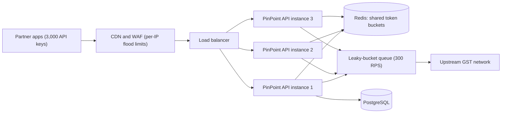
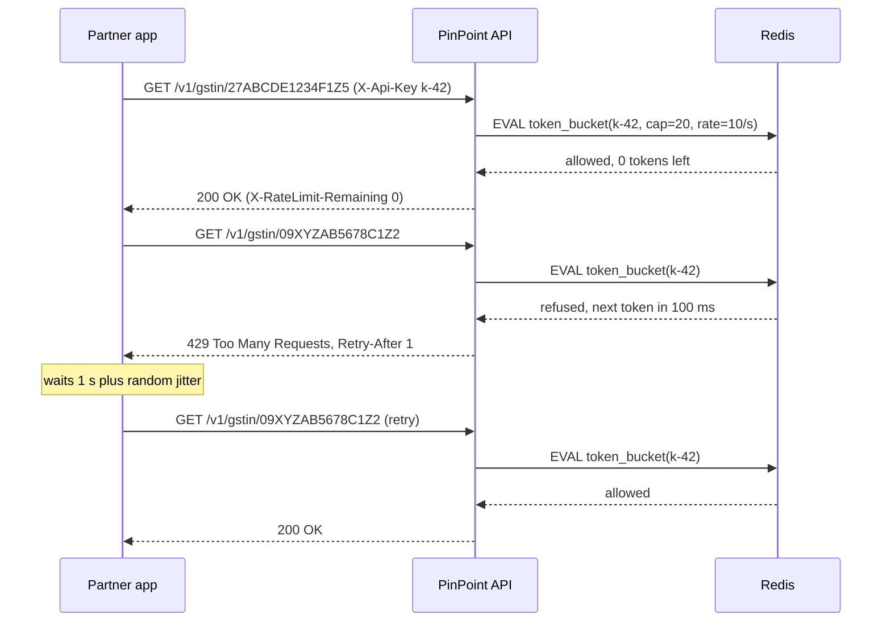

Every public API eventually meets a caller that sends too much: a partner with a bug in a loop, a scraper, a mobile app that retries forever, or simply a busy festival day. A rate limiter is the rule that says "this caller may make N requests per period; the rest wait or are refused". It is one of the cheapest protections you can add, and one of the easiest to get subtly wrong. This lesson builds all five classic algorithms in C#, shows what each one gets right and wrong, and then wires the version you would actually ship in ASP.NET Core.

## Learning objectives

By the end of this lesson you will be able to:

1. Explain why rate limiting exists (protecting capacity, fairness between callers, cost control, abuse prevention) and where in a system it belongs.
2. Describe fixed window, sliding log, sliding window counter, token bucket and leaky bucket, including their memory cost, burst behaviour and accuracy.
3. Implement each algorithm in C# with an injectable clock, and unit-test it without sleeping.
4. Choose a good partition key (API key, user, tenant, IP) and explain why IP alone is a weak key in India's mobile networks.
5. Configure ASP.NET Core's `AddRateLimiter` with per-key token buckets, named policies and a global cap.
6. Return a correct `429 Too Many Requests` with `Retry-After`, and explain how well-behaved clients should react.
7. Reason about distributed limiting (per-instance versus a shared Redis counter), and choose fail-open or fail-closed on purpose.

## Prerequisites

- [HTTP fundamentals](#/lesson/m10-http-fundamentals): status codes and headers.
- [API gateways, reverse proxies and load balancers](#/lesson/m10-gateways-proxies-lb): where a limiter usually sits.
- [Capacity estimation](#/lesson/m11-capacity-estimation): we size limits from real capacity numbers.

Comfort with `ConcurrentDictionary` and `lock` in C# helps for the implementation section.

## Explain it like I'm a beginner

Think of a metro station entry gate at rush hour. The platform can safely hold a certain number of people. If everyone outside rushed in at once, the platform would overflow, and people already inside would be hurt. So the gate lets people in at a steady pace. When the queue outside gets too long, the guard says "come back in a few minutes".

An API is the same. Your servers, database and upstream partners can each handle a certain amount of work per second (capacity). If one caller sends far more than their share, everyone else slows down or fails. A rate limiter is the gate:

- It **counts** requests from each caller (each caller has their own counter, called a partition).
- It **compares** the count against a rule, such as "60 requests per minute".
- It **lets the request through**, **makes it wait**, or **refuses it** with a polite message: HTTP status `429 Too Many Requests` and a `Retry-After` header saying how many seconds to wait.

A second analogy explains the most popular algorithm. Imagine each caller has a jar of tokens. Each request costs one token. A helper drops a new token into the jar at a fixed speed, say 5 per second, but the jar holds at most 20. If the caller has been quiet, the jar is full and they can make 20 requests in one go (a burst). After that, they can only go as fast as tokens arrive. That is the **token bucket**, and it is what most APIs use.

## First-principles explanation

### Why rate limiting exists

Four separate reasons, which lead to different limits:

1. **Protect capacity.** Suppose a GSTIN-verification API (we'll call it *PinPoint*) runs on 3 instances that together handle about 6,000 requests per second (RPS) before latency climbs (an estimate from load testing). A *global* limit protects the system.
2. **Fairness.** PinPoint has 3,000 partner apps. One buggy partner sending 5,000 RPS would starve the other 2,999 (the noisy-neighbour problem). A *per-caller* limit protects callers from each other.
3. **Cost and quotas.** PinPoint calls an upstream government network that allows 300 RPS for the whole company. A limit in front of that call stops one partner from using the whole quota.
4. **Abuse.** Login and OTP endpoints are attacked by bots. A tight per-phone-number limit (say 5 OTPs per 15 minutes) makes brute force and SMS-pumping fraud expensive.

"Per caller per minute" and "total in flight right now" are different questions; real systems usually answer both.

### Back-of-the-envelope sizing

Free plan: 60 requests/minute; Pro: 600/minute = 10 RPS. Average traffic 1,500 RPS, peak (GST filing deadline) about 3× → 4,500 RPS. If 500 Pro partners all hit their limit at once: 500 × 10 = 5,000 RPS, plus the free tier, which can exceed the 6,000 RPS capacity. The sum of all limits is far above capacity (oversubscription), the way a broadband provider sells 100 Mbps to more homes than its backbone could serve at once. That is normal, because not everyone peaks together, but it means per-key limits alone do not protect capacity. You still need a global or concurrency limit as a last line of defence.

### Where to limit

A request passes several places where you can count it. Each catches a different problem:

| Layer | Typical key | What it stops | Notes |
|---|---|---|---|
| CDN / WAF | IP address, ASN | Floods, crude bots | Very cheap, but blunt |
| API gateway (YARP, Azure API Management, Nginx) | API key, subscription | Plan quotas, fairness | One place for all services |
| Application (ASP.NET Core middleware) | User, tenant, endpoint | Business rules (5 OTPs per phone) | Knows the user and the route |
| In front of a dependency | One global key | Exceeding an upstream quota | Often a concurrency limit |
| Client side | Itself | Being throttled at all | Polite clients limit themselves |

You rarely need all five. A typical small API needs the application layer only. Add a gateway when you have several services or paid plans.

### Choosing the partition key

The key decides *whose* counter a request increments. Getting it wrong is the most common rate-limiting bug.

- **API key or client ID**: best for B2B APIs. But only count it *after* checking the key exists, or an attacker can send random keys and get a fresh bucket every time.
- **User ID** (from the authenticated token): best for logged-in apps.
- **Tenant ID**: for SaaS, so one company's 400 employees share a fair slice.
- **IP address**: the fallback for anonymous traffic. It is weak. Indian mobile carriers use carrier-grade NAT (CGNAT), so thousands of phones can share one public IPv4 address; an office in Gurugram also shares one. A tight per-IP limit can block a whole office. With IPv6, one user may get a whole /64 block (2^64 addresses), so you must limit by prefix, not by full address.
- **A combination**, such as `endpoint + user`, when one endpoint (export, OTP) needs its own tighter rule.

### The five algorithms

All five answer the same question: "may this request go through *now*?" They differ in how they remember the past.

#### 1. Fixed window counter

Split time into fixed windows (12:00:00–12:00:59, 12:01:00–12:01:59 …). Keep one counter per key per window. If the counter is below the limit, increment and allow; otherwise refuse until the window ends.

- **Memory:** one integer per key. Tiny.
- **Flaw — the boundary burst:** with a limit of 100 per minute, a caller can send 100 requests at 12:00:59 and 100 more at 12:01:00. That is 200 requests in two seconds, twice the intended rate. The limit holds per window, not per *any* 60-second span.
- **Good for:** daily or monthly quotas ("10,000 calls per day") where a short burst at midnight does not matter.

#### 2. Sliding log

Store the timestamp of every accepted request. On each new request, drop timestamps older than the window, then count what is left. If the count is below the limit, accept and add the new timestamp.

- **Accuracy:** exact. In any 60-second span, at most 100 requests are accepted.
- **Memory:** one timestamp per accepted request per key. For 3,000 keys × 600 requests per window × 8 bytes, that is about 14.4 MB of raw data. In Redis, a sorted set adds a lot of overhead per entry, so expect several times more (estimate; measure your own).
- **Good for:** low limits where exactness matters, such as 5 OTP requests per 15 minutes.

#### 3. Sliding window counter

A clever middle ground. Keep two counters per key: the previous fixed window and the current one. Estimate the count over the last full window by assuming the previous window's requests were spread evenly:

`estimate = previousCount × (1 − elapsedFractionOfCurrentWindow) + currentCount`

Example: the limit is 100 per minute. The previous minute had 80 requests. We are 15 seconds (25 %) into the current minute, which has 30 so far. Estimate = 80 × 0.75 + 30 = 90. One more request makes 91, which is below 100, so it is allowed.

- **Memory:** two integers per key, like fixed window.
- **Accuracy:** approximate, but it removes the 2× boundary burst. The error comes from the "evenly spread" assumption.
- **Good for:** general per-minute API limits at scale. ASP.NET Core's `SlidingWindowRateLimiter` uses a related idea: it splits the window into segments and slides segment by segment.

#### 4. Token bucket

Each key has a bucket with a **capacity** B (maximum burst) and a **refill rate** r tokens per second. A request takes one token (or more, for expensive operations). If there is no token, it is refused (or queued). You don't need a timer: store the token count and the time of the last update, and on each request add `elapsedSeconds × r` tokens, capped at B.

- **Memory:** two numbers per key.
- **Behaviour:** allows short bursts up to B, and a long-run average of r. Over any period of T seconds, at most `B + r × T` requests are accepted.
- **Good for:** almost every API. Bursts are natural (a page load fires 8 calls at once), and the long-run rate is what costs you. Stripe-style and cloud-provider APIs commonly describe their limits this way.

#### 5. Leaky bucket

Picture a bucket with a small hole in the bottom. Requests pour in at any speed; they leak out of the hole at a constant rate. If the bucket is full, new water spills over (refused).

There are two flavours, and people mix them up:

- **Leaky bucket as a meter:** a level that rises by 1 per request and drains at rate r. Refuse when the level would exceed capacity. This is mathematically the mirror image of a token bucket (level = capacity − tokens), so it accepts the same requests.
- **Leaky bucket as a queue:** requests are actually *queued* and released at exactly r per second. This **smooths** output: the downstream never sees a burst. The cost is added waiting time. With a queue of 10 and a drain rate of 5 per second, the last request in a full queue waits 2 seconds.

The queue flavour fits when the *downstream* demands a steady pace: an SMS gateway that allows 50 messages per second, or that upstream GST network with its 300 RPS quota.

#### Comparison

| Algorithm | Memory per key | Bursts | Accuracy | Typical use |
|---|---|---|---|---|
| Fixed window | 1 counter | Up to 2× at boundaries | Per window only | Daily/monthly quotas |
| Sliding log | 1 timestamp per request | None beyond the limit | Exact | Low limits (OTP, login) |
| Sliding window counter | 2 counters | Small error | Approximate | General per-minute limits |
| Token bucket | 2 numbers | Up to capacity B, by design | Exact for its rule | Most APIs |
| Leaky bucket (queue) | Queue of waiting requests | None: output is smooth | Exact | Protecting a fixed-rate dependency |

### Concurrency limits are different

"100 requests per second" and "at most 20 requests in progress at once" are different rules. A rate limit counts *arrivals*. A concurrency limit counts *requests in flight*. If each request to a PDF-export endpoint takes 4 seconds, 20 in flight is only 5 per second, and a rate limit of 100 per second would happily let 400 pile up. For slow or expensive work, use a concurrency limit (see [Bulkheads](#/lesson/m10-bulkhead)). ASP.NET Core ships both kinds.

### Responding to a limited request

Refuse with **429 Too Many Requests** (RFC 6585), not 503, which means the service is down for everyone. Watch out: ASP.NET Core's rate limiter rejects with **503 by default**, so always set `RejectionStatusCode = 429`. Add **`Retry-After`** (RFC 9110) in seconds, computed from the algorithm: time until the next token, or until the window ends. Many APIs also send the de facto `X-RateLimit-Limit/Remaining/Reset` headers. The IETF draft standardises two structured fields instead, `RateLimit-Policy: "default";q=600;w=60` (the rule: 600 per 60 s) and `RateLimit: "default";r=12;t=40` (12 remaining, resets in 40 s); it is still a draft as of this writing and earlier drafts used different names, so document whichever headers you send. Put a Problem Details body (`application/problem+json`) on top. A well-behaved client waits at least `Retry-After` plus random jitter; otherwise every refused client returns in the same second (a thundering herd). The [timeouts and retries lesson](#/lesson/m10-timeouts-retries) covers the client side.

### Distributed limiting

PinPoint runs 3 instances. Where does the counter live?

1. **Local counters, limit ÷ instance count.** Each instance allows 600 / 3 = 200 per minute per key. No network cost. Accurate only if the load balancer spreads each key evenly, and it drifts when you scale from 3 to 6 instances without updating the divisor. Sticky routing by API key (consistent hashing) makes local counting exact at the cost of even load spreading.
2. **A shared counter in Redis.** Each instance runs an atomic operation (`INCR` + `EXPIRE` for fixed windows, a small Lua script for a token bucket). Exact, at one round trip per request (often under a millisecond inside one data centre; estimate) and a new dependency. At 4,500 RPS peak that is 4,500 Redis operations per second, comfortable for one Redis node in typical deployments; measure yours.
3. **Hybrid:** count locally and sync to Redis every 100 ms or so. Cheaper, slightly inaccurate; used at very high volumes.

When Redis is down, decide in advance: **fail open** (allow, perhaps with a conservative local limit) for fairness limits, so a limiter outage does not become an API outage; **fail closed** (refuse) for security limits such as OTP and login.

### What breaks first under load

The limiter's storage (one hot partner key takes every increment), memory for millions of anonymous IP partitions (use expiry), and the refused traffic itself: refusing is cheap but not free, since a 50,000 RPS flood still costs TLS handshakes. Push crude IP limits to the CDN or WAF.

### When a simpler design is enough

An internal admin API with 20 users needs no rate limiting at all. A single-instance service needs only the in-process limiter: no Redis. A B2B API with a gateway product (Azure API Management, for example) can often use the gateway's built-in quota policies and write no code. Build custom limiting only when your rule is truly business-specific, like "5 OTPs per phone number".

## Visual explanation

### Architecture: where PinPoint counts requests



Read it left to right. Partner apps first hit the CDN and web application firewall, which drop obvious floods by IP before they cost anything. The load balancer spreads the rest across three API instances. Each instance asks Redis "does this API key have a token?", so all three share one bucket per partner and a partner cannot triple their limit by landing on different instances. Requests that pass reach PostgreSQL directly, but calls to the upstream GST network go through a leaky-bucket queue that releases at most 300 per second in total, because that quota belongs to the whole company, not to any one partner. Two limits, two purposes: per-key fairness at the front, global smoothing in front of the scarce dependency.

### Sequence: allowed, then refused



The first request takes the last token, so it succeeds with zero remaining. The second arrives before a new token has been added; the Lua script runs atomically inside Redis, so two instances can never both spend the same token. The API returns 429 with `Retry-After: 1` (100 ms rounded up to whole seconds, because the header uses whole seconds). The client waits, adds a little randomness so it does not return in lockstep with other refused clients, and its retry succeeds. Notice the API never talks to PostgreSQL for the refused request: refusal is cheap by design.

## Step-by-step example

Let's trace a token bucket by hand, then see why a fixed window would behave differently.

**Rule:** capacity 10 tokens, refill 2 tokens per second. The bucket starts full.

1. **t = 0.0 s:** a page load fires 8 requests at once. Tokens: 10 → 2. All 8 allowed.
2. **t = 0.5 s:** 3 more requests. First add refill: 0.5 s × 2/s = 1 token → 3 tokens. Allow all 3 → 0 tokens.
3. **t = 0.6 s:** 1 request. Refill 0.1 × 2 = 0.2 → 0.2 tokens. Not enough. Refuse. `Retry-After` = (1 − 0.2) / 2 = 0.4 s, rounded up to 1 second in the header.
4. **t = 5.6 s:** the caller was quiet for 5 s. Refill 5 × 2 = 10, capped at 10. Full again.

Over the first 0.6 s the caller made 11 accepted requests, far above the "2 per second" average. That is intended: the capacity decides how big a burst you tolerate.

**Same traffic, fixed window of 2 requests per second:** at t = 0.0 only 2 of the 8 page-load requests succeed. The page breaks, even though the user's average rate is low. That is why token bucket is the default for user-facing APIs: real traffic is bursty.

**A leaky-bucket queue of 10 draining at 2/s** accepts all 8 but releases them at 0, 0.5 … 3.5 s: nothing refused, but the last waits 3.5 s. Fine for SMS; bad for a web page.

## Production-style C# implementation

We build two things:

1. The five algorithms behind one small interface, using `TimeProvider` (built into .NET 8+) so tests can control time. These are useful for learning, for custom rules, and as the in-memory fake of a Redis-backed limiter.
2. The production wiring with ASP.NET Core's built-in rate limiter (`Microsoft.AspNetCore.RateLimiting`, backed by `System.Threading.RateLimiting`), which you should prefer for ordinary HTTP limits.

```text
PinPoint.Api/
  Program.cs
  RateLimiting/
    RateLimitDecision.cs
    Algorithms/FixedWindowCounter.cs
    Algorithms/SlidingLog.cs
    Algorithms/SlidingWindowCounter.cs
    Algorithms/TokenBucket.cs
    Algorithms/LeakyBucket.cs
    PartitionKeyResolver.cs
    ApiKeyPlans.cs
    AlgorithmRateLimitMiddleware.cs
```

### The contract

```csharp file=RateLimiting/RateLimitDecision.cs
namespace PinPoint.RateLimiting;

/// <summary>The answer a limiter gives for one request.</summary>
public readonly record struct RateLimitDecision(bool Allowed, int Remaining, TimeSpan RetryAfter)
{
    public static RateLimitDecision Allow(int remaining) => new(true, Math.Max(0, remaining), TimeSpan.Zero);
    public static RateLimitDecision Deny(TimeSpan retryAfter) =>
        new(false, 0, retryAfter < TimeSpan.FromMilliseconds(1) ? TimeSpan.FromMilliseconds(1) : retryAfter);
}

/// <summary>One rate-limiting algorithm. Implementations must be thread-safe: they are singletons
/// shared by every request.</summary>
public interface IRateLimitAlgorithm
{
    string Name { get; }
    RateLimitDecision TryAcquire(string partitionKey);
}
```

`Remaining` feeds the `X-RateLimit-Remaining` header; `RetryAfter` feeds `Retry-After`. Every algorithm is a singleton holding per-key state, so each must lock that state.

### Fixed window

```csharp file=RateLimiting/Algorithms/FixedWindowCounter.cs
using System.Collections.Concurrent;

namespace PinPoint.RateLimiting.Algorithms;

public sealed class FixedWindowCounter(int limit, TimeSpan window, TimeProvider clock) : IRateLimitAlgorithm
{
    private sealed class State { public long WindowIndex = -1; public int Count; }
    private readonly ConcurrentDictionary<string, State> _states = new();
    private readonly long _windowMs = (long)window.TotalMilliseconds;

    public string Name => "fixed-window";

    public RateLimitDecision TryAcquire(string partitionKey)
    {
        var nowMs = clock.GetUtcNow().ToUnixTimeMilliseconds();
        var index = nowMs / _windowMs;                       // windows aligned to the Unix epoch
        var state = _states.GetOrAdd(partitionKey, _ => new State());
        lock (state)
        {
            if (state.WindowIndex != index) { state.WindowIndex = index; state.Count = 0; }
            if (state.Count < limit)
            {
                state.Count++;
                return RateLimitDecision.Allow(limit - state.Count);
            }
            var windowEndMs = (index + 1) * _windowMs;
            return RateLimitDecision.Deny(TimeSpan.FromMilliseconds(windowEndMs - nowMs));
        }
    }
}
```

The window index is just "milliseconds since 1970 divided by window length", so every instance agrees on where windows start without coordination. Idle keys are never removed here; the production limiter later handles that for you.

### Sliding log

```csharp file=RateLimiting/Algorithms/SlidingLog.cs
using System.Collections.Concurrent;

namespace PinPoint.RateLimiting.Algorithms;

public sealed class SlidingLog(int limit, TimeSpan window, TimeProvider clock) : IRateLimitAlgorithm
{
    private readonly ConcurrentDictionary<string, Queue<long>> _logs = new();
    private readonly long _windowMs = (long)window.TotalMilliseconds;

    public string Name => "sliding-log";

    public RateLimitDecision TryAcquire(string partitionKey)
    {
        var nowMs = clock.GetUtcNow().ToUnixTimeMilliseconds();
        var log = _logs.GetOrAdd(partitionKey, _ => new Queue<long>());
        lock (log)
        {
            while (log.Count > 0 && log.Peek() <= nowMs - _windowMs) log.Dequeue();   // forget old requests
            if (log.Count < limit)
            {
                log.Enqueue(nowMs);
                return RateLimitDecision.Allow(limit - log.Count);
            }
            // The oldest entry leaves the window at oldest + window.
            return RateLimitDecision.Deny(TimeSpan.FromMilliseconds(log.Peek() + _windowMs - nowMs));
        }
    }
}
```

A queue is the natural shape: timestamps arrive in order, and old ones leave from the front. Memory grows with the limit, which is why this suits small limits.

### Sliding window counter

```csharp file=RateLimiting/Algorithms/SlidingWindowCounter.cs
using System.Collections.Concurrent;

namespace PinPoint.RateLimiting.Algorithms;

public sealed class SlidingWindowCounter(int limit, TimeSpan window, TimeProvider clock) : IRateLimitAlgorithm
{
    private sealed class State { public long WindowIndex = -1; public int Current; public int Previous; }
    private readonly ConcurrentDictionary<string, State> _states = new();
    private readonly long _windowMs = (long)window.TotalMilliseconds;

    public string Name => "sliding-window-counter";

    public RateLimitDecision TryAcquire(string partitionKey)
    {
        var nowMs = clock.GetUtcNow().ToUnixTimeMilliseconds();
        var index = nowMs / _windowMs;
        var state = _states.GetOrAdd(partitionKey, _ => new State());
        lock (state)
        {
            if (index == state.WindowIndex + 1) { state.Previous = state.Current; state.Current = 0; }
            else if (index != state.WindowIndex) { state.Previous = 0; state.Current = 0; }
            state.WindowIndex = index;

            var elapsed = (double)(nowMs - index * _windowMs) / _windowMs;      // 0.0 .. <1.0
            var estimate = state.Previous * (1 - elapsed) + state.Current;
            if (estimate + 1 <= limit)
            {
                state.Current++;
                return RateLimitDecision.Allow((int)Math.Floor(limit - estimate - 1));
            }

            // When will the weighted previous window have decayed enough for one more request?
            var room = limit - 1 - state.Current;
            if (room >= 0 && state.Previous > 0)
            {
                var neededElapsed = 1 - (double)room / state.Previous;
                return RateLimitDecision.Deny(TimeSpan.FromMilliseconds(Math.Ceiling((neededElapsed - elapsed) * _windowMs)));
            }
            // The current window alone is full: wait until it becomes "previous" (an upper-bound hint).
            return RateLimitDecision.Deny(TimeSpan.FromMilliseconds((index + 1) * _windowMs - nowMs));
        }
    }
}
```

Two integers per key, and no boundary burst. The `Retry-After` maths solves the estimate formula for "when does one more request fit?", which is more helpful to clients than "wait for the next window".

### Token bucket

```csharp file=RateLimiting/Algorithms/TokenBucket.cs
using System.Collections.Concurrent;

namespace PinPoint.RateLimiting.Algorithms;

public sealed class TokenBucket : IRateLimitAlgorithm
{
    private sealed class State { public double Tokens; public long LastRefillMs; }
    private readonly ConcurrentDictionary<string, State> _states = new();
    private readonly int _capacity;
    private readonly double _refillPerSecond;
    private readonly TimeProvider _clock;

    public TokenBucket(int capacity, double refillPerSecond, TimeProvider clock)
    {
        ArgumentOutOfRangeException.ThrowIfLessThan(capacity, 1);
        ArgumentOutOfRangeException.ThrowIfNegativeOrZero(refillPerSecond);
        (_capacity, _refillPerSecond, _clock) = (capacity, refillPerSecond, clock);
    }

    public string Name => "token-bucket";

    public RateLimitDecision TryAcquire(string partitionKey) => TryAcquire(partitionKey, cost: 1);

    /// <summary>Expensive operations can cost more than one token (for example a bulk lookup of 50 GSTINs).</summary>
    public RateLimitDecision TryAcquire(string partitionKey, int cost)
    {
        ArgumentOutOfRangeException.ThrowIfLessThan(cost, 1);
        ArgumentOutOfRangeException.ThrowIfGreaterThan(cost, _capacity);   // could never succeed
        var nowMs = _clock.GetUtcNow().ToUnixTimeMilliseconds();
        var state = _states.GetOrAdd(partitionKey, _ => new State { Tokens = _capacity, LastRefillMs = nowMs });
        lock (state)
        {
            var elapsedSeconds = Math.Max(0, nowMs - state.LastRefillMs) / 1000.0;
            state.Tokens = Math.Min(_capacity, state.Tokens + elapsedSeconds * _refillPerSecond);
            state.LastRefillMs = nowMs;

            if (state.Tokens >= cost)
            {
                state.Tokens -= cost;
                return RateLimitDecision.Allow((int)Math.Floor(state.Tokens));
            }
            var secondsUntilEnough = (cost - state.Tokens) / _refillPerSecond;
            return RateLimitDecision.Deny(TimeSpan.FromSeconds(secondsUntilEnough));
        }
    }
}
```

No background timer: refill is computed lazily from elapsed time on each request ("lazy refill"). `Math.Max(0, …)` guards against the clock going backwards (it happens with NTP corrections on real machines). Rejecting `cost > capacity` up front avoids a request that would wait forever.

### Leaky bucket (meter)

```csharp file=RateLimiting/Algorithms/LeakyBucket.cs
using System.Collections.Concurrent;

namespace PinPoint.RateLimiting.Algorithms;

/// <summary>Leaky bucket as a meter: the level rises by 1 per request and drains at a constant rate.
/// For the queue flavour (actually delaying requests), see the Channel-based example in the lesson.</summary>
public sealed class LeakyBucket(int capacity, double leakPerSecond, TimeProvider clock) : IRateLimitAlgorithm
{
    private sealed class State { public double Level; public long LastLeakMs; }
    private readonly ConcurrentDictionary<string, State> _states = new();

    public string Name => "leaky-bucket";

    public RateLimitDecision TryAcquire(string partitionKey)
    {
        var nowMs = clock.GetUtcNow().ToUnixTimeMilliseconds();
        var state = _states.GetOrAdd(partitionKey, _ => new State { Level = 0, LastLeakMs = nowMs });
        lock (state)
        {
            var leaked = Math.Max(0, nowMs - state.LastLeakMs) / 1000.0 * leakPerSecond;
            state.Level = Math.Max(0, state.Level - leaked);
            state.LastLeakMs = nowMs;

            if (state.Level + 1 <= capacity)
            {
                state.Level += 1;
                return RateLimitDecision.Allow((int)Math.Floor(capacity - state.Level));
            }
            var secondsUntilRoom = (state.Level + 1 - capacity) / leakPerSecond;
            return RateLimitDecision.Deny(TimeSpan.FromSeconds(secondsUntilRoom));
        }
    }
}
```

Compare it with `TokenBucket`: level is "capacity minus tokens". "Token bucket and leaky bucket are the same" is true for the meter, false for the queue.

The **queue** flavour really holds requests and releases them at a fixed pace. A sketch with `System.Threading.Channels` (illustrative, not part of the compiled project):

```csharp
// Bounded queue of 10; a single worker releases one job every 1/r seconds.
var queue = Channel.CreateBounded<Func<Task>>(new BoundedChannelOptions(10) { FullMode = BoundedChannelFullMode.DropWrite });
_ = Task.Run(async () =>
{
    using var timer = new PeriodicTimer(TimeSpan.FromMilliseconds(1000.0 / 300)); // 300 per second
    await foreach (var job in queue.Reader.ReadAllAsync())
    {
        await timer.WaitForNextTickAsync();
        _ = job();                           // fire at the steady pace; the upstream never sees a burst
    }
});
// Producer: if (!queue.Writer.TryWrite(job)) => bucket full, refuse with 429 or 503.
```

### Choosing the partition key

```csharp file=RateLimiting/PartitionKeyResolver.cs
using System.Net;
using System.Net.Sockets;

namespace PinPoint.RateLimiting;

public static class PartitionKeyResolver
{
    public const string ApiKeyHeader = "X-Api-Key";

    /// <summary>Known API key, else authenticated user, else client IP (IPv6 grouped by /64).</summary>
    public static string Resolve(HttpContext context, IApiKeyPlans plans)
    {
        if (context.Request.Headers.TryGetValue(ApiKeyHeader, out var values))
        {
            var apiKey = values.ToString();
            // Only trust keys we know; random keys must not get fresh buckets.
            if (apiKey.Length is > 0 and <= 64 && plans.TryGetPlan(apiKey, out _)) return "key:" + apiKey;
        }

        var userId = context.User.FindFirst("sub")?.Value;
        if (!string.IsNullOrEmpty(userId)) return "user:" + userId;

        return ClientIpKey(context.Connection.RemoteIpAddress);
    }

    public static string ClientIpKey(IPAddress? ip)
    {
        if (ip is null) return "ip:unknown";
        if (ip.IsIPv4MappedToIPv6) ip = ip.MapToIPv4();
        if (ip.AddressFamily == AddressFamily.InterNetworkV6)
        {
            var bytes = ip.GetAddressBytes();
            Array.Clear(bytes, 8, 8);                      // keep the /64 prefix: one subscriber's block
            return "ip6:" + new IPAddress(bytes);
        }
        return "ip:" + ip;
    }
}
```

Unknown API keys fall through to the IP key, so inventing keys gains nothing. `RemoteIpAddress` is the real client only if the Forwarded Headers middleware is configured with your known proxies.

### Plans per API key

```csharp file=RateLimiting/ApiKeyPlans.cs
namespace PinPoint.RateLimiting;

public sealed record RatePlan(string Name, int Burst, int TokensPerSecond);

public interface IApiKeyPlans
{
    bool TryGetPlan(string apiKey, out RatePlan plan);
}

/// <summary>In production this reads from the database through a cache; in-memory keeps the example small.</summary>
public sealed class InMemoryApiKeyPlans : IApiKeyPlans
{
    public static readonly RatePlan Free = new("free", Burst: 10, TokensPerSecond: 1);
    public static readonly RatePlan Pro = new("pro", Burst: 50, TokensPerSecond: 10);
    public static readonly RatePlan Anonymous = new("anon", Burst: 5, TokensPerSecond: 1);

    private readonly Dictionary<string, RatePlan> _plans = new(StringComparer.Ordinal)
    {
        ["k-free-001"] = Free,
        ["k-pro-042"] = Pro,
    };

    public bool TryGetPlan(string apiKey, out RatePlan plan)
    {
        if (_plans.TryGetValue(apiKey, out var found)) { plan = found; return true; }
        plan = Anonymous;
        return false;
    }
}
```

### A middleware for the hand-rolled algorithms

```csharp file=RateLimiting/AlgorithmRateLimitMiddleware.cs
using System.Globalization;

namespace PinPoint.RateLimiting;

/// <summary>Applies any IRateLimitAlgorithm. Use the built-in limiter for ordinary cases; this exists for
/// custom algorithms (for example a Redis-backed one) and to show what the built-in middleware does.</summary>
public sealed class AlgorithmRateLimitMiddleware(RequestDelegate next, IRateLimitAlgorithm algorithm,
    IApiKeyPlans plans, ILogger<AlgorithmRateLimitMiddleware> logger)
{
    public async Task InvokeAsync(HttpContext context)
    {
        var key = PartitionKeyResolver.Resolve(context, plans);
        var decision = algorithm.TryAcquire(key);
        context.Response.Headers["X-RateLimit-Remaining"] = decision.Remaining.ToString(CultureInfo.InvariantCulture);

        if (decision.Allowed)
        {
            await next(context);
            return;
        }

        var seconds = Math.Max(1, (int)Math.Ceiling(decision.RetryAfter.TotalSeconds));
        logger.LogInformation("Rate limited {PartitionKey} by {Algorithm}; retry after {Seconds}s", key, algorithm.Name, seconds);
        context.Response.StatusCode = StatusCodes.Status429TooManyRequests;
        context.Response.Headers.RetryAfter = seconds.ToString(CultureInfo.InvariantCulture);
        await Results.Problem(title: "Too many requests", statusCode: 429,
            detail: $"Rate limit exceeded. Retry after {seconds} seconds.").ExecuteAsync(context);
    }
}
```

### Program.cs: the built-in limiter, configured properly

```csharp file=Program.cs
using System.Globalization;
using System.Threading.RateLimiting;
using Microsoft.AspNetCore.RateLimiting;
using PinPoint.RateLimiting;
using PinPoint.RateLimiting.Algorithms;

var builder = WebApplication.CreateBuilder(args);

builder.Services.AddSingleton(TimeProvider.System);
builder.Services.AddSingleton<IApiKeyPlans, InMemoryApiKeyPlans>();
builder.Services.AddSingleton<IRateLimitAlgorithm>(sp =>
    new SlidingWindowCounter(limit: 600, window: TimeSpan.FromMinutes(1), sp.GetRequiredService<TimeProvider>()));
builder.Services.AddProblemDetails();

builder.Services.AddRateLimiter(options =>
{
    options.RejectionStatusCode = StatusCodes.Status429TooManyRequests;
    options.OnRejected = async (context, cancellationToken) =>
    {
        var response = context.HttpContext.Response;
        if (context.Lease.TryGetMetadata(MetadataName.RetryAfter, out var retryAfter))
            response.Headers.RetryAfter = Math.Max(1, (int)Math.Ceiling(retryAfter.TotalSeconds)).ToString(CultureInfo.InvariantCulture);
        await Results.Problem(title: "Too many requests", statusCode: 429).ExecuteAsync(context.HttpContext);
    };

    // 1. Per caller: a token bucket per API key / user / IP, sized by the caller's plan.
    //    The plan name is part of the partition key, so upgrading a plan gets a new bucket.
    var perCaller = PartitionedRateLimiter.Create<HttpContext, string>(http =>
    {
        var plans = http.RequestServices.GetRequiredService<IApiKeyPlans>();
        var key = PartitionKeyResolver.Resolve(http, plans);
        var apiKey = http.Request.Headers[PartitionKeyResolver.ApiKeyHeader].ToString();
        plans.TryGetPlan(apiKey, out var plan);
        return RateLimitPartition.GetTokenBucketLimiter($"{plan.Name}|{key}", _ => new TokenBucketRateLimiterOptions
        {
            TokenLimit = plan.Burst,
            TokensPerPeriod = plan.TokensPerSecond,
            ReplenishmentPeriod = TimeSpan.FromSeconds(1),
            QueueLimit = 0,                       // refuse immediately; don't hold connections open
            AutoReplenishment = true,
        });
    });

    // 2. Whole service: never more than 2,000 requests in flight on this instance.
    var wholeService = PartitionedRateLimiter.Create<HttpContext, string>(_ =>
        RateLimitPartition.GetConcurrencyLimiter("all", _ => new ConcurrencyLimiterOptions
        {
            PermitLimit = 2000,
            QueueLimit = 0,
        }));

    options.GlobalLimiter = PartitionedRateLimiter.CreateChained(perCaller, wholeService);

    // 3. A tight, exact rule for OTPs: 5 per 15 minutes per caller, sliding.
    options.AddPolicy("otp", http => RateLimitPartition.GetSlidingWindowLimiter(
        PartitionKeyResolver.Resolve(http, http.RequestServices.GetRequiredService<IApiKeyPlans>()),
        _ => new SlidingWindowRateLimiterOptions
        {
            PermitLimit = 5,
            Window = TimeSpan.FromMinutes(15),
            SegmentsPerWindow = 15,               // one-minute segments
            QueueLimit = 0,
        }));

    // 4. Slow, expensive exports: a concurrency limit with a short queue.
    options.AddConcurrencyLimiter("bulk-export", o =>
    {
        o.PermitLimit = 4;
        o.QueueLimit = 8;
        o.QueueProcessingOrder = QueueProcessingOrder.OldestFirst;
    });
});

var app = builder.Build();

// WebApplication adds UseRouting at the start of the pipeline, so endpoint policies (RequireRateLimiting) are
// visible here. If you call UseRouting() yourself, UseRateLimiter() must come after it; if partition keys read
// HttpContext.User, it must also come after UseAuthentication().
app.UseRateLimiter();

// v2 endpoints demonstrate the hand-rolled middleware with a sliding window counter.
app.UseWhen(ctx => ctx.Request.Path.StartsWithSegments("/v2"),
    branch => branch.UseMiddleware<AlgorithmRateLimitMiddleware>());

app.MapGet("/v1/gstin/{gstin}", (string gstin) => Results.Ok(new { gstin, status = "Active" }));
app.MapGet("/v2/gstin/{gstin}", (string gstin) => Results.Ok(new { gstin, status = "Active" }));
app.MapPost("/v1/otp", () => Results.Accepted()).RequireRateLimiting("otp");
app.MapPost("/v1/exports", () => Results.Accepted()).RequireRateLimiting("bulk-export");
app.MapGet("/health", () => Results.Ok()).DisableRateLimiting();

app.Run();
```

What to notice:

- **`QueueLimit = 0`** for the per-caller bucket. Queuing at the API holds a connection and a request slot open while the client waits. For HTTP APIs, refusing with a good `Retry-After` is usually kinder to your server than queuing. The export endpoint is the exception: a short queue smooths small spikes in slow work.
- **`CreateChained`** applies both limiters; a request must pass the per-caller bucket *and* the whole-service concurrency cap.
- **Plan in the partition key.** The built-in partitioned limiter creates a limiter the first time it sees a key and reuses it. If the key were just the API key, an upgraded customer would keep their old bucket until it went idle.
- **`RejectionStatusCode = 429`.** Without it the middleware answers 503, which tells clients and dashboards the service is down.
- **The built-in token bucket refills in steps.** It adds `TokensPerPeriod` once per `ReplenishmentPeriod`, not continuously like the hand-rolled `TokenBucket`. With a 1-second period, a Pro caller who empties the bucket waits up to a full second and then gets 10 tokens at once. For smoother refill, use a shorter period and proportionally fewer tokens (100 ms and 1 token for a 10/s plan).
- **`DisableRateLimiting()`** on health checks, so a load balancer's probes are never throttled into marking the instance unhealthy.
- **The built-in limiter is per instance.** With 3 instances the effective per-key limit is up to 3× unless routing is sticky. For exact cross-instance limits, implement the same rules against Redis (a Lua script) or let a gateway do it.

A Redis token bucket, for reference (not compiled here, because the Redis client is not available offline):

```csharp
// KEYS[1] = bucket key; ARGV = capacity, refill/sec, cost. Time comes from Redis itself (TIME), so the
// app instances' clocks can disagree without corrupting the bucket.
const string Lua = """
local b = redis.call('HMGET', KEYS[1], 'tokens', 'ts')
local t = redis.call('TIME')
local now = tonumber(t[1]) * 1000 + math.floor(tonumber(t[2]) / 1000)
local cap, rate, cost = tonumber(ARGV[1]), tonumber(ARGV[2]), tonumber(ARGV[3])
local tokens = tonumber(b[1]) or cap
local ts = tonumber(b[2]) or now
tokens = math.min(cap, tokens + math.max(0, now - ts) / 1000 * rate)
local allowed = tokens >= cost
if allowed then tokens = tokens - cost end
redis.call('HSET', KEYS[1], 'tokens', tokens, 'ts', now)
redis.call('PEXPIRE', KEYS[1], math.ceil(cap / rate * 1000) + 1000)
return { allowed and 1 or 0, tostring(tokens) }
""";
var result = (RedisResult[])(await db.ScriptEvaluateAsync(Lua, new RedisKey[] { $"rl:{key}" },
    new RedisValue[] { 50, 10, 1 }))!;
```

The script runs atomically inside Redis, so instances cannot race. It touches a single key, so it also works on Redis Cluster. `PEXPIRE` deletes buckets idle long enough to be full again (a full bucket and a missing one mean the same), so idle keys cost no memory.

## Bad design vs good design

**Bad:** a limiter in a static dictionary keyed by IP address, with `DateTime.Now`, a fixed one-second window, and a 503 response:

```csharp
static Dictionary<string, (DateTime, int)> hits = new();     // not thread-safe, never cleaned up
app.Use(async (ctx, next) =>
{
    var ip = ctx.Connection.RemoteIpAddress!.ToString();   // the load balancer's IP, for everyone
    var (start, n) = hits.GetValueOrDefault(ip);
    if (DateTime.Now - start > TimeSpan.FromSeconds(1)) (start, n) = (DateTime.Now, 0);
    if (++n > 10) { ctx.Response.StatusCode = 503; return; } // wrong status, no Retry-After
    hits[ip] = (start, n);
    await next();
});
```

Problems: (1) behind a load balancer without forwarded-header handling, every request has the same IP, so the whole API shares one limit; (2) a plain `Dictionary` is not thread-safe; (3) every IP ever seen stays in memory forever; (4) 503 with no `Retry-After` says "service down" and invites immediate retries; (5) `DateTime.Now` cannot be controlled in tests; (6) a 1-second fixed window trips on a single 8-call page load.

**Good:** the implementation above. A deliberate key (known API key → user → IP with forwarded headers configured), the built-in partitioned limiter that is thread-safe and removes idle partitions, a token bucket that tolerates natural bursts, 429 with `Retry-After`, and a separate concurrency cap for capacity.

:::callout type=tradeoff title="Exact limits cost money"
A shared Redis counter gives exact per-key limits across instances, at the price of a network round trip per request and a new dependency that can fail. For fairness limits, an approximate local limit (limit ÷ instances) is often good enough. Pay for exactness where it matters: paid quotas and security limits.
:::

:::callout type=mistake title="Limiting before authentication on untrusted keys"
If the partition key is "whatever is in the X-Api-Key header", an attacker sends a different random key on every request and is never limited. Validate the key (with a cache) first, and put unknown keys in the IP-based anonymous bucket.
:::

## Practical playground

The rate-limit simulator plays the same traffic against token bucket, fixed window and sliding window limiters. It starts on a fixed window with the *edge* traffic pattern, which is designed to fire bursts on both sides of a window boundary.

:::playground type=sim sim=ratelimit title="Fixed window versus token bucket versus sliding window" algorithm=fixed pattern=edge capacity=20 windowSec=4
:::

Try this, and write down the numbers:

1. With `fixed` and the `edge` pattern, find the largest number of accepted requests in any 4-second span (the simulator reports "max in any window"). Is it close to 2 × capacity?
2. Switch to `sliding`. What happens to that maximum? What happens to the accepted percentage?
3. Switch to `token` with capacity 20 and refill 5/s, then the `bursty` pattern. Compare the accepted percentage with the fixed window. Which one would make a web page that fires 8 calls at once feel better?
4. Lower the token bucket capacity to 5 while keeping the refill rate. How does the burst tolerance change, even though the long-run rate is identical?

## Exercises

:::exercise id=m10-rate-limiting-ex1 difficulty=beginner kind=code title="Build a fixed window counter"
Implement `FixedWindowLimiter.TryAcquire` so each key gets at most `limit` requests per window. Windows are aligned to the Unix epoch (window index = Unix milliseconds ÷ window milliseconds). Return a `Decision` with the remaining count, and for refusals, the time until the current window ends.
::requirements
- Use the injected `TimeProvider`; never `DateTime.Now`.
- Keys are independent: one key's traffic must not affect another.
- Must be thread-safe (assume many requests at once).
::acceptance
- With limit 3 per 10 s, the first 3 calls are allowed with remaining 2, 1, 0 and the 4th is refused.
- A refused call 4 s into a window reports `RetryAfter` of 6 s.
- After the window boundary, calls are allowed again.
- The tests also document the boundary-burst flaw: 6 calls succeed within 0.2 s across a boundary.
::hint
You need two pieces of state per key: which window you're in, and how many requests you've counted in it.
::hint
`clock.GetUtcNow().ToUnixTimeMilliseconds() / windowMs` gives the window index. When it changes, reset the count.
::hint
Store state in a `ConcurrentDictionary<string, State>` where `State` is a small class, and `lock (state)` around read-check-increment.
::hint
Retry after = `(index + 1) * windowMs - nowMs` milliseconds.
::hint
```csharp
lock (s)
{
    if (s.Index != index) { s.Index = index; s.Count = 0; }
    if (s.Count < limit) { s.Count++; return new Decision(true, limit - s.Count, TimeSpan.Zero); }
    return new Decision(false, 0, TimeSpan.FromMilliseconds((index + 1) * windowMs - nowMs));
}
```
::starter
```csharp file=FixedWindowLimiter.cs
using System;
using System.Collections.Concurrent;

namespace RateLimitEx1;

public sealed class ManualClock(DateTimeOffset start) : TimeProvider
{
    private DateTimeOffset _now = start;
    public override DateTimeOffset GetUtcNow() => _now;
    public void Advance(TimeSpan by) => _now += by;
}

public readonly record struct Decision(bool Allowed, int Remaining, TimeSpan RetryAfter);

public sealed class FixedWindowLimiter(int limit, TimeSpan window, TimeProvider clock)
{
    public Decision TryAcquire(string key) => throw new NotImplementedException();
}
```
::tests
```csharp file=FixedWindowLimiterTests.cs
using System;
using Xunit;
using RateLimitEx1;

public class FixedWindowLimiterTests
{
    private static readonly DateTimeOffset T0 = new(2026, 1, 1, 0, 0, 0, TimeSpan.Zero);   // aligned to 10 s

    [Fact]
    public void Allows_up_to_limit_then_refuses()
    {
        var clock = new ManualClock(T0);
        var limiter = new FixedWindowLimiter(3, TimeSpan.FromSeconds(10), clock);
        Assert.Equal(2, limiter.TryAcquire("k").Remaining);
        Assert.Equal(1, limiter.TryAcquire("k").Remaining);
        var third = limiter.TryAcquire("k");
        Assert.True(third.Allowed);
        Assert.Equal(0, third.Remaining);
        Assert.False(limiter.TryAcquire("k").Allowed);
    }

    [Fact]
    public void Retry_after_is_time_to_window_end()
    {
        var clock = new ManualClock(T0);
        var limiter = new FixedWindowLimiter(1, TimeSpan.FromSeconds(10), clock);
        limiter.TryAcquire("k");
        clock.Advance(TimeSpan.FromSeconds(4));
        var refused = limiter.TryAcquire("k");
        Assert.False(refused.Allowed);
        Assert.Equal(TimeSpan.FromSeconds(6), refused.RetryAfter);
    }

    [Fact]
    public void New_window_resets_the_count()
    {
        var clock = new ManualClock(T0);
        var limiter = new FixedWindowLimiter(2, TimeSpan.FromSeconds(10), clock);
        limiter.TryAcquire("k"); limiter.TryAcquire("k");
        Assert.False(limiter.TryAcquire("k").Allowed);
        clock.Advance(TimeSpan.FromSeconds(10));
        Assert.True(limiter.TryAcquire("k").Allowed);
    }

    [Fact]
    public void Keys_are_independent()
    {
        var limiter = new FixedWindowLimiter(1, TimeSpan.FromSeconds(10), new ManualClock(T0));
        Assert.True(limiter.TryAcquire("a").Allowed);
        Assert.True(limiter.TryAcquire("b").Allowed);
        Assert.False(limiter.TryAcquire("a").Allowed);
    }

    [Fact]
    public void Boundary_burst_allows_double_the_limit_in_a_short_span()
    {
        var clock = new ManualClock(T0.AddSeconds(9.9));
        var limiter = new FixedWindowLimiter(3, TimeSpan.FromSeconds(10), clock);
        var allowed = 0;
        for (var i = 0; i < 3; i++) if (limiter.TryAcquire("k").Allowed) allowed++;
        clock.Advance(TimeSpan.FromMilliseconds(200));   // now 10.1 s: a new window
        for (var i = 0; i < 3; i++) if (limiter.TryAcquire("k").Allowed) allowed++;
        Assert.Equal(6, allowed);
    }
}
```
::solution
Keep one small state object per key. Inside a lock, reset it when the window index changes, then compare and increment.

```csharp file=FixedWindowLimiter.cs
using System;
using System.Collections.Concurrent;

namespace RateLimitEx1;

public sealed class ManualClock(DateTimeOffset start) : TimeProvider
{
    private DateTimeOffset _now = start;
    public override DateTimeOffset GetUtcNow() => _now;
    public void Advance(TimeSpan by) => _now += by;
}

public readonly record struct Decision(bool Allowed, int Remaining, TimeSpan RetryAfter);

public sealed class FixedWindowLimiter(int limit, TimeSpan window, TimeProvider clock)
{
    private sealed class State { public long Index = -1; public int Count; }
    private readonly ConcurrentDictionary<string, State> _states = new();
    private readonly long _windowMs = (long)window.TotalMilliseconds;

    public Decision TryAcquire(string key)
    {
        var nowMs = clock.GetUtcNow().ToUnixTimeMilliseconds();
        var index = nowMs / _windowMs;
        var s = _states.GetOrAdd(key, _ => new State());
        lock (s)
        {
            if (s.Index != index) { s.Index = index; s.Count = 0; }
            if (s.Count < limit)
            {
                s.Count++;
                return new Decision(true, limit - s.Count, TimeSpan.Zero);
            }
            return new Decision(false, 0, TimeSpan.FromMilliseconds((index + 1) * _windowMs - nowMs));
        }
    }
}
```

The last test is the important lesson: the code is correct, and it still lets 6 requests through in 0.2 s with a limit of 3 per 10 s. That's the algorithm's nature, not a bug. Use this algorithm only where boundary bursts don't matter, such as daily quotas.
::mistakes
- Resetting the counter with a background timer per key. It does not scale to thousands of keys, and is unnecessary: compute the window from the clock.
- Using `ConcurrentDictionary.AddOrUpdate` with a lambda that increments, then checking the limit separately: the check and the increment are no longer atomic together.
- Storing window *start time* computed from the first request, rather than aligning to the epoch. That works on one instance but makes windows differ between instances.
::extensions
Add a `Cleanup()` method that removes states whose window index is more than one window old, and call it from a `PeriodicTimer` in a hosted service.
:::

:::exercise id=m10-rate-limiting-ex2 difficulty=beginner kind=written title="Pick the algorithm and the key"
For each scenario, choose an algorithm, a partition key, the limit, what to do when it is exceeded (refuse or queue), and fail-open or fail-closed if the limiter's storage is down. Give one sentence of reasoning for each.

1. A food-delivery app's "send OTP" endpoint. SMS costs ₹0.20 each and bots try SMS-pumping fraud.
2. A public weather API with free (1,000 calls/day) and paid (100,000 calls/day) plans.
3. A web app's search endpoint used by logged-in users; one page load fires 6 calls.
4. A notification worker that calls an SMS gateway whose contract allows 50 messages per second for the whole company.
5. An anonymous "check PNR status" page that gets traffic from mobile networks across India.
::acceptance
- Each answer names an algorithm, key, limit, refuse-or-queue, and fail-open-or-closed.
- The OTP answer limits per phone number (not only per IP) and fails closed.
- The SMS gateway answer uses a global key and smoothing (leaky bucket queue).
- The anonymous-page answer addresses shared IPs (CGNAT) with a generous per-IP limit.
::hint
Ask "who am I being fair between?" to find the key, and "is a burst harmful here?" to find the algorithm.
::hint
Security limits and cost limits are different: one should fail closed, the other usually fail open.
::hint
A downstream that needs a steady rate is the classic case for a queue rather than a refusal.
::hint
For daily quotas, the exact moment in the day does not matter much. What is the cheapest algorithm?
::solution
1. **OTP:** sliding log (exact, limits are tiny), key = phone number, plus a second limit per IP or device. Example: 3 per 15 minutes and 10 per day per number. Refuse with 429. **Fail closed**: an unprotected OTP endpoint during a Redis outage is an open door for SMS fraud, and every SMS costs money.
2. **Weather API:** fixed window per day, key = API key (validated). Refuse with 429 and `Retry-After` until midnight UTC (and say which time zone the day uses). Add a token bucket per key for short-term bursts (for example 20 burst, 5/s) to protect capacity. **Fail open** for the daily quota, with a local conservative limit.
3. **Search:** token bucket, key = user ID, capacity about 20, refill about 2/s, so a 6-call page load always fits. Refuse. **Fail open**: this is fairness, not security.
4. **SMS gateway:** leaky bucket *queue*, one global key, drain at 45/s (a margin below 50 to absorb clock and network jitter). Queue rather than refuse, because these are background jobs that can wait. If the queue grows beyond a few minutes of backlog, alert. The storage concern is different here: if the limiter cannot coordinate, fall back to a conservative per-worker rate (45 ÷ number of workers).
5. **PNR page:** token bucket per IP with a generous limit (for example 100 burst, 10/s), because one CGNAT IP can carry thousands of users; IPv6 grouped by /64. Put crude flood limits at the CDN or WAF. Refuse with 429 and a friendly page. Fail open.
::mistakes
- Choosing fixed window for OTP: a bot gets 2× the limit at every boundary.
- Per-IP only for OTP: the attacker rotates IPs and keeps targeting the same victim number.
- Refusing SMS jobs with 429 inside your own worker: background work should wait, not fail.
:::

:::exercise id=m10-rate-limiting-ex3 difficulty=intermediate kind=code title="Token bucket with weighted cost and Retry-After"
Implement `TokenBucketLimiter`: each key starts with a full bucket of `capacity` tokens; tokens refill continuously at `refillPerSecond`, capped at capacity. A request costs `cost` tokens (default 1). Refused requests get a `RetryAfter` equal to the time until enough tokens exist.
::requirements
- No timers: compute refill lazily from elapsed time.
- `cost < 1` or `cost > capacity` throws `ArgumentOutOfRangeException`.
- `Remaining` is the whole number of tokens left after the request.
- Thread-safe.
::acceptance
- A new key can make `capacity` requests immediately.
- After 1 s with refill 5/s, exactly 5 more requests succeed.
- After a long idle period, the bucket holds `capacity`, not more.
- An empty bucket with refill 5/s reports `RetryAfter` of about 200 ms for cost 1, and about 600 ms for cost 3.
::hint
State per key: current token count (a `double`) and the time you last updated it.
::hint
On each call: `tokens = min(capacity, tokens + elapsedSeconds × rate)`, then update the timestamp.
::hint
If `tokens >= cost`, subtract and allow. Otherwise `RetryAfter = (cost − tokens) / rate` seconds.
::hint
Validate `cost` before touching any state, so invalid calls don't change the bucket.
::starter
```csharp file=TokenBucketLimiter.cs
using System;
using System.Collections.Concurrent;

namespace RateLimitEx3;

public sealed class ManualClock(DateTimeOffset start) : TimeProvider
{
    private DateTimeOffset _now = start;
    public override DateTimeOffset GetUtcNow() => _now;
    public void Advance(TimeSpan by) => _now += by;
}

public readonly record struct Decision(bool Allowed, int Remaining, TimeSpan RetryAfter);

public sealed class TokenBucketLimiter(int capacity, double refillPerSecond, TimeProvider clock)
{
    public Decision TryAcquire(string key, int cost = 1) => throw new NotImplementedException();
}
```
::tests
```csharp file=TokenBucketLimiterTests.cs
using System;
using Xunit;
using RateLimitEx3;

public class TokenBucketLimiterTests
{
    private static ManualClock Clock() => new(new DateTimeOffset(2026, 3, 1, 9, 0, 0, TimeSpan.Zero));

    [Fact]
    public void New_key_can_burst_to_capacity()
    {
        var limiter = new TokenBucketLimiter(10, 5, Clock());
        for (var i = 0; i < 10; i++) Assert.True(limiter.TryAcquire("k").Allowed);
        Assert.False(limiter.TryAcquire("k").Allowed);
    }

    [Fact]
    public void Refills_at_rate()
    {
        var clock = Clock();
        var limiter = new TokenBucketLimiter(10, 5, clock);
        for (var i = 0; i < 10; i++) limiter.TryAcquire("k");
        clock.Advance(TimeSpan.FromSeconds(1));
        var ok = 0;
        for (var i = 0; i < 8; i++) if (limiter.TryAcquire("k").Allowed) ok++;
        Assert.Equal(5, ok);
    }

    [Fact]
    public void Never_exceeds_capacity_after_idle()
    {
        var clock = Clock();
        var limiter = new TokenBucketLimiter(4, 5, clock);
        limiter.TryAcquire("k");
        clock.Advance(TimeSpan.FromHours(1));
        var d = limiter.TryAcquire("k");
        Assert.Equal(3, d.Remaining);
    }

    [Fact]
    public void Retry_after_matches_missing_tokens()
    {
        var limiter = new TokenBucketLimiter(3, 5, Clock());
        limiter.TryAcquire("k", 3);
        var one = limiter.TryAcquire("k", 1);
        Assert.False(one.Allowed);
        Assert.InRange(one.RetryAfter.TotalMilliseconds, 199, 201);
        var three = limiter.TryAcquire("k", 3);
        Assert.InRange(three.RetryAfter.TotalMilliseconds, 599, 601);
    }

    [Fact]
    public void Invalid_cost_throws_and_does_not_consume()
    {
        var limiter = new TokenBucketLimiter(3, 1, Clock());
        Assert.Throws<ArgumentOutOfRangeException>(() => limiter.TryAcquire("k", 4));
        Assert.Throws<ArgumentOutOfRangeException>(() => limiter.TryAcquire("k", 0));
        Assert.Equal(2, limiter.TryAcquire("k").Remaining);
    }
}
```
::solution
Lazy refill: compute tokens from elapsed time, cap at capacity, then decide.

```csharp file=TokenBucketLimiter.cs
using System;
using System.Collections.Concurrent;

namespace RateLimitEx3;

public sealed class ManualClock(DateTimeOffset start) : TimeProvider
{
    private DateTimeOffset _now = start;
    public override DateTimeOffset GetUtcNow() => _now;
    public void Advance(TimeSpan by) => _now += by;
}

public readonly record struct Decision(bool Allowed, int Remaining, TimeSpan RetryAfter);

public sealed class TokenBucketLimiter(int capacity, double refillPerSecond, TimeProvider clock)
{
    private sealed class State { public double Tokens; public long LastMs; }
    private readonly ConcurrentDictionary<string, State> _states = new();

    public Decision TryAcquire(string key, int cost = 1)
    {
        ArgumentOutOfRangeException.ThrowIfLessThan(cost, 1);
        ArgumentOutOfRangeException.ThrowIfGreaterThan(cost, capacity);
        var nowMs = clock.GetUtcNow().ToUnixTimeMilliseconds();
        var s = _states.GetOrAdd(key, _ => new State { Tokens = capacity, LastMs = nowMs });
        lock (s)
        {
            var elapsed = Math.Max(0, nowMs - s.LastMs) / 1000.0;
            s.Tokens = Math.Min(capacity, s.Tokens + elapsed * refillPerSecond);
            s.LastMs = nowMs;
            if (s.Tokens >= cost)
            {
                s.Tokens -= cost;
                return new Decision(true, (int)Math.Floor(s.Tokens), TimeSpan.Zero);
            }
            return new Decision(false, 0, TimeSpan.FromSeconds((cost - s.Tokens) / refillPerSecond));
        }
    }
}
```

Weighted cost lets one rule cover cheap and expensive calls: a single GSTIN lookup costs 1, a bulk lookup of 20 costs 10. It's simpler than a separate limit per endpoint and closer to the real resource being protected.
::mistakes
- Refilling by whole tokens per tick (`tokens += (int)elapsed * rate`), which loses fractions and starves callers who make requests more often than once a second.
- Forgetting the capacity cap, so a key that was idle for a day gets a burst of 400,000.
- Allowing `cost > capacity`, which can never succeed: the caller is refused forever with a misleading `Retry-After`.
::extensions
Return the time until the bucket is full as a `Reset` value, and emit the IETF draft's structured headers, for example `RateLimit-Policy: "burst";q=10;w=2` and `RateLimit: "burst";r=3;t=1`.
:::

:::exercise id=m10-rate-limiting-ex4 difficulty=intermediate kind=hld title="Rate limiting for a multi-instance public API"
A ticket-availability API serves 1,200 partner apps. Peak traffic is 9,000 RPS across 6 app instances. Partners are on three plans (20, 100, 500 requests per second). Each request may call a seat-inventory service that allows at most 2,000 RPS in total. Extend the starter graph to show where each limit is enforced, and explain your choices: algorithm per limit, where counters live, what happens when the counter store fails, and the arithmetic.
::acceptance
- Per-partner limits are enforced consistently across all 6 instances (state where the counters live).
- The 2,000 RPS inventory limit is enforced globally, with smoothing or a concurrency cap.
- Anonymous or flood traffic is filtered before reaching the app.
- Failure of the counter store is handled explicitly (fail open or closed, per limit).
- At least one calculation, for example Redis operations per second or the effect of local limits.
::hint
Two limits with different purposes: fairness per partner, and protection of one scarce dependency.
::hint
If you keep counters locally, what is each instance's share of a 500 RPS plan with 6 instances? What goes wrong when you autoscale to 9?
::hint
A shared Redis needs about one operation per request. How many is that at peak?
::hint
The inventory service needs a *global* rate. Options: a Redis-backed token bucket with one key, a dedicated queue with fixed-rate workers, or a concurrency limit sized with Little's law.
::starter
```json
{
  "nodes": [
    { "id": "p", "type": "client", "label": "Partner apps", "props": { "rps": 9000 } },
    { "id": "lb", "type": "load-balancer", "label": "Load balancer" },
    { "id": "api", "type": "app-server", "label": "Availability API", "props": { "instances": 6 } },
    { "id": "inv", "type": "external", "label": "Seat inventory (2,000 RPS max)" },
    { "id": "db", "type": "database", "label": "PostgreSQL" }
  ],
  "edges": [
    { "from": "p", "to": "lb", "kind": "sync" },
    { "from": "lb", "to": "api", "kind": "sync" },
    { "from": "api", "to": "inv", "kind": "sync" },
    { "from": "api", "to": "db", "kind": "sync" }
  ]
}
```
::solution
```json
{
  "nodes": [
    { "id": "p", "type": "client", "label": "Partner apps", "props": { "rps": 9000 } },
    { "id": "waf", "type": "cdn", "label": "CDN / WAF (per-IP flood limits)" },
    { "id": "lb", "type": "load-balancer", "label": "Load balancer" },
    { "id": "gw", "type": "api-gateway", "label": "Gateway (API key auth)" },
    { "id": "rl", "type": "rate-limiter", "label": "Per-partner token buckets" },
    { "id": "redis", "type": "cache", "label": "Redis (bucket state, Lua)" },
    { "id": "api", "type": "app-server", "label": "Availability API", "props": { "instances": 6 } },
    { "id": "cache", "type": "cache", "label": "Availability cache (5 s TTL)", "props": { "ttlSeconds": 5 } },
    { "id": "inv", "type": "external", "label": "Seat inventory (2,000 RPS max)" },
    { "id": "db", "type": "database", "label": "PostgreSQL" },
    { "id": "mon", "type": "monitoring", "label": "429 rate per partner, Redis latency" }
  ],
  "edges": [
    { "from": "p", "to": "waf", "kind": "sync" },
    { "from": "waf", "to": "lb", "kind": "sync" },
    { "from": "lb", "to": "gw", "kind": "sync" },
    { "from": "gw", "to": "rl", "kind": "sync" },
    { "from": "rl", "to": "redis", "kind": "sync", "label": "EVAL token bucket" },
    { "from": "gw", "to": "api", "kind": "sync" },
    { "from": "api", "to": "cache", "kind": "sync" },
    { "from": "api", "to": "inv", "kind": "sync", "label": "global concurrency cap" },
    { "from": "api", "to": "db", "kind": "sync" },
    { "from": "rl", "to": "mon", "kind": "async" }
  ]
}
```

**Per-partner limits.** Token bucket per validated API key (capacity = 2 s of the plan rate, so a 100 RPS partner can burst 200). Counters in Redis via an atomic Lua script, so all 6 instances share one bucket per partner. Cost: about 9,000 Redis script calls per second at peak, plus well under a millisecond each within one data centre (estimate). One Redis primary with a replica usually handles this; shard by key if it does not.

**Why not local counters?** A 500 RPS plan becomes 500 ÷ 6 ≈ 83 RPS per instance. If the load balancer sends a partner unevenly, they are refused below their plan. Autoscaling to 9 instances without changing the divisor silently raises everyone's limit by 50 %. Local counters are an acceptable *fallback*, not the main mechanism here.

**Redis failure.** Fail open to a local token bucket at plan ÷ current instance count (read the instance count from configuration or service discovery). This is a fairness limit; an API outage would be worse than a few minutes of imprecise limits. Alert on the fallback.

**Inventory protection.** 9,000 RPS of availability checks against a 2,000 RPS service will not fit. First reduce demand: a 5-second availability cache absorbs repeated checks for the same train/date. Then enforce the remainder with a global concurrency cap: if inventory calls take 50 ms, Little's law says 2,000 RPS × 0.05 s = 100 calls in flight, so cap at about 15 per instance (6 × 15 = 90, a margin below 100). When the cap is full, serve the cached (slightly stale) answer rather than refusing.

**Floods.** Per-IP limits at the CDN/WAF stop crude floods before they cost TLS and gateway work.
::mistakes
- Putting the per-partner limit only at the CDN by IP: partners call from a few server IPs, and many share cloud egress IPs.
- Treating the 2,000 RPS inventory limit as "the sum of partner limits": partner plans add up to far more than 2,000.
- No plan for Redis failure, so the limiter becomes a single point of failure for the whole API.
:::

:::exercise id=m10-rate-limiting-ex5 difficulty=advanced kind=code title="A distributed fixed window that fails open safely"
Implement `DistributedFixedWindowLimiter`. It uses an `ICounterStore` (a stand-in for Redis `INCR` + `EXPIRE`) so all instances share one counter per key per window. If the store throws (anything except cancellation), the limiter must **fail open safely**: fall back to a local fixed-window limit of `limit / instanceCount` (at least 1) and increment `FallbackCount`.
::requirements
- Store key format: `rl:{key}:{windowIndex}` where window index = Unix ms ÷ window ms.
- Pass a TTL of 2 × window to the store, so keys expire on their own.
- Allowed when the count after incrementing is ≤ limit; `Remaining = limit − count`.
- Refused decisions carry `RetryAfter` = time until the window ends.
- `OperationCanceledException` must propagate (the caller gave up; that is not a store failure).
::acceptance
- With a healthy store, limit 4: four calls allowed (remaining 3, 2, 1, 0), the fifth refused.
- With a broken store, limit 6 and 3 instances: exactly 2 calls allowed per key per window, and `FallbackCount` counts every fallback.
- Cancellation propagates as `OperationCanceledException`.
- The store receives the expected key and TTL.
::hint
Compute the window index and the retry-after value first; both paths (store and fallback) need them.
::hint
Wrap only the store call in `try/catch (Exception ex) when (ex is not OperationCanceledException)`.
::hint
For the fallback, reuse the fixed window logic from exercise 1 with a `ConcurrentDictionary` keyed by the same store key, so it resets per window too.
::hint
`FallbackCount` may be incremented from many threads: use `Interlocked.Increment` on a field.
::hint
```csharp
try { var count = await store.IncrementAsync(storeKey, window * 2, ct); return count <= limit ? Allow(...) : Deny(...); }
catch (Exception ex) when (ex is not OperationCanceledException) { Interlocked.Increment(ref _fallbacks); return Local(storeKey, retryAfter); }
```
::starter
```csharp file=DistributedFixedWindowLimiter.cs
using System;
using System.Collections.Concurrent;
using System.Threading;
using System.Threading.Tasks;

namespace RateLimitEx5;

public sealed class ManualClock(DateTimeOffset start) : TimeProvider
{
    private DateTimeOffset _now = start;
    public override DateTimeOffset GetUtcNow() => _now;
    public void Advance(TimeSpan by) => _now += by;
}

public readonly record struct Decision(bool Allowed, int Remaining, TimeSpan RetryAfter);

/// <summary>Atomically increments a counter and sets its expiry when first created (like Redis INCR + EXPIRE).</summary>
public interface ICounterStore
{
    Task<long> IncrementAsync(string key, TimeSpan ttl, CancellationToken ct);
}

public sealed class InMemoryCounterStore : ICounterStore
{
    private readonly ConcurrentDictionary<string, long> _counts = new();
    public bool Broken { get; set; }
    public string? LastKey { get; private set; }
    public TimeSpan LastTtl { get; private set; }

    public Task<long> IncrementAsync(string key, TimeSpan ttl, CancellationToken ct)
    {
        ct.ThrowIfCancellationRequested();
        if (Broken) throw new InvalidOperationException("store unavailable");
        LastKey = key;
        LastTtl = ttl;
        return Task.FromResult(_counts.AddOrUpdate(key, 1, (_, v) => v + 1));
    }
}

public sealed class DistributedFixedWindowLimiter(ICounterStore store, int limit, TimeSpan window, int instanceCount, TimeProvider clock)
{
    public int FallbackCount => throw new NotImplementedException();

    public Task<Decision> TryAcquireAsync(string key, CancellationToken ct = default) => throw new NotImplementedException();
}
```
::tests
```csharp file=DistributedFixedWindowLimiterTests.cs
using System;
using System.Threading;
using System.Threading.Tasks;
using Xunit;
using RateLimitEx5;

public class DistributedFixedWindowLimiterTests
{
    private static readonly DateTimeOffset T0 = new(2026, 1, 1, 0, 0, 0, TimeSpan.Zero);

    [Fact]
    public async Task Healthy_store_enforces_shared_limit()
    {
        var store = new InMemoryCounterStore();
        var limiter = new DistributedFixedWindowLimiter(store, 4, TimeSpan.FromMinutes(1), 3, new ManualClock(T0));
        for (var expected = 3; expected >= 0; expected--)
        {
            var d = await limiter.TryAcquireAsync("p1");
            Assert.True(d.Allowed);
            Assert.Equal(expected, d.Remaining);
        }
        var refused = await limiter.TryAcquireAsync("p1");
        Assert.False(refused.Allowed);
        Assert.Equal(TimeSpan.FromMinutes(1), refused.RetryAfter);
        Assert.Equal(0, limiter.FallbackCount);
    }

    [Fact]
    public async Task Store_receives_window_key_and_ttl()
    {
        var store = new InMemoryCounterStore();
        var limiter = new DistributedFixedWindowLimiter(store, 4, TimeSpan.FromMinutes(1), 3, new ManualClock(T0));
        await limiter.TryAcquireAsync("p1");
        var index = T0.ToUnixTimeMilliseconds() / 60_000;
        Assert.Equal($"rl:p1:{index}", store.LastKey);
        Assert.Equal(TimeSpan.FromMinutes(2), store.LastTtl);
    }

    [Fact]
    public async Task Broken_store_falls_back_to_local_share()
    {
        var store = new InMemoryCounterStore { Broken = true };
        var limiter = new DistributedFixedWindowLimiter(store, 6, TimeSpan.FromMinutes(1), 3, new ManualClock(T0));
        var allowed = 0;
        for (var i = 0; i < 5; i++) if ((await limiter.TryAcquireAsync("p1")).Allowed) allowed++;
        Assert.Equal(2, allowed);
        Assert.Equal(5, limiter.FallbackCount);
    }

    [Fact]
    public async Task Fallback_resets_in_next_window()
    {
        var clock = new ManualClock(T0);
        var store = new InMemoryCounterStore { Broken = true };
        var limiter = new DistributedFixedWindowLimiter(store, 2, TimeSpan.FromMinutes(1), 4, clock);
        Assert.True((await limiter.TryAcquireAsync("p1")).Allowed);    // local share = max(1, 2/4) = 1
        Assert.False((await limiter.TryAcquireAsync("p1")).Allowed);
        clock.Advance(TimeSpan.FromMinutes(1));
        Assert.True((await limiter.TryAcquireAsync("p1")).Allowed);
    }

    [Fact]
    public async Task Cancellation_propagates()
    {
        var limiter = new DistributedFixedWindowLimiter(new InMemoryCounterStore(), 4, TimeSpan.FromMinutes(1), 3, new ManualClock(T0));
        using var cts = new CancellationTokenSource();
        cts.Cancel();
        await Assert.ThrowsAnyAsync<OperationCanceledException>(() => limiter.TryAcquireAsync("p1", cts.Token));
    }
}
```
::solution
Compute everything that both paths need first, then try the shared store and fall back only on real store failures.

```csharp file=DistributedFixedWindowLimiter.cs
using System;
using System.Collections.Concurrent;
using System.Threading;
using System.Threading.Tasks;

namespace RateLimitEx5;

public sealed class ManualClock(DateTimeOffset start) : TimeProvider
{
    private DateTimeOffset _now = start;
    public override DateTimeOffset GetUtcNow() => _now;
    public void Advance(TimeSpan by) => _now += by;
}

public readonly record struct Decision(bool Allowed, int Remaining, TimeSpan RetryAfter);

public interface ICounterStore
{
    Task<long> IncrementAsync(string key, TimeSpan ttl, CancellationToken ct);
}

public sealed class InMemoryCounterStore : ICounterStore
{
    private readonly ConcurrentDictionary<string, long> _counts = new();
    public bool Broken { get; set; }
    public string? LastKey { get; private set; }
    public TimeSpan LastTtl { get; private set; }

    public Task<long> IncrementAsync(string key, TimeSpan ttl, CancellationToken ct)
    {
        ct.ThrowIfCancellationRequested();
        if (Broken) throw new InvalidOperationException("store unavailable");
        LastKey = key;
        LastTtl = ttl;
        return Task.FromResult(_counts.AddOrUpdate(key, 1, (_, v) => v + 1));
    }
}

public sealed class DistributedFixedWindowLimiter(ICounterStore store, int limit, TimeSpan window, int instanceCount, TimeProvider clock)
{
    private readonly ConcurrentDictionary<string, int[]> _local = new();
    private readonly int _localLimit = Math.Max(1, limit / Math.Max(1, instanceCount));
    private readonly long _windowMs = (long)window.TotalMilliseconds;
    private int _fallbacks;

    public int FallbackCount => Volatile.Read(ref _fallbacks);

    public async Task<Decision> TryAcquireAsync(string key, CancellationToken ct = default)
    {
        var nowMs = clock.GetUtcNow().ToUnixTimeMilliseconds();
        var index = nowMs / _windowMs;
        var retryAfter = TimeSpan.FromMilliseconds((index + 1) * _windowMs - nowMs);
        var storeKey = $"rl:{key}:{index}";

        try
        {
            var count = await store.IncrementAsync(storeKey, window * 2, ct);
            return count <= limit
                ? new Decision(true, (int)(limit - count), TimeSpan.Zero)
                : new Decision(false, 0, retryAfter);
        }
        catch (Exception ex) when (ex is not OperationCanceledException)
        {
            Interlocked.Increment(ref _fallbacks);
            var counter = _local.GetOrAdd(storeKey, _ => new int[1]);
            var local = Interlocked.Increment(ref counter[0]);
            return local <= _localLimit
                ? new Decision(true, _localLimit - local, TimeSpan.Zero)
                : new Decision(false, 0, retryAfter);
        }
    }
}
```

The local fallback reuses the window key, so it resets per window for free. The `when` filter keeps cancellation (the client leaving) from counting as a store failure. For an OTP limit you would reverse the policy and **fail closed**.
::alternatives
Use a circuit breaker around the store: after several failures, stop calling Redis for a few seconds and go straight to the local limiter. This avoids paying a timeout on every request while Redis is down. See [Circuit breaker](#/lesson/m10-circuit-breaker).
::mistakes
- Catching all exceptions, including `OperationCanceledException`.
- Falling back to "allow everything" with no local limit: one bad partner can then flood the API during a Redis incident.
- Setting the TTL only on the first increment *outside* the atomic operation: a crash between `INCR` and `EXPIRE` leaves a key that never expires. In Redis, do both in one Lua script or a `MULTI` transaction.
::extensions
Add a store timeout (say 50 ms) with a linked `CancellationTokenSource`, and treat a store timeout as a failure while still propagating the caller's own cancellation.
:::

## Automated testing

Rate limiters are pure functions of "requests so far" and "now", so they are easy to test well, as long as time is injected.

**1. Algorithm tests with a manual clock.** Every algorithm in this lesson takes a `TimeProvider`. A ten-line `ManualClock` (or `FakeTimeProvider` from the `Microsoft.Extensions.TimeProvider.Testing` package) lets you move time forward without sleeping:

```csharp
[Fact]
public void Sliding_window_counter_weights_previous_window()
{
    var clock = new ManualClock(new DateTimeOffset(2026, 1, 1, 0, 0, 0, TimeSpan.Zero));
    var limiter = new SlidingWindowCounter(limit: 100, window: TimeSpan.FromMinutes(1), clock);
    for (var i = 0; i < 80; i++) limiter.TryAcquire("k");          // previous minute: 80
    clock.Advance(TimeSpan.FromSeconds(75));                        // 15 s into the next minute
    for (var i = 0; i < 30; i++) Assert.True(limiter.TryAcquire("k").Allowed);
    // estimate = 80 × 0.75 + 30 = 90 → 10 more fit, the 11th does not
    for (var i = 0; i < 10; i++) Assert.True(limiter.TryAcquire("k").Allowed);
    Assert.False(limiter.TryAcquire("k").Allowed);
}
```

**2. Property-style tests.** For a token bucket, assert the invariant "over any span T, accepted ≤ capacity + rate × T" by firing random request times from a seeded `Random` and checking every span. This catches off-by-one errors that example-based tests miss.

**3. Concurrency tests.** Fire 1,000 `TryAcquire` calls from `Parallel.For` against a limit of 100 and assert exactly 100 are allowed. Without the lock, this test fails intermittently, which is precisely what you want it to reveal.

**4. HTTP-level and load tests.** With `WebApplicationFactory<Program>`, assert the 429 status, the `Retry-After` header, and that `/health` is never limited. Before launch, load-test one key at 2× its plan while others send normal traffic: only the noisy key should see 429s.

## Real-world application

- **Public APIs** commonly describe their limits as token buckets or per-second/per-minute rates and return 429 with `Retry-After`. GitHub's REST API, for example, documents primary and secondary rate limits with `x-ratelimit-*` headers.
- **Cloud gateways** such as Azure API Management offer `rate-limit-by-key` and `quota-by-key` policies, which map directly onto the "token bucket for bursts, fixed window for quotas" split in this lesson. Nginx's `limit_req` is a leaky bucket with an optional burst queue.
- **Deadline-day portals** (income-tax returns, college admission forms, exam results) use per-user limits so one automated filer cannot crowd out thousands of humans, plus a queue in front of the slow back office.
- **SMS and email senders** run leaky-bucket queues on their side to stay under the provider's per-account throughput.

## Interview questions

:::interview
::q beginner
What is rate limiting, and why would an API use it?
::a
Rate limiting caps how many requests a caller may make in a period, refusing or delaying the rest. APIs use it to protect capacity (no one caller overloads servers or the database), for fairness (noisy neighbours cannot starve others), to control cost and upstream quotas, and to slow abuse such as credential stuffing or OTP fraud. The standard refusal is HTTP 429 with a `Retry-After` header.
::q beginner
Explain the token bucket algorithm with numbers.
::a
Each caller has a bucket with a capacity, say 10 tokens, refilled at a steady rate, say 2 per second. Each request spends a token; with no token, the request is refused. A quiet caller has a full bucket and can burst 10 requests at once, then sustain 2 per second. Implementation stores only two numbers per key (tokens and last-update time) and refills lazily: `tokens = min(capacity, tokens + elapsed × rate)` on each request.
::q intermediate
What is the boundary problem with fixed windows, and how do sliding windows fix it?
::a
A fixed window resets at fixed times, so a caller can use the full limit at the end of one window and again at the start of the next: 100 at 12:00:59 and 100 at 12:01:00 is 200 in two seconds with a "100 per minute" rule. A sliding log fixes it exactly by remembering every timestamp (memory grows with the limit). A sliding window counter fixes it approximately with two counters, weighting the previous window by how much of it still overlaps: `prev × (1 − elapsed) + current`.
::q intermediate
You run 8 instances of an API. How do you enforce "100 requests per minute per API key"?
::a
Options: (1) local limiters at 100 ÷ 8 per instance — cheap but inaccurate when traffic per key is uneven or the instance count changes; (2) sticky routing by key (consistent hashing) so each key's counter lives on one instance — exact, but uneven load and rebalancing on scale events; (3) a shared counter in Redis with an atomic Lua script or `INCR`+`EXPIRE` — exact, at one round trip per request and a new dependency; (4) let an API gateway do it. I'd pick Redis or the gateway for paid quotas, and decide fail-open versus fail-closed explicitly: fail open with a local fallback for fairness limits, fail closed for security limits.
::q advanced
Design rate limiting for an OTP endpoint that has been hit by SMS-pumping fraud.
::a
Layered limits: per phone number (sliding log, e.g. 3 per 15 minutes, 10 per day), per IP and /64 prefix (generous, CGNAT-aware), per device or app instance ID, and a global per-country-prefix limit to catch fraud using premium-rate number ranges. Fail closed if the limiter's store is unavailable, because each SMS costs money. Add a cost-based circuit: if hourly SMS spend exceeds a budget, require a CAPTCHA or turn off non-domestic numbers. Return 429 with `Retry-After`, but keep the message generic so attackers learn little. Monitor OTP requests versus successful verifications; a falling ratio is the classic fraud signal.
::q advanced
When would you choose a leaky bucket queue over a token bucket, and what are the risks?
::a
When a downstream needs a smooth, steady rate and the work can wait: an SMS gateway capped at 50 per second, a partner API with a strict quota, or a batch import into a fragile legacy system. The queue absorbs bursts and releases at a fixed pace. Risks: added latency (a queue of 1,000 at 50/s means a 20-second wait), memory and loss if the queue lives in process (use a durable queue for important work), and requests whose callers gave up long ago still consuming capacity. Bound the queue, drop or expire items older than their usefulness, and alert on queue age. For interactive HTTP traffic, a token bucket that refuses quickly is usually better.
:::

## Summary and revision

**Key takeaways**

- Rate limiting serves four purposes: capacity, fairness, cost/quota and abuse. Each may need its own limit.
- **Fixed window:** cheapest, but allows 2× bursts at boundaries. **Sliding log:** exact, memory per request. **Sliding window counter:** two counters, approximate, no boundary burst. **Token bucket:** bursts up to capacity, long-run rate r; the default for APIs. **Leaky bucket queue:** smooth output at the cost of waiting.
- The **partition key** matters more than the algorithm: validated API key → user → tenant → IP (CGNAT- and IPv6-aware).
- A rate limit counts arrivals; a **concurrency limit** counts work in flight. Slow endpoints need the latter.
- Refuse with **429 and `Retry-After`**; clients wait with jitter.
- Across instances: local (limit ÷ N), sticky routing, or a shared atomic counter in Redis. Choose **fail-open** for fairness and **fail-closed** for security.
- In ASP.NET Core, use `AddRateLimiter` with `RejectionStatusCode = 429` (the default is 503), `PartitionedRateLimiter`, `QueueLimit = 0` for most HTTP limits, `CreateChained` for layered limits, and `DisableRateLimiting` on health checks. Put `UseRateLimiter` after routing and authentication when policies or keys depend on them.

**Terminology:** partition key, token bucket, refill rate, burst capacity, fixed window, sliding log, sliding window counter, leaky bucket (meter and queue), concurrency limit, 429, Retry-After, fail open, fail closed, CGNAT, oversubscription.

:::flashcards
Q: Token bucket: what do capacity and refill rate control?
A: Capacity is the largest burst allowed; refill rate is the long-run average. Over T seconds at most capacity + rate × T requests pass.
Q: What is the fixed-window boundary problem?
A: A caller can use the full limit at the end of one window and again at the start of the next, getting 2× the limit in a short span.
Q: Sliding window counter formula?
A: estimate = previousCount × (1 − elapsed fraction of current window) + currentCount.
Q: Leaky bucket as a meter vs as a queue?
A: The meter refuses when full and is the mirror image of a token bucket; the queue delays requests and releases them at a constant rate, smoothing output.
Q: Which status code and header for a rate-limited request?
A: 429 Too Many Requests with Retry-After (seconds or an HTTP date).
Q: Why is per-IP limiting weak in India?
A: Mobile carriers use CGNAT, so thousands of users share one IPv4 address; offices share one too. Use authenticated keys where possible and generous per-IP limits.
Q: Fail open or fail closed when the limiter store is down?
A: Fail open (with a local fallback limit) for fairness limits; fail closed for security limits like OTP and login.
Q: What status does ASP.NET Core's rate limiter return by default, and what should you set?
A: 503 Service Unavailable. Set RejectionStatusCode = 429 and add Retry-After from the lease's MetadataName.RetryAfter in OnRejected.
Q: Rate limit vs concurrency limit?
A: A rate limit counts arrivals per time; a concurrency limit counts requests in progress. Slow endpoints need a concurrency limit.
:::

## Knowledge check

:::quiz pass=70
::q single
Your API allows 100 requests per minute per key using a fixed window. Logs show a partner made 190 successful requests between 10:14:58 and 10:15:03. What happened?
- [ ] The limiter has a race condition.
- [x] The partner used most of the limit at the end of one window and again at the start of the next: the fixed-window boundary burst.
- [ ] Redis lost some increments.
- [ ] The partner used two API keys.
> This is the documented behaviour of fixed windows. If it matters, switch to a sliding window counter or token bucket.
::q single
A web page fires 8 API calls at once when it loads. Users average 1 request per second. Which limiter configuration is most suitable?
- [ ] Fixed window of 2 requests per second.
- [x] Token bucket with capacity 20 and refill 2 per second.
- [ ] Leaky bucket queue draining at 1 per second.
- [ ] Sliding log of 1 request per second.
> A token bucket tolerates natural bursts up to its capacity while limiting the long-run rate. The others either refuse the page load or delay it by several seconds.
::q single
Behind your load balancer, every request is rate limited as if it came from the same client. What is the most likely cause?
- [ ] The token bucket capacity is too low.
- [x] The partition key is the remote IP, which is the load balancer's address because forwarded headers are not configured.
- [ ] Redis is down.
- [ ] HTTP/2 multiplexing.
> Configure the Forwarded Headers middleware with your known proxies, and prefer authenticated keys over IPs.
::q multi
Which are good reasons to return 429 with Retry-After rather than 503? (Select all that apply.)
- [x] 429 tells the client that *it* exceeded a limit, not that the service is down.
- [x] Retry-After tells well-behaved clients exactly how long to wait, reducing immediate retries.
- [ ] 429 responses are cached by CDNs automatically.
- [x] Monitoring can separate "clients over their limit" from "service unavailable".
> 503 means the service is unavailable to everyone; 429 is per-client. Neither is automatically cached.
::q single
Your SMS provider allows 50 messages per second for your whole company. A marketing job enqueues 30,000 messages at once. What should the sending worker use?
- [ ] A per-user token bucket.
- [ ] A fixed window of 50 per second, refusing the rest.
- [x] A global leaky-bucket queue that releases about 45 messages per second.
- [ ] No limit; the provider will return 429s, and we retry.
> Background work can wait, and the provider needs a smooth rate. 30,000 ÷ 45 ≈ 11 minutes, which is acceptable for marketing. Relying on the provider's 429s wastes calls and may get the account throttled harder.
::q single
Redis, which holds your shared rate-limit counters, becomes unreachable. Which policy is best for the login endpoint and for the general product-search endpoint?
- [ ] Fail open for both.
- [ ] Fail closed for both.
- [x] Fail closed for login, fail open (with a conservative local limit) for search.
- [ ] Fail open for login, fail closed for search.
> Login limits defend against credential stuffing; letting attackers through is worse than a short login outage. Search limits are about fairness, so availability wins.
::q single
A PDF-export endpoint takes about 4 seconds per request. It is protected by a rate limit of 10 requests per second, yet the server runs out of memory during spikes. Why, and what fixes it?
- [ ] The rate limit is too low; raise it.
- [x] A rate limit counts arrivals, not work in flight: 10/s × 4 s = 40 concurrent exports. Add a concurrency limit (for example 4 in flight plus a short queue).
- [ ] Switch to a sliding log.
- [ ] Add Retry-After headers.
> Little's law: in-flight = arrival rate × duration. Expensive, slow work needs a concurrency limit, which ASP.NET Core provides with AddConcurrencyLimiter.
::q single
Your partition key uses the `sub` claim, falling back to the client IP. In production every logged-in user from one office is throttled together, as if anonymous. The pipeline is `app.UseRateLimiter(); app.UseAuthentication(); app.UseAuthorization();`. What is wrong?
- [ ] The token bucket capacity is too small.
- [x] The limiter runs before authentication, so `HttpContext.User` is still empty and every request falls back to the shared office IP.
- [ ] `RequireRateLimiting` was not called on the endpoints.
- [ ] Sliding windows should be used for logged-in users.
> Middleware runs in order. Move `UseRateLimiter()` after `UseAuthentication()` (and after `UseRouting()` if you call it explicitly) so the partition key can see the user and the endpoint's policy.
:::

## Completion criteria

You have finished this lesson when you can:

- [ ] Score at least 70 % on the knowledge check.
- [ ] Complete exercises 1 and 3, with `dotnet test` passing.
- [ ] Complete exercise 2 and compare your reasoning with the solution.
- [ ] Complete exercise 4 or 5.
- [ ] Explain, with numbers, the difference between a token bucket and a fixed window to someone who has never heard of either.
