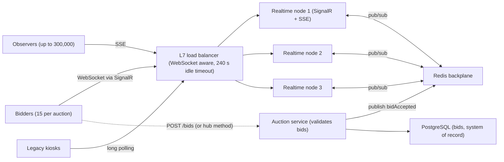
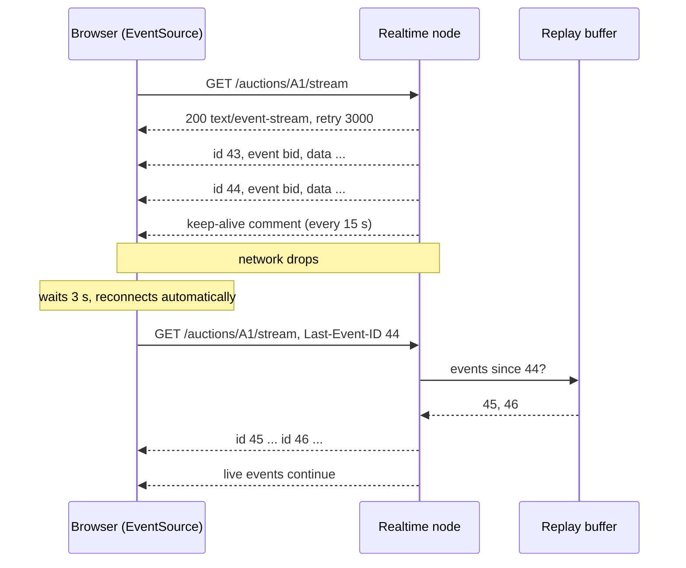
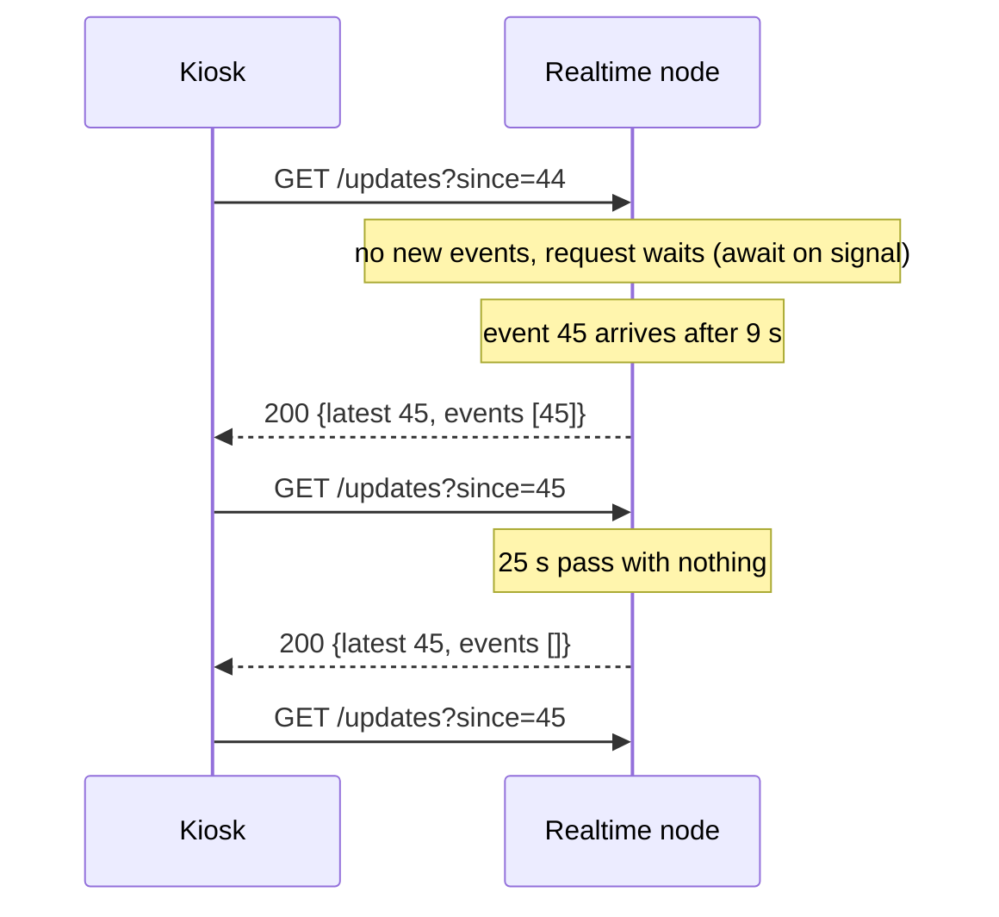
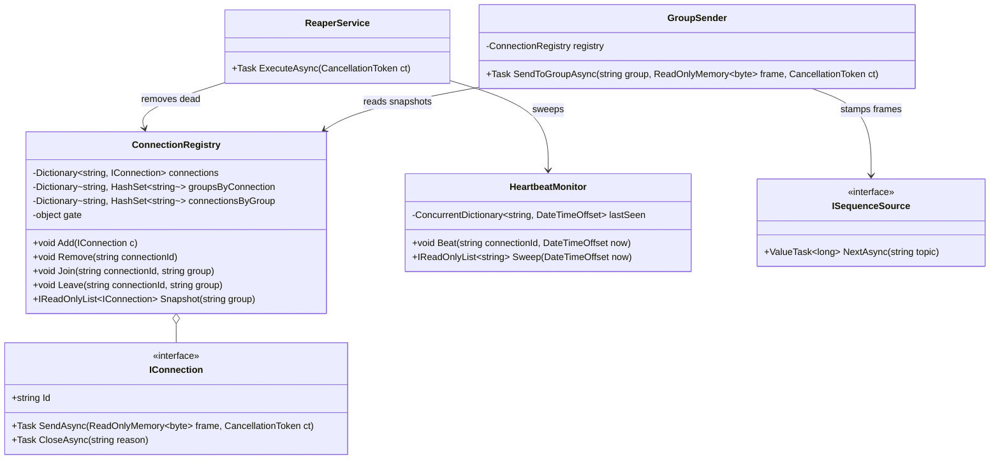

A state procurement portal runs online reverse auctions for road-maintenance contracts. Fifteen pre-qualified contractors bid; each new lowest bid must reach every other bidder within a second, or the auction is unfair. Meanwhile 3,000 observers (department staff, journalists, the losing bidders' head offices) watch a live price board, and a few legacy kiosks behind strict corporate proxies refresh a page. Three audiences, three different needs, and plain HTTP request-response serves none of them well. This lesson is about the three ways a server can push data to a client, what each costs, and how the architecture changes when 300,000 clients hold a connection open at the same time.

## Learning objectives

By the end of this lesson you will be able to:

1. Explain the difference between polling, long polling, Server-Sent Events (SSE) and WebSockets in plain words, with the trade-offs of each.
2. Pick the right transport for a given audience (bidirectional low latency, one-way broadcast, hostile network).
3. Explain why persistent connections change capacity planning: memory per connection, load balancer limits and the fan-out problem.
4. Describe how a SignalR backplane (Redis) lets a message reach clients connected to any server, and what it does not do.
5. Implement an SSE endpoint, a long-poll endpoint and a SignalR hub in ASP.NET Core, sharing one replay buffer with sequence numbers.
6. Build heartbeats and reconnection with exponential backoff and jitter, and resume after a gap using `Last-Event-ID`.
7. Decide when a 5-second poll is honestly good enough.

## Prerequisites

- [HTTP fundamentals](#/lesson/m10-http-fundamentals): request-response, headers, HTTP/1.1 versus HTTP/2 connections.
- [API gateways, reverse proxies and load balancers](#/lesson/m10-gateways-proxies-lb): L4 versus L7, and why long-lived connections need special handling.
- [Stateless versus stateful services](#/lesson/m11-stateless): a server holding 50,000 open sockets is stateful whether you like it or not.

## Explain it like I'm a beginner

Think about how you find out whether your train is late.

**Polling** is walking to the display board every two minutes. Simple, but you wear out your shoes, and you may still be up to two minutes late finding out.

**Long polling** is standing at the enquiry counter and saying "tell me when something changes". The clerk keeps you waiting, silently, until there is news or until a timer runs out (then says "nothing yet, ask again"). You immediately ask again. You hear news within a second of it happening, and the clerk is only disturbed when something changes. But each "ask" is still a full conversation with greetings and paperwork (an HTTP request with headers).

**Server-Sent Events (SSE)** is a loudspeaker. You tune in once, and the station announces changes as they happen. It is one-way: you cannot talk back through the loudspeaker. If you need to tell the station something, you make a separate phone call (a normal HTTP request). The loudspeaker system is simple, works over ordinary HTTP, and if you lose the signal you re-tune and say "I last heard announcement number 42", so you get the ones you missed.

**WebSockets** is a phone call that stays open. Both sides can talk at any time, there is no per-message greeting, and the latency is as low as the network allows. The cost is that a phone line is a real, continuous thing: the exchange has to keep it allocated, and every piece of equipment between you and the station (proxies, load balancers, corporate firewalls) has to understand that this is a long call, not a quick query.

A good rule: **broadcast to many → SSE; two-way chat or game-like interaction → WebSockets; nothing else works through this network → long polling.** And in .NET, **SignalR** is a library that picks the best of those three automatically and gives you a nicer programming model on top.

## First-principles explanation

### Why request-response is the wrong shape

HTTP was designed for the client to ask and the server to answer. Real-time data inverts that: the *server* knows when something happened. Every push technique is a trick for turning "server knows first" into something HTTP can carry.

The techniques differ on three axes:

1. **Latency from event to client**: polling is bounded by the poll interval; the others are bounded by network round-trip time.
2. **Cost per idle client**: polling costs a request per interval even when nothing changes; the others cost an open connection and almost no traffic.
3. **Direction**: SSE is server-to-client only; WebSockets are bidirectional; long polling is server-to-client with ordinary requests for the other direction.

### Long polling

The client sends `GET /auctions/A1/updates?since=42`. The server does not answer until an event with sequence greater than 42 exists, or until a timeout of roughly 25–30 seconds (shorter than most proxies' idle limit of 60 seconds). The client processes the answer and immediately sends the next request with the new `since`.

Costs: each cycle is a full HTTP request with headers (perhaps 500–800 bytes each way), and each waiting request holds server resources. In ASP.NET Core the "held" request is an `await` on a signal, not a blocked thread, so 10,000 waiting long-polls cost memory, not threads. The real cost is at the edges: proxies may buffer, and a 30-second request looks like a slow request to every dashboard you have.

Why it survives: it is plain HTTP/1.1 `GET`. It works through every proxy, every corporate firewall and every ancient mobile network. It is the fallback of last resort, which is why SignalR keeps it.

### Server-Sent Events

SSE is a response that never ends. The server replies with `Content-Type: text/event-stream` and keeps writing lines:

```text
retry: 3000

id: 43
event: bid
data: {"amount":1842000,"by":"C07"}

id: 44
event: bid
data: {"amount":1839500,"by":"C12"}

: keep-alive
```

Each message is `data:` lines ending in a blank line. `id:` sets the last event ID; if the connection drops, the browser's built-in `EventSource` reconnects automatically after `retry` milliseconds and sends `Last-Event-ID: 44`, so the server can replay what was missed. A line starting with `:` is a comment, used as a heartbeat. That is the entire protocol.

Strengths: ordinary HTTP (works with HTTP/2 multiplexing, so one TCP connection carries many streams), automatic reconnection and replay built into browsers, trivial to implement and to debug with `curl`. Weaknesses: one direction only; text only (binary must be base64); browsers cap HTTP/1.1 connections per origin at about six, so a page with many SSE streams over HTTP/1.1 runs out (HTTP/2 removes this); and some proxies buffer responses, which must be disabled (`X-Accel-Buffering: no` for Nginx, response buffering off in IIS/ARR).

### WebSockets

A WebSocket starts as an HTTP `GET` with `Upgrade: websocket`. If the server agrees (`101 Switching Protocols`), the TCP connection stops being HTTP and becomes a framed, bidirectional message channel. Frames have a tiny header (2–14 bytes) instead of HTTP headers, support text and binary, and either side can send at any time. The protocol includes ping/pong control frames for liveness.

Strengths: lowest latency, lowest per-message overhead, bidirectional, binary. Weaknesses: not HTTP after the upgrade, so HTTP caching, compression negotiation and many gateway features do not apply; every intermediary must support the upgrade (modern ones do, but corporate proxies and some mobile carriers still break it); no built-in reconnection or replay, so you write both; and a server holding 50,000 sockets is now a stateful server, with consequences for deployment, draining and autoscaling.

### SignalR

SignalR is ASP.NET Core's real-time library. It negotiates a transport (WebSockets, then SSE, then long polling), defines a hub protocol (JSON or MessagePack) on top, and gives you named methods in both directions, groups, and per-user messaging. For most .NET teams it is the right default: you write `Clients.Group("auction:A1").SendAsync("bidAccepted", bid)` and SignalR handles framing, keep-alives, and transport fallback.

What SignalR does *not* do by itself: reach clients connected to a *different* server, or replay missed messages after a reconnection. The first is solved by a backplane; the second you build (this lesson shows how).

### The scaling problem: persistent connections

With request-response, a server handles a request in a few milliseconds and forgets it. Ten servers each handling 500 RPS is 5,000 RPS, and any server can take any request. With persistent connections the picture changes in three ways.

**Memory per connection.** A WebSocket connection in Kestrel costs the socket buffers, the pipe buffers, the SignalR connection state and your per-connection objects. As a working estimate, budget 20–50 KB per idle connection, more if you keep send buffers large. 300,000 connections × 30 KB ≈ 9 GB, so on 16 GB nodes with headroom you need about 4–6 nodes just to *hold* the connections, before doing any work. Measure your own number; it depends on buffer settings and what you attach to the connection.

**Load balancer and OS limits.** Each connection is a file descriptor on the server and a tracked flow on the load balancer. Ulimits default to 1,024 on many Linux images; set them to hundreds of thousands. L7 load balancers have idle timeouts (often 60–240 seconds) that will kill a silent connection, which is why heartbeats exist. Cloud load balancers also have per-instance connection limits; read them before you plan.

**Fan-out.** A bid in auction A1 must reach every client watching A1. If 3,000 observers watch A1 and they are spread over 6 servers, the server that received the bid must get the message to the other 5. This is the backplane's job: every server subscribes to a Redis pub/sub channel; a publish on any server reaches all servers; each server then delivers to *its* connections in the group. The backplane carries one message per event, not one per client. Fan-out to clients still happens on each node.

Arithmetic for the auction portal at peak: 500 live auctions, 2 bids per second each, average 600 watchers per auction. Backplane traffic: 500 × 2 = 1,000 messages per second, trivial for Redis. Client deliveries: 1,000 × 600 = 600,000 messages per second across the fleet, or 100,000 per second per node with 6 nodes. At about 200 bytes each that is 20 MB/s per node of outbound traffic. Delivery, not the backplane, is what sizes the fleet.

**Deployment.** Restarting a server disconnects every client on it. 50,000 clients reconnecting in the same second is a self-inflicted thundering herd. Drain gracefully (stop accepting, let clients reconnect elsewhere over a minute) and make clients back off with jitter (next section).

### Heartbeats, reconnection and replay

Three mechanisms turn a fragile connection into a reliable feed.

**Heartbeats** detect dead connections. TCP will not tell you a peer vanished (a phone whose battery died sends no FIN). Send a small message every 15 seconds (SSE comment, WebSocket ping, SignalR keep-alive) and close connections that have not responded within a timeout (say 30 seconds). This also keeps idle-timeout proxies happy. SignalR defaults: `KeepAliveInterval` 15 s, `ClientTimeoutInterval` 30 s.

**Reconnection with backoff and jitter.** When the connection drops, retry after 1 s, then 2, 4, 8… capped at 30 s, and *randomise* each delay (full jitter: pick uniformly between 0 and the computed delay). Without jitter, 50,000 clients disconnected by one restart all retry at the exact same instants.

**Replay from a sequence number.** Every event gets a monotonically increasing sequence number per topic. The server keeps the last N events (a ring buffer) per topic. A client reconnecting says "I have up to 44"; the server sends 45 onwards. If the client is further behind than the buffer holds, the server says "resync" and the client fetches the current state with a normal `GET`. SSE has this built in via `Last-Event-ID`; for WebSockets and SignalR you add it in your message protocol.

:::callout type=tradeoff title="Push is not durable"
A push channel is a *notification* mechanism. If a bid absolutely must be recorded, it goes through a normal request (or hub method) that writes to the database and only then is broadcast. Clients must be able to rebuild state from a `GET` at any time. Treat the real-time feed as a cache-invalidation hint with payload, not as the system of record.
:::

### When polling is enough

A dashboard that shows site-progress percentages updated hourly does not need WebSockets. A 60-second poll of a cached endpoint costs 3,000 observers × 1 request per minute = 50 RPS, easily absorbed, and it has no persistent-connection problems at all. Choose push when the latency requirement is under a few seconds, when the change rate is low compared to the poll rate (so polling wastes most requests), or when the client needs to send many small messages quickly (games, collaborative editing).

## Visual explanation

### Architecture: real-time tier with a backplane



Three audiences use three transports, all terminating at the same load balancer, which must be configured for long-lived connections (WebSocket upgrade support and a long idle timeout). Bids are *written* through the auction service, which validates and persists to PostgreSQL before publishing one message to Redis. Every realtime node is subscribed, receives the message once, and fans it out to the connections it holds for that auction. The nodes are interchangeable for reading, but each one is stateful for the connections it currently holds.

### Sequence: SSE with a drop and resume



The browser does most of the work: it reconnects on its own after the `retry` interval and tells the server where it left off. The server consults the replay buffer and sends the two events that happened during the outage, then continues live. The client never sees a gap and never needs a full refresh, as long as the gap was shorter than the buffer.

### Sequence: long polling



The kiosk always has one request in flight. The server releases it when an event arrives or when the 25-second timer fires with an empty list. Each cycle costs one full HTTP exchange, which is why this transport is the fallback, not the default.

## Step-by-step example

We build the auction feed in four steps.

### Step 1 — a replay buffer with sequence numbers

One class, `AuctionFeed`, owns a ring buffer per auction. `Append` assigns the next sequence number and wakes anyone waiting. `GetSince(lastSeq)` returns the events after `lastSeq`, or a "resync required" flag if the client is further behind than the buffer holds. `WaitForAsync` is `GetSince` that waits up to a timeout for something to appear. Every transport sits on top of this one class.

### Step 2 — SSE endpoint

`GET /auctions/{id}/stream` sets the headers, reads `Last-Event-ID`, and loops: wait for events, write them as SSE frames, flush, repeat. When nothing happens for 15 seconds, write a comment as a heartbeat.

### Step 3 — long polling endpoint

`GET /auctions/{id}/updates?since=N` calls `WaitForAsync` with a 25-second timeout and returns JSON. Twelve lines.

### Step 4 — SignalR hub and raw WebSocket

The hub lets bidders join an auction group and place bids. A bid is appended to the feed and broadcast to the group. The raw WebSocket endpoint shows what SignalR hides: accepting the upgrade, a receive loop, a push loop and a close handshake.

## Production-style C# implementation

Project layout:

```text
Auction.Realtime/
  Program.cs
  Realtime/
    AuctionFeed.cs
    SseEndpoints.cs
    LongPollEndpoints.cs
    BidHub.cs
    RawWebSocketEndpoints.cs
    HeartbeatMonitor.cs
    ReconnectPolicy.cs
```

```csharp file=Realtime/AuctionFeed.cs
namespace Auction.Realtime;

public sealed record AuctionEvent(long Seq, string AuctionId, string Type, string Data, DateTimeOffset At);

/// <summary>What a client gets when it asks "anything after sequence N?".</summary>
public sealed record ReplayResult(IReadOnlyList<AuctionEvent> Events, bool ResyncRequired, long LatestSeq);

/// <summary>Per-auction ring buffer with monotonically increasing sequence numbers and a wake-up signal.
/// Every transport (SSE, long poll, SignalR, raw WebSocket) reads from this one class.</summary>
public sealed class AuctionFeed(TimeProvider clock, int capacity = 1000)
{
    private sealed class Topic
    {
        public long Latest;
        public readonly Queue<AuctionEvent> Buffer = new();
        public TaskCompletionSource Signal = NewSignal();
    }

    private readonly Dictionary<string, Topic> _topics = new(StringComparer.Ordinal);
    private readonly object _gate = new();

    private static TaskCompletionSource NewSignal() => new(TaskCreationOptions.RunContinuationsAsynchronously);

    public AuctionEvent Append(string auctionId, string type, string data)
    {
        lock (_gate)
        {
            var topic = GetTopic(auctionId);
            var ev = new AuctionEvent(++topic.Latest, auctionId, type, data, clock.GetUtcNow());
            topic.Buffer.Enqueue(ev);
            while (topic.Buffer.Count > capacity) topic.Buffer.Dequeue();
            var waiters = topic.Signal;
            topic.Signal = NewSignal();
            waiters.TrySetResult();                     // wake every pending WaitForAsync
            return ev;
        }
    }

    public ReplayResult GetSince(string auctionId, long lastSeq)
    {
        lock (_gate)
        {
            var topic = GetTopic(auctionId);
            if (lastSeq > topic.Latest) return new ReplayResult([], ResyncRequired: true, topic.Latest);
            if (lastSeq == topic.Latest) return new ReplayResult([], ResyncRequired: false, topic.Latest);
            var oldest = topic.Latest - topic.Buffer.Count + 1;
            if (lastSeq < oldest - 1) return new ReplayResult([], ResyncRequired: true, topic.Latest);
            var events = topic.Buffer.Where(e => e.Seq > lastSeq).ToList();
            return new ReplayResult(events, ResyncRequired: false, topic.Latest);
        }
    }

    /// <summary>Returns immediately if there is something to send; otherwise waits for the next Append or the timeout.</summary>
    public async Task<ReplayResult> WaitForAsync(string auctionId, long lastSeq, TimeSpan timeout, CancellationToken ct)
    {
        Task signal;
        lock (_gate)
        {
            var now = GetSince(auctionId, lastSeq);
            if (now.Events.Count > 0 || now.ResyncRequired) return now;
            signal = GetTopic(auctionId).Signal.Task;
        }
        await Task.WhenAny(signal, Task.Delay(timeout, ct));
        ct.ThrowIfCancellationRequested();
        return GetSince(auctionId, lastSeq);
    }

    private Topic GetTopic(string auctionId)
    {
        if (!_topics.TryGetValue(auctionId, out var t)) _topics[auctionId] = t = new Topic();
        return t;
    }
}
```

```csharp file=Realtime/SseEndpoints.cs
using Microsoft.AspNetCore.Http.Features;

namespace Auction.Realtime;

public static class SseEndpoints
{
    private static readonly TimeSpan HeartbeatInterval = TimeSpan.FromSeconds(15);

    public static IEndpointRouteBuilder MapAuctionStream(this IEndpointRouteBuilder app)
    {
        app.MapGet("/auctions/{auctionId}/stream", async (string auctionId, HttpContext http, AuctionFeed feed, CancellationToken ct) =>
        {
            var response = http.Response;
            response.Headers.ContentType = "text/event-stream";
            response.Headers.CacheControl = "no-cache";
            response.Headers["X-Accel-Buffering"] = "no";            // tell Nginx not to buffer
            http.Features.Get<IHttpResponseBodyFeature>()?.DisableBuffering();

            var last = long.TryParse(http.Request.Headers["Last-Event-ID"].ToString(), out var l) ? l : 0;

            try
            {
                await response.WriteAsync("retry: 3000\n\n", ct);
                await response.Body.FlushAsync(ct);

                while (!ct.IsCancellationRequested)
                {
                    var result = await feed.WaitForAsync(auctionId, last, HeartbeatInterval, ct);
                    if (result.ResyncRequired)
                    {
                        await response.WriteAsync($"id: {result.LatestSeq}\nevent: resync\ndata: {{\"latest\":{result.LatestSeq}}}\n\n", ct);
                        last = result.LatestSeq;
                    }
                    else if (result.Events.Count == 0)
                    {
                        await response.WriteAsync(": keep-alive\n\n", ct);   // comment line = heartbeat
                    }
                    else
                    {
                        foreach (var ev in result.Events)
                        {
                            await response.WriteAsync($"id: {ev.Seq}\nevent: {ev.Type}\ndata: {ev.Data}\n\n", ct);
                            last = ev.Seq;
                        }
                    }
                    await response.Body.FlushAsync(ct);
                }
            }
            catch (OperationCanceledException)
            {
                // client went away; nothing to clean up because the feed holds no per-client state
            }
        });
        return app;
    }
}
```

```csharp file=Realtime/LongPollEndpoints.cs
namespace Auction.Realtime;

public static class LongPollEndpoints
{
    private static readonly TimeSpan HoldFor = TimeSpan.FromSeconds(25);   // below typical 30-60 s proxy timeouts

    public static IEndpointRouteBuilder MapAuctionLongPoll(this IEndpointRouteBuilder app)
    {
        app.MapGet("/auctions/{auctionId}/updates", async (string auctionId, long? since, AuctionFeed feed, CancellationToken ct) =>
        {
            var result = await feed.WaitForAsync(auctionId, since ?? 0, HoldFor, ct);
            return Results.Ok(new { latest = result.LatestSeq, resync = result.ResyncRequired, events = result.Events });
        });
        return app;
    }
}
```

```csharp file=Realtime/BidHub.cs
using System.Globalization;
using Microsoft.AspNetCore.SignalR;

namespace Auction.Realtime;

/// <summary>Bidders connect here (WebSockets when possible). Observers use SSE; they never need the hub.</summary>
public sealed class BidHub(AuctionFeed feed, ILogger<BidHub> logger) : Hub
{
    public static string GroupName(string auctionId) => $"auction:{auctionId}";

    public async Task<long> JoinAuction(string auctionId, long lastSeq)
    {
        await Groups.AddToGroupAsync(Context.ConnectionId, GroupName(auctionId));
        // Replay anything the bidder missed while reconnecting, before live traffic resumes.
        var missed = feed.GetSince(auctionId, lastSeq);
        if (missed.ResyncRequired) await Clients.Caller.SendAsync("resync", missed.LatestSeq);
        else foreach (var ev in missed.Events) await Clients.Caller.SendAsync("bidAccepted", ev);
        return missed.LatestSeq;
    }

    public async Task PlaceBid(string auctionId, decimal amount)
    {
        if (amount <= 0) throw new HubException("Bid must be positive.");
        // In production: validate against the auction rules and persist in PostgreSQL first, then publish.
        var data = $"{{\"amount\":{amount.ToString(CultureInfo.InvariantCulture)},\"by\":\"{Context.ConnectionId[..6]}\"}}";
        var ev = feed.Append(auctionId, "bid", data);
        logger.LogInformation("Bid {Seq} on {AuctionId}: {Amount}", ev.Seq, auctionId, amount);
        await Clients.Group(GroupName(auctionId)).SendAsync("bidAccepted", ev);
    }

    public override Task OnDisconnectedAsync(Exception? exception)
    {
        logger.LogInformation("Connection {ConnectionId} left ({Reason})", Context.ConnectionId, exception?.Message ?? "closed");
        return base.OnDisconnectedAsync(exception);
    }
}
```

```csharp file=Realtime/RawWebSocketEndpoints.cs
using System.Net.WebSockets;
using System.Text;

namespace Auction.Realtime;

/// <summary>What SignalR does for you: accept the upgrade, read and write frames, handle close.</summary>
public static class RawWebSocketEndpoints
{
    public static IEndpointRouteBuilder MapRawAuctionSocket(this IEndpointRouteBuilder app)
    {
        app.MapGet("/ws/auctions/{auctionId}", async (string auctionId, HttpContext http, AuctionFeed feed, CancellationToken ct) =>
        {
            if (!http.WebSockets.IsWebSocketRequest)
            {
                http.Response.StatusCode = StatusCodes.Status400BadRequest;
                return;
            }

            using var socket = await http.WebSockets.AcceptWebSocketAsync();
            using var closed = CancellationTokenSource.CreateLinkedTokenSource(ct);

            var receive = ReceiveLoopAsync(socket, closed);
            var push = PushLoopAsync(socket, feed, auctionId, closed.Token);
            await Task.WhenAny(receive, push);
            closed.Cancel();

            if (socket.State == WebSocketState.Open)
                await socket.CloseAsync(WebSocketCloseStatus.NormalClosure, "bye", CancellationToken.None);
        });
        return app;
    }

    private static async Task ReceiveLoopAsync(WebSocket socket, CancellationTokenSource closed)
    {
        var buffer = new byte[4096];
        try
        {
            while (socket.State == WebSocketState.Open)
            {
                var result = await socket.ReceiveAsync(buffer, closed.Token);
                if (result.MessageType == WebSocketMessageType.Close) break;
                var text = Encoding.UTF8.GetString(buffer, 0, result.Count);
                if (text == "ping")                                   // application-level heartbeat from the client
                    await socket.SendAsync(Encoding.UTF8.GetBytes("pong"), WebSocketMessageType.Text, true, closed.Token);
            }
        }
        catch (OperationCanceledException) { }
        catch (WebSocketException) { }
        finally { closed.Cancel(); }
    }

    private static async Task PushLoopAsync(WebSocket socket, AuctionFeed feed, string auctionId, CancellationToken ct)
    {
        long last = 0;
        try
        {
            while (!ct.IsCancellationRequested && socket.State == WebSocketState.Open)
            {
                var result = await feed.WaitForAsync(auctionId, last, TimeSpan.FromSeconds(15), ct);
                foreach (var ev in result.Events)
                {
                    var frame = Encoding.UTF8.GetBytes($"{{\"seq\":{ev.Seq},\"type\":\"{ev.Type}\",\"data\":{ev.Data}}}");
                    await socket.SendAsync(frame, WebSocketMessageType.Text, true, ct);
                    last = ev.Seq;
                }
                if (result.ResyncRequired) last = result.LatestSeq;
            }
        }
        catch (OperationCanceledException) { }
    }
}
```

```csharp file=Realtime/HeartbeatMonitor.cs
using System.Collections.Concurrent;

namespace Auction.Realtime;

/// <summary>Tracks the last time each connection proved it was alive, and reports the ones that went silent.
/// SignalR has this built in (ClientTimeoutInterval); raw WebSocket and SSE servers need their own.</summary>
public sealed class HeartbeatMonitor(TimeSpan timeout)
{
    private readonly ConcurrentDictionary<string, DateTimeOffset> _lastSeen = new();

    public void Register(string connectionId, DateTimeOffset now) => _lastSeen[connectionId] = now;
    public void Beat(string connectionId, DateTimeOffset now) => _lastSeen[connectionId] = now;
    public void Remove(string connectionId) => _lastSeen.TryRemove(connectionId, out _);
    public int Count => _lastSeen.Count;

    /// <summary>Returns and forgets every connection silent for longer than the timeout. Call from a timer.</summary>
    public IReadOnlyList<string> Sweep(DateTimeOffset now)
    {
        var dead = new List<string>();
        foreach (var (id, seen) in _lastSeen)
            if (now - seen > timeout && _lastSeen.TryRemove(id, out _)) dead.Add(id);
        return dead;
    }
}
```

```csharp file=Realtime/ReconnectPolicy.cs
namespace Auction.Realtime;

/// <summary>Exponential backoff with full jitter: delay = random(0, min(cap, base × 2^attempt)).
/// Shared with clients as documentation of the expected behaviour.</summary>
public static class ReconnectPolicy
{
    public static TimeSpan NextDelay(int attempt, double random01, TimeSpan? baseDelay = null, TimeSpan? cap = null)
    {
        ArgumentOutOfRangeException.ThrowIfNegative(attempt);
        ArgumentOutOfRangeException.ThrowIfLessThan(random01, 0);
        ArgumentOutOfRangeException.ThrowIfGreaterThan(random01, 1);
        var b = (baseDelay ?? TimeSpan.FromSeconds(1)).TotalMilliseconds;
        var c = (cap ?? TimeSpan.FromSeconds(30)).TotalMilliseconds;
        var exp = Math.Min(c, b * Math.Pow(2, Math.Min(attempt, 30)));
        return TimeSpan.FromMilliseconds(exp * random01);
    }
}
```

```csharp file=Program.cs
using Auction.Realtime;

var builder = WebApplication.CreateBuilder(args);

builder.Services.AddSingleton(TimeProvider.System);
builder.Services.AddSingleton(sp => new AuctionFeed(sp.GetRequiredService<TimeProvider>(), capacity: 1000));
builder.Services.AddSingleton(new HeartbeatMonitor(TimeSpan.FromSeconds(30)));
builder.Services.AddSignalR(o =>
{
    o.KeepAliveInterval = TimeSpan.FromSeconds(15);       // server ping cadence
    o.ClientTimeoutInterval = TimeSpan.FromSeconds(30);   // drop clients silent for this long
    o.MaximumReceiveMessageSize = 16 * 1024;              // bids are small; refuse large frames
});

var app = builder.Build();

app.UseWebSockets(new WebSocketOptions { KeepAliveInterval = TimeSpan.FromSeconds(15) });

app.MapHub<BidHub>("/hubs/bids");
app.MapAuctionStream();        // SSE for observers
app.MapAuctionLongPoll();      // long polling for kiosks
app.MapRawAuctionSocket();     // raw WebSocket, for illustration

// Write path: bids are validated and persisted here (or in the hub), then published to every transport.
app.MapPost("/auctions/{auctionId}/bids", (string auctionId, BidRequest bid, AuctionFeed feed) =>
{
    if (bid.AmountPaise <= 0) return Results.BadRequest("Amount must be positive.");
    var ev = feed.Append(auctionId, "bid", $"{{\"amount\":{bid.AmountPaise},\"by\":\"{bid.BidderId}\"}}");
    return Results.Accepted(value: new { seq = ev.Seq });
});

app.Run();

public sealed record BidRequest(string BidderId, long AmountPaise);
```

**How this scales to more than one node.** Everything above works on a single server because `AuctionFeed` lives in memory. On two servers, a bid appended on node 1 never reaches node 2's clients. Two changes fix that, neither of which is in the compiled set because they need NuGet packages:

```csharp
// 1. SignalR Redis backplane: every node subscribes; a group send on any node reaches all nodes.
builder.Services.AddSignalR()
    .AddStackExchangeRedis(builder.Configuration.GetConnectionString("Redis")!, o =>
    {
        o.Configuration.ChannelPrefix = RedisChannel.Literal("auction");
    });

// 2. The feed subscribes to a Redis channel too, so SSE and long-poll clients on every node see every event.
//    Publisher: await subscriber.PublishAsync("auction-events", JsonSerializer.Serialize(ev));
//    Each node: subscriber.Subscribe("auction-events", (_, msg) => feed.Append(JsonSerializer.Deserialize<AuctionEvent>(msg!)!));
```

With the backplane, *sequence numbers must be assigned in one place* (the auction service or a Redis `INCR` per auction), not by each node's feed, or two nodes will hand out the same number for different events. The feed on each node becomes a replica of the ordered stream, not the source of it. Azure SignalR Service is the managed alternative: it holds the connections for you, and your servers only publish.

## Bad design vs good design

**Bad: WebSockets for everything.** The observer page opens a WebSocket to show a read-only price board. Now 300,000 WebSocket connections need upgrade-aware proxies, stateful nodes and hand-written reconnection, for a feed that never sends anything upstream. SSE would give the same latency with browser-native reconnection and replay.

**Bad: no sequence numbers.** The client reconnects after a 4-second blip and simply resumes. The two bids placed during the blip are never shown; the bidder sees a stale price and bids too high. With `Last-Event-ID` and a replay buffer, the gap is filled automatically.

**Bad: a 5-minute replay buffer in memory per connection.** Each connection keeps its own copy of recent events; 50,000 connections × 300 events × 200 bytes = 3 GB of duplicates. Keep one ring buffer per topic, shared by all connections.

**Bad: no heartbeats, 60-second proxy timeout.** Quiet auctions disconnect every client every minute, and nobody notices because the clients reconnect, generating 300,000 reconnects per minute of pure overhead.

**Bad: broadcasting before persisting.** The hub sends `bidAccepted` to the group, then the database insert fails. Every bidder saw a bid that does not exist. Persist first, publish second; on failure, the client gets an error and nobody else saw anything.

**Good:** the implementation above, plus a backplane for multiple nodes, persist-then-publish, one shared buffer per topic, heartbeats under the proxy timeout, and jittered backoff on the client.

:::callout type=tip title="Choosing in one line"
Many readers, one-way, text: SSE. Two-way, low latency, binary: WebSockets (via SignalR in .NET). Must work through anything: long polling. Updates slower than once a minute: just poll.
:::

## Practical playground

Open the HLD canvas with the starter graph below: a single realtime node, observers and bidders connected directly, and one database. Grow it to serve 300,000 observers and 2,000 bidders: add nodes, a WebSocket-aware load balancer, a backplane, and separate the write path (bids) from the push path. Annotate the idle timeout on the load balancer and estimate connections per node.

:::playground type=hld title="Scale the auction realtime tier"
```json
{
  "nodes": [
    { "id": "obs", "type": "client", "label": "Observers (SSE)", "props": { "rps": 50 } },
    { "id": "bid", "type": "client", "label": "Bidders (WebSocket)", "props": { "rps": 100 } },
    { "id": "rt", "type": "app-server", "label": "Realtime node (SignalR + SSE)", "props": { "instances": 1 } },
    { "id": "db", "type": "database", "label": "PostgreSQL (bids)" }
  ],
  "edges": [
    { "from": "obs", "to": "rt", "kind": "sync" },
    { "from": "bid", "to": "rt", "kind": "sync" },
    { "from": "rt", "to": "db", "kind": "sync" }
  ]
}
```
:::

## Exercises

:::exercise id=m10-realtime-ex1 difficulty=beginner kind=code title="Reconnect delay with exponential backoff and full jitter"
Implement `ReconnectPolicy.NextDelay(attempt, random01, baseDelay, cap)`. The delay before reconnect attempt *n* (0-based) is a uniformly random value between 0 and `min(cap, baseDelay × 2^n)`. `random01` is a number in `[0, 1]` supplied by the caller (so tests are deterministic); the result is `random01 × min(cap, baseDelay × 2^n)`.
::requirements
- Default `baseDelay` is 1 second, default `cap` is 30 seconds.
- Negative `attempt`, or `random01` outside `[0, 1]`, throws `ArgumentOutOfRangeException`.
- Large attempts must not overflow (clamp the exponent).
::acceptance
- Attempt 0 with `random01 = 1.0` gives 1,000 ms; attempt 3 gives 8,000 ms.
- Attempt 10 with `random01 = 1.0` gives 30,000 ms (capped).
- `random01 = 0.5` halves the delay; `random01 = 0` gives zero.
- Attempt 100 does not throw or overflow.
::hint
Compute the uncapped exponential first: `baseMs * Math.Pow(2, attempt)`, then `Math.Min(capMs, ...)`.
::hint
`Math.Pow(2, 100)` is huge but finite as a `double`; clamp `attempt` to something like 30 before the power to stay well inside range.
::hint
`ArgumentOutOfRangeException.ThrowIfNegative` and `ThrowIfGreaterThan` (.NET 8+) make the guards one-liners.
::hint
```csharp
var exp = Math.Min(capMs, baseMs * Math.Pow(2, Math.Min(attempt, 30)));
return TimeSpan.FromMilliseconds(exp * random01);
```
::starter
```csharp file=ReconnectPolicy.cs
using System;

namespace RealtimeKata;

public static class ReconnectPolicy
{
    public static TimeSpan NextDelay(int attempt, double random01, TimeSpan? baseDelay = null, TimeSpan? cap = null)
    {
        throw new NotImplementedException();
    }
}
```
::tests
```csharp file=ReconnectPolicyTests.cs
using System;
using RealtimeKata;
using Xunit;

public class ReconnectPolicyTests
{
    [Theory]
    [InlineData(0, 1000)]
    [InlineData(1, 2000)]
    [InlineData(3, 8000)]
    [InlineData(4, 16000)]
    [InlineData(5, 30000)]
    [InlineData(10, 30000)]
    public void Full_random_gives_capped_exponential(int attempt, int expectedMs) =>
        Assert.Equal(expectedMs, (int)ReconnectPolicy.NextDelay(attempt, 1.0).TotalMilliseconds);

    [Fact]
    public void Jitter_scales_the_delay()
    {
        Assert.Equal(4000, (int)ReconnectPolicy.NextDelay(3, 0.5).TotalMilliseconds);
        Assert.Equal(0, (int)ReconnectPolicy.NextDelay(3, 0.0).TotalMilliseconds);
    }

    [Fact]
    public void Custom_base_and_cap_are_respected() =>
        Assert.Equal(5000, (int)ReconnectPolicy.NextDelay(6, 1.0, TimeSpan.FromMilliseconds(250), TimeSpan.FromSeconds(5)).TotalMilliseconds);

    [Fact]
    public void Huge_attempt_does_not_overflow() =>
        Assert.Equal(30000, (int)ReconnectPolicy.NextDelay(100, 1.0).TotalMilliseconds);

    [Fact]
    public void Invalid_arguments_throw()
    {
        Assert.Throws<ArgumentOutOfRangeException>(() => ReconnectPolicy.NextDelay(-1, 0.5));
        Assert.Throws<ArgumentOutOfRangeException>(() => ReconnectPolicy.NextDelay(1, 1.5));
        Assert.Throws<ArgumentOutOfRangeException>(() => ReconnectPolicy.NextDelay(1, -0.1));
    }
}
```
::solution
```csharp file=ReconnectPolicy.cs
using System;

namespace RealtimeKata;

public static class ReconnectPolicy
{
    public static TimeSpan NextDelay(int attempt, double random01, TimeSpan? baseDelay = null, TimeSpan? cap = null)
    {
        ArgumentOutOfRangeException.ThrowIfNegative(attempt);
        ArgumentOutOfRangeException.ThrowIfLessThan(random01, 0);
        ArgumentOutOfRangeException.ThrowIfGreaterThan(random01, 1);

        var baseMs = (baseDelay ?? TimeSpan.FromSeconds(1)).TotalMilliseconds;
        var capMs = (cap ?? TimeSpan.FromSeconds(30)).TotalMilliseconds;
        var exp = Math.Min(capMs, baseMs * Math.Pow(2, Math.Min(attempt, 30)));
        return TimeSpan.FromMilliseconds(exp * random01);
    }
}
```

Why "full" jitter rather than adding a small random offset? With 50,000 clients disconnected at once, a ±10 % offset still clusters their retries into narrow bands. Spreading each retry uniformly over the whole window flattens the reconnect storm into a gentle ramp.
::mistakes
- Using `1 << attempt`, which overflows `int` at attempt 31 and goes negative.
- Applying jitter to the cap instead of the computed delay, so early attempts are too random and late ones too regular.
- Calling `Random.Shared` inside the method, which makes tests non-deterministic; take the random value as a parameter.
::extensions
Add a `MaxAttempts` after which the client should stop and show "connection lost, refresh the page", and a reset rule when a connection stays up for more than 60 seconds.
:::

:::exercise id=m10-realtime-ex2 difficulty=beginner kind=written title="Pick the transport"
For each scenario, choose polling, long polling, SSE or WebSockets (via SignalR where appropriate) and justify in two or three sentences, naming the deciding factor.

1. A public live-score page for a cricket match with up to 2 million viewers; scores change a few times a minute.
2. A collaborative whiteboard where 10 engineers draw at the same time and each stroke must appear on everyone's screen within 100 ms.
3. A contractor's billing dashboard that shows bill approval status; status changes a few times a day.
4. An e-auction bidding console used by 15 bidders from offices with strict proxies; bids must propagate within 1 second.
5. A site-camera page that streams detection alerts (text) from a server to a monitoring room display, and the display never sends anything back.
::acceptance
- Scenario 1 is SSE (or CDN-cached polling) with fan-out reasoning, not WebSockets.
- Scenario 2 is WebSockets, with latency and bidirectionality named.
- Scenario 3 is plain polling with the cost arithmetic.
- Scenario 4 discusses WebSockets with fallback to SSE or long polling, and why SignalR fits.
- Scenario 5 is SSE with the one-way nature named.
::hint
Direction first: does the client need to send many small messages quickly?
::hint
Then rate: if updates are rarer than the poll interval you would accept, pushing is overkill.
::hint
Then network: proxies and firewalls that cannot handle upgrades push you towards SSE or long polling.
::solution
1. **SSE, behind a CDN that supports streaming, or plain polling with CDN caching.** Two million one-way readers with a few changes a minute is a broadcast. WebSockets would mean 2 million stateful sockets for no benefit. Polling every 10 seconds against a CDN-cached JSON (TTL 5 s) is also reasonable: the origin sees a handful of requests per second regardless of audience size.
2. **WebSockets.** Bidirectional, many small messages, 100 ms budget. Each stroke is a few bytes; HTTP headers per message would dominate. SignalR with the MessagePack protocol fits.
3. **Polling** every 60 seconds, or just on page load with a manual refresh. A few changes a day means a push channel would sit idle for hours. 500 contractors polling once a minute is about 8 RPS.
4. **WebSockets with fallback.** Fifteen bidders need sub-second bidirectional updates, so WebSockets is the first choice. Strict proxies may block the upgrade, so the client must fall back to SSE plus `POST` for bids, or long polling. SignalR negotiates exactly this fallback chain automatically.
5. **SSE.** One direction, text, modest fan-out. Browser-native reconnection with `Last-Event-ID` means the display catches up after a network blip without custom code.
::mistakes
- Choosing WebSockets by reflex for read-only feeds.
- Forgetting that a CDN can absorb enormous read-only audiences when the data changes slowly.
:::

:::exercise id=m10-realtime-ex3 difficulty=intermediate kind=code title="A replay buffer with sequence numbers"
Implement `EventRing`, a bounded buffer of events with monotonically increasing sequence numbers starting at 1. `Append(data)` stores the event and returns its sequence number. `TryGetSince(lastSeq, out events)` returns the events with sequence greater than `lastSeq`, in order. It returns `false` (and an empty list) when the client cannot be caught up: `lastSeq` is greater than the latest sequence, or `lastSeq` is older than the oldest event the buffer still holds minus one.
::requirements
- Capacity is fixed at construction; appending beyond it drops the oldest event.
- `TryGetSince(latest, out e)` returns `true` with an empty list (client is up to date).
- `TryGetSince(0, ...)` returns every buffered event only if nothing has been dropped yet.
- Thread-safe for concurrent `Append` and `TryGetSince`.
::acceptance
- All tests pass.
- No LINQ `Skip`/`Take` over the whole buffer on every call is required, but correctness matters more than speed here.
::hint
Keep `_latest` (long) and a `Queue<(long Seq, string Data)>`. The oldest sequence still held is `_latest - _queue.Count + 1`.
::hint
Three cases, in order: `lastSeq > _latest` → false; `lastSeq == _latest` → true, empty; `lastSeq < oldest - 1` → false. Otherwise filter.
::hint
Wrap both methods in `lock (_gate)`; the operations are microseconds.
::hint
```csharp
var oldest = _latest - _queue.Count + 1;
if (lastSeq < oldest - 1) { events = []; return false; }
events = _queue.Where(e => e.Seq > lastSeq).Select(e => e.Data).ToList();
```
::starter
```csharp file=EventRing.cs
using System;
using System.Collections.Generic;
using System.Linq;

namespace RealtimeKata;

public sealed class EventRing
{
    private readonly int _capacity;
    private readonly Queue<(long Seq, string Data)> _queue = new();
    private readonly object _gate = new();
    private long _latest;

    public EventRing(int capacity)
    {
        if (capacity <= 0) throw new ArgumentOutOfRangeException(nameof(capacity));
        _capacity = capacity;
    }

    public long Latest { get { lock (_gate) return _latest; } }

    public long Append(string data) => throw new NotImplementedException();

    public bool TryGetSince(long lastSeq, out IReadOnlyList<string> events) => throw new NotImplementedException();
}
```
::tests
```csharp file=EventRingTests.cs
using System.Collections.Generic;
using System.Linq;
using System.Threading.Tasks;
using RealtimeKata;
using Xunit;

public class EventRingTests
{
    [Fact]
    public void Sequence_starts_at_one_and_increments()
    {
        var ring = new EventRing(10);
        Assert.Equal(1, ring.Append("a"));
        Assert.Equal(2, ring.Append("b"));
        Assert.Equal(2, ring.Latest);
    }

    [Fact]
    public void Since_zero_returns_everything_before_overflow()
    {
        var ring = new EventRing(10);
        ring.Append("a"); ring.Append("b"); ring.Append("c");
        Assert.True(ring.TryGetSince(0, out var events));
        Assert.Equal(new[] { "a", "b", "c" }, events);
    }

    [Fact]
    public void Since_latest_is_up_to_date()
    {
        var ring = new EventRing(10);
        ring.Append("a"); ring.Append("b");
        Assert.True(ring.TryGetSince(2, out var events));
        Assert.Empty(events);
    }

    [Fact]
    public void Returns_only_newer_events()
    {
        var ring = new EventRing(10);
        for (var i = 1; i <= 5; i++) ring.Append($"e{i}");
        Assert.True(ring.TryGetSince(3, out var events));
        Assert.Equal(new[] { "e4", "e5" }, events);
    }

    [Fact]
    public void Client_ahead_of_server_needs_resync()
    {
        var ring = new EventRing(10);
        ring.Append("a");
        Assert.False(ring.TryGetSince(5, out var events));
        Assert.Empty(events);
    }

    [Fact]
    public void Gap_older_than_buffer_needs_resync()
    {
        var ring = new EventRing(3);
        for (var i = 1; i <= 6; i++) ring.Append($"e{i}");   // buffer holds 4,5,6
        Assert.False(ring.TryGetSince(1, out _));             // would need 2 and 3, which are gone
        Assert.True(ring.TryGetSince(3, out var events));     // exactly at the edge: 4,5,6
        Assert.Equal(new[] { "e4", "e5", "e6" }, events);
    }

    [Fact]
    public async Task Concurrent_appends_keep_sequence_unique()
    {
        var ring = new EventRing(10000);
        var seqs = await Task.WhenAll(Enumerable.Range(0, 8).Select(_ => Task.Run(() =>
            Enumerable.Range(0, 500).Select(__ => ring.Append("x")).ToList())));
        var all = seqs.SelectMany(s => s).ToList();
        Assert.Equal(4000, all.Count);
        Assert.Equal(4000, all.Distinct().Count());
        Assert.Equal(4000, ring.Latest);
    }
}
```
::solution
```csharp file=EventRing.cs
using System;
using System.Collections.Generic;
using System.Linq;

namespace RealtimeKata;

public sealed class EventRing
{
    private readonly int _capacity;
    private readonly Queue<(long Seq, string Data)> _queue = new();
    private readonly object _gate = new();
    private long _latest;

    public EventRing(int capacity)
    {
        if (capacity <= 0) throw new ArgumentOutOfRangeException(nameof(capacity));
        _capacity = capacity;
    }

    public long Latest { get { lock (_gate) return _latest; } }

    public long Append(string data)
    {
        lock (_gate)
        {
            var seq = ++_latest;
            _queue.Enqueue((seq, data));
            while (_queue.Count > _capacity) _queue.Dequeue();
            return seq;
        }
    }

    public bool TryGetSince(long lastSeq, out IReadOnlyList<string> events)
    {
        lock (_gate)
        {
            if (lastSeq > _latest) { events = []; return false; }
            if (lastSeq == _latest) { events = []; return true; }
            var oldest = _latest - _queue.Count + 1;
            if (lastSeq < oldest - 1) { events = []; return false; }
            events = _queue.Where(e => e.Seq > lastSeq).Select(e => e.Data).ToList();
            return true;
        }
    }
}
```

The "edge" case in the gap test is worth a second look: with events 4, 5, 6 buffered, a client that has seen 3 can be caught up (it needs 4 onwards), but a client that has seen 2 cannot (it needs 3, which is gone). That is why the condition is `lastSeq < oldest - 1`, not `lastSeq < oldest`.
::alternatives
A fixed array used as a true ring (index = seq mod capacity) avoids the `Queue` and the LINQ filter: the events since `lastSeq` are a contiguous slice. Use it when the buffer is hot and large.
::mistakes
- Starting sequence numbers at 0, which makes "I have seen nothing" (0) indistinguishable from "I have seen event 0".
- Returning `true` with a partial list when the gap is too old, which silently loses events for the client.
- Forgetting the lock on `Latest`, which can read a torn or stale value.
::extensions
Add `WaitForAsync(lastSeq, timeout, ct)` using a `TaskCompletionSource` that `Append` completes, as in the lesson's `AuctionFeed`, and write a test with two concurrent waiters.
:::

:::exercise id=m10-realtime-ex4 difficulty=intermediate kind=design title="Connection registry and groups for a realtime node"
Design the classes a single realtime node needs to track its connections, their group memberships (auctions they watch), their last heartbeat, and deliver a message to a group. SignalR has these built in; design them as if you were writing a lightweight server for the raw WebSocket endpoint. Produce a class model (interfaces, classes, key members) and explain the thread-safety and ownership decisions.
::acceptance
- A connection can belong to many groups and a group to many connections (and both lookups are fast).
- Removing a connection removes it from every group in one operation.
- Heartbeat tracking and sweeping is separate from group membership.
- Sending to a group does not hold a lock while awaiting network I/O.
- The design states where sequence numbers come from on a multi-node deployment.
::hint
Two dictionaries: `connectionId → set of groups` and `group → set of connectionIds`. Keep them consistent under one lock, or use `ConcurrentDictionary` with care.
::hint
Snapshot the connection list for a group under the lock, release the lock, then send to the snapshot.
::hint
Heartbeats belong in a `HeartbeatMonitor` that reports dead connection IDs; the registry removes them.
::hint
A `ISequenceSource` abstraction (local counter in one-node mode, Redis INCR or the auction service in multi-node mode) keeps the registry independent of the deployment shape.
::solution


```json
{
  "classes": [
    { "id": "IConnection", "name": "IConnection", "kind": "interface", "fields": [], "methods": ["string Id", "Task SendAsync(ReadOnlyMemory<byte> frame, CancellationToken ct)", "Task CloseAsync(string reason)"] },
    { "id": "Registry", "name": "ConnectionRegistry", "kind": "class", "fields": ["-Dictionary<string, IConnection> _connections", "-Dictionary<string, HashSet<string>> _groupsByConnection", "-Dictionary<string, HashSet<string>> _connectionsByGroup", "-object _gate"], "methods": ["+void Add(IConnection c)", "+void Remove(string id)", "+void Join(string id, string group)", "+void Leave(string id, string group)", "+IReadOnlyList<IConnection> Snapshot(string group)"], "responsibility": "Owns connection and group membership; all mutations under one lock" },
    { "id": "Sender", "name": "GroupSender", "kind": "class", "fields": ["-ConnectionRegistry _registry", "-ISequenceSource _seq"], "methods": ["+Task SendToGroupAsync(string group, ReadOnlyMemory<byte> frame, CancellationToken ct)"], "responsibility": "Snapshots the group, then sends outside the lock; removes connections whose send fails" },
    { "id": "Heartbeat", "name": "HeartbeatMonitor", "kind": "class", "fields": ["-ConcurrentDictionary<string, DateTimeOffset> _lastSeen", "-TimeSpan _timeout"], "methods": ["+void Beat(string id, DateTimeOffset now)", "+IReadOnlyList<string> Sweep(DateTimeOffset now)"], "responsibility": "Liveness only; knows nothing about groups" },
    { "id": "Seq", "name": "ISequenceSource", "kind": "interface", "fields": [], "methods": ["ValueTask<long> NextAsync(string topic)"] },
    { "id": "Reaper", "name": "ReaperService", "kind": "class", "fields": [], "methods": ["+Task ExecuteAsync(CancellationToken ct)"], "responsibility": "Every 5 s: sweep dead ids, close and remove them" }
  ],
  "relations": [
    { "from": "Registry", "to": "IConnection", "kind": "aggregation", "multiplicity": "0..*" },
    { "from": "Sender", "to": "Registry", "kind": "dependency" },
    { "from": "Sender", "to": "Seq", "kind": "dependency" },
    { "from": "Reaper", "to": "Heartbeat", "kind": "dependency" },
    { "from": "Reaper", "to": "Registry", "kind": "dependency" }
  ]
}
```

**Thread safety.** The registry keeps two indexes (by connection, by group) and mutates both under one lock, so they can never disagree. `Remove(id)` reads the connection's group set, removes the id from each group's set, and deletes both entries, all in one lock scope. Lookups are O(1) in either direction.

**Sending outside the lock.** `GroupSender` calls `Snapshot(group)` (a copied list, taken under the lock) and then awaits each `SendAsync` with the lock released. A slow client cannot stall joins and leaves. Sends run with a bounded degree of parallelism (for example 64 at a time) and a per-send timeout; a failed send marks the connection for removal.

**Heartbeats are separate.** `HeartbeatMonitor` only knows ids and timestamps. A `ReaperService` ties it to the registry every few seconds. This keeps the registry free of time and the monitor free of groups, so each is trivial to test.

**Sequence numbers.** On one node, `ISequenceSource` is a per-topic counter. On many nodes, the auction service assigns the number when it persists the bid (or Redis `INCR auction:A1:seq`), and the frame carries it. Nodes never invent sequence numbers in multi-node mode, or replays become ambiguous.
::mistakes
- Awaiting network sends while holding the registry lock.
- One dictionary only (group → connections), which makes "remove this connection from all groups" a full scan.
- Mixing heartbeat state into the connection object so that a test of group logic needs a clock.
:::

:::exercise id=m10-realtime-ex5 difficulty=advanced kind=hld title="300,000 observers, 2,000 bidders, 500 auctions"
Design the real-time tier for the procurement portal at peak: 500 simultaneous auctions, 2,000 bidders on WebSockets, 300,000 observers, an average of 600 observers per auction, and 2 bids per second per auction. Bids must reach all bidders of that auction within 1 second; observers may lag by up to 3 seconds. Extend the starter graph. Show your arithmetic for node count, backplane traffic and per-node outbound message rate; state how you drain a node for deployment; and explain how a reconnecting client catches up.
::acceptance
- Node count derived from a stated memory-per-connection estimate (labelled as an estimate).
- Backplane message rate versus client delivery rate are both computed and clearly different.
- Write path (bid validation and persistence) is separated from the push path.
- Deployment drain and client backoff with jitter are described.
- Replay or resync after reconnect is described, including where sequence numbers are assigned.
::hint
Memory first: at roughly 30 KB per idle connection (estimate), how many GB do 302,000 connections need, and how many 16 GB nodes with headroom?
::hint
Backplane sees each event once; clients see each event once per subscriber. Compute both.
::hint
Observers tolerate 3 seconds: can you coalesce bids per auction into one update per second for them and cut delivery by half?
::hint
Draining: stop accepting new connections at the load balancer, send a "reconnect" hint to clients in small batches over 60 seconds, then exit.
::starter
```json
{
  "nodes": [
    { "id": "obs", "type": "client", "label": "Observers (300,000, SSE)", "props": { "rps": 100 } },
    { "id": "bid", "type": "client", "label": "Bidders (2,000, WebSocket)", "props": { "rps": 1000 } },
    { "id": "lb", "type": "load-balancer", "label": "Load balancer" },
    { "id": "rt", "type": "app-server", "label": "Realtime nodes", "props": { "instances": 2 } },
    { "id": "db", "type": "database", "label": "PostgreSQL (bids)" }
  ],
  "edges": [
    { "from": "obs", "to": "lb", "kind": "sync" },
    { "from": "bid", "to": "lb", "kind": "sync" },
    { "from": "lb", "to": "rt", "kind": "sync" },
    { "from": "rt", "to": "db", "kind": "sync" }
  ]
}
```
::solution
```json
{
  "nodes": [
    { "id": "obs", "type": "client", "label": "Observers (300,000, SSE)", "props": { "rps": 100 } },
    { "id": "bid", "type": "client", "label": "Bidders (2,000, WebSocket via SignalR)", "props": { "rps": 1000 } },
    { "id": "lb", "type": "load-balancer", "label": "L7 LB: WebSocket upgrade, 240 s idle, least-connections" },
    { "id": "wsg", "type": "websocket-gateway", "label": "Realtime nodes (SignalR + SSE), 50k connections each", "props": { "instances": 8 } },
    { "id": "redis", "type": "cache", "label": "Redis: SignalR backplane + auction-events channel" },
    { "id": "api", "type": "app-server", "label": "Auction service: validate bid, assign seq, persist, publish", "props": { "instances": 3 } },
    { "id": "db", "type": "database", "label": "PostgreSQL (bids, system of record)", "props": { "multiAz": true } },
    { "id": "snap", "type": "cache", "label": "Auction state snapshots (for resync GET)", "props": { "ttlSeconds": 5 } },
    { "id": "mon", "type": "monitoring", "label": "Connections per node, reconnect rate, fan-out latency p99" }
  ],
  "edges": [
    { "from": "obs", "to": "lb", "kind": "sync", "label": "SSE, Last-Event-ID" },
    { "from": "bid", "to": "lb", "kind": "sync", "label": "WebSocket" },
    { "from": "lb", "to": "wsg", "kind": "sync" },
    { "from": "bid", "to": "api", "kind": "sync", "label": "place bid (hub method forwards)" },
    { "from": "api", "to": "db", "kind": "sync", "label": "insert bid with seq" },
    { "from": "api", "to": "redis", "kind": "async", "label": "publish bidAccepted (1,000 msg/s)" },
    { "from": "redis", "to": "wsg", "kind": "async", "label": "fan-out to local connections" },
    { "from": "wsg", "to": "snap", "kind": "sync", "label": "resync GET" },
    { "from": "api", "to": "snap", "kind": "async" },
    { "from": "wsg", "to": "mon", "kind": "async" }
  ]
}
```

**Node count.** 302,000 connections × about 30 KB each (estimate; measure under load) ≈ 9 GB of connection state. On 16 GB nodes keeping 50 % headroom for send buffers and bursts, that is about 8 GB usable per node, so 2 nodes could hold it, but a single node failure would then dump 150,000 reconnects onto the survivor. Choose **8 nodes at about 38,000 connections each**, so losing one moves only 12.5 % of clients. Raise file-descriptor limits to at least 100,000 per node.

**Backplane rate.** 500 auctions × 2 bids/s = **1,000 messages per second** on Redis pub/sub. Trivial.

**Client delivery rate.** Each bid goes to 600 observers + 15 bidders ≈ 615 recipients: 1,000 × 615 ≈ **615,000 deliveries per second** fleet-wide, about 77,000 per node. At 200 bytes each, that is about 15 MB/s outbound per node. This, not the backplane, is the sizing constraint. Because observers tolerate 3 seconds, **coalesce** observer updates: one SSE frame per auction per second carrying the current best bid instead of each bid, which cuts observer deliveries to 500 × 600 = 300,000 per second regardless of bid rate, with bidders still receiving every bid immediately.

**Write path.** A bid is a hub call that the realtime node forwards to the auction service (or a direct `POST`). The service validates (auction open, bidder qualified, amount lower than current), assigns the next sequence number for that auction as part of the insert, commits to PostgreSQL, and only then publishes to Redis. Realtime nodes never invent sequence numbers.

**Draining.** Before deploying to a node: mark it unhealthy at the load balancer so new connections go elsewhere; send a `reconnect` hint to its clients in batches of 1,000 every second (about 40 seconds for a full node); clients reconnect with jittered backoff (1 s base, 30 s cap) and land on healthy nodes; then stop the process. Rolling one node at a time keeps the fleet at 7/8 capacity throughout.

**Catching up.** SSE clients send `Last-Event-ID` automatically; SignalR clients send their last sequence in `JoinAuction`. Each node keeps a ring buffer of the last 1,000 events per auction, fed from the Redis channel. A client within the buffer gets replay; a client beyond it gets `resync` and fetches the auction snapshot (5-second TTL cache in front of the service). The snapshot endpoint is what makes a mass reconnect survivable: 38,000 clients doing a cached `GET` is fine; 38,000 clients demanding full database reads is not.
::mistakes
- Sizing by backplane traffic and ignoring per-node delivery, which is 600× larger.
- Two big nodes, so one failure halves capacity and causes a reconnect storm.
- Letting realtime nodes assign sequence numbers, so replays across nodes disagree.
- No snapshot endpoint, so every resync hits PostgreSQL.
:::

## Automated testing

**Feed and ring buffer** (exercise 3 and `AuctionFeed`): pure in-memory tests. Add a test for `WaitForAsync`: start a waiter with a 5-second timeout, append after 50 ms, assert the waiter completes with the event well before the timeout. Use a `TaskCompletionSource` and `Task.WhenAny` to keep the test fast and deterministic; never `Thread.Sleep`.

**SSE framing**: the frame format is a string, so test it as one. Extract the `id:/event:/data:` formatting into a small `SseFrame.Format(ev)` function and assert exact output, including the blank line terminator and the comment heartbeat.

**Endpoints**: with `WebApplicationFactory` (NuGet), open the SSE endpoint with `HttpCompletionOption.ResponseHeadersRead`, append two events through the feed, read the stream line by line and assert the frames. For long polling, start the request, append after 100 ms, assert it returns within 1 second with one event. For the hub, the `Microsoft.AspNetCore.SignalR.Client` package can connect to the test server over the in-memory handler:

```csharp
var connection = new HubConnectionBuilder()
    .WithUrl("http://localhost/hubs/bids", o => o.HttpMessageHandlerFactory = _ => factory.Server.CreateHandler())
    .Build();
var received = new TaskCompletionSource<AuctionEvent>();
connection.On<AuctionEvent>("bidAccepted", e => received.TrySetResult(e));
await connection.StartAsync();
await connection.InvokeAsync("JoinAuction", "A1", 0L);
await connection.InvokeAsync("PlaceBid", "A1", 1842000m);
var ev = await received.Task.WaitAsync(TimeSpan.FromSeconds(5));
Assert.Equal("bid", ev.Type);
```

**Heartbeat sweep**: register three connections, beat two of them, advance a fake clock past the timeout, assert `Sweep` returns exactly the silent one and that `Count` drops by one.

**Load test** (not unit): before going live, hold 50,000 idle connections on one node with a small client tool and record memory. That number replaces the "30 KB estimate" in your capacity plan.

## Real-world application

- **SignalR with a Redis backplane or Azure SignalR Service** is the standard .NET approach for dashboards, notifications and chat. The service option removes the stateful-node problem entirely at the cost of per-connection pricing.
- **Stock tickers and live sports scores** are almost always SSE or coalesced polling behind a CDN: enormous one-way audiences, modest update rates.
- **Collaborative editors and multiplayer games** use WebSockets with binary protocols, often with their own replay and conflict-resolution layers on top.
- **AI chat interfaces** stream tokens with SSE; the pattern you built here (`text/event-stream`, `data:` lines, reconnect) is exactly what they use.
- **Construction monitoring platforms** push drone-processing progress, sensor alerts and approval-status changes to site and office dashboards; SSE for the office displays and a plain poll for the once-an-hour reports is usually the right split.

## Interview questions

:::interview
::q beginner
Explain long polling, SSE and WebSockets to someone who only knows request-response.
::a
All three let the server deliver data when it changes instead of waiting to be asked. Long polling is an ordinary request that the server holds open until there is news or a timeout; the client immediately asks again. SSE is a single HTTP response that never finishes, with the server writing small text messages into it; browsers reconnect and resume automatically. WebSockets upgrade an HTTP connection into a two-way message channel with tiny per-message overhead, which is the lowest latency but requires every proxy on the path to support the upgrade and leaves you to build reconnection yourself.
::q beginner
When would you use SSE instead of WebSockets?
::a
When data flows one way (server to client), is text, and the audience is large: live scores, price boards, notifications, streamed AI responses. SSE is plain HTTP, so it works through caches and proxies, multiplexes over HTTP/2, and gets reconnection and `Last-Event-ID` replay from the browser for free. WebSockets earn their complexity when the client sends many small messages quickly (games, collaborative editing) or when binary frames matter.
::q intermediate
What is a SignalR backplane, and what problem does it not solve?
::a
With several server instances, a client is connected to exactly one of them. A group broadcast on instance 1 would only reach instance 1's clients. A backplane (Redis pub/sub, or Azure SignalR Service) makes every instance subscribe to a shared channel: a send on any instance is published once, each instance receives it and delivers it to its own connections in that group. It solves "reach clients on other nodes". It does not solve replay of missed messages after a reconnect, ordering across instances, or the per-node fan-out cost, which still scales with subscribers per node. Sequence numbers for replay must be assigned centrally, not by each node.
::q intermediate
Why are heartbeats necessary, and what interval would you choose?
::a
TCP does not reliably notice a vanished peer; a phone that loses signal sends no close frame, so the server keeps the connection and its memory forever. Heartbeats (SSE comments, WebSocket pings, SignalR keep-alives) give both sides a regular proof of life and let the server close connections that go silent. They also keep idle-timeout proxies and load balancers from cutting quiet connections. A 15-second interval with a 30-second timeout is a common default: well under typical 60-second proxy idle limits, and cheap (a few bytes per client per 15 seconds, so 300,000 clients cost about 20 KB/s).
::q advanced
A deploy restarts a node holding 50,000 connections. Walk through what goes wrong naively and how you fix it.
::a
Naively, 50,000 clients detect the drop within seconds and reconnect at once, hitting the remaining nodes in a burst, each reconnect doing a TLS handshake, a negotiate call and often a full state fetch. The load balancer may route many to the same node, and the burst can cascade into another node failing. Fixes, in layers: drain before stopping (mark the node unhealthy at the load balancer, then send reconnect hints in batches over 30–60 seconds so clients move gradually); clients use exponential backoff with full jitter (1 s base, 30 s cap) so even an abrupt drop spreads over tens of seconds; clients resume with a sequence number so most reconnects get a small replay rather than a full state fetch; the full-state fallback is a cached snapshot endpoint, not a database read; and the fleet is sized so that one node's share (12.5 % with 8 nodes) fits in the others' headroom. Roll one node at a time.
::q advanced
Design replay for a WebSocket feed so that a client never misses an event after a short disconnect, and explain what "short" means.
::a
Every event in a topic gets a monotonically increasing sequence number assigned by the single writer (the service that persists the event, or a Redis `INCR`), carried in the frame. Each node keeps a ring buffer of the last N events per topic, filled from the backplane. On reconnect the client sends its last sequence; the server returns events after it from the buffer, then switches to live. If the client's sequence is older than the buffer's oldest minus one, the server replies "resync" and the client fetches a snapshot through a cached GET, then resumes from the snapshot's sequence. "Short" is defined by the buffer: N events at the topic's event rate. At 2 events per second and N = 1,000, the buffer covers about 8 minutes; size N from the longest outage you want to bridge without a snapshot, and remember the memory is per topic, not per client. Idempotent handling on the client (ignore sequences already seen) covers the overlap case where an event was delivered just before the drop.
:::

## Summary and revision

**Key takeaways**

- Polling asks; long polling waits; SSE streams one way over plain HTTP; WebSockets open a two-way channel. SignalR picks among the last three for you.
- Choose by direction, update rate and network: one-way broadcast → SSE; two-way low latency → WebSockets; hostile proxies → long polling; slow-changing data → just poll.
- Persistent connections make nodes stateful: budget memory per connection (measure; tens of KB is a typical estimate), raise descriptor limits, set load balancer idle timeouts above the heartbeat interval.
- A backplane carries each event once between nodes; delivery to clients is per subscriber and is what sizes the fleet.
- Three reliability mechanisms: heartbeats (detect dead peers), jittered exponential backoff (avoid reconnect storms), sequence-numbered replay buffer (fill gaps; resync via cached snapshot when too far behind).
- Persist first, publish second. The push channel is a notification, not the system of record.

**Terminology**: long polling, Server-Sent Events, `EventSource`, `Last-Event-ID`, WebSocket upgrade, ping/pong, SignalR hub, group, backplane, fan-out, heartbeat, full jitter, replay buffer, resync, drain.

:::flashcards
Q: What makes SSE reconnection free?
A: The browser's EventSource reconnects after the retry interval and sends Last-Event-ID, so the server can replay missed events.
Q: What does the WebSocket upgrade do?
A: An HTTP GET with Upgrade: websocket becomes a framed, bidirectional message channel after a 101 response; it is no longer HTTP.
Q: Why hold a long-poll request for 25 s and not 60 s?
A: Many proxies and load balancers cut idle requests at 30 to 60 s; staying under that avoids spurious errors.
Q: What does a SignalR backplane carry?
A: One copy of each message between nodes via Redis pub/sub; each node then delivers to its own connections.
Q: Where should sequence numbers be assigned on a multi-node deployment?
A: By the single writer that persists the event (or a Redis INCR), never by each realtime node.
Q: Why full jitter on reconnect?
A: So thousands of clients dropped at once spread their retries uniformly over the window instead of retrying in synchronised waves.
Q: Default SignalR keep-alive and client timeout?
A: KeepAliveInterval 15 s, ClientTimeoutInterval 30 s.
Q: What sizes a realtime fleet: backplane rate or delivery rate?
A: Delivery rate (events × subscribers), which is typically hundreds of times larger than the backplane rate (events once).
Q: When is plain polling the right answer?
A: When data changes slower than the poll interval you would accept and latency of a minute or so is fine; it has no persistent-connection costs.
:::

## Knowledge check

:::quiz pass=70
::q single
A read-only live price board for 300,000 viewers, text updates a few times a second. Which transport fits best?
- [ ] WebSockets, because it is fastest.
- [x] SSE, because it is one-way, plain HTTP, and reconnection with replay is built into browsers.
- [ ] Long polling, because it is simplest.
- [ ] HTTP/2 push.
> One direction, large audience, text: SSE. WebSockets add stateful-connection costs with no benefit here.
::q single
Bids arrive on node 1, but bidders connected to node 2 never see them. What is missing?
- [ ] Heartbeats.
- [x] A backplane (for example Redis pub/sub) so every node receives every event.
- [ ] A bigger replay buffer.
- [ ] Sticky sessions.
> Each node only knows its own connections. The backplane delivers each event to all nodes; each node fans out locally.
::q multi
Which statements about persistent-connection scaling are true? (Select all that apply.)
- [x] Memory per idle connection, not CPU, is often the first limit.
- [x] Load balancer idle timeouts must be longer than the heartbeat interval.
- [ ] The backplane must carry one message per client.
- [x] Restarting a node causes every client on it to reconnect.
> The backplane carries one message per event; fan-out to clients happens on each node.
::q single
A client reconnects with `Last-Event-ID: 44`, but the ring buffer's oldest event is 120. What should the server do?
- [ ] Send events from 120 onwards and hope.
- [ ] Reject the connection.
- [x] Signal a resync so the client fetches a current snapshot, then continue live from the snapshot's sequence.
- [ ] Send the entire history from the database.
> Events 45 to 119 are gone from the buffer. A partial replay would silently lose them; a snapshot restores correct state.
::q single
Why does the lesson persist a bid to PostgreSQL before publishing it to clients?
- [ ] PostgreSQL is faster than Redis.
- [x] If the insert fails after a broadcast, every client has seen a bid that does not exist.
- [ ] SignalR requires it.
- [ ] To generate the connection ID.
> Persist first, publish second. The push channel is a notification, not the system of record.
::q single
Fifty thousand clients lose their connection when a node restarts. Which client behaviour prevents a reconnect storm?
- [ ] Reconnect immediately and keep retrying every 100 ms.
- [ ] Wait exactly 5 seconds, then reconnect.
- [x] Exponential backoff with full jitter, so retries spread uniformly over a growing window.
- [ ] Never reconnect; show an error.
> Fixed delays keep the clients synchronised; jitter spreads them out.
::q single
Which is a correct SSE frame carrying event ID 45 of type `bid`?
- [x] `id: 45` newline `event: bid` newline `data: {"amount":1842000}` followed by a blank line.
- [ ] `{"id":45,"event":"bid"}` with no blank line.
- [ ] A binary WebSocket frame.
- [ ] `45|bid|{"amount":1842000}`.
> SSE frames are `field: value` lines terminated by an empty line; `id` sets the value the browser sends back as Last-Event-ID.
:::

## Completion criteria

You have finished this lesson when you can:

- [ ] Score at least 70 % on the knowledge check.
- [ ] Complete exercises 1 and 3; the downloaded projects' `dotnet test` should pass.
- [ ] Complete exercise 5 and compare your node-count and delivery-rate arithmetic with the solution.
- [ ] Run the lesson's SSE endpoint locally and watch it with `curl -N`, including a heartbeat.
- [ ] Explain in under two minutes why a backplane does not solve replay, and what does.
