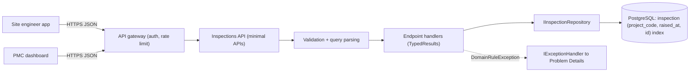
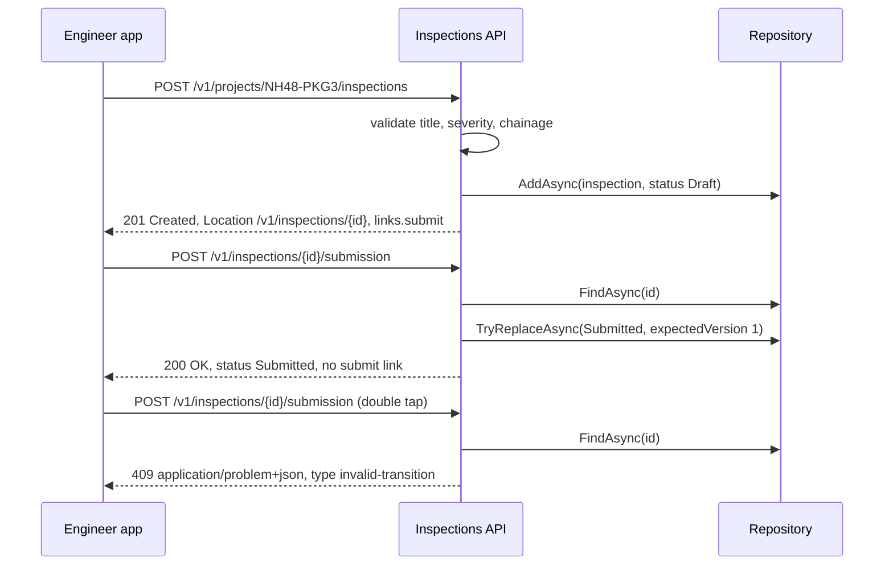
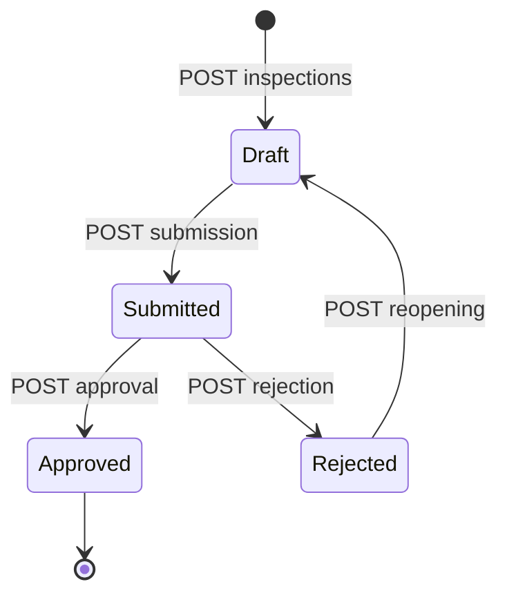

An API is a promise to people you may never meet: the mobile developer in another company, the data team writing a nightly script, the integration partner who will read your docs once and then copy-paste for years. A good REST API is one they can *guess*: if `GET /v1/inspections/{id}` exists, they expect `GET /v1/projects/{code}/inspections` to list them, errors to look the same everywhere, and lists to page the same way. This lesson turns that "guessability" into concrete rules and an ASP.NET Core implementation.

## Learning objectives

By the end of this lesson you will be able to:

1. Model a domain as resources and collections with clean, predictable URIs.
2. Map operations to HTTP methods and status codes, including state transitions that don't fit plain CRUD.
3. Return every error as RFC 9457 Problem Details, with validation errors and stable `type` URIs.
4. Design filtering, sorting and cursor (keyset) pagination that stays correct while data changes.
5. Explain HATEOAS and the Richardson Maturity Model, and decide how much of it you need.
6. Implement all of this with minimal APIs: route groups, `TypedResults`, `[AsParameters]`, `IExceptionHandler` and `AddProblemDetails`.

## Prerequisites

- [HTTP fundamentals](#/lesson/m10-http-fundamentals): methods, safety, idempotency, status codes, `ETag`.
- [Kestrel, middleware, routing, controllers and minimal APIs](#/lesson/m03-kestrel-middleware-routing): how a request reaches an endpoint.

## Explain it like I'm a beginner

Picture a well-run government records office. Every file has an address: *Building B, Shelf 12, File 4471*. You don't need to know how the clerks work inside; you only need a small set of actions that work the same on every file:

- **Look** at a file (read).
- **Put** a new file on a shelf (create).
- **Replace** a file with a corrected copy (update).
- **Remove** a file (delete).

You also get a standard slip back: "Done", "No such file", "You're not allowed", "Come back later". And if you ask for "all files on Shelf 12", the clerk hands you 25 at a time with a note: "for the next batch, show this token".

REST (REpresentational State Transfer) is that office, over HTTP:

- Each file is a **resource**, and its address is a **URI** (`/v1/inspections/4471`).
- The small set of actions are the **HTTP methods** (`GET`, `POST`, `PUT`, `PATCH`, `DELETE`).
- The standard slip is the **status code** plus a standard error form (**Problem Details**).
- The batch token is a **pagination cursor**.

The key idea: nouns in the address, verbs in the method. You never walk up to the counter and say "/pleaseFetchFile?id=4471"; you say "GET file 4471".

## First-principles explanation

### What REST is (and isn't)

REST is an architectural style described by Roy Fielding in 2000. Its constraints include client–server separation, statelessness (each request carries everything needed to process it), cacheability, a uniform interface, and a layered system (clients can't tell whether they talk to the server or a proxy). In everyday engineering, "REST API" means: **resources identified by URIs, manipulated through standard HTTP methods, with representations (usually JSON) and standard status codes.** That is what we design here.

Why does it work so well at scale? Because it reuses what HTTP infrastructure already understands. A CDN knows `GET` is cacheable. A retry library knows `PUT` is idempotent. A gateway can rate-limit by path. Monitoring can graph 5xx rates. Every rule you follow from HTTP buys you free behaviour from the ecosystem.

### Resources and URIs

Our running example: a **site-quality platform** for highway construction. Site engineers raise *inspections* (a quality check at a location, measured as *chainage* — distance along the road, like `112+450` meaning km 112 + 450 m). Inspections belong to a *project package* (`NH48-PKG3`), can have *defects*, and go through *Draft → Submitted → Approved/Rejected*.

Rules for URIs:

1. **Nouns, plural for collections.** `/v1/projects/NH48-PKG3/inspections`, not `/v1/getInspections`.
2. **Identify one item by id.** `/v1/inspections/0192f3a0-...`. Use ids that don't leak information or invite guessing: UUIDs (v7 sorts by time, which keeps database indexes friendly) or opaque strings. Sequential integers reveal volumes ("we're inspection 4,471") and invite enumeration.
3. **Nest one level, for ownership.** `/v1/projects/{code}/inspections` (inspections *of* a project) is natural. Deeper nesting (`/projects/{code}/inspections/{id}/defects/{defectId}/photos/{photoId}`) makes URLs fragile; give each resource one canonical address (`/v1/defects/{id}`) once it has a globally unique id.
4. **Lower-case, kebab-case, no file extensions.** `/v1/defect-categories`, with the format chosen by `Accept`, not `.json`.
5. **Version from day one** when external clients exist: `/v1/...` is the simplest and most visible scheme ([see versioning](#/lesson/m10-versioning-contracts)).
6. **Query strings are for optional modifiers** of a collection: filtering, sorting, paging, field selection. Never for the identity of a single resource.

### Methods and status codes per operation

| Operation | Request | Success | Typical errors |
|---|---|---|---|
| List inspections of a project | `GET /v1/projects/{code}/inspections?status=submitted&sort=-raisedAt&limit=25` | `200` with a page | `400` bad filter, `404` unknown project |
| Create an inspection | `POST /v1/projects/{code}/inspections` | `201 Created` + `Location: /v1/inspections/{id}` + body | `400`/`422` validation, `401`, `403` |
| Read one | `GET /v1/inspections/{id}` | `200` + `ETag` | `404` |
| Replace | `PUT /v1/inspections/{id}` + `If-Match` | `200` or `204` | `400`, `404`, `409`, `412`, `428` |
| Partial update | `PATCH /v1/inspections/{id}` (`application/merge-patch+json`) | `200` | `400`, `404`, `409`, `412` |
| Delete a draft | `DELETE /v1/inspections/{id}` | `204` | `404`, `409` (not a draft) |
| Submit for approval | `POST /v1/inspections/{id}/submission` | `200` (or `201` if you model a submission resource) | `404`, `409` (wrong state) |
| Long-running export | `POST /v1/projects/{code}/inspection-exports` | `202 Accepted` + `Location` of the job | `400`, `429` |

### Actions that aren't CRUD

"Submit", "approve", "reject", "recalculate" are real business operations. Three honest ways to model them:

1. **Sub-resource as a noun**: `POST /v1/inspections/{id}/submission`, `POST /v1/inspections/{id}/approval`. Reads well, keeps the method meaningful (`POST` = "do something that creates a fact"), and gives you a place for the action's data (`{ "remarks": "Re-check after curing" }`).
2. **State field via PATCH**: `PATCH /v1/inspections/{id}` with `{ "status": "submitted" }`. Simple, but it hides business rules inside a generic update and makes permissions harder ("engineers may edit titles but only managers may approve").
3. **Custom method** (Google's API style): `POST /v1/inspections/{id}:submit`. Explicit and common in some large public APIs, but less familiar to many clients.

We use option 1. Whatever you pick, use it consistently and return **409 Conflict** when the current state forbids the transition.

### Errors as Problem Details (RFC 9457)

Every error from every endpoint should have the same shape, so a client writes *one* error handler. RFC 9457 (which replaced RFC 7807) defines it, with media type `application/problem+json`:

```json
{
  "type": "https://api.sitequality.example/problems/invalid-transition",
  "title": "Inspection cannot be submitted",
  "status": 409,
  "detail": "Inspection 0192f3a0-7c1e-7b8e-9d2a-4e1f0c3b5a77 is Approved; only Draft inspections can be submitted.",
  "instance": "/v1/inspections/0192f3a0-7c1e-7b8e-9d2a-4e1f0c3b5a77/submission",
  "traceId": "00-4bf92f3577b34da6a3ce929d0e0e4736-00f067aa0ba902b7-01"
}
```

- **`type`** is a stable URI that identifies the *kind* of problem. Clients branch on it (`if type == ".../invalid-transition"`), never on the human-readable `detail`. Ideally it resolves to a docs page.
- **`title`** is a short summary of that type; **`detail`** explains this occurrence.
- **`status`** repeats the HTTP status for convenience.
- **Extensions** are allowed: `traceId` lets support find the logs; validation problems add `errors`:

```json
{
  "type": "https://tools.ietf.org/html/rfc9110#section-15.5.1",
  "title": "One or more validation errors occurred.",
  "status": 400,
  "errors": {
    "title": ["Title is required and must be at most 200 characters."],
    "chainage": ["Use the format km+metres, for example 112+450."]
  }
}
```

Never put stack traces, SQL or internal hostnames in `detail` for external clients — that's an information leak. ASP.NET Core's `AddProblemDetails()` plus `UseExceptionHandler()` produces this format for unhandled exceptions (generic 500 with no internals in production) and `UseStatusCodePages()` adds bodies to bare 4xx responses.

### Filtering, sorting and pagination

A list endpoint without limits is a time bomb. In month one a project has 40 inspections; in year three it has 60,000, and the mobile app that downloads all of them times out on site.

**Filtering**: plain query parameters for the common cases — `?status=submitted&minSeverity=high&raisedAfter=2026-10-01`. Validate them: an unknown status is a `400` with a helpful message, not an empty list (which looks like "no data" and hides the bug). For rich search, offer a separate search endpoint or `POST /v1/inspection-searches` with a body, rather than inventing a query language in the URL.

**Sorting**: `?sort=-raisedAt,severity` — comma-separated fields, `-` for descending. Allow only a **whitelist** of fields that have supporting indexes; arbitrary sort fields let one client trigger full table scans. Always add a unique tie-breaker (the id) internally so ordering is total and stable.

**Pagination**, two families:

| | Offset (`?page=3&pageSize=25` → `OFFSET 50 LIMIT 25`) | Cursor / keyset (`?limit=25&cursor=eyJ...`) |
|---|---|---|
| Jump to page N | Yes | No (only next/previous) |
| Cost of deep pages | Grows with offset: the database still reads and discards the skipped rows | Constant: an index seek to the cursor position |
| Correct while rows are inserted/deleted | No — rows shift, so users see duplicates or miss items | Yes — the cursor is a position in the sort order, not a count |
| Total count | Easy (but `COUNT(*)` on big tables is itself slow) | Usually omitted or approximate |

Keyset pagination works like a bookmark: "give me 25 items that come *after* (raised_at = 2026-10-10 09:00, id = 7) in newest-first order." In PostgreSQL that is a row comparison that uses a composite index:

```sql
SELECT id, title, raised_at
FROM inspection
WHERE project_code = $1
  AND (raised_at, id) < ($2, $3)        -- strictly after the bookmark, newest first
ORDER BY raised_at DESC, id DESC
LIMIT 26;                               -- one extra row tells us whether a next page exists
-- index: CREATE INDEX ON inspection (project_code, raised_at DESC, id DESC);
```

The cursor sent to clients is **opaque**: base64url of the sort and the last row's key. Opaque means clients can't build or depend on its structure, so you can change it later. If tampering matters (a cursor could encode a tenant or filter), sign it with an HMAC. See [Offset versus keyset pagination](#/lesson/m09-pagination) for the database side.

A typical page response:

```json
{
  "items": [ { "id": "...", "title": "Bearing pedestal level off", "status": "submitted" } ],
  "nextCursor": "LXJhaXNlZEF0fDN8NjM4NjQ...",
  "links": { "self": { "href": "/v1/projects/NH48-PKG3/inspections?limit=25", "method": "GET" },
             "next": { "href": "/v1/projects/NH48-PKG3/inspections?limit=25&cursor=LXJh...", "method": "GET" } }
}
```

`nextCursor` is `null` on the last page. Clients loop until it is null.

### HATEOAS, briefly

HATEOAS (Hypermedia As The Engine Of Application State) means responses include **links to what the client can do next**, so clients follow links instead of hard-coding URLs and rules. Leonard Richardson's maturity model (popularised by Martin Fowler) describes the steps:

- **Level 0**: one endpoint, everything is `POST` (SOAP-style RPC).
- **Level 1**: resources with their own URIs.
- **Level 2**: proper HTTP methods and status codes. **Most good production APIs live here.**
- **Level 3**: hypermedia controls (links).

A light, practical dose of Level 3 is useful: a `next` link in pages, and **state-dependent action links** — the `submit` link appears only while an inspection is a draft. A UI can show or hide the "Submit" button based on the link's presence instead of duplicating the state rules. Full HATEOAS (clients that discover the entire API by following links, with formats like HAL or JSON:API) is rare in practice because most clients are written against documentation anyway. Use OpenAPI as the contract ([see OpenAPI](#/lesson/m03-openapi)) and links as a convenience.

### What happens without these rules

- RPC-style URLs (`/api/doInspectionStuff`) make every endpoint a special case; caches and gateways can't help.
- Inconsistent errors force clients to write per-endpoint parsing; a "200 with error" hides failures from monitoring.
- Unbounded or offset-paginated lists slow down as data grows and corrupt sync jobs that page while engineers are adding inspections.
- Unvalidated filters return empty lists for typos, and users file "data missing" bugs.

### When a simpler design is enough

An internal API with one client, owned by the same team and deployed together (for example, a BFF for one web app), doesn't need HATEOAS links, signed cursors or a published problem-type catalogue. Plain resource URIs, correct status codes, Problem Details from `AddProblemDetails()` and a `limit` cap are still cheap and worth it. If clients need flexible, nested reads across many resources, look at [GraphQL](#/lesson/m10-graphql); for high-throughput internal calls, [gRPC](#/lesson/m10-grpc).

### Trade-offs

| Choice | Benefit | Cost |
|---|---|---|
| Sub-resource actions (`/submission`) | Clear permissions and audit per action | More endpoints to document |
| Cursor pagination | Fast and stable at any depth | No "jump to page 37"; total count is harder |
| Strict validation of query params | Bugs surface immediately | Adding a filter value later is a contract change to communicate |
| HATEOAS links | UIs follow server rules; fewer hard-coded URLs | Bigger payloads; clients must actually use them |
| Problem Details with type URIs | One client error handler | You must maintain the catalogue as a contract |

## Visual explanation

### Architecture of the inspections API



Two kinds of client (the field engineers' mobile app and the project management consultant's dashboard) call the same versioned API through a **gateway** that handles authentication and rate limits. Inside the API, each request is first **validated and parsed** (filters, sort, limit, cursor) so handlers only see well-formed queries. **Handlers** return `TypedResults`, which also tells OpenAPI exactly which status codes each endpoint can produce. Data access goes through **`IInspectionRepository`**, backed in production by PostgreSQL with a composite index that matches the default sort, which is what makes keyset paging an index seek. The dotted arrow shows the error path: business-rule violations raised anywhere in the handler are turned into `409` Problem Details by a single **exception handler**, so error formatting lives in one place.

### Sequence: create, read, submit, and a rejected transition



The app creates an inspection; the API validates it, stores it as a draft and answers **201** with a `Location` header and a `submit` link. The app follows that link. The handler loads the inspection, applies the domain transition and saves it with an **expected version** (optimistic concurrency), then returns the updated representation — which no longer has a `submit` link. When the engineer double-taps and the request is sent again, the domain rule rejects it and the client receives a **409 Problem Details** whose `type` it can recognise and show as "Already submitted" rather than a scary error.

### Inspection lifecycle



Every arrow is one action endpoint, and every missing arrow is a **409**. Drawing this diagram before writing endpoints is the quickest way to find the actions you need and the errors clients must handle.

## Step-by-step example

**Requirement**: "The PMC dashboard shows submitted inspections of high or critical severity for a package, newest first, 25 at a time. Engineers raise inspections from site, sometimes on 2G."

**Step 1 — name the resources.** Projects (packages), inspections, defects. Inspections belong to a package → `GET /v1/projects/{code}/inspections`.

**Step 2 — choose parameters.** `status=submitted`, `minSeverity=high`, `sort=-raisedAt` (default), `limit=25` (max 100), `cursor` (opaque).

**Step 3 — size it** (estimates). 30 packages × 50 engineers × 8 inspections/day = 12,000 new inspections/day; after 3 years ≈ 13 million rows. The dashboard is used by ~300 people, refreshing every minute in working hours: 300 ÷ 60 ≈ 5 list requests per second. Offset paging to page 200 of a busy package would read and discard 5,000 rows per request; keyset reads 26 rows via the index regardless of depth.

**Step 4 — define the errors.** `400` for unknown `status`/`minSeverity`/`sort`, out-of-range `limit`, or a cursor that doesn't decode or belongs to another sort. `404` for an unknown package. `409` for invalid transitions.

**Step 5 — keep payloads small for 2G.** The list returns summary fields (id, title, severity, status, raisedAt, chainage) and links; photos are separate resources fetched on demand. Responses are compressed.

**Step 6 — write the contract first.** Put the endpoints in the API design playground (`#/playground/api`), fix the lint warnings, export OpenAPI, and review it with the dashboard and mobile teams *before* writing handlers. Changing a contract on paper costs minutes; changing it after three clients ship costs a version.

## Production-style C# implementation

```text
SiteQuality.Api/
  Program.cs
  Inspections/Inspection.cs
  Inspections/PageCursor.cs
  Inspections/ListQuery.cs
  Inspections/InspectionRepository.cs
  Inspections/InspectionEndpoints.cs
  Errors/DomainExceptionHandler.cs
```

```csharp file=Inspections/Inspection.cs
namespace SiteQuality.Inspections;

public enum Severity { Low = 1, Medium = 2, High = 3, Critical = 4 }

public enum InspectionStatus { Draft, Submitted, Approved, Rejected }

public static class ProblemTypes
{
    public const string Base = "https://api.sitequality.example/problems/";
    public const string InvalidTransition = Base + "invalid-transition";
    public const string ConcurrentChange = Base + "concurrent-change";
    public const string NotFound = Base + "not-found";
}

/// <summary>A business rule rejected the request. Mapped to 409 Problem Details in one place.</summary>
public sealed class DomainRuleException(string problemType, string title, string detail) : Exception(detail)
{
    public string ProblemType { get; } = problemType;
    public string Title { get; } = title;
}

public sealed record Inspection(
    Guid Id, string ProjectCode, string Title, string? Chainage, Severity Severity,
    InspectionStatus Status, DateTimeOffset RaisedAt, int Version)
{
    public Inspection Submit() => Status == InspectionStatus.Draft
        ? this with { Status = InspectionStatus.Submitted, Version = Version + 1 }
        : throw new DomainRuleException(ProblemTypes.InvalidTransition, "Inspection cannot be submitted",
            $"Inspection {Id} is {Status}; only Draft inspections can be submitted.");
}

public sealed record CreateInspectionRequest(string? Title, string? Chainage, Severity? Severity);

public sealed record Link(string Href, string Method);

public sealed record InspectionResponse(
    Guid Id, string ProjectCode, string Title, string? Chainage, Severity Severity,
    InspectionStatus Status, DateTimeOffset RaisedAt, IReadOnlyDictionary<string, Link> Links)
{
    public static InspectionResponse From(Inspection i)
    {
        var links = new Dictionary<string, Link>
        {
            ["self"] = new($"/v1/inspections/{i.Id}", "GET"),
            ["project"] = new($"/v1/projects/{i.ProjectCode}", "GET"),
        };
        // State-dependent link: clients show "Submit" only when the server offers it.
        if (i.Status == InspectionStatus.Draft) links["submit"] = new($"/v1/inspections/{i.Id}/submission", "POST");
        return new InspectionResponse(i.Id, i.ProjectCode, i.Title, i.Chainage, i.Severity, i.Status, i.RaisedAt, links);
    }
}

public sealed record PageResponse<T>(IReadOnlyList<T> Items, string? NextCursor, IReadOnlyDictionary<string, Link> Links);
```

```csharp file=Inspections/PageCursor.cs
using System.Text;

namespace SiteQuality.Inspections;

/// <summary>Opaque keyset cursor: which sort it belongs to, and the last row's sort key.
/// Not encrypted — sign it with an HMAC if clients must not be able to forge positions.</summary>
public sealed record PageCursor(string Sort, int SeverityRank, long RaisedAtUtcTicks, Guid Id)
{
    public string Encode() => ToBase64Url(Encoding.UTF8.GetBytes($"{Sort}|{SeverityRank}|{RaisedAtUtcTicks}|{Id:N}"));

    public static PageCursor? TryDecode(string token)
    {
        try
        {
            var parts = Encoding.UTF8.GetString(FromBase64Url(token)).Split('|');
            if (parts.Length != 4) return null;
            if (!int.TryParse(parts[1], out var severity) || !long.TryParse(parts[2], out var ticks)) return null;
            if (!Guid.TryParseExact(parts[3], "N", out var id)) return null;
            return new PageCursor(parts[0], severity, ticks, id);
        }
        catch (FormatException)
        {
            return null;
        }
    }

    private static string ToBase64Url(byte[] bytes) =>
        Convert.ToBase64String(bytes).TrimEnd('=').Replace('+', '-').Replace('/', '_');

    private static byte[] FromBase64Url(string text)
    {
        var s = text.Replace('-', '+').Replace('_', '/');
        return Convert.FromBase64String(s.PadRight(s.Length + (4 - s.Length % 4) % 4, '='));
    }
}
```

```csharp file=Inspections/ListQuery.cs
namespace SiteQuality.Inspections;

/// <summary>Raw query-string parameters, bound with [AsParameters].</summary>
public sealed record ListParams(string? Status, string? MinSeverity, string? Sort, int? Limit, string? Cursor);

public enum SortField { RaisedAt, Severity }

public sealed record ListQuery(InspectionStatus? Status, Severity? MinSeverity, SortField SortBy, bool Descending, int Limit, PageCursor? After)
{
    public string SortToken => (Descending ? "-" : "") + (SortBy == SortField.RaisedAt ? "raisedAt" : "severity");
}

public static class ListQueryParser
{
    public const int DefaultLimit = 25;
    public const int MaxLimit = 100;
    private static readonly string[] AllowedSorts = ["raisedAt", "-raisedAt", "severity", "-severity"];

    public static (ListQuery? Query, Dictionary<string, string[]> Errors) Parse(ListParams p)
    {
        var errors = new Dictionary<string, string[]>();

        InspectionStatus? status = null;
        if (p.Status is not null)
        {
            if (Enum.TryParse<InspectionStatus>(p.Status, ignoreCase: true, out var s) && Enum.IsDefined(s)) status = s;
            else errors["status"] = [$"Unknown status '{p.Status}'. Allowed: draft, submitted, approved, rejected."];
        }

        Severity? minSeverity = null;
        if (p.MinSeverity is not null)
        {
            if (Enum.TryParse<Severity>(p.MinSeverity, ignoreCase: true, out var sev) && Enum.IsDefined(sev)) minSeverity = sev;
            else errors["minSeverity"] = [$"Unknown severity '{p.MinSeverity}'. Allowed: low, medium, high, critical."];
        }

        var sortText = string.IsNullOrWhiteSpace(p.Sort) ? "-raisedAt" : p.Sort.Trim();
        var sort = AllowedSorts.FirstOrDefault(a => string.Equals(a, sortText, StringComparison.OrdinalIgnoreCase));
        if (sort is null) errors["sort"] = [$"Unsupported sort '{p.Sort}'. Allowed: {string.Join(", ", AllowedSorts)}."];

        var limit = p.Limit ?? DefaultLimit;
        if (limit is < 1 or > MaxLimit) errors["limit"] = [$"limit must be between 1 and {MaxLimit}."];

        PageCursor? after = null;
        if (!string.IsNullOrEmpty(p.Cursor))
        {
            after = PageCursor.TryDecode(p.Cursor);
            if (after is null) errors["cursor"] = ["The cursor is invalid. Start again without a cursor."];
            else if (sort is not null && !string.Equals(after.Sort, sort, StringComparison.Ordinal))
                errors["cursor"] = ["The cursor belongs to a different sort order."];
        }

        if (errors.Count > 0) return (null, errors);
        var descending = sort!.StartsWith('-');
        var field = sort.TrimStart('-') == "raisedAt" ? SortField.RaisedAt : SortField.Severity;
        return (new ListQuery(status, minSeverity, field, descending, limit, after), errors);
    }
}
```

```csharp file=Inspections/InspectionRepository.cs
namespace SiteQuality.Inspections;

public interface IInspectionRepository
{
    Task<Inspection?> FindAsync(Guid id, CancellationToken ct);
    Task AddAsync(Inspection inspection, CancellationToken ct);
    Task<(IReadOnlyList<Inspection> Items, PageCursor? Next)> ListAsync(string projectCode, ListQuery query, CancellationToken ct);
    /// <summary>Saves only if the stored version still equals expectedVersion.</summary>
    Task<bool> TryReplaceAsync(Inspection updated, int expectedVersion, CancellationToken ct);
}

/// <summary>In-memory stand-in. The PostgreSQL version uses
/// WHERE (raised_at, id) &lt; (@t, @id) ORDER BY raised_at DESC, id DESC LIMIT @limit + 1.</summary>
public sealed class InMemoryInspectionRepository : IInspectionRepository
{
    private readonly Lock _gate = new();
    private readonly Dictionary<Guid, Inspection> _rows = new();

    public Task<Inspection?> FindAsync(Guid id, CancellationToken ct)
    {
        lock (_gate) return Task.FromResult(_rows.GetValueOrDefault(id));
    }

    public Task AddAsync(Inspection inspection, CancellationToken ct)
    {
        lock (_gate) _rows.Add(inspection.Id, inspection);
        return Task.CompletedTask;
    }

    public Task<bool> TryReplaceAsync(Inspection updated, int expectedVersion, CancellationToken ct)
    {
        lock (_gate)
        {
            if (!_rows.TryGetValue(updated.Id, out var current) || current.Version != expectedVersion) return Task.FromResult(false);
            _rows[updated.Id] = updated;
            return Task.FromResult(true);
        }
    }

    public Task<(IReadOnlyList<Inspection> Items, PageCursor? Next)> ListAsync(string projectCode, ListQuery q, CancellationToken ct)
    {
        List<Inspection> rows;
        lock (_gate) rows = _rows.Values.Where(i => string.Equals(i.ProjectCode, projectCode, StringComparison.OrdinalIgnoreCase)).ToList();

        if (q.Status is { } status) rows = rows.Where(i => i.Status == status).ToList();
        if (q.MinSeverity is { } min) rows = rows.Where(i => i.Severity >= min).ToList();

        rows.Sort((a, b) => Compare(a, (int)b.Severity, b.RaisedAt.UtcTicks, b.Id, q));
        IEnumerable<Inspection> after = rows;
        if (q.After is { } c) after = rows.Where(i => Compare(i, c.SeverityRank, c.RaisedAtUtcTicks, c.Id, q) > 0);

        var page = after.Take(q.Limit + 1).ToList();      // one extra row = "is there a next page?"
        PageCursor? next = null;
        if (page.Count > q.Limit)
        {
            page.RemoveAt(page.Count - 1);
            var last = page[^1];
            next = new PageCursor(q.SortToken, (int)last.Severity, last.RaisedAt.UtcTicks, last.Id);
        }
        return Task.FromResult<(IReadOnlyList<Inspection>, PageCursor?)>((page, next));
    }

    // Total order: primary sort field, then raised time, then id as the unique tie-breaker.
    private static int Compare(Inspection i, int severityRank, long raisedTicks, Guid id, ListQuery q)
    {
        var c = q.SortBy == SortField.Severity ? ((int)i.Severity).CompareTo(severityRank) : 0;
        if (c == 0) c = i.RaisedAt.UtcTicks.CompareTo(raisedTicks);
        if (c == 0) c = i.Id.CompareTo(id);
        return q.Descending ? -c : c;
    }
}
```

```csharp file=Inspections/InspectionEndpoints.cs
using System.Text.RegularExpressions;
using Microsoft.AspNetCore.Http.HttpResults;

namespace SiteQuality.Inspections;

public static class InspectionEndpoints
{
    private static readonly Regex ChainagePattern = new(@"^\d{1,4}\+\d{3}$", RegexOptions.Compiled);

    public static IEndpointRouteBuilder MapInspections(this IEndpointRouteBuilder app)
    {
        var byProject = app.MapGroup("/v1/projects/{projectCode}/inspections").WithTags("Inspections");
        byProject.MapGet("/", List);
        byProject.MapPost("/", Create);

        var items = app.MapGroup("/v1/inspections").WithTags("Inspections");
        items.MapGet("/{id:guid}", Get);
        items.MapPost("/{id:guid}/submission", Submit);
        return app;
    }

    private static async Task<Results<Ok<PageResponse<InspectionResponse>>, ValidationProblem>> List(
        string projectCode, [AsParameters] ListParams p, IInspectionRepository repo, CancellationToken ct)
    {
        var (query, errors) = ListQueryParser.Parse(p);
        if (query is null) return TypedResults.ValidationProblem(errors);

        var (items, next) = await repo.ListAsync(projectCode, query, ct);
        var basePath = $"/v1/projects/{projectCode}/inspections?sort={Uri.EscapeDataString(query.SortToken)}&limit={query.Limit}"
                       + (query.Status is { } s ? $"&status={s.ToString().ToLowerInvariant()}" : "")
                       + (query.MinSeverity is { } m ? $"&minSeverity={m.ToString().ToLowerInvariant()}" : "");
        var links = new Dictionary<string, Link> { ["self"] = new(basePath, "GET") };
        var nextToken = next?.Encode();
        if (nextToken is not null) links["next"] = new($"{basePath}&cursor={nextToken}", "GET");

        return TypedResults.Ok(new PageResponse<InspectionResponse>(items.Select(InspectionResponse.From).ToList(), nextToken, links));
    }

    private static async Task<Results<Created<InspectionResponse>, ValidationProblem>> Create(
        string projectCode, CreateInspectionRequest body, IInspectionRepository repo, TimeProvider clock, CancellationToken ct)
    {
        var errors = new Dictionary<string, string[]>();
        if (string.IsNullOrWhiteSpace(body.Title) || body.Title.Trim().Length > 200)
            errors["title"] = ["Title is required and must be at most 200 characters."];
        if (body.Severity is null || !Enum.IsDefined(body.Severity.Value))
            errors["severity"] = ["Severity must be one of low, medium, high, critical."];
        if (body.Chainage is not null && !ChainagePattern.IsMatch(body.Chainage))
            errors["chainage"] = ["Use the format km+metres, for example 112+450."];
        if (errors.Count > 0) return TypedResults.ValidationProblem(errors);

        var inspection = new Inspection(Guid.CreateVersion7(), projectCode.ToUpperInvariant(), body.Title!.Trim(),
            body.Chainage, body.Severity!.Value, InspectionStatus.Draft, clock.GetUtcNow(), Version: 1);
        await repo.AddAsync(inspection, ct);
        return TypedResults.Created($"/v1/inspections/{inspection.Id}", InspectionResponse.From(inspection));
    }

    private static async Task<Results<Ok<InspectionResponse>, ProblemHttpResult>> Get(Guid id, IInspectionRepository repo, CancellationToken ct)
    {
        var inspection = await repo.FindAsync(id, ct);
        return inspection is null ? NotFound(id) : TypedResults.Ok(InspectionResponse.From(inspection));
    }

    private static async Task<Results<Ok<InspectionResponse>, ProblemHttpResult>> Submit(Guid id, IInspectionRepository repo, CancellationToken ct)
    {
        var current = await repo.FindAsync(id, ct);
        if (current is null) return NotFound(id);

        var submitted = current.Submit();   // throws DomainRuleException → 409 via the exception handler
        if (!await repo.TryReplaceAsync(submitted, current.Version, ct))
            throw new DomainRuleException(ProblemTypes.ConcurrentChange, "Inspection changed",
                "Someone else changed this inspection while you were submitting it. Reload and try again.");
        return TypedResults.Ok(InspectionResponse.From(submitted));
    }

    private static ProblemHttpResult NotFound(Guid id) =>
        TypedResults.Problem(statusCode: StatusCodes.Status404NotFound, type: ProblemTypes.NotFound,
            title: "Inspection not found", detail: $"No inspection with id {id} exists or you cannot see it.");
}
```

```csharp file=Errors/DomainExceptionHandler.cs
using Microsoft.AspNetCore.Diagnostics;
using Microsoft.AspNetCore.Mvc;
using SiteQuality.Inspections;

namespace SiteQuality.Errors;

/// <summary>Turns business-rule violations into 409 Problem Details. Anything else falls through
/// to the default handler, which returns a generic 500 without internals.</summary>
public sealed class DomainExceptionHandler(IProblemDetailsService problems, ILogger<DomainExceptionHandler> logger) : IExceptionHandler
{
    public async ValueTask<bool> TryHandleAsync(HttpContext http, Exception exception, CancellationToken ct)
    {
        if (exception is not DomainRuleException rule) return false;

        logger.LogInformation("Business rule rejected {Method} {Path}: {ProblemType}", http.Request.Method, http.Request.Path, rule.ProblemType);
        http.Response.StatusCode = StatusCodes.Status409Conflict;
        return await problems.TryWriteAsync(new ProblemDetailsContext
        {
            HttpContext = http,
            Exception = exception,
            ProblemDetails = new ProblemDetails
            {
                Type = rule.ProblemType,
                Title = rule.Title,
                Detail = rule.Message,
                Status = StatusCodes.Status409Conflict,
                Instance = http.Request.Path,
            },
        });
    }
}
```

```csharp file=Program.cs
using System.Diagnostics;
using System.Text.Json;
using System.Text.Json.Serialization;
using SiteQuality.Errors;
using SiteQuality.Inspections;

var builder = WebApplication.CreateBuilder(args);

// Enums as lower-camel strings ("high", "submitted"), and reject numbers like 7.
builder.Services.ConfigureHttpJsonOptions(o =>
    o.SerializerOptions.Converters.Add(new JsonStringEnumConverter(JsonNamingPolicy.CamelCase, allowIntegerValues: false)));

builder.Services.AddProblemDetails(o => o.CustomizeProblemDetails = ctx =>
    ctx.ProblemDetails.Extensions["traceId"] = Activity.Current?.Id ?? ctx.HttpContext.TraceIdentifier);
builder.Services.AddExceptionHandler<DomainExceptionHandler>();

builder.Services.AddSingleton(TimeProvider.System);
builder.Services.AddSingleton<IInspectionRepository, InMemoryInspectionRepository>();

var app = builder.Build();

app.UseExceptionHandler();   // runs registered IExceptionHandlers, then the default 500 Problem Details
app.UseStatusCodePages();    // bodies for bare 404/405 from routing
app.MapInspections();

app.Run();
```

Points worth noticing:

- **`TypedResults` with `Results<...>`** makes each handler's possible responses part of its signature, so OpenAPI documents them accurately and the compiler stops you returning an undocumented status.
- **`[AsParameters]`** binds query parameters into a record, so parsing and validation live in one testable class (`ListQueryParser`), not in the handler.
- **The domain decides transitions** (`Inspection.Submit()`); the endpoint only orchestrates. The exception handler is the single place that knows "rule violation = 409".
- **Validation errors use `ValidationProblem`**, producing the standard `errors` dictionary. .NET 10 also offers built-in minimal API validation from DataAnnotations attributes (`builder.Services.AddValidation()`); hand-written checks are shown here so every rule is visible.
- **`Guid.CreateVersion7()`** gives time-ordered UUIDs, friendlier to B-tree indexes than random v4 ids.

## Bad design vs good design

**Bad**

```text
POST /api/getInspections          body: { "project": "NH48-PKG3", "page": 7 }
POST /api/createInspection        → 200 { "ok": true, "id": 4471 }
GET  /api/deleteInspection?id=4471
POST /api/inspectionAction        body: { "id": 4471, "action": "SUBMIT" }
                                  → 200 { "ok": false, "msg": "Object reference not set to an instance of an object." }
```

Problems: verbs in URLs; reads via `POST` (uncacheable, unsafe to retry by convention); a destructive `GET` (a link prefetcher or crawler can delete data); one "action" endpoint that hides every business rule; `200` for failures; a leaked exception message; sequential ids; offset pages that shift as engineers add inspections.

**Good**

```text
GET    /v1/projects/NH48-PKG3/inspections?status=submitted&sort=-raisedAt&limit=25&cursor=...
POST   /v1/projects/NH48-PKG3/inspections        → 201 Created, Location: /v1/inspections/0192f3a0-...
GET    /v1/inspections/0192f3a0-...              → 200 + ETag, links.submit while Draft
DELETE /v1/inspections/0192f3a0-...              → 204, or 409 Problem Details if not a draft
POST   /v1/inspections/0192f3a0-.../submission   → 200, or 409 type .../invalid-transition
```

**Is it worth it?** For a public or multi-team API, yes, from day one; the cost is mostly discipline, not code. For a throwaway internal tool, take the cheap wins (nouns, correct methods, status codes, `AddProblemDetails`) and skip links and signed cursors.

:::callout type=mistake title="An empty list is not a validation error message"
If `?status=submited` (typo) silently returns `[]`, users report "data disappeared". Reject unknown filter values with a `400` that lists allowed values. Being strict early is far cheaper than debugging silent mismatches later.
:::

:::callout type=tip title="Design in the playground before coding"
Model endpoints in the API design playground (`#/playground/api`). Its linter flags verb-style paths, missing pagination, `POST` without `201`, money-moving `POST`s without an idempotency key, and errors that aren't Problem Details. Export the OpenAPI document and review it with client teams before writing handlers.
:::

## Practical playground

The SQL playground is seeded with inspections for two packages, including three rows with the *same* timestamp. Try these:

1. Write the offset query for page 2 (`LIMIT 5 OFFSET 5`, newest first). Then insert a new inspection with a newer `raised_at` and run page 2 again — one row from page 1 reappears.
2. Write the keyset version using `(raised_at, id) < (..., ...)` with the last row of page 1 as the bookmark, insert a newer row, and confirm page 2 doesn't change.
3. Run `EXPLAIN` on both after creating the index below and compare the plans.

:::playground type=sql title="Filtering, sorting and keyset pagination"
```sql
CREATE TABLE inspection (
  id           int PRIMARY KEY,
  project_code text NOT NULL,
  title        text NOT NULL,
  severity     text NOT NULL CHECK (severity IN ('low','medium','high','critical')),
  status       text NOT NULL,
  raised_at    timestamptz NOT NULL
);
CREATE INDEX inspection_project_raised ON inspection (project_code, raised_at DESC, id DESC);
INSERT INTO inspection VALUES
  (1,  'NH48-PKG3', 'Missing kerb stones at 112+300', 'low',      'approved',  '2026-10-05 08:00:00+00'),
  (2,  'NH48-PKG3', 'Cracks in RE wall panel',        'high',     'submitted', '2026-10-06 11:30:00+00'),
  (3,  'NH48-PKG3', 'Drain outlet blocked',           'medium',   'submitted', '2026-10-07 09:15:00+00'),
  (4,  'NH48-PKG3', 'Honeycombing in pier P4',        'critical', 'submitted', '2026-10-08 14:00:00+00'),
  (5,  'NH48-PKG3', 'Signboard misaligned',           'low',      'draft',     '2026-10-09 07:45:00+00'),
  (6,  'NH48-PKG3', 'Bearing pedestal level off',     'high',     'submitted', '2026-10-10 09:00:00+00'),
  (7,  'NH48-PKG3', 'Crash barrier bolts loose',      'medium',   'submitted', '2026-10-10 09:00:00+00'),
  (8,  'NH48-PKG3', 'Road marking faded',             'low',      'draft',     '2026-10-10 09:00:00+00'),
  (9,  'NH48-PKG3', 'Pothole near toll plaza',        'high',     'submitted', '2026-10-11 12:00:00+00'),
  (10, 'NH48-PKG3', 'Expansion joint debris',         'medium',   'approved',  '2026-10-12 16:20:00+00'),
  (11, 'NH48-PKG3', 'Streetlight pole tilted',        'low',      'submitted', '2026-10-13 10:10:00+00'),
  (12, 'NH44-PKG1', 'Culvert silted',                 'medium',   'submitted', '2026-10-09 07:45:00+00'),
  (13, 'NH44-PKG1', 'Shoulder erosion',               'high',     'draft',     '2026-10-10 09:00:00+00');
```
:::

## Exercises

:::exercise id=m10-rest-design-ex1 difficulty=beginner kind=written title="Rescue an RPC-style API in the playground"
A contractor-billing module exposes these endpoints:

```text
POST /api/getAllBills
POST /api/getBillById           body: { "billId": 912 }
POST /api/saveBill              (creates or updates, depending on whether billId is present)
GET  /api/removeBill?billId=912
POST /api/approveBill           body: { "billId": 912, "approver": "ravi" }
POST /api/payBill               body: { "billId": 912, "amount": 1850000 }
```

Open the **API design playground** (`#/playground/api`), recreate the API as resource-oriented REST endpoints, and keep editing until the linter shows no errors and no warnings. Then export the OpenAPI YAML and write two sentences on what each change buys clients.
::acceptance
- Collections and items are plural nouns under a versioned base path (`/v1/bills`, `/v1/bills/{billId}`).
- Create is `POST` → `201`; update is `PUT` or `PATCH` on the item; delete is `DELETE` → `204`; the list is paginated.
- Approval and payment are modelled as sub-resources (for example `POST /v1/bills/{billId}/approval`, `POST /v1/bills/{billId}/payments`) with `409` for invalid states.
- The payment endpoint requires an `Idempotency-Key`.
- Every endpoint uses Problem Details errors and documents 401/403 where authentication applies.
::hint
List the nouns first: bills, approvals, payments. Then attach methods.
::hint
"saveBill" does two jobs. Split it: `POST` on the collection creates, `PUT`/`PATCH` on the item updates.
::hint
Why is `GET /api/removeBill` dangerous even if only staff can reach it? Think about link prefetching and crawlers.
::hint
The linter's `idempotency` rule fires on money-moving `POST`s. Tick "Idempotency-Key" on the payments endpoint.
::solution
| Old | New | Success | Notes |
|---|---|---|---|
| `POST /api/getAllBills` | `GET /v1/bills?status=pending&contractorId=...&limit=25&cursor=...` | 200 | Safe, cacheable, paginated |
| `POST /api/getBillById` | `GET /v1/bills/{billId}` | 200 + ETag | 404 if missing |
| `POST /api/saveBill` (new) | `POST /v1/bills` | 201 + Location | 400/422 validation |
| `POST /api/saveBill` (existing) | `PATCH /v1/bills/{billId}` with `If-Match` | 200 | 409 if already approved, 412 if stale |
| `GET /api/removeBill` | `DELETE /v1/bills/{billId}` | 204 | 409 if approved or paid |
| `POST /api/approveBill` | `POST /v1/bills/{billId}/approval` | 201 (an approval record) or 200 | 403 if not an approver, 409 if not pending; approver comes from the token, not the body |
| `POST /api/payBill` | `POST /v1/bills/{billId}/payments` + `Idempotency-Key` | 201 or 202 | 409 if not approved; a retry with the same key returns the original result |

What clients gain: reads become cacheable and safely retryable; the destructive `GET` can no longer be triggered by a crawler; approval and payment each get their own permission, audit trail and error types; and the idempotency key stops duplicate payments of ₹18,50,000 when a mobile client retries.
::mistakes
- Keeping `approver` in the request body — anyone could approve "as ravi". Take identity from the authenticated principal.
- `PUT /v1/bills/{id}/status` with `{ "status": "paid" }` — it hides the payment business rules in a generic update.
- Forgetting pagination on `GET /v1/bills`.
:::

:::exercise id=m10-rest-design-ex2 difficulty=beginner kind=code title="Parse and validate a sort parameter"
Implement the parser behind `?sort=-raisedAt,severity`.
::requirements
- `SortParser.Parse(string? sort, IReadOnlyList<string> allowed, string defaultSort)` returns `SortParseResult(IReadOnlyList<SortKey> Keys, string? Error)`.
- A null or blank `sort` parses `defaultSort` instead.
- Comma-separated fields; a leading `-` means descending, a leading `+` or nothing means ascending. Trim spaces.
- Field names match `allowed` case-insensitively, and the returned `SortKey.Field` uses the canonical spelling from `allowed`.
- Errors (return no keys and a message): an unknown field (the message must name it and list allowed fields), the same field twice, more than 3 fields, or an empty segment such as `"a,,b"`.
::acceptance
- `"-raisedAt,severity"` → `[raisedAt desc, severity asc]`.
- `"RAISEDAT"` → `[raisedAt asc]` with canonical casing.
- `"colour"` → error mentioning `colour` and `raisedAt`.
- `"severity,-severity"` → error.
::hint
Split on commas without removing empty entries, so you can detect `"a,,b"`.
::hint
Strip one leading `-` or `+` to get the direction, then look the name up in `allowed`.
::hint
Track seen fields in a `HashSet<string>` with `StringComparer.OrdinalIgnoreCase`.
::hint
```csharp
var desc = part.StartsWith('-');
var name = part.TrimStart('-', '+');
var canonical = allowed.FirstOrDefault(a => a.Equals(name, StringComparison.OrdinalIgnoreCase));
```
::starter
```csharp file=SortParser.cs
using System;
using System.Collections.Generic;
using System.Linq;

public sealed record SortKey(string Field, bool Descending);

public sealed record SortParseResult(IReadOnlyList<SortKey> Keys, string? Error)
{
    public bool IsValid => Error is null;
}

public static class SortParser
{
    public const int MaxKeys = 3;

    public static SortParseResult Parse(string? sort, IReadOnlyList<string> allowed, string defaultSort) =>
        throw new NotImplementedException();
}
```
::tests
```csharp file=SortParserTests.cs
using Xunit;

public class SortParserTests
{
    private static readonly string[] Allowed = { "raisedAt", "severity", "chainage" };

    [Fact]
    public void Parses_directions()
    {
        var r = SortParser.Parse("-raisedAt,severity", Allowed, "-raisedAt");
        Assert.True(r.IsValid);
        Assert.Equal(2, r.Keys.Count);
        Assert.Equal(new SortKey("raisedAt", true), r.Keys[0]);
        Assert.Equal(new SortKey("severity", false), r.Keys[1]);
    }

    [Fact]
    public void Uses_default_when_blank()
    {
        var r = SortParser.Parse("  ", Allowed, "-raisedAt");
        Assert.Equal(new SortKey("raisedAt", true), Assert.Single(r.Keys));
    }

    [Fact]
    public void Canonical_casing_and_plus_sign()
    {
        var r = SortParser.Parse(" +RAISEDAT ", Allowed, "-raisedAt");
        Assert.Equal(new SortKey("raisedAt", false), Assert.Single(r.Keys));
    }

    [Fact]
    public void Unknown_field_names_it_and_lists_allowed()
    {
        var r = SortParser.Parse("colour", Allowed, "-raisedAt");
        Assert.False(r.IsValid);
        Assert.Empty(r.Keys);
        Assert.Contains("colour", r.Error);
        Assert.Contains("raisedAt", r.Error);
    }

    [Fact] public void Duplicate_field_is_rejected() => Assert.False(SortParser.Parse("severity,-severity", Allowed, "-raisedAt").IsValid);

    [Fact] public void Empty_segment_is_rejected() => Assert.False(SortParser.Parse("severity,,chainage", Allowed, "-raisedAt").IsValid);

    [Fact] public void Too_many_fields_are_rejected() =>
        Assert.False(SortParser.Parse("raisedAt,severity,chainage,raisedAt", Allowed, "-raisedAt").IsValid);
}
```
::solution
```csharp file=SortParser.cs
using System;
using System.Collections.Generic;
using System.Linq;

public sealed record SortKey(string Field, bool Descending);

public sealed record SortParseResult(IReadOnlyList<SortKey> Keys, string? Error)
{
    public bool IsValid => Error is null;
}

public static class SortParser
{
    public const int MaxKeys = 3;

    public static SortParseResult Parse(string? sort, IReadOnlyList<string> allowed, string defaultSort)
    {
        var text = string.IsNullOrWhiteSpace(sort) ? defaultSort : sort;
        var parts = text.Split(',');
        if (parts.Length > MaxKeys) return Fail($"At most {MaxKeys} sort fields are allowed.");

        var keys = new List<SortKey>();
        var seen = new HashSet<string>(StringComparer.OrdinalIgnoreCase);
        foreach (var raw in parts)
        {
            var part = raw.Trim();
            if (part.Length == 0) return Fail("Empty sort field. Use a comma-separated list such as -raisedAt,severity.");
            var descending = part[0] == '-';
            var name = part[0] is '-' or '+' ? part[1..] : part;
            var canonical = allowed.FirstOrDefault(a => a.Equals(name, StringComparison.OrdinalIgnoreCase));
            if (canonical is null) return Fail($"Unknown sort field '{name}'. Allowed: {string.Join(", ", allowed)}.");
            if (!seen.Add(canonical)) return Fail($"Sort field '{canonical}' appears more than once.");
            keys.Add(new SortKey(canonical, descending));
        }
        return new SortParseResult(keys, null);
    }

    private static SortParseResult Fail(string message) => new(Array.Empty<SortKey>(), message);
}
```

In the endpoint, a failed parse becomes `TypedResults.ValidationProblem(new() { ["sort"] = [result.Error!] })`. Map each canonical field to a column and an index in one place; never interpolate the client's text into SQL.
::mistakes
- Passing the raw sort string into `ORDER BY` — SQL injection and unindexed scans.
- Silently ignoring unknown fields, so a typo returns data in an unexpected order.
- Forgetting the unique tie-breaker when turning keys into SQL (append `id`).
:::

:::exercise id=m10-rest-design-ex3 difficulty=intermediate kind=sql ordered=true title="Write the keyset page query"
The dashboard shows inspections of package `NH48-PKG3`, newest first, ties broken by `id` descending. Page 1 (5 rows) ended at the row with `raised_at = '2026-10-10 09:00:00+00'` and `id = 7`. Write the query for the **next 4 rows**, returning `id`, `title` and `raised_at`.
::setup
```sql
CREATE TABLE inspection (
  id           int PRIMARY KEY,
  project_code text NOT NULL,
  title        text NOT NULL,
  severity     text NOT NULL,
  raised_at    timestamptz NOT NULL
);
INSERT INTO inspection VALUES
  (1,  'NH48-PKG3', 'Missing kerb stones at 112+300', 'low',      '2026-10-05 08:00:00+00'),
  (2,  'NH48-PKG3', 'Cracks in RE wall panel',        'high',     '2026-10-06 11:30:00+00'),
  (3,  'NH48-PKG3', 'Drain outlet blocked',           'medium',   '2026-10-07 09:15:00+00'),
  (4,  'NH48-PKG3', 'Honeycombing in pier P4',        'critical', '2026-10-08 14:00:00+00'),
  (5,  'NH48-PKG3', 'Signboard misaligned',           'low',      '2026-10-09 07:45:00+00'),
  (6,  'NH48-PKG3', 'Bearing pedestal level off',     'high',     '2026-10-10 09:00:00+00'),
  (7,  'NH48-PKG3', 'Crash barrier bolts loose',      'medium',   '2026-10-10 09:00:00+00'),
  (8,  'NH48-PKG3', 'Road marking faded',             'low',      '2026-10-10 09:00:00+00'),
  (9,  'NH48-PKG3', 'Pothole near toll plaza',        'high',     '2026-10-11 12:00:00+00'),
  (10, 'NH48-PKG3', 'Expansion joint debris',         'medium',   '2026-10-12 16:20:00+00'),
  (11, 'NH48-PKG3', 'Streetlight pole tilted',        'low',      '2026-10-13 10:10:00+00'),
  (12, 'NH44-PKG1', 'Culvert silted',                 'medium',   '2026-10-09 07:45:00+00'),
  (13, 'NH44-PKG1', 'Shoulder erosion',               'high',     '2026-10-10 09:00:00+00');
```
::check
```sql
SELECT id, title, raised_at
FROM inspection
WHERE project_code = 'NH48-PKG3'
  AND (raised_at, id) < (timestamptz '2026-10-10 09:00:00+00', 7)
ORDER BY raised_at DESC, id DESC
LIMIT 4;
```
::acceptance
- Returns ids 6, 5, 4, 3 in that order.
- Row 6 is included (same timestamp as the bookmark, smaller id); row 8 is not (same timestamp, larger id — it was on page 1).
- Rows from `NH44-PKG1` never appear.
- No `OFFSET`.
::hint
Page 1 was ids 11, 10, 9, 8, 7. Which rows come "after" id 7 in newest-first order?
::hint
Comparing only `raised_at < '2026-10-10 09:00'` loses row 6, which shares the timestamp.
::hint
PostgreSQL compares row values left to right: `(a, b) < (x, y)` means `a < x OR (a = x AND b < y)`.
::hint
`WHERE project_code = ... AND (raised_at, id) < (timestamptz '...', 7) ORDER BY raised_at DESC, id DESC LIMIT 4`
::solution
```sql
SELECT id, title, raised_at
FROM inspection
WHERE project_code = 'NH48-PKG3'
  AND (raised_at, id) < (timestamptz '2026-10-10 09:00:00+00', 7)
ORDER BY raised_at DESC, id DESC
LIMIT 4;
```

| id | title |
|---|---|
| 6 | Bearing pedestal level off |
| 5 | Signboard misaligned |
| 4 | Honeycombing in pier P4 |
| 3 | Drain outlet blocked |

The row comparison expresses "strictly after the bookmark" in the composite sort order, and an index on `(project_code, raised_at DESC, id DESC)` lets PostgreSQL seek straight to the bookmark instead of reading and discarding earlier rows. In the API, fetch `limit + 1` rows to know whether to return a `nextCursor`.
::mistakes
- `raised_at < bookmark` alone: skips rows that share the bookmark's timestamp.
- `raised_at <= bookmark`: repeats rows from page 1.
- Ordering by `raised_at` only: ties come back in arbitrary order, so pages overlap or skip.
:::

:::exercise id=m10-rest-design-ex4 difficulty=intermediate kind=code title="A keyset pager with opaque cursors"
Implement newest-first cursor pagination over an in-memory list of defects, with an opaque cursor, and prove it stays correct while new defects arrive.
::requirements
- Order: `RaisedAt` descending, then `Id` descending.
- `KeysetPager.GetPage(IEnumerable<Defect> all, string? cursor, int limit)` returns `Page(Items, NextCursor)`; `NextCursor` is null on the last page (fetch one extra item to know).
- `limit` outside 1..100 throws `ArgumentOutOfRangeException`.
- `EncodeCursor(DateTimeOffset raisedAt, int id)` returns a base64url string; `DecodeCursor(string)` reverses it and throws `ArgumentException` for anything malformed.
::acceptance
- Walking 7 defects with `limit = 3` returns 3, 3, 1 items, every defect exactly once, in order.
- When exactly 6 defects exist and `limit = 3`, the second page has `NextCursor == null`.
- A defect inserted with a newer `RaisedAt` after page 1 was served does not appear on page 2 and causes no duplicates.
- A garbage cursor throws `ArgumentException`.
::hint
The cursor is the sort key of the *last item you returned*: `(RaisedAt, Id)`.
::hint
"After the cursor" in descending order means: `RaisedAt < c.RaisedAt`, or `RaisedAt == c.RaisedAt && Id < c.Id`.
::hint
Encode `$"{raisedAt.UtcTicks}:{id}"` as UTF-8, then base64url (`+`→`-`, `/`→`_`, strip `=`).
::hint
Wrap decoding in `try`/`catch (FormatException)` and re-throw as `ArgumentException("Invalid cursor", nameof(cursor))`.
::starter
```csharp file=KeysetPager.cs
using System;
using System.Collections.Generic;
using System.Linq;
using System.Text;

public sealed record Defect(int Id, DateTimeOffset RaisedAt, string Title);

public sealed record Page(IReadOnlyList<Defect> Items, string? NextCursor);

public static class KeysetPager
{
    public static Page GetPage(IEnumerable<Defect> all, string? cursor, int limit) => throw new NotImplementedException();
    public static string EncodeCursor(DateTimeOffset raisedAt, int id) => throw new NotImplementedException();
    public static (DateTimeOffset RaisedAt, int Id) DecodeCursor(string cursor) => throw new NotImplementedException();
}
```
::tests
```csharp file=KeysetPagerTests.cs
using System;
using System.Collections.Generic;
using System.Linq;
using Xunit;

public class KeysetPagerTests
{
    private static readonly DateTimeOffset T = new(2026, 10, 10, 9, 0, 0, TimeSpan.Zero);

    private static List<Defect> Seven() => new()
    {
        new Defect(1, T.AddHours(-5), "a"), new Defect(2, T.AddHours(-4), "b"), new Defect(3, T, "c"),
        new Defect(4, T, "d"), new Defect(5, T, "e"), new Defect(6, T.AddHours(1), "f"), new Defect(7, T.AddHours(2), "g"),
    };

    [Fact]
    public void Walks_all_pages_exactly_once_in_order()
    {
        var data = Seven();
        var seen = new List<int>();
        var sizes = new List<int>();
        string? cursor = null;
        do
        {
            var page = KeysetPager.GetPage(data, cursor, 3);
            sizes.Add(page.Items.Count);
            seen.AddRange(page.Items.Select(d => d.Id));
            cursor = page.NextCursor;
        } while (cursor is not null);

        Assert.Equal(new[] { 3, 3, 1 }, sizes.ToArray());
        Assert.Equal(new[] { 7, 6, 5, 4, 3, 2, 1 }, seen.ToArray());
    }

    [Fact]
    public void Exact_multiple_has_no_empty_trailing_page()
    {
        var data = Seven().Take(6).ToList();
        var first = KeysetPager.GetPage(data, null, 3);
        var second = KeysetPager.GetPage(data, first.NextCursor, 3);
        Assert.Equal(3, second.Items.Count);
        Assert.Null(second.NextCursor);
    }

    [Fact]
    public void Newer_insert_does_not_shift_later_pages()
    {
        var data = Seven();
        var first = KeysetPager.GetPage(data, null, 3);            // 7, 6, 5
        data.Add(new Defect(8, T.AddHours(3), "new"));
        var second = KeysetPager.GetPage(data, first.NextCursor, 3);
        Assert.Equal(new[] { 4, 3, 2 }, second.Items.Select(d => d.Id).ToArray());
    }

    [Fact]
    public void Cursor_round_trips()
    {
        var c = KeysetPager.EncodeCursor(T, 42);
        Assert.DoesNotContain("=", c);
        Assert.Equal((T, 42), KeysetPager.DecodeCursor(c));
    }

    [Fact] public void Garbage_cursor_is_rejected() => Assert.Throws<ArgumentException>(() => KeysetPager.DecodeCursor("%%not-a-cursor%%"));

    [Fact] public void Limit_is_bounded() => Assert.Throws<ArgumentOutOfRangeException>(() => KeysetPager.GetPage(Seven(), null, 0));
}
```
::solution
```csharp file=KeysetPager.cs
using System;
using System.Collections.Generic;
using System.Linq;
using System.Text;

public sealed record Defect(int Id, DateTimeOffset RaisedAt, string Title);

public sealed record Page(IReadOnlyList<Defect> Items, string? NextCursor);

public static class KeysetPager
{
    public static Page GetPage(IEnumerable<Defect> all, string? cursor, int limit)
    {
        if (limit is < 1 or > 100) throw new ArgumentOutOfRangeException(nameof(limit), "limit must be 1..100");

        IEnumerable<Defect> query = all.OrderByDescending(d => d.RaisedAt).ThenByDescending(d => d.Id);
        if (cursor is not null)
        {
            var (at, id) = DecodeCursor(cursor);
            query = query.Where(d => d.RaisedAt < at || (d.RaisedAt == at && d.Id < id));
        }

        var rows = query.Take(limit + 1).ToList();
        if (rows.Count <= limit) return new Page(rows, null);

        rows.RemoveAt(limit);
        var last = rows[^1];
        return new Page(rows, EncodeCursor(last.RaisedAt, last.Id));
    }

    public static string EncodeCursor(DateTimeOffset raisedAt, int id) =>
        Convert.ToBase64String(Encoding.UTF8.GetBytes($"{raisedAt.UtcTicks}:{id}"))
               .TrimEnd('=').Replace('+', '-').Replace('/', '_');

    public static (DateTimeOffset RaisedAt, int Id) DecodeCursor(string cursor)
    {
        try
        {
            var b64 = cursor.Replace('-', '+').Replace('_', '/');
            b64 = b64.PadRight(b64.Length + (4 - b64.Length % 4) % 4, '=');
            var parts = Encoding.UTF8.GetString(Convert.FromBase64String(b64)).Split(':');
            if (parts.Length == 2 && long.TryParse(parts[0], out var ticks) && int.TryParse(parts[1], out var id)
                && ticks >= DateTimeOffset.MinValue.UtcTicks && ticks <= DateTimeOffset.MaxValue.UtcTicks)
                return (new DateTimeOffset(ticks, TimeSpan.Zero), id);
        }
        catch (FormatException) { }
        throw new ArgumentException("Invalid cursor.", nameof(cursor));
    }
}
```

The "fetch one extra" trick avoids a final empty page and a separate `COUNT(*)`. The cursor stores UTC ticks so it is independent of the server's time zone.
::mistakes
- Making `NextCursor` the *first* item of the next page instead of the last item returned, which needs an extra query and is off by one.
- Comparing only `RaisedAt`, so items with equal timestamps are skipped or repeated.
- Returning a cursor when the page is exactly full and nothing follows, producing an empty last page.
::extensions
Add a `prevCursor` for "newer than" navigation, and an HMAC signature so clients cannot forge cursors.
:::

:::exercise id=m10-rest-design-ex5 difficulty=intermediate kind=written title="Design the approval workflow contract and its error catalogue"
Extend the inspections API with approval. Rules: only users with the `QualityManager` role may approve or reject; rejection requires remarks of at least 20 characters; an inspection with any *critical* defect still open cannot be approved; a rejected inspection can be reopened by its author, returning it to Draft.

In the **API design playground** (`#/playground/api`), add the endpoints, then write the Problem Details catalogue (type URI, status, title, when it happens) that client developers will code against.
::acceptance
- One endpoint per transition in the lifecycle diagram (approval, rejection, reopening) with methods and success codes.
- Distinguishes 401, 403 (wrong role or not the author), 404, 409 (wrong state; open critical defects) and 400/422 (remarks too short).
- At least four problem `type` URIs, each with a stable meaning; none relies on clients parsing `detail`.
- Says how a UI knows which buttons to show (state-dependent links or an `allowedActions` list).
- The linter shows no errors.
::hint
Start from the state diagram: every arrow is an endpoint; every missing arrow is a 409.
::hint
Is "open critical defects" the same problem as "wrong state"? A client would show different messages, so give it its own type.
::hint
Remarks too short: is the request malformed (400) or semantically invalid (422)? Pick one convention and say why.
::hint
Example row: `https://api.sitequality.example/problems/open-critical-defects` · 409 · "Inspection has open critical defects" · approval attempted while any critical defect is open; extension `defectIds`.
::solution
**Endpoints**

| Transition | Endpoint | Success | Errors |
|---|---|---|---|
| Submitted → Approved | `POST /v1/inspections/{id}/approval` body `{ "remarks"?: string }` | 201 + `Location: /v1/inspections/{id}/approval` | 401, 403, 404, 409 |
| Submitted → Rejected | `POST /v1/inspections/{id}/rejection` body `{ "remarks": string }` | 201 | 400, 401, 403, 404, 409 |
| Rejected → Draft | `POST /v1/inspections/{id}/reopening` | 200 | 401, 403, 404, 409 |
| Read decision | `GET /v1/inspections/{id}/approval` | 200 | 404 if none |

**Problem catalogue**

| type (suffix of `https://api.sitequality.example/problems/`) | Status | Title | When |
|---|---|---|---|
| `invalid-transition` | 409 | Action not allowed in current state | e.g. approving a Draft; extension `currentStatus` |
| `open-critical-defects` | 409 | Inspection has open critical defects | approval while critical defects are open; extension `defectIds` |
| `insufficient-role` | 403 | You don't have permission for this action | not a `QualityManager` |
| `not-author` | 403 | Only the author can reopen | reopening by someone else |
| `concurrent-change` | 409 (or 412 with `If-Match`) | Inspection changed | version mismatch during the transition |
| validation (standard) | 400 | One or more validation errors occurred | `errors.remarks` shorter than 20 characters |

**Buttons**: each inspection representation includes links only for actions the *current user* may take now (`approve`, `reject`, `reopen`). The server evaluates both state and role, so the UI never duplicates the rules; it still handles 409 because state can change between rendering and clicking.

**400 vs 422**: we use 400 with the standard `errors` dictionary for all input validation, because ASP.NET Core's `ValidationProblem` and most client libraries already handle it; 409 is reserved for "valid request, wrong state".
::mistakes
- A single `PATCH { "status": "approved" }` — permissions per transition and the defect check get buried in a generic update.
- One generic `error` type for everything, so the UI can only show "Something went wrong".
- Showing an Approve button based on the client's own copy of the rules.
:::

:::exercise id=m10-rest-design-ex6 difficulty=advanced kind=code title="Implement JSON Merge Patch with field rules"
Support `PATCH /v1/inspections/{id}` with `Content-Type: application/merge-patch+json` (RFC 7396), and reject patches that touch read-only fields or remove required ones.
::requirements
- `MergePatch.Apply(JsonNode? target, JsonNode? patch)` implements RFC 7396 and returns a **new** node; the inputs are not modified.
  - If the patch is an object: start from the target if it is an object (otherwise an empty object); for each member, a JSON `null` removes the key; any other value is merged recursively.
  - If the patch is not an object (array, string, number, `null`), the result is the patch itself.
- `MergePatch.Validate(JsonObject patch)` returns a dictionary of field → messages:
  - `id`, `status`, `raisedAt`, `projectCode` are read-only: "is read-only".
  - `title` and `severity` are required: setting them to `null` gives "cannot be removed".
  - Anything other than those and `chainage` gives "is not a known field".
  - An empty dictionary means the patch is acceptable.
::acceptance
- RFC 7396 examples pass: replace a value, add a key, remove with `null`, nested merge, arrays replaced wholesale.
- The original target is unchanged after `Apply`.
- `{ "status": "approved" }` fails validation on `status`; `{ "title": null }` fails on `title`; `{ "chainage": null }` is valid.
::hint
The RFC gives the whole algorithm in eight lines of pseudocode. Translate it literally.
::hint
In `System.Text.Json.Nodes`, a JSON `null` member is a C# `null` value in the `JsonObject`.
::hint
A `JsonNode` can only have one parent: `DeepClone()` the target first, and clone each patch value you insert.
::hint
```csharp
if (patch is not JsonObject p) return patch?.DeepClone();
var result = target is JsonObject t ? (JsonObject)t.DeepClone() : new JsonObject();
foreach (var (name, value) in p)
{
    if (value is null) result.Remove(name);
    else result[name] = Apply(result[name], value);
}
return result;
```
::starter
```csharp file=MergePatch.cs
using System;
using System.Collections.Generic;
using System.Text.Json.Nodes;

public static class MergePatch
{
    public static JsonNode? Apply(JsonNode? target, JsonNode? patch) => throw new NotImplementedException();

    public static Dictionary<string, string[]> Validate(JsonObject patch) => throw new NotImplementedException();
}
```
::tests
```csharp file=MergePatchTests.cs
using System.Text.Json.Nodes;
using Xunit;

public class MergePatchTests
{
    private static void Check(string target, string patch, string expected) =>
        Assert.True(JsonNode.DeepEquals(JsonNode.Parse(expected), MergePatch.Apply(JsonNode.Parse(target), JsonNode.Parse(patch))),
            $"{target} + {patch} should be {expected}");

    [Fact] public void Replaces_value() => Check("{\"a\":\"b\"}", "{\"a\":\"c\"}", "{\"a\":\"c\"}");
    [Fact] public void Adds_key() => Check("{\"a\":\"b\"}", "{\"b\":\"c\"}", "{\"a\":\"b\",\"b\":\"c\"}");
    [Fact] public void Null_removes() => Check("{\"a\":\"b\",\"b\":\"c\"}", "{\"a\":null}", "{\"b\":\"c\"}");
    [Fact] public void Arrays_are_replaced() => Check("{\"a\":[1,2]}", "{\"a\":[3]}", "{\"a\":[3]}");
    [Fact] public void Nested_merge() => Check("{\"a\":{\"b\":\"c\",\"d\":1}}", "{\"a\":{\"b\":\"x\",\"d\":null}}", "{\"a\":{\"b\":\"x\"}}");
    [Fact] public void Non_object_patch_replaces_everything() => Check("{\"a\":\"b\"}", "[\"c\"]", "[\"c\"]");
    [Fact] public void Object_patch_on_non_object_target() => Check("[1]", "{\"a\":\"b\",\"c\":null}", "{\"a\":\"b\"}");

    [Fact]
    public void Target_is_not_modified()
    {
        var target = JsonNode.Parse("{\"title\":\"old\"}");
        MergePatch.Apply(target, JsonNode.Parse("{\"title\":\"new\"}"));
        Assert.Equal("old", (string?)target!["title"]);
    }

    [Fact]
    public void Read_only_field_is_rejected()
    {
        var errors = MergePatch.Validate(JsonNode.Parse("{\"status\":\"approved\",\"title\":\"ok\"}")!.AsObject());
        Assert.Contains("read-only", Assert.Single(errors).Value[0]);
        Assert.True(errors.ContainsKey("status"));
    }

    [Fact]
    public void Required_field_cannot_be_removed()
    {
        var errors = MergePatch.Validate(JsonNode.Parse("{\"title\":null}")!.AsObject());
        Assert.Contains("cannot be removed", errors["title"][0]);
    }

    [Fact] public void Optional_field_can_be_removed() => Assert.Empty(MergePatch.Validate(JsonNode.Parse("{\"chainage\":null}")!.AsObject()));

    [Fact] public void Unknown_field_is_rejected() => Assert.Contains("not a known field", MergePatch.Validate(JsonNode.Parse("{\"colour\":\"red\"}")!.AsObject())["colour"][0]);
}
```
::solution
```csharp file=MergePatch.cs
using System;
using System.Collections.Generic;
using System.Text.Json.Nodes;

public static class MergePatch
{
    private static readonly HashSet<string> ReadOnly = new(StringComparer.Ordinal) { "id", "status", "raisedAt", "projectCode" };
    private static readonly HashSet<string> Required = new(StringComparer.Ordinal) { "title", "severity" };
    private static readonly HashSet<string> Optional = new(StringComparer.Ordinal) { "chainage" };

    public static JsonNode? Apply(JsonNode? target, JsonNode? patch)
    {
        if (patch is not JsonObject patchObject) return patch?.DeepClone();

        var result = target is JsonObject targetObject ? (JsonObject)targetObject.DeepClone() : new JsonObject();
        foreach (var (name, value) in patchObject)
        {
            if (value is null) result.Remove(name);
            else result[name] = Apply(result[name], value);
        }
        return result;
    }

    public static Dictionary<string, string[]> Validate(JsonObject patch)
    {
        var errors = new Dictionary<string, string[]>();
        foreach (var (name, value) in patch)
        {
            if (ReadOnly.Contains(name)) errors[name] = [$"'{name}' is read-only."];
            else if (Required.Contains(name)) { if (value is null) errors[name] = [$"'{name}' cannot be removed."]; }
            else if (!Optional.Contains(name)) errors[name] = [$"'{name}' is not a known field."];
        }
        return errors;
    }
}
```

In the endpoint: read the body as `JsonObject`, validate, load the current inspection, serialise it to a `JsonNode`, apply the patch, deserialise into the domain type (which re-runs domain validation such as the chainage format), and save with the version from `If-Match`. Status changes stay on the action endpoints, which is why `status` is read-only here.
::mistakes
- Treating a missing key and an explicit `null` the same — in merge patch, only `null` removes.
- Merging arrays element by element; RFC 7396 replaces them entirely (use JSON Patch, RFC 6902, if clients need fine-grained array edits).
- Mutating the cached or tracked target object, so a failed validation still leaves changes behind.
:::

## Automated testing

1. **Parsing and domain rules as unit tests.** `ListQueryParser`, `PageCursor`, `SortParser` and `Inspection.Submit()` are plain C#. Cover every error message clients depend on.
2. **Contract tests with `WebApplicationFactory`** (in a test project referencing `Microsoft.AspNetCore.Mvc.Testing`) assert the HTTP contract, not the implementation:

```csharp
[Fact]
public async Task Create_returns_201_with_location_and_problem_details_on_validation_error()
{
    var client = factory.CreateClient();

    var created = await client.PostAsJsonAsync("/v1/projects/NH48-PKG3/inspections",
        new { title = "Honeycombing in pier P4", severity = "critical", chainage = "112+450" });
    Assert.Equal(HttpStatusCode.Created, created.StatusCode);
    Assert.StartsWith("/v1/inspections/", created.Headers.Location!.OriginalString);

    var invalid = await client.PostAsJsonAsync("/v1/projects/NH48-PKG3/inspections", new { title = "", severity = "high", chainage = "km 112" });
    Assert.Equal(HttpStatusCode.BadRequest, invalid.StatusCode);
    Assert.Equal("application/problem+json", invalid.Content.Headers.ContentType!.MediaType);
    var problem = await invalid.Content.ReadFromJsonAsync<HttpValidationProblemDetails>();
    Assert.Contains("title", problem!.Errors.Keys);
    Assert.Contains("chainage", problem.Errors.Keys);
}

[Fact]
public async Task Submitting_twice_returns_409_invalid_transition()
{
    var client = factory.CreateClient();
    var created = await client.PostAsJsonAsync("/v1/projects/NH48-PKG3/inspections", new { title = "Drain blocked", severity = "medium" });
    var location = created.Headers.Location!.OriginalString;

    Assert.Equal(HttpStatusCode.OK, (await client.PostAsync($"{location}/submission", null)).StatusCode);
    var second = await client.PostAsync($"{location}/submission", null);

    Assert.Equal(HttpStatusCode.Conflict, second.StatusCode);
    var problem = await second.Content.ReadFromJsonAsync<ProblemDetails>();
    Assert.Equal("https://api.sitequality.example/problems/invalid-transition", problem!.Type);
}
```

3. **Pagination property test.** Seed 1,000 inspections with many identical timestamps, page through with random limits, and assert every id appears exactly once and in order. Insert rows between page requests and assert no duplicates.
4. **OpenAPI snapshot.** Generate the OpenAPI document in CI (`Microsoft.AspNetCore.OpenApi`) and diff it against the committed version; an unexpected change is a contract change that needs review ([see versioning](#/lesson/m10-versioning-contracts)).

## Real-world application

- **Public APIs of payment, cloud and developer platforms** follow these conventions closely: plural resource collections, cursor-based pagination for large lists, consistent error objects, idempotency keys on create. Their public docs are worth reading as examples of contracts written for strangers.
- **Government and infrastructure platforms** exchange data between agencies, contractors and consultants. A clean resource model (projects, packages, inspections, bills, measurements) and stable error types matter more there than anywhere, because each integration is built once and maintained for years by a different team.
- **Mobile sync** (field apps that work offline) depends on stable cursor pagination and `ETag`-based conditional requests to download only what changed.
- **ASP.NET Core** itself produces RFC-compliant Problem Details through `AddProblemDetails()`, and OpenAPI generation reads `TypedResults` signatures, so following these conventions also makes the framework do more for you.

## Interview questions

:::interview
::q beginner
What makes an API "RESTful" in everyday practice?
::a
Resources identified by URIs (nouns, plural collections such as `/v1/orders` and items such as `/v1/orders/{id}`), manipulated with standard HTTP methods whose semantics are respected (`GET` safe, `PUT`/`DELETE` idempotent, `POST` to create), meaningful status codes, stateless requests (each carries its own auth and context), cacheable responses where appropriate, and a consistent representation format (usually JSON) with consistent errors. Formally, REST is Fielding's architectural style with constraints such as statelessness and a uniform interface; most production APIs sit at Richardson level 2.
::q beginner
What should a successful create return?
::a
`201 Created`, a `Location` header with the new resource's URI, and usually the created representation in the body (so the client gets server-assigned fields like id and timestamps without a second request). If creation is asynchronous, return `202 Accepted` with a `Location` pointing at a status resource the client can poll.
::q intermediate
How do you model an action like "approve" in REST?
::a
Common options: a sub-resource noun (`POST /v1/invoices/{id}/approval`), a state field updated with `PATCH`, or a custom method (`POST /v1/invoices/{id}:approve`). I prefer the sub-resource: it gives the action its own permission check, request body (remarks), audit record and error types, and it avoids burying business rules in a generic update. Invalid transitions return `409 Conflict` with a Problem Details `type` the client can recognise. The resource's representation can include links or an `allowedActions` list so UIs know what is currently possible.
::q intermediate
Why prefer cursor (keyset) pagination over offset pagination for large or changing lists?
::a
Offset pagination makes the database read and discard all skipped rows, so deep pages get slower linearly, and it is unstable: inserts or deletes between requests shift rows, causing duplicates or gaps — bad for sync jobs. Keyset pagination remembers the last row's sort key and asks for rows strictly after it (`WHERE (created_at, id) < (@t, @id) ORDER BY created_at DESC, id DESC LIMIT n+1`), which is an index seek with constant cost and stable under concurrent changes. Trade-offs: no random page jumps and totals are harder. The cursor should be opaque (base64 of the key and sort, optionally signed) and the sort must include a unique tie-breaker.
::q advanced
Design the error contract for a public API used by 200 partner companies.
::a
Use RFC 9457 Problem Details everywhere, media type `application/problem+json`. Each error kind has a stable, documented `type` URI (which resolves to a docs page), a fixed `title`, the HTTP `status`, an occurrence-specific `detail`, and `instance`. Validation errors use a standard `errors` map of field → messages. Add a `traceId` extension for support. Treat the catalogue as part of the contract: adding new types is non-breaking only if clients have a documented fallback ("unknown type → treat by status family"); changing meanings is breaking. Never leak internals (stack traces, SQL, hostnames). Use status codes precisely (400 vs 409 vs 422; 401 vs 403; 429 with `Retry-After`), keep messages safe to show to end users or provide a separate user-facing message field, and test the shapes in contract tests and OpenAPI snapshots.
::q advanced
A list endpoint has `?sort=` with any column and `?filter=` with a mini query language. It's causing database incidents. What do you change?
::a
Constrain the contract to what the database can serve efficiently: a whitelist of sort fields, each backed by a composite index that includes a unique tie-breaker; a fixed set of typed filter parameters validated with clear `400` errors; a hard `limit` cap; keyset pagination. Move ad-hoc querying to a purpose-built search endpoint backed by a search index or a read model ([see search architecture](#/lesson/m16-search-architecture)), or to an export job (`202 Accepted`) for bulk needs. Roll out through versioning: keep the old parameters working for a deprecation window with warnings (`Deprecation`/`Sunset` headers), measure who uses what, and rate-limit expensive queries meanwhile. Add query timeouts (`statement_timeout`) so one bad query can't take down the primary.
:::

## Summary and revision

**Key takeaways**

- Nouns in URIs, verbs in methods. Plural collections, one canonical URI per item, shallow nesting, versioned base path.
- `201 + Location` for creates, `204` for deletes, `409` for wrong state, `412/428` with `If-Match`, `400` for invalid input.
- Model business actions as sub-resources (`/submission`, `/approval`) so each has its own permissions, audit and errors.
- Every error is RFC 9457 Problem Details with a stable `type` URI; validation errors use the `errors` map.
- Validate filters strictly, whitelist sorts with a unique tie-breaker, cap `limit`, and use opaque keyset cursors.
- A little HATEOAS (next links, state-dependent action links) helps clients; full hypermedia is rarely needed.
- In ASP.NET Core: route groups, `TypedResults`, `[AsParameters]`, `AddProblemDetails`, `IExceptionHandler`.

**Terminology**: resource, collection, URI, representation, Richardson Maturity Model, HATEOAS, Problem Details, problem type, validation problem, filtering, sorting, keyset/cursor pagination, opaque cursor, merge patch.

:::flashcards
Q: What three things should a successful POST that creates a resource return?
A: 201 Created, a Location header with the new resource's URI, and (usually) the created representation.
Q: Which field of Problem Details should clients branch on?
A: type — a stable URI for the kind of problem. Never parse detail.
Q: How do you model "approve invoice" RESTfully?
A: As a sub-resource action, e.g. POST /v1/invoices/{id}/approval, returning 409 if the state forbids it.
Q: Why must a keyset sort include a unique tie-breaker?
A: Without it, rows with equal sort values have no stable order, so pages overlap or skip rows.
Q: Why fetch limit + 1 rows?
A: To know whether a next page exists without a COUNT query or an empty last page.
Q: What is Richardson level 2?
A: Resources with URIs plus correct use of HTTP methods and status codes — where most good APIs sit.
Q: What does a JSON null mean in a merge patch?
A: Remove that member from the target. Arrays in the patch replace arrays entirely.
Q: Why reject an unknown filter value with 400 instead of returning an empty list?
A: An empty list hides the client's mistake and looks like missing data.
:::

## Knowledge check

:::quiz pass=70
::q single
A mobile client needs to list a project's inspections. Which endpoint is best?
- [ ] `POST /api/getInspections` with the project in the body
- [x] `GET /v1/projects/{code}/inspections?limit=25`
- [ ] `GET /v1/inspections/list?project={code}&all=true`
- [ ] `GET /v1/getProjectInspections/{code}`
> A GET on a plural collection scoped by its owner is safe, cacheable and predictable, and the limit keeps responses bounded.
::q single
An approver tries to approve an inspection that is still a Draft. What should the API return?
- [ ] 400 Bad Request
- [ ] 403 Forbidden
- [x] 409 Conflict with a Problem Details type such as `.../invalid-transition`
- [ ] 200 OK with `{ "success": false }`
> The request is well-formed and the user is allowed to approve in general; the resource's current state forbids it.
::q single
Your list uses `OFFSET`/`LIMIT`. A sync job pages through while engineers add new inspections at the top. What happens?
- [ ] Nothing; offsets are stable.
- [x] Rows shift down, so the job sees some rows twice and may miss others.
- [ ] The database locks the table.
- [ ] Pages get faster.
> New rows push existing rows to higher offsets. Keyset cursors are positions in the sort order, so they don't shift.
::q multi
Which belong in a Problem Details response for a validation failure? (Select all that apply.)
- [x] `status: 400` and a `title`
- [x] An `errors` map from field names to messages
- [x] A `traceId` extension for support
- [ ] The exception's stack trace
> Stack traces leak internals and help attackers. A trace id lets support find the logs instead.
::q single
Which keyset condition returns the rows after the bookmark (t, 7) in newest-first order with id as the tie-breaker?
- [ ] `WHERE raised_at < t`
- [ ] `WHERE raised_at <= t AND id < 7`
- [x] `WHERE (raised_at, id) < (t, 7)`
- [ ] `WHERE id > 7`
> The row comparison means raised_at < t, or raised_at = t and id < 7. The second option wrongly drops older rows whose id is larger than 7.
::q single
A partner's client parses `detail` strings like "Inspection is Approved; only Draft..." to decide what to show. You want to reword the message. What is the underlying design flaw?
- [ ] Messages should be in a database.
- [x] Clients should branch on a stable `type` URI; `detail` is human-readable and may change.
- [ ] The API should return 500 instead.
- [ ] Problem Details shouldn't include `detail`.
> The `type` is the contract. `detail` explains a single occurrence and is free to change.
::q single
Your team adds `?sort=anyColumn` to a large table's list endpoint. What is the main risk?
- [ ] Larger JSON payloads.
- [x] Sorts on unindexed columns cause full scans and sorts on a large table, which can overload the database.
- [ ] Clients can't parse the response.
- [ ] HTTP doesn't allow sort parameters.
> Whitelist sort fields that have supporting indexes, and always append a unique tie-breaker.
:::

## Completion criteria

You have finished this lesson when you can:

- [ ] Score at least 70 % on the knowledge check.
- [ ] Complete exercise 1 in the API design playground with no lint errors or warnings.
- [ ] Pass the tests for exercises 2 and 4, and get the expected rows in exercise 3.
- [ ] Complete exercise 5 or 6 and compare with the solution.
- [ ] Explain, without notes, why keyset pagination stays correct when rows are inserted, and why clients should branch on a Problem Details `type`.
