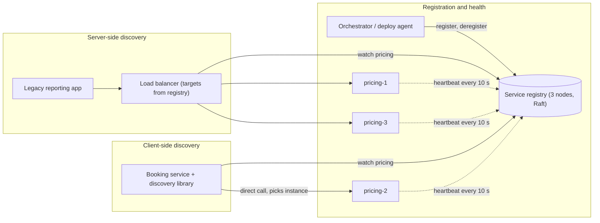
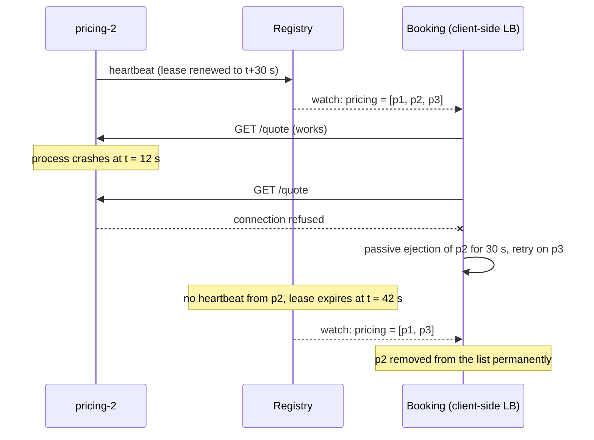

In a system with one server, "where is the orders service?" has a fixed answer you can put in `appsettings.json`. In a system that autoscales, deploys ten times a day and replaces failed machines automatically, the answer changes every few minutes. Service discovery is the machinery that keeps that answer current, and its failure modes (stale addresses, flapping health checks, a registry outage) are behind many confusing production incidents.

## Learning objectives

By the end of this lesson you will be able to:

1. Explain why static configuration breaks once instances are dynamic, with a concrete failure.
2. Describe DNS-based discovery, including TTLs, SRV records and the caching traps in clients such as .NET's `HttpClient`.
3. Explain how a service registry works: registration, leases, heartbeats and deregistration.
4. Compare client-side and server-side discovery and choose one for a given system.
5. Design health checks with thresholds that detect failure quickly without flapping, including a panic threshold.
6. Explain how Kubernetes Services, EndpointSlices, readiness probes and headless Services implement discovery.
7. Plan for discovery failures: registry outages, stale entries and graceful shutdown.

## Prerequisites

- [Gateways, reverse proxies and load balancers](#/lesson/m10-gateways-proxies-lb): server-side discovery is usually a load balancer that learns its targets dynamically.
- [DNS and traffic routing](#/lesson/m11-dns-routing): records, TTLs and resolvers.
- [Availability](#/lesson/m11-availability): detection time is a large part of MTTR.
- [Health checks and graceful shutdown](#/lesson/m03-health-shutdown): the ASP.NET Core side of liveness and readiness.

## Explain it like I'm a beginner

Imagine a big wedding hall in Jaipur with 30 caterers' stalls. Stalls open and close all evening: a stall runs out of food and shuts, a new one opens near the entrance. Guests want "the dosa stall", not "stall number 17", because the dosa stall might move.

So the organisers keep a **notice board** near the door: "Dosa: stalls 4 and 22. Chaat: stall 9." Each stall owner must walk to the board every 15 minutes and tick their name to say "still open". If someone has not ticked for 30 minutes, the organisers rub them off the board, because the stall has probably closed without telling anyone.

- The notice board is a **service registry**.
- Writing your stall on the board when you open is **registration**.
- Ticking every 15 minutes is a **heartbeat**, and "30 minutes without a tick means you are gone" is a **lease** (a registration that expires unless renewed).
- A guest reading the board and walking to a stall themselves is **client-side discovery**.
- A guest asking a volunteer at the door, "take me to dosa", who walks them there, is **server-side discovery**.
- The volunteer also tastes the food at each stall now and then, to make sure it is still being served: a **health check**.

There is also a lazier option: everybody knows the phone number "Dosa line", and whoever answers it tells you where to go. That is **DNS-based discovery**. It works well, but guests tend to remember the answer for a long time and keep walking to a stall that has closed. That is **DNS caching**, the most common trap in this lesson.

## First-principles explanation

### The problem in numbers

A ride-booking platform runs its pricing service on 12 instances during the day and 40 during the evening rush, scaling every few minutes. Deploys replace every instance roughly twice a day. Machines fail occasionally.

```text
Instance changes per day ≈ autoscaling (say 60 scale events × ~4 instances)
                         + deploys (2 × 40 instances)
                         + failures (a few)
                         ≈ 320 address changes a day, or one every ~4.5 minutes
```

If callers hold a static list of addresses, within minutes some of those addresses point to nothing (connection refused or timeouts) and new instances receive no traffic. With 1 dead instance out of 10 and plain round robin, **10 % of calls fail** until someone edits the configuration. Discovery exists to make that list correct automatically, within seconds.

### The three jobs of discovery

Every discovery system has to answer three questions:

1. **Registration**: how does the system learn that an instance exists, and its address and port?
2. **Health**: how does it learn that an instance is (still) able to serve?
3. **Lookup**: how does a caller get the current list, and how fresh is it?

The designs differ in who does each job.

### DNS-based discovery

The simplest approach uses DNS, which every client already speaks. The service name `pricing.internal` resolves to the current instances' IP addresses (several A or AAAA records). For services on non-standard ports, **SRV records** (RFC 2782) return host, port, priority and weight: `_grpc._tcp.pricing.internal`.

DNS is attractive: zero client libraries, works for every language, and every cloud and Kubernetes provides it. Its weaknesses all come from **caching**:

- **TTL staleness.** A record with a 30 s TTL can be served from caches for up to 30 s after it changed. Every cache layer (the resolver, the OS, the language runtime) can add its own delay.
- **Clients that cache longer than the TTL**, or forever. Some runtimes and libraries ignore TTLs.
- **Long-lived connections ignore DNS entirely.** .NET's `HttpClient` resolves the name when it *opens a connection*, and a pooled connection can live indefinitely. If you create one `HttpClient` (correctly, to avoid socket exhaustion) and never recycle connections, you keep talking to the old IPs after a change. The fix is `SocketsHttpHandler.PooledConnectionLifetime` (for example 2 minutes), or `IHttpClientFactory`, which rotates handlers.
- **No health information.** Plain DNS returns addresses, not "is it healthy?". Health-checked DNS (cloud DNS with health probes, Consul's DNS interface, Kubernetes' readiness-aware endpoints) fixes this partially.
- **Weak load balancing.** Clients usually take the first address returned; resolvers rotate the order, but balancing is coarse.

A short TTL (5–30 s) narrows staleness but increases resolver load. That load is usually trivial: 500 clients × 1 lookup per 10 s = 50 queries a second.

### Service registries

A **service registry** is a database of live instances, designed for this job. Examples: HashiCorp Consul, Netflix Eureka, Apache ZooKeeper, etcd (which underpins Kubernetes), and cloud-native registries.

**Registration** happens in one of two ways:

- **Self-registration**: the service registers itself on startup and deregisters on shutdown. Simple, but every service (in every language) needs the logic, and a crashed process cannot deregister.
- **Third-party registration**: a separate component (the platform, an agent, the orchestrator) watches deployments and registers instances. Kubernetes works this way: the control plane knows which pods exist and which are ready, so services contain no registry code.

**Leases and heartbeats** solve the crashed-process problem. A registration is valid for a time-to-live (say 30 s) and must be renewed by a heartbeat (say every 10 s). If three heartbeats in a row are missed, the lease expires and the instance disappears, even though it never said goodbye.

```text
Heartbeat load: 2,000 instances × 1 heartbeat per 10 s = 200 writes/s to the registry
Detection time for a crashed instance ≈ lease TTL = 30 s (worst case)
```

Shorter leases detect crashes faster but multiply heartbeat traffic, and they risk evicting healthy instances during a garbage-collection pause or a brief network blip.

**Lookup** from a registry is either polling ("give me pricing's instances" every few seconds) or **watching** (a long-poll or stream that pushes changes as they happen). Watches give sub-second freshness without heavy polling.

### Registry consistency: what happens during a partition

A registry is itself a distributed system, so it must choose between consistency and availability when the network splits ([CAP](#/lesson/m13-cap-pacelc)):

- **CP registries** (etcd, ZooKeeper, Consul's servers) use a consensus protocol such as [Raft](#/lesson/m13-consensus). They refuse writes without a majority. Data is never contradictory, but a partition can make the registry read-only or unavailable.
- **AP registries** (Eureka is the well-known example) keep accepting registrations and serving reads on each side of a partition. Data may be stale or inconsistent, but lookups keep working. Eureka also has a "self-preservation" mode: if too many heartbeats are missed at once, it assumes a network problem rather than mass death and stops evicting instances.

For discovery, a slightly stale list is usually much better than no list. That is why the most important client-side rule is: **if the registry is unreachable, keep using the last known list**. A registry outage should degrade freshness, not take down every caller.

### Client-side discovery

The **caller** queries the registry, keeps a local list of healthy instances, and chooses one per request with its own load-balancing algorithm.

- One fewer network hop: requests go straight from caller to instance.
- Smart balancing per request: least-requests, power of two choices, zone-aware routing ("prefer instances in my availability zone"), and it handles HTTP/2 and gRPC well because the client chooses per call.
- But every client needs discovery logic, and every language needs a library. Bugs in that library are spread across all callers. Clients also need credentials to read the registry.

In .NET, the `Microsoft.Extensions.ServiceDiscovery` library (used by Aspire, formerly .NET Aspire) does this: you call `http://pricing` and a delegating handler resolves the logical name, picks an endpoint (round robin by default), and rewrites the request. Out of the box it reads endpoints from configuration and otherwise passes the name through to DNS unchanged (which is what you want on Kubernetes, where `pricing` is already a Service name). The separate `Microsoft.Extensions.ServiceDiscovery.Dns` package adds DNS SRV lookups (`AddDnsSrvServiceEndpointProvider()`). Resolved endpoints are cached and refreshed in the background, so the library has the same staleness trade-off as any client-side cache.

```csharp
// Needs the Microsoft.Extensions.ServiceDiscovery package; shown as a snippet.
builder.Services.AddServiceDiscovery();
builder.Services.ConfigureHttpClientDefaults(http => http.AddServiceDiscovery());
builder.Services.AddHttpClient<PricingClient>(c => c.BaseAddress = new Uri("https+http://pricing"));
// "https+http://" means: prefer an https endpoint, fall back to http.
// In production, restrict to https so a misconfiguration cannot silently downgrade:
// builder.Services.Configure<ServiceDiscoveryOptions>(o => o.AllowedSchemes = ["https"]);
```

```json
{
  "Services": {
    "pricing": {
      "https": [ "10.0.4.11:8443", "10.0.4.12:8443" ]
    }
  }
}
```

gRPC uses the same pattern: gRPC clients support client-side load balancing over a resolved list (for example DNS or a headless Kubernetes Service), which avoids the per-connection pinning problem from [the previous lesson](#/lesson/m10-gateways-proxies-lb).

### Server-side discovery

The caller sends every request to a **stable address** (a load balancer, a router, a virtual IP). That component queries the registry and forwards to a healthy instance.

- Clients stay dumb: any language, any HTTP library, no registry credentials.
- Discovery logic lives in one place, maintained by the platform team.
- But it adds a hop (often small: sub-millisecond for kernel-level forwarding, a little more for a proxy), the router must be highly available and scaled, and balancing quality depends on the router (L4 routers balance per connection).

Cloud load balancers with auto-registered target groups, Kubernetes `ClusterIP` Services and service meshes (where a sidecar proxy next to each instance does the routing) are all server-side discovery from the application's point of view.

| | Client-side | Server-side |
|---|---|---|
| Extra hop | No | Yes (router or proxy) |
| Client complexity | High (library per language) | Low (one stable address) |
| Load-balancing control | Per caller, per request | Depends on the router |
| Works for gRPC/HTTP/2 | Well | Only with L7 routers |
| Failure blast radius | A library bug affects all callers | A router outage affects all callers |
| Typical examples | Eureka + client library, .NET service discovery, gRPC xDS | Kubernetes ClusterIP, cloud LBs, service mesh sidecars |

### Health checks that work

Discovery is only as good as its health information. Several design choices matter:

**Liveness versus readiness.** Liveness answers "is the process stuck?" and triggers a *restart*. Readiness answers "should I receive traffic now?" and controls *membership in the discovery list*. An instance that is starting up, warming caches, or temporarily cannot reach its database should be **not ready**, not dead. Never check dependencies in liveness, or a database blip restarts every instance ([availability lesson](#/lesson/m11-availability)).

**Active versus passive checks.** Active checks probe `/health/ready` on a schedule. Passive checks (outlier detection) watch real traffic: 5 consecutive connection failures or 502s from one instance eject it for 30 s. Use both: active checks find instances that receive no traffic; passive checks react within seconds to instances that fail under load.

**Thresholds and flapping.** Marking an instance unhealthy after one failed probe makes it flap in and out on every hiccup. Typical settings: probe every 5 s, unhealthy after 3 consecutive failures, healthy again after 2 consecutive passes.

```text
Detection time ≈ interval × unhealthy threshold = 5 s × 3 = 15 s
Requests sent to a dead instance meanwhile (1 of 10 instances, 2,000 RPS): 2,000 × 0.1 × 15 ≈ 3,000
```

That is why passive ejection and caller retries (on another instance, for idempotent requests) matter: they cover the detection window.

**Panic threshold.** If health checks say 80 % of instances are unhealthy, it is more likely that the *checks* are broken (a shared dependency is slow, the checker's network is partitioned) than that 80 % of servers died. Routing all traffic to the remaining 20 % would overload and kill them too. Proxies such as Envoy use a **panic threshold**: below, say, 50 % healthy, ignore health and spread across all instances. This is the same idea as Eureka's self-preservation.

**Graceful shutdown.** When an instance is stopping, the order matters:

1. Mark it not ready (or deregister) so discovery stops sending new requests.
2. Wait for the change to propagate to callers (for Kubernetes, a few seconds; a `preStop` sleep of 5–10 s is a common pattern).
3. Finish in-flight requests, then exit.

If the process exits first, every caller with a cached list sends requests into a closed port until the next refresh.

In ASP.NET Core, keep the whole sequence inside the platform's budget: Kubernetes sends `SIGTERM`, waits `terminationGracePeriodSeconds` (30 s by default), then kills the pod. The host's `HostOptions.ShutdownTimeout` (30 s by default) plus the `preStop` delay must fit inside that grace period, or in-flight requests are cut off anyway.

### Kubernetes: discovery built in

Kubernetes gives you third-party registration, health-aware membership and both kinds of discovery without application code ([Kubernetes fundamentals](#/lesson/m15-kubernetes)):

- A **Pod** is an instance with its own IP, which changes every time it is recreated.
- A **Service** selects pods by label (`app: pricing`) and gets a stable virtual IP (`ClusterIP`) and DNS name: `pricing.rides.svc.cluster.local`, or simply `pricing` from the same namespace.
- **EndpointSlices** list the IPs of the selected pods that are currently **ready**. The readiness probe decides membership: a pod failing readiness is removed from the slice and stops receiving traffic, without being restarted.
- **kube-proxy** (or an eBPF-based networking layer) programs each node so connections to the ClusterIP are spread across ready pod IPs. That is server-side discovery at L4: balancing is per connection.
- A **headless Service** (`clusterIP: None`) skips the virtual IP; DNS returns the ready pod IPs directly. Clients then do client-side balancing, which is the usual setup for gRPC.
- `NodePort`, `LoadBalancer` and Ingress / Gateway API resources expose Services outside the cluster.
- **Zone-aware routing** is available on the Service itself: `spec.trafficDistribution: PreferClose` asks the data plane to prefer endpoints in the caller's zone, which cuts cross-zone latency and data-transfer cost.
- **A DNS trap**: pods resolve names with `ndots:5` by default, so an external name such as `api.payments.example.com` is first tried against every cluster search domain. That multiplies DNS queries (and CoreDNS load) several times. Use fully qualified names with a trailing dot for external hosts, or lower `ndots` in the pod's `dnsConfig`.

```yaml
apiVersion: v1
kind: Service
metadata:
  name: pricing
  namespace: rides
spec:
  selector:
    app: pricing
  ports:
    - name: http
      port: 80
      targetPort: 8080
---
# In the Deployment's pod template:
readinessProbe:
  httpGet: { path: /health/ready, port: 8080 }
  periodSeconds: 5
  failureThreshold: 3
livenessProbe:
  httpGet: { path: /health/live, port: 8080 }
  periodSeconds: 10
  failureThreshold: 3
lifecycle:
  preStop:
    exec: { command: ["sleep", "5"] }
    # Chiseled/distroless .NET images have no shell or sleep binary. On recent
    # Kubernetes versions use the built-in action instead:  preStop: { sleep: { seconds: 5 } }
```

### Failure modes and what to do about them

| Failure | Symptom | Mitigation |
|---|---|---|
| Stale entry (instance died, still listed) | Connection refused or timeouts to one address | Leases, passive ejection, retries on another instance |
| Zombie instance (process alive, broken, heartbeating) | Errors from a "healthy" instance | Readiness checks that exercise real dependencies; passive outlier detection |
| Registry outage | Lookups fail | Clients keep the last-known list; registry runs as a 3- or 5-node cluster across zones |
| DNS cached too long | Traffic to old IPs after deploy | Short TTLs, `PooledConnectionLifetime`, `IHttpClientFactory` |
| Health-check storm | Every instance probed by every caller | Centralise probing (platform or registry), or use passive checks in callers |
| Mass eviction during a network blip | Most instances disappear at once | Panic threshold or self-preservation; longer leases |
| Exit before deregistration | Errors during every deploy | Not-ready first, wait, drain, then exit |

### When a simpler design is enough

- **A handful of VMs that rarely change**: a load balancer with a fixed backend pool and health checks is discovery enough. Add a registry when instances become dynamic.
- **Everything on Kubernetes**: use Services and DNS. Do not add Consul or Eureka on top unless you need cross-cluster or VM-plus-container discovery.
- **Managed PaaS** (App Service, Container Apps): the platform gives each app a stable host name and load-balances internally. Discovery is the platform's job.
- **A modular monolith**: in-process calls need no discovery at all.

## Visual explanation

### Architecture: registry, client-side and server-side paths



On the left, the **orchestrator** registers each new pricing instance (third-party registration), and each instance also **heartbeats** so its lease stays alive; a crashed instance stops heartbeating and drops out after the lease expires. The registry is a three-node consensus cluster, so it survives one node's failure. In the middle, the **booking service** uses a discovery library: it *watches* the registry for changes, keeps the healthy list in memory, and calls an instance **directly**, choosing per request. On the right, a **legacy reporting app** knows only one stable address, the **load balancer**, which watches the same registry and forwards to healthy instances. Both paths see the same truth; they differ in who chooses the instance and whether there is an extra hop.

### Sequence: an instance crashes and is removed



pricing-2 heartbeats normally, and the client's watch delivers the full list of three instances. When pricing-2 crashes at 12 s, the registry does not know yet: the lease is valid until 42 s. The client finds out first, from real traffic: a refused connection. Its **passive health check** ejects pricing-2 locally for 30 s and **retries the idempotent quote request on pricing-3**, so the user sees nothing. At 42 s the lease expires, the registry removes the instance and pushes the new list to every watcher. The lesson in this diagram: registry leases bound how long a dead instance can stay listed, but passive checks and retries are what protect users inside that window.

## Step-by-step example

**Scenario.** YatraGo, a fictional intercity bus-booking platform, runs eight services on VMs today with addresses in configuration files. It is moving to Kubernetes over six months, so for a while some services run in the cluster and some on VMs. The seat-map service is gRPC.

### Step 1 — Measure the pain

Last quarter: three incidents where a replaced VM's new IP was not added to callers' configs (traffic to dead addresses for 20–40 minutes each), and deploys that took an hour because ops edited configs by hand.

### Step 2 — Inside the cluster: use what Kubernetes gives you

- HTTP services: ordinary `ClusterIP` Services; callers use `http://booking.yatra.svc.cluster.local` (or `http://booking`).
- Seat-map (gRPC): a **headless Service**, and gRPC client-side load balancing (`round_robin`) over the DNS results, so calls spread across pods instead of sticking to one connection.
- Readiness probes on `/health/ready` every 5 s, failure threshold 3. Liveness on `/health/live` only.
- `preStop: sleep 5` and a 30 s termination grace period so pods leave the EndpointSlice before they stop accepting connections.

### Step 3 — Bridge the VMs

During migration, cluster services must call VM services and vice versa.

- VM services are registered in the cluster as Services *without selectors* plus manually managed EndpointSlices, maintained by a small sync job that reads the VM inventory and health. Callers inside the cluster use the same DNS style for both.
- VM-based callers reach cluster services through an internal L7 load balancer in front of the cluster's ingress.

### Step 4 — Fix the client side

Audit every `HttpClient`: register them through `IHttpClientFactory` or set `PooledConnectionLifetime = 2 min`, so DNS changes are picked up within minutes rather than never.

### Step 5 — Check the numbers

```text
Readiness detection: 5 s × 3 = 15 s worst case before a broken pod leaves the Service
Booking peak: 3,000 RPS across 15 pods; one pod broken → 3,000 / 15 × 15 s ≈ 3,000 requests at risk
Mitigation: one retry on a different pod for idempotent GETs; passive outlier detection in the mesh later
```

### Step 6 — Plan for discovery failure

CoreDNS (the cluster DNS) runs with at least two replicas and node-local DNS caching, because if cluster DNS is down, *every* new connection fails. The VM sync job alerts if it has not run for 5 minutes, and never deletes all endpoints for a service at once (a guard against an empty inventory response wiping the list).

## Production-style C# implementation

The compiled code builds a small, self-contained version of the moving parts so you can see them work: an in-memory registry with leases, a self-registration hosted service that heartbeats and deregisters on shutdown, and a client-side resolver plus `DelegatingHandler` that turns `http://pricing/...` into a real instance address, with last-known-good fallback and passive ejection. In production you would use Kubernetes Services or a registry such as Consul, and `Microsoft.Extensions.ServiceDiscovery` on the client.

```text
Discovery.Demo/
  Program.cs
  Registry/ServiceRegistry.cs
  Registry/SelfRegistrationService.cs
  Client/ServiceEndpointResolver.cs
  Client/DiscoveryHandler.cs
```

```csharp file=Registry/ServiceRegistry.cs
using System.Collections.Concurrent;

namespace Discovery.Registry;

public sealed record ServiceInstance(string Service, string InstanceId, Uri Address, string Zone);

public interface IServiceRegistry
{
    void Register(ServiceInstance instance, TimeSpan leaseTtl);
    bool Heartbeat(string service, string instanceId);
    void Deregister(string service, string instanceId);
    IReadOnlyList<ServiceInstance> GetHealthy(string service);
}

/// <summary>Lease-based registry: an instance is listed only while its lease is unexpired.
/// Production: Consul, etcd or the Kubernetes API, replicated with consensus.</summary>
public sealed class InMemoryServiceRegistry(TimeProvider clock) : IServiceRegistry
{
    private sealed record Lease(ServiceInstance Instance, TimeSpan Ttl, DateTimeOffset ExpiresAt);

    private readonly ConcurrentDictionary<(string Service, string Id), Lease> _leases = new();

    public void Register(ServiceInstance instance, TimeSpan leaseTtl)
    {
        if (leaseTtl <= TimeSpan.Zero) throw new ArgumentOutOfRangeException(nameof(leaseTtl));
        _leases[(instance.Service, instance.InstanceId)] = new Lease(instance, leaseTtl, clock.GetUtcNow() + leaseTtl);
    }

    public bool Heartbeat(string service, string instanceId)
    {
        while (_leases.TryGetValue((service, instanceId), out var lease))
        {
            if (lease.ExpiresAt <= clock.GetUtcNow()) return false;   // too late: must re-register
            var renewed = lease with { ExpiresAt = clock.GetUtcNow() + lease.Ttl };
            if (_leases.TryUpdate((service, instanceId), renewed, lease)) return true;
        }
        return false;
    }

    public void Deregister(string service, string instanceId) => _leases.TryRemove((service, instanceId), out _);

    public IReadOnlyList<ServiceInstance> GetHealthy(string service)
    {
        var now = clock.GetUtcNow();
        return _leases.Values
            .Where(l => l.Instance.Service == service && l.ExpiresAt > now)
            .Select(l => l.Instance)
            .OrderBy(i => i.InstanceId, StringComparer.Ordinal)
            .ToList();
    }
}
```

A heartbeat that arrives after expiry returns `false` rather than silently reviving the lease. The instance must re-register, which forces it to re-check that it is actually ready.

```csharp file=Registry/SelfRegistrationService.cs
using Microsoft.Extensions.Hosting;
using Microsoft.Extensions.Logging;
using Microsoft.Extensions.Options;

namespace Discovery.Registry;

public sealed class SelfRegistrationOptions
{
    public string Service { get; set; } = "pricing";
    public string InstanceId { get; set; } = Environment.MachineName;
    public Uri Address { get; set; } = new("http://localhost:5100/");
    public string Zone { get; set; } = "zone-a";
    public TimeSpan LeaseTtl { get; set; } = TimeSpan.FromSeconds(30);
    public TimeSpan HeartbeatInterval { get; set; } = TimeSpan.FromSeconds(10);
    public TimeSpan DrainDelay { get; set; } = TimeSpan.FromSeconds(5);
}

/// <summary>Registers on start, heartbeats every interval, and on shutdown deregisters FIRST,
/// waits for callers to notice, and only then lets the host stop accepting requests.</summary>
public sealed class SelfRegistrationService(IServiceRegistry registry, IOptions<SelfRegistrationOptions> options,
    TimeProvider clock, ILogger<SelfRegistrationService> log) : BackgroundService
{
    private readonly SelfRegistrationOptions _o = options.Value;

    private ServiceInstance Me => new(_o.Service, _o.InstanceId, _o.Address, _o.Zone);

    protected override async Task ExecuteAsync(CancellationToken stoppingToken)
    {
        registry.Register(Me, _o.LeaseTtl);
        log.LogInformation("Registered {Service}/{Instance} at {Address}", _o.Service, _o.InstanceId, _o.Address);

        using var timer = new PeriodicTimer(_o.HeartbeatInterval, clock);
        try
        {
            while (await timer.WaitForNextTickAsync(stoppingToken))
            {
                if (!registry.Heartbeat(_o.Service, _o.InstanceId))
                {
                    log.LogWarning("Lease lost for {Instance}; re-registering", _o.InstanceId);
                    registry.Register(Me, _o.LeaseTtl);
                }
            }
        }
        catch (OperationCanceledException) when (stoppingToken.IsCancellationRequested) { }
    }

    public override async Task StopAsync(CancellationToken cancellationToken)
    {
        registry.Deregister(_o.Service, _o.InstanceId);
        log.LogInformation("Deregistered {Instance}; draining for {Delay}", _o.InstanceId, _o.DrainDelay);
        try { await Task.Delay(_o.DrainDelay, clock, cancellationToken); }
        catch (OperationCanceledException) { }
        await base.StopAsync(cancellationToken);
    }
}
```

```csharp file=Client/ServiceEndpointResolver.cs
using System.Collections.Concurrent;
using Discovery.Registry;
using Microsoft.Extensions.Logging;

namespace Discovery.Client;

/// <summary>Client-side discovery: caches each service's instance list, refreshes it periodically,
/// keeps the last-known-good list if the registry fails, and skips instances ejected after errors.</summary>
public sealed class ServiceEndpointResolver(IServiceRegistry registry, TimeProvider clock, ILogger<ServiceEndpointResolver> log)
{
    private sealed record Snapshot(IReadOnlyList<ServiceInstance> Instances, DateTimeOffset FetchedAt);

    public TimeSpan RefreshInterval { get; init; } = TimeSpan.FromSeconds(5);
    public TimeSpan EjectionTime { get; init; } = TimeSpan.FromSeconds(30);

    private readonly ConcurrentDictionary<string, Snapshot> _cache = new();
    private readonly ConcurrentDictionary<string, DateTimeOffset> _ejectedUntil = new();
    private int _counter;

    public ServiceInstance? Pick(string service)
    {
        var instances = Current(service);
        var now = clock.GetUtcNow();
        var usable = instances.Where(i => !_ejectedUntil.TryGetValue(i.InstanceId, out var until) || until <= now).ToList();
        if (usable.Count == 0) usable = instances.ToList();   // panic mode: everything ejected, try them all
        if (usable.Count == 0) return null;
        int n = Interlocked.Increment(ref _counter) & int.MaxValue;
        return usable[n % usable.Count];
    }

    public void ReportFailure(ServiceInstance instance) =>
        _ejectedUntil[instance.InstanceId] = clock.GetUtcNow() + EjectionTime;

    private IReadOnlyList<ServiceInstance> Current(string service)
    {
        var now = clock.GetUtcNow();
        if (_cache.TryGetValue(service, out var snap) && now - snap.FetchedAt < RefreshInterval)
            return snap.Instances;
        try
        {
            var fresh = registry.GetHealthy(service);
            // Guard: an empty answer when we had instances is suspicious. Keep the old list.
            if (fresh.Count == 0 && snap is { Instances.Count: > 0 })
            {
                log.LogWarning("Registry returned no instances for {Service}; keeping last known list", service);
                _cache[service] = snap with { FetchedAt = now };
                return snap.Instances;
            }
            _cache[service] = new Snapshot(fresh, now);
            return fresh;
        }
        catch (Exception ex) when (snap is not null)
        {
            log.LogWarning(ex, "Registry unavailable; using last known list for {Service}", service);
            return snap.Instances;
        }
    }
}
```

Three defensive choices are deliberate: **last-known-good** when the registry throws, **refusing an empty list** that replaces a non-empty one (a common way a bad deploy of the registry wipes out traffic), and **panic mode** when every instance is ejected.

```csharp file=Client/DiscoveryHandler.cs
namespace Discovery.Client;

/// <summary>Rewrites http://{service-name}/path to a concrete instance, and reports connection
/// failures so the resolver ejects that instance. Similar in spirit to Microsoft.Extensions.ServiceDiscovery.</summary>
public sealed class DiscoveryHandler(ServiceEndpointResolver resolver) : DelegatingHandler
{
    protected override async Task<HttpResponseMessage> SendAsync(HttpRequestMessage request, CancellationToken ct)
    {
        Uri original = request.RequestUri ?? throw new InvalidOperationException("Request has no URI.");
        var instance = resolver.Pick(original.Host)
            ?? throw new HttpRequestException($"No instances available for service '{original.Host}'.");

        request.RequestUri = new Uri(instance.Address, original.PathAndQuery);
        try
        {
            var response = await base.SendAsync(request, ct);
            if ((int)response.StatusCode is 502 or 503) resolver.ReportFailure(instance);
            return response;
        }
        catch (HttpRequestException)
        {
            resolver.ReportFailure(instance);   // passive health check
            throw;
        }
        finally
        {
            request.RequestUri = original;      // keep the logical name for logging and retries
        }
    }
}
```

```csharp file=Program.cs
using Discovery.Client;
using Discovery.Registry;
using Microsoft.AspNetCore.Diagnostics.HealthChecks;

var builder = WebApplication.CreateBuilder(args);

builder.Services.AddSingleton(TimeProvider.System);
builder.Services.AddSingleton<IServiceRegistry, InMemoryServiceRegistry>();
builder.Services.Configure<SelfRegistrationOptions>(builder.Configuration.GetSection("Discovery:Self"));
builder.Services.AddHostedService<SelfRegistrationService>();

builder.Services.AddSingleton<ServiceEndpointResolver>();
builder.Services.AddTransient<DiscoveryHandler>();
builder.Services.AddHttpClient("pricing", c => c.BaseAddress = new Uri("http://pricing/"))
    .AddHttpMessageHandler<DiscoveryHandler>()
    .ConfigurePrimaryHttpMessageHandler(() => new SocketsHttpHandler
    {
        PooledConnectionLifetime = TimeSpan.FromMinutes(2)   // never pin to stale addresses forever
    });

builder.Services.AddHealthChecks();

var app = builder.Build();

// Liveness runs no checks: it only proves the process can answer. Readiness runs every
// registered check (add dependency checks here) and controls membership in discovery.
app.MapHealthChecks("/health/live", new HealthCheckOptions { Predicate = _ => false });
app.MapHealthChecks("/health/ready");

// A tiny registry API, standing in for Consul's or the Kubernetes API.
app.MapPut("/registry/{service}/{instanceId}", (string service, string instanceId, RegisterRequest req, IServiceRegistry registry) =>
{
    registry.Register(new ServiceInstance(service, instanceId, req.Address, req.Zone), TimeSpan.FromSeconds(req.TtlSeconds));
    return Results.NoContent();
});
app.MapPut("/registry/{service}/{instanceId}/heartbeat", (string service, string instanceId, IServiceRegistry registry) =>
    registry.Heartbeat(service, instanceId) ? Results.NoContent() : Results.NotFound());
app.MapDelete("/registry/{service}/{instanceId}", (string service, string instanceId, IServiceRegistry registry) =>
{
    registry.Deregister(service, instanceId);
    return Results.NoContent();
});
app.MapGet("/registry/{service}", (string service, IServiceRegistry registry) => registry.GetHealthy(service));

// A caller using client-side discovery: the URL holds a logical name, not an address.
app.MapGet("/quote/{route}", async (string route, IHttpClientFactory factory, CancellationToken ct) =>
{
    var client = factory.CreateClient("pricing");
    try { return Results.Text(await client.GetStringAsync($"/quote/{route}", ct)); }
    catch (HttpRequestException ex) { return Results.Problem(ex.Message, statusCode: StatusCodes.Status503ServiceUnavailable); }
});

app.Run();

public sealed record RegisterRequest(Uri Address, string Zone, int TtlSeconds);
```

The pooled-connection lifetime is the single most valuable line for teams using DNS-based discovery in .NET: without it, a long-lived `HttpClient` can keep using a decommissioned IP indefinitely.

## Bad design vs good design

**Bad: addresses in configuration, health in nobody's hands.**

```json
{
  "Pricing": { "Urls": [ "http://10.0.4.11:8080", "http://10.0.4.12:8080", "http://10.0.4.13:8080" ] }
}
```

```csharp
var url = _urls[Random.Shared.Next(_urls.Length)];   // no health, no ejection, no refresh
var quote = await _http.GetStringAsync(url + "/quote/" + route);
```

What goes wrong:

- A VM is replaced and gets `10.0.4.21`. One third of calls go to a dead address until someone edits and redeploys every caller.
- Autoscaling adds instances that receive no traffic.
- There is no retry on another instance, so each dead address is a user-visible error.

**Bad, more subtle: a registry with no defences.** A client that replaces its list with whatever the registry returns, including an empty list during a registry deploy, and that fails every request when the registry is unreachable. The registry has become a single point of failure for the entire platform.

**Good:**

- Instances registered automatically (by the platform where possible), with leases.
- Readiness-based membership, separate liveness, thresholds of 3 failures / 2 passes.
- Callers refresh or watch, keep last-known-good, reject suspicious empty lists, eject failing instances passively, and retry idempotent calls once on another instance.
- Graceful shutdown: not-ready, drain delay, then stop.
- On Kubernetes: just use Services, readiness probes and `preStop`, and headless Services for gRPC.

:::callout type=mistake title="A readiness check that checks everything"
A readiness endpoint that calls the database, Redis, three downstream services and a payment provider will fail whenever *any* of them blips, and then every instance goes not-ready together. Check only what this instance needs to serve most requests, keep timeouts short, and rely on circuit breakers for optional dependencies.
:::

:::callout type=tradeoff title="Service mesh: discovery as infrastructure"
A service mesh puts a proxy next to every instance. You get client-side-quality balancing, outlier detection, retries and mTLS without any library in your code, which is attractive with many languages. You pay in operational complexity, memory per pod, an extra hop on each side, and a control plane that is now critical infrastructure. Adopt one when the cross-cutting needs are real across many services, not as a first step.
:::

## Practical playground

The starter graph is YatraGo before discovery: callers with hard-coded addresses to a VM-based pricing service. Open it in the HLD canvas and redesign it: add a `service-registry` node, decide which callers use client-side discovery and which go through a load balancer, give the pricing tier multiple instances across zones, and add monitoring for registry health. For each new edge, note whether it carries requests, registrations or health checks.

:::playground type=hld title="Add service discovery to YatraGo"
```json
{
  "nodes": [
    { "id": "app", "type": "client", "label": "Mobile app", "props": { "rps": 3000 } },
    { "id": "lb", "type": "load-balancer", "label": "Public load balancer" },
    { "id": "booking", "type": "app-server", "label": "Booking service", "props": { "instances": 4 } },
    { "id": "report", "type": "app-server", "label": "Legacy reporting app", "props": { "instances": 1 } },
    { "id": "pricing", "type": "app-server", "label": "Pricing (static IPs in config)", "props": { "instances": 3, "multiAz": false } },
    { "id": "db", "type": "database", "label": "PostgreSQL" }
  ],
  "edges": [
    { "from": "app", "to": "lb", "kind": "sync" },
    { "from": "lb", "to": "booking", "kind": "sync" },
    { "from": "booking", "to": "pricing", "kind": "sync", "label": "hard-coded IP list" },
    { "from": "report", "to": "pricing", "kind": "sync", "label": "hard-coded IP" },
    { "from": "booking", "to": "db", "kind": "sync" }
  ]
}
```
:::

## Exercises

:::exercise id=m10-service-discovery-ex1 difficulty=beginner kind=code title="A lease-based service registry"
Build the heart of a registry: registrations that expire unless renewed.
::requirements
- `LeaseRegistry` with `Register(string service, string instanceId, string address, TimeSpan ttl, DateTimeOffset now)`.
- `bool Heartbeat(string service, string instanceId, DateTimeOffset now)`: renews the lease to `now + ttl` and returns `true`; returns `false` if the instance is unknown or its lease has already expired.
- `void Deregister(string service, string instanceId)`.
- `IReadOnlyList<string> Healthy(string service, DateTimeOffset now)`: addresses with unexpired leases, sorted.
- A lease is expired when `now >= expiresAt`.
::acceptance
- An instance registered with a 30 s TTL is listed at +29 s and not at +30 s.
- Heartbeats every 10 s keep an instance listed for 5 minutes.
- A heartbeat after expiry returns false and does not bring the instance back.
- Deregistered instances disappear immediately.
- Instances of different services do not mix.
::hint
Store, per (service, instance), the address, the TTL and the expiry time.
::hint
A `Dictionary<(string, string), Lease>` with a small `record Lease(string Address, TimeSpan Ttl, DateTimeOffset ExpiresAt)` keeps it tidy.
::hint
`Healthy` filters by service and `ExpiresAt > now`, then sorts the addresses.
::hint
In `Heartbeat`, check expiry before renewing: `if (lease.ExpiresAt <= now) return false;`.
::starter
```csharp file=LeaseRegistry.cs
using System;
using System.Collections.Generic;
using System.Linq;

public sealed class LeaseRegistry
{
    public void Register(string service, string instanceId, string address, TimeSpan ttl, DateTimeOffset now) =>
        throw new NotImplementedException();

    public bool Heartbeat(string service, string instanceId, DateTimeOffset now) => throw new NotImplementedException();

    public void Deregister(string service, string instanceId) => throw new NotImplementedException();

    public IReadOnlyList<string> Healthy(string service, DateTimeOffset now) => throw new NotImplementedException();
}
```
::tests
```csharp file=LeaseRegistryTests.cs
using System;
using Xunit;

public class LeaseRegistryTests
{
    private static readonly DateTimeOffset T0 = new(2026, 10, 19, 8, 0, 0, TimeSpan.Zero);
    private static readonly TimeSpan Ttl = TimeSpan.FromSeconds(30);

    [Fact]
    public void Expires_after_ttl()
    {
        var r = new LeaseRegistry();
        r.Register("pricing", "p1", "10.0.4.11:8080", Ttl, T0);
        Assert.Single(r.Healthy("pricing", T0.AddSeconds(29)));
        Assert.Empty(r.Healthy("pricing", T0.AddSeconds(30)));
    }

    [Fact]
    public void Heartbeats_keep_it_alive()
    {
        var r = new LeaseRegistry();
        r.Register("pricing", "p1", "10.0.4.11:8080", Ttl, T0);
        for (int s = 10; s <= 300; s += 10) Assert.True(r.Heartbeat("pricing", "p1", T0.AddSeconds(s)));
        Assert.Single(r.Healthy("pricing", T0.AddSeconds(320)));
    }

    [Fact]
    public void Late_heartbeat_does_not_revive()
    {
        var r = new LeaseRegistry();
        r.Register("pricing", "p1", "10.0.4.11:8080", Ttl, T0);
        Assert.False(r.Heartbeat("pricing", "p1", T0.AddSeconds(31)));
        Assert.Empty(r.Healthy("pricing", T0.AddSeconds(32)));
    }

    [Fact]
    public void Deregister_removes_immediately()
    {
        var r = new LeaseRegistry();
        r.Register("pricing", "p1", "10.0.4.11:8080", Ttl, T0);
        r.Deregister("pricing", "p1");
        Assert.Empty(r.Healthy("pricing", T0));
    }

    [Fact]
    public void Services_are_separate_and_sorted()
    {
        var r = new LeaseRegistry();
        r.Register("pricing", "p2", "10.0.4.12:8080", Ttl, T0);
        r.Register("pricing", "p1", "10.0.4.11:8080", Ttl, T0);
        r.Register("booking", "b1", "10.0.5.11:8080", Ttl, T0);
        Assert.Equal(new[] { "10.0.4.11:8080", "10.0.4.12:8080" }, r.Healthy("pricing", T0));
        Assert.False(r.Heartbeat("pricing", "b1", T0));
    }
}
```
::solution
```csharp file=LeaseRegistry.cs
using System;
using System.Collections.Generic;
using System.Linq;

public sealed class LeaseRegistry
{
    private sealed record Lease(string Address, TimeSpan Ttl, DateTimeOffset ExpiresAt);

    private readonly Dictionary<(string Service, string Id), Lease> _leases = new();
    private readonly object _gate = new();

    public void Register(string service, string instanceId, string address, TimeSpan ttl, DateTimeOffset now)
    {
        if (ttl <= TimeSpan.Zero) throw new ArgumentOutOfRangeException(nameof(ttl));
        lock (_gate) _leases[(service, instanceId)] = new Lease(address, ttl, now + ttl);
    }

    public bool Heartbeat(string service, string instanceId, DateTimeOffset now)
    {
        lock (_gate)
        {
            if (!_leases.TryGetValue((service, instanceId), out var lease)) return false;
            if (lease.ExpiresAt <= now)
            {
                _leases.Remove((service, instanceId));   // expired: clean up, require re-registration
                return false;
            }
            _leases[(service, instanceId)] = lease with { ExpiresAt = now + lease.Ttl };
            return true;
        }
    }

    public void Deregister(string service, string instanceId)
    {
        lock (_gate) _leases.Remove((service, instanceId));
    }

    public IReadOnlyList<string> Healthy(string service, DateTimeOffset now)
    {
        lock (_gate)
            return _leases.Where(kv => kv.Key.Service == service && kv.Value.ExpiresAt > now)
                          .Select(kv => kv.Value.Address)
                          .OrderBy(a => a, StringComparer.Ordinal)
                          .ToList();
    }
}
```

The TTL-to-heartbeat ratio matters: with a 30 s TTL and 10 s heartbeats, an instance survives two lost heartbeats (a GC pause, a dropped packet) but a crash is detected within 30 s.
::mistakes
- Letting a late heartbeat silently renew an expired lease, which hides an instance that was frozen long enough to be considered dead.
- Using `>` instead of `>=` for expiry and getting off-by-one behaviour at the boundary.
- Never removing expired leases, so the dictionary grows with every deploy.
::extensions
Add `Watch(string service)` returning an `IAsyncEnumerable<IReadOnlyList<string>>` that yields a new list whenever membership changes.
:::

:::exercise id=m10-service-discovery-ex2 difficulty=beginner kind=code title="A DNS cache that respects TTL and survives resolver outages"
Clients cache DNS answers. Build a cache that refreshes on TTL, and serves a stale answer for a limited time if the resolver fails (stale-if-error).
::requirements
- `DnsCache(Func<string, DnsAnswer> resolver, TimeSpan maxStale)`.
- `DnsAnswer(string[] Addresses, TimeSpan Ttl)`.
- `string[] Resolve(string name, DateTimeOffset now)`:
  - If a cached answer is younger than its TTL, return it without calling the resolver.
  - Otherwise call the resolver, cache the result with `now`, and return it.
  - If the resolver throws and a cached answer exists that expired less than `maxStale` ago, return the cached answer.
  - Otherwise rethrow.
- Expose `int ResolverCalls` for testing.
::acceptance
- Two lookups within the TTL call the resolver once.
- A lookup after the TTL calls it again and returns the new addresses.
- With the resolver down, a lookup 20 s after expiry (max stale 60 s) returns the old addresses.
- With the resolver down, a lookup 90 s after expiry throws.
::hint
Store the answer and the time you fetched it. "Fresh" means `now − fetchedAt < ttl`.
::hint
Wrap the resolver call in `try/catch`; decide inside the `catch` whether a stale answer is allowed.
::hint
"Expired for" is `now − (fetchedAt + ttl)`. Compare that with `maxStale`.
::hint
Use `throw;` (not `throw ex;`) to rethrow and keep the original stack trace.
::starter
```csharp file=DnsCache.cs
using System;
using System.Collections.Generic;

public sealed record DnsAnswer(string[] Addresses, TimeSpan Ttl);

public sealed class DnsCache(Func<string, DnsAnswer> resolver, TimeSpan maxStale)
{
    public int ResolverCalls { get; private set; }

    public string[] Resolve(string name, DateTimeOffset now) => throw new NotImplementedException();
}
```
::tests
```csharp file=DnsCacheTests.cs
using System;
using Xunit;

public class DnsCacheTests
{
    private static readonly DateTimeOffset T0 = new(2026, 10, 19, 8, 0, 0, TimeSpan.Zero);

    [Fact]
    public void Caches_within_ttl()
    {
        var cache = new DnsCache(_ => new DnsAnswer(new[] { "10.0.4.11" }, TimeSpan.FromSeconds(30)), TimeSpan.FromSeconds(60));
        cache.Resolve("pricing", T0);
        cache.Resolve("pricing", T0.AddSeconds(29));
        Assert.Equal(1, cache.ResolverCalls);
    }

    [Fact]
    public void Refreshes_after_ttl()
    {
        int n = 0;
        var cache = new DnsCache(_ => new DnsAnswer(new[] { n++ == 0 ? "10.0.4.11" : "10.0.4.21" }, TimeSpan.FromSeconds(30)), TimeSpan.FromSeconds(60));
        Assert.Equal("10.0.4.11", cache.Resolve("pricing", T0)[0]);
        Assert.Equal("10.0.4.21", cache.Resolve("pricing", T0.AddSeconds(31))[0]);
        Assert.Equal(2, cache.ResolverCalls);
    }

    [Fact]
    public void Serves_stale_when_resolver_is_down()
    {
        bool down = false;
        var cache = new DnsCache(_ => down ? throw new TimeoutException("resolver down") : new DnsAnswer(new[] { "10.0.4.11" }, TimeSpan.FromSeconds(30)),
            TimeSpan.FromSeconds(60));
        cache.Resolve("pricing", T0);
        down = true;
        Assert.Equal("10.0.4.11", cache.Resolve("pricing", T0.AddSeconds(50))[0]);   // expired 20 s ago
    }

    [Fact]
    public void Too_stale_rethrows()
    {
        bool down = false;
        var cache = new DnsCache(_ => down ? throw new TimeoutException("resolver down") : new DnsAnswer(new[] { "10.0.4.11" }, TimeSpan.FromSeconds(30)),
            TimeSpan.FromSeconds(60));
        cache.Resolve("pricing", T0);
        down = true;
        Assert.Throws<TimeoutException>(() => cache.Resolve("pricing", T0.AddSeconds(120)));   // expired 90 s ago
    }

    [Fact]
    public void No_cache_and_resolver_down_throws()
    {
        var cache = new DnsCache(_ => throw new TimeoutException("down"), TimeSpan.FromSeconds(60));
        Assert.Throws<TimeoutException>(() => cache.Resolve("pricing", T0));
    }
}
```
::solution
```csharp file=DnsCache.cs
using System;
using System.Collections.Generic;

public sealed record DnsAnswer(string[] Addresses, TimeSpan Ttl);

public sealed class DnsCache(Func<string, DnsAnswer> resolver, TimeSpan maxStale)
{
    private sealed record Entry(DnsAnswer Answer, DateTimeOffset FetchedAt);
    private readonly Dictionary<string, Entry> _entries = new(StringComparer.OrdinalIgnoreCase);

    public int ResolverCalls { get; private set; }

    public string[] Resolve(string name, DateTimeOffset now)
    {
        if (_entries.TryGetValue(name, out var entry) && now - entry.FetchedAt < entry.Answer.Ttl)
            return entry.Answer.Addresses;

        try
        {
            ResolverCalls++;
            var answer = resolver(name);
            _entries[name] = new Entry(answer, now);
            return answer.Addresses;
        }
        catch when (entry is not null && now - (entry.FetchedAt + entry.Answer.Ttl) < maxStale)
        {
            return entry.Answer.Addresses;
        }
    }
}
```

The exception filter (`catch when`) only catches when serving stale is allowed; otherwise the original exception propagates untouched. "Serve stale on error" is standardised for DNS resolvers (RFC 8767) for exactly this reason: a brief resolver outage should not make every lookup fail.
::mistakes
- Caching forever ("DNS never changes"), which is how clients end up talking to decommissioned servers.
- Serving stale data without any limit, hiding a resolver that has been broken for days.
- Treating an empty address list as a valid answer to cache for a full TTL; consider a shorter negative-cache TTL.
::extensions
Add a background refresh that resolves shortly *before* expiry (prefetch), so callers never wait on the resolver for popular names.
:::

:::exercise id=m10-service-discovery-ex3 difficulty=intermediate kind=code title="Client-side resolver with refresh, last-known-good and ejection"
Implement the caller-side component that picks an instance per request.
::requirements
- `InstancePicker(Func<IReadOnlyList<string>> fetch, TimeSpan refreshInterval, TimeSpan ejectionTime)`.
- `string? Pick(DateTimeOffset now)` returns the next instance in round-robin order among usable instances.
- Refresh by calling `fetch` when the cached list is older than `refreshInterval` (or there is none).
- If `fetch` throws, keep the previous list. If `fetch` returns an empty list while the previous list was non-empty, keep the previous list.
- `void ReportFailure(string instance, DateTimeOffset now)` ejects the instance until `now + ejectionTime`.
- If every instance is ejected, ignore ejections (panic mode) and round-robin over all.
- Returns `null` only if there has never been any instance.
::acceptance
- Round robin over three instances returns each once in three picks.
- An ejected instance is skipped until the ejection time passes.
- A failing `fetch` keeps the old list; an empty `fetch` result does not wipe a non-empty list.
- With every instance ejected, `Pick` still returns instances.
::hint
Keep three pieces of state: the current list, when it was fetched, and a dictionary of ejected-until times.
::hint
Do the refresh first, then filter out ejected instances, then round-robin over what is left.
::hint
For round robin, keep an integer counter and use `counter++ % usable.Count`.
::hint
For panic mode: `if (usable.Count == 0) usable = list;`.
::starter
```csharp file=InstancePicker.cs
using System;
using System.Collections.Generic;
using System.Linq;

public sealed class InstancePicker(Func<IReadOnlyList<string>> fetch, TimeSpan refreshInterval, TimeSpan ejectionTime)
{
    public int FetchCalls { get; private set; }

    public string? Pick(DateTimeOffset now) => throw new NotImplementedException();

    public void ReportFailure(string instance, DateTimeOffset now) => throw new NotImplementedException();
}
```
::tests
```csharp file=InstancePickerTests.cs
using System;
using System.Collections.Generic;
using System.Linq;
using Xunit;

public class InstancePickerTests
{
    private static readonly DateTimeOffset T0 = new(2026, 10, 19, 8, 0, 0, TimeSpan.Zero);
    private static readonly IReadOnlyList<string> Three = new[] { "a", "b", "c" };

    [Fact]
    public void Round_robin()
    {
        var p = new InstancePicker(() => Three, TimeSpan.FromSeconds(5), TimeSpan.FromSeconds(30));
        var picks = Enumerable.Range(0, 3).Select(_ => p.Pick(T0)).ToHashSet();
        Assert.Equal(3, picks.Count);
        Assert.Equal(1, p.FetchCalls);
    }

    [Fact]
    public void Ejected_instance_is_skipped_until_time_passes()
    {
        var p = new InstancePicker(() => Three, TimeSpan.FromMinutes(5), TimeSpan.FromSeconds(30));
        p.Pick(T0);
        p.ReportFailure("b", T0);
        var during = Enumerable.Range(0, 6).Select(_ => p.Pick(T0.AddSeconds(10))).ToList();
        Assert.DoesNotContain("b", during);
        var after = Enumerable.Range(0, 6).Select(_ => p.Pick(T0.AddSeconds(31))).ToList();
        Assert.Contains("b", after);
    }

    [Fact]
    public void Fetch_failure_keeps_last_known_good()
    {
        bool fail = false;
        var p = new InstancePicker(() => fail ? throw new InvalidOperationException("registry down") : Three,
            TimeSpan.FromSeconds(5), TimeSpan.FromSeconds(30));
        p.Pick(T0);
        fail = true;
        Assert.NotNull(p.Pick(T0.AddSeconds(10)));
        Assert.Equal(2, p.FetchCalls);
    }

    [Fact]
    public void Empty_result_does_not_wipe_list()
    {
        int calls = 0;
        var p = new InstancePicker(() => calls++ == 0 ? Three : Array.Empty<string>(), TimeSpan.FromSeconds(5), TimeSpan.FromSeconds(30));
        p.Pick(T0);
        Assert.Contains(p.Pick(T0.AddSeconds(10)), Three);
    }

    [Fact]
    public void Panic_mode_when_all_ejected()
    {
        var p = new InstancePicker(() => Three, TimeSpan.FromMinutes(5), TimeSpan.FromSeconds(30));
        p.Pick(T0);
        foreach (var i in Three) p.ReportFailure(i, T0);
        Assert.NotNull(p.Pick(T0.AddSeconds(1)));
    }

    [Fact]
    public void Never_any_instance_returns_null()
    {
        var p = new InstancePicker(() => Array.Empty<string>(), TimeSpan.FromSeconds(5), TimeSpan.FromSeconds(30));
        Assert.Null(p.Pick(T0));
    }
}
```
::solution
```csharp file=InstancePicker.cs
using System;
using System.Collections.Generic;
using System.Linq;

public sealed class InstancePicker(Func<IReadOnlyList<string>> fetch, TimeSpan refreshInterval, TimeSpan ejectionTime)
{
    private IReadOnlyList<string> _list = Array.Empty<string>();
    private DateTimeOffset? _fetchedAt;
    private readonly Dictionary<string, DateTimeOffset> _ejectedUntil = new();
    private int _next;
    private readonly object _gate = new();

    public int FetchCalls { get; private set; }

    public string? Pick(DateTimeOffset now)
    {
        lock (_gate)
        {
            Refresh(now);
            var usable = _list.Where(i => !_ejectedUntil.TryGetValue(i, out var until) || until <= now).ToList();
            if (usable.Count == 0) usable = _list.ToList();   // panic mode
            if (usable.Count == 0) return null;
            return usable[_next++ % usable.Count];
        }
    }

    public void ReportFailure(string instance, DateTimeOffset now)
    {
        lock (_gate) _ejectedUntil[instance] = now + ejectionTime;
    }

    private void Refresh(DateTimeOffset now)
    {
        if (_fetchedAt is { } at && now - at < refreshInterval) return;
        _fetchedAt = now;   // set first, so a failing registry is retried once per interval, not on every call
        try
        {
            FetchCalls++;
            var fresh = fetch();
            if (fresh.Count == 0 && _list.Count > 0) return;   // suspicious: keep last known good
            _list = fresh;
        }
        catch
        {
            // Registry unavailable: keep using _list.
        }
    }
}
```

Setting `_fetchedAt` before calling `fetch` means a broken registry is retried at most once per refresh interval. Without that, every request would hammer a registry that is already struggling, a small but real retry storm.
::alternatives
Instead of polling, subscribe to registry change notifications (a watch) and update `_list` when they arrive, keeping polling as a slow safety net (for example every 60 s).
::mistakes
- Replacing the list with an empty registry response, which turns a registry bug into a total outage.
- Refreshing on every request when the registry is down (no backoff).
- Ejecting forever, so an instance that had one bad minute never gets traffic again.
::extensions
Add zone awareness: prefer instances whose zone matches the caller's, and fall back to other zones only when fewer than two local instances are usable.
:::

:::exercise id=m10-service-discovery-ex4 difficulty=intermediate kind=hld title="Discovery for a hybrid Kubernetes and VM estate"
A state transport corporation is moving its ticketing platform to Kubernetes. For the next year: booking and pricing run in the cluster; the fare-rules engine (a licensed product) runs on four VMs and cannot be containerised; a seat-map service uses gRPC; a nightly settlement job on a VM calls booking. Design discovery for every caller–callee pair.
::acceptance
- In-cluster HTTP callers use Kubernetes Services and DNS.
- The gRPC service uses a headless Service (or a mesh) with per-call balancing.
- Cluster callers can reach the VM-based engine through a stable name, with health-aware membership.
- The VM-based job reaches cluster services through a stable address.
- Graceful shutdown and readiness behaviour are described.
- The design states what happens if cluster DNS or the VM health sync fails.
::hint
Kubernetes lets you create a Service with no selector and supply the endpoints yourself.
::hint
What decides whether a VM address is in that list? Something has to probe the VMs.
::hint
How does a VM outside the cluster get a stable address for `booking`?
::hint
Consider CoreDNS replicas and node-local DNS caching: what fails if DNS is down?
::starter
```json
{
  "nodes": [
    { "id": "users", "type": "client", "label": "Passengers", "props": { "rps": 1500 } },
    { "id": "ingress", "type": "load-balancer", "label": "Ingress" },
    { "id": "booking", "type": "app-server", "label": "Booking (pods)", "props": { "instances": 6 } },
    { "id": "pricing", "type": "app-server", "label": "Pricing (pods)", "props": { "instances": 4 } },
    { "id": "seat", "type": "app-server", "label": "Seat map gRPC (pods)", "props": { "instances": 4 } },
    { "id": "fare", "type": "app-server", "label": "Fare-rules engine (4 VMs)", "props": { "instances": 4 } },
    { "id": "job", "type": "worker", "label": "Nightly settlement (VM)" }
  ],
  "edges": [
    { "from": "users", "to": "ingress", "kind": "sync" },
    { "from": "ingress", "to": "booking", "kind": "sync" },
    { "from": "booking", "to": "pricing", "kind": "sync" },
    { "from": "booking", "to": "seat", "kind": "sync" },
    { "from": "pricing", "to": "fare", "kind": "sync", "label": "how?" },
    { "from": "job", "to": "booking", "kind": "sync", "label": "how?" }
  ]
}
```
::solution
```json
{
  "nodes": [
    { "id": "users", "type": "client", "label": "Passengers", "props": { "rps": 1500 } },
    { "id": "ingress", "type": "load-balancer", "label": "Ingress / Gateway API (public)" },
    { "id": "booking", "type": "app-server", "label": "Booking pods (ClusterIP Service)", "props": { "instances": 6, "multiAz": true } },
    { "id": "pricing", "type": "app-server", "label": "Pricing pods (ClusterIP Service)", "props": { "instances": 4, "multiAz": true } },
    { "id": "seat", "type": "app-server", "label": "Seat map gRPC (headless Service)", "props": { "instances": 4, "multiAz": true } },
    { "id": "dns", "type": "dns", "label": "CoreDNS (3 replicas) + node-local cache" },
    { "id": "reg", "type": "service-registry", "label": "Kubernetes API: Services + EndpointSlices" },
    { "id": "sync", "type": "worker", "label": "VM endpoint sync (probes fare VMs every 5 s)" },
    { "id": "fare", "type": "app-server", "label": "Fare-rules engine (4 VMs, Service without selector)", "props": { "instances": 4 } },
    { "id": "ilb", "type": "load-balancer", "label": "Internal L7 load balancer (booking.internal)" },
    { "id": "job", "type": "worker", "label": "Nightly settlement (VM)" },
    { "id": "mon", "type": "monitoring", "label": "Alerts: endpoint count, sync freshness, DNS errors" }
  ],
  "edges": [
    { "from": "users", "to": "ingress", "kind": "sync" },
    { "from": "ingress", "to": "booking", "kind": "sync" },
    { "from": "booking", "to": "dns", "kind": "sync", "label": "resolve pricing, seat-map" },
    { "from": "booking", "to": "pricing", "kind": "sync", "label": "ClusterIP, kube-proxy" },
    { "from": "booking", "to": "seat", "kind": "sync", "label": "gRPC round_robin over pod IPs" },
    { "from": "pricing", "to": "fare", "kind": "sync", "label": "fare-rules.ticketing.svc" },
    { "from": "sync", "to": "fare", "kind": "sync", "label": "health probes" },
    { "from": "sync", "to": "reg", "kind": "sync", "label": "update EndpointSlice" },
    { "from": "dns", "to": "reg", "kind": "sync", "label": "watch Services" },
    { "from": "job", "to": "ilb", "kind": "sync" },
    { "from": "ilb", "to": "booking", "kind": "sync", "label": "via internal ingress" },
    { "from": "sync", "to": "mon", "kind": "async" }
  ]
}
```

**Per pair.**

- **booking → pricing**: ordinary `ClusterIP` Service. Readiness probes (5 s × 3) control membership; `preStop: sleep 5` plus a 30 s grace period for clean rollouts.
- **booking → seat-map (gRPC)**: headless Service so DNS returns ready pod IPs; the gRPC client uses `round_robin` and re-resolves periodically. The server sets a maximum connection age (for example 5 minutes) so clients rebalance after scale-outs.
- **pricing → fare engine (VMs)**: a Service named `fare-rules` *without a selector*, with an EndpointSlice maintained by a small sync controller that probes each VM's health endpoint every 5 s (3 failures to remove, 2 passes to add). Pricing calls `http://fare-rules` exactly like any other service. When the engine is eventually replaced, only the Service's backing changes.
- **settlement job (VM) → booking**: an internal L7 load balancer with a stable DNS name (`booking.internal`) routing to an internal ingress in the cluster. The job never needs pod IPs.

**Failure planning.**

- **Cluster DNS down**: new connections cannot resolve names. Run CoreDNS with three replicas across zones, use node-local DNS caching, and keep connection pools warm. Alert on DNS error rate.
- **Sync controller down**: the EndpointSlice freezes at its last state, which is acceptable for minutes. Alert if it has not reconciled for 2 minutes. The controller must never write an empty slice because of a failed inventory read (same "keep last known good" rule as the client).
- **Panic case**: if all four fare VMs fail probes at once, suspect the probe path (network policy, firewall change) before assuming four simultaneous failures; the sync controller keeps the last two healthy addresses and pages.
::mistakes
- Hard-coding the fare VMs' IPs inside the pricing service's config, which recreates the original problem.
- Using a normal ClusterIP Service for gRPC and getting uneven per-connection balancing.
- Exposing pod IPs to the VM job, which breaks every time pods are rescheduled.
:::

:::exercise id=m10-service-discovery-ex5 difficulty=advanced kind=code title="Health tracking with thresholds, flap damping and a panic threshold"
Implement the health logic a proxy or discovery client uses to decide which instances get traffic.
::requirements
- `HealthTracker(int unhealthyThreshold, int healthyThreshold, double panicThreshold)`.
- `void Add(string instance)`: new instances start **healthy**.
- `void RecordProbe(string instance, bool success)`:
  - A healthy instance becomes unhealthy after `unhealthyThreshold` **consecutive** failures.
  - An unhealthy instance becomes healthy after `healthyThreshold` **consecutive** successes.
  - A success resets the failure streak and vice versa.
- `bool IsHealthy(string instance)`.
- `IReadOnlyList<string> Routable()`: the healthy instances, sorted, unless the healthy fraction is **below** `panicThreshold`, in which case return **all** instances (panic mode).
- `bool InPanic` reports whether the last `Routable()` call was in panic mode.
- `int Transitions(string instance)`: how many times the instance changed state (to measure flapping).
::acceptance
- With thresholds 3/2, two failures keep an instance healthy; the third makes it unhealthy.
- Alternating fail/success never makes an instance unhealthy (streaks reset).
- An unhealthy instance needs two consecutive successes to recover.
- With 10 instances and a panic threshold of 0.5, 4 unhealthy instances means 6 routable; 6 unhealthy means panic and all 10 are routable.
::hint
Each instance needs: current state, current failure streak, current success streak, and a transition counter.
::hint
On a failure: increment the failure streak, reset the success streak, then check whether the streak has reached the threshold while healthy.
::hint
Healthy fraction = healthy count ÷ total. Panic if that is strictly less than the threshold.
::hint
```csharp
if (success) { s.Successes++; s.Failures = 0; if (!s.Healthy && s.Successes >= healthyThreshold) Flip(s); }
```
::starter
```csharp file=HealthTracker.cs
using System;
using System.Collections.Generic;
using System.Linq;

public sealed class HealthTracker(int unhealthyThreshold, int healthyThreshold, double panicThreshold)
{
    public bool InPanic { get; private set; }

    public void Add(string instance) => throw new NotImplementedException();
    public void RecordProbe(string instance, bool success) => throw new NotImplementedException();
    public bool IsHealthy(string instance) => throw new NotImplementedException();
    public IReadOnlyList<string> Routable() => throw new NotImplementedException();
    public int Transitions(string instance) => throw new NotImplementedException();
}
```
::tests
```csharp file=HealthTrackerTests.cs
using System;
using System.Linq;
using Xunit;

public class HealthTrackerTests
{
    private static HealthTracker T(int n = 1)
    {
        var t = new HealthTracker(3, 2, 0.5);
        for (int i = 0; i < n; i++) t.Add($"i{i:00}");
        return t;
    }

    [Fact]
    public void Three_failures_to_unhealthy()
    {
        var t = T();
        t.RecordProbe("i00", false);
        t.RecordProbe("i00", false);
        Assert.True(t.IsHealthy("i00"));
        t.RecordProbe("i00", false);
        Assert.False(t.IsHealthy("i00"));
    }

    [Fact]
    public void Alternating_results_do_not_flap()
    {
        var t = T();
        for (int k = 0; k < 20; k++) t.RecordProbe("i00", k % 2 == 0);
        Assert.True(t.IsHealthy("i00"));
        Assert.Equal(0, t.Transitions("i00"));
    }

    [Fact]
    public void Two_successes_to_recover()
    {
        var t = T();
        for (int k = 0; k < 3; k++) t.RecordProbe("i00", false);
        t.RecordProbe("i00", true);
        Assert.False(t.IsHealthy("i00"));
        t.RecordProbe("i00", true);
        Assert.True(t.IsHealthy("i00"));
        Assert.Equal(2, t.Transitions("i00"));
    }

    [Fact]
    public void Routable_excludes_unhealthy()
    {
        var t = T(10);
        foreach (var id in new[] { "i00", "i01", "i02", "i03" })
            for (int k = 0; k < 3; k++) t.RecordProbe(id, false);
        var r = t.Routable();
        Assert.Equal(6, r.Count);
        Assert.False(t.InPanic);
        Assert.DoesNotContain("i00", r);
    }

    [Fact]
    public void Panic_routes_to_all()
    {
        var t = T(10);
        foreach (var id in Enumerable.Range(0, 6).Select(i => $"i{i:00}"))
            for (int k = 0; k < 3; k++) t.RecordProbe(id, false);
        Assert.Equal(10, t.Routable().Count);
        Assert.True(t.InPanic);
    }

    [Fact]
    public void Unknown_instance_throws() => Assert.Throws<KeyNotFoundException>(() => T().RecordProbe("nope", true));
}
```
::solution
```csharp file=HealthTracker.cs
using System;
using System.Collections.Generic;
using System.Linq;

public sealed class HealthTracker(int unhealthyThreshold, int healthyThreshold, double panicThreshold)
{
    private sealed class State
    {
        public bool Healthy = true;
        public int Failures;
        public int Successes;
        public int Transitions;
    }

    private readonly Dictionary<string, State> _states = new(StringComparer.Ordinal);
    private readonly object _gate = new();

    public bool InPanic { get; private set; }

    public void Add(string instance)
    {
        lock (_gate) _states.TryAdd(instance, new State());
    }

    public void RecordProbe(string instance, bool success)
    {
        lock (_gate)
        {
            var s = Get(instance);
            if (success)
            {
                s.Successes++;
                s.Failures = 0;
                if (!s.Healthy && s.Successes >= healthyThreshold) { s.Healthy = true; s.Transitions++; }
            }
            else
            {
                s.Failures++;
                s.Successes = 0;
                if (s.Healthy && s.Failures >= unhealthyThreshold) { s.Healthy = false; s.Transitions++; }
            }
        }
    }

    public bool IsHealthy(string instance)
    {
        lock (_gate) return Get(instance).Healthy;
    }

    public IReadOnlyList<string> Routable()
    {
        lock (_gate)
        {
            var all = _states.Keys.OrderBy(k => k, StringComparer.Ordinal).ToList();
            if (all.Count == 0) { InPanic = false; return all; }
            var healthy = all.Where(k => _states[k].Healthy).ToList();
            InPanic = (double)healthy.Count / all.Count < panicThreshold;
            return InPanic ? all : healthy;
        }
    }

    public int Transitions(string instance)
    {
        lock (_gate) return Get(instance).Transitions;
    }

    private State Get(string instance) =>
        _states.TryGetValue(instance, out var s) ? s : throw new KeyNotFoundException($"Unknown instance '{instance}'.");
}
```

The thresholds trade detection speed for stability. At a 5 s interval, 3 failures detect a dead instance in about 15 s, while a single dropped probe never moves anything. The panic threshold protects against the scariest failure in health checking: the *checker* being wrong about everyone at once, after which "remove all unhealthy instances" would send 100 % of traffic to a few survivors and take them down too.
::alternatives
Instead of consecutive counts, use a sliding window ("unhealthy if 3 of the last 5 probes failed"). It tolerates noisy networks better at the cost of slightly slower detection, and it is how many outlier-detection features are configured.
::mistakes
- Counting total failures instead of consecutive ones, so an instance with a 1 % probe-failure rate eventually goes unhealthy and stays there.
- No panic threshold: a shared dependency hiccup makes every instance unhealthy and the router has nowhere to send traffic.
- Starting new instances as healthy *before* they are ready to serve; in production, new instances usually start unhealthy until they pass readiness. (This exercise starts them healthy for simplicity; consider adding a `startHealthy` flag.)
::extensions
Add slow-start: a recovered instance receives a growing share of traffic over 30 s instead of its full share at once, so a cold cache does not get hammered.
:::

## Automated testing

**Unit tests** cover the pure logic with explicit times: lease expiry, heartbeat renewal, DNS cache freshness and stale-if-error, round robin with ejection, and health thresholds with panic mode (exercises 1, 2, 3 and 5). Inject `TimeProvider` (or pass `DateTimeOffset now`) so tests never sleep.

**Handler tests.** Test `DiscoveryHandler` by giving it an inner handler that records the request URI and returns canned responses. Assert that `http://pricing/quote/x` is rewritten to the chosen instance, that a `HttpRequestException` triggers `ReportFailure`, and that the request URI is restored afterwards.

```csharp
private sealed class Recording(Func<HttpRequestMessage, HttpResponseMessage> respond) : HttpMessageHandler
{
    public List<Uri> Seen { get; } = new();
    protected override Task<HttpResponseMessage> SendAsync(HttpRequestMessage r, CancellationToken ct)
    {
        Seen.Add(r.RequestUri!);
        return Task.FromResult(respond(r));
    }
}
```

**Shutdown tests.** Start the host with `SelfRegistrationService`, stop it, and assert that the instance was deregistered *before* the drain delay elapsed, using a fake `TimeProvider` to advance time.

**Kubernetes-level tests.** In a test cluster (kind, k3d or a staging namespace), run a continuous load test while performing a rolling deployment and while deleting pods at random. The pass criterion is zero 5xx responses for idempotent requests. This catches missing `preStop` hooks, readiness probes that pass too early, and clients that pin connections. Repeat with CoreDNS scaled down to one replica to see how DNS dependency behaves.

## Real-world application

- **Kubernetes** is the most widespread discovery system today: Services, EndpointSlices and cluster DNS provide third-party registration and health-aware membership for every workload.
- **Consul** provides a registry, health checks and a DNS interface across VMs and containers, and is common in hybrid estates.
- **Netflix's open-source Eureka and Ribbon** popularised client-side discovery and the AP "self-preservation" design; their public write-ups are a good source on why availability beat consistency for their registry.
- **gRPC** supports pluggable resolvers and client-side balancing policies, and the xDS protocol (from Envoy) lets a control plane push endpoints and policies to clients and proxies.
- **Aspire** (formerly .NET Aspire) uses `Microsoft.Extensions.ServiceDiscovery` so that local development, Docker Compose and Kubernetes deployments all resolve `http://catalog` correctly without code changes.
- **IoT platforms** (smart electricity meters, EV chargers, delivery-fleet trackers) often face discovery in reverse: thousands of devices must find the current ingestion endpoint. They use a stable DNS name with health-checked records and short TTLs, plus a fallback list baked into the device firmware.

## Interview questions

:::interview
::q beginner
What is service discovery, and why do we need it?
::a
It is the mechanism by which a caller finds the current network locations of a service's healthy instances. With autoscaling, deploys and automatic replacement, instance addresses change often, so static configuration goes stale: requests hit dead addresses and new instances get no traffic. Discovery automates registration, health tracking and lookup so the list stays correct within seconds.
::q beginner
What is the difference between client-side and server-side discovery?
::a
Client-side: the caller queries the registry, caches the list and picks an instance itself (one fewer hop, smart per-request balancing, but a library in every client and language). Server-side: the caller sends requests to a stable address such as a load balancer or a Kubernetes ClusterIP, which looks up healthy instances and forwards (simple clients, central logic, but an extra hop and a component that must be highly available).
::q intermediate
Why can DNS-based discovery send traffic to old instances, and how do you prevent it in .NET?
::a
DNS answers are cached at several layers for up to the TTL, some clients cache longer, and most importantly, pooled HTTP connections never re-resolve: a long-lived `HttpClient` keeps using the IPs it connected to. Use short TTLs (5–30 s), use `IHttpClientFactory` or set `SocketsHttpHandler.PooledConnectionLifetime` (for example 2 minutes) so connections are recycled and names re-resolved, and for gRPC configure periodic re-resolution or a maximum connection age on the server.
::q intermediate
How do leases and heartbeats work in a registry, and how do you pick the numbers?
::a
A registration is valid for a TTL and must be renewed by heartbeats; if renewals stop (crash, partition), the lease expires and the instance disappears without having to deregister. Pick a heartbeat interval about a third of the TTL so one or two lost heartbeats do not evict a healthy instance. The TTL bounds detection time (30 s TTL means a crashed instance can stay listed up to 30 s) and heartbeat load is instances ÷ interval (2,000 instances every 10 s = 200 writes/s). Shorter is faster detection but more load and more false evictions during GC pauses or blips; passive health checks cover the gap.
::q advanced
Your registry cluster is down for 10 minutes. What should happen to the system, and how do you design for that?
::a
Ideally nothing user-visible: existing instances keep serving, and callers keep using their last-known list. Design: clients cache and keep last-known-good on registry errors (and reject suspicious empty lists); refresh with backoff rather than on every request; passive health checks and retries handle instances that die meanwhile; the registry runs as a 3- or 5-node consensus cluster across zones; registration of new instances is delayed (so autoscaling stalls), which is acceptable for minutes. Alert on registry health and on client-side "using stale list" metrics. Avoid designs where every request does a registry lookup.
::q advanced
During every deployment you see a burst of 502s and connection-refused errors for a few seconds. What is likely wrong and how do you fix it?
::a
Instances stop accepting connections before callers stop sending to them. The termination signal reaches the pod, the process exits, but EndpointSlices, kube-proxy rules, load balancers and client caches take seconds to remove it. Fix the order: on shutdown, first fail readiness (or deregister), wait for propagation (a `preStop` sleep of 5–10 s), then let Kestrel stop accepting and drain in-flight requests within the grace period. Also check that new pods do not pass readiness before they can really serve (warm-up), that callers retry idempotent requests on another instance, and that clients do not pin to old connections.
:::

## Summary and revision

**Key takeaways**

- Discovery answers "where are the healthy instances of X right now?" through registration, health and lookup.
- DNS-based discovery is simple and universal, but caching (TTL, runtime caches, pooled connections) makes it stale; set `PooledConnectionLifetime` or use `IHttpClientFactory` in .NET.
- Registries track instances with leases renewed by heartbeats; the TTL bounds how long a dead instance stays listed.
- Client-side discovery gives per-request balancing without an extra hop; server-side discovery keeps clients simple behind a stable address.
- Health checks need separate liveness and readiness, consecutive-failure thresholds, passive ejection, and a panic threshold.
- Kubernetes provides discovery out of the box: Services, EndpointSlices driven by readiness probes, cluster DNS, and headless Services for gRPC.
- Plan for discovery failure: keep last-known-good lists, reject empty updates, shut down in the right order.

**Terminology**: service discovery, service registry, self-registration, third-party registration, lease, heartbeat, TTL, SRV record, client-side discovery, server-side discovery, liveness, readiness, active and passive health checks, outlier ejection, panic threshold, self-preservation, ClusterIP, headless Service, EndpointSlice, kube-proxy, `preStop`.

:::flashcards
Q: What are the three jobs of a service discovery system?
A: Registration (learn instances exist), health (learn they can serve) and lookup (give callers the current list).
Q: What is a lease in a service registry?
A: A registration that expires after a TTL unless renewed by heartbeats, so crashed instances disappear automatically.
Q: Why does a long-lived .NET HttpClient sometimes keep calling old IPs?
A: DNS is resolved when a connection opens; pooled connections live on. Set SocketsHttpHandler.PooledConnectionLifetime or use IHttpClientFactory.
Q: Client-side vs server-side discovery in one line each?
A: Client-side: caller reads the registry and picks an instance. Server-side: caller hits a stable address that looks up and forwards.
Q: What decides whether a Kubernetes pod receives Service traffic?
A: Its readiness probe; only ready pods appear in the Service's EndpointSlices.
Q: When do you use a headless Kubernetes Service?
A: When clients should get pod IPs directly and balance themselves, typically for gRPC.
Q: What is a panic threshold?
A: If the healthy fraction drops below it (for example 50 %), route to all instances, because mass failure is more likely a broken health check.
Q: Correct shutdown order for an instance behind discovery?
A: Fail readiness or deregister, wait for propagation, drain in-flight requests, then exit.
Q: Detection time with 5 s probes and an unhealthy threshold of 3?
A: About 15 seconds.
:::

## Knowledge check

:::quiz pass=70
::q single
After a blue-green switch, DNS for `pricing.internal` points to the new IPs, but one caller keeps sending traffic to the old environment for hours. The caller uses a single static `HttpClient`. What is the most likely fix?
- [ ] Lower the DNS TTL to 1 second.
- [x] Set `PooledConnectionLifetime` on the handler (or use `IHttpClientFactory`) so connections are recycled and the name is re-resolved.
- [ ] Restart the DNS server.
- [ ] Switch to HTTP/1.0.
> Pooled connections never re-resolve DNS. The TTL is irrelevant to a connection that stays open.
::q single
A registry uses a 30 s lease and 10 s heartbeats. An instance's process freezes for 25 s during a long garbage collection, then recovers. What happens?
- [x] It stays registered, because its lease had not expired when heartbeats resumed.
- [ ] It is evicted after the first missed heartbeat.
- [ ] It is evicted permanently and can never re-register.
- [ ] The registry crashes.
> Two missed heartbeats fit within the 30 s lease. That tolerance is exactly why heartbeats are a fraction of the TTL.
::q single
A gRPC client calls a Kubernetes `ClusterIP` Service with 6 pods, and one pod is at 90 % CPU while others are idle. What change helps most?
- [ ] Increase the readiness probe frequency.
- [x] Use a headless Service with gRPC client-side round-robin (or an L7 proxy/mesh) so calls, not connections, are balanced.
- [ ] Add more pods.
- [ ] Increase the DNS TTL.
> ClusterIP balancing is per connection; gRPC multiplexes many calls over one long-lived connection.
::q single
Health checks suddenly report 8 of 10 instances unhealthy, all at the same moment, while real traffic error rates are normal. What is the safest routing behaviour?
- [ ] Send all traffic to the 2 healthy instances.
- [x] Enter panic mode and keep spreading traffic across all instances while investigating the checks.
- [ ] Stop all traffic.
- [ ] Restart all 10 instances.
> Simultaneous failure of most instances usually means the health-check path is broken. Concentrating traffic on 2 instances would overload them.
::q multi
Which belong in a readiness check rather than a liveness check? (Select all that apply.)
- [x] Can this instance reach its primary database within 2 s?
- [x] Has this instance finished loading its configuration and warming its cache?
- [ ] Is the process's main loop responding at all?
- [x] Is the instance in the middle of shutting down?
> Liveness answers "restart me?"; readiness answers "send me traffic?". Dependency and lifecycle checks belong in readiness.
::q single
Every deploy produces a 3-second burst of connection-refused errors. Which change fixes the cause rather than hiding it?
- [ ] Add more retries in every caller.
- [ ] Increase the liveness failure threshold.
- [x] Add a preStop delay so the pod is removed from endpoints before it stops accepting connections, then drain.
- [ ] Use a longer DNS TTL.
> Endpoints, proxies and clients need a few seconds to notice an instance is leaving. The instance must keep serving during that window.
::q single
The registry returns an empty instance list for `payments` because of a bug in a registry deploy. What should a well-designed client do?
- [ ] Immediately replace its list with the empty list and fail all calls.
- [x] Treat the sudden empty result as suspicious, keep the last known list, and alert.
- [ ] Pick a random IP address.
- [ ] Fall back to calling the registry on every request.
> Rejecting an empty update that replaces a non-empty list turns a registry bug into a log line instead of an outage.
:::

## Completion criteria

You have finished this lesson when you can:

- [ ] Score at least 70 % on the knowledge check.
- [ ] Complete exercises 1, 2 and 3 so that `dotnet test` passes.
- [ ] Draw client-side and server-side discovery from memory, naming who registers, who checks health and who chooses the instance.
- [ ] Explain why `PooledConnectionLifetime` matters for DNS-based discovery in .NET.
- [ ] Describe the correct shutdown order for a pod and calculate detection time from probe settings.
