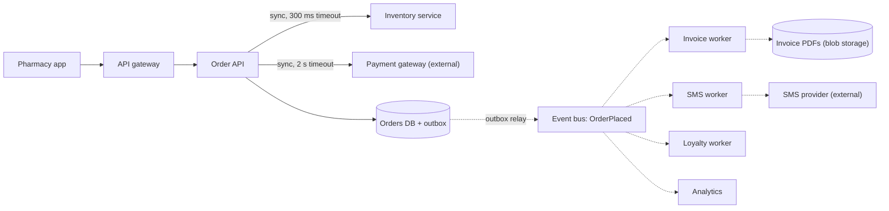
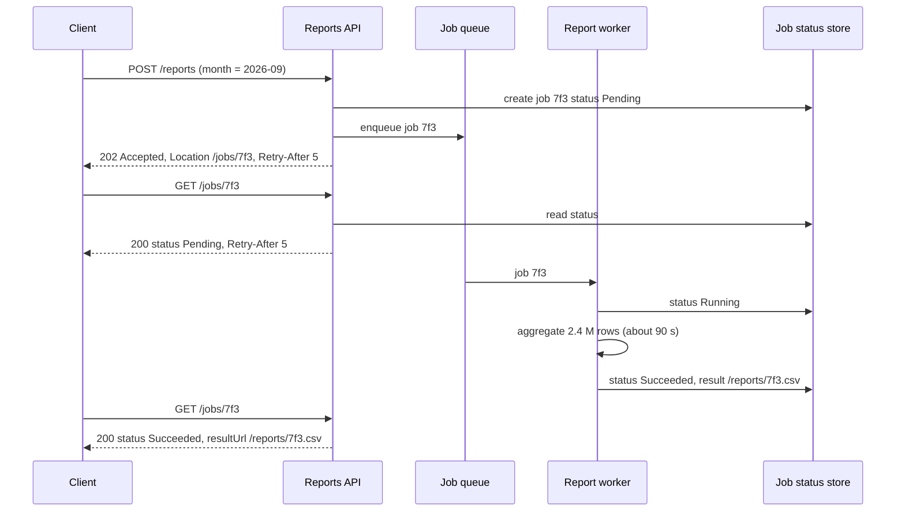

Every arrow on an architecture diagram hides a decision: does the caller **wait** for the answer, or does it hand the work over and move on? That one choice decides how slow the system feels, how often it is down, and how hard it is to debug. This lesson gives you the arithmetic and a checklist to make that choice deliberately, one interaction at a time.

## Learning objectives

By the end of this lesson you will be able to:

1. Define synchronous and asynchronous communication, and explain temporal coupling in plain words.
2. Calculate how latency adds up and availability multiplies through a chain of synchronous calls.
3. Explain tail-latency amplification in fan-out calls with a concrete probability.
4. Describe the main asynchronous styles: fire-and-forget commands, events (publish-subscribe), and asynchronous request-reply (`202 Accepted` + status).
5. List what asynchronous communication costs: eventual consistency, duplicates, ordering, observability and operations.
6. Choose sync or async for each interaction in a checkout flow, and justify it.
7. Implement both styles in ASP.NET Core: a timed-out synchronous call and a `202 Accepted` job with a background worker.

## Prerequisites

- [HTTP fundamentals](#/lesson/m10-http-fundamentals): requests, responses and status codes such as `202` and `503`.
- [Availability and the nines](#/lesson/m11-availability): we reuse the serial-availability formula.
- [Latency numbers](#/lesson/m11-latency-numbers): you should know roughly what a network hop and a database query cost.

## Explain it like I'm a beginner

Think about two ways of getting something done at a government office.

**The counter (synchronous).** You stand at the counter, hand over your form, and *wait* while the clerk checks it, stamps it and hands it back. You get an answer right away, but you are stuck there the whole time. If the clerk is on a break, you cannot do anything. If the clerk has to phone another department, you wait for that call too.

**The drop box (asynchronous).** You drop your form in a box, get a token number, and leave. The office processes forms in order, and you check the status later on a website, or they SMS you. You are free immediately, the office can work at its own pace, and it does not matter if the clerk is on a break when you arrive. But you do not know the outcome yet, and if something is wrong with your form, you find out later.

That is the whole idea:

- **Synchronous** communication: the caller sends a request and waits for the reply before continuing (request-response, usually HTTP or gRPC).
- **Asynchronous** communication: the caller hands off a message and continues without waiting for the work to finish (usually through a waiting line for messages, a **message queue**, or a broadcast of **events**).

The key phrase is **temporal coupling** (coupling in time): with the counter, you and the clerk must both be present *at the same time*. With the drop box, you need not be.

Neither is "better". A UPI payment needs a counter: the shop must know *now* whether the money moved. Sending you a GST invoice PDF can use the drop box: nobody needs it in the next 200 ms.

## First-principles explanation

### What "synchronous" and "asynchronous" mean here

These words are overloaded, so be precise:

- **Code-level async** (`async`/`await` in C#) means a thread is not blocked while waiting for I/O. An `await httpClient.GetAsync(...)` is still a **synchronous interaction** at the architecture level, because the *caller's request* cannot finish until the answer arrives.
- **Interaction-level async** means the caller's job completes without waiting for the receiver to finish its work. The receiver may not even be running at that moment.

In this lesson, "sync" and "async" always mean the interaction level.

| | Synchronous | Asynchronous |
|---|---|---|
| Typical transport | HTTP, gRPC | Queue (RabbitMQ, Azure Service Bus, SQS), log (Kafka), webhook, outbox table |
| Caller gets | The result, or an error | An acknowledgement ("accepted"), result later |
| Both sides up at once? | Yes (temporal coupling) | No |
| Consistency | Immediate for that call | Eventual |
| Failure visible to caller | Immediately | Later, via status, callback or dead-letter queue |
| Load spikes | Passed straight through | Absorbed by the queue |

### Temporal coupling, and why it hurts

When service A calls service B synchronously, A's availability now includes B's availability, and A's latency now includes B's latency. Every synchronous arrow is a **dependency in time**.

That is fine for one arrow. It becomes a problem in **chains**: the API calls Orders, which calls Inventory, which calls Pricing, which calls the Promotions service. The user's request is only as fast as the sum, and only as available as the product.

### Latency adds up along a chain

Sequential synchronous calls add their latencies. If a checkout request does:

| Step | Typical (p50) | Slow (p99) |
|---|---|---|
| Order API own work | 15 ms | 40 ms |
| Inventory reserve | 25 ms | 120 ms |
| Payment authorise | 300 ms | 1,500 ms |
| Invoice PDF generation | 400 ms | 2,000 ms |
| SMS provider | 150 ms | 3,000 ms |
| Loyalty points | 20 ms | 200 ms |

The typical total is 15 + 25 + 300 + 400 + 150 + 20 = **910 ms**. The p99s do not simply add (the slow cases rarely line up), but the user-facing p99 is at least the largest single p99 (3 s here), and in practice somewhat more. Moving invoice, SMS and loyalty off the synchronous path cuts the typical response to 15 + 25 + 300 = **340 ms**, and the worst single p99 on the path drops from 3,000 ms to 1,500 ms.

### Availability multiplies along a chain

From [the availability lesson](#/lesson/m11-availability): components in series multiply. Suppose each of those six steps is 99.9 % available on its own:

```text
All six synchronous:   0.999^6 ≈ 0.99401  →  99.40 %  →  about 259 min down per 30-day month
Only three synchronous: 0.999^3 ≈ 0.99700  →  99.70 %  →  about 130 min down per month
```

Making three steps asynchronous **halved the user-visible downtime** without making any service more reliable. The SMS provider may still be down for an hour; the difference is that its outage now delays SMSes instead of failing checkouts.

### Fan-out amplifies the tail

Sometimes one request calls many services **in parallel** (a product page that asks 10 services for price, stock, reviews, delivery date...). Parallel calls do not add latency, the response waits for the **slowest** one. If each service is slow (above, say, 500 ms) on 1 % of calls, independently:

```text
P(at least one of N is slow) = 1 − 0.99^N
N = 1    →  1 %
N = 10   →  9.6 %
N = 100  →  63.4 %
```

With 10 parallel calls, almost **1 in 10** page loads hits a slow case, even though every individual service looks fine on its own dashboard. This is the core finding of *The Tail at Scale*. Mitigations: fewer synchronous dependencies, tight per-call timeouts with partial responses ("delivery estimate unavailable"), hedged requests for idempotent reads, and caching.

### Retries multiply through layers

If each layer of a three-layer synchronous chain retries a failing call up to 3 times, one user request can generate 3 × 3 × 3 = **27 calls** to the bottom service, exactly when it is already struggling. Synchronous chains need retry budgets and deadlines ([timeouts and retries](#/lesson/m10-timeouts-retries), [retry storms](#/lesson/m13-retry-storms)). Asynchronous designs move retries into one place, the consumer, with backoff and a dead-letter queue.

### The asynchronous styles

1. **Fire-and-forget command through a queue.** "Generate invoice for order 81234." One specific consumer is expected to do it. The sender needs no reply. Example: sending to an `invoices` queue.
2. **Event (publish-subscribe).** "Order 81234 was placed." The publisher does not know or care who listens. Invoicing, SMS, loyalty and analytics each subscribe. Adding a new consumer requires no change to the publisher. See [message queues](#/lesson/m12-message-queues).
3. **Asynchronous request-reply.** The client *does* want a result, but the work takes too long for one HTTP request (a 3-minute report). The API returns `202 Accepted` with a `Location` header pointing to a status resource. The client polls `GET /jobs/{id}` (respecting `Retry-After`), or receives a webhook, or gets a push over WebSockets or Server-Sent Events ([real-time](#/lesson/m10-realtime)). When done, the status points to the result.

### Queues absorb load spikes (queue-based load leveling)

A pharmacy app runs a midnight sale. Orders arrive at 1,200 a minute for 10 minutes, then fall to 100 a minute. The invoice service can produce 400 PDFs a minute.

- **Synchronous**: the invoice service receives 1,200/min and can serve 400/min. Requests queue in threads and sockets, latency climbs, timeouts start, retries add more load, and checkouts fail.
- **Asynchronous**: the queue grows by 1,200 − 400 = 800 messages a minute, reaching **8,000** after 10 minutes. Then it drains at 400 − 100 = 300 a minute, so it is empty after 8,000 ÷ 300 ≈ **27 minutes**. Every order succeeds; invoices arrive up to about half an hour late.

You trade *latency of the background work* for *availability of the user action*. Whether that trade is acceptable is a business question: a 27-minute-late invoice is fine; a 27-minute-late OTP is not.

### What asynchronous communication costs

Asynchronous designs are not free, and interviews reward people who say so.

- **Eventual consistency.** Right after checkout, the "My invoices" page may not show the new invoice yet. The UI must say "Invoice is being generated" rather than showing nothing. See [eventual consistency](#/lesson/m12-eventual-consistency).
- **No immediate error.** If invoice generation fails, the user is long gone. You need retries, a dead-letter queue, alerts, and sometimes a compensating action ([sagas](#/lesson/m12-sagas)).
- **Duplicates and ordering.** Most brokers deliver at-least-once, so consumers must be idempotent ([idempotent consumers](#/lesson/m12-idempotent-consumers)). Ordering is usually only guaranteed within a partition or session.
- **Losing messages between the database and the broker.** Writing the order and publishing the event are two systems. Use the [transactional outbox](#/lesson/m12-outbox).
- **Harder debugging.** A single user action becomes several hops separated in time. You need correlation ids and distributed tracing ([correlation](#/lesson/m10-correlation)).
- **More infrastructure.** A broker to run, secure, monitor (queue depth *and* age of the oldest message) and pay for.
- **Coupling does not disappear.** Producer and consumer are decoupled in time, but still coupled by the **message schema**. A breaking change to `OrderPlaced` breaks every subscriber ([contracts and versioning](#/lesson/m10-versioning-contracts)).

### The "sync over async" anti-pattern

A common half-measure: the API puts a message on a queue and then **waits** (blocking the HTTP request) for a reply message on another queue. This keeps all the temporal coupling (the user still waits, and still fails if the consumer is down) and adds a broker, correlation logic and new timeout cases. If the caller must wait, use a direct synchronous call with a timeout. If it need not wait, return `202` and let it go.

### Choosing per interaction: a checklist

Decide for each arrow, not for the whole system. Ask, in this order:

1. **Does the caller need the result to continue?** "Is this card authorised?" yes, sync. "Was the SMS delivered?" no, async.
2. **Must the user see success or failure now?** Payments, seat booking and login: sync. Notifications, analytics, search indexing: async.
3. **How long does the work take?** Under about 1 s: sync is fine. Seconds to minutes: asynchronous request-reply.
4. **Is the downstream less available or slower than the caller can tolerate?** Third-party providers (SMS, email, e-invoicing portals) often are: async.
5. **Are arrival rates spiky compared with the downstream's capacity?** Async with a queue levels the load.
6. **How many consumers care?** One: command or direct call. Many, and growing: publish an event.
7. **What consistency does the business need?** "Money moved" needs a definite answer. "Points credited" can lag by a minute.

### A hybrid: sync with an async fallback

Some interactions want both: try synchronously with a short timeout, and if that fails, accept the request and finish later. Example: e-invoice registration with a government portal. Try for 2 s; if the portal answers, show the invoice reference number. If not, show "Invoice registered, reference will be emailed" and queue the retry. The user is never blocked by the portal's outage, and most users still get the instant answer.

### When a simpler design is enough

- **A modular monolith** where invoicing is just a class: call it in-process, or use an in-process background queue (`Channel<T>` + `BackgroundService`). You get load leveling without a broker. Persist the work in a database table if it must survive restarts.
- **Low traffic, reliable dependencies**: a three-step synchronous flow at 5 requests per second with in-house services is simpler to build, test and debug. Add a queue when a real problem (spikes, flaky third party, slow work) appears.
- **Async everywhere** is its own anti-pattern: a system where every read goes through a queue is slow and hard to reason about. Queries are almost always synchronous.

## Visual explanation

### Architecture: one checkout, two kinds of arrow



Solid arrows are synchronous: the **Order API** cannot confirm an order until **Inventory** has reserved the stock (300 ms timeout) and the **payment gateway** has authorised the money (2 s timeout). Those two answers decide what the user sees, so they stay on the critical path. The Order API then writes the order and an `OrderPlaced` row to the **outbox** in one transaction and returns. Dotted arrows are asynchronous: the outbox relay publishes the event to the **bus**, and four independent workers react. The **invoice worker** writes the PDF to blob storage, the **SMS worker** calls the external SMS provider, and **loyalty** and **analytics** update their own data. If the SMS provider is down for an hour, checkouts are unaffected; the SMS worker's queue simply grows.

### Sequence: asynchronous request-reply for a long report



The client asks for a monthly report that takes about 90 seconds to build, far too long for one HTTP request (gateways and browsers often time out at 30–100 s). The API creates a **job record** and enqueues the work, then immediately replies **202 Accepted** with a `Location` header and a `Retry-After` hint. The client polls the status URL; early polls say `Pending`. The worker picks up the job, marks it `Running`, does the heavy work, and records `Succeeded` with a link to the result. The next poll returns that link. The HTTP connection was never held open for 90 seconds, and if the worker restarts mid-job, the job can be retried from the queue.

## Step-by-step example

**Scenario.** DawaGhar, a fictional online pharmacy in Bengaluru, has a checkout that takes 1.1 s on average and fails about 4 hours a month. Today `POST /checkout` synchronously calls: inventory, payment, prescription verification, invoice PDF, SMS and loyalty.

### Step 1 — List the interactions and what each one needs

| Interaction | Does the user need the answer now? | Duration | Notes |
|---|---|---|---|
| Inventory reserve | Yes, cannot sell what is not in stock | 25 ms | In-house |
| Payment authorise | Yes, must know money is held | 300 ms | External, 99.9 % |
| Prescription verification | For Schedule H medicines, yes, but a pharmacist checks it, taking up to 30 min | minutes | Human step |
| Invoice PDF | No | 400 ms | CPU heavy |
| SMS | No | 150 ms | External, 99.5 % |
| Loyalty points | No | 20 ms | In-house |

### Step 2 — Decide per interaction

- Inventory and payment: **sync**, with tight timeouts.
- Prescription verification: **async request-reply**. The order is created as `AwaitingPrescriptionCheck`; the app shows the status and pushes an update when a pharmacist approves.
- Invoice, SMS and loyalty: **events**, published through an outbox.

### Step 3 — Recalculate availability

Before: Order API 99.95 % × inventory 99.9 % × payment 99.9 % × invoice 99.9 % × SMS 99.5 % × loyalty 99.9 % ≈ **99.05 %** (about 6.8 h down a month).

After: 99.95 % × 99.9 % × 99.9 % ≈ **99.75 %** (about 1.8 h a month), and the external SMS provider no longer appears in the product at all.

### Step 4 — Recalculate latency

Typical: 15 + 25 + 300 = **340 ms**, down from about 1.1 s.

### Step 5 — Pay the async bill

Add: an outbox table and relay, a queue per worker with dead-lettering, idempotency keys on the invoice and loyalty handlers, an "invoice is being generated" state in the app, correlation ids from checkout to SMS, and an alert on "age of oldest message in `invoices` > 10 minutes".

### Step 6 — Check the spike

Midnight sale: 1,200 orders a minute for 10 minutes. The invoice workers produce 400 a minute, so the backlog peaks at 8,000 and drains in about 27 minutes (worked out above). Business agrees invoices may lag by up to an hour during sales. No extra invoice capacity is bought for a 10-minute peak.

## Production-style C# implementation

The code shows both styles side by side: a synchronous inventory call with a strict timeout and a clear failure response, an in-process event bus for after-the-fact work, and the asynchronous request-reply pattern for long reports. The in-memory bus stands in for a real broker so the project compiles offline.

```text
Pharmacy.Api/
  Program.cs
  Checkout/CheckoutModels.cs
  Checkout/InventoryClient.cs
  Checkout/OrderStore.cs
  Messaging/InMemoryEventBus.cs
  Messaging/InvoiceWorker.cs
  Jobs/JobStore.cs
  Jobs/ReportWorker.cs
```

```csharp file=Checkout/CheckoutModels.cs
namespace Pharmacy.Checkout;

public sealed record CheckoutLine(string Sku, int Quantity, decimal UnitPrice);
public sealed record CheckoutRequest(string CustomerId, IReadOnlyList<CheckoutLine> Lines);

public enum OrderState { Confirmed, Rejected }
public sealed record Order(Guid Id, string CustomerId, decimal Total, OrderState State, DateTimeOffset CreatedAt);

/// <summary>The event other services react to. It is a contract: change it carefully.</summary>
public sealed record OrderPlaced(Guid OrderId, string CustomerId, decimal Total, DateTimeOffset OccurredAt, string CorrelationId);
```

```csharp file=Checkout/InventoryClient.cs
using System.Net.Http.Json;

namespace Pharmacy.Checkout;

public enum ReserveResult { Reserved, OutOfStock, Unavailable }

public interface IInventoryClient
{
    Task<ReserveResult> ReserveAsync(Guid orderId, IReadOnlyList<CheckoutLine> lines, CancellationToken ct);
}

/// <summary>Synchronous dependency: checkout cannot continue without this answer,
/// so it gets a strict timeout and a clear "Unavailable" outcome instead of hanging.</summary>
public sealed class HttpInventoryClient(HttpClient http) : IInventoryClient
{
    public static readonly TimeSpan Timeout = TimeSpan.FromMilliseconds(300);

    public async Task<ReserveResult> ReserveAsync(Guid orderId, IReadOnlyList<CheckoutLine> lines, CancellationToken ct)
    {
        using var cts = CancellationTokenSource.CreateLinkedTokenSource(ct);
        cts.CancelAfter(Timeout);
        try
        {
            using var response = await http.PostAsJsonAsync($"/reservations/{orderId}", lines, cts.Token);
            if (response.StatusCode == System.Net.HttpStatusCode.Conflict) return ReserveResult.OutOfStock;
            return response.IsSuccessStatusCode ? ReserveResult.Reserved : ReserveResult.Unavailable;
        }
        catch (OperationCanceledException) when (!ct.IsCancellationRequested)
        {
            return ReserveResult.Unavailable;   // our timeout fired, not the caller's cancellation
        }
        catch (HttpRequestException)
        {
            return ReserveResult.Unavailable;
        }
    }
}

/// <summary>Offline stand-in used by this sample.</summary>
public sealed class InMemoryInventoryClient : IInventoryClient
{
    public Task<ReserveResult> ReserveAsync(Guid orderId, IReadOnlyList<CheckoutLine> lines, CancellationToken ct) =>
        Task.FromResult(lines.All(l => l.Quantity <= 10) ? ReserveResult.Reserved : ReserveResult.OutOfStock);
}
```

The reservation is keyed by `orderId` (a `PUT`-like idempotent call), so a client retry cannot reserve the stock twice.

```csharp file=Checkout/OrderStore.cs
using System.Collections.Concurrent;

namespace Pharmacy.Checkout;

/// <summary>Production: PostgreSQL, writing the order and an outbox row in one transaction.</summary>
public interface IOrderStore
{
    Task SaveWithEventAsync(Order order, OrderPlaced evt, CancellationToken ct);
    Order? Find(Guid id);
}

public sealed class InMemoryOrderStore(Messaging.IEventBus bus) : IOrderStore
{
    private readonly ConcurrentDictionary<Guid, Order> _orders = new();

    public async Task SaveWithEventAsync(Order order, OrderPlaced evt, CancellationToken ct)
    {
        _orders[order.Id] = order;
        // In production the outbox relay publishes after commit. Here we publish directly.
        await bus.PublishAsync(evt, ct);
    }

    public Order? Find(Guid id) => _orders.TryGetValue(id, out var o) ? o : null;
}
```

```csharp file=Messaging/InMemoryEventBus.cs
using System.Collections.Concurrent;
using System.Threading.Channels;
using Pharmacy.Checkout;

namespace Pharmacy.Messaging;

public interface IEventBus
{
    ValueTask PublishAsync(OrderPlaced evt, CancellationToken ct);
    ChannelReader<OrderPlaced> Subscribe(string subscriberName);
}

/// <summary>One bounded channel per subscriber, like one queue per subscription on a topic.
/// A slow subscriber fills only its own channel. Not durable: a stand-in for a broker.</summary>
public sealed class InMemoryEventBus : IEventBus
{
    private readonly ConcurrentDictionary<string, Channel<OrderPlaced>> _subscriptions = new();

    public ChannelReader<OrderPlaced> Subscribe(string subscriberName) =>
        _subscriptions.GetOrAdd(subscriberName, _ => Channel.CreateBounded<OrderPlaced>(
            new BoundedChannelOptions(50_000) { FullMode = BoundedChannelFullMode.Wait })).Reader;

    public async ValueTask PublishAsync(OrderPlaced evt, CancellationToken ct)
    {
        foreach (var channel in _subscriptions.Values)
            await channel.Writer.WriteAsync(evt, ct);
    }
}
```

```csharp file=Messaging/InvoiceWorker.cs
using Microsoft.Extensions.Hosting;
using Microsoft.Extensions.Logging;
using Pharmacy.Checkout;

namespace Pharmacy.Messaging;

/// <summary>Asynchronous consumer. Its slowness or failure never affects checkout.</summary>
public sealed class InvoiceWorker(IEventBus bus, ILogger<InvoiceWorker> log) : BackgroundService
{
    private readonly System.Threading.Channels.ChannelReader<OrderPlaced> _inbox = bus.Subscribe("invoices");
    private readonly HashSet<Guid> _done = new();   // production: inbox table for idempotency

    protected override async Task ExecuteAsync(CancellationToken stoppingToken)
    {
        await foreach (OrderPlaced evt in _inbox.ReadAllAsync(stoppingToken))
        {
            if (!_done.Add(evt.OrderId)) continue;   // duplicate delivery
            using (log.BeginScope(new Dictionary<string, object> { ["CorrelationId"] = evt.CorrelationId }))
            {
                await Task.Delay(TimeSpan.FromMilliseconds(400), stoppingToken);   // stands in for PDF rendering
                log.LogInformation("Invoice generated for order {OrderId}, total {Total}", evt.OrderId, evt.Total);
            }
        }
    }
}
```

The worker logs inside a scope carrying the **correlation id** that started at checkout. Without it, finding "why did order 81234 get no invoice?" means searching several services' logs by time.

```csharp file=Jobs/JobStore.cs
using System.Collections.Concurrent;
using System.Threading.Channels;

namespace Pharmacy.Jobs;

public enum JobStatus { Pending, Running, Succeeded, Failed }

public sealed record JobRecord(Guid Id, string Month, JobStatus Status, string? ResultUrl, string? Error, DateTimeOffset UpdatedAt);

public sealed class JobStore(TimeProvider clock)
{
    private readonly ConcurrentDictionary<Guid, JobRecord> _jobs = new();
    private readonly Channel<Guid> _queue = Channel.CreateUnbounded<Guid>();

    public JobRecord Create(string month)
    {
        var job = new JobRecord(Guid.NewGuid(), month, JobStatus.Pending, null, null, clock.GetUtcNow());
        _jobs[job.Id] = job;
        _queue.Writer.TryWrite(job.Id);
        return job;
    }

    public JobRecord? Get(Guid id) => _jobs.TryGetValue(id, out var j) ? j : null;

    public void Update(Guid id, JobStatus status, string? resultUrl = null, string? error = null) =>
        _jobs.AddOrUpdate(id,
            _ => throw new KeyNotFoundException($"Job {id} not found"),
            (_, old) => old with { Status = status, ResultUrl = resultUrl, Error = error, UpdatedAt = clock.GetUtcNow() });

    public IAsyncEnumerable<Guid> PendingAsync(CancellationToken ct) => _queue.Reader.ReadAllAsync(ct);
}
```

```csharp file=Jobs/ReportWorker.cs
using Microsoft.Extensions.Hosting;
using Microsoft.Extensions.Logging;

namespace Pharmacy.Jobs;

public sealed class ReportWorker(JobStore jobs, ILogger<ReportWorker> log) : BackgroundService
{
    protected override async Task ExecuteAsync(CancellationToken stoppingToken)
    {
        await foreach (Guid id in jobs.PendingAsync(stoppingToken))
        {
            jobs.Update(id, JobStatus.Running);
            try
            {
                await Task.Delay(TimeSpan.FromSeconds(3), stoppingToken);   // stands in for heavy aggregation
                jobs.Update(id, JobStatus.Succeeded, resultUrl: $"/reports/{id}.csv");
            }
            catch (Exception ex) when (ex is not OperationCanceledException)
            {
                log.LogError(ex, "Report job {JobId} failed", id);
                jobs.Update(id, JobStatus.Failed, error: "Report generation failed. Please retry.");
            }
        }
    }
}
```

```csharp file=Program.cs
using System.Diagnostics;
using Pharmacy.Checkout;
using Pharmacy.Jobs;
using Pharmacy.Messaging;

var builder = WebApplication.CreateBuilder(args);

builder.Services.AddSingleton(TimeProvider.System);
builder.Services.AddSingleton<IEventBus, InMemoryEventBus>();
builder.Services.AddSingleton<IOrderStore, InMemoryOrderStore>();
builder.Services.AddSingleton<IInventoryClient, InMemoryInventoryClient>();
// Production: builder.Services.AddHttpClient<IInventoryClient, HttpInventoryClient>(c => c.BaseAddress = new Uri("http://inventory"));
builder.Services.AddHostedService<InvoiceWorker>();
builder.Services.AddSingleton<JobStore>();
builder.Services.AddHostedService<ReportWorker>();

var app = builder.Build();

// Synchronous where the user needs the answer; asynchronous for everything after.
app.MapPost("/checkout", async (CheckoutRequest req, IInventoryClient inventory, IOrderStore orders,
    TimeProvider clock, HttpContext http, CancellationToken ct) =>
{
    if (req.Lines.Count == 0) return Results.ValidationProblem(new Dictionary<string, string[]> { ["lines"] = ["At least one line is required."] });

    var orderId = Guid.NewGuid();
    switch (await inventory.ReserveAsync(orderId, req.Lines, ct))
    {
        case ReserveResult.OutOfStock:
            return Results.Problem("One or more items are out of stock.", statusCode: StatusCodes.Status409Conflict);
        case ReserveResult.Unavailable:
            http.Response.Headers.RetryAfter = "2";
            return Results.Problem("Stock check is temporarily unavailable. Please try again.", statusCode: StatusCodes.Status503ServiceUnavailable);
    }

    // (Payment authorisation would go here: also synchronous, also with a strict timeout.)

    decimal total = req.Lines.Sum(l => l.UnitPrice * l.Quantity);
    var order = new Order(orderId, req.CustomerId, total, OrderState.Confirmed, clock.GetUtcNow());
    string correlationId = Activity.Current?.TraceId.ToString() ?? http.TraceIdentifier;
    await orders.SaveWithEventAsync(order, new OrderPlaced(orderId, req.CustomerId, total, order.CreatedAt, correlationId), ct);

    // The invoice, SMS and loyalty points happen later. The response says so.
    return Results.Created($"/orders/{orderId}", new { orderId, total, invoice = "being generated" });
});

app.MapGet("/orders/{id:guid}", (Guid id, IOrderStore orders) =>
    orders.Find(id) is { } o ? Results.Ok(o) : Results.NotFound());

// Asynchronous request-reply: 202 + Location + Retry-After.
app.MapPost("/reports", (ReportRequest req, JobStore jobs, HttpContext http) =>
{
    var job = jobs.Create(req.Month);
    http.Response.Headers.RetryAfter = "5";
    return Results.Accepted($"/jobs/{job.Id}", new { jobId = job.Id, status = job.Status.ToString() });
});

app.MapGet("/jobs/{id:guid}", (Guid id, JobStore jobs, HttpContext http) =>
{
    if (jobs.Get(id) is not { } job) return Results.NotFound();
    if (job.Status is JobStatus.Pending or JobStatus.Running) http.Response.Headers.RetryAfter = "5";
    return Results.Ok(new { jobId = job.Id, status = job.Status.ToString(), job.ResultUrl, job.Error });
});

app.Run();

public sealed record ReportRequest(string Month);
```

Two choices worth defending:

1. **`503` with `Retry-After` when inventory is unavailable.** The checkout fails fast and honestly instead of hanging for 30 s. Because the reservation is keyed by order id, the client can retry safely.
2. **`201 Created` that admits the invoice is pending.** The response tells the client exactly which parts are done. The app shows "Invoice being generated" rather than an empty list.

## Bad design vs good design

**Bad: the synchronous chain of everything.**

```csharp
app.MapPost("/checkout", async (CheckoutRequest req, /* six clients */ ...) =>
{
    await inventory.ReserveAsync(...);        // 25 ms
    await payment.AuthoriseAsync(...);        // 300 ms
    await invoices.GeneratePdfAsync(...);     // 400 ms, CPU heavy
    await sms.SendAsync(...);                 // 150 ms, external 99.5 %
    await loyalty.AddPointsAsync(...);        // 20 ms
    await analytics.TrackAsync(...);          // 30 ms
    return Results.Ok();
});
```

Problems:

- Latency is the sum, about 925 ms typical, and the p99 is dominated by the SMS provider.
- Availability is the product, about 99 % with these numbers.
- If `sms.SendAsync` throws after the payment was authorised, the user sees an error, retries, and may be charged twice.
- A midnight-sale spike hits all six services at full force.

**Bad in the other direction: async everything.** Inventory reservation goes through a queue. Checkout returns `202` immediately, and 20 seconds later the app learns the item was out of stock. The user has already left the page believing they bought it. Some answers must be synchronous.

**Good:** synchronous for inventory and payment (with timeouts and idempotency keys), an outbox and events for everything after, asynchronous request-reply for genuinely long work, and a UI that shows pending states honestly.

:::callout type=mistake title="await is not asynchronous communication"
Making a call with `await` frees the thread, which is good for throughput. It does not remove temporal coupling: the request still waits, and still fails if the other service is down. Architecture-level async means the caller's request finishes without the callee's work being done.
:::

:::callout type=tradeoff title="Push the decision to the user experience"
"Can this be asynchronous?" is often a UX question in disguise. If the screen can honestly say "We'll notify you when...", the backend can be asynchronous. Involve product and design in the decision; they often accept delays engineers assumed were forbidden, and occasionally reject ones engineers assumed were fine.
:::

## Practical playground

The queue simulator models the invoice queue from the step-by-step example. Set the producer rate to the midnight-sale rate and the consumers to what you can afford, then watch the backlog grow and drain. Try crashing a consumer during the peak. The point to notice: with a queue, a slow or crashed consumer turns into *delay*, not *failed checkouts*. Then work out how many consumers keep the oldest message under 10 minutes.

:::playground type=sim sim=queue title="Queue-based load leveling for invoice generation" producerRate=20 consumers=4 processingMs=600
:::

## Exercises

:::exercise id=m10-sync-async-ex1 difficulty=beginner kind=code title="Chain arithmetic: latency, availability and fan-out"
Turn this lesson's three formulas into a small, tested calculator you can use in design reviews.
::requirements
- `ChainMath.SerialLatencyMs(params double[] stepsMs)` returns the sum.
- `ChainMath.SerialAvailability(params double[] parts)` returns the product. Each part must be in `[0, 1]`, otherwise throw `ArgumentOutOfRangeException`.
- `ChainMath.FanOutSlowProbability(double pSlowEach, int calls)` returns `1 − (1 − p)^calls`.
- `ChainMath.MonthlyDowntimeMinutes(double availability)` uses a 30-day month (43,200 minutes).
::acceptance
- Six steps at 0.999 give about 0.99401 and about 258.6 minutes a month.
- 10 parallel calls each slow 1 % of the time give about 0.0956.
- Latencies 15, 25 and 300 give 340.
- An availability of 1.2 throws.
::hint
Each function is one line of maths. The work is in validating inputs.
::hint
`Aggregate(1.0, (acc, a) => acc * a)` multiplies; `Sum()` adds.
::hint
Fan-out: the chance that *none* is slow is `(1 − p)^n`, so the chance that *at least one* is slow is one minus that.
::hint
```csharp
public static double FanOutSlowProbability(double p, int n) => 1 - Math.Pow(1 - p, n);
```
::starter
```csharp file=ChainMath.cs
using System;
using System.Linq;

public static class ChainMath
{
    public static double SerialLatencyMs(params double[] stepsMs) => throw new NotImplementedException();
    public static double SerialAvailability(params double[] parts) => throw new NotImplementedException();
    public static double FanOutSlowProbability(double pSlowEach, int calls) => throw new NotImplementedException();
    public static double MonthlyDowntimeMinutes(double availability) => throw new NotImplementedException();
}
```
::tests
```csharp file=ChainMathTests.cs
using System;
using Xunit;

public class ChainMathTests
{
    [Fact] public void Latency_adds() => Assert.Equal(340, ChainMath.SerialLatencyMs(15, 25, 300), 6);

    [Fact] public void Six_three_nines() =>
        Assert.Equal(0.99401, ChainMath.SerialAvailability(0.999, 0.999, 0.999, 0.999, 0.999, 0.999), 5);

    [Fact] public void Downtime_for_six_steps() =>
        Assert.Equal(258.55, ChainMath.MonthlyDowntimeMinutes(Math.Pow(0.999, 6)), 1);

    [Fact] public void Fan_out_ten() => Assert.Equal(0.0956, ChainMath.FanOutSlowProbability(0.01, 10), 4);

    [Fact] public void Fan_out_hundred() => Assert.Equal(0.634, ChainMath.FanOutSlowProbability(0.01, 100), 3);

    [Fact] public void Invalid_availability_throws() =>
        Assert.Throws<ArgumentOutOfRangeException>(() => ChainMath.SerialAvailability(0.999, 1.2));

    [Fact] public void Invalid_calls_throws() =>
        Assert.Throws<ArgumentOutOfRangeException>(() => ChainMath.FanOutSlowProbability(0.01, 0));
}
```
::solution
```csharp file=ChainMath.cs
using System;
using System.Linq;

public static class ChainMath
{
    private const double MinutesPerMonth = 30 * 24 * 60;

    public static double SerialLatencyMs(params double[] stepsMs)
    {
        ArgumentNullException.ThrowIfNull(stepsMs);
        if (stepsMs.Any(s => s < 0)) throw new ArgumentOutOfRangeException(nameof(stepsMs));
        return stepsMs.Sum();
    }

    public static double SerialAvailability(params double[] parts)
    {
        ArgumentNullException.ThrowIfNull(parts);
        return parts.Aggregate(1.0, (acc, a) => acc * Check(a));
    }

    public static double FanOutSlowProbability(double pSlowEach, int calls)
    {
        if (calls < 1) throw new ArgumentOutOfRangeException(nameof(calls));
        return 1.0 - Math.Pow(1.0 - Check(pSlowEach), calls);
    }

    public static double MonthlyDowntimeMinutes(double availability) => (1.0 - Check(availability)) * MinutesPerMonth;

    private static double Check(double v) =>
        v is >= 0 and <= 1 ? v : throw new ArgumentOutOfRangeException(nameof(v), v, "Must be in [0, 1].");
}
```

Use it in a unit test that encodes your architecture's critical path: if someone adds a seventh synchronous dependency, the "checkout ≥ 99.7 %" test fails and forces a conversation.
::mistakes
- Adding availabilities instead of multiplying them.
- Treating fan-out probability as `p × n` (gives 100 % at n = 100, which is wrong; it is 63.4 %).
- Using 31-day months in one place and 30-day months in another.
::extensions
Add `ParallelLatencyMs(params double[])` returning the maximum, and a `Stage` type so a checkout can be modelled as "A, then (B and C in parallel), then D".
:::

:::exercise id=m10-sync-async-ex2 difficulty=beginner kind=written title="Sync or async? Classify eight interactions"
For a ride-hailing app operating in Indian cities, decide whether each interaction should be synchronous or asynchronous, and give a one-line reason. If it should be async, say which style (command, event, or async request-reply).

1. Rider requests a quote for a trip.
2. Rider confirms the booking and the app must show "Driver assigned" or "No drivers nearby".
3. Sending the trip receipt by email.
4. Updating the driver's weekly earnings summary.
5. Card pre-authorisation of the estimated fare when booking.
6. Generating a 12-month trip history export for a corporate account.
7. Feeding trip data to the fraud-scoring model after the trip ends.
8. Checking the rider is not blocked before allowing a booking.
::acceptance
- Each item is labelled sync or async with a reason tied to "does the caller need the answer now?".
- Items 1, 5 and 8 are synchronous; 3, 4 and 7 are asynchronous; 6 uses async request-reply.
- Item 2 is discussed as a nuanced case (matching can take seconds).
- At least one answer mentions a timeout or fallback for a synchronous call.
::hint
Start with the question: if this step were delayed by 5 minutes, would the user or the business be harmed?
::hint
Exports that take minutes are too long for one HTTP request, but the user still wants the result. Which pattern returns 202?
::hint
Driver matching can take 5–30 s. Holding one HTTP request open that long is fragile. What could the app do instead while it waits?
::solution
1. **Quote: sync.** The rider is looking at the screen waiting for a price; a cached or approximate price is an acceptable fallback if pricing is slow.
2. **Booking confirmation: async request-reply with push.** The booking is accepted synchronously (`202` with a booking id), matching runs for up to 30 s, and the result is pushed over WebSocket or SSE (or polled). The *acceptance* is sync; the *matching* is async.
3. **Receipt email: async event** (`TripCompleted`). Nobody needs it in the next second; the email provider can be down.
4. **Earnings summary: async event.** Eventual consistency of minutes is fine for a weekly summary.
5. **Pre-authorisation: sync** with a strict timeout (about 2 s). Without a hold on funds, the business will not dispatch a driver. On timeout, fail the booking clearly or fall back to cash if the business allows.
6. **12-month export: async request-reply.** `202 Accepted` + status URL, or email a link when done.
7. **Fraud model feed: async event,** typically onto a stream. Real-time fraud *blocking* at booking is a different, synchronous check.
8. **Blocked-rider check: sync,** but cheap: cache the blocked list locally so this is a memory lookup rather than a network call.
::mistakes
- Making booking confirmation fully synchronous and holding the HTTP request open for 30 s of matching.
- Making the payment hold asynchronous, so drivers are dispatched for riders whose cards fail.
- Treating "async" as one thing instead of naming the style.
:::

:::exercise id=m10-sync-async-ex3 difficulty=intermediate kind=code title="Asynchronous request-reply job tracker"
Implement the job state machine behind a `202 Accepted` endpoint, including idempotent submission.
::requirements
- `JobTracker(TimeProvider clock)`.
- `JobView Submit(string clientRequestId, string description)`: creates a `Pending` job. Submitting again with the same `clientRequestId` returns the **existing** job (idempotent).
- `void Start(Guid id)`: `Pending → Running`. `void Succeed(Guid id, string resultUrl)`: `Running → Succeeded`. `void Fail(Guid id, string error)`: `Running → Failed`.
- Any other transition throws `InvalidOperationException`. Unknown ids throw `KeyNotFoundException`.
- `JobView Get(Guid id)` returns the current view, including `RetryAfterSeconds`: 5 while `Pending` or `Running`, `null` when finished.
::acceptance
- Two submissions with the same client id return the same job id.
- `Succeed` on a `Pending` job throws.
- After `Start` and `Succeed`, `Get` shows `Succeeded`, the result URL and no `RetryAfterSeconds`.
- `UpdatedAt` comes from the injected `TimeProvider`.
::hint
Keep two dictionaries: job id → job, and client request id → job id.
::hint
Write a private `Transition(id, from, to)` helper that checks the current status before changing it.
::hint
A `record` with `with` expressions makes updates tidy: `job with { Status = JobStatus.Running }`.
::hint
For thread safety, a single `lock` around each public method is perfectly fine at this scale.
::starter
```csharp file=JobTracker.cs
using System;
using System.Collections.Generic;

public enum JobState { Pending, Running, Succeeded, Failed }

public sealed record JobView(Guid Id, string Description, JobState State, string? ResultUrl, string? Error,
    DateTimeOffset UpdatedAt, int? RetryAfterSeconds);

public sealed class JobTracker(TimeProvider clock)
{
    public JobView Submit(string clientRequestId, string description) => throw new NotImplementedException();
    public void Start(Guid id) => throw new NotImplementedException();
    public void Succeed(Guid id, string resultUrl) => throw new NotImplementedException();
    public void Fail(Guid id, string error) => throw new NotImplementedException();
    public JobView Get(Guid id) => throw new NotImplementedException();
}
```
::tests
```csharp file=JobTrackerTests.cs
using System;
using System.Collections.Generic;
using Xunit;

public class JobTrackerTests
{
    private sealed class FixedClock(DateTimeOffset now) : TimeProvider
    {
        public DateTimeOffset Now { get; set; } = now;
        public override DateTimeOffset GetUtcNow() => Now;
    }

    private static readonly DateTimeOffset T0 = new(2026, 10, 19, 9, 0, 0, TimeSpan.Zero);

    [Fact]
    public void Submit_is_idempotent()
    {
        var t = new JobTracker(new FixedClock(T0));
        var a = t.Submit("req-1", "September report");
        var b = t.Submit("req-1", "September report");
        Assert.Equal(a.Id, b.Id);
        Assert.Equal(JobState.Pending, b.State);
        Assert.Equal(5, b.RetryAfterSeconds);
    }

    [Fact]
    public void Happy_path()
    {
        var clock = new FixedClock(T0);
        var t = new JobTracker(clock);
        var job = t.Submit("req-1", "report");
        t.Start(job.Id);
        clock.Now = T0.AddSeconds(90);
        t.Succeed(job.Id, "/reports/1.csv");
        var view = t.Get(job.Id);
        Assert.Equal(JobState.Succeeded, view.State);
        Assert.Equal("/reports/1.csv", view.ResultUrl);
        Assert.Null(view.RetryAfterSeconds);
        Assert.Equal(T0.AddSeconds(90), view.UpdatedAt);
    }

    [Fact]
    public void Cannot_succeed_from_pending()
    {
        var t = new JobTracker(new FixedClock(T0));
        var job = t.Submit("req-1", "report");
        Assert.Throws<InvalidOperationException>(() => t.Succeed(job.Id, "/x"));
    }

    [Fact]
    public void Cannot_restart_finished_job()
    {
        var t = new JobTracker(new FixedClock(T0));
        var job = t.Submit("req-1", "report");
        t.Start(job.Id);
        t.Fail(job.Id, "boom");
        Assert.Equal(JobState.Failed, t.Get(job.Id).State);
        Assert.Throws<InvalidOperationException>(() => t.Start(job.Id));
    }

    [Fact]
    public void Unknown_id_throws() =>
        Assert.Throws<KeyNotFoundException>(() => new JobTracker(new FixedClock(T0)).Get(Guid.NewGuid()));
}
```
::solution
```csharp file=JobTracker.cs
using System;
using System.Collections.Generic;

public enum JobState { Pending, Running, Succeeded, Failed }

public sealed record JobView(Guid Id, string Description, JobState State, string? ResultUrl, string? Error,
    DateTimeOffset UpdatedAt, int? RetryAfterSeconds);

public sealed class JobTracker(TimeProvider clock)
{
    private const int PollSeconds = 5;
    private readonly Dictionary<Guid, JobView> _jobs = new();
    private readonly Dictionary<string, Guid> _byClientId = new(StringComparer.Ordinal);
    private readonly object _gate = new();

    public JobView Submit(string clientRequestId, string description)
    {
        ArgumentException.ThrowIfNullOrWhiteSpace(clientRequestId);
        lock (_gate)
        {
            if (_byClientId.TryGetValue(clientRequestId, out var existing)) return _jobs[existing];
            var job = new JobView(Guid.NewGuid(), description, JobState.Pending, null, null, clock.GetUtcNow(), PollSeconds);
            _jobs[job.Id] = job;
            _byClientId[clientRequestId] = job.Id;
            return job;
        }
    }

    public void Start(Guid id) => Transition(id, JobState.Pending, j => j with { State = JobState.Running });

    public void Succeed(Guid id, string resultUrl) =>
        Transition(id, JobState.Running, j => j with { State = JobState.Succeeded, ResultUrl = resultUrl, RetryAfterSeconds = null });

    public void Fail(Guid id, string error) =>
        Transition(id, JobState.Running, j => j with { State = JobState.Failed, Error = error, RetryAfterSeconds = null });

    public JobView Get(Guid id)
    {
        lock (_gate) return _jobs.TryGetValue(id, out var j) ? j : throw new KeyNotFoundException($"Job {id} not found.");
    }

    private void Transition(Guid id, JobState from, Func<JobView, JobView> change)
    {
        lock (_gate)
        {
            if (!_jobs.TryGetValue(id, out var job)) throw new KeyNotFoundException($"Job {id} not found.");
            if (job.State != from) throw new InvalidOperationException($"Job {id} is {job.State}, expected {from}.");
            _jobs[id] = change(job) with { UpdatedAt = clock.GetUtcNow() };
        }
    }
}
```

The client request id is the same idea as an [idempotency key](#/lesson/m10-idempotency): a mobile client that loses the `202` response and retries gets the same job instead of starting a second 90-second report.
::mistakes
- Creating a new job on every submit, so flaky networks start duplicate heavy jobs.
- Allowing `Succeed` straight from `Pending`, which hides worker bugs.
- Returning `Retry-After` on finished jobs, so clients keep polling forever.
::extensions
Add `Expire(TimeSpan maxAge)` that marks jobs stuck in `Running` for more than the limit as `Failed` (the worker probably crashed), and decide whether such jobs should be re-queued instead.
:::

:::exercise id=m10-sync-async-ex4 difficulty=intermediate kind=hld title="Untangle a synchronous chain"
A contractor-billing platform processes "submit running bill". Today the bill API synchronously calls: measurement validation (in-house, 99.9 %), GST e-invoice registration (government portal, about 99 % and slow at month-end), PDF generation (in-house, 400 ms), email to the client engineer (external, 99.5 %), and an audit log service (in-house, 99.9 %). Month-end peak is 50 bills a second for two hours. Redesign the interactions.
::acceptance
- Each arrow is labelled sync or async with a reason.
- E-invoice registration uses a sync-with-async-fallback or a fully async approach, and the bill's status model reflects it.
- The design prevents losing events between the database and the broker.
- Shows the availability of the synchronous critical path before and after.
- Mentions how the month-end spike is absorbed.
::hint
Which steps decide whether the bill is *accepted*? Everything else can follow.
::hint
The government portal is both slow and less available. What status can the bill have while registration is pending?
::hint
Audit logs feel like they must be synchronous. Do they, if the audit record is written in the same database transaction as the bill?
::hint
Before: 0.999 × 0.99 × 0.999 × 0.995 × 0.999 (plus the API itself). After: only the API and validation.
::starter
```json
{
  "nodes": [
    { "id": "eng", "type": "client", "label": "Contractor portal", "props": { "rps": 50 } },
    { "id": "lb", "type": "load-balancer", "label": "Load balancer" },
    { "id": "api", "type": "app-server", "label": "Bill API", "props": { "instances": 3 } },
    { "id": "db", "type": "database", "label": "PostgreSQL" },
    { "id": "val", "type": "app-server", "label": "Measurement validation" },
    { "id": "gst", "type": "external", "label": "GST e-invoice portal" },
    { "id": "pdf", "type": "app-server", "label": "PDF service" },
    { "id": "mail", "type": "external", "label": "Email provider" },
    { "id": "audit", "type": "app-server", "label": "Audit log service" }
  ],
  "edges": [
    { "from": "eng", "to": "lb", "kind": "sync" },
    { "from": "lb", "to": "api", "kind": "sync" },
    { "from": "api", "to": "db", "kind": "sync" },
    { "from": "api", "to": "val", "kind": "sync" },
    { "from": "api", "to": "gst", "kind": "sync" },
    { "from": "api", "to": "pdf", "kind": "sync" },
    { "from": "api", "to": "mail", "kind": "sync" },
    { "from": "api", "to": "audit", "kind": "sync" }
  ]
}
```
::solution
```json
{
  "nodes": [
    { "id": "eng", "type": "client", "label": "Contractor portal", "props": { "rps": 50 } },
    { "id": "lb", "type": "load-balancer", "label": "Load balancer" },
    { "id": "api", "type": "app-server", "label": "Bill API", "props": { "instances": 3 } },
    { "id": "val", "type": "app-server", "label": "Measurement validation (sync, 500 ms timeout)" },
    { "id": "db", "type": "database", "label": "PostgreSQL: bills + audit rows + outbox", "props": { "replicas": 1, "multiAz": true } },
    { "id": "relay", "type": "worker", "label": "Outbox relay" },
    { "id": "bus", "type": "queue", "label": "BillSubmitted topic" },
    { "id": "gstw", "type": "worker", "label": "E-invoice worker (rate-limited, retries)", "props": { "instances": 2 } },
    { "id": "gst", "type": "external", "label": "GST e-invoice portal" },
    { "id": "pdfw", "type": "worker", "label": "PDF workers", "props": { "instances": 4 } },
    { "id": "blob", "type": "object-storage", "label": "Bill PDFs" },
    { "id": "mailw", "type": "worker", "label": "Email worker" },
    { "id": "mail", "type": "external", "label": "Email provider" },
    { "id": "push", "type": "websocket-gateway", "label": "Status updates to portal" }
  ],
  "edges": [
    { "from": "eng", "to": "lb", "kind": "sync" },
    { "from": "lb", "to": "api", "kind": "sync" },
    { "from": "api", "to": "val", "kind": "sync", "label": "must pass to accept" },
    { "from": "api", "to": "db", "kind": "sync", "label": "bill + audit + outbox, one transaction" },
    { "from": "db", "to": "relay", "kind": "async" },
    { "from": "relay", "to": "bus", "kind": "async" },
    { "from": "bus", "to": "gstw", "kind": "async" },
    { "from": "gstw", "to": "gst", "kind": "sync", "label": "register IRN, 10 s timeout" },
    { "from": "bus", "to": "pdfw", "kind": "async" },
    { "from": "pdfw", "to": "blob", "kind": "sync" },
    { "from": "bus", "to": "mailw", "kind": "async" },
    { "from": "mailw", "to": "mail", "kind": "sync" },
    { "from": "gstw", "to": "push", "kind": "async", "label": "IRN registered" }
  ]
}
```

**Per-arrow reasoning.**

- **Validation: sync.** It decides whether the bill can be accepted at all; it is in-house and fast. 500 ms timeout; on timeout, return 503 so the user can retry.
- **Audit: no network call at all.** Write the audit row in the same PostgreSQL transaction as the bill. That is *more* reliable than a synchronous call to a separate service, and removes a dependency.
- **E-invoice registration: async** with a status model: `Submitted → EInvoicePending → EInvoiced` (or `EInvoiceFailed` needing attention). The worker rate-limits itself to what the portal tolerates and retries with backoff. Optionally try once synchronously with a 2 s timeout for an instant reference number on quiet days.
- **PDF and email: async events.** PDF is CPU-heavy; email depends on an external provider.
- **Outbox** ensures `BillSubmitted` is published if and only if the bill committed.

**Availability of the critical path.** Before: API 0.9995 × validation 0.999 × GST 0.99 × PDF 0.999 × email 0.995 × audit 0.999 ≈ **0.9820** (about 13 hours down a month). After: API 0.9995 × validation 0.999 × DB 0.9995 ≈ **0.9980** (about 1.4 hours). These component figures are illustrative.

**Spike.** 50 bills/s × 7,200 s = 360,000 bills in two hours. If the portal accepts only 30 registrations a second, the backlog grows by 20/s to 144,000 and drains after the peak. The business must agree that e-invoice references may lag by a few hours on the last day of the month, and the status model makes that visible.
::mistakes
- Keeping the audit service as a synchronous call "because audit is important". Importance argues for transactional writes, not for an extra network dependency.
- Making e-invoicing async without a visible status, so users cannot tell whether a bill is registered.
- Calling the broker directly after the database commit without an outbox.
:::

:::exercise id=m10-sync-async-ex5 difficulty=advanced kind=code title="Evaluate a call graph: latency, availability and critical path"
Real request paths mix sequential calls, parallel fan-out and asynchronous hand-offs. Model them as a tree and compute what the user experiences.
::requirements
- `ICallNode` with `double LatencyMs()`, `double Availability()` and `IEnumerable<string> CriticalServices()`.
- `Service(name, latencyMs, availability)`: a leaf.
- `Sequence(params ICallNode[] steps)`: latency is the sum, availability the product.
- `Parallel(params ICallNode[] branches)`: all branches are required; latency is the **max**, availability the product.
- `Async(ICallNode inner)`: handed off to a queue. Contributes `0` latency and `1.0` availability to the user path, and no critical services.
- `CriticalServices()` lists every leaf name that can fail the user request (all leaves not under an `Async`).
- Empty `Sequence`/`Parallel` throw `ArgumentException`.
::acceptance
- A sequence of 15 ms, 25 ms and 300 ms is 340 ms.
- A parallel group of 80 ms and 120 ms is 120 ms.
- Making SMS async removes it from `CriticalServices()` and raises availability.
- Checkout = Sequence(api 15 ms 0.9995, Parallel(inventory 25 ms 0.999, fraud 60 ms 0.999), payment 300 ms 0.999, Async(sms 150 ms 0.995)) has latency 375 ms and availability ≈ 0.99650.
::hint
This is the Composite pattern: each node computes its result from its children without caring what kind they are.
::hint
`Parallel` latency uses `Max`, but availability still uses the product, because *all* branches are needed.
::hint
`Async` is a node that deliberately hides its child from the user path. Its `CriticalServices()` returns an empty sequence.
::hint
```csharp
public double Availability() => _steps.Aggregate(1.0, (a, s) => a * s.Availability());
public IEnumerable<string> CriticalServices() => _steps.SelectMany(s => s.CriticalServices());
```
::starter
```csharp file=CallGraph.cs
using System;
using System.Collections.Generic;
using System.Linq;

public interface ICallNode
{
    double LatencyMs();
    double Availability();
    IEnumerable<string> CriticalServices();
}

public sealed class Service(string name, double latencyMs, double availability) : ICallNode
{
    public string Name => name;
    public double LatencyMs() => throw new NotImplementedException();
    public double Availability() => throw new NotImplementedException();
    public IEnumerable<string> CriticalServices() => throw new NotImplementedException();
}

public sealed class Sequence(params ICallNode[] steps) : ICallNode
{
    public double LatencyMs() => throw new NotImplementedException();
    public double Availability() => throw new NotImplementedException();
    public IEnumerable<string> CriticalServices() => throw new NotImplementedException();
}

public sealed class Parallel(params ICallNode[] branches) : ICallNode
{
    public double LatencyMs() => throw new NotImplementedException();
    public double Availability() => throw new NotImplementedException();
    public IEnumerable<string> CriticalServices() => throw new NotImplementedException();
}

public sealed class Async(ICallNode inner) : ICallNode
{
    public ICallNode Inner => inner;
    public double LatencyMs() => throw new NotImplementedException();
    public double Availability() => throw new NotImplementedException();
    public IEnumerable<string> CriticalServices() => throw new NotImplementedException();
}
```
::tests
```csharp file=CallGraphTests.cs
using System;
using System.Linq;
using Xunit;

public class CallGraphTests
{
    private static ICallNode Checkout(bool smsAsync)
    {
        ICallNode sms = new Service("sms", 150, 0.995);
        return new Sequence(
            new Service("api", 15, 0.9995),
            new Parallel(new Service("inventory", 25, 0.999), new Service("fraud", 60, 0.999)),
            new Service("payment", 300, 0.999),
            smsAsync ? new Async(sms) : sms);
    }

    [Fact] public void Sequence_adds_latency() =>
        Assert.Equal(340, new Sequence(new Service("a", 15, 1), new Service("b", 25, 1), new Service("c", 300, 1)).LatencyMs(), 6);

    [Fact] public void Parallel_takes_max() =>
        Assert.Equal(120, new Parallel(new Service("a", 80, 1), new Service("b", 120, 1)).LatencyMs(), 6);

    [Fact] public void Parallel_multiplies_availability() =>
        Assert.Equal(0.998001, new Parallel(new Service("a", 1, 0.999), new Service("b", 1, 0.999)).Availability(), 6);

    [Fact] public void Checkout_with_async_sms()
    {
        var c = Checkout(smsAsync: true);
        Assert.Equal(375, c.LatencyMs(), 6);
        Assert.Equal(0.99650, c.Availability(), 5);
        Assert.DoesNotContain("sms", c.CriticalServices());
        Assert.Equal(4, c.CriticalServices().Count());
    }

    [Fact] public void Sync_sms_is_worse()
    {
        var sync = Checkout(smsAsync: false);
        Assert.Equal(525, sync.LatencyMs(), 6);
        Assert.Contains("sms", sync.CriticalServices());
        Assert.True(sync.Availability() < Checkout(smsAsync: true).Availability());
    }

    [Fact] public void Empty_groups_throw()
    {
        Assert.Throws<ArgumentException>(() => new Sequence().LatencyMs());
        Assert.Throws<ArgumentException>(() => new Parallel().Availability());
    }
}
```
::solution
```csharp file=CallGraph.cs
using System;
using System.Collections.Generic;
using System.Linq;

public interface ICallNode
{
    double LatencyMs();
    double Availability();
    IEnumerable<string> CriticalServices();
}

public sealed class Service(string name, double latencyMs, double availability) : ICallNode
{
    public string Name => name;
    public double LatencyMs() => latencyMs >= 0 ? latencyMs : throw new ArgumentOutOfRangeException(nameof(latencyMs));
    public double Availability() =>
        availability is >= 0 and <= 1 ? availability : throw new ArgumentOutOfRangeException(nameof(availability));
    public IEnumerable<string> CriticalServices() { yield return name; }
}

public sealed class Sequence(params ICallNode[] steps) : ICallNode
{
    private ICallNode[] Steps => steps.Length > 0 ? steps : throw new ArgumentException("A sequence needs at least one step.");
    public double LatencyMs() => Steps.Sum(s => s.LatencyMs());
    public double Availability() => Steps.Aggregate(1.0, (a, s) => a * s.Availability());
    public IEnumerable<string> CriticalServices() => Steps.SelectMany(s => s.CriticalServices());
}

public sealed class Parallel(params ICallNode[] branches) : ICallNode
{
    private ICallNode[] Branches => branches.Length > 0 ? branches : throw new ArgumentException("A parallel group needs at least one branch.");
    public double LatencyMs() => Branches.Max(b => b.LatencyMs());
    public double Availability() => Branches.Aggregate(1.0, (a, b) => a * b.Availability());
    public IEnumerable<string> CriticalServices() => Branches.SelectMany(b => b.CriticalServices());
}

public sealed class Async(ICallNode inner) : ICallNode
{
    public ICallNode Inner => inner;
    public double LatencyMs() => 0;
    public double Availability() => 1.0;
    public IEnumerable<string> CriticalServices() => Enumerable.Empty<string>();
}
```

Checkout arithmetic: latency 15 + max(25, 60) + 300 = 375 ms; availability 0.9995 × 0.999 × 0.999 × 0.999 ≈ 0.99650. With SMS synchronous: 525 ms and ≈ 0.99152.

Two honest caveats. Summing averages gives the average, not the p99; for tails, simulate with distributions. And `Async` reporting availability 1.0 is true only for the *user path*: the async work still needs its own SLO (for example "99 % of SMSes sent within 2 minutes").
::alternatives
Instead of a class hierarchy, parse the HLD canvas JSON (nodes and `sync`/`async` edges) and walk the graph from the client node, following only `sync` edges. That lets architects evaluate a diagram directly.
::mistakes
- Treating parallel branches as redundant (`1 − Π(1 − a)`). These are fan-out calls where *all* answers are needed, so availability still multiplies.
- Forgetting that `Async` children still need monitoring: hiding them from the user path is not the same as making them reliable.
::extensions
Add `Optional(ICallNode inner, double fallbackLatencyMs)` for calls with a timeout and graceful fallback (for example, recommendations): latency is `min(inner, timeout)`, availability 1.0 for the user path.
:::

## Automated testing

**Unit tests** cover the pure parts: chain arithmetic, job state transitions, and the inventory client's mapping of timeouts and status codes to `ReserveResult`. For the client, inject an `HttpClient` built on a fake `HttpMessageHandler`:

```csharp
private sealed class DelayHandler(TimeSpan delay) : HttpMessageHandler
{
    protected override async Task<HttpResponseMessage> SendAsync(HttpRequestMessage r, CancellationToken ct)
    {
        await Task.Delay(delay, ct);
        return new HttpResponseMessage(HttpStatusCode.OK);
    }
}

[Fact]
public async Task Slow_inventory_is_reported_unavailable_within_the_timeout()
{
    var client = new HttpInventoryClient(new HttpClient(new DelayHandler(TimeSpan.FromSeconds(5))) { BaseAddress = new Uri("http://inv") });
    var sw = Stopwatch.StartNew();
    var result = await client.ReserveAsync(Guid.NewGuid(), [new CheckoutLine("PARA500", 2, 30m)], CancellationToken.None);
    Assert.Equal(ReserveResult.Unavailable, result);
    Assert.True(sw.Elapsed < TimeSpan.FromSeconds(1));
}
```

**Integration tests** with `WebApplicationFactory<Program>` check the HTTP contract: `POST /reports` returns `202` with a `Location` header and `Retry-After`; polling the location eventually returns `Succeeded` (use a fake worker or a short delay); `POST /checkout` returns `503` with `Retry-After` when the inventory fake says `Unavailable`.

**Asynchronous flows** are tested by asserting *eventually*: publish an event, then poll the consumer's side effect with a timeout (for example, up to 5 s every 50 ms). Never `Thread.Sleep(5000)` and hope. Also test that publishing the same event twice produces one invoice (idempotency), and that a consumer exception does not lose the message.

**Architecture tests**: encode the critical path as a `ChainMath` or call-graph test so that adding a synchronous dependency to checkout fails a test and triggers a review.

## Real-world application

- **E-commerce checkouts** commonly keep payment authorisation and stock reservation synchronous, and push confirmation emails, invoices, recommendations updates and analytics to events.
- **Ride-hailing and food delivery** accept the order synchronously, then run matching or restaurant confirmation asynchronously and push updates to the app over a persistent connection.
- **Banking and UPI** flows are synchronous for the debit decision, with asynchronous reconciliation, notifications and settlement afterwards.
- **Government portals** (tax filing, grievance systems) accept a submission with an acknowledgement number and process it asynchronously; status is checked later. This is asynchronous request-reply at national scale.
- **Cloud APIs** use asynchronous request-reply for long operations: creating a database or a VM returns `202` and an operation URL to poll. Azure's long-running operation pattern is a documented example.
- **Construction and infrastructure platforms**: uploading a 2 GB drone survey returns immediately, and processing into an orthomosaic runs as a background job with a progress status.

## Interview questions

:::interview
::q beginner
What is the difference between synchronous and asynchronous communication between services?
::a
Synchronous: the caller sends a request and waits for the response before continuing, as with HTTP or gRPC. Both sides must be up at the same time (temporal coupling), and the caller gets an immediate result or error. Asynchronous: the caller hands off a message (to a queue, topic or webhook) and continues without waiting for the work to finish. The receiver can be down or slow without failing the caller, at the cost of eventual consistency, duplicates and harder debugging. Note that C# `await` is not architecture-level async: it frees a thread but the request still waits.
::q beginner
What is temporal coupling?
::a
The requirement that two components be available at the same moment for an interaction to succeed. A synchronous call from A to B means A fails whenever B is down or slow. Queues remove temporal coupling: the producer writes a message and the consumer processes it whenever it is available.
::q intermediate
Your checkout makes five synchronous calls, each 99.9 % available. What is the checkout's availability, and how would you improve it without making any service more reliable?
::a
0.999^5 ≈ 99.5 %, about 3.6 hours of failures a month. Improve it by moving calls that the user does not need an answer from off the critical path: confirmation email, invoice, loyalty and analytics become events published through an outbox. If two calls remain synchronous, availability rises to about 99.8 %. Also: run independent sync calls in parallel to cut latency, add timeouts and fallbacks for optional data, and cache reference data so it is not a live dependency.
::q intermediate
When would you use the asynchronous request-reply pattern, and how does it work over HTTP?
::a
When the client wants a result but the work takes longer than a single HTTP request should (more than a few seconds): reports, exports, video processing, provisioning. The API validates, creates a job record, enqueues the work and returns `202 Accepted` with `Location: /jobs/{id}` and `Retry-After`. The client polls the status endpoint (or gets a webhook or push), which reports `Pending`, `Running`, `Succeeded` with a result URL, or `Failed` with a reason. Make submission idempotent with a client request id, expire stuck jobs, and stop returning `Retry-After` once the job is finished.
::q advanced
A product page fans out to 12 services in parallel. Each has a p99 of 200 ms. Why is the page's p99 much worse than 200 ms, and what would you do?
::a
The page waits for the slowest of 12. If each call exceeds 200 ms 1 % of the time independently, the chance at least one does is 1 − 0.99^12 ≈ 11.4 %, so 200 ms is roughly the page's p89, not its p99. Mitigations: reduce the number of synchronous dependencies (precompute or cache rarely changing data such as reviews summaries); give optional parts a tight timeout and render without them; use hedged requests for idempotent reads (send a second request after the p95 delay, take the first response); collapse calls into a backend-for-frontend that fetches in parallel close to the services; and move non-essential widgets to client-side lazy loading.
::q advanced
A team proposes making every interaction asynchronous "for resilience". How do you respond?
::a
Async improves resilience for work the caller does not need immediately, but it is not free and not universal. Queries need synchronous answers. Decisions such as payment authorisation or seat reservation must be definitive before the user proceeds. Async adds eventual consistency the UI must expose, at-least-once delivery requiring idempotent consumers, ordering limits, outbox plumbing, dead-letter handling, distributed tracing, broker operations and cost, and schema coupling between producers and consumers. "Request over a queue then block for the reply" keeps the temporal coupling and adds a broker. I would decide per interaction using a checklist: does the caller need the answer now, how long does the work take, how reliable is the dependency, how spiky is the load, and how many consumers care.
:::

## Summary and revision

**Key takeaways**

- Synchronous means the caller waits; asynchronous means the caller's request completes without waiting for the work. `await` is not architectural async.
- Every synchronous arrow adds latency and multiplies in its availability. Six steps at 99.9 % give 99.4 %, about 4.3 hours of failures a month.
- Fan-out waits for the slowest call: with 10 calls each slow 1 % of the time, about 9.6 % of requests are slow.
- Asynchronous styles: commands through a queue, events through publish-subscribe, and asynchronous request-reply (`202` + status URL).
- Queues absorb spikes by turning overload into delay: backlog = (arrival − service rate) × duration.
- Async costs eventual consistency, duplicates, ordering limits, outbox plumbing, tracing and operations, and schemas still couple services.
- Decide per interaction: does the caller need the result now? Keep decisions sync and side effects async.

**Terminology**: synchronous, asynchronous, temporal coupling, critical path, latency chain, serial availability, fan-out, tail latency, retry amplification, command, event, publish-subscribe, asynchronous request-reply, queue-based load leveling, eventual consistency, sync over async.

:::flashcards
Q: What is temporal coupling?
A: Two components must both be available at the same moment for an interaction to succeed; synchronous calls create it, queues remove it.
Q: Six synchronous dependencies at 99.9 % each give what availability?
A: About 99.4 % (0.999^6), roughly 259 minutes of failures per 30-day month.
Q: Probability that at least one of 10 parallel calls is slow, if each is slow 1 % of the time?
A: 1 − 0.99^10 ≈ 9.6 %.
Q: Is `await httpClient.GetAsync()` asynchronous communication?
A: No. It is non-blocking code, but the interaction is still synchronous: the request waits for the answer.
Q: What does asynchronous request-reply look like over HTTP?
A: 202 Accepted with a Location header to a status resource and Retry-After; the client polls until Succeeded (with a result URL) or Failed.
Q: How big does a queue backlog get during a spike?
A: (arrival rate − processing rate) × spike duration; it drains at (processing rate − new arrival rate).
Q: Name three costs of asynchronous communication.
A: Eventual consistency in the UI, duplicate and out-of-order delivery (idempotent consumers), harder debugging (correlation ids, tracing), plus broker operations.
Q: What is the sync-over-async anti-pattern?
A: Sending a request via a queue and blocking the HTTP request until a reply message arrives; it keeps temporal coupling and adds a broker.
:::

## Knowledge check

:::quiz pass=70
::q single
A checkout calls inventory, payment, invoice PDF, SMS and loyalty synchronously, each about 99.9 % available. Which change most improves checkout availability with the least risk?
- [ ] Add retries to every call.
- [x] Publish an OrderPlaced event (via an outbox) and move invoice, SMS and loyalty to asynchronous consumers.
- [ ] Make payment asynchronous as well.
- [ ] Increase every HTTP timeout to 60 seconds.
> Removing three dependencies from the critical path changes 0.999^5 to 0.999^2. Payment must stay synchronous because the user needs a definitive answer.
::q single
A team says "we use async/await everywhere, so our services are asynchronous and decoupled". What is wrong with that claim?
- [ ] Nothing; async/await is asynchronous communication.
- [x] async/await frees threads, but each request still waits for the downstream answer, so temporal coupling remains.
- [ ] async/await is slower than synchronous code.
- [ ] async/await only works with message queues.
> Code-level async improves throughput. Architecture-level async means the caller's request completes without waiting for the callee.
::q single
A page calls 20 services in parallel, each slow 1 % of the time. Roughly what fraction of page loads hit at least one slow call?
- [ ] 1 %
- [ ] 5 %
- [x] About 18 %
- [ ] 20 % exactly
> 1 − 0.99^20 ≈ 0.182. It is not 20 % because a single page can hit several slow calls at once.
::q single
Orders arrive at 900 a minute for 20 minutes; the invoice workers process 500 a minute. Afterwards orders arrive at 100 a minute. How large is the backlog at the end of the spike, and how long does it take to drain?
- [ ] 4,000 messages; 10 minutes.
- [x] 8,000 messages; 20 minutes.
- [ ] 18,000 messages; 36 minutes.
- [ ] No backlog; queues process instantly.
> Backlog = (900 − 500) × 20 = 8,000. Drain rate = 500 − 100 = 400 a minute, so 20 minutes.
::q single
An export takes 4 minutes to build. What is the best HTTP design?
- [ ] Keep the HTTP request open for 4 minutes.
- [ ] Return 200 OK immediately with an empty file.
- [x] Return 202 Accepted with a Location header to a job status resource and Retry-After, then provide the result URL when done.
- [ ] Send the request through a queue and block until the reply message arrives.
> Gateways and clients often time out long before 4 minutes. Asynchronous request-reply avoids holding the connection and survives worker restarts.
::q multi
Which interactions should normally stay synchronous? (Select all that apply.)
- [x] Authorising a card payment before confirming an order.
- [x] Checking a seat is still free before booking it.
- [ ] Sending the booking confirmation email.
- [ ] Updating a recommendations model with the purchase.
- [x] Returning search results the user just asked for.
> Decisions the user must know now, and queries, are synchronous. Notifications and model updates can lag.
::q single
Your service publishes OrderPlaced to the broker right after committing the order. Occasionally an order exists but no invoice is ever generated. What is the most likely cause and fix?
- [ ] The broker reorders messages; use a bigger broker.
- [x] The process crashed between commit and publish; use a transactional outbox so the event is stored in the same transaction.
- [ ] The consumer is too fast; add a delay.
- [ ] HTTP/2 is dropping packets.
> A database and a broker cannot commit atomically together. The outbox makes the event part of the database transaction and a relay publishes it reliably.
:::

## Completion criteria

You have finished this lesson when you can:

- [ ] Score at least 70 % on the knowledge check.
- [ ] Complete exercise 1 and exercise 3 so that `dotnet test` passes.
- [ ] Classify every arrow in a system you work on as sync or async, with a one-line reason each (exercise 2 style).
- [ ] Redraw a synchronous chain from exercise 4 and state the before-and-after availability with arithmetic.
- [ ] Explain, in under two minutes, why `await` is not the same as asynchronous communication.
