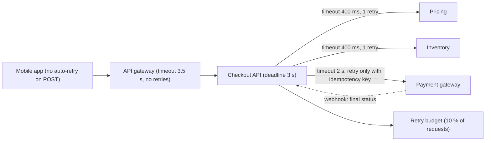
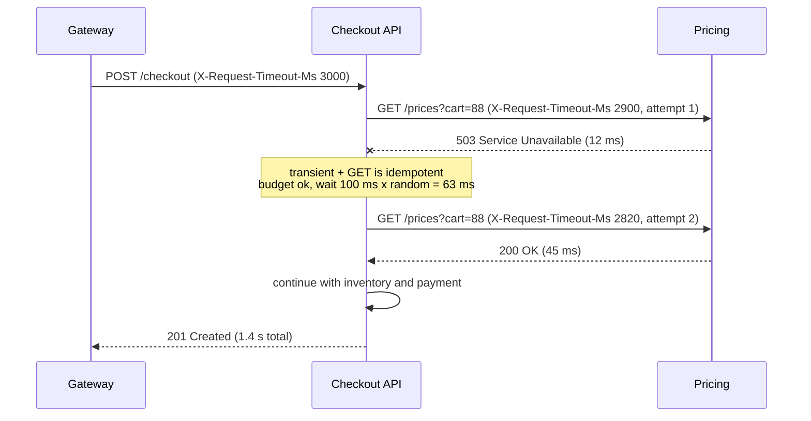

Remote calls fail in two ways: loudly (an error comes back) and quietly (nothing comes back). Quiet failures are the dangerous ones, because a caller that waits forever holds a thread, a connection and memory while it waits. Timeouts turn quiet failures into loud ones. Retries recover from loud failures that are temporary. Done carelessly, both make outages worse: a retry is extra load sent to a system that is already struggling. This lesson shows how to do both deliberately.

## Learning objectives

By the end of this lesson you will be able to:

1. Name the kinds of timeout (connect, per attempt, total, deadline) and choose values from latency percentiles.
2. Build a latency budget for a call chain and propagate the remaining deadline to downstream services.
3. Decide which failures are worth retrying, and which operations are safe to retry (idempotency).
4. Compute exponential backoff with full, equal and decorrelated jitter, and explain why jitter matters.
5. Explain retry amplification across layers and cap it with a retry budget.
6. Configure `HttpClient` timeouts correctly, use `Microsoft.Extensions.Http.Resilience`, and write a hand-rolled retry handler you can test.

## Prerequisites

- [HTTP fundamentals](#/lesson/m10-http-fundamentals): status codes and methods.
- [Idempotency keys](#/lesson/m10-idempotency): retrying a payment is only safe if the server can recognise the repeat.
- [Synchronous versus asynchronous communication](#/lesson/m10-sync-async): why a synchronous caller is stuck while it waits.

## Explain it like I'm a beginner

You phone a shop to ask if they have a part in stock.

- If nobody answers after 30 seconds, you hang up. Waiting an hour would waste your whole afternoon. That limit is a **timeout**.
- You try again, because maybe the line was just busy. That is a **retry**.
- If it fails again, you wait 1 minute, then 2, then 4 before calling, instead of calling non-stop. That is **exponential backoff**: each wait doubles.
- Now imagine 500 customers all had their call dropped at 10:00. If everyone waits exactly 1 minute, all 500 call again at 10:01 and jam the line again. If each waits a *random* time between 0 and 1 minute, the calls spread out. That randomness is **jitter**.
- You would never redial a "place my order" call without checking whether the first one went through, or you might get two parts and two bills. Only repeat actions that are safe to repeat (**idempotent** operations).
- Finally, if your boss needs an answer within 10 minutes, you don't start a 15-minute call. You know your remaining time, and you tell the shop: "I need an answer in 5 minutes." That is **deadline propagation**.

## First-principles explanation

### Our scenario

A grocery-delivery app's **Checkout API** calls three services for every order: Pricing (p50 40 ms, p99 250 ms), Inventory (p50 30 ms, p99 200 ms) and an external Payment gateway (p50 400 ms, p99 1,500 ms). Peak traffic is 300 checkouts per second during an evening sale. The product goal: checkout responds within 3 seconds for 99 % of users.

### Why timeouts are mandatory

A caller waiting on a hung dependency is not idle: it holds a request slot, a connection from the pool, memory for buffers, and the user's patience. Little's law makes this concrete: **requests in flight = arrival rate × time each request takes**.

- Healthy: 300 RPS × 0.5 s ≈ 150 checkouts in flight.
- Payment hangs and the timeout is .NET's default `HttpClient.Timeout` of **100 seconds**: 300 × 100 = **30,000** checkouts in flight. Connection pools, memory and the thread pool run out long before that, and *every* endpoint of the Checkout API becomes slow, including ones that never call Payment.
- With a 2-second attempt timeout: 300 × 2 = 600 in flight. Unpleasant, but survivable.

A timeout does not make the dependency faster. It **bounds the damage** a slow dependency can do to you.

### The four timeouts

| Timeout | What it bounds | .NET setting | Typical value |
|---|---|---|---|
| Connect | Establishing TCP (and TLS) | `SocketsHttpHandler.ConnectTimeout` (default: infinite, bounded only by the OS) | 1–3 s |
| Per attempt | One try, from sending to receiving the response headers | a linked `CancellationTokenSource`, or the resilience handler's attempt timeout | slightly above the dependency's p99 |
| Total | All attempts plus all waits | `HttpClient.Timeout` (applies to the whole handler pipeline) | fits the caller's budget |
| Deadline | The whole user request across every service | propagated budget + `CancellationToken` | from the product SLO |

**Choosing a per-attempt timeout.** Use the dependency's latency percentiles, not a round number. Payment's p99 is 1,500 ms, so an attempt timeout of about 2 s refuses only around 1 % of successful-but-slow calls. A timeout *below* p99 (say 1 s) would cut off many calls that were about to succeed, and every cut-off call followed by a retry doubles the work for that request.

**Timeouts are ambiguous.** When a call to the payment gateway times out, you don't know whether the charge happened. The request may have been processed and only the response lost. This is why timed-out *non-idempotent* calls must not be blindly retried.

### Latency budgets and deadline propagation

The 3-second checkout goal is a budget to share out:

```text
Checkout budget (p99):                           3,000 ms
  Gateway, auth, serialisation (estimate):          100 ms
  Pricing + Inventory in parallel (timeout 400):    400 ms
  Payment: 1 attempt (2,000) + 1 retry would need   2,000 + backoff + 2,000 = too much
  => Payment gets one attempt of 2,000 ms, plus at most one fast retry only on
     connection failure (which fails quickly), within the remaining ~500 ms
```

The arithmetic tells you something important: **there is no room for a full retry of a slow payment call within 3 seconds.** Either accept that the rare slow payment fails (and let the user retry with the same idempotency key), or move payment confirmation to an asynchronous flow ("we're confirming your payment…").

**Deadline propagation** means each service passes its *remaining* time to the next. If Checkout has 900 ms left when it calls Pricing, it tells Pricing "you have 850 ms" (keeping a little for the network). Pricing then stops work it cannot finish in time, instead of computing an answer nobody will read. gRPC does this natively (`grpc-timeout`). Over HTTP, use a header carrying a *relative* duration (milliseconds remaining), not an absolute time, so clock differences between machines do not matter. In .NET the in-process half is the `CancellationToken`: pass `HttpContext.RequestAborted` (or a token linked to your deadline) to every async call.

### Which failures should be retried?

Retry only failures that are likely to go away by themselves (transient):

| Outcome | Retry? | Why |
|---|---|---|
| Connection refused or reset, DNS hiccup | Yes | The request probably never reached the server |
| Attempt timeout | Only if the operation is idempotent | The server may have done the work |
| 502, 503, 504 | Yes | Gateway or overloaded server; often transient |
| 429 Too Many Requests | Yes, after `Retry-After` | The server told you when |
| 408 Request Timeout | Yes | The server gave up waiting for you |
| 500 Internal Server Error | Rarely; once at most | Often a bug that repeats every time |
| 400, 401, 403, 404, 409, 422 | No | Same request, same answer |
| Caller cancelled | Never | Nobody is waiting for the answer |

### Which operations are safe to retry?

HTTP defines `GET`, `HEAD`, `OPTIONS`, `PUT` and `DELETE` as **idempotent**: sending them twice has the same effect as sending once. `POST` and `PATCH` are not, in general. "Create payment of ₹1,249" sent twice can charge twice.

A POST becomes safe to retry when it carries an **idempotency key** the server remembers: the server sees the same key, recognises the repeat, and returns the original result instead of charging again ([Idempotency keys](#/lesson/m10-idempotency)). The rule for a retry layer is therefore: retry idempotent methods, plus POSTs that carry an idempotency key, and nothing else.

### Backoff: how long to wait

Retrying immediately hits the dependency again at its worst moment. **Exponential backoff** spaces attempts out:

`delay(n) = min(cap, base × 2^n)`, where n = 0 for the first retry.

With base = 200 ms and cap = 2 s: 200, 400, 800, 1,600, 2,000, 2,000 ms…

Backoff alone has a flaw. If a 5-second outage fails 10,000 requests at the same instant, all 10,000 retry at +200 ms, then all at +600 ms, then at +1,400 ms. The retries arrive in synchronised waves (a thundering herd) that can knock the recovering service down again. **Jitter** adds randomness so retries spread out. Three common formulas, where `random()` returns a number in [0, 1):

| Formula | Delay for retry n | Effect |
|---|---|---|
| Full jitter | `random() × min(cap, base × 2^n)` | Widest spread; some retries happen very soon |
| Equal jitter | `d/2 + random() × d/2`, with d = `min(cap, base × 2^n)` | Guarantees at least half the backoff |
| Decorrelated jitter | `min(cap, base + random() × (previous × 3 − base))` | Each delay depends on the last one; spreads well |

Marc Brooker's AWS Architecture Blog analysis (see references) simulated these and found that the jittered versions complete the same work with far fewer total calls than un-jittered exponential backoff, with full and decorrelated jitter performing well. You don't need to memorise which is best; **any jitter is dramatically better than none.**

### Retry amplification: the hidden multiplier

Suppose a mobile app, an API gateway, the Checkout API and its Payment client *each* make up to 3 attempts. When Payment is down, one user tap becomes 3 × 3 × 3 × 3 = **81** calls to Payment. At 300 taps per second, a struggling Payment service receives 24,300 RPS of retries. This is how a short blip becomes a long outage (a retry storm; see [Retry storms](#/lesson/m13-retry-storms)).

Defences:

1. **Retry at one layer only**, usually the one closest to the failing dependency, which knows the most about whether the failure is transient. Other layers fail fast and pass the error up.
2. **Cap attempts per request** (2–3 total attempts is typical for synchronous calls).
3. **A retry budget** per client: retries may be at most, say, 10 % of requests in the last 10 seconds, plus a small floor. When a dependency is healthy, retries are rare and always allowed; during an outage, the budget runs out and retries stop, so load stays at most about 1.1× normal.
4. **A circuit breaker** stops calling a dependency that is clearly down ([Circuit breaker](#/lesson/m10-circuit-breaker)).

### HttpClient timeouts in .NET

- `HttpClient.Timeout` (default **100 s**) covers the whole send, *including every retry inside its handler pipeline*. It throws `TaskCanceledException` whose `InnerException` is a `TimeoutException` (.NET 5+), so you can tell a timeout from caller cancellation.
- `SocketsHttpHandler.ConnectTimeout` bounds TCP + TLS setup. Set it explicitly.
- `SocketsHttpHandler.PooledConnectionLifetime` (for example 5 minutes) makes pooled connections pick up DNS changes; `IHttpClientFactory` also rotates handlers.
- With `HttpCompletionOption.ResponseHeadersRead`, the timeout covers only up to the headers; reading a large body afterwards is bounded by your `CancellationToken`, not by `HttpClient.Timeout`.

### The library you would normally use

`Microsoft.Extensions.Http.Resilience` (built on Polly v8) adds a standard pipeline to any `HttpClient` in one line:

```csharp
builder.Services.AddHttpClient<InventoryClient>(c => c.BaseAddress = new Uri("https://inventory.internal/"))
    .AddStandardResilienceHandler(o =>
    {
        o.AttemptTimeout.Timeout = TimeSpan.FromMilliseconds(400);
        o.TotalRequestTimeout.Timeout = TimeSpan.FromSeconds(1);
        o.Retry.MaxRetryAttempts = 2;
        o.Retry.BackoffType = DelayBackoffType.Exponential;
        o.Retry.UseJitter = true;
        o.Retry.Delay = TimeSpan.FromMilliseconds(100);
        o.CircuitBreaker.SamplingDuration = TimeSpan.FromSeconds(10);  // must be at least 2 × attempt timeout
    });
```

At the time of writing, the standard handler's defaults are: total timeout 30 s, up to 3 retries with exponential backoff and jitter starting at 2 s, a circuit breaker (10 % failure ratio over 30 s, at least 100 requests, 5 s break), and a 10 s attempt timeout. Those defaults are generous; for a user-facing call like ours, tighten them to your budget. By default its retry strategy handles transient failures for *every* HTTP method, POST included; to stop it retrying unsafe methods, call `o.Retry.DisableForUnsafeHttpMethods()` (available in recent versions of the package; check the docs for yours).

Use the library in production. We hand-roll a retry handler below for two reasons: to understand exactly what the library does, and because the checker that compiles this lesson has no NuGet access.

### When a simpler design is enough

- **Background jobs** that run from a durable queue usually should *not* retry in-process with backoff. Let the message go back to the queue and use the queue's redelivery and dead-letter features ([Retries and DLQs](#/lesson/m12-retries-dlq)).
- **A single internal call with an obvious fallback** (show cached recommendations) needs a timeout and a fallback, not a retry.
- **A user-triggered action** that can be repeated by the user (refresh a page) may need only a timeout and a clear error.

## Visual explanation

### Architecture: where each limit lives



The mobile app does not retry POSTs automatically; it shows an error and lets the user retry with the same idempotency key. The gateway has a slightly longer timeout than Checkout's deadline (3.5 s versus 3 s), so Checkout can return a meaningful error before the gateway gives up; it does not retry, which keeps amplification at one layer. Checkout calls Pricing and Inventory in parallel with tight timeouts and one retry each, and Payment with a timeout sized from its p99 and retries only for keyed requests. All retries draw from a shared retry budget. The dotted arrow is the safety net for ambiguous timeouts: the payment gateway later sends a webhook with the final status, so a timed-out payment is resolved instead of guessed.

### Sequence: a transient failure, a backoff, and the deadline



The first attempt fails quickly with a 503, which is transient. Because the request is a GET, it is safe to repeat. Before waiting, the retry handler checks the remaining budget; there is plenty, so it sleeps for a jittered delay (here 63 ms, a random fraction of the 100 ms base). The second attempt carries a *smaller* remaining budget in its header, because time has passed: that is deadline propagation in action. Pricing answers, and checkout continues. If the budget had been nearly used up, the handler would have returned the 503 immediately rather than sleeping and retrying pointlessly.

## Step-by-step example

Let's size a retry policy for the Inventory call with numbers.

1. **Attempt timeout.** Inventory p99 is 200 ms. Choose 400 ms: well above p99, so very few healthy calls are cut off.
2. **Budget.** Pricing and Inventory run in parallel within 900 ms of the checkout budget.
3. **How many attempts fit?** Worst case for 2 attempts: 400 + backoff + 400. With base 100 ms and full jitter, backoff is at most 100 ms: 400 + 100 + 400 = 900 ms. Exactly fits. A third attempt (+200 ms backoff + 400) would not. So: **max 1 retry**.
4. **What to retry.** Connection failures, 503, 504, attempt timeouts (GET is idempotent). Not 404 ("SKU not found" is a real answer).
5. **Amplification check.** Healthy error rate is about 0.5 %, so retries add about 0.5 % load. During an outage, every call fails, and 1 retry would double load on Inventory. The retry budget caps this at +10 %: 300 RPS × 1.1 = 330 RPS instead of 600.
6. **Total timeout as a backstop.** Set `HttpClient.Timeout` to 1 s for this client, so even a bug in the retry logic cannot hold a request longer.

## Production-style C# implementation

Project structure:

```text
Checkout.Api/
  Program.cs
  Resilience/RetryOptions.cs
  Resilience/BackoffCalculator.cs
  Resilience/RetryClassifier.cs
  Resilience/RetryHandler.cs
  Resilience/Deadlines.cs
  Clients/DownstreamClients.cs
```

### Options and backoff

```csharp file=Resilience/RetryOptions.cs
namespace Checkout.Resilience;

public enum JitterMode { None, Full, Equal, Decorrelated }

public sealed class RetryOptions
{
    /// <summary>Retries after the first attempt. 1 means at most 2 attempts in total.</summary>
    public int MaxRetries { get; set; } = 1;
    public TimeSpan BaseDelay { get; set; } = TimeSpan.FromMilliseconds(100);
    public TimeSpan MaxDelay { get; set; } = TimeSpan.FromSeconds(2);
    public JitterMode Jitter { get; set; } = JitterMode.Full;
    public TimeSpan AttemptTimeout { get; set; } = TimeSpan.FromMilliseconds(400);
    /// <summary>Never wait longer than this even if the server's Retry-After asks for more.</summary>
    public TimeSpan MaxRetryAfter { get; set; } = TimeSpan.FromSeconds(5);
    /// <summary>Don't start an attempt unless at least this much of the deadline remains.</summary>
    public TimeSpan MinimumAttemptTime { get; set; } = TimeSpan.FromMilliseconds(50);
}
```

```csharp file=Resilience/BackoffCalculator.cs
namespace Checkout.Resilience;

public static class BackoffCalculator
{
    /// <summary>min(cap, base × 2^retryIndex), safe against overflow for large indexes.</summary>
    public static TimeSpan Exponential(int retryIndex, TimeSpan baseDelay, TimeSpan cap)
    {
        ArgumentOutOfRangeException.ThrowIfNegative(retryIndex);
        var ms = baseDelay.TotalMilliseconds * Math.Pow(2, Math.Min(retryIndex, 30));
        return TimeSpan.FromMilliseconds(Math.Min(ms, cap.TotalMilliseconds));
    }

    /// <summary>Delay before retry number retryIndex (0-based). previous is the last delay used
    /// (needed by decorrelated jitter).</summary>
    public static TimeSpan Next(RetryOptions o, int retryIndex, TimeSpan previous, Func<double> random)
    {
        var d = Exponential(retryIndex, o.BaseDelay, o.MaxDelay);
        return o.Jitter switch
        {
            JitterMode.None => d,
            JitterMode.Full => TimeSpan.FromMilliseconds(random() * d.TotalMilliseconds),
            JitterMode.Equal => TimeSpan.FromMilliseconds(d.TotalMilliseconds / 2 + random() * d.TotalMilliseconds / 2),
            JitterMode.Decorrelated => Decorrelated(previous, o.BaseDelay, o.MaxDelay, random),
            _ => d,
        };
    }

    public static TimeSpan Decorrelated(TimeSpan previous, TimeSpan baseDelay, TimeSpan cap, Func<double> random)
    {
        var low = baseDelay.TotalMilliseconds;
        var high = Math.Max(low, previous.TotalMilliseconds * 3);
        return TimeSpan.FromMilliseconds(Math.Min(cap.TotalMilliseconds, low + random() * (high - low)));
    }
}
```

The random source is a `Func<double>` so tests can pass a fixed value; production passes `Random.Shared.NextDouble`. Clamping the exponent at 30 prevents `2^n` from overflowing for silly retry counts.

### What to retry

```csharp file=Resilience/RetryClassifier.cs
using System.Net;

namespace Checkout.Resilience;

public static class RetryClassifier
{
    public const string IdempotencyKeyHeader = "Idempotency-Key";

    /// <summary>Repeating the request must not cause a second side effect.</summary>
    public static bool IsRetrySafe(HttpRequestMessage request)
    {
        var m = request.Method;
        if (m == HttpMethod.Get || m == HttpMethod.Head || m == HttpMethod.Options || m == HttpMethod.Put || m == HttpMethod.Delete)
            return true;
        return request.Headers.Contains(IdempotencyKeyHeader);   // a POST the server can de-duplicate
    }

    public static bool IsTransient(HttpStatusCode status) => status is
        HttpStatusCode.RequestTimeout or            // 408
        HttpStatusCode.TooManyRequests or           // 429
        HttpStatusCode.BadGateway or                // 502
        HttpStatusCode.ServiceUnavailable or        // 503
        HttpStatusCode.GatewayTimeout;              // 504
}
```

### The retry handler

```csharp file=Resilience/RetryHandler.cs
using System.Runtime.ExceptionServices;
using Microsoft.Extensions.Options;

namespace Checkout.Resilience;

/// <summary>Retries transient failures of retry-safe requests with jittered exponential backoff,
/// a per-attempt timeout, Retry-After support and a deadline check. Register it as the OUTER handler,
/// so each attempt goes through the inner handlers (for example deadline propagation) again.</summary>
public sealed class RetryHandler(IOptions<RetryOptions> options, IDeadlineAccessor deadline, TimeProvider clock,
    ILogger<RetryHandler> logger) : DelegatingHandler
{
    private readonly RetryOptions _o = options.Value;

    protected override async Task<HttpResponseMessage> SendAsync(HttpRequestMessage request, CancellationToken cancellationToken)
    {
        var retrySafe = RetryClassifier.IsRetrySafe(request);
        var previousDelay = _o.BaseDelay;

        for (var retry = 0; ; retry++)
        {
            HttpResponseMessage? response = null;
            ExceptionDispatchInfo? failure = null;

            using (var attemptTimeout = new CancellationTokenSource(_o.AttemptTimeout, clock))
            using (var linked = CancellationTokenSource.CreateLinkedTokenSource(cancellationToken, attemptTimeout.Token))
            {
                try
                {
                    response = await base.SendAsync(request, linked.Token);
                }
                catch (OperationCanceledException) when (!cancellationToken.IsCancellationRequested)
                {
                    // Our attempt timeout fired, not the caller's token.
                    failure = ExceptionDispatchInfo.Capture(new TimeoutException(
                        $"{request.Method} {request.RequestUri} attempt {retry + 1} exceeded {_o.AttemptTimeout.TotalMilliseconds} ms"));
                }
                catch (HttpRequestException ex)
                {
                    failure = ExceptionDispatchInfo.Capture(ex);       // connection refused, reset, DNS…
                }
            }

            var transient = response is null || RetryClassifier.IsTransient(response.StatusCode);
            if (!transient || !retrySafe || retry >= _o.MaxRetries)
                return response ?? Fail(failure!);

            var delay = BackoffCalculator.Next(_o, retry, previousDelay, Random.Shared.NextDouble);
            if (response?.Headers.RetryAfter?.Delta is { } serverAsked)
                delay = serverAsked > _o.MaxRetryAfter ? _o.MaxRetryAfter : (serverAsked > delay ? serverAsked : delay);

            if (deadline.Remaining is { } remaining && remaining < delay + _o.MinimumAttemptTime)
            {
                logger.LogInformation("Not retrying {Method} {Uri}: {Remaining} ms left in the deadline",
                    request.Method, request.RequestUri, (int)remaining.TotalMilliseconds);
                return response ?? Fail(failure!);
            }

            logger.LogWarning("Retrying {Method} {Uri} after {Delay} ms (retry {Retry} of {Max}); last result {Result}",
                request.Method, request.RequestUri, (int)delay.TotalMilliseconds, retry + 1, _o.MaxRetries,
                response is null ? "exception" : ((int)response.StatusCode).ToString());
            response?.Dispose();
            previousDelay = delay;
            await Task.Delay(delay, clock, cancellationToken);
        }
    }

    private static HttpResponseMessage Fail(ExceptionDispatchInfo failure)
    {
        failure.Throw();
        return null!;   // unreachable
    }
}
```

Points worth reading twice:

- **Caller cancellation is never retried.** The `when (!cancellationToken.IsCancellationRequested)` filter separates "my attempt timed out" from "the user went away". If the caller cancelled, the `OperationCanceledException` propagates immediately.
- **Non-transient responses are returned, not thrown.** A 404 is a valid answer; the typed client decides what it means.
- **`Retry-After` wins over our backoff**, but is capped, so a server cannot park our request for an hour.
- **The deadline check happens before sleeping.** Sleeping 800 ms when only 500 ms remain wastes resources and guarantees failure.
- **Re-sending the same `HttpRequestMessage`** works in .NET when its content is buffered (`StringContent`, `ByteArrayContent`). Streamed content cannot be sent twice; the resilience library snapshots requests for this reason.

### Deadline propagation

```csharp file=Resilience/Deadlines.cs
using System.Globalization;
using Microsoft.Extensions.Options;

namespace Checkout.Resilience;

public sealed record RequestDeadline(DateTimeOffset ExpiresAt);

public sealed class DeadlineOptions
{
    public const string Header = "X-Request-Timeout-Ms";
    public TimeSpan DefaultBudget { get; set; } = TimeSpan.FromSeconds(3);
    public TimeSpan MaxBudget { get; set; } = TimeSpan.FromSeconds(10);
    /// <summary>Kept back when forwarding, for network time and our own response work.</summary>
    public TimeSpan ForwardingMargin { get; set; } = TimeSpan.FromMilliseconds(50);
}

public interface IDeadlineAccessor
{
    /// <summary>Time left for the current inbound request, or null outside a request.</summary>
    TimeSpan? Remaining { get; }
}

public sealed class HttpContextDeadlineAccessor(IHttpContextAccessor accessor, TimeProvider clock) : IDeadlineAccessor
{
    public TimeSpan? Remaining =>
        accessor.HttpContext?.Features.Get<RequestDeadline>() is { } d ? d.ExpiresAt - clock.GetUtcNow() : null;
}

/// <summary>Reads the caller's remaining budget (relative milliseconds, so clock skew doesn't matter),
/// caps it, stores the deadline, and cancels RequestAborted when it passes.</summary>
public sealed class DeadlineMiddleware(RequestDelegate next, IOptions<DeadlineOptions> options, TimeProvider clock)
{
    public async Task InvokeAsync(HttpContext context)
    {
        var o = options.Value;
        var budget = o.DefaultBudget;
        if (long.TryParse(context.Request.Headers[DeadlineOptions.Header], NumberStyles.None, CultureInfo.InvariantCulture, out var ms) && ms > 0)
            budget = TimeSpan.FromMilliseconds(Math.Min(ms, o.MaxBudget.TotalMilliseconds));

        context.Features.Set(new RequestDeadline(clock.GetUtcNow() + budget));
        using var timeout = new CancellationTokenSource(budget, clock);
        using var linked = CancellationTokenSource.CreateLinkedTokenSource(context.RequestAborted, timeout.Token);
        context.RequestAborted = linked.Token;     // everything downstream that honours the token now stops on time
        await next(context);
    }
}

/// <summary>Inner handler: stamps each outgoing attempt with the time still available.</summary>
public sealed class DeadlinePropagationHandler(IDeadlineAccessor deadline, IOptions<DeadlineOptions> options) : DelegatingHandler
{
    protected override Task<HttpResponseMessage> SendAsync(HttpRequestMessage request, CancellationToken cancellationToken)
    {
        if (deadline.Remaining is { } remaining)
        {
            var forward = remaining - options.Value.ForwardingMargin;
            if (forward <= TimeSpan.Zero)
                throw new TimeoutException("The request deadline has passed; not calling downstream.");
            request.Headers.Remove(DeadlineOptions.Header);
            request.Headers.TryAddWithoutValidation(DeadlineOptions.Header,
                ((long)forward.TotalMilliseconds).ToString(CultureInfo.InvariantCulture));
        }
        return base.SendAsync(request, cancellationToken);
    }
}
```

The handler is registered *inside* the retry handler, so each attempt gets a freshly computed (smaller) budget, exactly as the sequence diagram showed. Accepting the header only up to `MaxBudget` stops a caller from asking you to work for an hour.

### Typed clients and wiring

```csharp file=Clients/DownstreamClients.cs
using System.Net;
using System.Text;
using System.Text.Json;
using Checkout.Resilience;

namespace Checkout.Clients;

public sealed record Price(string Sku, decimal Amount);
public sealed record ChargeRequest(string OrderId, decimal Amount, string Currency);
public sealed record ChargeResult(string ChargeId, string Status);

public sealed class PricingClient(HttpClient http)
{
    public async Task<IReadOnlyList<Price>> GetPricesAsync(string cartId, CancellationToken ct)
    {
        using var response = await http.GetAsync($"v1/prices?cart={Uri.EscapeDataString(cartId)}", ct);
        response.EnsureSuccessStatusCode();
        return await response.Content.ReadFromJsonAsync<List<Price>>(ct) ?? [];
    }
}

public sealed class PaymentClient(HttpClient http)
{
    /// <summary>The idempotency key is derived from the order, so a user's retry of the same checkout
    /// reuses it and the gateway can never charge twice.</summary>
    public async Task<ChargeResult?> ChargeAsync(ChargeRequest charge, CancellationToken ct)
    {
        using var request = new HttpRequestMessage(HttpMethod.Post, "v1/charges")
        {
            Content = new StringContent(JsonSerializer.Serialize(charge), Encoding.UTF8, "application/json"),
        };
        request.Headers.Add(RetryClassifier.IdempotencyKeyHeader, $"order-{charge.OrderId}");
        using var response = await http.SendAsync(request, ct);
        if (response.StatusCode == HttpStatusCode.Conflict) return null;    // same key, different body: a bug upstream
        response.EnsureSuccessStatusCode();
        return await response.Content.ReadFromJsonAsync<ChargeResult>(ct);
    }
}
```

```csharp file=Program.cs
using Checkout.Clients;
using Checkout.Resilience;

var builder = WebApplication.CreateBuilder(args);

builder.Services.AddSingleton(TimeProvider.System);
builder.Services.AddHttpContextAccessor();
builder.Services.AddSingleton<IDeadlineAccessor, HttpContextDeadlineAccessor>();
builder.Services.Configure<DeadlineOptions>(builder.Configuration.GetSection("Resilience:Deadline"));
builder.Services.Configure<RetryOptions>(builder.Configuration.GetSection("Resilience:Retry"));
builder.Services.AddTransient<RetryHandler>();
builder.Services.AddTransient<DeadlinePropagationHandler>();

static SocketsHttpHandler PrimaryHandler() => new()
{
    ConnectTimeout = TimeSpan.FromSeconds(2),              // the default is effectively unbounded
    PooledConnectionLifetime = TimeSpan.FromMinutes(5),    // pick up DNS changes
};

builder.Services.AddHttpClient<PricingClient>(c =>
    {
        c.BaseAddress = new Uri("https://pricing.internal/");
        c.Timeout = TimeSpan.FromSeconds(1);               // total, across all attempts: a backstop
    })
    .ConfigurePrimaryHttpMessageHandler(PrimaryHandler)
    .AddHttpMessageHandler<RetryHandler>()                 // outer: loops over attempts
    .AddHttpMessageHandler<DeadlinePropagationHandler>();  // inner: runs once per attempt

builder.Services.AddHttpClient<PaymentClient>(c =>
    {
        c.BaseAddress = new Uri("https://payments.example.com/");
        c.Timeout = TimeSpan.FromSeconds(2.5);
    })
    .ConfigurePrimaryHttpMessageHandler(PrimaryHandler)
    .AddHttpMessageHandler<RetryHandler>()
    .AddHttpMessageHandler<DeadlinePropagationHandler>();

var app = builder.Build();
app.UseMiddleware<DeadlineMiddleware>();

app.MapPost("/checkout/{cartId}", async (string cartId, PricingClient pricing, PaymentClient payments, HttpContext http) =>
{
    var ct = http.RequestAborted;                          // cancelled by the deadline middleware too
    try
    {
        var prices = await pricing.GetPricesAsync(cartId, ct);
        var total = prices.Sum(p => p.Amount);
        var result = await payments.ChargeAsync(new ChargeRequest(cartId, total, "INR"), ct);
        return result is null ? Results.Conflict() : Results.Created($"/orders/{cartId}", result);
    }
    catch (Exception ex) when (ex is TimeoutException or TaskCanceledException { InnerException: TimeoutException })
    {
        // Ambiguous for payment: tell the client to check the order status, not to pay again.
        return Results.Problem("Checkout is taking longer than expected. Check your order status before retrying.",
            statusCode: StatusCodes.Status504GatewayTimeout);
    }
});

app.Run();
```

The handler order is the key wiring decision: `AddHttpMessageHandler` adds handlers from outer to inner. The retry handler is outer, so it loops, and each loop goes through the deadline handler, which stamps a fresh budget. `HttpClient.Timeout` wraps the whole pipeline: it is the *total* timeout, a backstop if the per-attempt logic is misconfigured. In a real service, both clients would share one `RetryOptions` only if their dependencies behave alike; otherwise use named options per client.

## Bad design vs good design

**Bad:**

```csharp
for (var i = 0; i < 5; i++)
{
    try { return await http.PostAsJsonAsync("v1/charges", charge); }   // POST, no idempotency key
    catch { }                                                           // swallows 400s, bugs, cancellation
}
// HttpClient.Timeout left at 100 s; no delay between tries; mobile app and gateway also retry 3×
```

Why it hurts: five immediate retries of a non-idempotent payment can charge a customer several times after a timeout. `catch { }` retries permanent errors and even the caller's cancellation. With the 100-second default, each attempt can hold a connection for up to 100 s, so one hung gateway exhausts the pool. And stacked with retries in the app and gateway, a single tap can become 3 × 3 × 5 = 45 payment attempts.

**Good:** the implementation above. A per-attempt timeout from p99, a total timeout as a backstop, retries only for transient failures of idempotent or keyed requests, jittered backoff, `Retry-After` honoured and capped, the deadline checked before sleeping, retries in one layer, and an honest "check your order status" message when the outcome is unknown.

:::callout type=warning title="Timeouts are not failures of the server"
When a POST times out, the server may have succeeded. Before retrying, you need a way to find out: an idempotency key (the safe retry returns the original result), a status endpoint, or a webhook. Never show "Payment failed, please pay again" after a timeout.
:::

:::callout type=tradeoff title="Retrying at the edge vs near the dependency"
Retrying close to the failing dependency uses the most specific knowledge (status codes, idempotency). Retrying at the edge (the app) covers more failure types, including the network between the user and you. Pick one layer per call path. Most teams retry in the service client and keep gateways and apps retry-free for non-idempotent calls.
:::

## Practical playground

The retry simulator sends traffic from 500 clients to a dependency with capacity 1,000 RPS. Between seconds 10 and 25 an incident fails 40 % of requests. Watch the load on the dependency (attempts per second) compared with its capacity.

:::playground type=sim sim=retry title="Retry storms, backoff and jitter" failureRate=0.4 maxRetries=3 backoff=false jitter=false
:::

Try this:

1. With no backoff and no jitter, what is the peak load as a multiple of capacity? Does the system recover right after the incident ends at second 25, or later?
2. Turn on backoff only. What happens to the peak, and to the shape of the load curve (smooth or in waves)?
3. Turn on jitter as well. Compare the peak and the time to recover.
4. Increase `maxRetries` to 8 with backoff and jitter on. Does the success rate improve much? What does it cost in load?
5. Raise the failure rate to 0.9. Which setting would you add next that the simulator does not have? (Hint: a budget or a breaker.)

## Exercises

:::exercise id=m10-timeouts-retries-ex1 difficulty=beginner kind=code title="Exponential backoff and jitter formulas"
Implement the four delay functions in `Backoff`. The random source is passed in as `Func<double>` returning a value in [0, 1).
::requirements
- `Exponential(retryIndex, base, cap)` = min(cap, base × 2^retryIndex). `retryIndex` starts at 0; negative throws `ArgumentOutOfRangeException`. Large indexes (60) must return `cap` without overflow.
- `FullJitter` = random() × Exponential(...).
- `EqualJitter` = d/2 + random() × d/2 where d = Exponential(...).
- `Decorrelated(previous, base, cap, random)` = min(cap, base + random() × (max(base, previous × 3) − base)).
::acceptance
- Base 200 ms, cap 2 s: retries 0–4 give 200, 400, 800, 1,600, 2,000 ms.
- Full jitter with random 0.5 at retry 2 gives 400 ms; with random 0 gives 0.
- Equal jitter with random 0 at retry 2 gives 400 ms (half of 800), with random 0.999… just under 800 ms.
- Decorrelated jitter with previous 1 s, base 100 ms, random 1.0 is capped at the cap.
::hint
Work in milliseconds as `double`, then convert back with `TimeSpan.FromMilliseconds`.
::hint
`Math.Pow(2, n)` grows quickly. Clamp `n` (say at 30) before calling it, or compare against the cap first.
::hint
Every jitter formula starts from the plain exponential delay. Write `Exponential` first and reuse it.
::hint
```csharp
var ms = baseDelay.TotalMilliseconds * Math.Pow(2, Math.Min(retryIndex, 30));
return TimeSpan.FromMilliseconds(Math.Min(ms, cap.TotalMilliseconds));
```
::starter
```csharp file=Backoff.cs
using System;

namespace RetryEx1;

public static class Backoff
{
    public static TimeSpan Exponential(int retryIndex, TimeSpan baseDelay, TimeSpan cap) => throw new NotImplementedException();

    public static TimeSpan FullJitter(int retryIndex, TimeSpan baseDelay, TimeSpan cap, Func<double> random) => throw new NotImplementedException();

    public static TimeSpan EqualJitter(int retryIndex, TimeSpan baseDelay, TimeSpan cap, Func<double> random) => throw new NotImplementedException();

    public static TimeSpan Decorrelated(TimeSpan previous, TimeSpan baseDelay, TimeSpan cap, Func<double> random) => throw new NotImplementedException();
}
```
::tests
```csharp file=BackoffTests.cs
using System;
using Xunit;
using RetryEx1;

public class BackoffTests
{
    private static readonly TimeSpan Base = TimeSpan.FromMilliseconds(200);
    private static readonly TimeSpan Cap = TimeSpan.FromSeconds(2);

    [Theory]
    [InlineData(0, 200)]
    [InlineData(1, 400)]
    [InlineData(2, 800)]
    [InlineData(3, 1600)]
    [InlineData(4, 2000)]
    [InlineData(60, 2000)]
    public void Exponential_doubles_and_caps(int retry, double expectedMs) =>
        Assert.Equal(expectedMs, Backoff.Exponential(retry, Base, Cap).TotalMilliseconds, 3);

    [Fact]
    public void Negative_retry_index_throws() =>
        Assert.Throws<ArgumentOutOfRangeException>(() => Backoff.Exponential(-1, Base, Cap));

    [Fact]
    public void Full_jitter_scales_the_whole_delay()
    {
        Assert.Equal(400, Backoff.FullJitter(2, Base, Cap, () => 0.5).TotalMilliseconds, 3);
        Assert.Equal(0, Backoff.FullJitter(2, Base, Cap, () => 0.0).TotalMilliseconds, 3);
    }

    [Fact]
    public void Equal_jitter_keeps_at_least_half()
    {
        Assert.Equal(400, Backoff.EqualJitter(2, Base, Cap, () => 0.0).TotalMilliseconds, 3);
        Assert.InRange(Backoff.EqualJitter(2, Base, Cap, () => 0.9999).TotalMilliseconds, 799, 800);
    }

    [Fact]
    public void Decorrelated_grows_from_previous_and_caps()
    {
        var b = TimeSpan.FromMilliseconds(100);
        Assert.Equal(100, Backoff.Decorrelated(TimeSpan.Zero, b, Cap, () => 0.7).TotalMilliseconds, 3);
        Assert.Equal(380, Backoff.Decorrelated(TimeSpan.FromMilliseconds(500), b, Cap, () => 0.2).TotalMilliseconds, 3);
        Assert.Equal(2000, Backoff.Decorrelated(TimeSpan.FromSeconds(1), b, Cap, () => 1.0).TotalMilliseconds, 3);
    }
}
```
::solution
Write the plain exponential first, then express each jitter variant in terms of it.

```csharp file=Backoff.cs
using System;

namespace RetryEx1;

public static class Backoff
{
    public static TimeSpan Exponential(int retryIndex, TimeSpan baseDelay, TimeSpan cap)
    {
        ArgumentOutOfRangeException.ThrowIfNegative(retryIndex);
        var ms = baseDelay.TotalMilliseconds * Math.Pow(2, Math.Min(retryIndex, 30));
        return TimeSpan.FromMilliseconds(Math.Min(ms, cap.TotalMilliseconds));
    }

    public static TimeSpan FullJitter(int retryIndex, TimeSpan baseDelay, TimeSpan cap, Func<double> random) =>
        TimeSpan.FromMilliseconds(random() * Exponential(retryIndex, baseDelay, cap).TotalMilliseconds);

    public static TimeSpan EqualJitter(int retryIndex, TimeSpan baseDelay, TimeSpan cap, Func<double> random)
    {
        var d = Exponential(retryIndex, baseDelay, cap).TotalMilliseconds;
        return TimeSpan.FromMilliseconds(d / 2 + random() * d / 2);
    }

    public static TimeSpan Decorrelated(TimeSpan previous, TimeSpan baseDelay, TimeSpan cap, Func<double> random)
    {
        var low = baseDelay.TotalMilliseconds;
        var high = Math.Max(low, previous.TotalMilliseconds * 3);
        return TimeSpan.FromMilliseconds(Math.Min(cap.TotalMilliseconds, low + random() * (high - low)));
    }
}
```

Check the second decorrelated case by hand: previous 500 ms gives high = 1,500 ms and low = 100 ms, so the delay is 100 + 0.2 × (1,500 − 100) = 380 ms. Each delay grows from the *previous* one (up to 3×) rather than from the attempt number, which spreads clients apart quickly. Working one value out on paper like this is the fastest way to catch a formula bug.
::mistakes
- Starting `retryIndex` at 1, so the first retry waits 2 × base.
- Applying jitter *before* the cap, so the cap can be exceeded.
- Using `new Random()` inside the method, which makes tests non-deterministic and, on older runtimes, produced identical sequences when created in quick succession.
::extensions
Plot 1,000 samples of each formula for retries 0–5 (for example into a CSV) and compare how evenly they spread.
:::

:::exercise id=m10-timeouts-retries-ex2 difficulty=beginner kind=written title="Retry or not?"
For each failure, say whether the retry layer in the Checkout API should retry it, and why. Assume no circuit breaker yet.

1. `GET /v1/prices` returns 503 after 15 ms.
2. `POST /v1/charges` with an `Idempotency-Key` header times out after 2 s.
3. `POST /v1/charges` without an idempotency key gets "connection refused".
4. `PUT /v1/carts/88/address` returns 409 Conflict.
5. `GET /v1/stock/sku-42` returns 404.
6. `GET /v1/prices` returns 429 with `Retry-After: 30`, and the checkout deadline has 900 ms left.
7. `DELETE /v1/reservations/77` returns 500 three times in a row in the logs this hour.
8. The user closes the app and the request's `CancellationToken` is cancelled while waiting on Inventory.
::acceptance
- Each answer considers both "is the failure transient?" and "is the operation safe to repeat?".
- Case 3 recognises that "connection refused" means the request never reached the server.
- Case 6 respects the deadline and does not wait 30 s.
- Case 8 never retries.
::hint
Two questions every time: could the problem go away by itself, and would doing it twice hurt?
::hint
"Connection refused" happens before any byte of the request is processed.
::hint
A `Retry-After` longer than your remaining budget means "fail now".
::hint
A 500 that repeats every time is probably a bug, not a blip.
::solution
1. **Retry.** 503 is transient and GET is idempotent.
2. **Retry**, because the key makes it safe: the gateway returns the original result if the first attempt succeeded. Check the deadline first; a 2 s timeout plus another 2 s attempt may not fit.
3. **Retry is acceptable.** Connection refused means the server never received the request, so even a non-idempotent POST cannot have taken effect. Many libraries still refuse to retry unsafe methods at all, which is the conservative choice; adding an idempotency key removes the doubt.
4. **No.** 409 is a real answer (state conflict); the same request gives the same answer.
5. **No.** "Not found" is a valid response.
6. **No.** The server asked for 30 s and only 900 ms remain. Fail fast (or serve a cached price if the business allows) rather than waiting past the deadline.
7. **At most once, probably not at all.** Repeated 500s suggest a bug. DELETE is idempotent so a single retry is harmless, but the real fix is an alert.
8. **Never.** Nobody is waiting for the answer; retrying only wastes capacity.
::mistakes
- Treating every timeout as safe to retry.
- Retrying 4xx responses "just in case".
- Forgetting that a retry must fit inside the remaining deadline.
:::

:::exercise id=m10-timeouts-retries-ex3 difficulty=intermediate kind=code title="A retry executor with a total budget"
Implement `RetryExecutor.ExecuteAsync`. It runs an operation, retries exceptions the classifier calls transient with exponential backoff (no jitter, so tests are deterministic), and stops early if the next wait would push total elapsed time past `totalBudget`.
::requirements
- Delay before retry n (0-based) = min(maxDelay, baseDelay × 2^n). Record every delay used in `DelaysUsed`.
- Waiting is done through the injected `delay` function (tests pass one that advances a manual clock).
- Elapsed time is measured with the injected `TimeProvider` from the first call.
- Before waiting: if elapsed + delay > totalBudget, stop and rethrow the last exception.
- A non-transient exception is rethrown immediately. After `maxRetries` retries, rethrow the last exception.
- `OperationCanceledException` when the caller's token is cancelled is never retried and never passed to the classifier.
::acceptance
- Success on the first call: no delays.
- Two transient failures then success: returns the value, delays 100 ms and 200 ms.
- A non-transient failure: one call, exception rethrown.
- With maxRetries 3 and permanent transient failures: 4 calls, then the exception.
- With a 1 s budget, base 300 ms, and operations that take 200 ms: exactly 2 calls and one 300 ms delay.
::hint
A `for (var retry = 0; ; retry++)` loop with `try { return await operation(ct); } catch (...) when (...)` is the usual shape.
::hint
Use exception filters: `catch (Exception ex) when (!ct.IsCancellationRequested && isTransient(ex))`. Anything that doesn't match the filter propagates on its own.
::hint
Inside the catch: if `retry >= maxRetries`, `throw;`. Compute the delay; if `elapsed + delay > totalBudget`, `throw;`. Otherwise record and await the delay.
::hint
Elapsed = `clock.GetUtcNow() - start`, where `start` was read before the first attempt.
::hint
```csharp
catch (Exception ex) when (!ct.IsCancellationRequested && isTransient(ex))
{
    if (retry >= maxRetries) throw;
    var wait = Delay(retry);
    if (clock.GetUtcNow() - start + wait > totalBudget) throw;
    _delays.Add(wait);
    await delay(wait, ct);
}
```
::starter
```csharp file=RetryExecutor.cs
using System;
using System.Collections.Generic;
using System.Threading;
using System.Threading.Tasks;

namespace RetryEx3;

public sealed class ManualClock(DateTimeOffset start) : TimeProvider
{
    private DateTimeOffset _now = start;
    public override DateTimeOffset GetUtcNow() => _now;
    public void Advance(TimeSpan by) => _now += by;
}

public sealed class RetryExecutor(int maxRetries, TimeSpan baseDelay, TimeSpan maxDelay, TimeSpan totalBudget,
    TimeProvider clock, Func<TimeSpan, CancellationToken, Task> delay)
{
    public IReadOnlyList<TimeSpan> DelaysUsed => throw new NotImplementedException();

    public Task<T> ExecuteAsync<T>(Func<CancellationToken, Task<T>> operation, Func<Exception, bool> isTransient,
        CancellationToken ct = default) => throw new NotImplementedException();
}
```
::tests
```csharp file=RetryExecutorTests.cs
using System;
using System.Threading;
using System.Threading.Tasks;
using Xunit;
using RetryEx3;

public class TransientException : Exception { }
public class PermanentException : Exception { }

public class RetryExecutorTests
{
    private static (RetryExecutor, ManualClock) Make(int maxRetries = 3, int baseMs = 100, int budgetMs = 10_000)
    {
        var clock = new ManualClock(new DateTimeOffset(2026, 5, 1, 12, 0, 0, TimeSpan.Zero));
        var exec = new RetryExecutor(maxRetries, TimeSpan.FromMilliseconds(baseMs), TimeSpan.FromSeconds(2),
            TimeSpan.FromMilliseconds(budgetMs), clock, (d, _) => { clock.Advance(d); return Task.CompletedTask; });
        return (exec, clock);
    }

    private static bool Transient(Exception e) => e is TransientException;

    [Fact]
    public async Task Success_needs_no_delay()
    {
        var (exec, _) = Make();
        Assert.Equal(42, await exec.ExecuteAsync(_ => Task.FromResult(42), Transient));
        Assert.Empty(exec.DelaysUsed);
    }

    [Fact]
    public async Task Retries_transient_failures_with_backoff()
    {
        var (exec, _) = Make();
        var calls = 0;
        var result = await exec.ExecuteAsync(_ => ++calls < 3 ? throw new TransientException() : Task.FromResult("ok"), Transient);
        Assert.Equal("ok", result);
        Assert.Equal(new[] { TimeSpan.FromMilliseconds(100), TimeSpan.FromMilliseconds(200) }, exec.DelaysUsed);
    }

    [Fact]
    public async Task Permanent_failure_is_not_retried()
    {
        var (exec, _) = Make();
        var calls = 0;
        await Assert.ThrowsAsync<PermanentException>(() =>
            exec.ExecuteAsync<int>(_ => { calls++; throw new PermanentException(); }, Transient));
        Assert.Equal(1, calls);
    }

    [Fact]
    public async Task Gives_up_after_max_retries()
    {
        var (exec, _) = Make(maxRetries: 3);
        var calls = 0;
        await Assert.ThrowsAsync<TransientException>(() =>
            exec.ExecuteAsync<int>(_ => { calls++; throw new TransientException(); }, Transient));
        Assert.Equal(4, calls);
    }

    [Fact]
    public async Task Stops_when_the_next_wait_would_exceed_the_budget()
    {
        var (exec, clock) = Make(maxRetries: 5, baseMs: 300, budgetMs: 1000);
        var calls = 0;
        await Assert.ThrowsAsync<TransientException>(() => exec.ExecuteAsync<int>(_ =>
        {
            calls++;
            clock.Advance(TimeSpan.FromMilliseconds(200));     // each attempt takes 200 ms
            throw new TransientException();
        }, Transient));
        Assert.Equal(2, calls);                                 // 0.2 + 0.3 + 0.2 = 0.7 s; next wait 0.6 s would reach 1.3 s
        Assert.Equal(new[] { TimeSpan.FromMilliseconds(300) }, exec.DelaysUsed);
    }

    [Fact]
    public async Task Caller_cancellation_is_never_retried()
    {
        var (exec, _) = Make();
        using var cts = new CancellationTokenSource();
        var calls = 0;
        var classifierCalled = false;
        await Assert.ThrowsAnyAsync<OperationCanceledException>(() => exec.ExecuteAsync<int>(token =>
        {
            calls++;
            cts.Cancel();
            token.ThrowIfCancellationRequested();
            return Task.FromResult(1);
        }, e => { classifierCalled = true; return true; }, cts.Token));
        Assert.Equal(1, calls);
        Assert.False(classifierCalled);
    }
}
```
::solution
The loop tries, and the exception filter decides whether the catch block runs at all. Everything else (non-transient errors, caller cancellation) propagates untouched with its original stack trace.

```csharp file=RetryExecutor.cs
using System;
using System.Collections.Generic;
using System.Threading;
using System.Threading.Tasks;

namespace RetryEx3;

public sealed class ManualClock(DateTimeOffset start) : TimeProvider
{
    private DateTimeOffset _now = start;
    public override DateTimeOffset GetUtcNow() => _now;
    public void Advance(TimeSpan by) => _now += by;
}

public sealed class RetryExecutor(int maxRetries, TimeSpan baseDelay, TimeSpan maxDelay, TimeSpan totalBudget,
    TimeProvider clock, Func<TimeSpan, CancellationToken, Task> delay)
{
    private readonly List<TimeSpan> _delays = new();

    public IReadOnlyList<TimeSpan> DelaysUsed => _delays;

    public async Task<T> ExecuteAsync<T>(Func<CancellationToken, Task<T>> operation, Func<Exception, bool> isTransient,
        CancellationToken ct = default)
    {
        var start = clock.GetUtcNow();
        for (var retry = 0; ; retry++)
        {
            try
            {
                return await operation(ct);
            }
            catch (Exception ex) when (!ct.IsCancellationRequested && isTransient(ex))
            {
                if (retry >= maxRetries) throw;
                var wait = TimeSpan.FromMilliseconds(Math.Min(maxDelay.TotalMilliseconds,
                    baseDelay.TotalMilliseconds * Math.Pow(2, Math.Min(retry, 30))));
                if (clock.GetUtcNow() - start + wait > totalBudget) throw;
                _delays.Add(wait);
                await delay(wait, ct);
            }
        }
    }
}
```

Why exception filters? A `when` clause is evaluated *before* the stack unwinds, and if it returns false the exception continues as if the catch did not exist. That gives you "retry these, propagate everything else" without catching and rethrowing. The `!ct.IsCancellationRequested` check comes first, so the classifier never sees the caller's cancellation.

In the budget test, the second failure happens at 0.7 s. The next delay would be 600 ms, reaching 1.3 s, beyond the 1 s budget, so the executor stops instead of sleeping uselessly.
::mistakes
- Checking the budget *after* sleeping, which wastes the wait and still fails.
- Catching `Exception` and calling `throw ex;`, which resets the stack trace.
- Retrying `OperationCanceledException` because the classifier said "timeouts are transient".
::extensions
Add full jitter with an injected `Func<double>`, and an `onRetry` callback for logging and metrics.
:::

:::exercise id=m10-timeouts-retries-ex4 difficulty=intermediate kind=hld title="Timeout budget for a call chain"
A bus-ticket booking request goes Mobile app → API gateway → Booking API → Seat service → PostgreSQL, and Booking API also calls a Payment provider. The product goal is a p99 of 4 s for "confirm booking". Measured p99 latencies: gateway overhead 30 ms, Booking API own work 80 ms, Seat service 300 ms (it takes a row lock in PostgreSQL), Payment provider 2,200 ms. Today every hop uses default timeouts and three layers retry 3 times each. Edit the graph (labels can carry timeouts) and write down a timeout and retry plan per hop that fits the budget, with the arithmetic.
::acceptance
- Each hop has a timeout; outer timeouts are longer than inner ones.
- Only one layer retries each dependency, and the plan states which.
- The sum of the worst case fits in 4 s, with the calculation shown.
- The plan handles the ambiguous payment timeout safely (idempotency key, status check or webhook).
- Retry amplification before and after is calculated.
::hint
Start from the inside: what is the smallest sensible timeout for each dependency given its p99?
::hint
Outer layers must wait slightly longer than everything inside them, or they give up while the inner layer is still working.
::hint
Today's amplification: 3 layers × 3 attempts each. How many Payment calls is that per tap?
::hint
Does a full payment retry fit in 4 s? If not, what's the alternative?
::starter
```json
{
  "nodes": [
    { "id": "app", "type": "client", "label": "Mobile app (retries 3x)", "props": { "rps": 120 } },
    { "id": "gw", "type": "api-gateway", "label": "API gateway (retries 3x)" },
    { "id": "book", "type": "app-server", "label": "Booking API (retries 3x)", "props": { "instances": 4 } },
    { "id": "seat", "type": "app-server", "label": "Seat service", "props": { "instances": 2, "latencyMs": 300 } },
    { "id": "db", "type": "database", "label": "PostgreSQL" },
    { "id": "pay", "type": "external", "label": "Payment provider", "props": { "latencyMs": 2200 } }
  ],
  "edges": [
    { "from": "app", "to": "gw", "kind": "sync" },
    { "from": "gw", "to": "book", "kind": "sync" },
    { "from": "book", "to": "seat", "kind": "sync" },
    { "from": "seat", "to": "db", "kind": "sync" },
    { "from": "book", "to": "pay", "kind": "sync" }
  ]
}
```
::solution
```json
{
  "nodes": [
    { "id": "app", "type": "client", "label": "Mobile app (timeout 4.5 s, no auto-retry)", "props": { "rps": 120 } },
    { "id": "gw", "type": "api-gateway", "label": "API gateway (timeout 4.2 s, no retry)" },
    { "id": "book", "type": "app-server", "label": "Booking API (deadline 4 s)", "props": { "instances": 4 } },
    { "id": "seat", "type": "app-server", "label": "Seat service (timeout 500 ms, 1 retry by Booking)", "props": { "instances": 2, "latencyMs": 300 } },
    { "id": "db", "type": "database", "label": "PostgreSQL (statement_timeout 400 ms, lock_timeout 200 ms)" },
    { "id": "pay", "type": "external", "label": "Payment provider (timeout 2.6 s, idempotency key, no in-request retry)", "props": { "latencyMs": 2200 } },
    { "id": "hook", "type": "worker", "label": "Payment status reconciler (webhook + polling)" }
  ],
  "edges": [
    { "from": "app", "to": "gw", "kind": "sync" },
    { "from": "gw", "to": "book", "kind": "sync" },
    { "from": "book", "to": "seat", "kind": "sync", "label": "500 ms, 1 retry" },
    { "from": "seat", "to": "db", "kind": "sync" },
    { "from": "book", "to": "pay", "kind": "sync", "label": "2.6 s, key = booking id" },
    { "from": "pay", "to": "hook", "kind": "async", "label": "webhook" },
    { "from": "hook", "to": "db", "kind": "sync" }
  ]
}
```

**Budget (worst case, sequential):**

```text
Gateway overhead                          30 ms
Booking own work                          80 ms
Seat: attempt 500 + backoff ≤100 + 500  1,100 ms
Payment: one attempt                    2,600 ms
Total                                   3,810 ms  ≤ 4,000 ms
```

Gateway timeout 4.2 s and app timeout 4.5 s: each outer layer waits a little longer than the inner one, so Booking can return a meaningful error (for example "payment pending") before anyone outside gives up.

**Database.** `lock_timeout = 200 ms` stops a seat request queuing behind a long lock; `statement_timeout = 400 ms` keeps the query inside the Seat service's 500 ms.

**Payment.** A second 2.6 s attempt cannot fit. So Booking makes **one** attempt with an idempotency key equal to the booking ID. On timeout, it returns "payment pending" and the reconciler resolves the final state from the provider's webhook (or by polling the provider's status API). The app shows the pending state and never asks the user to pay again. Connection-refused errors (which fail in milliseconds) could be retried once safely.

**Amplification.** Before: 3 × 3 × 3 = 27 Booking→Payment attempts per user tap in the worst case. After: 1 attempt per tap (plus one user-initiated retry using the same key). For Seat: before 27, after 2.
::mistakes
- Inner timeouts longer than outer ones, so work continues after the caller has already given up.
- Fitting a payment retry by shrinking the payment timeout below its p99, which fails more healthy payments than it rescues.
- Leaving the app's automatic retry on POST /bookings.
:::

:::exercise id=m10-timeouts-retries-ex5 difficulty=advanced kind=code title="A retry budget that stops retry storms"
Implement `RetryBudget`. Callers report every request with `RecordRequest()` and ask permission before each retry with `TryAcquireRetry()`. A retry is allowed when retries already granted in the sliding window are fewer than `max(minRetriesPerWindow, ratio × requestsInWindow)`.
::requirements
- The window is `window` long (whole seconds), counted in one-second buckets, using the injected `TimeProvider`.
- Requests and retries older than the window no longer count.
- Only granted retries count against the budget.
- Thread-safe.
::acceptance
- 100 requests, ratio 0.1, minimum 0: 10 retries granted, the 11th refused.
- No requests, minimum 3: 3 retries granted, the 4th refused.
- After the window passes, old requests and retries are forgotten.
- 1,000 concurrent `TryAcquireRetry` calls against a budget of 50 grant exactly 50.
::hint
Store, for each of the last N seconds, how many requests and how many retries happened. A circular array of N buckets indexed by `unixSecond % N` works if each bucket also remembers which second it belongs to.
::hint
When you touch a bucket whose stored second is not the current second, reset it first.
::hint
To sum the window, include only buckets whose second is greater than `nowSecond − N`.
::hint
One `lock` around each public method is simple and correct; contention is low because the work inside is tiny.
::hint
```csharp
var allowed = Math.Max(min, ratio * requests);
if (retries < allowed) { Bucket(now).Retries++; return true; }
return false;
```
::starter
```csharp file=RetryBudget.cs
using System;

namespace RetryEx5;

public sealed class ManualClock(DateTimeOffset start) : TimeProvider
{
    private DateTimeOffset _now = start;
    public override DateTimeOffset GetUtcNow() => _now;
    public void Advance(TimeSpan by) => _now += by;
}

public sealed class RetryBudget(double ratio, int minRetriesPerWindow, TimeSpan window, TimeProvider clock)
{
    public void RecordRequest() => throw new NotImplementedException();

    public bool TryAcquireRetry() => throw new NotImplementedException();
}
```
::tests
```csharp file=RetryBudgetTests.cs
using System;
using System.Threading;
using System.Threading.Tasks;
using Xunit;
using RetryEx5;

public class RetryBudgetTests
{
    private static ManualClock Clock() => new(new DateTimeOffset(2026, 6, 1, 0, 0, 0, TimeSpan.Zero));

    [Fact]
    public void Ratio_of_recent_requests()
    {
        var budget = new RetryBudget(0.1, 0, TimeSpan.FromSeconds(10), Clock());
        for (var i = 0; i < 100; i++) budget.RecordRequest();
        var granted = 0;
        for (var i = 0; i < 11; i++) if (budget.TryAcquireRetry()) granted++;
        Assert.Equal(10, granted);
    }

    [Fact]
    public void Minimum_floor_applies_with_no_traffic()
    {
        var budget = new RetryBudget(0.1, 3, TimeSpan.FromSeconds(10), Clock());
        Assert.True(budget.TryAcquireRetry());
        Assert.True(budget.TryAcquireRetry());
        Assert.True(budget.TryAcquireRetry());
        Assert.False(budget.TryAcquireRetry());
    }

    [Fact]
    public void Old_traffic_expires()
    {
        var clock = Clock();
        var budget = new RetryBudget(0.1, 0, TimeSpan.FromSeconds(10), clock);
        for (var i = 0; i < 100; i++) budget.RecordRequest();
        for (var i = 0; i < 10; i++) budget.TryAcquireRetry();
        clock.Advance(TimeSpan.FromSeconds(11));
        Assert.False(budget.TryAcquireRetry());                 // no recent requests, no floor
        for (var i = 0; i < 50; i++) budget.RecordRequest();
        var granted = 0;
        for (var i = 0; i < 10; i++) if (budget.TryAcquireRetry()) granted++;
        Assert.Equal(5, granted);
    }

    [Fact]
    public void Spreads_across_buckets_inside_the_window()
    {
        var clock = Clock();
        var budget = new RetryBudget(0.5, 0, TimeSpan.FromSeconds(10), clock);
        for (var s = 0; s < 4; s++) { budget.RecordRequest(); budget.RecordRequest(); clock.Advance(TimeSpan.FromSeconds(1)); }
        var granted = 0;
        for (var i = 0; i < 10; i++) if (budget.TryAcquireRetry()) granted++;
        Assert.Equal(4, granted);                               // 8 requests × 0.5
    }

    [Fact]
    public void Thread_safe_under_contention()
    {
        var budget = new RetryBudget(0.05, 0, TimeSpan.FromSeconds(10), Clock());
        for (var i = 0; i < 1000; i++) budget.RecordRequest();
        var granted = 0;
        Parallel.For(0, 1000, _ => { if (budget.TryAcquireRetry()) Interlocked.Increment(ref granted); });
        Assert.Equal(50, granted);
    }
}
```
::solution
A ring of one-second buckets keeps memory constant (N buckets) whatever the traffic.

```csharp file=RetryBudget.cs
using System;

namespace RetryEx5;

public sealed class ManualClock(DateTimeOffset start) : TimeProvider
{
    private DateTimeOffset _now = start;
    public override DateTimeOffset GetUtcNow() => _now;
    public void Advance(TimeSpan by) => _now += by;
}

public sealed class RetryBudget
{
    private sealed class Bucket { public long Second = long.MinValue; public int Requests; public int Retries; }

    private readonly double _ratio;
    private readonly int _min;
    private readonly TimeProvider _clock;
    private readonly Bucket[] _buckets;
    private readonly object _gate = new();

    public RetryBudget(double ratio, int minRetriesPerWindow, TimeSpan window, TimeProvider clock)
    {
        _ratio = ratio;
        _min = minRetriesPerWindow;
        _clock = clock;
        var n = Math.Max(1, (int)Math.Ceiling(window.TotalSeconds));
        _buckets = new Bucket[n];
        for (var i = 0; i < n; i++) _buckets[i] = new Bucket();
    }

    public void RecordRequest()
    {
        lock (_gate) Current().Requests++;
    }

    public bool TryAcquireRetry()
    {
        lock (_gate)
        {
            var now = NowSecond();
            int requests = 0, retries = 0;
            foreach (var b in _buckets)
                if (b.Second > now - _buckets.Length) { requests += b.Requests; retries += b.Retries; }
            if (retries < Math.Max(_min, _ratio * requests))
            {
                Current().Retries++;
                return true;
            }
            return false;
        }
    }

    private long NowSecond() => _clock.GetUtcNow().ToUnixTimeSeconds();

    private Bucket Current()
    {
        var now = NowSecond();
        var b = _buckets[(int)(now % _buckets.Length)];
        if (b.Second != now) { b.Second = now; b.Requests = 0; b.Retries = 0; }
        return b;
    }
}
```

How it behaves: when the dependency is healthy, retries are a tiny fraction of requests and are always granted. When it fails completely, every request wants a retry, but only 10 % get one, so the dependency sees at most about 1.1× normal load instead of 2× or 4×. This is the same idea as the retry budgets in proxies such as Envoy and Linkerd.
::mistakes
- Counting retry *requests* instead of *granted* retries, so a storm of refused retries exhausts the budget for nobody's benefit.
- Using a single counter reset every 10 s (a fixed window), which allows bursts at the boundary.
- Sharing one budget across unrelated dependencies, so a failing Payment provider uses up Inventory's retries.
::extensions
Make retries also count as requests (they are load too) and adjust the ratio; expose the remaining budget as a metric.
:::

## Automated testing

Resilience code is notoriously under-tested, because failures are hard to produce on demand. Make them easy:

**1. A scripted fake handler.** Put a fake at the bottom of the handler pipeline that returns a list of canned outcomes in order:

```csharp
public sealed class ScriptedHandler(params Func<HttpResponseMessage>[] script) : HttpMessageHandler
{
    private int _i;
    public int Calls => _i;
    protected override Task<HttpResponseMessage> SendAsync(HttpRequestMessage r, CancellationToken ct) =>
        Task.FromResult(script[Math.Min(_i++, script.Length - 1)]());
}

// new RetryHandler(...) { InnerHandler = new DeadlinePropagationHandler(...) { InnerHandler = scripted } }
// Script: 503, 503, 200 → assert Calls == 3 for GET, Calls == 1 for POST without a key.
```

**2. Control time.** Inject `TimeProvider` (`FakeTimeProvider` from `Microsoft.Extensions.TimeProvider.Testing`, or a hand-rolled one) so backoff waits and timeouts happen instantly in tests.

**3. Test the negative cases explicitly:** 404 not retried, POST without a key not retried, caller cancellation not retried, `Retry-After` capped, deadline respected.

**4. Fault injection in staging.** Use a proxy (Toxiproxy, or a chaos tool) to add latency and drop connections between real services, and check that p99 latency and error rates match your budget arithmetic.

## Real-world application

- **Cloud SDKs** (Azure SDK for .NET, AWS SDKs) ship retry policies with exponential backoff and jitter by default, and honour `Retry-After` from throttled services.
- **gRPC** propagates deadlines across services automatically: a client's deadline travels in the `grpc-timeout` header and each server sees the remaining time.
- **Payments in India.** UPI and card payment flows are designed around ambiguity: the merchant gets a "pending" state, final status arrives by callback or status-check API, and the same order ID is never charged twice. That's timeouts plus idempotency plus reconciliation, at national scale.
- **Service meshes** (Envoy, Linkerd) implement per-try timeouts, retry policies and retry budgets in the proxy, so they apply uniformly to every service.

## Interview questions

:::interview
::q beginner
Why do we need timeouts on remote calls?
::a
Without a timeout, a hung dependency makes callers wait indefinitely, each holding a thread, a connection and memory. By Little's law, in-flight requests = arrival rate × duration, so at 300 RPS a 100-second hang means 30,000 stuck requests and the whole service collapses. A timeout bounds how much damage a slow dependency can do. Choose it from the dependency's latency percentiles (slightly above p99) and the caller's overall budget.
::q beginner
What is exponential backoff with jitter, and why add the jitter?
::a
Exponential backoff waits longer before each retry: `min(cap, base × 2^n)`, for example 200, 400, 800 ms. Jitter randomises the wait (full jitter: `random() × that`). Without jitter, clients that failed at the same moment retry at the same moments, creating synchronised waves that can knock a recovering service down again. Jitter spreads retries over time.
::q intermediate
Which requests are safe to retry?
::a
Requests whose repetition causes no extra side effect: idempotent methods (GET, HEAD, OPTIONS, PUT, DELETE) and non-idempotent ones made safe by an idempotency key the server de-duplicates on. And only for transient failures: connection errors, 408, 429 (after Retry-After), 502/503/504, and timeouts if idempotent. Not 4xx business errors, not repeated 500s, never caller cancellation. A timed-out POST without a key is ambiguous: the server may have done the work.
::q intermediate
What is deadline propagation and how would you do it in ASP.NET Core?
::a
Each service tells the next how much time remains for the overall request, so downstream services stop work nobody will wait for. gRPC does it natively. Over HTTP: middleware reads a relative budget header (milliseconds remaining, avoiding clock skew), caps it, stores the deadline in the request features, and links a `CancellationTokenSource` with that timeout into `HttpContext.RequestAborted`. A `DelegatingHandler` on outgoing `HttpClient`s stamps the remaining time minus a margin on each attempt, and the retry logic refuses to sleep if the remaining time is too short.
::q advanced
Each of four layers retries 3 times. A dependency goes down. What happens, and how do you fix it?
::a
Retry amplification: one user action can become 3^4 = 81 calls to the failing dependency, so the outage multiplies load just when the system is weakest, often preventing recovery (a retry storm). Fixes: retry at one layer only (usually nearest the dependency) and fail fast elsewhere; cap attempts at 2–3; add a retry budget (retries ≤ about 10 % of recent requests) so a full outage adds at most about 10 % load; use jittered backoff; add a circuit breaker to stop calling a dependency that is clearly down; and honour `Retry-After` and 429s.
::q advanced
A payment call times out after 2 seconds. Design what the system does next.
::a
Treat the outcome as unknown, not failed. The request carried an idempotency key derived from the order, so a retry is safe only if it fits the deadline; usually it does not, so return a "payment pending" state to the client, not an error asking them to pay again. Resolve the truth asynchronously: the provider's webhook, or a reconciler that polls the provider's status API by our key, then marks the order paid or failed and notifies the user. If the user retries, the same key is reused, so the provider returns the original result. Log the ambiguous case with the trace ID, and alert if pending payments older than a few minutes grow.
:::

## Summary and revision

**Key takeaways**

- Every remote call needs a timeout. Little's law (in-flight = rate × duration) shows why: hangs exhaust resources.
- Four timeouts: connect, per attempt (just above p99), total (`HttpClient.Timeout`, wraps all retries) and the end-to-end deadline. Outer timeouts must be longer than inner ones.
- Propagate the remaining deadline as a relative duration, and pass `CancellationToken`s everywhere.
- Retry only transient failures of idempotent (or idempotency-keyed) operations. Never retry caller cancellation. Timeouts are ambiguous.
- Backoff: `min(cap, base × 2^n)`. Add jitter (full, equal or decorrelated); any jitter beats none.
- Retry in one layer, cap attempts, and use a retry budget so outages do not multiply load.
- Use `Microsoft.Extensions.Http.Resilience` in production; tune its defaults to your latency budget.

**Terminology:** timeout, attempt timeout, total timeout, deadline, latency budget, transient failure, idempotent, idempotency key, exponential backoff, jitter (full, equal, decorrelated), retry amplification, retry storm, retry budget, Little's law.

:::flashcards
Q: Exponential backoff formula?
A: delay(n) = min(cap, base × 2^n), with n = 0 for the first retry.
Q: Full jitter formula?
A: random() × min(cap, base × 2^n), where random() is in [0, 1).
Q: What does HttpClient.Timeout cover when retry handlers are in the pipeline?
A: The whole send including every retry: it is the total timeout. Per-attempt timeouts need a separate mechanism.
Q: Why is a timed-out POST dangerous to retry?
A: The server may have processed it and only the response was lost, so a retry can repeat the side effect (for example a double charge) unless an idempotency key is used.
Q: What is retry amplification?
A: Retries at several layers multiply: 3 attempts at each of 3 layers is 27 calls to the bottom dependency per user action.
Q: What is a retry budget?
A: A cap on retries as a fraction of recent requests (for example 10 % over 10 s, plus a small floor), so a full outage adds at most about 10 % extra load.
Q: Why propagate a relative deadline (ms remaining) rather than an absolute time?
A: Machines' clocks differ; a relative duration does not depend on clock synchronisation.
Q: How do you tell an HttpClient timeout from caller cancellation in .NET 5+?
A: A timeout throws TaskCanceledException with an InnerException of TimeoutException; for caller cancellation, the caller's token IsCancellationRequested.
:::

## Knowledge check

:::quiz pass=70
::q single
Inventory's latency is p50 30 ms, p99 200 ms. Which per-attempt timeout is the most sensible starting point?
- [ ] 50 ms, to fail fast.
- [x] About 400 ms: comfortably above p99, small enough to bound damage.
- [ ] 100 seconds, the HttpClient default.
- [ ] No timeout; the service is internal.
> Below p99 you cut off many calls that would have succeeded (and retries double their cost). The default 100 s lets a hang exhaust your resources.
::q single
A checkout service has 900 ms left of its deadline. Pricing returned 429 with `Retry-After: 5`. What should the retry layer do?
- [ ] Wait 5 seconds and retry.
- [ ] Retry immediately, ignoring Retry-After.
- [x] Stop retrying: the requested wait exceeds the remaining deadline. Return an error or a fallback now.
- [ ] Retry with a shorter attempt timeout.
> A retry that cannot complete within the deadline only wastes resources. Retry-After also tells you the server does not want to hear from you sooner.
::q multi
Which failures are generally reasonable to retry for a GET request? (Select all that apply.)
- [x] Connection reset before the response.
- [x] 503 Service Unavailable.
- [ ] 404 Not Found.
- [x] 504 Gateway Timeout.
- [ ] 401 Unauthorized.
> 404 and 401 are real answers: repeating the request returns the same answer.
::q single
10,000 clients lose their connection at the same moment and retry with exponential backoff (200 ms, 400 ms, 800 ms) but no jitter. What happens?
- [ ] Retries are spread evenly over time.
- [x] Retries arrive in synchronised waves at +200, +600 and +1,400 ms, which can overload the recovering service.
- [ ] Backoff alone prevents any overload.
- [ ] The clients' connection pools prevent this.
> Backoff spaces out each client's attempts, but identical schedules keep all clients aligned. Jitter breaks the alignment.
::q single
The mobile app, gateway, service and its HTTP client each make up to 3 attempts. How many calls can one user tap cause to the bottom dependency?
- [ ] 12
- [ ] 27
- [x] 81
- [ ] 3
> 3 × 3 × 3 × 3 = 81. Retry at one layer only.
::q single
In the hand-rolled pipeline, the retry handler is added before the deadline-propagation handler with `AddHttpMessageHandler`. Why does the order matter?
- [ ] It doesn't; handlers run in parallel.
- [x] The first-added handler is outermost, so the retry loop runs each attempt through the deadline handler, which stamps a fresh, smaller remaining budget each time.
- [ ] The last-added handler is outermost, so retries happen inside deadline propagation.
- [ ] The deadline handler must be outermost to retry expired requests.
> Outer-to-inner order follows registration order. Inner handlers run once per attempt.
::q single
A payment POST with an idempotency key times out, and there is no time left in the deadline for another attempt. What is the best response to the user?
- [ ] "Payment failed. Please pay again."
- [x] "Payment pending" while a webhook or status check resolves the real outcome; a user retry reuses the same key.
- [ ] Retry the payment in a background thread with a new key.
- [ ] Return 200 OK and assume it worked.
> A timeout is an unknown outcome. Resolve it asynchronously and keep the same key so nothing is charged twice.
:::

## Completion criteria

You have finished this lesson when you can:

- [ ] Score at least 70 % on the knowledge check.
- [ ] Complete exercises 1 and 3 with all tests passing.
- [ ] Complete exercise 2 and compare your answers with the solution.
- [ ] Complete exercise 4 or 5.
- [ ] Explain, using Little's law, why the 100-second default timeout is dangerous at 300 RPS.
