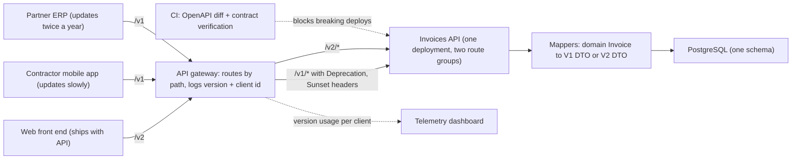
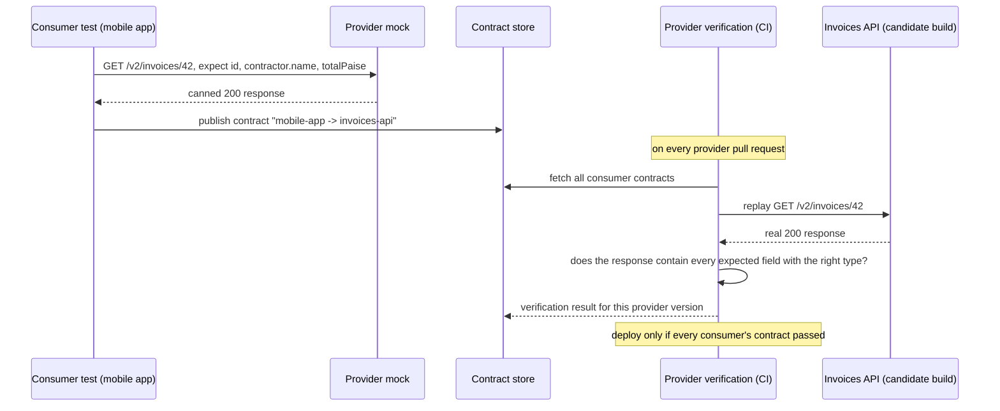
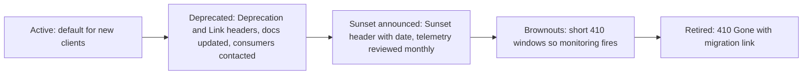

An infrastructure programme-management platform exposes an invoices API. Three consumers depend on it: the platform's own web front end (deployed with the API), a contractor mobile app (updated by users whenever they feel like it, sometimes never), and a partner ERP that files GST returns (updated twice a year by a vendor who bills per change). Finance now wants amounts in paise instead of rupees-with-decimals, GST shown separately, and the contractor as an object rather than a name string. Every one of those changes would break at least one consumer tonight. This lesson is about shipping them anyway, without a single consumer noticing until they choose to.

## Learning objectives

By the end of this lesson you will be able to:

1. Classify any API change as breaking or non-breaking for requests and for responses, and explain why the two directions have different rules.
2. Compare URL-segment, header and media-type versioning, and state when each one is the right choice.
3. Apply the "expand and contract" approach so most changes never need a new version at all.
4. Explain consumer-driven contract testing and write a provider verification against a consumer's expectations.
5. Deprecate and retire an API version using `Deprecation`, `Sunset` and `Link` headers, usage telemetry and a published timeline.
6. Generate one OpenAPI document per version in ASP.NET Core and use it to detect breaking changes in CI.
7. Build a version reader, a deprecation filter and versioned DTO mappers in ASP.NET Core.

## Prerequisites

- [HTTP fundamentals](#/lesson/m10-http-fundamentals): headers, content negotiation and media types.
- [REST API design](#/lesson/m10-rest-design): resources, representations and status codes.
- [Migrations and schema evolution](#/lesson/m09-migrations-evolution): the database version of the same problem; "expand and contract" is borrowed from there.

## Explain it like I'm a beginner

Think of an API as a form that other people fill in and a receipt you hand back. The form and the receipt together are the **contract**: "send me these fields, and I promise to return those fields in this shape."

Some changes are harmless. If you *add* an optional box to the form, people who do not know about it leave it blank and nothing breaks. If you *add* a line to the receipt, people who do not look for it simply ignore it. These are **non-breaking changes** (backward-compatible changes).

Some changes hurt. If you *remove* a line from the receipt, someone who reads that line gets nothing and their program crashes. If you *rename* "Amount" to "Total", the same thing. If you add a *mandatory* box to the form, every old form submission is now rejected. These are **breaking changes**.

The first rule of API evolution is to make as many changes as possible non-breaking: add, never remove or rename, and keep what exists meaning what it meant. You would be surprised how far that gets you.

When you truly must break something, you run two versions side by side, like a bank that accepts both old and new cheque formats for a year. Each consumer says which version they want (in the address, in a header, or in the media type), you announce a retirement date for the old one, you watch who is still using it, you nag them, and eventually you switch it off. That whole process is **API versioning**, and the announcing and nagging part is **deprecation**.

Finally, how do you *know* a change will not break a consumer? You ask the consumer to write down exactly which fields it reads, as an executable test. That is a **consumer-driven contract**. If your new version passes every consumer's contract, you can deploy. If not, you know who you would break before you break them.

## First-principles explanation

### Why response and request rules differ

A contract has two sides, and they evolve under opposite pressures.

For a **response**, the server produces and the client consumes. The client is safe as long as everything it *reads* is still there with the same meaning and type. So:

| Response change | Breaking? | Why |
|---|---|---|
| Add a field | No | Clients that follow the Tolerant Reader principle ignore unknown fields |
| Remove a field | Yes | Any client that reads it fails |
| Rename a field | Yes | Same as remove plus add |
| Change a field's type (`"amount": "1200.50"` → `1200.50`) | Yes | Deserialisers are strict about types |
| Make a required field nullable | Yes | Clients that assumed a value now get `null` |
| Change the meaning of a field (amount excluding GST → including GST) | Yes, and the worst kind | Nothing fails; numbers are silently wrong |
| Add an enum value | Usually yes | A `switch` without a default throws on the new value |
| Reorder fields in JSON | No | JSON objects are unordered |

For a **request**, the client produces and the server consumes. The client is safe as long as everything it *sends* is still accepted:

| Request change | Breaking? | Why |
|---|---|---|
| Add an optional field | No | Old clients omit it; the server applies a default |
| Add a required field | Yes | Every old request fails validation |
| Remove a field | Usually no | Server ignores the extra field, unless it rejects unknown fields |
| Change a field's type | Yes | Old clients send the old type |
| Tighten validation (max length 100 → 50) | Yes | Previously valid requests now fail |
| Loosen validation | No | Old requests remain valid |
| Change a URL or HTTP method | Yes | Old clients get 404 or 405 |
| Change an error status code | Often yes | Clients branch on codes |

Two principles fall out of this. **Tolerant Reader** (Martin Fowler's term): consumers should ignore fields they do not know, so that providers can add freely. **Expand and contract**: when you need to change a field, first *expand* (add the new field alongside the old, write both), then migrate consumers, then *contract* (remove the old). Expand is non-breaking. Contract is breaking, but by the time you do it, nobody reads the old field, so it breaks no one.

### Most changes should not need a version

With Tolerant Readers and expand-and-contract, the invoices example needs no new version for two of the three changes: add `amountPaise` and `gstPaise` next to `amount`, add `contractorRef` next to `contractor`. Old consumers keep reading `amount` and `contractor`; new consumers read the new fields. Months later, when telemetry shows nobody reads the old fields, remove them.

Only when the *shape* must change incompatibly for everyone, or when the old fields cannot be kept correct (for example `amount` was defined as "including GST" and the business now insists it must mean "excluding"), do you need a new version. Versions are expensive: every version is a codebase to test, document and support. Reach for them last.

### The three versioning schemes

**URL segment**: `GET /v1/invoices/42` versus `GET /v2/invoices/42`.
Pros: visible in logs, browser-testable, cache-friendly (different URLs), trivially routable at a gateway, impossible to send by accident. Cons: strictly speaking the "same resource" now has two URLs, which purists dislike; a change to one endpoint forces a new version prefix for the whole API, or you end up with `/v2/invoices` and `/v1/contractors` side by side.

**Custom header**: `GET /invoices/42` with `Api-Version: 2`.
Pros: one URL per resource, versioning can be per endpoint, keeps URLs clean. Cons: invisible in browser address bars and most logs, harder to test by hand, caches must be told to vary on the header (`Vary: Api-Version`), easy to forget and silently get the default.

**Media type (content negotiation)**: `Accept: application/vnd.rodic.v2+json`.
Pros: uses HTTP's own mechanism for "which representation do you want", lets you version representations independently of resources. Cons: most developers find vendor media types unfamiliar, tooling support is patchy, and the same caching caveats as headers apply (`Vary: Accept`).

**Query string**: `GET /invoices/42?api-version=2` is a fourth option that some gateways prefer. It behaves like the URL segment for caching and visibility, and like the header for "per endpoint" flexibility, at the cost of looking a bit untidy.

Honest guidance: for public and partner APIs, URL segment versioning wins on clarity and tooling, and it is what most large public APIs use. Header versioning suits internal APIs with sophisticated clients. Media types are the right answer when you genuinely offer multiple representations of the same resource. Whatever you choose, apply it consistently and make the *default* explicit: a request with no version should either get the oldest supported version (safest for existing clients) or be rejected (safest for the server). Silently defaulting to the newest version is how you break the partner ERP on a Sunday.

### Consumer-driven contract tests

Integration tests written by the provider test what the provider *thinks* consumers need. Consumer-driven contract tests invert this:

1. The **consumer** writes a test against a mock of the provider: "when I `GET /v2/invoices/42`, I expect a 200 with `id` (string), `contractor.name` (string) and `totalPaise` (number)". The mock records these interactions into a **contract file** (Pact calls it a pact).
2. The contract file is shared (a Pact Broker, or simply a repository).
3. The **provider** runs a verification: for each interaction in each consumer's contract, replay the request against the real provider and check the response satisfies the expectations. Only the fields the consumer listed are checked, so adding fields never fails a contract.
4. CI asks "can I deploy this provider version given the consumers currently in production?" and blocks the deploy if any contract fails.

The crucial property is that the contract contains only what the consumer *actually uses*. A consumer that never reads `gstPaise` does not block you from changing it. You learn exactly who you would break, before you break them, and you learn that a field nobody lists is safe to remove.

Pact is the most widely used tool; the lesson's compiled code shows the core idea with a small JSON "expected subset" verifier so you can see what the tooling automates.

### Deprecation: the social protocol

Retiring a version is a process, not a commit. The pieces:

- **Announce** in the documentation and changelog with a date, typically 6–12 months ahead for partner APIs.
- **Signal in responses.** RFC 9745 defines `Deprecation: @1759276800` (a Unix timestamp in Structured Field date form) meaning "this is deprecated as of that moment". RFC 8594 defines `Sunset: Thu, 01 Apr 2027 00:00:00 GMT` meaning "this will stop working at that time". A `Link: </v2/invoices>; rel="successor-version"` header points at the replacement. Automated clients can log these; good SDKs surface them as warnings.
- **Measure.** Log the version and the client identity (API key, OAuth client ID) on every request. A dashboard of "requests per day per client on v1" tells you exactly who has not moved and lets you contact them by name instead of blasting everyone.
- **Nag with increasing force.** Email at announcement, at 90 days, at 30 days; add a brownout (deliberately return 410 for a few minutes a day in the last fortnight) so the laggards' monitoring finally fires.
- **Retire.** Return `410 Gone` with a problem-details body pointing at the migration guide. Not 404; 404 says "never existed".

Arithmetic for the invoices API: 40 registered consumers, 2 million requests a day. After six months, telemetry shows 3 consumers still on v1 producing 12 % of traffic (about 240,000 requests a day). That is three phone calls, not a broadcast email. Keeping v1 alive another quarter costs one developer's maintenance attention and a doubled test matrix; the business can now decide with numbers.

### OpenAPI as the contract artefact

An OpenAPI document is the machine-readable form of the contract. ASP.NET Core 9 and later generate one at build or run time from your endpoints (`Microsoft.AspNetCore.OpenApi`), and you can register one document per version. Two uses matter here:

1. **Diffing in CI.** Tools such as `oasdiff` compare the previous document with the new one and classify changes as breaking or not using rules like the tables above. Run it on every pull request; a breaking change in a version that is not new fails the build.
2. **Client generation.** Consumers generate typed clients from the document. That makes the Tolerant Reader property depend on the generator settings: ensure generated clients ignore unknown properties (System.Text.Json does by default; `JsonSerializerOptions.UnmappedMemberHandling` can make it strict, so do not).

### gRPC and GraphQL in one paragraph each

Protobuf (used by [gRPC](#/lesson/m10-grpc)) is designed for this: fields are numbered, unknown fields are preserved, and the rules are simple (never reuse a field number, never change a field's type, add fields freely). Versioning happens by adding fields and occasionally by a new package version for incompatible redesigns. [GraphQL](#/lesson/m10-graphql) deliberately has no versions: the schema only grows, fields are marked `@deprecated(reason: ...)`, and because clients ask for exactly the fields they need, the server can see which deprecated fields are still queried. Both ecosystems reached the same conclusion as REST practitioners: evolve additively, measure usage, remove late.

:::callout type=mistake title="The silent breaking change"
The most dangerous change in the tables above is the one that changes *meaning* without changing *shape*. `amount` goes from excluding GST to including it, and every consumer keeps working and starts paying contractors 18 % too much. No contract test catches it unless a consumer asserted the value. Treat semantic changes as breaking, always introduce a new field (`amountIncludingGstPaise`) rather than redefining an old one, and write the meaning into the OpenAPI description.
:::

## Visual explanation

### Architecture: two versions behind one gateway



One deployment serves both versions. The domain model and the database have a single shape; each version is a thin mapping layer over the same `Invoice`. The gateway routes by path prefix and records which client used which version, which is the data you need for deprecation. CI runs an OpenAPI diff and verifies every consumer contract before anything reaches production. Note the direction of the dotted arrows: telemetry flows *out* to a dashboard that humans read; CI *blocks* deploys.

### Sequence: consumer-driven contract testing



The consumer's test runs against a mock and records expectations. The provider's CI replays those expectations against the real candidate build. Because the contract lists only what the consumer reads, extra fields in the real response never fail it; a removed or retyped field always does. The result is published so the deployment pipeline can answer "is it safe to deploy this build given the consumers in production?".

### Lifecycle of a version



A version moves left to right over months. Each stage adds a signal that is harder to ignore. The telemetry review between "deprecated" and "retired" is where the decision to proceed or extend is made with numbers, not feelings.

## Step-by-step example

We take the invoices API from a single unversioned endpoint to two supported versions with deprecation signalling.

### Step 1 — the unversioned API and the requested change

```csharp
// Today: GET /invoices/{id}
public sealed record InvoiceDto(string Id, string Contractor, decimal Amount, string Status);
```

Finance wants `amountPaise` and `gstPaise` as integers, a contractor object with ID and name, and the issue date. Converting `Amount` from `decimal` rupees to `long` paise changes a type; replacing `Contractor` with an object changes a type. Both are breaking for a response.

### Step 2 — try expand first

Add `AmountPaise`, `GstPaise`, `ContractorRef` and `IssuedOn` as *new* fields next to the old ones. This is non-breaking and would be the right move if the old fields could remain correct. Here the business also declares that `Amount` must stop including GST, which would silently change its meaning. So the old field cannot stay correct, and a version is justified.

### Step 3 — two versions, one domain

Keep one domain `Invoice`. Create `InvoiceV1Dto` (unchanged shape) and `InvoiceV2Dto` (new shape) and a mapper for each. Register `/v1` and `/v2` route groups. Attach a deprecation filter to `/v1` that adds `Deprecation`, `Sunset` and `Link` headers and logs the client ID.

### Step 4 — contracts and OpenAPI

Each consumer publishes the fields it reads. Provider CI verifies both versions against those contracts and diffs the OpenAPI documents. The mobile app's contract turns out to list only `id`, `contractor` and `status`, so you learn that even on v1 nobody reads `amount` from the app; the ERP's contract lists everything.

## Production-style C# implementation

Project layout:

```text
Invoices.Api/
  Program.cs
  Versioning/
    ApiVersionReader.cs
    DeprecationFilter.cs
  Contracts/
    InvoiceModels.cs
    InvoiceMapper.cs
    SchemaCompatibility.cs
    JsonContractVerifier.cs
```

```csharp file=Versioning/ApiVersionReader.cs
using System.Text.RegularExpressions;

namespace Invoices.Api.Versioning;

public enum VersionSource { Url, Header, MediaType, Default }

public sealed record VersionResolution(int Version, VersionSource Source);

public sealed class ApiVersionConflictException(string message) : Exception(message);

/// <summary>Reads the requested API version from, in order of precedence, the URL segment (/v2/...),
/// the Api-Version header, or a vendor media type (application/vnd.rodic.v2+json). Falls back to a default.
/// If two sources name different versions, that is a client bug and we refuse rather than guess.</summary>
public static partial class ApiVersionReader
{
    public const string HeaderName = "Api-Version";

    [GeneratedRegex(@"^/v(\d{1,3})(?:/|$)", RegexOptions.IgnoreCase)]
    private static partial Regex UrlPattern();

    [GeneratedRegex(@"application/vnd\.[a-z0-9.-]+\.v(\d{1,3})\+json", RegexOptions.IgnoreCase)]
    private static partial Regex MediaTypePattern();

    public static VersionResolution Resolve(string? path, string? versionHeader, string? accept, int defaultVersion)
    {
        var candidates = new List<VersionResolution>(3);

        if (path is not null && UrlPattern().Match(path) is { Success: true } url)
            candidates.Add(new VersionResolution(int.Parse(url.Groups[1].Value), VersionSource.Url));

        if (!string.IsNullOrWhiteSpace(versionHeader) && int.TryParse(versionHeader.Trim(), out var fromHeader) && fromHeader > 0)
            candidates.Add(new VersionResolution(fromHeader, VersionSource.Header));

        if (accept is not null && MediaTypePattern().Match(accept) is { Success: true } media)
            candidates.Add(new VersionResolution(int.Parse(media.Groups[1].Value), VersionSource.MediaType));

        if (candidates.Count == 0) return new VersionResolution(defaultVersion, VersionSource.Default);

        var distinct = candidates.Select(c => c.Version).Distinct().ToList();
        if (distinct.Count > 1)
            throw new ApiVersionConflictException(
                $"Conflicting API versions requested: {string.Join(", ", candidates.Select(c => $"{c.Source}={c.Version}"))}.");

        return candidates[0];   // list is already in precedence order
    }
}
```

```csharp file=Versioning/DeprecationFilter.cs
namespace Invoices.Api.Versioning;

/// <summary>When and how a version is being retired. SuccessorLink is a complete Link header value.</summary>
public sealed record DeprecationInfo(DateTimeOffset DeprecatedAt, DateTimeOffset SunsetAt, string SuccessorLink);

/// <summary>Adds RFC 9745 Deprecation, RFC 8594 Sunset and a successor Link header to every response of a
/// deprecated route group, and logs which client is still calling it so the retirement can be planned with data.</summary>
public sealed class DeprecationFilter(DeprecationInfo info) : IEndpointFilter
{
    public async ValueTask<object?> InvokeAsync(EndpointFilterInvocationContext context, EndpointFilterDelegate next)
    {
        var http = context.HttpContext;
        http.Response.OnStarting(() =>
        {
            // RFC 9745: a Structured Field Date, i.e. '@' followed by Unix seconds.
            http.Response.Headers["Deprecation"] = $"@{info.DeprecatedAt.ToUnixTimeSeconds()}";
            // RFC 8594: an HTTP-date.
            http.Response.Headers["Sunset"] = info.SunsetAt.UtcDateTime.ToString("r");
            http.Response.Headers.Append("Link", info.SuccessorLink);
            return Task.CompletedTask;
        });

        var clientId = http.User.Identity?.Name ?? http.Request.Headers["X-Client-Id"].ToString();
        var logger = http.RequestServices.GetRequiredService<ILogger<DeprecationFilter>>();
        logger.LogInformation("Deprecated endpoint {Path} called by {ClientId}; sunset {Sunset:yyyy-MM-dd}",
            http.Request.Path, string.IsNullOrEmpty(clientId) ? "unknown" : clientId, info.SunsetAt);

        return await next(context);
    }
}
```

```csharp file=Contracts/InvoiceModels.cs
namespace Invoices.Api.Contracts;

/// <summary>Internal domain shape. There is exactly one of these; versions are projections of it.</summary>
public sealed record Invoice(
    string Id,
    string ContractorId,
    string ContractorName,
    long AmountExclGstPaise,
    long GstPaise,
    DateOnly IssuedOn,
    string Status)
{
    public long TotalPaise => AmountExclGstPaise + GstPaise;
}

/// <summary>v1 contract, frozen. Amount is rupees including GST, as the original API promised.</summary>
public sealed record InvoiceV1Dto(string Id, string Contractor, decimal Amount, string Status);

public sealed record ContractorRef(string Id, string Name);

/// <summary>v2 contract: integer paise, GST separated, contractor as an object, issue date added.</summary>
public sealed record InvoiceV2Dto(
    string Id,
    ContractorRef Contractor,
    long AmountPaise,
    long GstPaise,
    long TotalPaise,
    DateOnly IssuedOn,
    string Status);

public sealed class InvoiceRepository
{
    private readonly Dictionary<string, Invoice> _data = new()
    {
        ["INV-1001"] = new Invoice("INV-1001", "C-07", "Shree Infra Works", 1_200_000_00, 216_000_00, new DateOnly(2026, 9, 30), "approved"),
        ["INV-1002"] = new Invoice("INV-1002", "C-12", "Deccan Roads Pvt Ltd", 845_500_00, 152_190_00, new DateOnly(2026, 10, 3), "submitted"),
    };

    public Invoice? Find(string id) => _data.GetValueOrDefault(id);
    public IEnumerable<Invoice> All() => _data.Values;
}
```

```csharp file=Contracts/InvoiceMapper.cs
namespace Invoices.Api.Contracts;

/// <summary>Each version is a pure function of the domain model. Versions never read the database directly.</summary>
public static class InvoiceMapper
{
    public static InvoiceV1Dto ToV1(Invoice inv) =>
        new(inv.Id, inv.ContractorName, inv.TotalPaise / 100m, inv.Status);   // v1 promised "amount including GST, in rupees"

    public static InvoiceV2Dto ToV2(Invoice inv) =>
        new(inv.Id, new ContractorRef(inv.ContractorId, inv.ContractorName), inv.AmountExclGstPaise, inv.GstPaise, inv.TotalPaise, inv.IssuedOn, inv.Status);
}
```

```csharp file=Contracts/SchemaCompatibility.cs
namespace Invoices.Api.Contracts;

/// <summary>A deliberately simplified field description: name, JSON type, and whether it is always present.</summary>
public sealed record FieldSpec(string Name, string Type, bool Required);

/// <summary>Classifies changes between two versions of a flat schema. Real tools (oasdiff, openapi-diff) apply the
/// same rules to full OpenAPI documents; this shows the rules themselves.</summary>
public static class SchemaCompatibility
{
    /// <summary>Response rules: the client reads, so anything it might read must still be there, same type, still present.</summary>
    public static IReadOnlyList<string> CheckResponse(IReadOnlyList<FieldSpec> oldSchema, IReadOnlyList<FieldSpec> newSchema)
    {
        var breaking = new List<string>();
        var byName = newSchema.ToDictionary(f => f.Name, StringComparer.Ordinal);
        foreach (var old in oldSchema)
        {
            if (!byName.TryGetValue(old.Name, out var updated)) { breaking.Add($"response field '{old.Name}' was removed"); continue; }
            if (!string.Equals(old.Type, updated.Type, StringComparison.Ordinal))
                breaking.Add($"response field '{old.Name}' changed type from {old.Type} to {updated.Type}");
            if (old.Required && !updated.Required)
                breaking.Add($"response field '{old.Name}' became optional");
        }
        return breaking;
    }

    /// <summary>Request rules: the client sends, so anything it already sends must still be accepted, and it must not be
    /// forced to send something new.</summary>
    public static IReadOnlyList<string> CheckRequest(IReadOnlyList<FieldSpec> oldSchema, IReadOnlyList<FieldSpec> newSchema)
    {
        var breaking = new List<string>();
        var oldByName = oldSchema.ToDictionary(f => f.Name, StringComparer.Ordinal);
        foreach (var updated in newSchema)
        {
            if (!oldByName.TryGetValue(updated.Name, out var old))
            {
                if (updated.Required) breaking.Add($"new required request field '{updated.Name}'");
                continue;
            }
            if (!string.Equals(old.Type, updated.Type, StringComparison.Ordinal))
                breaking.Add($"request field '{updated.Name}' changed type from {old.Type} to {updated.Type}");
            if (!old.Required && updated.Required)
                breaking.Add($"request field '{updated.Name}' became required");
        }
        return breaking;
    }
}
```

```csharp file=Contracts/JsonContractVerifier.cs
using System.Text.Json;

namespace Invoices.Api.Contracts;

/// <summary>The heart of consumer-driven contract verification: does the actual response contain every field the
/// consumer expects, with a compatible JSON type? Extra fields in the actual response are fine.</summary>
public static class JsonContractVerifier
{
    public static IReadOnlyList<string> Verify(JsonElement expected, JsonElement actual, string path = "$")
    {
        var problems = new List<string>();
        VerifyInto(expected, actual, path, problems);
        return problems;
    }

    private static void VerifyInto(JsonElement expected, JsonElement actual, string path, List<string> problems)
    {
        if (!SameKind(expected.ValueKind, actual.ValueKind))
        {
            problems.Add($"{path}: expected {expected.ValueKind} but got {actual.ValueKind}");
            return;
        }

        switch (expected.ValueKind)
        {
            case JsonValueKind.Object:
                foreach (var prop in expected.EnumerateObject())
                {
                    if (!actual.TryGetProperty(prop.Name, out var actualProp))
                    {
                        problems.Add($"{path}.{prop.Name}: missing");
                        continue;
                    }
                    VerifyInto(prop.Value, actualProp, $"{path}.{prop.Name}", problems);
                }
                break;
            case JsonValueKind.Array:
                // Contract arrays describe the shape of elements: check the first expected element against each actual element.
                var template = expected.EnumerateArray().FirstOrDefault();
                if (template.ValueKind == JsonValueKind.Undefined) break;
                var i = 0;
                foreach (var item in actual.EnumerateArray()) VerifyInto(template, item, $"{path}[{i++}]", problems);
                break;
        }
    }

    private static bool SameKind(JsonValueKind expected, JsonValueKind actual) =>
        expected == actual || (expected is JsonValueKind.True or JsonValueKind.False && actual is JsonValueKind.True or JsonValueKind.False);
}
```

```csharp file=Program.cs
using Invoices.Api.Contracts;
using Invoices.Api.Versioning;

var builder = WebApplication.CreateBuilder(args);
builder.Services.AddSingleton<InvoiceRepository>();
builder.Services.AddProblemDetails();

var app = builder.Build();

// --- URL-segment versioning: one route group per version, one domain model underneath ---
var v1Deprecation = new DeprecationInfo(
    DeprecatedAt: new DateTimeOffset(2026, 10, 1, 0, 0, 0, TimeSpan.Zero),
    SunsetAt: new DateTimeOffset(2027, 4, 1, 0, 0, 0, TimeSpan.Zero),
    SuccessorLink: "</v2/invoices>; rel=\"successor-version\"");

var v1 = app.MapGroup("/v1").AddEndpointFilter(new DeprecationFilter(v1Deprecation));
v1.MapGet("/invoices/{id}", (string id, InvoiceRepository repo) =>
    repo.Find(id) is { } inv ? Results.Ok(InvoiceMapper.ToV1(inv)) : Results.NotFound());
v1.MapGet("/invoices", (InvoiceRepository repo) => Results.Ok(repo.All().Select(InvoiceMapper.ToV1)));

var v2 = app.MapGroup("/v2");
v2.MapGet("/invoices/{id}", (string id, InvoiceRepository repo) =>
    repo.Find(id) is { } inv ? Results.Ok(InvoiceMapper.ToV2(inv)) : Results.NotFound());
v2.MapGet("/invoices", (InvoiceRepository repo) => Results.Ok(repo.All().Select(InvoiceMapper.ToV2)));

// --- Header / media-type versioning on an unversioned path, for clients that prefer it ---
app.MapGet("/invoices/{id}", (string id, HttpContext http, InvoiceRepository repo) =>
{
    VersionResolution resolved;
    try
    {
        resolved = ApiVersionReader.Resolve(
            path: null,                                           // the path carries no version here
            versionHeader: http.Request.Headers[ApiVersionReader.HeaderName].ToString(),
            accept: http.Request.Headers.Accept.ToString(),
            defaultVersion: 1);                                   // oldest supported: never surprise an existing client
    }
    catch (ApiVersionConflictException ex)
    {
        return Results.Problem(detail: ex.Message, statusCode: StatusCodes.Status400BadRequest);
    }

    http.Response.Headers[ApiVersionReader.HeaderName] = resolved.Version.ToString();
    http.Response.Headers.Vary = $"{ApiVersionReader.HeaderName}, Accept";   // caches must key on the version inputs

    var inv = repo.Find(id);
    if (inv is null) return Results.NotFound();
    return resolved.Version switch
    {
        1 => Results.Ok(InvoiceMapper.ToV1(inv)),
        2 => Results.Ok(InvoiceMapper.ToV2(inv)),
        _ => Results.Problem(detail: $"API version {resolved.Version} is not supported. Supported: 1, 2.",
                             statusCode: StatusCodes.Status400BadRequest),
    };
});

// Retired versions answer 410, not 404, with a pointer to the migration guide.
app.MapGet("/v0/{**rest}", () => Results.Problem(
    detail: "API v0 was retired on 2026-01-31. See https://docs.example.org/invoices/migrate-v2",
    statusCode: StatusCodes.Status410Gone));

app.Run();
```

**Reading the implementation.** Both route groups map to the same repository and domain model; the only version-specific code is a DTO and a mapper, which is as cheap as a version can be. The deprecation filter is attached once to the `/v1` group, so every v1 endpoint signals and logs. The unversioned endpoint shows the header and media-type scheme and the two details people forget: echo the resolved version back, and set `Vary` so shared caches do not serve a v2 body to a v1 client.

### OpenAPI per version

With the `Microsoft.AspNetCore.OpenApi` package (NuGet, so not part of the compiled set):

```csharp
builder.Services.AddOpenApi("v1", o => o.ShouldInclude = d => d.GroupName == "v1");
builder.Services.AddOpenApi("v2", o => o.ShouldInclude = d => d.GroupName == "v2");
// ...
var v1 = app.MapGroup("/v1").WithGroupName("v1").AddEndpointFilter(new DeprecationFilter(v1Deprecation));
var v2 = app.MapGroup("/v2").WithGroupName("v2");
app.MapOpenApi();   // serves /openapi/v1.json and /openapi/v2.json
```

In CI, download both documents from the previous build and the candidate build and run a diff tool. A rule set like "fail on removed property, type change, new required request property or removed enum value for any version that is not brand new" turns the breaking-change tables into an automated gate. Mark v1 operations `deprecated: true` in the document (`.WithOpenApi(op => { op.Deprecated = true; return op; })`), which client generators turn into compiler warnings.

### Provider verification against a consumer contract

A consumer publishes the shape it depends on as JSON. The provider's test replays it (`WebApplicationFactory` requires the `Microsoft.AspNetCore.Mvc.Testing` package, so this is a snippet):

```csharp
public class MobileAppContractTests(WebApplicationFactory<Program> factory) : IClassFixture<WebApplicationFactory<Program>>
{
    // What the mobile app actually reads. Note: no amount fields. Removing them would not break this consumer.
    private const string MobileExpectsV2 = """
        { "id": "INV-1001", "contractor": { "name": "x" }, "status": "approved" }
        """;

    [Fact]
    public async Task V2_invoice_satisfies_mobile_app_contract()
    {
        var client = factory.CreateClient();
        var body = await client.GetStringAsync("/v2/invoices/INV-1001");

        using var expected = JsonDocument.Parse(MobileExpectsV2);
        using var actual = JsonDocument.Parse(body);
        var problems = JsonContractVerifier.Verify(expected.RootElement, actual.RootElement);

        Assert.Empty(problems);
    }
}
```

Pact does the same thing with a richer matching language (types, regexes, min array lengths), a broker to store contracts per consumer version, and the `can-i-deploy` check. The verifier above is the mental model: *expected is a subset; types must match; extras are fine*.

## Bad design vs good design

**Bad: version in the database.** Each version gets its own tables or columns ("v2 invoices store paise"). Now the two versions can disagree about the same invoice, and every write must update both. Versions are *projections* of one model; the database has one shape.

**Bad: default to the newest version.** A request without a version gets v2. The partner ERP, which never sends a version header because v1 was the only version when it was written, breaks the night v2 ships. Default to the oldest supported version, or require an explicit version.

**Bad: branching inside the handler.** `if (version == 1) { ... } else if (version == 2) { ... }` scattered through every endpoint. Each new version multiplies the branches. Put version differences in mappers and route groups; handlers stay version-free.

**Bad: retiring with 404.** Clients cannot tell "wrong URL" from "this version is gone". Use `410 Gone` with a problem-details body and the migration link.

**Bad: redefining a field's meaning.** `amount` quietly stops including GST. Nothing fails; payments are wrong. New meaning, new field.

**Bad: a breaking change per sprint.** If you find yourself on v7, the problem is not versioning technique; the contract was designed without Tolerant Readers and expand-and-contract. Fix the habits before the tooling.

**Good:** the implementation above, plus: one domain model, versions as mappers over route groups, deprecation headers and client-level telemetry on the old version, consumer contracts verified in CI, OpenAPI diffs as a gate, and a published sunset date you actually honour.

:::callout type=tradeoff title="How many versions to support at once"
Two is the sweet spot: current and previous. Each additional live version roughly doubles the surface to test and document. Public platforms with thousands of consumers sometimes carry more, but they also have the telemetry and support staff to manage it. For a partner API with 40 consumers, two versions and a 6-month overlap is a defensible policy.
:::

## Practical playground

The program below encodes the invoices v1 and v2 response schemas as `FieldSpec` lists and runs the compatibility checker. Run it to see which v2 changes are breaking, then edit the v2 list to make it an *expand* (keep the old fields, add the new ones) and watch the breaking list go empty. Try the request checker too: add a required field and see it flagged.

:::playground type=csharp title="Breaking-change detector"
```csharp file=Program.cs
using System;
using System.Collections.Generic;
using System.Linq;

public sealed record FieldSpec(string Name, string Type, bool Required);

public static class SchemaCompatibility
{
    public static List<string> CheckResponse(IReadOnlyList<FieldSpec> oldSchema, IReadOnlyList<FieldSpec> newSchema)
    {
        var breaking = new List<string>();
        var byName = newSchema.ToDictionary(f => f.Name);
        foreach (var old in oldSchema)
        {
            if (!byName.TryGetValue(old.Name, out var updated)) { breaking.Add($"response field '{old.Name}' was removed"); continue; }
            if (old.Type != updated.Type) breaking.Add($"response field '{old.Name}' changed type from {old.Type} to {updated.Type}");
            if (old.Required && !updated.Required) breaking.Add($"response field '{old.Name}' became optional");
        }
        return breaking;
    }
}

public static class Program
{
    public static void Main()
    {
        var v1 = new List<FieldSpec>
        {
            new("id", "string", true), new("contractor", "string", true), new("amount", "number", true), new("status", "string", true),
        };
        var v2 = new List<FieldSpec>
        {
            new("id", "string", true), new("contractor", "object", true), new("amountPaise", "integer", true),
            new("gstPaise", "integer", true), new("totalPaise", "integer", true), new("issuedOn", "string", true), new("status", "string", true),
        };

        var problems = SchemaCompatibility.CheckResponse(v1, v2);
        Console.WriteLine(problems.Count == 0 ? "No breaking changes: ship it as the same version." : $"{problems.Count} breaking change(s):");
        foreach (var p in problems) Console.WriteLine($"  - {p}");
    }
}
```
:::

## Exercises

:::exercise id=m10-versioning-contracts-ex1 difficulty=beginner kind=code title="Resolve the requested API version"
Implement `ApiVersionReader.Resolve(path, versionHeader, accept, defaultVersion)`. Sources in precedence order: a URL segment `/v{n}/` at the start of the path, an `Api-Version` header holding a positive integer, and a vendor media type `application/vnd.{anything}.v{n}+json` in `Accept`. If no source names a version, return the default with `VersionSource.Default`. If two or more sources name *different* versions, throw `ApiVersionConflictException`. Invalid values (non-numeric header, unrelated media types) are treated as absent.
::requirements
- `/v2/invoices/42` → version 2 from `Url`; `/invoices/42` → no URL version.
- `Api-Version: 3` → 3 from `Header`; `Api-Version: abc` → ignored.
- `Accept: application/vnd.rodic.v2+json` → 2 from `MediaType`; `Accept: application/json` → ignored.
- URL 2 and header 2 → 2 from `Url` (agreeing sources are fine).
- URL 1 and header 2 → `ApiVersionConflictException`.
::acceptance
- All tests pass.
- No exception for malformed inputs other than the conflict case.
::hint
Collect candidates into a list in precedence order, then decide.
::hint
Two regular expressions: `^/v(\d+)(/|$)` for the path and `application/vnd\.[a-z0-9.-]+\.v(\d+)\+json` for `Accept`.
::hint
"Different versions" means `candidates.Select(c => c.Version).Distinct().Count() > 1`.
::hint
```csharp
if (candidates.Count == 0) return new VersionResolution(defaultVersion, VersionSource.Default);
if (candidates.Select(c => c.Version).Distinct().Count() > 1) throw new ApiVersionConflictException("...");
return candidates[0];
```
::starter
```csharp file=ApiVersionReader.cs
using System;
using System.Collections.Generic;
using System.Linq;
using System.Text.RegularExpressions;

namespace VersioningKata;

public enum VersionSource { Url, Header, MediaType, Default }
public sealed record VersionResolution(int Version, VersionSource Source);
public sealed class ApiVersionConflictException : Exception
{
    public ApiVersionConflictException(string message) : base(message) { }
}

public static class ApiVersionReader
{
    public static VersionResolution Resolve(string? path, string? versionHeader, string? accept, int defaultVersion)
    {
        throw new NotImplementedException();
    }
}
```
::tests
```csharp file=ApiVersionReaderTests.cs
using VersioningKata;
using Xunit;

public class ApiVersionReaderTests
{
    [Fact]
    public void Url_segment_wins()
    {
        var r = ApiVersionReader.Resolve("/v2/invoices/42", null, null, 1);
        Assert.Equal(2, r.Version);
        Assert.Equal(VersionSource.Url, r.Source);
    }

    [Fact]
    public void Header_is_used_when_url_has_no_version()
    {
        var r = ApiVersionReader.Resolve("/invoices/42", "3", null, 1);
        Assert.Equal(3, r.Version);
        Assert.Equal(VersionSource.Header, r.Source);
    }

    [Fact]
    public void Media_type_is_used_when_nothing_else()
    {
        var r = ApiVersionReader.Resolve("/invoices/42", null, "application/vnd.rodic.v2+json", 1);
        Assert.Equal(2, r.Version);
        Assert.Equal(VersionSource.MediaType, r.Source);
    }

    [Fact]
    public void Default_when_no_source()
    {
        var r = ApiVersionReader.Resolve("/invoices/42", null, "application/json", 1);
        Assert.Equal(1, r.Version);
        Assert.Equal(VersionSource.Default, r.Source);
    }

    [Fact]
    public void Invalid_header_is_ignored()
    {
        var r = ApiVersionReader.Resolve("/invoices/42", "abc", null, 1);
        Assert.Equal(VersionSource.Default, r.Source);
    }

    [Fact]
    public void Agreeing_sources_are_fine()
    {
        var r = ApiVersionReader.Resolve("/v2/invoices", "2", "application/vnd.rodic.v2+json", 1);
        Assert.Equal(2, r.Version);
        Assert.Equal(VersionSource.Url, r.Source);
    }

    [Fact]
    public void Conflicting_sources_throw() =>
        Assert.Throws<ApiVersionConflictException>(() => ApiVersionReader.Resolve("/v1/invoices", "2", null, 1));

    [Fact]
    public void Version_only_counts_at_path_start()
    {
        var r = ApiVersionReader.Resolve("/invoices/v2/42", null, null, 1);
        Assert.Equal(VersionSource.Default, r.Source);
    }
}
```
::solution
```csharp file=ApiVersionReader.cs
using System;
using System.Collections.Generic;
using System.Linq;
using System.Text.RegularExpressions;

namespace VersioningKata;

public enum VersionSource { Url, Header, MediaType, Default }
public sealed record VersionResolution(int Version, VersionSource Source);
public sealed class ApiVersionConflictException : Exception
{
    public ApiVersionConflictException(string message) : base(message) { }
}

public static class ApiVersionReader
{
    private static readonly Regex UrlPattern = new(@"^/v(\d{1,3})(?:/|$)", RegexOptions.IgnoreCase | RegexOptions.Compiled);
    private static readonly Regex MediaTypePattern = new(@"application/vnd\.[a-z0-9.-]+\.v(\d{1,3})\+json", RegexOptions.IgnoreCase | RegexOptions.Compiled);

    public static VersionResolution Resolve(string? path, string? versionHeader, string? accept, int defaultVersion)
    {
        var candidates = new List<VersionResolution>();

        if (path is not null)
        {
            var m = UrlPattern.Match(path);
            if (m.Success) candidates.Add(new VersionResolution(int.Parse(m.Groups[1].Value), VersionSource.Url));
        }
        if (!string.IsNullOrWhiteSpace(versionHeader) && int.TryParse(versionHeader.Trim(), out var v) && v > 0)
            candidates.Add(new VersionResolution(v, VersionSource.Header));
        if (accept is not null)
        {
            var m = MediaTypePattern.Match(accept);
            if (m.Success) candidates.Add(new VersionResolution(int.Parse(m.Groups[1].Value), VersionSource.MediaType));
        }

        if (candidates.Count == 0) return new VersionResolution(defaultVersion, VersionSource.Default);
        if (candidates.Select(c => c.Version).Distinct().Count() > 1)
            throw new ApiVersionConflictException("Conflicting API versions: " + string.Join(", ", candidates.Select(c => $"{c.Source}={c.Version}")));
        return candidates[0];
    }
}
```

Refusing on conflict rather than picking a winner is a deliberate choice. A client that sends `/v1/...` with `Api-Version: 2` is confused, and guessing which one it meant produces the silent kind of bug.
::alternatives
The `Asp.Versioning.Http` package (formerly Microsoft.AspNetCore.Mvc.Versioning) provides exactly these readers (`UrlSegmentApiVersionReader`, `HeaderApiVersionReader`, `MediaTypeApiVersionReader`) plus OpenAPI integration. In a real project use it; this exercise shows what it does.
::mistakes
- Matching `v2` anywhere in the path, so `/invoices/v2-report` resolves to version 2.
- Defaulting to the newest version, which breaks clients that never sent a version.
- Treating `Api-Version: 0` or negative numbers as valid.
:::

:::exercise id=m10-versioning-contracts-ex2 difficulty=beginner kind=written title="Classify the changes"
For each proposed change to the invoices API, say whether it is breaking or non-breaking, which direction (request or response) it affects, and whether a new version is required or an expand-and-contract approach works.

1. Add `issuedOn` (date) to the invoice response.
2. Rename response field `contractor` to `contractorName`.
3. Change response field `amount` from a decimal in rupees to an integer in paise.
4. Add an optional `notes` field to the `POST /invoices` request body.
5. Make the existing optional `purchaseOrderNumber` request field mandatory.
6. Add the value `"disputed"` to the `status` enum in responses.
7. Return `422` instead of `400` for validation errors.
8. Change the meaning of `amount` from "including GST" to "excluding GST" while keeping the name and type.
::acceptance
- Items 1 and 4 are identified as non-breaking.
- Items 2, 3, 5 and 7 are identified as breaking with the direction named.
- Item 6 is identified as breaking in practice, with the reason.
- Item 8 is identified as the most dangerous kind of breaking change.
- For each breaking change, an expand-and-contract alternative is suggested where one exists.
::hint
Response: can every existing reader still read what it read before? Request: can every existing sender still send what it sent before?
::hint
Renames and type changes can almost always be done as "add the new field, keep the old one, remove the old one later".
::hint
Enum additions break any client with an exhaustive `switch`; semantic changes break nobody's code and everybody's data.
::solution
1. **Non-breaking, response.** Adding a field is safe for Tolerant Readers. No version needed.
2. **Breaking, response.** Readers of `contractor` get nothing. Expand-and-contract: add `contractorName`, keep `contractor` for one deprecation cycle, remove later. No version needed if you do that.
3. **Breaking, response** (type change). Expand-and-contract: add `amountPaise` as a new field; keep `amount`. No version needed unless the old field cannot stay correct.
4. **Non-breaking, request.** Old clients omit it and the server defaults it. No version needed.
5. **Breaking, request.** Every client that omits it now gets 400. Alternatives: keep it optional and default it, or introduce the requirement only in a new version with a long overlap.
6. **Breaking in practice, response.** A client with `switch (status) { case "approved": ...; case "submitted": ...; default: throw }` fails. Mitigate by documenting from day one that clients must handle unknown values, and announce new values ahead of time; otherwise treat as a versioned change.
7. **Breaking, response status.** Clients that branch on `400` for validation feedback stop showing messages. Only change in a new version, or keep 400 and add a problem-details `type` to distinguish cases.
8. **Breaking, response semantics, and the most dangerous.** Every client keeps working and every payment calculation is 18 % off. Never redefine; add `amountExclGstPaise` and `gstPaise`, and if `amount` must go, deprecate and remove it on a schedule.
::mistakes
- Calling an enum addition non-breaking because "it is just a new string".
- Thinking that a type change is fine because "JSON is loosely typed"; deserialisers are not.
:::

:::exercise id=m10-versioning-contracts-ex3 difficulty=intermediate kind=code title="Detect breaking changes between two schemas"
Implement `SchemaCompatibility.CheckResponse` and `CheckRequest` over flat `FieldSpec` lists (name, JSON type, required). Each returns a list of human-readable breaking-change descriptions (empty list means compatible).

Response rules (old → new): a field removed, a field's type changed, or a required field becoming optional is breaking. Added fields are fine.

Request rules (old → new): a *new* required field, a type change on an existing field, or an optional field becoming required is breaking. Removed fields and new optional fields are fine.
::requirements
- Field names are compared case-sensitively.
- Each breaking change produces exactly one entry that contains the field name.
- Order of entries follows the order of the schema being iterated (old for responses, new for requests).
::acceptance
- All tests pass.
- Both methods are pure (no I/O, no static state).
::hint
Build a dictionary of the *other* schema by name, then iterate the schema whose fields define the rules: old fields for responses, new fields for requests.
::hint
For responses ask "can every old reader still read?"; for requests ask "can every old sender still send, and is nothing new demanded?".
::hint
```csharp
foreach (var old in oldSchema)
{
    if (!byName.TryGetValue(old.Name, out var updated)) { breaking.Add($"... '{old.Name}' was removed"); continue; }
    if (old.Type != updated.Type) breaking.Add(...);
    if (old.Required && !updated.Required) breaking.Add(...);
}
```
::starter
```csharp file=SchemaCompatibility.cs
using System;
using System.Collections.Generic;
using System.Linq;

namespace VersioningKata;

public sealed record FieldSpec(string Name, string Type, bool Required);

public static class SchemaCompatibility
{
    public static IReadOnlyList<string> CheckResponse(IReadOnlyList<FieldSpec> oldSchema, IReadOnlyList<FieldSpec> newSchema)
        => throw new NotImplementedException();

    public static IReadOnlyList<string> CheckRequest(IReadOnlyList<FieldSpec> oldSchema, IReadOnlyList<FieldSpec> newSchema)
        => throw new NotImplementedException();
}
```
::tests
```csharp file=SchemaCompatibilityTests.cs
using System.Collections.Generic;
using System.Linq;
using VersioningKata;
using Xunit;

public class SchemaCompatibilityTests
{
    private static readonly List<FieldSpec> V1Response =
    [
        new("id", "string", true), new("contractor", "string", true), new("amount", "number", true), new("status", "string", true),
    ];

    [Fact]
    public void Adding_response_fields_is_compatible()
    {
        var v2 = V1Response.Concat([new FieldSpec("issuedOn", "string", true), new FieldSpec("gstPaise", "integer", false)]).ToList();
        Assert.Empty(SchemaCompatibility.CheckResponse(V1Response, v2));
    }

    [Fact]
    public void Removing_a_response_field_is_breaking()
    {
        var v2 = V1Response.Where(f => f.Name != "amount").ToList();
        var problems = SchemaCompatibility.CheckResponse(V1Response, v2);
        var p = Assert.Single(problems);
        Assert.Contains("amount", p);
    }

    [Fact]
    public void Changing_a_response_type_is_breaking()
    {
        var v2 = V1Response.Select(f => f.Name == "contractor" ? f with { Type = "object" } : f).ToList();
        var p = Assert.Single(SchemaCompatibility.CheckResponse(V1Response, v2));
        Assert.Contains("contractor", p);
    }

    [Fact]
    public void Response_field_becoming_optional_is_breaking()
    {
        var v2 = V1Response.Select(f => f.Name == "status" ? f with { Required = false } : f).ToList();
        var p = Assert.Single(SchemaCompatibility.CheckResponse(V1Response, v2));
        Assert.Contains("status", p);
    }

    [Fact]
    public void Several_problems_are_all_reported()
    {
        var v2 = new List<FieldSpec> { new("id", "string", true), new("contractor", "object", true), new("amountPaise", "integer", true), new("status", "string", true) };
        var problems = SchemaCompatibility.CheckResponse(V1Response, v2);
        Assert.Equal(2, problems.Count);
    }

    private static readonly List<FieldSpec> V1Request =
    [
        new("contractorId", "string", true), new("amountPaise", "integer", true), new("purchaseOrderNumber", "string", false),
    ];

    [Fact]
    public void New_optional_request_field_is_compatible()
    {
        var v2 = V1Request.Concat([new FieldSpec("notes", "string", false)]).ToList();
        Assert.Empty(SchemaCompatibility.CheckRequest(V1Request, v2));
    }

    [Fact]
    public void New_required_request_field_is_breaking()
    {
        var v2 = V1Request.Concat([new FieldSpec("projectCode", "string", true)]).ToList();
        var p = Assert.Single(SchemaCompatibility.CheckRequest(V1Request, v2));
        Assert.Contains("projectCode", p);
    }

    [Fact]
    public void Optional_request_field_becoming_required_is_breaking()
    {
        var v2 = V1Request.Select(f => f.Name == "purchaseOrderNumber" ? f with { Required = true } : f).ToList();
        var p = Assert.Single(SchemaCompatibility.CheckRequest(V1Request, v2));
        Assert.Contains("purchaseOrderNumber", p);
    }

    [Fact]
    public void Removing_a_request_field_is_compatible()
    {
        var v2 = V1Request.Where(f => f.Name != "purchaseOrderNumber").ToList();
        Assert.Empty(SchemaCompatibility.CheckRequest(V1Request, v2));
    }

    [Fact]
    public void Request_type_change_is_breaking()
    {
        var v2 = V1Request.Select(f => f.Name == "amountPaise" ? f with { Type = "string" } : f).ToList();
        var p = Assert.Single(SchemaCompatibility.CheckRequest(V1Request, v2));
        Assert.Contains("amountPaise", p);
    }
}
```
::solution
```csharp file=SchemaCompatibility.cs
using System;
using System.Collections.Generic;
using System.Linq;

namespace VersioningKata;

public sealed record FieldSpec(string Name, string Type, bool Required);

public static class SchemaCompatibility
{
    public static IReadOnlyList<string> CheckResponse(IReadOnlyList<FieldSpec> oldSchema, IReadOnlyList<FieldSpec> newSchema)
    {
        var breaking = new List<string>();
        var byName = newSchema.ToDictionary(f => f.Name, StringComparer.Ordinal);
        foreach (var old in oldSchema)
        {
            if (!byName.TryGetValue(old.Name, out var updated)) { breaking.Add($"response field '{old.Name}' was removed"); continue; }
            if (!string.Equals(old.Type, updated.Type, StringComparison.Ordinal))
                breaking.Add($"response field '{old.Name}' changed type from {old.Type} to {updated.Type}");
            if (old.Required && !updated.Required)
                breaking.Add($"response field '{old.Name}' became optional");
        }
        return breaking;
    }

    public static IReadOnlyList<string> CheckRequest(IReadOnlyList<FieldSpec> oldSchema, IReadOnlyList<FieldSpec> newSchema)
    {
        var breaking = new List<string>();
        var oldByName = oldSchema.ToDictionary(f => f.Name, StringComparer.Ordinal);
        foreach (var updated in newSchema)
        {
            if (!oldByName.TryGetValue(updated.Name, out var old))
            {
                if (updated.Required) breaking.Add($"new required request field '{updated.Name}'");
                continue;
            }
            if (!string.Equals(old.Type, updated.Type, StringComparison.Ordinal))
                breaking.Add($"request field '{updated.Name}' changed type from {old.Type} to {updated.Type}");
            if (!old.Required && updated.Required)
                breaking.Add($"request field '{updated.Name}' became required");
        }
        return breaking;
    }
}
```

Notice the asymmetry: responses iterate the *old* schema (what readers depend on), requests iterate the *new* schema (what the server now demands). Getting that direction right is the whole exercise.
::alternatives
Real tools work on full OpenAPI documents with nested objects, arrays, enums, formats and status codes. The same two questions apply at every level of nesting.
::mistakes
- Treating a removed request field as breaking. The server simply ignores it (unless it rejects unknown members, which is itself a decision to document).
- Comparing names case-insensitively, which hides a real rename (`Amount` → `amount` is breaking in JSON).
- Reporting a type change *and* a removal for the same field.
::extensions
Add enum support: `FieldSpec` gets an optional `AllowedValues` list; a removed value is breaking for requests and an added value is breaking for responses.
:::

:::exercise id=m10-versioning-contracts-ex4 difficulty=intermediate kind=sql ordered=true title="Who is still on v1?"
You log every API request with the client ID and the version it used. As of exactly `2026-10-19 00:00:00+00`, list the clients that called **v1 at least once in the previous 30 days**, with the number of v1 calls (`v1_calls`) and the timestamp of their most recent v1 call (`last_v1_call`). Order by `v1_calls` descending, then by `client_id`.
::acceptance
- Only v1 calls within the 30-day window are counted.
- Clients whose last v1 call is older than 30 days are excluded.
- Clients that only call v2 are excluded.
- Ordered by `v1_calls` descending, then `client_id`.
::hint
Filter on `api_version = 1` and `requested_at >= '2026-10-19 00:00:00+00'::timestamptz - INTERVAL '30 days'`, then group by client.
::hint
`MAX(requested_at)` gives the most recent call per client.
::hint
`ORDER BY v1_calls DESC, client_id` handles ties deterministically.
::setup
```sql
CREATE TABLE api_requests (
    client_id    text NOT NULL,
    api_version  int NOT NULL,
    path         text NOT NULL,
    requested_at timestamptz NOT NULL
);

INSERT INTO api_requests VALUES
  ('mobile-app',   1, '/v1/invoices/INV-1001', '2026-10-18 09:00:00+00'),
  ('mobile-app',   1, '/v1/invoices',          '2026-10-17 11:30:00+00'),
  ('mobile-app',   2, '/v2/invoices/INV-1002', '2026-10-18 10:00:00+00'),
  ('partner-erp',  1, '/v1/invoices',          '2026-10-15 02:00:00+00'),
  ('partner-erp',  1, '/v1/invoices',          '2026-10-01 02:00:00+00'),
  ('partner-erp',  1, '/v1/invoices',          '2026-09-25 02:00:00+00'),
  ('web-frontend', 2, '/v2/invoices',          '2026-10-18 12:00:00+00'),
  ('web-frontend', 2, '/v2/invoices/INV-1001', '2026-10-18 12:00:05+00'),
  ('old-reporting',1, '/v1/invoices',          '2026-09-10 00:00:00+00'),
  ('gst-filer',    1, '/v1/invoices',          '2026-09-19 00:00:00+00'),
  ('gst-filer',    1, '/v1/invoices',          '2026-09-18 23:59:59+00');
```
::check
```sql
SELECT client_id,
       COUNT(*) AS v1_calls,
       MAX(requested_at) AS last_v1_call
FROM api_requests
WHERE api_version = 1
  AND requested_at >= TIMESTAMPTZ '2026-10-19 00:00:00+00' - INTERVAL '30 days'
GROUP BY client_id
ORDER BY v1_calls DESC, client_id;
```
::solution
```sql
SELECT client_id,
       COUNT(*) AS v1_calls,
       MAX(requested_at) AS last_v1_call
FROM api_requests
WHERE api_version = 1
  AND requested_at >= TIMESTAMPTZ '2026-10-19 00:00:00+00' - INTERVAL '30 days'
GROUP BY client_id
ORDER BY v1_calls DESC, client_id;
```

Expected: `partner-erp` (3 calls, last on 2026-10-15), `mobile-app` (2 calls, last on 2026-10-18), `gst-filer` (1 call, exactly at the 30-day boundary on 2026-09-19 00:00:00, which is included by `>=`; the 2026-09-18 call is excluded). `old-reporting` last called v1 on 2026-09-10 and is out of the window; `web-frontend` never used v1.

This is the query behind the deprecation dashboard. Three named clients, not "some traffic", is what lets you pick up the phone.
::mistakes
- Grouping without the version filter, which counts v2 calls as v1.
- Using `>` instead of `>=` at the window boundary without deciding which you mean.
- Ordering only by count, which makes the output order unstable for ties.
:::

:::exercise id=m10-versioning-contracts-ex5 difficulty=advanced kind=hld title="Retire v1 without breaking the partner ERP"
The invoices API has 40 consumers and 2 million requests a day. Six months after v2 shipped, 3 consumers still use v1 (12 % of traffic, about 240,000 requests a day). One of them, the partner ERP, cannot change for another 9 months. Design the architecture and the process to retire v1 from the core service while keeping the ERP working, and show how you measure and gate the retirement. Extend the starter graph.
::acceptance
- The core service stops serving v1 code; v1 compatibility is provided by a separate adapter or gateway translation layer.
- Telemetry per client per version drives the decision, with the numbers stated.
- Deprecation signalling (headers, docs, brownouts) is part of the plan with dates.
- Consumer contracts or OpenAPI diffs gate deploys of the adapter and the core.
- Risks of the translation approach are named (semantic mapping, latency, a second thing to maintain).
::hint
If v1 can be computed from v2 (it can: v1 amount = v2 totalPaise / 100), a thin translator can serve v1 on top of v2 without the core knowing.
::hint
Where does the translator live: in the gateway (policy), as a sidecar, or as a small separate service? What does each cost?
::hint
240,000 requests a day is about 2.8 RPS average; the adapter is tiny. What is its latency cost?
::hint
The ERP's contract (the fields it reads) tells you exactly what the adapter must produce. Verify the adapter against that contract in CI.
::starter
```json
{
  "nodes": [
    { "id": "erp", "type": "client", "label": "Partner ERP (v1, cannot change for 9 months)", "props": { "rps": 2 } },
    { "id": "mob", "type": "client", "label": "Mobile app (v1 and v2)", "props": { "rps": 5 } },
    { "id": "web", "type": "client", "label": "Web front end (v2)", "props": { "rps": 16 } },
    { "id": "gw", "type": "api-gateway", "label": "API gateway" },
    { "id": "api", "type": "app-server", "label": "Invoices API (serves v1 and v2)", "props": { "instances": 3 } },
    { "id": "db", "type": "database", "label": "PostgreSQL" }
  ],
  "edges": [
    { "from": "erp", "to": "gw", "kind": "sync" },
    { "from": "mob", "to": "gw", "kind": "sync" },
    { "from": "web", "to": "gw", "kind": "sync" },
    { "from": "gw", "to": "api", "kind": "sync" },
    { "from": "api", "to": "db", "kind": "sync" }
  ]
}
```
::solution
```json
{
  "nodes": [
    { "id": "erp", "type": "client", "label": "Partner ERP (v1, cannot change for 9 months)", "props": { "rps": 2 } },
    { "id": "mob", "type": "client", "label": "Mobile app (forced update to v2 in 60 days)", "props": { "rps": 5 } },
    { "id": "web", "type": "client", "label": "Web front end (v2)", "props": { "rps": 16 } },
    { "id": "gw", "type": "api-gateway", "label": "Gateway: route /v1 to adapter, /v2 to core; log client + version; brownout policy" },
    { "id": "adp", "type": "app-server", "label": "v1 compatibility adapter (v1 shape from v2 responses)", "props": { "instances": 2 } },
    { "id": "api", "type": "app-server", "label": "Invoices API core (v2 only)", "props": { "instances": 3 } },
    { "id": "db", "type": "database", "label": "PostgreSQL" },
    { "id": "tel", "type": "monitoring", "label": "Version usage per client per day; alert when a v1 client goes quiet" },
    { "id": "ci", "type": "external", "label": "CI: ERP contract verified against adapter; OpenAPI diff on core v2" }
  ],
  "edges": [
    { "from": "erp", "to": "gw", "kind": "sync", "label": "/v1" },
    { "from": "mob", "to": "gw", "kind": "sync", "label": "/v1 then /v2" },
    { "from": "web", "to": "gw", "kind": "sync", "label": "/v2" },
    { "from": "gw", "to": "adp", "kind": "sync", "label": "/v1/* with Deprecation + Sunset headers" },
    { "from": "gw", "to": "api", "kind": "sync", "label": "/v2/*" },
    { "from": "adp", "to": "api", "kind": "sync", "label": "calls /v2, maps to v1 DTO" },
    { "from": "api", "to": "db", "kind": "sync" },
    { "from": "gw", "to": "tel", "kind": "async" },
    { "from": "ci", "to": "adp", "kind": "async", "label": "gate" },
    { "from": "ci", "to": "api", "kind": "async", "label": "gate" }
  ]
}
```

**Move v1 out of the core.** v1 is a pure projection of v2 (`amount = totalPaise / 100`, `contractor = contractor.name`), so a small adapter service can serve `/v1/*` by calling `/v2/*` and mapping. The core drops its v1 route group and its v1 tests; its OpenAPI document shrinks to one version. The adapter is about 2.8 RPS average (240,000 ÷ 86,400), perhaps 10 RPS at peak: two tiny instances. Added latency is one in-cluster hop, roughly a few milliseconds (estimate), acceptable for a nightly ERP batch.

**Why not a gateway policy?** A gateway transformation (for example a response-mapping policy in Azure API Management) avoids a new deployable, and is a fine choice for field renames. Here the mapping includes arithmetic and object flattening, and it must be unit-tested against the ERP's contract, which is easier in C#. Either is defensible; the point is that the *core* no longer carries v1.

**Measure.** The gateway logs `client_id`, `api_version`, `path` per request (exercise 4's table). Dashboard: v1 calls per client per day. Today: ERP 60,000/day, mobile app 170,000/day, one reporting tool 10,000/day. Alert when a v1 client drops to zero for 7 days, so you can confirm migration and remove them from the "still to contact" list.

**Timeline.** Day 0: `Deprecation` header on all v1 responses, docs updated, emails to the 3 clients with a `Sunset` date 9 months out (aligned with the ERP's window). Day 30: mobile app forces an update (its contract shows it never read `amount`, so moving it to v2 is low-risk). Day 60: reporting tool migrated by the internal team. Months 7–8: brownouts, 10 minutes of `410` per day on v1 for any client other than the ERP's allow-listed client ID. Month 9: ERP migrates; v1 traffic hits zero for 14 consecutive days; adapter is deleted; `/v1/*` returns `410 Gone` with a migration link from the gateway.

**Gates.** The ERP's consumer contract (the fields it reads from v1) is verified against the adapter in CI on every change to adapter or core. The core's v2 OpenAPI document is diffed on every pull request; any breaking change fails the build.

**Risks.** Semantic drift: if v2 changes what `totalPaise` includes, the adapter silently changes v1's `amount`; the contract test on the ERP's expected *values*, not just types, catches this. Double maintenance: the adapter exists for 9 months and someone owns it. Latency and a new failure point: the adapter sits in the ERP's path; give it the same health checks and retries as the core.
::mistakes
- Keeping v1 in the core "because it is only a mapper": the test matrix and the OpenAPI document stay doubled, and the pressure to migrate disappears.
- Retiring on a date without client-level telemetry, then discovering who was still calling from the support queue.
- Brownouts applied to the ERP, whose window you already agreed to honour.
:::

## Automated testing

Four kinds of test keep contracts honest.

**Version resolution** (exercise 1): pure unit tests of the reader, including conflict and malformed cases.

**Mapper tests**: for each version, a domain `Invoice` goes in and a DTO comes out. These are the tests that pin the *meaning* of each field, so write them with values: `ToV1(inv).Amount == 1416000.00m` ("v1 amount includes GST, in rupees") and `ToV2(inv).AmountPaise == 120000000` ("v2 amount excludes GST, in paise"). If someone later changes what `Amount` means, this test is the alarm.

**Consumer contract verification**: one test per consumer per version using `JsonContractVerifier` (or Pact), replaying the consumer's recorded interactions against the real endpoints via `WebApplicationFactory`. Run on every provider pull request. Store each consumer's contract next to the consumer's own code and publish it on their deploy, so the provider always verifies against what is actually in production.

**Deprecation headers**: an integration test that calls a v1 endpoint and asserts `Deprecation` starts with `@`, `Sunset` parses as an HTTP-date in the future, and `Link` contains `rel="successor-version"`. Another that calls a v2 endpoint and asserts none of those headers are present. Cheap, and it catches the day someone copies the filter onto the wrong group.

**OpenAPI diff in CI**: not a unit test but a build step. Generate the documents at build time, compare with the artefact from the main branch, fail on breaking changes to any existing version. Keep the previous documents as build artefacts so the comparison does not need a running old version.

## Real-world application

- **Payment and cloud provider APIs** version by URL segment or by a date-based version header pinned per account, run old versions for years, and publish changelogs that classify every change as breaking or additive. Their telemetry-driven deprecation process is the model this lesson describes.
- **Public sector integrations** (GST, e-invoicing, procurement portals) publish versioned specifications with long overlap periods because consumers are vendors on their own release cycles. The partner ERP in this lesson is the typical case.
- **Internal microservices** often skip explicit versions entirely and rely on Tolerant Readers plus expand-and-contract, with consumer-driven contracts (Pact, Spring Cloud Contract) as the safety net. That is appropriate when you control deployment order and can see every consumer.
- **gRPC** services evolve by protobuf field numbering rules; **GraphQL** schemas evolve by `@deprecated` plus field-level usage telemetry. Different mechanics, same philosophy.
- **Infrastructure project platforms** that expose progress, billing and measurement data to contractors, auditors and government dashboards face exactly the invoices problem: many consumers, uneven update speeds, and numbers where a silent semantic change costs real money.

## Interview questions

:::interview
::q beginner
What is a breaking change in an API? Give two examples each for responses and requests.
::a
A breaking change is one that makes an existing, correctly written client fail or misbehave. Response examples: removing or renaming a field a client reads; changing a field's type (string to number). Request examples: adding a required field that old clients do not send; tightening validation so previously valid requests are rejected. Adding optional request fields or new response fields is non-breaking, provided clients follow the Tolerant Reader principle and ignore unknown fields.
::q beginner
Compare URL-segment and header versioning in a few sentences.
::a
URL versioning (`/v2/invoices`) is visible in logs and browsers, cache-friendly because different versions have different URLs, and trivial to route at a gateway; its cost is that a version prefix applies to the whole API surface. Header versioning (`Api-Version: 2`) keeps one URL per resource and allows per-endpoint versioning, but is invisible in casual testing and logs, requires `Vary` for caches, and makes it easy to forget the header and silently get the default. For public or partner APIs URL versioning is usually the better choice; header versioning suits internal APIs with sophisticated clients.
::q intermediate
What is expand-and-contract, and how does it reduce the need for versions?
::a
It is the practice of making a change in two non-breaking steps instead of one breaking step. Expand: add the new field or endpoint alongside the old one and populate both. Migrate consumers at their own pace, using telemetry to see who still reads the old field. Contract: remove the old field once nobody reads it. Because each step is non-breaking at the time it happens, most renames, type changes and restructurings never need a new version. A version is reserved for changes where the old field cannot remain correct, for example a change in meaning that the business mandates for everyone.
::q intermediate
Explain consumer-driven contract testing and what it catches that provider-written tests do not.
::a
The consumer writes tests against a mock of the provider that record exactly which requests it makes and which response fields and types it depends on; this becomes a contract file. The provider replays every consumer's contract against its real candidate build in CI and may only deploy if all pass. It catches "this change breaks consumer X" before deployment, with the consumer named, and only for fields the consumer actually uses, so adding fields never fails and removing an unused field is proven safe. Provider-written tests check what the provider team *believes* consumers need, which is often wrong in both directions.
::q advanced
Design the deprecation and retirement of a widely used API version. What signals, data and gates do you put in place?
::a
Signals: on every response of the deprecated version, add `Deprecation: @<unix time>` (RFC 9745), `Sunset: <HTTP-date>` (RFC 8594) and `Link: <successor>; rel="successor-version"`; mark the operations deprecated in OpenAPI so generated clients warn; publish a migration guide and a date 6–12 months out. Data: log client identity and version on every request, build a per-client daily usage view, and alert when a client's old-version traffic goes to zero so you can confirm migrations. Process: contact remaining clients by name at 90 and 30 days; run brownouts (short `410` windows) in the final weeks for all but explicitly exempted clients; retire with `410 Gone` and a problem-details body, never `404`. Gates: consumer contracts verified in CI for both versions, OpenAPI diff blocking breaking changes to any live version, and a "can I deploy" check against the consumers in production. If one consumer genuinely cannot move, isolate the old version into a thin adapter over the new one so the core stops carrying it.
::q advanced
A field's meaning must change (`amount` must stop including GST) but its name and type stay the same. How do you handle it, and why is this the most dangerous change?
::a
It is dangerous because nothing fails: every client keeps deserialising successfully and starts computing wrong numbers, in this case paying or invoicing 18 % off. No type-based contract test, OpenAPI diff or deserialiser catches it. Handle it by never redefining an existing field: add new fields with explicit names (`amountExclGstPaise`, `gstPaise`, `totalPaise`), keep `amount` meaning what it always meant, deprecate it, measure who still reads it, and remove it on a schedule. If the business insists the old name must carry the new meaning for everyone, that is a new API version with a hard migration, and the mapper tests must assert concrete values ("v1 amount for this invoice is 1,416,000.00") so any accidental drift fails a test rather than a payment run.
:::

## Summary and revision

**Key takeaways**

- Response rule: never remove, rename, retype or weaken what clients read. Request rule: never demand something new or reject what clients already send.
- Tolerant Readers plus expand-and-contract make most changes non-breaking; versions are the last resort, and two live versions is plenty.
- URL segment versioning for public and partner APIs; header or media-type for internal APIs that need per-endpoint versions. Default to the oldest supported version, or require one.
- Semantic changes with the same shape are the most dangerous; add a new field instead.
- Consumer-driven contracts tell you who you would break before you break them; OpenAPI diffs catch shape changes in CI.
- Deprecate with `Deprecation`, `Sunset` and `Link` headers, per-client telemetry, named conversations, brownouts and `410 Gone`.
- One domain model; versions are mappers over route groups.

**Terminology**: contract, breaking change, backward compatibility, Tolerant Reader, expand and contract, URL/header/media-type versioning, content negotiation, `Vary`, consumer-driven contract, provider verification, OpenAPI, deprecation, `Sunset`, brownout, `410 Gone`.

:::flashcards
Q: Is adding a field to a response breaking?
A: No, provided clients are Tolerant Readers that ignore unknown fields.
Q: Is adding a required field to a request breaking?
A: Yes; every existing client that omits it will be rejected.
Q: What is expand and contract?
A: Add the new field alongside the old (expand), migrate consumers, then remove the old one (contract); each step is non-breaking at the time.
Q: Which versioning scheme is most visible in logs and caches?
A: URL segment (/v2/...), because the version is part of the URL.
Q: What header must you set when versioning by header or media type so caches behave?
A: Vary (for example Vary: Api-Version, Accept).
Q: What do the Deprecation and Sunset headers mean?
A: Deprecation (RFC 9745, @unix-time) says the endpoint is deprecated as of that time; Sunset (RFC 8594, HTTP-date) says when it will stop working.
Q: What status code for a retired API version?
A: 410 Gone with a problem-details body linking to the migration guide; not 404.
Q: What does a consumer-driven contract contain?
A: Only the requests a consumer makes and the response fields and types it actually reads, so providers can add freely and know exactly who a removal would break.
Q: Why is a change of meaning with the same shape the worst breaking change?
A: Nothing fails; clients keep working and produce wrong results that no type-based check detects.
:::

## Knowledge check

:::quiz pass=70
::q single
You add an optional `notes` field to a request body and a `issuedOn` field to the response. Which versioning action is required?
- [ ] A new major version.
- [x] None; both changes are backward compatible.
- [ ] A new media type.
- [ ] A `Sunset` header on the old endpoint.
> Adding optional request fields and new response fields is non-breaking for Tolerant Readers.
::q single
A request arrives at `/invoices/42` with no version header. The API supports v1 and v2. What should it serve?
- [ ] v2, because newest is best.
- [x] v1 (the oldest supported), or reject the request as unversioned, so existing clients are never surprised.
- [ ] A random version.
- [ ] 404.
> Silently defaulting to the newest version breaks every client that predates it.
::q multi
Which of these are breaking changes to a JSON response? (Select all that apply.)
- [x] Changing `amount` from a number to a string.
- [x] Removing `contractor`.
- [ ] Adding `gstPaise`.
- [x] Changing the meaning of `amount` from including GST to excluding GST.
- [ ] Reordering the properties.
> Type changes and removals break deserialisers; semantic changes break results. Additions and reordering are safe.
::q single
What does a consumer-driven contract test verify?
- [ ] That the provider's OpenAPI document is valid.
- [x] That the provider's real responses contain every field, with the right type, that a specific consumer actually reads.
- [ ] That the consumer handles all error codes.
- [ ] That the database schema matches the DTOs.
> The contract lists what the consumer uses; extras are ignored; missing or retyped fields fail. Each failing contract names the consumer it would break.
::q single
Which response header combination correctly signals a deprecated version with a retirement date?
- [x] `Deprecation: @1759276800`, `Sunset: Thu, 01 Apr 2027 00:00:00 GMT`, `Link: </v2/invoices>; rel="successor-version"`.
- [ ] `Warning: deprecated`.
- [ ] `X-Deprecated: true`.
- [ ] `Retry-After: 15552000`.
> RFC 9745 defines Deprecation as a Structured Field date (`@` plus Unix seconds); RFC 8594 defines Sunset as an HTTP-date.
::q single
You version by `Api-Version` header. A shared cache serves a v2 body to a v1 client. What was missing?
- [ ] `Cache-Control: no-store` on every response.
- [x] `Vary: Api-Version`, so the cache keys on the header.
- [ ] A different domain per version.
- [ ] `ETag`.
> Caches key on the URL by default; any header that changes the representation must be listed in Vary.
::q single
A field's name and type stay the same but its meaning changes. Why is this the most dangerous kind of change?
- [ ] It causes 500 errors everywhere.
- [ ] OpenAPI diff tools flag it loudly.
- [x] Nothing fails; clients keep working and silently produce wrong results.
- [ ] It breaks the URL routing.
> Shape-based checks cannot see meaning. Add a new field instead of redefining the old one.
::q single
Six months after v2 shipped, 3 of 40 clients still call v1 and one cannot change for 9 months. What is the best way to stop the core service from carrying v1?
- [ ] Retire v1 now with 404.
- [x] Serve v1 from a thin adapter that calls v2 and maps the response, verified against the remaining clients' contracts; remove v1 from the core.
- [ ] Keep v1 in the core indefinitely.
- [ ] Ask the ERP vendor to accept v2 responses on v1 URLs.
> v1 is a projection of v2, so a small adapter can carry it for the agreed window while the core sheds the doubled test matrix.
:::

## Completion criteria

You have finished this lesson when you can:

- [ ] Score at least 70 % on the knowledge check.
- [ ] Complete exercises 1 and 3; the downloaded projects' `dotnet test` should pass.
- [ ] Complete exercise 4 or 5 and compare your answer with the solution.
- [ ] Classify, from memory, eight common changes as breaking or non-breaking with the direction named.
- [ ] Describe a complete deprecation timeline for an API version in under two minutes, including the headers and the data you would collect.
