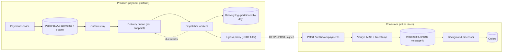
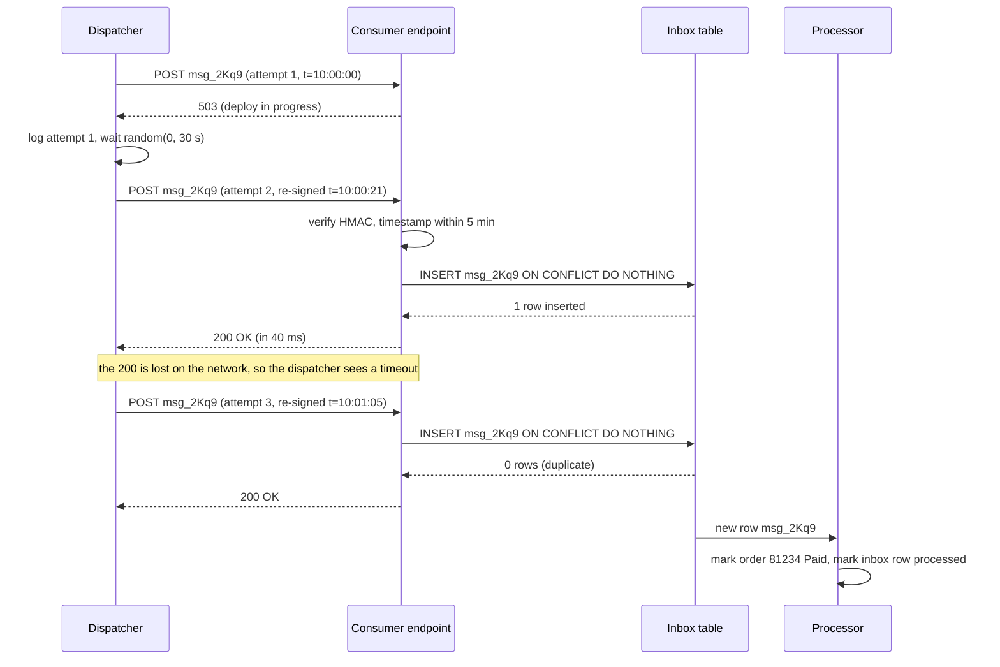

Your online store takes a UPI payment through a payment provider. The customer approves the payment on their phone, and the provider knows it succeeded. But how does *your* server find out? You could ask the provider every few seconds, "is it done yet?". Or the provider could call you the moment it happens. That second option is a webhook, and almost every payment, shipping, Git hosting and messaging platform offers one. This lesson covers both sides: sending webhooks reliably and receiving them safely.

## Learning objectives

By the end of this lesson you will be able to:

1. Explain what a webhook is, and when it beats polling and when it does not.
2. Sign a webhook with HMAC-SHA256 and verify it in ASP.NET Core with a constant-time comparison.
3. Block replay attacks with a signed timestamp and a tolerance window.
4. Design retries with exponential backoff and jitter, and decide which HTTP responses are worth retrying.
5. Build an idempotent receiver that processes each event exactly once even when it is delivered three times.
6. Keep a delivery log that lets support answer "did you send it, and what did they reply?" in seconds.
7. Size a webhook delivery platform and protect it from slow or malicious endpoints.

## Prerequisites

- [HTTP fundamentals](#/lesson/m10-http-fundamentals): status codes, headers and request bodies.
- [REST API design](#/lesson/m10-rest-design): a webhook is a REST call in reverse, so the same contract thinking applies.
- [Background services](#/lesson/m03-background-services): both sender and receiver push slow work into a `BackgroundService`.

Helpful later: [Idempotency keys](#/lesson/m10-idempotency) and [Timeouts, retries and backoff](#/lesson/m10-timeouts-retries) go deeper on two ideas we use here.

## Explain it like I'm a beginner

Think of ordering a cake from a bakery in Pune. You have two ways to know when it is ready.

1. **Keep calling the bakery** every 10 minutes: "Is it ready?" Most calls get "not yet". This is **polling**.
2. **Leave your phone number** and say "call me when it's ready". The bakery calls once, at the right time. This is a **webhook** (a callback over HTTP).

In software, "leaving your phone number" means registering a URL, for example `https://shop.example.in/webhooks/payments`. When an event happens (payment captured, parcel delivered, code pushed), the provider sends an HTTP `POST` to that URL with a small JSON message describing the event.

Three worries come with this, and they shape the whole lesson:

- **Is it really the bakery calling?** Anyone can POST to your URL. So the sender attaches a secret stamp that only it and you can make (an **HMAC signature**).
- **Is someone playing an old recording?** An attacker who captured one genuine call could replay it later. So the stamp includes the time, and you reject old calls (**replay protection**).
- **What if your phone was off?** Your server might be restarting. So the sender tries again later, waiting a bit longer each time (**retries with backoff**). Because of retries, you might get the same call twice, so you must handle duplicates safely (an **idempotent receiver**).

And the bakery keeps a notebook of every call it made and what you said (a **delivery log**), so when you complain "you never called", they can check.

## First-principles explanation

### What a webhook is

A webhook is an HTTP request that a **provider** sends to a **consumer's** URL when an event happens. The consumer registers the URL (and usually chooses which event types it wants). The provider owns the event format.

```text
POST /webhooks/payments HTTP/1.1
Host: shop.example.in
Content-Type: application/json
webhook-id: msg_2Kq9
webhook-timestamp: 1760000000
webhook-signature: v1,qcRGXFqlY3AhGVnWX/73txTg4VbNuU36vhMOprmVdEY=

{"type":"payment.captured","amount":49900}
```

The three `webhook-*` headers follow the open **Standard Webhooks** specification, which many providers have adopted. Others use their own header names (one popular payment API uses a single `Signature` header with `t=` and `v1=` parts; Git hosts often use `X-Hub-Signature-256`). The ideas are identical.

### Webhooks versus polling: the numbers

Suppose 5,000 merchants each want to know about payments within 10 seconds.

- **Polling** every 10 s: 5,000 ÷ 10 = **500 requests per second**, all day, even at 3 a.m. when nothing happens. If each merchant gets 2,000 payments a day, that is 10 M events a day against 43.2 M polls a day: most polls return nothing.
- **Webhooks**: 10 M events ÷ 86,400 s ≈ **116 requests per second** on average, and each one carries news. Latency is usually under a second instead of "up to 10 s".

Webhooks win on cost and freshness. Polling wins on **simplicity and control**: the consumer decides the pace, needs no public URL, and cannot miss an event if it polls a "list events since cursor X" API. Many good providers offer both: webhooks for speed, plus an events API so consumers can reconcile anything they missed.

### Delivery semantics: at-least-once, not exactly-once

The sender can never be sure a delivery worked. If it sends a POST and the connection drops before the response arrives, the consumer may or may not have processed it. The only safe choice is to **retry**, which means the consumer may receive the same event more than once. That is **at-least-once delivery**. "Exactly once" is achieved only by combining at-least-once delivery with an idempotent receiver, which we build later. (The same reasoning appears in [delivery guarantees](#/lesson/m12-delivery-guarantees) for message queues.)

Webhooks also give **no ordering guarantee**. Attempt 1 of `payment.captured` may fail and be retried 30 seconds later, after `payment.refunded` was already delivered. Receivers must cope with out-of-order events, usually by re-reading the current state from the provider's API or by comparing a version or timestamp on the resource.

### Authenticity: HMAC signatures

**HMAC** (hash-based message authentication code, RFC 2104) mixes a shared secret key with the message and hashes the result. With HMAC-SHA256 you get 32 bytes that:

- anyone with the secret can recompute, and
- nobody without the secret can forge, even after seeing millions of valid signatures.

When the consumer registers the endpoint, the provider generates a random secret (at least 24 bytes, typically 32) and shows it once. Standard Webhooks presents it as `whsec_` followed by the base64 of the key bytes; the HMAC key is the *decoded* bytes, not the string. Store it like a password: in a secret store, never in source control. For every delivery, the provider computes:

```text
signed_content = webhook-id + "." + webhook-timestamp + "." + raw_body
signature      = base64( HMAC-SHA256(secret, signed_content) )
header         = "v1," + signature
```

The consumer recomputes the same value from the request it received and compares. If even one byte of the body, the id or the timestamp changed, the result is completely different.

Four details decide whether verification is actually secure:

1. **Sign and verify the raw bytes.** If your framework parses the JSON and you re-serialise it, the whitespace or property order may change, and the signature fails. Worse, some teams "fix" that by skipping verification. Read the body as bytes *before* any model binding.
2. **Compare in constant time.** A normal string compare stops at the first different character, so it returns slightly faster for a wrong first byte than for a wrong last byte. With enough tries an attacker can measure that (a **timing attack**). .NET gives you `CryptographicOperations.FixedTimeEquals`, which always takes the same time for equal-length inputs.
3. **Include the timestamp and id in the signed content.** Otherwise an attacker can copy a valid signature and attach a fresh timestamp.
4. **Support several signatures at once.** During **secret rotation** the provider signs with both the old and the new secret for a while (the header holds `v1,abc… v1,def…` separated by spaces). The consumer accepts either. Rotation then needs no downtime.

Why HMAC rather than public-key signatures? HMAC is fast and simple, but both sides hold the same secret, so the consumer could in theory forge messages *to itself*. Some providers use asymmetric signatures (for example Ed25519, which the Standard Webhooks spec allows as `v1a`) so consumers only hold a public key. For most systems HMAC is enough. Mutual TLS is another option for high-security B2B links, at a much higher operational cost.

### Replay protection with timestamps

A signature proves *who* sent the message, not *when*. An attacker who logs one genuine `payment.captured` request (from a misconfigured proxy log, say) could resend it next week. Because the bytes are identical, the signature is still valid.

The defence has two layers:

1. **Timestamp tolerance.** Reject any request whose signed timestamp is more than, say, **5 minutes** from your clock, in either direction. A replay next week fails. Five minutes allows for clock skew between servers (keep your servers on NTP) without leaving a long window.
2. **Seen-id check.** Inside the 5-minute window, remember each `webhook-id` you processed. A replay within the window is a duplicate and is ignored. This is the same table that gives you idempotency, so you get it almost for free.

Do not confuse the two time spans. For *replay* protection, remembering ids for the 5-minute tolerance is enough, because anything older fails the timestamp check. For *idempotency*, it is not: a genuine retry 10 hours later carries the same id with a fresh timestamp and passes the window. So the inbox must remember ids for at least the sender's whole retry horizon plus manual resends (keep them 7–30 days, then drop old partitions).

Note what tolerance does to retries: the sender must **re-sign every attempt with a fresh timestamp**. The id stays the same across retries (that is how the receiver spots duplicates), but the timestamp changes.

### Retries with backoff and jitter

Consumer endpoints fail all the time: deploys, expired certificates, a slow database. A sender that tries once loses events. A sender that retries every second hammers a struggling consumer and can keep it down. The standard answer is **exponential backoff with jitter**:

```text
delay(n) = random(0, min(cap, base × 2^(n−1)))      // "full jitter"
```

With `base = 30 s` and `cap = 1 h`, the upper bounds for attempts 1 to 8 are 30 s, 1 min, 2 min, 4 min, 8 min, 16 min, 32 min, 1 h. The total window is roughly 2 hours of upper bounds. Many providers use a longer fixed schedule instead (for example 5 s, 5 min, 30 min, 2 h, 5 h, 10 h, 10 h), spanning about a day, so a consumer that is down overnight still catches up.

The **random part (jitter)** matters as much as the exponential part. Suppose a consumer is down for 10 minutes and 20,000 events queue up for it. Without jitter, all 20,000 retries fire at the same instants and crush the consumer the moment it comes back. With full jitter they spread evenly over each window.

Not every failure deserves a retry. A sensible classification:

| Response | Meaning | Action |
|---|---|---|
| 2xx | Accepted | Done. Do not look at the body. |
| 408, 429, 5xx | Temporary trouble | Retry with backoff. Honour `Retry-After` if present. |
| Timeout, connection refused, DNS failure, TLS error | Unknown or temporary | Retry with backoff. |
| 410 Gone | "This endpoint no longer exists" | Stop and disable the endpoint. |
| 3xx | Redirect | Do not follow (an SSRF risk). Treat as failure. |
| Other 4xx (400, 401, 404) | The consumer rejected it | Usually stop after a few tries and alert the consumer. |

After the last attempt, the event goes to a **dead-letter** state, and the consumer can replay it from a dashboard or API. If an endpoint fails every delivery for several days, disable it and email its owner, otherwise you spend money retrying into a void.

### Idempotent receivers

Because delivery is at-least-once, the receiver must make processing the same event twice harmless. The usual design:

1. Verify the signature and timestamp.
2. Try to insert the `webhook-id` into an **inbox table** with a unique key. If the insert conflicts, you have seen it before: return `200 OK` and stop.
3. Store the payload and return `200 OK` **quickly**, ideally in under a second.
4. Process the event in a background worker, inside a database transaction that also marks the inbox row as processed.

Why return fast? The sender has a timeout, often 10–30 s. If your handler sends an email, updates three tables and calls an ERP inside the request, it may exceed the timeout. The sender then retries, while your first attempt is still running, and now you have concurrent duplicates. Accepting quickly and processing asynchronously removes that race. The full inbox pattern is covered in [idempotent consumers](#/lesson/m12-idempotent-consumers).

Some business effects are naturally idempotent: "set order status to Paid" can run twice safely. "Add ₹499 to the wallet" cannot. Make the side effect idempotent where you can, and rely on the inbox where you cannot.

### Delivery logs

When a merchant says "we never got the refund webhook for order 81234", support needs an answer in seconds. A **delivery log** records every attempt:

| Field | Example |
|---|---|
| message id, event type | `msg_2Kq9`, `refund.processed` |
| endpoint id and URL | `ep_77`, `https://shop.example.in/webhooks/payments` |
| attempt number, timestamp | 3, `2026-10-19T10:42:05Z` |
| response status, duration | `503`, 10,000 ms (timeout) |
| first 1–2 KB of response body | `upstream connect error` |
| next attempt at | `2026-10-19T10:46:05Z` |

Keep request bodies separately (the message is stored once, attempts reference it) and truncate response bodies, because some endpoints return entire HTML error pages. Expose the log in the consumer's dashboard with a **"resend"** button. That one feature removes a large share of support tickets.

Storage grows fast, so estimate it: 10 M events a day × 1.2 attempts × about 400 bytes per attempt row ≈ **4.8 GB a day**, or about 144 GB for 30 days. In PostgreSQL, partition the table by day and drop old partitions instead of running huge `DELETE`s ([partitioning](#/lesson/m09-partitioning-sharding)).

### Sending reliably: the outbox

A subtle bug lives on the sender side. If your code commits "payment captured" to the database and *then* publishes the webhook, a crash between those two steps loses the webhook forever. If it publishes first and the commit then fails, you announced something that never happened. The fix is the [transactional outbox](#/lesson/m12-outbox): write the event row in the same transaction as the business change, and let a background dispatcher deliver it.

### Security on the sender side

Consumers type in their own URLs, so a webhook sender is a machine that makes HTTP requests to **attacker-chosen addresses**. That is the definition of a server-side request forgery (SSRF) risk ([OWASP](#/lesson/m14-owasp)). An attacker registers `http://169.254.169.254/latest/meta-data/` (a cloud metadata address) or `http://10.0.0.5:5432` and reads your internal network through the delivery log. Defences:

- Require HTTPS and resolve the host name yourself. Reject private, loopback, link-local and metadata address ranges, *after* DNS resolution, on every attempt (DNS can change).
- Do not follow redirects.
- Send from a separate network segment or egress proxy that cannot reach internal services.
- Cap response size and time.

### When a simpler design is enough

- **Internal services in one company**: if both sides can use a message broker (RabbitMQ, Azure Service Bus), a queue gives you retries, dead-lettering and ordering per partition without HTTP signing. Webhooks shine across organisational boundaries.
- **Low volume, latency not critical**: a nightly reconciliation job that polls an "events since" API may be all you need. A grievance portal that sends 200 status updates a day to a state department's system does not need a delivery platform.
- **Receiving only**: if you are the consumer, you do not build backoff or delivery logs. You verify, deduplicate, store and process. Most teams are consumers far more often than providers.

## Visual explanation

### Architecture: from business event to processed webhook



Start on the left. The **payment service** writes the payment and an **outbox** row in one PostgreSQL transaction, so the event exists if and only if the payment does. The **outbox relay** reads new rows and puts one delivery per subscribed endpoint onto a **delivery queue**, kept per endpoint so a slow consumer cannot block others. **Dispatcher workers** sign and send each delivery through an **egress proxy** that blocks private addresses, record every attempt in the **delivery log**, and put failures back on the queue with a later due time (the dotted arrow). On the right, the consumer's endpoint **verifies** the signature and timestamp, inserts the message id into an **inbox** table (a duplicate insert is ignored), returns `200`, and a **background processor** updates the orders.

### Sequence: a failed delivery, a retry and a duplicate



Attempt 1 hits the consumer mid-deploy and gets **503**, a retryable status, so the dispatcher logs it and waits a random time up to 30 s. Attempt 2 carries the **same id** but a **new timestamp and signature**. The consumer verifies it, inserts the id into its inbox and replies in 40 ms. That reply is lost, so from the dispatcher's point of view attempt 2 timed out, and it sends attempt 3. The consumer's insert now affects **zero rows**, so it knows this is a duplicate and simply replies `200`. The processor handles the event exactly once. This diagram is the whole lesson in miniature: at-least-once delivery plus an idempotent receiver gives exactly-once *effects*.

## Step-by-step example

**Scenario.** PaySetu is a fictional payment gateway used by online shops, food-delivery kitchens and coaching institutes. Each merchant's server needs to know when a customer's UPI or card payment is captured or refunded, so it can confirm the order, start the delivery or unlock the course. PaySetu has 12,000 merchant endpoints and handles about 3 M payment events a day, with big peaks during festival sales.

### Step 1 — Estimate the load

```text
3,000,000 events/day ÷ 86,400 s ≈ 35 events/s average
Festival-sale peak, assume ×6      ≈ 210 events/s
Assume 1.3 attempts per event       ≈ 270 HTTP requests/s at peak
```

### Step 2 — Estimate concurrency (Little's law)

Concurrent requests = arrival rate × time each takes. If healthy endpoints answer in about 300 ms: 270 × 0.3 ≈ **81 in flight**. Now suppose 3 % of traffic goes to endpoints that hang until our 10 s timeout: 270 × 0.03 × 10 ≈ **81 more in flight**, from only 3 % of traffic. Slow endpoints, not volume, decide how many connections and workers you need. This is why delivery is partitioned per endpoint with a concurrency cap (say 10 in flight per endpoint).

### Step 3 — Choose a retry schedule

Many small merchants run their shop on a single virtual machine or shared hosting that goes down for an hour during a deploy, or overnight. A 2-hour exponential window is too short for them, so PaySetu publishes a fixed schedule: 8 attempts, with gaps of 5 s, 5 min, 30 min, 2 h, 5 h, 10 h and 10 h (about 28 hours in total), each gap with ±20 % jitter. It disables an endpoint after 5 days of continuous failure, with emails to the merchant at day 1 and day 3.

### Step 4 — Define the contract

Headers `webhook-id`, `webhook-timestamp`, `webhook-signature`; HMAC-SHA256 over `id.timestamp.body`; 5-minute tolerance; JSON body with `type`, `id`, `created_at` and a `data` object containing the payment's current state and a `version` number so receivers can ignore stale updates.

### Step 5 — Build the receiver (for the merchant's team)

Read raw bytes, verify, insert into inbox, return `200` within 1 s, process in the background (mark the order paid, then send the receipt). The code is in the next section.

### Step 6 — Size the delivery log

```text
3 M events × 1.3 attempts × 400 bytes ≈ 1.56 GB/day
90-day retention ≈ 140 GB  →  daily partitions, drop partitions older than 90 days
```

## Production-style C# implementation

The code has two halves. The **receiver** (what most teams build) verifies, deduplicates and queues. The **sender** signs, retries with backoff and logs every attempt. External pieces (PostgreSQL) are behind interfaces with in-memory implementations so the project compiles offline.

```text
Webhooks.Api/
  Program.cs
  Signing/WebhookSignature.cs
  Signing/WebhookVerifier.cs
  Receiving/WebhookInbox.cs
  Receiving/InboxProcessor.cs
  Sending/RetryPolicy.cs
  Sending/DeliveryLog.cs
  Sending/DeliveryQueue.cs
  Sending/WebhookDispatcher.cs
```

```csharp file=Signing/WebhookSignature.cs
using System.Security.Cryptography;
using System.Text;

namespace Webhooks.Signing;

/// <summary>Standard Webhooks style signing: HMAC-SHA256 over "id.timestamp.body".
/// The secret is used as raw UTF-8 bytes here for clarity; many providers base64-encode it.</summary>
public static class WebhookSignature
{
    public const string Version = "v1";

    public static string Compute(ReadOnlySpan<byte> secret, string messageId, long unixTimestamp, ReadOnlySpan<byte> body)
    {
        byte[] prefix = Encoding.UTF8.GetBytes($"{messageId}.{unixTimestamp}.");
        byte[] content = new byte[prefix.Length + body.Length];
        prefix.CopyTo(content, 0);
        body.CopyTo(content.AsSpan(prefix.Length));
        byte[] mac = HMACSHA256.HashData(secret, content);
        return $"{Version},{Convert.ToBase64String(mac)}";
    }
}
```

`Compute` signs the **raw body bytes**, never a re-serialised object. The id and timestamp are part of the signed content, so neither can be swapped.

```csharp file=Signing/WebhookVerifier.cs
using System.Globalization;
using System.Security.Cryptography;
using System.Text;
using Microsoft.Extensions.Options;

namespace Webhooks.Signing;

public enum VerificationOutcome { Valid, MissingHeaders, MalformedTimestamp, TooOld, TooNew, BadSignature }

public sealed class WebhookVerifierOptions
{
    /// <summary>Accept timestamps within this distance of our clock, in either direction.</summary>
    public TimeSpan Tolerance { get; set; } = TimeSpan.FromMinutes(5);

    /// <summary>All currently valid secrets. During rotation this holds the old and the new one.</summary>
    public List<string> Secrets { get; set; } = new();
}

public sealed class WebhookVerifier(IOptions<WebhookVerifierOptions> options, TimeProvider clock)
{
    private readonly WebhookVerifierOptions _o = options.Value;

    public VerificationOutcome Verify(string? messageId, string? timestampHeader, string? signatureHeader, ReadOnlySpan<byte> body)
    {
        if (string.IsNullOrWhiteSpace(messageId) || string.IsNullOrWhiteSpace(timestampHeader) || string.IsNullOrWhiteSpace(signatureHeader))
            return VerificationOutcome.MissingHeaders;

        if (!long.TryParse(timestampHeader, NumberStyles.None, CultureInfo.InvariantCulture, out long ts))
            return VerificationOutcome.MalformedTimestamp;

        long now = clock.GetUtcNow().ToUnixTimeSeconds();
        long tolerance = (long)_o.Tolerance.TotalSeconds;
        if (ts < now - tolerance) return VerificationOutcome.TooOld;
        if (ts > now + tolerance) return VerificationOutcome.TooNew;

        // The header may carry several space-separated signatures (secret rotation).
        string[] candidates = signatureHeader.Split(' ', StringSplitOptions.RemoveEmptyEntries);
        foreach (string secret in _o.Secrets)
        {
            byte[] expected = Encoding.ASCII.GetBytes(WebhookSignature.Compute(Encoding.UTF8.GetBytes(secret), messageId, ts, body));
            foreach (string candidate in candidates)
            {
                byte[] actual = Encoding.ASCII.GetBytes(candidate);
                // Constant-time comparison: no early exit on the first different byte.
                if (CryptographicOperations.FixedTimeEquals(expected, actual))
                    return VerificationOutcome.Valid;
            }
        }
        return VerificationOutcome.BadSignature;
    }
}
```

Three points to defend in review. The verifier takes a `TimeProvider`, so tests can freeze the clock. It checks the timestamp **before** computing any HMAC, which makes floods of stale requests cheap to reject. And `FixedTimeEquals` returns `false` immediately for different lengths, which leaks only the length, and every valid signature has the same length anyway.

```csharp file=Receiving/WebhookInbox.cs
using System.Collections.Concurrent;
using System.Threading.Channels;

namespace Webhooks.Receiving;

public sealed record InboxMessage(string MessageId, byte[] Body, DateTimeOffset ReceivedAt);

/// <summary>Records each message id once. Production: a PostgreSQL table with a unique key
/// and INSERT ... ON CONFLICT (message_id) DO NOTHING.</summary>
public interface IWebhookInbox
{
    /// <returns>true if this id is new; false if it was already recorded (a duplicate).</returns>
    ValueTask<bool> TryAddAsync(InboxMessage message, CancellationToken ct);
    ValueTask MarkProcessedAsync(string messageId, CancellationToken ct);
}

public sealed class InMemoryWebhookInbox : IWebhookInbox
{
    private readonly ConcurrentDictionary<string, bool> _processedById = new();

    public ValueTask<bool> TryAddAsync(InboxMessage message, CancellationToken ct) =>
        ValueTask.FromResult(_processedById.TryAdd(message.MessageId, false));

    public ValueTask MarkProcessedAsync(string messageId, CancellationToken ct)
    {
        _processedById[messageId] = true;
        return ValueTask.CompletedTask;
    }
}

/// <summary>Hands accepted messages to the background processor without blocking the HTTP request.</summary>
public sealed class InboxWorkQueue
{
    private readonly Channel<InboxMessage> _channel =
        Channel.CreateBounded<InboxMessage>(new BoundedChannelOptions(10_000) { FullMode = BoundedChannelFullMode.Wait });

    public ValueTask EnqueueAsync(InboxMessage message, CancellationToken ct) => _channel.Writer.WriteAsync(message, ct);
    public IAsyncEnumerable<InboxMessage> ReadAllAsync(CancellationToken ct) => _channel.Reader.ReadAllAsync(ct);
}
```

In production the inbox row itself is the queue: the processor polls `WHERE processed_at IS NULL`, so nothing is lost if the process restarts between accepting and processing. The in-memory channel here keeps the example runnable; it would lose messages on a crash, which is exactly why the durable insert must happen *before* the `200`.

```csharp file=Receiving/InboxProcessor.cs
using System.Text.Json;
using Microsoft.Extensions.Hosting;
using Microsoft.Extensions.Logging;

namespace Webhooks.Receiving;

public interface IPaymentEventHandler
{
    Task HandleAsync(string eventType, JsonElement data, CancellationToken ct);
}

public sealed class LoggingPaymentEventHandler(ILogger<LoggingPaymentEventHandler> log) : IPaymentEventHandler
{
    public Task HandleAsync(string eventType, JsonElement data, CancellationToken ct)
    {
        log.LogInformation("Handling {EventType}: {Data}", eventType, data.GetRawText());
        return Task.CompletedTask;
    }
}

public sealed class InboxProcessor(InboxWorkQueue queue, IWebhookInbox inbox, IPaymentEventHandler handler, ILogger<InboxProcessor> log)
    : BackgroundService
{
    protected override async Task ExecuteAsync(CancellationToken stoppingToken)
    {
        await foreach (InboxMessage message in queue.ReadAllAsync(stoppingToken))
        {
            try
            {
                using JsonDocument doc = JsonDocument.Parse(message.Body);
                string type = doc.RootElement.GetProperty("type").GetString() ?? "unknown";
                JsonElement data = doc.RootElement.TryGetProperty("data", out var d) ? d : doc.RootElement;
                await handler.HandleAsync(type, data, stoppingToken);
                await inbox.MarkProcessedAsync(message.MessageId, stoppingToken);
            }
            catch (Exception ex) when (ex is not OperationCanceledException)
            {
                // The row stays unprocessed; a sweeper retries it later. Never lose it silently.
                log.LogError(ex, "Failed to process webhook {MessageId}", message.MessageId);
            }
        }
    }
}
```

Now the sender side. The retry policy is pure, so it is easy to test.

```csharp file=Sending/RetryPolicy.cs
namespace Webhooks.Sending;

public enum DeliveryDecision { Delivered, Retry, GiveUp, DisableEndpoint }

public sealed class RetryPolicy(TimeSpan baseDelay, TimeSpan maxDelay, int maxAttempts)
{
    public static RetryPolicy Default { get; } = new(TimeSpan.FromSeconds(30), TimeSpan.FromHours(1), 8);

    public int MaxAttempts => maxAttempts;

    /// <param name="statusCode">null when there was no HTTP response (timeout, DNS, TLS, connection refused).</param>
    public DeliveryDecision Decide(int attempt, int? statusCode)
    {
        if (statusCode is >= 200 and < 300) return DeliveryDecision.Delivered;
        if (statusCode == 410) return DeliveryDecision.DisableEndpoint;
        bool retryable = statusCode is null or 408 or 429 or >= 500;
        if (!retryable) return DeliveryDecision.GiveUp;
        return attempt < maxAttempts ? DeliveryDecision.Retry : DeliveryDecision.GiveUp;
    }

    /// <summary>Full jitter: a uniform random delay in [0, min(max, base × 2^(attempt−1))].</summary>
    public TimeSpan DelayAfter(int attempt, double random01)
    {
        double exp = baseDelay.TotalSeconds * Math.Pow(2, Math.Max(0, attempt - 1));
        double upper = Math.Min(maxDelay.TotalSeconds, exp);
        return TimeSpan.FromSeconds(upper * Math.Clamp(random01, 0, 1));
    }
}
```

```csharp file=Sending/DeliveryLog.cs
using System.Collections.Concurrent;

namespace Webhooks.Sending;

public sealed record DeliveryAttempt(
    string MessageId, string EndpointId, int Attempt, DateTimeOffset StartedAt,
    int? StatusCode, TimeSpan Duration, string? ResponseSnippet, string? Error, DeliveryDecision Decision);

/// <summary>Production: an append-only PostgreSQL table partitioned by day.</summary>
public interface IDeliveryLog
{
    void Record(DeliveryAttempt attempt);
    IReadOnlyList<DeliveryAttempt> ForMessage(string messageId);
}

public sealed class InMemoryDeliveryLog : IDeliveryLog
{
    private readonly ConcurrentQueue<DeliveryAttempt> _attempts = new();
    public void Record(DeliveryAttempt attempt) => _attempts.Enqueue(attempt);
    public IReadOnlyList<DeliveryAttempt> ForMessage(string messageId) =>
        _attempts.Where(a => a.MessageId == messageId).OrderBy(a => a.Attempt).ToList();
}
```

```csharp file=Sending/DeliveryQueue.cs
namespace Webhooks.Sending;

public sealed record OutgoingWebhook(string MessageId, string EndpointId, Uri EndpointUrl, string Secret, byte[] Body);

public sealed record PendingDelivery(OutgoingWebhook Message, int Attempt, DateTimeOffset DueAt);

public interface IDeliveryQueue
{
    void Schedule(PendingDelivery delivery);
    bool TryTakeDue(DateTimeOffset now, out PendingDelivery? delivery);
}

/// <summary>Due-time ordered queue. Production: a table polled with
/// SELECT ... WHERE due_at &lt;= now() ORDER BY due_at FOR UPDATE SKIP LOCKED.</summary>
public sealed class InMemoryDeliveryQueue : IDeliveryQueue
{
    private readonly PriorityQueue<PendingDelivery, DateTimeOffset> _queue = new();
    private readonly Lock _gate = new();

    public void Schedule(PendingDelivery delivery)
    {
        lock (_gate) _queue.Enqueue(delivery, delivery.DueAt);
    }

    public bool TryTakeDue(DateTimeOffset now, out PendingDelivery? delivery)
    {
        lock (_gate)
        {
            if (_queue.TryPeek(out var next, out var due) && due <= now)
            {
                delivery = _queue.Dequeue();
                return true;
            }
        }
        delivery = null;
        return false;
    }
}
```

```csharp file=Sending/WebhookDispatcher.cs
using System.Diagnostics;
using System.Text;
using Microsoft.Extensions.Hosting;
using Microsoft.Extensions.Logging;
using Webhooks.Signing;

namespace Webhooks.Sending;

public sealed class WebhookDispatcher(
    IHttpClientFactory httpFactory, IDeliveryQueue queue, IDeliveryLog deliveryLog,
    RetryPolicy policy, TimeProvider clock, ILogger<WebhookDispatcher> log) : BackgroundService
{
    public const string ClientName = "webhooks";

    protected override async Task ExecuteAsync(CancellationToken stoppingToken)
    {
        while (!stoppingToken.IsCancellationRequested)
        {
            if (!queue.TryTakeDue(clock.GetUtcNow(), out var pending) || pending is null)
            {
                await Task.Delay(TimeSpan.FromMilliseconds(250), clock, stoppingToken);
                continue;
            }
            await DeliverOnceAsync(pending, stoppingToken);
        }
    }

    public async Task<DeliveryAttempt> DeliverOnceAsync(PendingDelivery pending, CancellationToken ct)
    {
        OutgoingWebhook m = pending.Message;
        DateTimeOffset started = clock.GetUtcNow();
        long ts = started.ToUnixTimeSeconds();   // fresh timestamp on every attempt

        using var request = new HttpRequestMessage(HttpMethod.Post, m.EndpointUrl)
        {
            Content = new ByteArrayContent(m.Body)
        };
        request.Content.Headers.ContentType = new System.Net.Http.Headers.MediaTypeHeaderValue("application/json");
        request.Headers.Add("webhook-id", m.MessageId);
        request.Headers.Add("webhook-timestamp", ts.ToString(System.Globalization.CultureInfo.InvariantCulture));
        request.Headers.Add("webhook-signature", WebhookSignature.Compute(Encoding.UTF8.GetBytes(m.Secret), m.MessageId, ts, m.Body));

        int? status = null;
        string? snippet = null, error = null;
        long t0 = Stopwatch.GetTimestamp();
        try
        {
            HttpClient http = httpFactory.CreateClient(ClientName);
            using HttpResponseMessage response = await http.SendAsync(request, HttpCompletionOption.ResponseHeadersRead, ct);
            status = (int)response.StatusCode;
            string body = await response.Content.ReadAsStringAsync(ct);
            snippet = body.Length > 1024 ? body[..1024] : body;   // never store whole error pages
        }
        catch (Exception ex) when (ex is HttpRequestException or TaskCanceledException && !ct.IsCancellationRequested)
        {
            error = ex.GetType().Name + ": " + ex.Message;
        }

        DeliveryDecision decision = policy.Decide(pending.Attempt, status);
        var attempt = new DeliveryAttempt(m.MessageId, m.EndpointId, pending.Attempt, started, status,
            Stopwatch.GetElapsedTime(t0), snippet, error, decision);
        deliveryLog.Record(attempt);

        switch (decision)
        {
            case DeliveryDecision.Retry:
                TimeSpan delay = policy.DelayAfter(pending.Attempt, Random.Shared.NextDouble());
                queue.Schedule(pending with { Attempt = pending.Attempt + 1, DueAt = clock.GetUtcNow() + delay });
                break;
            case DeliveryDecision.GiveUp:
                log.LogWarning("Webhook {MessageId} to {EndpointId} dead-lettered after attempt {Attempt}", m.MessageId, m.EndpointId, pending.Attempt);
                break;
            case DeliveryDecision.DisableEndpoint:
                log.LogWarning("Endpoint {EndpointId} returned 410 Gone; disabling", m.EndpointId);
                break;
        }
        return attempt;
    }
}
```

`DeliverOnceAsync` is public so tests can drive one attempt with a fake `HttpMessageHandler`. Note the `HttpCompletionOption.ResponseHeadersRead` plus the 1 KB snippet: we never buffer a 50 MB response from a hostile endpoint into memory just to log it. (A stricter version would read at most 1 KB from the stream.)

```csharp file=Program.cs
using System.Text;
using Microsoft.AspNetCore.Http.Features;
using Webhooks.Receiving;
using Webhooks.Sending;
using Webhooks.Signing;

var builder = WebApplication.CreateBuilder(args);

builder.Services.AddSingleton(TimeProvider.System);

// Receiver side
builder.Services.Configure<WebhookVerifierOptions>(builder.Configuration.GetSection("Webhooks:Incoming"));
builder.Services.AddSingleton<WebhookVerifier>();
builder.Services.AddSingleton<IWebhookInbox, InMemoryWebhookInbox>();
builder.Services.AddSingleton<InboxWorkQueue>();
builder.Services.AddSingleton<IPaymentEventHandler, LoggingPaymentEventHandler>();
builder.Services.AddHostedService<InboxProcessor>();

// Sender side
builder.Services.AddHttpClient(WebhookDispatcher.ClientName, c => c.Timeout = TimeSpan.FromSeconds(10))
    .ConfigurePrimaryHttpMessageHandler(() => new SocketsHttpHandler { AllowAutoRedirect = false });
builder.Services.AddSingleton(RetryPolicy.Default);
builder.Services.AddSingleton<IDeliveryQueue, InMemoryDeliveryQueue>();
builder.Services.AddSingleton<IDeliveryLog, InMemoryDeliveryLog>();
builder.Services.AddHostedService<WebhookDispatcher>();

var app = builder.Build();

const long MaxBodyBytes = 256 * 1024;

app.MapPost("/webhooks/payments", async (HttpRequest request, WebhookVerifier verifier, IWebhookInbox inbox,
    InboxWorkQueue work, TimeProvider clock, ILogger<Program> log, CancellationToken ct) =>
{
    if (request.ContentLength is > MaxBodyBytes) return Results.StatusCode(StatusCodes.Status413PayloadTooLarge);
    // Content-Length can be absent (chunked); this cap makes the server stop reading past the limit either way.
    if (request.HttpContext.Features.Get<IHttpMaxRequestBodySizeFeature>() is { IsReadOnly: false } sizeLimit)
        sizeLimit.MaxRequestBodySize = MaxBodyBytes;

    // Read the RAW bytes before anything parses them; the signature covers these exact bytes.
    using var buffer = new MemoryStream();
    await request.Body.CopyToAsync(buffer, ct);
    byte[] body = buffer.ToArray();

    string id = request.Headers["webhook-id"].ToString();
    VerificationOutcome outcome = verifier.Verify(id, request.Headers["webhook-timestamp"], request.Headers["webhook-signature"], body);
    if (outcome != VerificationOutcome.Valid)
    {
        log.LogWarning("Rejected webhook {MessageId}: {Outcome}", id, outcome);
        return Results.StatusCode(StatusCodes.Status401Unauthorized);
    }

    var message = new InboxMessage(id, body, clock.GetUtcNow());
    if (!await inbox.TryAddAsync(message, ct)) return Results.Ok();   // duplicate: acknowledge, do nothing

    await work.EnqueueAsync(message, ct);
    return Results.Ok();
});

app.MapGet("/admin/deliveries/{messageId}", (string messageId, IDeliveryLog deliveries) => deliveries.ForMessage(messageId));

app.MapPost("/admin/send-test", (OutgoingTestRequest req, IDeliveryQueue queue, TimeProvider clock) =>
{
    var message = new OutgoingWebhook($"msg_{Guid.NewGuid():N}", req.EndpointId, req.Url, req.Secret, Encoding.UTF8.GetBytes(req.Json));
    queue.Schedule(new PendingDelivery(message, 1, clock.GetUtcNow()));
    return Results.Accepted($"/admin/deliveries/{message.MessageId}");
});

app.Run();

public sealed record OutgoingTestRequest(string EndpointId, Uri Url, string Secret, string Json);
```

`AllowAutoRedirect = false` enforces the "do not follow redirects" rule. A complete SSRF guard also needs a `SocketsHttpHandler.ConnectCallback` that resolves the host and refuses private address ranges before connecting. Doing it in the callback means the check runs on every connection, against the IP actually used, which defeats DNS rebinding (a snippet; `IsPublic` is your own helper that rejects loopback, private, link-local, CGNAT and metadata ranges for IPv4 and IPv6):

```csharp
var handler = new SocketsHttpHandler
{
    AllowAutoRedirect = false,
    ConnectCallback = async (ctx, ct) =>
    {
        IPAddress[] addresses = await Dns.GetHostAddressesAsync(ctx.DnsEndPoint.Host, ct);
        IPAddress target = addresses.FirstOrDefault(IsPublic)
            ?? throw new HttpRequestException($"Blocked non-public destination {ctx.DnsEndPoint.Host}");
        var socket = new Socket(target.AddressFamily, SocketType.Stream, ProtocolType.Tcp) { NoDelay = true };
        try { await socket.ConnectAsync(target, ctx.DnsEndPoint.Port, ct); return new NetworkStream(socket, ownsSocket: true); }
        catch { socket.Dispose(); throw; }
    }
};
```

One more thing a reviewer will ask: why not just add `AddStandardResilienceHandler()` (Microsoft.Extensions.Http.Resilience) to the `webhooks` client and let it retry? Because webhook retries must survive a process restart, wait minutes to hours, be recorded in the delivery log and be re-signed with a fresh timestamp. In-process retries do none of that and would multiply attempts on top of the durable schedule. Keep the HTTP client to a single attempt with a timeout, and let the durable queue own retries.

The production inbox insert is one statement (Npgsql, shown as a snippet because it is not compiled offline):

```csharp
await using var cmd = dataSource.CreateCommand("""
    INSERT INTO webhook_inbox (message_id, body, received_at)
    VALUES ($1, $2, now())
    ON CONFLICT (message_id) DO NOTHING
    """);
cmd.Parameters.AddWithValue(messageId);
cmd.Parameters.AddWithValue(body);
bool isNew = await cmd.ExecuteNonQueryAsync(ct) == 1;
```

## Bad design vs good design

**Bad: the "do everything in the handler" receiver.**

```csharp
[HttpPost("/webhooks/payments")]
public async Task<IActionResult> Receive([FromBody] PaymentEvent evt)   // model binding first
{
    var json = JsonSerializer.Serialize(evt);                            // re-serialised: not the signed bytes
    if (ComputeSig(json) != Request.Headers["webhook-signature"])        // ordinary string compare
        return Unauthorized();
    await _orders.MarkPaidAsync(evt.OrderId);                            // no duplicate check
    await _email.SendReceiptAsync(evt.OrderId);                          // slow call inside the request
    await _erp.PostInvoiceAsync(evt.OrderId);                            // slower call inside the request
    return Ok();
}
```

What goes wrong:

- Signatures fail randomly because re-serialisation changes whitespace and property order. Someone eventually comments out the check "temporarily".
- `!=` leaks timing information.
- No timestamp check, so a captured request can be replayed forever.
- The ERP call takes 12 s, the sender times out at 10 s and retries, and now two requests run concurrently: two receipts, two invoices.
- If the email fails after `MarkPaidAsync`, the handler returns 500, the sender retries, and the order is "marked paid" again (harmless) but the ERP gets a second invoice (not harmless).

**Good:** verify raw bytes in constant time, check the timestamp, insert the id into an inbox, return `200` in milliseconds, and process in the background with idempotent side effects. On the sender side: outbox, per-endpoint queues, re-signing on every attempt, backoff with jitter, a delivery log and a resend button.

:::callout type=mistake title="Returning 500 for a duplicate"
Some receivers treat "already processed" as an error and return 409 or 500. The sender then retries the duplicate for hours. A duplicate is a *success* from the sender's point of view: return 200.
:::

:::callout type=tradeoff title="Thin events versus fat events"
A **fat** event carries the whole resource (`data.amount`, `data.status`...). A **thin** event carries only `{ "type": "payment.updated", "id": "pay_81" }` and the receiver calls the provider's API to fetch the current state. Thin events dodge ordering problems and stale data, and leak less if a URL is misconfigured, but cost an extra API call per event and need the provider's API to be up. Many providers send fat events with a `version` field and let receivers choose.
:::

## Practical playground

A webhook sender retrying into a recovering consumer is a classic retry storm. In the simulator, treat the "dependency" as one large merchant's endpoint and "clients" as the deliveries queued for it. Start with retries on, no backoff and no jitter, trigger the incident, and watch load stay above capacity after the endpoint recovers. Then switch on backoff and jitter, and finally cut the retry count. Note how many attempts each setting spends per successful delivery.

:::playground type=sim sim=retry title="Webhook retries into a recovering endpoint" clients=600 failureRate=0.5 maxRetries=3 backoff=false jitter=false capacityRps=500
:::

## Exercises

:::exercise id=m10-webhooks-ex1 difficulty=beginner kind=code title="Sign and verify a webhook with HMAC-SHA256"
Implement the signing scheme from this lesson and a verifier that is safe against timing attacks and supports secret rotation.
::requirements
- `HmacWebhookSignature.Compute(string secret, string id, long timestamp, string body)` returns `"v1," + base64(HMAC-SHA256(secret, id + "." + timestamp + "." + body))`. Use UTF-8 for all strings.
- `HmacWebhookSignature.Verify(string secret, string id, long timestamp, string body, string signatureHeader)` returns `true` if **any** space-separated signature in the header matches.
- Use `CryptographicOperations.FixedTimeEquals` for the comparison.
::acceptance
- Secret `whsec-test-key-123`, id `msg_2Kq9`, timestamp `1760000000`, body `{"type":"payment.captured","amount":49900}` gives `v1,qcRGXFqlY3AhGVnWX/73txTg4VbNuU36vhMOprmVdEY=`.
- Changing one character of the body, the id or the timestamp makes `Verify` return false.
- A header with two signatures, one stale and one valid, verifies.
- An empty header returns false and does not throw.
::hint
HMAC needs two things: a key (the secret) and a message (the signed content). Build the message string first.
::hint
`HMACSHA256.HashData(byte[] key, byte[] source)` computes the MAC in one call. `Encoding.UTF8.GetBytes` turns strings into bytes.
::hint
For verification, compute the expected header string, then compare it to each candidate from `header.Split(' ', StringSplitOptions.RemoveEmptyEntries)`.
::hint
Compare bytes, not strings: `CryptographicOperations.FixedTimeEquals(Encoding.ASCII.GetBytes(expected), Encoding.ASCII.GetBytes(candidate))`.
::hint
```csharp
var mac = HMACSHA256.HashData(Encoding.UTF8.GetBytes(secret), Encoding.UTF8.GetBytes($"{id}.{timestamp}.{body}"));
return "v1," + Convert.ToBase64String(mac);
```
::starter
```csharp file=HmacWebhookSignature.cs
using System;
using System.Security.Cryptography;
using System.Text;

public static class HmacWebhookSignature
{
    public static string Compute(string secret, string id, long timestamp, string body) =>
        throw new NotImplementedException();

    public static bool Verify(string secret, string id, long timestamp, string body, string signatureHeader) =>
        throw new NotImplementedException();
}
```
::tests
```csharp file=HmacWebhookSignatureTests.cs
using Xunit;

public class HmacWebhookSignatureTests
{
    private const string Secret = "whsec-test-key-123";
    private const string Id = "msg_2Kq9";
    private const long Ts = 1760000000;
    private const string Body = "{\"type\":\"payment.captured\",\"amount\":49900}";
    private const string Expected = "v1,qcRGXFqlY3AhGVnWX/73txTg4VbNuU36vhMOprmVdEY=";

    [Fact] public void Known_vector() => Assert.Equal(Expected, HmacWebhookSignature.Compute(Secret, Id, Ts, Body));

    [Fact] public void Valid_signature_verifies() => Assert.True(HmacWebhookSignature.Verify(Secret, Id, Ts, Body, Expected));

    [Fact] public void Tampered_body_fails() =>
        Assert.False(HmacWebhookSignature.Verify(Secret, Id, Ts, Body.Replace("49900", "99900"), Expected));

    [Fact] public void Tampered_timestamp_fails() => Assert.False(HmacWebhookSignature.Verify(Secret, Id, Ts + 1, Body, Expected));

    [Fact] public void Tampered_id_fails() => Assert.False(HmacWebhookSignature.Verify(Secret, "msg_other", Ts, Body, Expected));

    [Fact] public void Wrong_secret_fails() => Assert.False(HmacWebhookSignature.Verify("another-secret", Id, Ts, Body, Expected));

    [Fact] public void Rotation_header_with_two_signatures() =>
        Assert.True(HmacWebhookSignature.Verify(Secret, Id, Ts, Body, "v1,AAAAAAAAAAAAAAAAAAAAAAAAAAAAAAAAAAAAAAAAAAA= " + Expected));

    [Fact] public void Empty_header_is_false() => Assert.False(HmacWebhookSignature.Verify(Secret, Id, Ts, Body, ""));
}
```
::solution
Build the signed content, MAC it, base64-encode, prefix with the version. Verification recomputes and compares each candidate in constant time.

```csharp file=HmacWebhookSignature.cs
using System;
using System.Security.Cryptography;
using System.Text;

public static class HmacWebhookSignature
{
    public static string Compute(string secret, string id, long timestamp, string body)
    {
        byte[] key = Encoding.UTF8.GetBytes(secret);
        byte[] content = Encoding.UTF8.GetBytes($"{id}.{timestamp}.{body}");
        return "v1," + Convert.ToBase64String(HMACSHA256.HashData(key, content));
    }

    public static bool Verify(string secret, string id, long timestamp, string body, string signatureHeader)
    {
        if (string.IsNullOrWhiteSpace(signatureHeader)) return false;
        byte[] expected = Encoding.ASCII.GetBytes(Compute(secret, id, timestamp, body));
        bool match = false;
        foreach (string candidate in signatureHeader.Split(' ', StringSplitOptions.RemoveEmptyEntries))
        {
            // Do not break early: keep total work independent of which candidate matched.
            match |= CryptographicOperations.FixedTimeEquals(expected, Encoding.ASCII.GetBytes(candidate));
        }
        return match;
    }
}
```

The `|=` without `break` is a small extra: it keeps the loop's run time the same whichever candidate matched. In a real receiver you would also pass the raw body as bytes rather than a string, so that no decoding step can alter it.
::mistakes
- Using `==` or `string.Equals` to compare signatures (timing leak).
- Signing only the body, so an attacker can attach a new timestamp to an old signature.
- Comparing the base64 part only and ignoring the `v1,` version prefix, which breaks when a `v2` scheme arrives.
- Throwing on a malformed header instead of returning false; a hostile caller can then trigger 500s.
::extensions
Add `ComputeBytes(byte[] secret, string id, long ts, ReadOnlySpan<byte> body)` that avoids converting the body to a string at all, and benchmark it with BenchmarkDotNet against the string version.
:::

:::exercise id=m10-webhooks-ex2 difficulty=beginner kind=code title="Replay guard: timestamp window plus seen ids"
Signatures do not stop replays. Build the guard that does.
::requirements
- `ReplayGuard(TimeSpan tolerance)` with `ReplayDecision Evaluate(string messageId, long unixTimestamp, DateTimeOffset now)`.
- Return `Stale` if the timestamp is more than `tolerance` before `now`, `FromFuture` if it is more than `tolerance` after `now`.
- Return `Duplicate` if the same message id was already accepted and is still remembered.
- Otherwise remember the id and return `Accept`.
- Forget ids whose timestamps have fallen out of the window, so memory does not grow forever.
::acceptance
- With a 5-minute tolerance, a timestamp 4 minutes old is accepted and one 6 minutes old is `Stale`.
- A timestamp 6 minutes in the future is `FromFuture`.
- The same id twice within the window gives `Accept` then `Duplicate`.
- After 10 minutes, the remembered-id count drops back to zero once `Evaluate` is called again.
::hint
Two separate checks: is the time acceptable, and have I seen this id? Do the cheap time check first.
::hint
Convert `now` with `now.ToUnixTimeSeconds()` and compare plain `long` values.
::hint
Store `Dictionary<string, long>` of id → timestamp. Before deciding, remove entries whose timestamp is older than `now − tolerance`.
::hint
Why is it safe to forget an id once it leaves the window? Because any replay of it would now fail the time check anyway.
::starter
```csharp file=ReplayGuard.cs
using System;
using System.Collections.Generic;
using System.Linq;

public enum ReplayDecision { Accept, Stale, FromFuture, Duplicate }

public sealed class ReplayGuard(TimeSpan tolerance)
{
    public int RememberedCount => throw new NotImplementedException();

    public ReplayDecision Evaluate(string messageId, long unixTimestamp, DateTimeOffset now) =>
        throw new NotImplementedException();
}
```
::tests
```csharp file=ReplayGuardTests.cs
using System;
using Xunit;

public class ReplayGuardTests
{
    private static readonly DateTimeOffset Now = new(2026, 10, 19, 10, 0, 0, TimeSpan.Zero);
    private static long Ago(int minutes) => Now.AddMinutes(-minutes).ToUnixTimeSeconds();

    [Fact] public void Recent_is_accepted() =>
        Assert.Equal(ReplayDecision.Accept, new ReplayGuard(TimeSpan.FromMinutes(5)).Evaluate("a", Ago(4), Now));

    [Fact] public void Old_is_stale() =>
        Assert.Equal(ReplayDecision.Stale, new ReplayGuard(TimeSpan.FromMinutes(5)).Evaluate("a", Ago(6), Now));

    [Fact] public void Future_is_rejected() =>
        Assert.Equal(ReplayDecision.FromFuture, new ReplayGuard(TimeSpan.FromMinutes(5)).Evaluate("a", Ago(-6), Now));

    [Fact]
    public void Same_id_twice_is_duplicate()
    {
        var g = new ReplayGuard(TimeSpan.FromMinutes(5));
        Assert.Equal(ReplayDecision.Accept, g.Evaluate("msg_1", Ago(1), Now));
        Assert.Equal(ReplayDecision.Duplicate, g.Evaluate("msg_1", Ago(0), Now));
    }

    [Fact]
    public void Old_ids_are_forgotten()
    {
        var g = new ReplayGuard(TimeSpan.FromMinutes(5));
        g.Evaluate("msg_1", Ago(0), Now);
        g.Evaluate("msg_2", Ago(0), Now);
        Assert.Equal(2, g.RememberedCount);
        g.Evaluate("msg_3", Now.AddMinutes(10).ToUnixTimeSeconds(), Now.AddMinutes(10));
        Assert.Equal(1, g.RememberedCount);
    }
}
```
::solution
```csharp file=ReplayGuard.cs
using System;
using System.Collections.Generic;
using System.Linq;

public enum ReplayDecision { Accept, Stale, FromFuture, Duplicate }

public sealed class ReplayGuard(TimeSpan tolerance)
{
    private readonly Dictionary<string, long> _seen = new(StringComparer.Ordinal);
    private readonly object _gate = new();

    public int RememberedCount { get { lock (_gate) return _seen.Count; } }

    public ReplayDecision Evaluate(string messageId, long unixTimestamp, DateTimeOffset now)
    {
        long nowSec = now.ToUnixTimeSeconds();
        long tol = (long)tolerance.TotalSeconds;
        if (unixTimestamp < nowSec - tol) return ReplayDecision.Stale;
        if (unixTimestamp > nowSec + tol) return ReplayDecision.FromFuture;

        lock (_gate)
        {
            foreach (var expired in _seen.Where(kv => kv.Value < nowSec - tol).Select(kv => kv.Key).ToList())
                _seen.Remove(expired);

            if (_seen.ContainsKey(messageId)) return ReplayDecision.Duplicate;
            _seen[messageId] = unixTimestamp;
            return ReplayDecision.Accept;
        }
    }
}
```

The window bounds memory: at 200 webhooks per second and a 5-minute window, the guard holds at most about 60,000 ids (200 × 300). With several receiver instances, this set must live in a shared store (a PostgreSQL inbox table or Redis `SET NX EX 300`), otherwise a replay sent to a different instance gets through. Note that this guard stops *replays*, not *retries*: a genuine retry hours later has a fresh timestamp, passes the window, and is caught only by the longer-lived inbox from exercise 4.
::mistakes
- Checking only "too old" and forgetting "too far in the future". A sender with a clock 2 days ahead would create signatures that stay valid for 2 days.
- Keeping ids forever in memory, which is a slow memory leak.
- Using a per-instance cache behind a load balancer and assuming it catches all replays.
::extensions
Replace the linear purge with a queue ordered by timestamp, so each call removes only the expired head entries in O(1) amortised time.
:::

:::exercise id=m10-webhooks-ex3 difficulty=intermediate kind=code title="Retry planner: classify responses and back off with jitter"
Write the sender's decision logic: what to do after each attempt, and how long to wait.
::requirements
- `RetryPlanner(TimeSpan baseDelay, TimeSpan maxDelay, int maxAttempts)`.
- `Outcome Decide(int attempt, int? statusCode)` where `null` means "no response" (timeout, DNS, TLS).
  - 2xx → `Delivered`. 410 → `DisableEndpoint`.
  - `null`, 408, 429 and 5xx → `Retry` if `attempt < maxAttempts`, else `DeadLetter`.
  - Any other status (3xx, 400, 401, 404, ...) → `DeadLetter`.
- `TimeSpan Delay(int attempt, double random01, TimeSpan? retryAfter = null)`: full jitter over `min(maxDelay, baseDelay × 2^(attempt − 1))`. If `retryAfter` is given, use `max(retryAfter, jittered)` but never more than `maxDelay`.
::acceptance
- With base 30 s, cap 1 h: attempt 1 with random 1.0 waits 30 s; attempt 4 with random 0.5 waits 2 min.
- Attempt 10 with random 1.0 is capped at 1 hour.
- A 503 on the last allowed attempt dead-letters.
- A `Retry-After` of 5 minutes on attempt 1 waits at least 5 minutes.
::hint
Write `Decide` as a `switch` on the status code with pattern matching (`>= 200 and < 300`).
::hint
The exponential upper bound for attempt n is `base × 2^(n−1)`. Cap it with `Math.Min` before multiplying by the random number.
::hint
Keep the random number as a parameter. That makes the method deterministic in tests; production passes `Random.Shared.NextDouble()`.
::hint
```csharp
double upper = Math.Min(max.TotalSeconds, baseDelay.TotalSeconds * Math.Pow(2, attempt - 1));
var jittered = TimeSpan.FromSeconds(upper * random01);
```
::starter
```csharp file=RetryPlanner.cs
using System;

public enum Outcome { Delivered, Retry, DeadLetter, DisableEndpoint }

public sealed class RetryPlanner(TimeSpan baseDelay, TimeSpan maxDelay, int maxAttempts)
{
    public Outcome Decide(int attempt, int? statusCode) => throw new NotImplementedException();

    public TimeSpan Delay(int attempt, double random01, TimeSpan? retryAfter = null) =>
        throw new NotImplementedException();
}
```
::tests
```csharp file=RetryPlannerTests.cs
using System;
using Xunit;

public class RetryPlannerTests
{
    private static RetryPlanner P() => new(TimeSpan.FromSeconds(30), TimeSpan.FromHours(1), 8);

    [Theory]
    [InlineData(200)]
    [InlineData(204)]
    public void Success_is_delivered(int status) => Assert.Equal(Outcome.Delivered, P().Decide(1, status));

    [Fact] public void Gone_disables() => Assert.Equal(Outcome.DisableEndpoint, P().Decide(1, 410));

    [Theory]
    [InlineData(500)]
    [InlineData(503)]
    [InlineData(429)]
    [InlineData(408)]
    public void Temporary_errors_retry(int status) => Assert.Equal(Outcome.Retry, P().Decide(3, status));

    [Fact] public void No_response_retries() => Assert.Equal(Outcome.Retry, P().Decide(1, null));

    [Theory]
    [InlineData(400)]
    [InlineData(404)]
    [InlineData(301)]
    public void Permanent_errors_dead_letter(int status) => Assert.Equal(Outcome.DeadLetter, P().Decide(1, status));

    [Fact] public void Last_attempt_dead_letters() => Assert.Equal(Outcome.DeadLetter, P().Decide(8, 503));

    [Fact] public void First_delay_full() => Assert.Equal(TimeSpan.FromSeconds(30), P().Delay(1, 1.0));

    [Fact] public void Fourth_delay_half() => Assert.Equal(TimeSpan.FromMinutes(2), P().Delay(4, 0.5));

    [Fact] public void Delay_is_capped() => Assert.Equal(TimeSpan.FromHours(1), P().Delay(10, 1.0));

    [Fact] public void Retry_after_is_respected() =>
        Assert.True(P().Delay(1, 0.2, TimeSpan.FromMinutes(5)) >= TimeSpan.FromMinutes(5));

    [Fact] public void Retry_after_cannot_exceed_cap() =>
        Assert.Equal(TimeSpan.FromHours(1), P().Delay(1, 0.2, TimeSpan.FromHours(6)));
}
```
::solution
```csharp file=RetryPlanner.cs
using System;

public enum Outcome { Delivered, Retry, DeadLetter, DisableEndpoint }

public sealed class RetryPlanner(TimeSpan baseDelay, TimeSpan maxDelay, int maxAttempts)
{
    public Outcome Decide(int attempt, int? statusCode)
    {
        bool retryable;
        switch (statusCode)
        {
            case >= 200 and < 300: return Outcome.Delivered;
            case 410: return Outcome.DisableEndpoint;
            case null or 408 or 429 or >= 500: retryable = true; break;
            default: retryable = false; break;
        }
        return retryable && attempt < maxAttempts ? Outcome.Retry : Outcome.DeadLetter;
    }

    public TimeSpan Delay(int attempt, double random01, TimeSpan? retryAfter = null)
    {
        if (attempt < 1) throw new ArgumentOutOfRangeException(nameof(attempt));
        double upper = Math.Min(maxDelay.TotalSeconds, baseDelay.TotalSeconds * Math.Pow(2, attempt - 1));
        TimeSpan jittered = TimeSpan.FromSeconds(upper * Math.Clamp(random01, 0.0, 1.0));
        if (retryAfter is { } ra && ra > jittered) jittered = ra;
        return jittered > maxDelay ? maxDelay : jittered;
    }
}
```

`Math.Pow(2, attempt − 1)` grows quickly but stays a finite `double` for any realistic attempt count, and the `Math.Min` cap is applied before multiplying, so there is no overflow into `TimeSpan`.
::alternatives
A fixed schedule table (`[5 s, 5 min, 30 min, 2 h, 5 h, 10 h, 10 h]`) plus ±20 % jitter is easier to explain to customers ("we retry for about a day") and is what many providers publish. Exponential formulas are easier to tune. Both are fine; publish whichever you choose.
::mistakes
- Retrying 400 Bad Request forever: the payload will not become valid by waiting.
- Following 3xx redirects automatically, which turns the sender into an SSRF tool.
- Applying jitter as `delay ± small random` around a fixed value, which still clusters retries.
- Ignoring `Retry-After` from a consumer that is explicitly rate-limiting you.
::extensions
Add a per-endpoint **circuit breaker**: after 20 consecutive failures, stop attempting that endpoint for 10 minutes and push its deliveries' due times forward, instead of spending attempts ([circuit breaker](#/lesson/m10-circuit-breaker)).
:::

:::exercise id=m10-webhooks-ex4 difficulty=intermediate kind=code title="An idempotent webhook processor"
Build the receiver-side component that guarantees each event's side effect runs once, even with duplicate and concurrent deliveries.
::requirements
- `IdempotentProcessor(IProcessedEventStore store, Func<WebhookEvent, Task> handler)`.
- `Task<ProcessResult> ProcessAsync(WebhookEvent evt)`:
  - If the id is new, claim it, run the handler, then mark it complete and return `Processed`.
  - If the id is already complete or currently being processed, return `Duplicate` without running the handler.
  - If the handler throws, release the claim (so a later retry can process it) and rethrow.
- The provided `InMemoryProcessedEventStore` is complete; do not change it.
::acceptance
- Two sequential calls with the same id run the handler once.
- Ten concurrent calls with the same id run the handler once.
- A handler that fails on the first call and succeeds on the second runs twice in total and ends `Processed`.
- Different ids are processed independently.
::hint
"Claim then work then complete" is a tiny state machine: none → in progress → done. Failure moves in progress back to none.
::hint
The store's `TryClaim` is atomic (it uses `ConcurrentDictionary.TryAdd`), so only one concurrent caller can win it.
::hint
Use `try { await handler(evt); store.Complete(id); } catch { store.Release(id); throw; }`.
::hint
Return `Duplicate` immediately when `TryClaim` returns false. Do not wait for the other caller.
::starter
```csharp file=IdempotentProcessor.cs
using System;
using System.Collections.Concurrent;
using System.Threading.Tasks;

public sealed record WebhookEvent(string Id, string Type, decimal Amount);

public enum ProcessResult { Processed, Duplicate }

public interface IProcessedEventStore
{
    bool TryClaim(string id);
    void Complete(string id);
    void Release(string id);
    bool IsComplete(string id);
}

public sealed class InMemoryProcessedEventStore : IProcessedEventStore
{
    private readonly ConcurrentDictionary<string, bool> _state = new();   // false = in progress, true = done
    public bool TryClaim(string id) => _state.TryAdd(id, false);
    public void Complete(string id) => _state[id] = true;
    public void Release(string id) => _state.TryRemove(id, out _);
    public bool IsComplete(string id) => _state.TryGetValue(id, out var done) && done;
}

public sealed class IdempotentProcessor(IProcessedEventStore store, Func<WebhookEvent, Task> handler)
{
    public Task<ProcessResult> ProcessAsync(WebhookEvent evt) => throw new NotImplementedException();
}
```
::tests
```csharp file=IdempotentProcessorTests.cs
using System;
using System.Linq;
using System.Threading;
using System.Threading.Tasks;
using Xunit;

public class IdempotentProcessorTests
{
    private static readonly WebhookEvent Evt = new("msg_1", "payment.captured", 499m);

    [Fact]
    public async Task Duplicate_runs_once()
    {
        int calls = 0;
        var p = new IdempotentProcessor(new InMemoryProcessedEventStore(), _ => { Interlocked.Increment(ref calls); return Task.CompletedTask; });
        Assert.Equal(ProcessResult.Processed, await p.ProcessAsync(Evt));
        Assert.Equal(ProcessResult.Duplicate, await p.ProcessAsync(Evt));
        Assert.Equal(1, calls);
    }

    [Fact]
    public async Task Concurrent_duplicates_run_once()
    {
        int calls = 0;
        var p = new IdempotentProcessor(new InMemoryProcessedEventStore(), async _ => { Interlocked.Increment(ref calls); await Task.Delay(50); });
        var results = await Task.WhenAll(Enumerable.Range(0, 10).Select(_ => Task.Run(() => p.ProcessAsync(Evt))));
        Assert.Equal(1, calls);
        Assert.Equal(1, results.Count(r => r == ProcessResult.Processed));
    }

    [Fact]
    public async Task Failure_releases_claim()
    {
        int calls = 0;
        var store = new InMemoryProcessedEventStore();
        var p = new IdempotentProcessor(store, _ =>
        {
            calls++;
            if (calls == 1) throw new InvalidOperationException("ERP down");
            return Task.CompletedTask;
        });
        await Assert.ThrowsAsync<InvalidOperationException>(() => p.ProcessAsync(Evt));
        Assert.False(store.IsComplete(Evt.Id));
        Assert.Equal(ProcessResult.Processed, await p.ProcessAsync(Evt));
        Assert.Equal(2, calls);
        Assert.True(store.IsComplete(Evt.Id));
    }

    [Fact]
    public async Task Different_ids_are_independent()
    {
        int calls = 0;
        var p = new IdempotentProcessor(new InMemoryProcessedEventStore(), _ => { calls++; return Task.CompletedTask; });
        await p.ProcessAsync(Evt);
        await p.ProcessAsync(Evt with { Id = "msg_2" });
        Assert.Equal(2, calls);
    }
}
```
::solution
```csharp file=IdempotentProcessor.cs
using System;
using System.Collections.Concurrent;
using System.Threading.Tasks;

public sealed record WebhookEvent(string Id, string Type, decimal Amount);

public enum ProcessResult { Processed, Duplicate }

public interface IProcessedEventStore
{
    bool TryClaim(string id);
    void Complete(string id);
    void Release(string id);
    bool IsComplete(string id);
}

public sealed class InMemoryProcessedEventStore : IProcessedEventStore
{
    private readonly ConcurrentDictionary<string, bool> _state = new();   // false = in progress, true = done
    public bool TryClaim(string id) => _state.TryAdd(id, false);
    public void Complete(string id) => _state[id] = true;
    public void Release(string id) => _state.TryRemove(id, out _);
    public bool IsComplete(string id) => _state.TryGetValue(id, out var done) && done;
}

public sealed class IdempotentProcessor(IProcessedEventStore store, Func<WebhookEvent, Task> handler)
{
    public async Task<ProcessResult> ProcessAsync(WebhookEvent evt)
    {
        ArgumentNullException.ThrowIfNull(evt);
        if (!store.TryClaim(evt.Id)) return ProcessResult.Duplicate;
        try
        {
            await handler(evt);
            store.Complete(evt.Id);
            return ProcessResult.Processed;
        }
        catch
        {
            store.Release(evt.Id);
            throw;
        }
    }
}
```

In PostgreSQL the same idea is one transaction: `INSERT INTO inbox ... ON CONFLICT DO NOTHING`, then the business update, then `COMMIT`. If the business update fails, the whole transaction rolls back, including the inbox row, which is the database version of `Release`. That is stronger than this in-memory version, because "complete" and "side effect" commit atomically.
::alternatives
If a claim can be abandoned (the process crashes mid-handler), store a `claimed_at` and let a sweeper release claims older than, say, 5 minutes. Without that, a crashed claim blocks the event forever.
::mistakes
- Checking `IsComplete` and then running the handler in two separate steps (check-then-act race): two concurrent requests both see "not complete".
- Marking complete *before* running the handler, so a failure loses the event.
- Swallowing the handler's exception, so the sender gets 200 and never retries a real failure.
::extensions
Handle out-of-order events: add `long Version` to `WebhookEvent` and per-resource tracking, so a `payment.updated` with version 3 is ignored if version 5 was already applied.
:::

:::exercise id=m10-webhooks-ex5 difficulty=advanced kind=hld title="Design a webhook delivery platform"
A B2B subscription-billing SaaS (it raises GST invoices, collects card and UPI AutoPay payments and manages plans for thousands of businesses, from gyms to software companies) wants to offer webhooks such as `invoice.created`, `payment.succeeded` and `subscription.cancelled` to its customers' ERPs and accounting systems. Requirements:

- 40,000 subscribed endpoints. 20 M events a day, with month-end billing peaks of about 6× average.
- p95 delivery under 5 s for healthy endpoints. Retries for 24 hours. A dashboard showing every attempt for 30 days, with a resend button.
- One customer's slow or dead endpoint must not delay anyone else's deliveries.
- Endpoint URLs are customer-supplied.

The starter graph is a naive design: the API calls each customer endpoint synchronously while handling the business request. Redesign it, and show your estimates.
::acceptance
- Events are captured transactionally (no lost or phantom webhooks).
- Delivery is asynchronous, with per-endpoint isolation (queues or concurrency caps).
- Retries with backoff and jitter, dead-lettering, and endpoint auto-disable are described.
- Delivery log storage is estimated and a retention mechanism is named.
- SSRF protection is part of the design.
- Shows RPS and concurrency arithmetic.
::hint
What happens to the business request today if one ERP takes 30 s to answer?
::hint
Split the problem into three stages: capture (outbox), fan-out (one delivery per subscription), and delivery (workers).
::hint
Use Little's law for concurrency: in-flight = rate × duration. Do it separately for healthy and slow endpoints.
::hint
Delivery log: events × attempts × bytes per row × retention days. Then decide how to delete old data cheaply.
::hint
Customer URLs mean the workers make requests to arbitrary addresses. Where should those workers live on the network?
::starter
```json
{
  "nodes": [
    { "id": "users", "type": "client", "label": "Finance users and billing jobs", "props": { "rps": 600 } },
    { "id": "lb", "type": "load-balancer", "label": "Load balancer" },
    { "id": "api", "type": "app-server", "label": "Billing API", "props": { "instances": 4 } },
    { "id": "db", "type": "database", "label": "PostgreSQL" },
    { "id": "erp", "type": "external", "label": "Customer ERP endpoints (40k)" }
  ],
  "edges": [
    { "from": "users", "to": "lb", "kind": "sync" },
    { "from": "lb", "to": "api", "kind": "sync" },
    { "from": "api", "to": "db", "kind": "sync", "label": "save invoice" },
    { "from": "api", "to": "erp", "kind": "sync", "label": "POST webhook inline" }
  ]
}
```
::solution
```json
{
  "nodes": [
    { "id": "users", "type": "client", "label": "Finance users and billing jobs", "props": { "rps": 600 } },
    { "id": "lb", "type": "load-balancer", "label": "Load balancer" },
    { "id": "api", "type": "app-server", "label": "Billing API", "props": { "instances": 4 } },
    { "id": "db", "type": "database", "label": "PostgreSQL (business tables + outbox)", "props": { "replicas": 1, "multiAz": true } },
    { "id": "relay", "type": "worker", "label": "Outbox relay + fan-out", "props": { "instances": 2 } },
    { "id": "q", "type": "queue", "label": "Delivery queue (partitioned by endpoint)" },
    { "id": "disp", "type": "worker", "label": "Dispatcher workers (isolated egress subnet)", "props": { "instances": 6 } },
    { "id": "sched", "type": "scheduler", "label": "Retry scheduler (due-time index)" },
    { "id": "log", "type": "database", "label": "Delivery log (PostgreSQL, daily partitions)" },
    { "id": "proxy", "type": "external", "label": "Egress proxy (blocks private IPs)" },
    { "id": "erp", "type": "external", "label": "Customer ERP endpoints (40k)" },
    { "id": "dash", "type": "app-server", "label": "Webhook dashboard + resend API" },
    { "id": "mon", "type": "monitoring", "label": "Per-endpoint failure metrics + alerts" }
  ],
  "edges": [
    { "from": "users", "to": "lb", "kind": "sync" },
    { "from": "lb", "to": "api", "kind": "sync" },
    { "from": "api", "to": "db", "kind": "sync", "label": "invoice + outbox row, one transaction" },
    { "from": "db", "to": "relay", "kind": "async", "label": "poll outbox" },
    { "from": "relay", "to": "q", "kind": "async", "label": "one delivery per subscription" },
    { "from": "q", "to": "disp", "kind": "async" },
    { "from": "disp", "to": "proxy", "kind": "sync", "label": "signed HTTPS POST, 10 s timeout" },
    { "from": "proxy", "to": "erp", "kind": "sync" },
    { "from": "disp", "to": "log", "kind": "async", "label": "every attempt" },
    { "from": "disp", "to": "sched", "kind": "async", "label": "failed: due_at = now + jitter" },
    { "from": "sched", "to": "q", "kind": "async", "label": "re-enqueue when due" },
    { "from": "dash", "to": "log", "kind": "sync", "label": "read attempts" },
    { "from": "dash", "to": "q", "kind": "async", "label": "resend" },
    { "from": "disp", "to": "mon", "kind": "async" }
  ]
}
```

**Estimates.**

```text
20 M events/day ÷ 86,400 ≈ 230/s average; ×6 peak ≈ 1,400/s
Attempts: assume 1.25 per event → about 1,750 HTTP requests/s at peak
Healthy endpoints (95 %): 1,660/s × 0.4 s ≈ 660 in flight
Slow endpoints (5 %) hitting the 10 s timeout: 88/s × 10 s ≈ 880 in flight
Total ≈ 1,540 concurrent requests → ~6 workers × 300 concurrent sockets each (estimate; load-test it)
Delivery log: 20 M × 1.25 × 400 B ≈ 10 GB/day → 30 days ≈ 300 GB
```

**Reasoning.**

- **Capture**: the invoice and the outbox row commit together, so a webhook exists exactly when the invoice does. The API no longer waits on any ERP, and its latency no longer depends on 40,000 strangers' servers.
- **Isolation**: the delivery queue is partitioned by endpoint, and each endpoint has a concurrency cap (say 10 in flight) and its own circuit breaker. A dead endpoint fills only its own partition. The arithmetic shows why: 5 % of slow traffic consumes more than half of all connections, so without caps they would starve everyone else.
- **Retries**: 8 attempts on a fixed schedule spanning about a day, with jitter on every gap, re-signed each time. 410 disables immediately; continuous failure for 3 days disables with an email to the customer.
- **Delivery log**: append-only, partitioned by day, `DROP TABLE` on partitions older than 30 days (instant, no vacuum debt). Index by `(endpoint_id, created_at)` for the dashboard and by `message_id` for support lookups. Response bodies truncated to 1 KB.
- **Security**: dispatchers run in a subnet with no route to internal services, behind an egress proxy that blocks private, loopback, link-local and metadata ranges after DNS resolution. Redirects are not followed. Each endpoint has its own secret with rotation (two valid secrets during a 24-hour overlap).
- **What breaks first**: connection count to slow endpoints, then delivery-log write volume. Batch log inserts (for example `COPY` every 200 ms) before scaling the database.
- **Simpler alternative**: for the first 500 customers, one PostgreSQL table used as the queue (`FOR UPDATE SKIP LOCKED`), two worker instances and a 7-day log are plenty. Introduce a dedicated broker when the table's polling load or per-endpoint fairness becomes the bottleneck.
::mistakes
- Fanning out inside the API request, so the API's p99 latency becomes the slowest ERP's latency.
- A single shared FIFO queue: one dead endpoint with 50,000 backlogged deliveries blocks everyone behind it.
- Storing full response bodies in the log; some endpoints return 200 KB HTML error pages.
- Forgetting that the dispatcher calls customer-controlled URLs (SSRF).
:::

## Automated testing

Test webhook code at three levels.

**1. Pure logic.** Signature computation (with a known test vector), timestamp windows (with a fixed `DateTimeOffset`), retry decisions and delays (with an injected random number). These run in microseconds and catch most bugs.

**2. The endpoint, in memory.** Use `WebApplicationFactory<Program>` (from `Microsoft.AspNetCore.Mvc.Testing`) to post real HTTP requests at the receiver and assert status codes:

```csharp
[Fact]
public async Task Rejects_bad_signature_and_accepts_good_one()
{
    await using var factory = new WebApplicationFactory<Program>().WithWebHostBuilder(b =>
        b.ConfigureServices(s => s.Configure<WebhookVerifierOptions>(o => o.Secrets = ["test-secret"])));
    var client = factory.CreateClient();
    var body = """{"type":"payment.captured","data":{"id":"pay_1"}}""";
    long ts = DateTimeOffset.UtcNow.ToUnixTimeSeconds();

    var bad = new HttpRequestMessage(HttpMethod.Post, "/webhooks/payments") { Content = new StringContent(body) };
    bad.Headers.Add("webhook-id", "msg_1");
    bad.Headers.Add("webhook-timestamp", ts.ToString());
    bad.Headers.Add("webhook-signature", "v1,AAAA");
    Assert.Equal(HttpStatusCode.Unauthorized, (await client.SendAsync(bad)).StatusCode);

    var good = new HttpRequestMessage(HttpMethod.Post, "/webhooks/payments") { Content = new StringContent(body) };
    good.Headers.Add("webhook-id", "msg_1");
    good.Headers.Add("webhook-timestamp", ts.ToString());
    good.Headers.Add("webhook-signature", WebhookSignature.Compute("test-secret"u8, "msg_1", ts, Encoding.UTF8.GetBytes(body)));
    Assert.Equal(HttpStatusCode.OK, (await client.SendAsync(good)).StatusCode);
}
```

Add a test that posts the same valid request twice and asserts the handler ran once, and a test with a timestamp 10 minutes old that expects 401.

**3. The sender, with a fake handler.** Give `IHttpClientFactory` a client built on a fake `HttpMessageHandler` that returns 503 twice and then 200. Assert the delivery log holds three attempts, that each attempt carried a different `webhook-timestamp` but the same `webhook-id`, and that the signature on each verifies.

**Contract tests with consumers.** Publish a sample payload and its signature for every event type in your docs, plus a "send test event" button. Consumers then test their verification code against real bytes before going live.

Edge cases worth a test each: an empty body, a body over the size limit, non-ASCII characters in the payload (signature must be over UTF-8 bytes), a header with extra spaces, a timestamp exactly at the tolerance boundary, and a duplicate arriving while the first copy is still being processed.

## Real-world application

- **Payment gateways** (card, UPI, wallets) announce captures, failures, refunds and disputes by webhook. Their public docs consistently stress verifying signatures on the raw body and handling duplicates. Merchants still run a periodic reconciliation against the gateway's API, because a webhook can be missed if an endpoint was disabled.
- **Git hosting platforms** send push and pull-request events to CI systems. Signatures (`X-Hub-Signature-256` style), a delivery log with a "redeliver" button, and an event-id header are standard features.
- **Messaging platforms** (WhatsApp Business style APIs, SMS gateways) send delivery receipts and inbound messages by webhook, often at thousands per second for large senders, which is why receivers queue first and process later.
- **Healthcare and public services**: a hospital's appointment system can notify a diagnostics lab when a test is ordered, and the lab can call back when the report is ready, replacing nightly CSV exports. A grievance portal can notify department systems when a complaint is assigned or escalated. Here volume is low, and a simple outbox plus one worker is enough.
- **Open standards**: the Standard Webhooks specification and CloudEvents (a CNCF format for event metadata) exist so that providers stop inventing incompatible header schemes.

## Interview questions

:::interview
::q beginner
What is a webhook, and how is it different from polling?
::a
A webhook is an HTTP callback: when an event happens, the provider sends a POST to a URL the consumer registered. With polling, the consumer repeatedly asks "anything new?". Webhooks deliver news faster and waste far fewer requests (for 5,000 consumers polling every 10 s, that is 500 RPS of mostly empty answers). Polling is simpler, needs no public endpoint, and lets the consumer control the pace. Good providers offer both: webhooks for speed and an events API for reconciliation.
::q beginner
How does a receiver know a webhook really came from the provider?
::a
The provider signs each request with HMAC-SHA256 using a secret shared only with that consumer, over the message id, the timestamp and the raw body. The receiver recomputes the HMAC on the exact bytes it received and compares in constant time (`CryptographicOperations.FixedTimeEquals`). It must verify before parsing or re-serialising the body. Optionally, IP allow-lists or mutual TLS add defence in depth, but the signature is the primary control.
::q intermediate
Why can a receiver get the same webhook twice, and how do you handle it?
::a
Delivery is at-least-once: if the sender does not see a 2xx (timeout, lost response, 5xx), it retries, even if the receiver already processed the event. The receiver records each `webhook-id` in an inbox table with a unique constraint (`INSERT ... ON CONFLICT DO NOTHING`). If the insert affects zero rows, it is a duplicate: return 200 and do nothing. Process the event in the same transaction as marking it processed, and make side effects idempotent where possible (set status rather than increment).
::q intermediate
Design the retry policy for a webhook sender.
::a
Classify responses: 2xx done; 408, 429, 5xx and network errors retry; 410 disables the endpoint; other 4xx and 3xx stop after at most a few tries. Use exponential backoff with full jitter (`random(0, min(cap, base × 2^n))`) so retries from many deliveries spread out, honour `Retry-After`, and re-sign each attempt with a fresh timestamp. Retry for a published window (often about 24 hours), then dead-letter with a resend option. Add a per-endpoint circuit breaker and auto-disable after days of failure.
::q advanced
One large customer's endpoint has been down for an hour and 300,000 deliveries are queued for it. What problems does this cause and how does your design prevent them?
::a
In a shared FIFO queue those deliveries block everyone behind them (head-of-line blocking), and workers waste connections on timeouts: at 10 s each, a few hundred per second tie up thousands of sockets. When the endpoint recovers, 300,000 retries can hit it at once and knock it over again. The design prevents this with per-endpoint partitions and a concurrency cap (for example 10 in flight), a per-endpoint circuit breaker that pauses attempts while it is clearly down, full jitter so recovery traffic ramps smoothly, and an optional per-endpoint rate limit during catch-up. Monitoring alerts the customer, and auto-disable stops spending after several days.
::q advanced
How do you stop a webhook platform from being used for SSRF?
::a
Customer-supplied URLs mean your servers make requests to attacker-chosen addresses. Require HTTPS; resolve DNS yourself and reject private, loopback, link-local, multicast and cloud-metadata ranges on every attempt (not only at registration, because DNS can be changed later — DNS rebinding); pin the connection to the vetted IP; never follow redirects; cap response size and time; run dispatchers in an isolated network segment or behind an egress proxy with an allow-only-public policy; and do not show raw response bodies from internal-looking errors in the dashboard.
:::

## Summary and revision

**Key takeaways**

- A webhook is a provider-initiated HTTP POST to a consumer's URL. It is faster and cheaper than polling, but delivery is at-least-once and unordered.
- Sign `id.timestamp.raw-body` with HMAC-SHA256; verify the raw bytes with `CryptographicOperations.FixedTimeEquals`; accept several signatures during secret rotation.
- Reject timestamps outside about 5 minutes and remember ids inside that window to stop replays; keep inbox ids for the sender's whole retry and resend horizon (days, not minutes) for idempotency.
- Senders retry with exponential backoff and full jitter, re-sign every attempt, classify responses, dead-letter at the end, and isolate endpoints from each other.
- Receivers insert the id into an inbox, return 200 fast, and process in the background idempotently.
- Delivery logs plus a resend button turn "you never sent it" into a 10-second support answer. Partition them by day.
- Customer-supplied URLs make the sender an SSRF risk; filter destinations after DNS resolution and never follow redirects.

**Terminology**: webhook, polling, HMAC, constant-time comparison, secret rotation, replay attack, timestamp tolerance, at-least-once delivery, idempotent receiver, inbox table, exponential backoff, full jitter, dead letter, delivery log, outbox, SSRF.

:::flashcards
Q: What exactly should a webhook HMAC be computed over?
A: The message id, the timestamp and the raw body bytes (for example "id.timestamp.body"), never a re-serialised object.
Q: Why use CryptographicOperations.FixedTimeEquals instead of ==?
A: A normal comparison stops at the first different byte, leaking timing information an attacker can measure; FixedTimeEquals takes the same time regardless.
Q: What stops a captured valid webhook from being replayed next week?
A: A signed timestamp checked against a tolerance window (about 5 minutes), plus remembering message ids seen within that window.
Q: Why must the sender re-sign every retry?
A: Each attempt carries a fresh timestamp so it passes the receiver's tolerance check; the message id stays the same so duplicates can be detected.
Q: Which responses should a webhook sender retry?
A: Timeouts and network errors, 408, 429 and 5xx. Not 2xx (done), not 410 (disable endpoint), and usually not other 4xx or 3xx.
Q: What is full jitter?
A: Waiting a uniform random time between 0 and the exponential backoff bound, so many retries do not fire in lockstep.
Q: How does a receiver make processing idempotent?
A: Insert the message id into an inbox table with a unique key; a conflict means duplicate, so return 200 and skip processing.
Q: Why should a webhook receiver return 200 quickly?
A: Slow handlers exceed the sender's timeout, causing retries that run concurrently with the first attempt.
Q: How do you keep a delivery log from growing forever in PostgreSQL?
A: Partition it by day and drop partitions older than the retention period.
:::

## Knowledge check

:::quiz pass=70
::q single
Your receiver parses the JSON into a C# object, serialises it back to a string, and computes the HMAC on that string. Signatures fail for about 1 in 20 requests. What is the most likely cause?
- [ ] The provider's secret changes every 20 requests.
- [x] Re-serialisation changes bytes (whitespace, property order, number formatting), so the HMAC no longer matches the signed raw body.
- [ ] HMAC-SHA256 is not deterministic.
- [ ] The timestamp tolerance is too short.
> The signature covers the exact bytes the provider sent. Read the raw body before any model binding and verify those bytes.
::q single
A webhook signed 20 minutes ago, with a valid HMAC, arrives at your endpoint. Your tolerance is 5 minutes. What should happen?
- [ ] Accept it, because the signature is valid.
- [x] Reject it as too old; a genuine retry would carry a fresh timestamp and signature.
- [ ] Accept it only if the message id is new.
- [ ] Return 500 so the sender retries.
> A valid signature with a stale timestamp is exactly what a replay looks like. Senders re-sign retries, so genuine late deliveries still pass.
::q single
Your handler takes 15 s because it calls an ERP. The provider's timeout is 10 s. What happens, and what is the fix?
- [ ] Nothing; the provider waits.
- [ ] The provider gives up forever after the first timeout.
- [x] The provider retries while the first attempt is still running, causing concurrent duplicates; store the event, return 200 quickly and process in the background.
- [ ] Increase your server's thread pool size.
> Timeouts look like failures to the sender. Accept fast, process asynchronously, and deduplicate by message id.
::q multi
Which responses should a webhook sender normally retry with backoff? (Select all that apply.)
- [x] 503 Service Unavailable
- [x] A connection timeout with no response
- [x] 429 Too Many Requests
- [ ] 410 Gone
- [ ] 200 OK with an error message in the body
> 410 means the endpoint is gone: disable it. Any 2xx is a success; the sender should not inspect the body.
::q single
A consumer endpoint was down for 30 minutes and 50,000 deliveries are waiting. It comes back up. Which retry design is least likely to knock it over again?
- [ ] Retry every delivery immediately when the first health check passes.
- [ ] Fixed 60-second retry interval for every delivery.
- [x] Exponential backoff with full jitter plus a per-endpoint concurrency cap.
- [ ] Retry only on weekends.
> Without jitter, retries synchronise into spikes. A concurrency cap bounds how hard you hit the endpoint during catch-up.
::q single
Two copies of the same webhook arrive 5 ms apart on two different receiver instances. Each instance first checks "is this id processed?" and then processes. What goes wrong and how do you fix it?
- [ ] Nothing; 5 ms is too short to matter.
- [x] Both see "not processed" and both process it; use an atomic claim such as INSERT ... ON CONFLICT DO NOTHING on a unique key.
- [ ] One of them will crash.
- [ ] Use a longer timestamp tolerance.
> Check-then-act is a race. The database's unique constraint makes the claim atomic across instances.
::q single
Your platform lets customers register any webhook URL. Which risk does that create most directly?
- [ ] SQL injection.
- [x] Server-side request forgery: customers can point deliveries at internal or cloud-metadata addresses.
- [ ] Cross-site scripting.
- [ ] Clock skew.
> Filter destinations after DNS resolution, block private ranges, do not follow redirects, and send from an isolated network.
::q single
A small internal team needs two services in the same company to react to "invoice approved" events, 300 a day. Both already use Azure Service Bus. What is the simplest good choice?
- [ ] Build a full webhook platform with signatures and delivery logs.
- [x] Publish the event to a Service Bus topic and let the other service subscribe.
- [ ] Poll the invoice table every second.
- [ ] Email the other team.
> Webhooks shine across organisation boundaries. Inside one company with a broker already available, a queue or topic gives retries and dead-lettering for free.
:::

## Completion criteria

You have finished this lesson when you can:

- [ ] Score at least 70 % on the knowledge check.
- [ ] Complete exercises 1 and 2 so that `dotnet test` passes.
- [ ] Complete exercise 3 or 4 and explain how your code behaves when the same event arrives twice at the same moment.
- [ ] Sketch the delivery platform from exercise 5 on a whiteboard, with the RPS, concurrency and storage arithmetic, in under 10 minutes.
- [ ] Explain in one minute why HMAC verification must use the raw body and a constant-time comparison.
