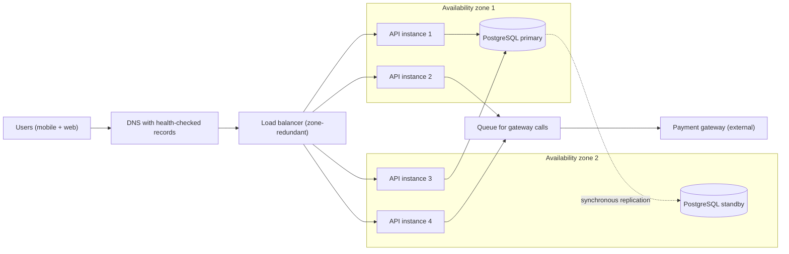
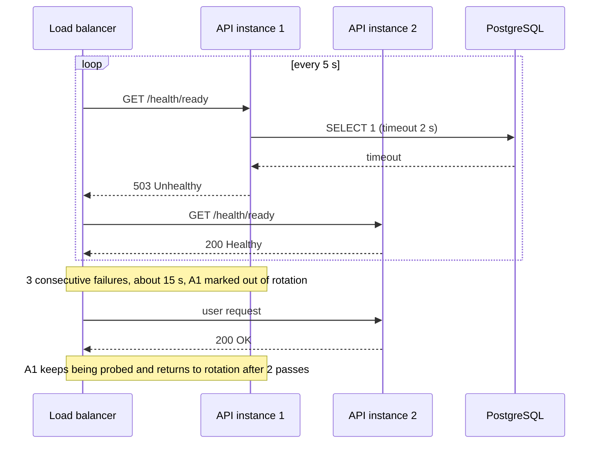

"The system must be highly available" is the most common non-functional requirement, and the least useful one as written. This lesson turns it into arithmetic you can check on a whiteboard: how many minutes of downtime a target allows, what a design will actually achieve, and which change buys the next nine for the least money.

## Learning objectives

By the end of this lesson you will be able to:

1. Convert an availability target such as 99.95 % into allowed downtime per year, month, week and day.
2. Tell availability, reliability and durability apart, and say which one a requirement is really about.
3. Calculate the availability of components in series (all must work) and in parallel (any one is enough).
4. Use MTBF and MTTR to explain why faster detection and recovery often beat buying more hardware.
5. Spot hidden single points of failure and correlated failures that break the parallel formula.
6. Expose liveness and readiness health checks in ASP.NET Core so a load balancer can route around failures.
7. Decide when 99.9 % is enough and the extra nines are not worth their cost.

## Prerequisites

- [Non-functional requirements](#/lesson/m11-nfrs): availability is one of the NFRs you clarify at the start of every design.
- [Capacity estimation](#/lesson/m11-capacity-estimation): we use the same back-of-the-envelope style here.
- Helpful but optional: [Health checks and graceful shutdown](#/lesson/m03-health-shutdown) for the ASP.NET Core side.

## Explain it like I'm a beginner

Think of a metro line in Delhi. The line is "available" when you can walk in and catch a train. If the line runs 20 hours a day and is shut for 12 minutes because of a signal fault, it was available for 1,188 of its 1,200 minutes: 99 %.

Now imagine your trip needs **three things to work at once**: the ticket gate, the train and the lift at your exit station. Each works 99 % of the time. The chance that all three work together is 0.99 × 0.99 × 0.99 ≈ 97 %. Every extra thing you *depend on* makes the whole trip less available. That is a chain of parts in a row (components in series).

Now imagine the station has **two lifts**, and you only need one. If each lift works 99 % of the time and they fail independently, the chance both are broken at once is 1 % × 1 % = 0.01 %. So "at least one lift works" is 99.99 %. Spare copies of a part (redundancy, components in parallel) make the whole more available.

One more idea. How often a lift breaks matters, but so does **how fast someone fixes it**. A lift that breaks once a month and is fixed in 5 minutes is far better than one that breaks once a month and takes a day. The average time between failures (MTBF, mean time between failures) and the average time to repair (MTTR, mean time to repair) together decide availability.

Those three ideas (chains multiply, spares protect, fast repair matters) are almost everything you need for this topic.

## First-principles explanation

### What availability means

**Availability** is the fraction of time (or of requests) for which the system does its job.

- **Time-based**: `uptime ÷ (uptime + downtime)`. Simple, but "down" must be defined. Is a page that loads in 30 seconds up?
- **Request-based**: `good requests ÷ valid requests`. This is how most teams measure in production today (a service level indicator, SLI). A request is "good" if it returned a non-5xx response within a latency threshold, for example 99 % under 800 ms.

Request-based measurement is fairer to users. A 10-minute outage at 3 a.m. with 50 users matters less than a 2-minute outage during the IPL final with 2 million users, and the request count reflects that.

### Availability is not reliability, and neither is durability

These three words get mixed up in interviews. Keep them apart:

| Term | Question it answers | Example |
|---|---|---|
| **Availability** | Can I use it right now? | The UPI app opens and accepts a payment. |
| **Reliability** | Does it keep working correctly, without failure, for a period? | The payment service ran 30 days with no failed transfers. |
| **Durability** | Once stored, is my data still there later? | The receipt saved last year can still be downloaded. |

A system can be available but unreliable: it answers every request, but 1 in 1,000 answers is wrong. It can be durable but unavailable: the bank's database has your data safely on disk, but the API is down. Object stores often advertise eleven nines of *durability* (99.999999999 %) with only three or four nines of *availability*. Those are different promises.

Reliability is usually expressed as a probability over time. If failures arrive randomly at a constant rate, the chance of running for time `t` without failure is `R(t) = e^(−t / MTBF)`. With an MTBF of 1,000 hours, the chance of surviving a 100-hour run is `e^(−0.1)` ≈ 90.5 %.

### The nines and what they buy

One year has 365 × 24 × 60 = 525,600 minutes. A 30-day month has 43,200 minutes. Allowed downtime is `(1 − availability) × period`.

| Availability | Per year | Per 30-day month | Per week | Per day |
|---|---|---|---|---|
| 99 % ("two nines") | 3.65 days (87.6 h) | 7.2 h | 1.68 h | 14.4 min |
| 99.5 % | 1.83 days (43.8 h) | 3.6 h | 50.4 min | 7.2 min |
| 99.9 % ("three nines") | 8.76 h | 43.2 min | 10.1 min | 1.44 min |
| 99.95 % | 4.38 h | 21.6 min | 5.04 min | 43.2 s |
| 99.99 % ("four nines") | 52.6 min | 4.32 min | 1.01 min | 8.64 s |
| 99.999 % ("five nines") | 5.26 min | 25.9 s | 6.05 s | 0.86 s |

Check one row yourself: 99.95 % → 0.0005 × 43,200 min = 21.6 minutes per month.

Two things jump out:

1. **Each extra nine divides allowed downtime by 10.** It does not add 10 % more work. It usually multiplies cost and operational effort.
2. **At four nines, humans are too slow.** 4.32 minutes a month is less than the time it takes for an alert to page someone, for them to open a laptop and log in. Four nines and above need *automatic* detection and failover.

### Components in series: availabilities multiply

If a request must pass through components A, B and C, and *all* must work, then:

```text
A_total = A_1 × A_2 × … × A_n
```

Worked example: a metro smart-card top-up service.

| Component | Availability (illustrative) |
|---|---|
| DNS + load balancer | 99.99 % |
| API tier | 99.9 % |
| PostgreSQL | 99.95 % |
| Payment gateway (external) | 99.9 % |

```text
0.9999 × 0.999 × 0.9995 × 0.999 = 0.99740  →  99.74 %
Downtime ≈ (1 − 0.9974) × 8,760 h ≈ 22.8 hours per year
```

The chain is *worse than its weakest part* (99.9 %). The system can never be more available than the least available thing it cannot work without. This is why a product owner asking for 99.99 % while depending on a 99.9 % third-party gateway is asking for something impossible, unless the design stops depending on that gateway synchronously.

### Components in parallel: unavailabilities multiply

If you have `n` independent copies and **any one** is enough:

```text
A_total = 1 − (1 − A)^n
```

| One copy | Two copies | Three copies |
|---|---|---|
| 99 % | 1 − 0.01² = 99.99 % | 1 − 0.01³ = 99.9999 % |
| 99.9 % | 99.9999 % | 99.9999999 % |

Redundancy is powerful on paper. In practice the formula is only as good as its assumption: **failures must be independent**. They often are not.

### Why the parallel formula lies: correlated failures

Common causes that take out "redundant" copies together:

- **Shared infrastructure.** Both API instances run in the same availability zone (one data centre). A power or cooling failure kills both.
- **Shared software.** A bad deployment, a bad configuration flag or an expired TLS certificate rolls out to all copies within minutes.
- **Shared dependencies.** Three API instances, one database. The instances are redundant; the database is a single point of failure (SPOF).
- **Shared load.** One instance dies, the survivors receive its traffic, overload, and fall over in turn (cascading failure).
- **Failover itself.** Switching to a standby takes time (detection + promotion + DNS or connection refresh), and the switch can fail.

A more honest model multiplies by the availability of whatever the copies share:

```text
Two API instances in one zone, each 99.9 %, zone 99.95 %:
(1 − 0.001²) × 0.9995 ≈ 0.999499  →  99.95 %, not 99.9999 %
```

The shared zone caps the result. Spreading instances across zones (multi-AZ) removes that cap for zone-level failures, though not for a bad deploy. That is why staged rollouts (canary releases) are also an availability tool.

### MTBF and MTTR: the repair-time lever

For one repairable component:

```text
A = MTBF ÷ (MTBF + MTTR)
```

Suppose a service fails on average once every 30 days (MTBF = 720 h):

| MTTR | Availability | Downtime per month |
|---|---|---|
| 4 h (someone notices, debugs, redeploys) | 720 ÷ 724 = 99.45 % | 4 h |
| 1 h | 720 ÷ 721 = 99.86 % | 1 h |
| 6 min (automatic restart + health-check routing) | 720 ÷ 720.1 = 99.986 % | 6 min |

Cutting repair time from 1 hour to 6 minutes adds almost a full nine, **without making the software fail less often**. MTTR itself breaks into pieces you can attack separately:

```text
MTTR = time to detect + time to decide + time to repair + time to verify
```

- Detect: health checks every 5–10 s, alerts on SLO burn rate rather than on CPU.
- Decide: automatic rules ("3 failed checks → remove from pool") instead of a human call.
- Repair: restart, fail over, roll back. A one-click rollback is often the fastest repair there is.
- Verify: dashboards that show recovery in seconds.

Raising MTBF (fewer failures) costs effort too: testing, code review, better hardware, chaos experiments. Mature teams work both levers, but MTTR is usually cheaper to improve first.

### Error budgets: turning the nines into decisions

If the target (service level objective, SLO) is 99.9 % of requests per 30 days, then 0.1 % of requests may fail. With 50 million requests a month, that is a budget of 50,000 failed requests. While budget remains, the team ships features quickly. When it is spent, the team slows releases and fixes reliability. This makes "how available?" a shared business decision instead of an argument. The full mechanics are in [SLI, SLO, SLA and error budgets](#/lesson/m14-sli-slo-sla).

### When a simpler design is enough

- An internal reporting tool used 9-to-6 by 40 engineers: 99 % (about 7 hours down a month, often outside working hours) is fine. One VM, nightly backups, a restore runbook.
- A government grievance portal where citizens submit a form and get an email: 99.5–99.9 % with a queue that accepts submissions even when downstream processing is down.
- Payments, ride dispatch, emergency services: here the extra nines pay for themselves.

Every nine costs roughly an order of magnitude more in engineering and infrastructure. Ask "what does one hour of downtime cost us?" before buying the nine.

## Visual explanation

### Architecture: removing single points of failure



Read it from left to right. Users resolve the service name through **DNS**, which only returns healthy load balancer addresses. The **load balancer** itself is zone-redundant, so it is not a SPOF. It spreads requests across **four API instances in two zones**: losing a whole zone still leaves two instances. Every API instance writes to the **PostgreSQL primary**, which synchronously replicates each commit to a **standby in the other zone**, so a zone loss does not lose committed data and the standby can be promoted. The arrows from instances 2 and 4 go to a **queue** rather than calling the **payment gateway** directly. That breaks the series chain: if the gateway is down for 10 minutes, top-up requests are accepted and settled later, so the gateway's 99.9 % no longer caps the user-facing availability of "accept my top-up". (In reality every instance has all three arrows; the diagram shows a subset to stay readable.)

### Sequence: a failing instance is removed automatically



This is MTTR reduction in action. The load balancer probes each instance's **readiness** endpoint every 5 seconds. Instance 1 cannot reach the database within its 2-second timeout, so it answers **503**. After three failures in a row (about 15 seconds of detection time) the load balancer stops sending it user traffic. Users are served by instance 2. Nobody was paged to make that decision. The load balancer keeps probing instance 1 and adds it back after two good answers, so a short network blip heals itself. The thresholds are a trade-off: fewer failures before removal means faster detection but more flapping on brief hiccups.

## Step-by-step example

**Scenario.** A city transport authority runs a smart-card top-up service. Product asks for "99.99 % availability". Today the design is: one VM running the API, one PostgreSQL VM, and a synchronous call to a payment gateway that publishes a 99.9 % SLA.

### Step 1 — Turn the target into minutes

99.99 % per month = 0.0001 × 43,200 = **4.3 minutes per month**. One deploy with a 5-minute restart blows the whole budget. Ask product: is 4 minutes a month really needed, and what does an hour of downtime cost? Suppose the answer is "about ₹6 lakh in lost top-ups and complaints per hour at peak". 99.95 % (21.6 min/month) is agreed as the target for *accepting* top-ups.

### Step 2 — Estimate today's availability

Use realistic per-component estimates (estimates, not vendor numbers): single VM 99.5 %, single PostgreSQL VM 99.5 %, gateway 99.9 %.

```text
0.995 × 0.995 × 0.999 = 0.98903  →  98.9 %, about 8 hours down per month
```

We are almost two nines short.

### Step 3 — Remove the biggest SPOFs first

Add a second API instance behind a load balancer, in a second zone: `1 − 0.005² = 99.9975 %` for the API tier. Use a managed PostgreSQL with a zone-redundant standby (published SLAs for such offerings are typically 99.95–99.99 %; check your provider). Suppose 99.95 %.

```text
LB 0.9999 × API 0.999975 × DB 0.9995 × gateway 0.999 = 0.99838  →  99.84 %
```

Better, but the gateway now dominates.

### Step 4 — Take the external dependency out of the critical path

Accept the top-up, write it to the database with status `Pending`, and push the gateway call to a background worker through a queue. The user-facing request no longer needs the gateway:

```text
LB 0.9999 × API 0.999975 × DB 0.9995 = 0.99938  →  99.94 %
```

Very close to 99.95 %. The gateway's outages now delay settlement instead of rejecting users.

### Step 5 — Attack MTTR

Add readiness checks with 5-second probes, automated rollback on a failed canary, and a database failover drill each quarter. Each of these cuts the minutes of each incident. Our model treated component availabilities as fixed, but faster detection and failover are exactly what lift those numbers in practice. The final design meets 99.95 % with margin. Getting to 99.99 % would need a second region; we now have the numbers to say what that would cost and buy.

## Production-style C# implementation

The code below gives you three things: an availability calculator you can use in design reviews and tests, request-based availability measurement (the SLI), and readiness and liveness endpoints that a load balancer can probe.

```text
Transit.TopUp.Api/
  Program.cs
  Availability/AvailabilityMath.cs
  Availability/RequestAvailabilityMeter.cs
  Availability/RequestAvailabilityMiddleware.cs
  Health/DatabaseReadinessCheck.cs
  Health/IDatabasePinger.cs
```

```csharp file=Availability/AvailabilityMath.cs
namespace Transit.TopUp.Availability;

/// <summary>Pure functions for back-of-the-envelope availability maths.
/// Availabilities are fractions in [0, 1], for example 0.999 for 99.9 %.</summary>
public static class AvailabilityMath
{
    public static double Serial(params double[] parts)
    {
        ArgumentNullException.ThrowIfNull(parts);
        double total = 1.0;
        foreach (var a in parts) total *= Check(a);
        return total;
    }

    /// <summary>Any one of n independent copies is enough.</summary>
    public static double Parallel(double each, int copies)
    {
        if (copies < 1) throw new ArgumentOutOfRangeException(nameof(copies));
        return 1.0 - Math.Pow(1.0 - Check(each), copies);
    }

    /// <summary>Redundant copies that also share a common dependency (zone, deploy, network).</summary>
    public static double ParallelWithCommonCause(double each, int copies, double shared) =>
        Parallel(each, copies) * Check(shared);

    public static double FromMtbf(TimeSpan mtbf, TimeSpan mttr)
    {
        if (mtbf <= TimeSpan.Zero || mttr < TimeSpan.Zero) throw new ArgumentOutOfRangeException(nameof(mtbf));
        return mtbf.TotalHours / (mtbf.TotalHours + mttr.TotalHours);
    }

    public static TimeSpan DowntimePer(double availability, TimeSpan period) =>
        TimeSpan.FromTicks((long)Math.Round((1.0 - Check(availability)) * period.Ticks));

    private static double Check(double a) =>
        a is >= 0.0 and <= 1.0 ? a : throw new ArgumentOutOfRangeException(nameof(a), a, "Availability must be in [0, 1].");
}
```

`AvailabilityMath` is deliberately pure: no I/O, no clock. You can call it from a unit test that asserts "our documented design still reaches 99.95 %" whenever someone adds a dependency to the critical path. `ParallelWithCommonCause` exists so that nobody quotes the naive parallel number without the shared-zone cap.

```csharp file=Availability/RequestAvailabilityMeter.cs
namespace Transit.TopUp.Availability;

/// <summary>Counts good and bad requests for a request-based availability SLI.
/// Thread-safe; registered as a singleton. In production you would export these as
/// OpenTelemetry metrics instead of reading them from memory.</summary>
public sealed class RequestAvailabilityMeter
{
    private long _good;
    private long _bad;

    public void Record(int statusCode, TimeSpan elapsed, TimeSpan latencyThreshold)
    {
        // 5xx and too-slow responses count against availability. 4xx are the caller's fault.
        bool good = statusCode < 500 && elapsed <= latencyThreshold;
        if (good) Interlocked.Increment(ref _good);
        else Interlocked.Increment(ref _bad);
    }

    public long Good => Interlocked.Read(ref _good);
    public long Bad => Interlocked.Read(ref _bad);

    public double Availability
    {
        get
        {
            long g = Good, b = Bad;
            return g + b == 0 ? 1.0 : (double)g / (g + b);
        }
    }
}
```

The key design decision is *what counts as bad*. A 404 for a card number that does not exist is the system working correctly, so 4xx responses are good. A 200 that took 6 seconds is bad for the user, so slow responses count against availability.

```csharp file=Availability/RequestAvailabilityMiddleware.cs
using System.Diagnostics;
using Microsoft.Extensions.Options;

namespace Transit.TopUp.Availability;

public sealed class SliOptions
{
    public TimeSpan LatencyThreshold { get; set; } = TimeSpan.FromMilliseconds(800);
}

public sealed class RequestAvailabilityMiddleware(RequestDelegate next, RequestAvailabilityMeter meter, IOptions<SliOptions> options)
{
    private readonly TimeSpan _threshold = options.Value.LatencyThreshold;

    public async Task InvokeAsync(HttpContext context)
    {
        // Health probes are not user traffic; do not let them inflate or deflate the SLI.
        if (context.Request.Path.StartsWithSegments("/health"))
        {
            await next(context);
            return;
        }

        long start = Stopwatch.GetTimestamp();
        try
        {
            await next(context);
            meter.Record(context.Response.StatusCode, Stopwatch.GetElapsedTime(start), _threshold);
        }
        catch
        {
            meter.Record(StatusCodes.Status500InternalServerError, Stopwatch.GetElapsedTime(start), _threshold);
            throw;
        }
    }
}
```

```csharp file=Health/IDatabasePinger.cs
namespace Transit.TopUp.Health;

/// <summary>Abstraction over "can I reach the database?". The real implementation runs
/// SELECT 1 through Npgsql; tests and offline builds use a fake.</summary>
public interface IDatabasePinger
{
    Task PingAsync(CancellationToken ct);
}

public sealed class AlwaysUpPinger : IDatabasePinger
{
    public Task PingAsync(CancellationToken ct) => Task.CompletedTask;
}
```

```csharp file=Health/DatabaseReadinessCheck.cs
using Microsoft.Extensions.Diagnostics.HealthChecks;

namespace Transit.TopUp.Health;

/// <summary>Readiness: "send me traffic only if I can reach my database within 2 seconds".</summary>
public sealed class DatabaseReadinessCheck(IDatabasePinger pinger) : IHealthCheck
{
    private static readonly TimeSpan Timeout = TimeSpan.FromSeconds(2);

    public async Task<HealthCheckResult> CheckHealthAsync(HealthCheckContext context, CancellationToken cancellationToken = default)
    {
        using var cts = CancellationTokenSource.CreateLinkedTokenSource(cancellationToken);
        cts.CancelAfter(Timeout);
        try
        {
            await pinger.PingAsync(cts.Token);
            return HealthCheckResult.Healthy();
        }
        catch (OperationCanceledException) when (!cancellationToken.IsCancellationRequested)
        {
            return HealthCheckResult.Unhealthy($"Database did not answer within {Timeout.TotalSeconds} s.");
        }
        catch (Exception ex)
        {
            return HealthCheckResult.Unhealthy("Database ping failed.", ex);
        }
    }
}
```

```csharp file=Program.cs
using Microsoft.AspNetCore.Diagnostics.HealthChecks;
using Transit.TopUp.Availability;
using Transit.TopUp.Health;

var builder = WebApplication.CreateBuilder(args);

builder.Services.Configure<SliOptions>(builder.Configuration.GetSection("Sli"));
builder.Services.AddSingleton<RequestAvailabilityMeter>();
builder.Services.AddSingleton<IDatabasePinger, AlwaysUpPinger>();   // replace with the Npgsql pinger in production

builder.Services.AddHealthChecks()
    .AddCheck("self", () => Microsoft.Extensions.Diagnostics.HealthChecks.HealthCheckResult.Healthy(), tags: ["live"])
    .AddCheck<DatabaseReadinessCheck>("database", tags: ["ready"]);

var app = builder.Build();

app.UseMiddleware<RequestAvailabilityMiddleware>();

// Liveness: "is the process alive?" Never check dependencies here, or a database blip
// makes the orchestrator restart every healthy instance at once.
app.MapHealthChecks("/health/live", new HealthCheckOptions { Predicate = r => r.Tags.Contains("live") });

// Readiness: "should the load balancer send me traffic?" Dependency checks belong here.
app.MapHealthChecks("/health/ready", new HealthCheckOptions { Predicate = r => r.Tags.Contains("ready") });

app.MapPost("/topups", (TopUpRequest req) =>
    req.AmountRupees is > 0 and <= 10_000
        ? Results.Accepted($"/topups/{Guid.NewGuid()}")
        : Results.ValidationProblem(new Dictionary<string, string[]> { ["amountRupees"] = ["Must be between 1 and 10,000."] }));

app.MapGet("/sli", (RequestAvailabilityMeter m) => new { m.Good, m.Bad, availability = m.Availability });

app.Run();

public sealed record TopUpRequest(string CardNumber, decimal AmountRupees);
```

Three choices in `Program.cs` are worth defending in a review:

1. **Liveness and readiness are separate.** If liveness checked the database, a 30-second database failover would make Kubernetes (or App Service) restart *every* instance, turning a short blip into a long outage. Liveness only proves the process is not stuck.
2. **The top-up endpoint returns `202 Accepted`.** It records intent and lets a worker call the gateway. This is Step 4 of the example in code form.
3. **Health endpoints are excluded from the SLI.** Probes are frequent and cheap, and counting them would make availability look better than users experience it.

For the Npgsql-backed pinger in production, the shape is a short snippet (not compiled here because Npgsql is not available offline):

```csharp
public sealed class NpgsqlPinger(NpgsqlDataSource dataSource) : IDatabasePinger
{
    public async Task PingAsync(CancellationToken ct)
    {
        await using var cmd = dataSource.CreateCommand("SELECT 1");
        await cmd.ExecuteScalarAsync(ct);
    }
}
```

## Bad design vs good design

**Bad: redundancy theatre.** Four API instances, all in one zone, all deployed at the same moment, all reading a connection string that points to one database VM. The liveness probe runs `SELECT 1`. The architecture diagram looks redundant, and the slide says "99.99 %".

What actually happens:

- The database VM reboots for patching. Every liveness probe fails, the orchestrator restarts all four instances, and they all reconnect at once when the database returns (a thundering herd).
- A bad configuration value ships to all four instances in 60 seconds. Redundancy gives zero protection.
- The zone has a networking incident. Everything is down together.

**Good:**

- Instances spread across at least two zones, with enough spare capacity that losing one zone does not overload the rest (N+1 or N+2 sizing).
- A managed database with a standby in another zone and automatic failover, and an app that retries on connection errors with backoff ([see timeouts and retries](#/lesson/m10-timeouts-retries)).
- Liveness checks only the process; readiness checks dependencies.
- Rolling or canary deployments with automatic rollback, so a bad release reaches 5 % of traffic before it is stopped.
- External dependencies moved off the synchronous path where the business allows it.

:::callout type=mistake title="Adding nines by adding parts"
Every component you add *in series* lowers availability. A new cache, a service mesh sidecar, an API gateway and an auth service are each another multiplier below 1. Add a component only if it removes more failure than it introduces, and make the system degrade gracefully when an optional component (such as a cache) is down.
:::

:::callout type=tradeoff title="Redundancy has a cost beyond money"
Two copies need a way to agree who is in charge (leader election, failover). Bugs in failover logic, split-brain and replication lag are new failure modes that a single server never had. For a small internal app, one well-monitored server with fast restore can beat a fragile cluster.
:::

## Practical playground

The graph below is today's top-up design: one API instance, one database, a synchronous call to the payment gateway. Open it in the HLD canvas and change it to reach **99.95 %** for accepting top-ups. Suggested steps: raise `instances`, set `multiAz` on the API and database nodes, add a `read-replica` or standby, and route the gateway call through a `queue` and `worker`. After each change, write the new serial and parallel arithmetic next to the graph.

:::playground type=hld title="Make the top-up service survive a zone failure"
```json
{
  "nodes": [
    { "id": "users", "type": "client", "label": "Card holders", "props": { "rps": 300 } },
    { "id": "lb", "type": "load-balancer", "label": "Load balancer" },
    { "id": "api", "type": "app-server", "label": "Top-up API", "props": { "instances": 1, "multiAz": false } },
    { "id": "db", "type": "database", "label": "PostgreSQL", "props": { "replicas": 0, "multiAz": false } },
    { "id": "pg", "type": "external", "label": "Payment gateway (99.9 % SLA)" }
  ],
  "edges": [
    { "from": "users", "to": "lb", "kind": "sync" },
    { "from": "lb", "to": "api", "kind": "sync" },
    { "from": "api", "to": "db", "kind": "sync", "label": "SQL" },
    { "from": "api", "to": "pg", "kind": "sync", "label": "charge card" }
  ]
}
```
:::

## Exercises

:::exercise id=m11-availability-ex1 difficulty=beginner kind=code title="Downtime budget calculator"
Write a small calculator that answers the two questions every on-call engineer asks: "how much downtime does our target allow?" and "what availability did we actually achieve?".
::requirements
- `DowntimeBudget.Allowed(double targetPercent, TimeSpan period)` returns allowed downtime. `targetPercent` is a percentage such as `99.9`.
- `DowntimeBudget.Achieved(TimeSpan downtime, TimeSpan period)` returns achieved availability as a percentage.
- Targets outside `(0, 100]` throw `ArgumentOutOfRangeException`. A downtime longer than the period also throws.
::acceptance
- 99.9 % over 30 days allows 43.2 minutes.
- 99.99 % over 365 days allows about 52.56 minutes.
- 30 minutes of downtime in a 30-day month is about 99.93 %.
- `Allowed(0, …)` and `Allowed(100.5, …)` throw.
::hint
Allowed downtime is "the part of the period that is not the target".
::hint
Convert the percentage to a fraction first: 99.9 % → 0.999. Then multiply `(1 − fraction)` by the period.
::hint
`TimeSpan` has `Ticks`, and `TimeSpan.FromTicks(long)` builds one back. Round to the nearest tick.
::hint
```csharp
var fraction = targetPercent / 100.0;
return TimeSpan.FromTicks((long)Math.Round((1 - fraction) * period.Ticks));
```
::starter
```csharp file=DowntimeBudget.cs
using System;

public static class DowntimeBudget
{
    public static TimeSpan Allowed(double targetPercent, TimeSpan period) => throw new NotImplementedException();

    public static double Achieved(TimeSpan downtime, TimeSpan period) => throw new NotImplementedException();
}
```
::tests
```csharp file=DowntimeBudgetTests.cs
using System;
using Xunit;

public class DowntimeBudgetTests
{
    [Fact]
    public void Three_nines_per_month_is_43_2_minutes() =>
        Assert.Equal(43.2, DowntimeBudget.Allowed(99.9, TimeSpan.FromDays(30)).TotalMinutes, 2);

    [Fact]
    public void Four_nines_per_year_is_about_52_minutes() =>
        Assert.Equal(52.56, DowntimeBudget.Allowed(99.99, TimeSpan.FromDays(365)).TotalMinutes, 2);

    [Fact]
    public void Thirty_minutes_in_a_month() =>
        Assert.Equal(99.9306, DowntimeBudget.Achieved(TimeSpan.FromMinutes(30), TimeSpan.FromDays(30)), 4);

    [Fact]
    public void Zero_downtime_is_100_percent() =>
        Assert.Equal(100.0, DowntimeBudget.Achieved(TimeSpan.Zero, TimeSpan.FromDays(7)), 6);

    [Fact]
    public void Invalid_targets_throw()
    {
        Assert.Throws<ArgumentOutOfRangeException>(() => DowntimeBudget.Allowed(0, TimeSpan.FromDays(1)));
        Assert.Throws<ArgumentOutOfRangeException>(() => DowntimeBudget.Allowed(100.5, TimeSpan.FromDays(1)));
    }

    [Fact]
    public void Downtime_longer_than_period_throws() =>
        Assert.Throws<ArgumentOutOfRangeException>(() => DowntimeBudget.Achieved(TimeSpan.FromDays(2), TimeSpan.FromDays(1)));
}
```
::solution
Convert the percentage to a fraction, validate, then multiply the remaining fraction by the period.

```csharp file=DowntimeBudget.cs
using System;

public static class DowntimeBudget
{
    public static TimeSpan Allowed(double targetPercent, TimeSpan period)
    {
        if (targetPercent <= 0 || targetPercent > 100)
            throw new ArgumentOutOfRangeException(nameof(targetPercent), targetPercent, "Target must be in (0, 100].");
        if (period <= TimeSpan.Zero) throw new ArgumentOutOfRangeException(nameof(period));
        double unavailable = 1.0 - targetPercent / 100.0;
        return TimeSpan.FromTicks((long)Math.Round(unavailable * period.Ticks));
    }

    public static double Achieved(TimeSpan downtime, TimeSpan period)
    {
        if (period <= TimeSpan.Zero) throw new ArgumentOutOfRangeException(nameof(period));
        if (downtime < TimeSpan.Zero || downtime > period) throw new ArgumentOutOfRangeException(nameof(downtime));
        return 100.0 * (1.0 - (double)downtime.Ticks / period.Ticks);
    }
}
```

Working in ticks avoids losing precision at five nines, where the answer is a few seconds.
::mistakes
- Forgetting to divide the percentage by 100, which gives negative downtime.
- Using a 31-day month in one place and a 30-day month in another. State the period explicitly.
- Rounding to whole minutes, which shows five nines as "5 minutes" a year when it is 5.26.
::extensions
Add `BudgetRemaining(double targetPercent, TimeSpan period, TimeSpan downtimeSoFar)` and return a negative value when the budget is overspent.
:::

:::exercise id=m11-availability-ex2 difficulty=beginner kind=written title="Find the weakest link"
A ticket-booking flow calls, in order: CDN (99.99 %), API gateway (99.95 %), booking API on two instances in two zones (each 99.5 %), PostgreSQL single VM (99.5 %), SMS provider (99.0 %) to send the ticket.

1. Calculate the availability of the whole flow if every step is synchronous.
2. Which single change gives the biggest improvement?
3. Recalculate after that change.
::acceptance
- Shows the parallel calculation for the two API instances.
- Shows the full serial product with at least four decimal places.
- Names the SMS provider (or the database) as the weakest link and justifies the choice.
- Proposes a change that removes it from the synchronous path or makes it redundant.
::hint
Do the API tier first: two copies, any one is enough.
::hint
`1 − (1 − 0.995)² = 0.999975`. Now multiply everything in the chain.
::hint
Look at the smallest number in the chain. Does the user really need the SMS to be sent *before* they see "booking confirmed"?
::hint
If the SMS goes through a queue, drop it from the product. Then compare with making the database highly available instead.
::solution
1. API tier: `1 − 0.005² = 0.999975`. Chain: `0.9999 × 0.9995 × 0.999975 × 0.995 × 0.990 = 0.98443` → **98.44 %**, about 11.2 hours down a month.
2. The SMS provider at 99.0 % is the weakest link. The user does not need the SMS to *complete* a booking; show the ticket on screen and send the SMS asynchronously through a queue with retries.
3. Without SMS in the chain: `0.9999 × 0.9995 × 0.999975 × 0.995 = 0.99438` → **99.44 %**. The database is now the weakest link. Moving it to a zone-redundant managed service at about 99.95 % gives `0.9999 × 0.9995 × 0.999975 × 0.9995 = 0.99888` → **99.89 %**.

The order matters: remove dependencies from the critical path first (often free), then buy redundancy for what remains.
::mistakes
- Adding availabilities instead of multiplying them.
- Treating the two API instances as two serial steps, which makes redundancy look harmful.
- Making the SMS provider "redundant" by adding a second provider without asking whether it needs to be synchronous at all.
:::

:::exercise id=m11-availability-ex3 difficulty=intermediate kind=code title="Availability of a whole architecture tree"
Real architectures nest: a chain that contains a redundant group that contains a chain. Model this as a tree (the Composite pattern) and compute its availability.
::requirements
- `IAvailabilityNode` with `string Name` and `double Availability()`.
- `Part(name, availability)` is a leaf.
- `SerialGroup(name, params IAvailabilityNode[] steps)`: all steps must work.
- `ParallelGroup(name, params IAvailabilityNode[] copies)`: any one is enough. Copies may have different availabilities.
- `SerialGroup.WeakestStep()` returns the direct child with the lowest availability.
::acceptance
- A chain of 0.999 and 0.999 gives 0.998001.
- Two parallel copies of 0.99 and 0.98 give 0.9998.
- A chain of LB (0.9999) and a parallel group of two 0.995 instances gives about 0.999875.
- Empty groups throw `ArgumentException`.
::hint
Each group computes its result from its children's `Availability()`. It does not need to know whether a child is a leaf or another group.
::hint
For a parallel group with different availabilities, multiply the *unavailabilities*: `1 − Π(1 − aᵢ)`.
::hint
`WeakestStep` is `steps.MinBy(s => s.Availability())`.
::hint
```csharp
public double Availability() => 1.0 - _copies.Aggregate(1.0, (acc, c) => acc * (1.0 - c.Availability()));
```
::starter
```csharp file=AvailabilityTree.cs
using System;
using System.Collections.Generic;
using System.Linq;

public interface IAvailabilityNode
{
    string Name { get; }
    double Availability();
}

public sealed class Part(string name, double availability) : IAvailabilityNode
{
    public string Name => name;
    public double Availability() => throw new NotImplementedException();
}

public sealed class SerialGroup(string name, params IAvailabilityNode[] steps) : IAvailabilityNode
{
    public string Name => name;
    public double Availability() => throw new NotImplementedException();
    public IAvailabilityNode WeakestStep() => throw new NotImplementedException();
}

public sealed class ParallelGroup(string name, params IAvailabilityNode[] copies) : IAvailabilityNode
{
    public string Name => name;
    public double Availability() => throw new NotImplementedException();
}
```
::tests
```csharp file=AvailabilityTreeTests.cs
using System;
using Xunit;

public class AvailabilityTreeTests
{
    [Fact]
    public void Serial_multiplies() =>
        Assert.Equal(0.998001, new SerialGroup("chain", new Part("a", 0.999), new Part("b", 0.999)).Availability(), 6);

    [Fact]
    public void Parallel_with_different_copies() =>
        Assert.Equal(0.9998, new ParallelGroup("pair", new Part("a", 0.99), new Part("b", 0.98)).Availability(), 6);

    [Fact]
    public void Nested_tree()
    {
        var api = new ParallelGroup("api", new Part("api-1", 0.995), new Part("api-2", 0.995));
        var system = new SerialGroup("system", new Part("lb", 0.9999), api);
        Assert.Equal(0.999875, system.Availability(), 5);
    }

    [Fact]
    public void Weakest_step_is_found()
    {
        var system = new SerialGroup("system", new Part("lb", 0.9999), new Part("db", 0.995), new Part("cdn", 0.9999));
        Assert.Equal("db", system.WeakestStep().Name);
    }

    [Fact]
    public void Empty_groups_throw()
    {
        Assert.Throws<ArgumentException>(() => new SerialGroup("empty").Availability());
        Assert.Throws<ArgumentException>(() => new ParallelGroup("empty").Availability());
    }

    [Fact]
    public void Part_rejects_out_of_range() =>
        Assert.Throws<ArgumentOutOfRangeException>(() => new Part("bad", 1.5).Availability());
}
```
::solution
Each node knows only how to combine its children. The groups are a textbook Composite: the client asks the root for its availability and the question flows down the tree.

```csharp file=AvailabilityTree.cs
using System;
using System.Collections.Generic;
using System.Linq;

public interface IAvailabilityNode
{
    string Name { get; }
    double Availability();
}

public sealed class Part(string name, double availability) : IAvailabilityNode
{
    public string Name => name;
    public double Availability() =>
        availability is >= 0 and <= 1 ? availability
            : throw new ArgumentOutOfRangeException(nameof(availability), availability, "Must be in [0, 1].");
}

public sealed class SerialGroup(string name, params IAvailabilityNode[] steps) : IAvailabilityNode
{
    public string Name => name;

    public double Availability()
    {
        if (steps.Length == 0) throw new ArgumentException($"Serial group '{name}' has no steps.");
        return steps.Aggregate(1.0, (acc, s) => acc * s.Availability());
    }

    public IAvailabilityNode WeakestStep()
    {
        if (steps.Length == 0) throw new ArgumentException($"Serial group '{name}' has no steps.");
        return steps.MinBy(s => s.Availability())!;
    }
}

public sealed class ParallelGroup(string name, params IAvailabilityNode[] copies) : IAvailabilityNode
{
    public string Name => name;

    public double Availability()
    {
        if (copies.Length == 0) throw new ArgumentException($"Parallel group '{name}' has no copies.");
        double allDown = copies.Aggregate(1.0, (acc, c) => acc * (1.0 - c.Availability()));
        return 1.0 - allDown;
    }
}
```
::alternatives
A data-driven version reads the tree from JSON (the same shape as the HLD canvas graph) so architects can model a design without writing code. Keep the evaluation logic identical and add a parser.
::mistakes
- Using `Math.Pow(1 − a, n)` in the parallel group, which assumes all copies are identical.
- Forgetting that a parallel group can contain serial groups (a replica *and its own disk*), so leaves are not the only children.
::extensions
Add a `CommonCause(name, shared, inner)` node that multiplies an inner group by a shared dependency such as an availability zone.
:::

:::exercise id=m11-availability-ex4 difficulty=intermediate kind=hld title="From one zone to two"
The starter graph is a GST invoice-upload portal for small businesses: one load balancer, two API instances in one zone, a single PostgreSQL VM and Blob storage. The target is 99.95 % for uploads during the monthly filing peak (days 10–20). Redesign it.
::acceptance
- No component on the upload path is a single point of failure in one zone.
- The database has a standby in another zone with automatic failover.
- The design explains how capacity survives the loss of one zone (N+1 sizing).
- Shows an availability estimate with the arithmetic.
::hint
Which nodes have `instances: 1`, `replicas: 0` or `multiAz: false`?
::hint
Two instances in one zone are redundant against a process crash but not against a zone failure.
::hint
If peak needs 4 instances' worth of capacity, how many do you need across 2 zones so losing one zone still leaves 4?
::hint
Set `multiAz: true` on the API and database, raise API instances to 8 (4 per zone), and give the database one standby. Check whether the object storage tier is zone-redundant too.
::starter
```json
{
  "nodes": [
    { "id": "biz", "type": "client", "label": "Businesses uploading invoices", "props": { "rps": 800 } },
    { "id": "lb", "type": "load-balancer", "label": "Load balancer" },
    { "id": "api", "type": "app-server", "label": "Upload API", "props": { "instances": 2, "multiAz": false } },
    { "id": "db", "type": "database", "label": "PostgreSQL VM", "props": { "replicas": 0, "multiAz": false } },
    { "id": "blob", "type": "object-storage", "label": "Invoice files" }
  ],
  "edges": [
    { "from": "biz", "to": "lb", "kind": "sync" },
    { "from": "lb", "to": "api", "kind": "sync" },
    { "from": "api", "to": "db", "kind": "sync", "label": "metadata" },
    { "from": "api", "to": "blob", "kind": "sync", "label": "PDF upload" }
  ]
}
```
::solution
```json
{
  "nodes": [
    { "id": "biz", "type": "client", "label": "Businesses uploading invoices", "props": { "rps": 800 } },
    { "id": "dns", "type": "dns", "label": "DNS (health-checked)" },
    { "id": "lb", "type": "load-balancer", "label": "Zone-redundant load balancer", "props": { "multiAz": true } },
    { "id": "api", "type": "app-server", "label": "Upload API", "props": { "instances": 8, "multiAz": true } },
    { "id": "db", "type": "database", "label": "Managed PostgreSQL (zone-redundant HA)", "props": { "replicas": 1, "multiAz": true } },
    { "id": "blob", "type": "object-storage", "label": "Invoice files (zone-redundant storage)", "props": { "multiAz": true } },
    { "id": "q", "type": "queue", "label": "Virus-scan and OCR jobs" },
    { "id": "w", "type": "worker", "label": "Scan / OCR workers", "props": { "instances": 4, "multiAz": true } },
    { "id": "mon", "type": "monitoring", "label": "SLO dashboards + burn-rate alerts" }
  ],
  "edges": [
    { "from": "biz", "to": "dns", "kind": "sync" },
    { "from": "dns", "to": "lb", "kind": "sync" },
    { "from": "lb", "to": "api", "kind": "sync" },
    { "from": "api", "to": "blob", "kind": "sync", "label": "presigned upload" },
    { "from": "api", "to": "db", "kind": "sync", "label": "metadata" },
    { "from": "api", "to": "q", "kind": "async", "label": "uploaded event" },
    { "from": "q", "to": "w", "kind": "async" },
    { "from": "api", "to": "mon", "kind": "async" }
  ]
}
```

**Reasoning.** Peak is 800 RPS; suppose one instance handles about 200 RPS at 60 % CPU (an estimate to verify with a load test). That is 4 instances. To survive a zone loss, each zone must hold 4 on its own, so 8 instances across 2 zones. The database moves to a managed service with a synchronous standby in the other zone, which removes the single VM. Scanning and OCR move off the upload path into a queue, so a slow OCR engine cannot fail uploads.

**Estimate** (illustrative figures): LB 0.9999 × API tier (4 surviving instances per zone; zone-level parallel ≈ 0.99999) × DB HA 0.9995 × storage 0.9999 ≈ **0.99929** → 99.93 %. That is just under target; the remaining gap is closed by MTTR work (automated failover tested quarterly, canary deploys) or by a database tier with a higher published SLA. Saying "we are 0.02 % short, here is what closes it" is a strong interview answer.
::mistakes
- Doubling instances inside one zone and calling it highly available.
- Forgetting that after a zone loss, the surviving zone must carry 100 % of the peak load.
- Leaving virus scanning synchronous, so a third-party scanner's outage fails uploads.
:::

:::exercise id=m11-availability-ex5 difficulty=advanced kind=code title="Quorums and common-cause failures"
Some systems need *k of n* copies to work, not just one. A three-node consensus cluster needs 2 of 3 to elect a leader. Also, replicas that share a zone fail together. Implement both models.
::requirements
- `QuorumAvailability.KOfN(int k, int n, double each)` returns the probability that at least `k` of `n` independent copies are up.
- `QuorumAvailability.WithCommonCause(double independent, double shared)` multiplies a redundant group by its shared dependency.
- `QuorumAvailability.ZoneSpread(int k, int zones, double eachZone)` returns availability when one copy lives in each zone and the zone is the unit of failure. (It is `KOfN` with zone availability.)
- Invalid inputs (`k < 1`, `k > n`, availabilities outside `[0, 1]`) throw `ArgumentOutOfRangeException`.
::acceptance
- `KOfN(1, 2, 0.99)` = 0.9999.
- `KOfN(2, 3, 0.99)` = 0.999702.
- `KOfN(3, 3, 0.99)` = 0.970299 (needing all copies is worse than one copy).
- `WithCommonCause(0.999999, 0.9995)` ≈ 0.999499 (the shared zone, not the redundancy, sets the ceiling).
::hint
"At least k up" is the sum of "exactly i up" for i = k … n.
::hint
"Exactly i up" follows the binomial distribution: `C(n, i) × a^i × (1 − a)^(n − i)`.
::hint
Compute `C(n, i)` with a loop of multiplications and divisions in `double` to avoid overflow for small n.
::hint
```csharp
double total = 0;
for (int i = k; i <= n; i++) total += Choose(n, i) * Math.Pow(a, i) * Math.Pow(1 - a, n - i);
```
::starter
```csharp file=QuorumAvailability.cs
using System;

public static class QuorumAvailability
{
    public static double KOfN(int k, int n, double each) => throw new NotImplementedException();

    public static double WithCommonCause(double independent, double shared) => throw new NotImplementedException();

    public static double ZoneSpread(int k, int zones, double eachZone) => throw new NotImplementedException();
}
```
::tests
```csharp file=QuorumAvailabilityTests.cs
using System;
using Xunit;

public class QuorumAvailabilityTests
{
    [Fact] public void One_of_two() => Assert.Equal(0.9999, QuorumAvailability.KOfN(1, 2, 0.99), 6);
    [Fact] public void Two_of_three() => Assert.Equal(0.999702, QuorumAvailability.KOfN(2, 3, 0.99), 6);
    [Fact] public void Three_of_three() => Assert.Equal(0.970299, QuorumAvailability.KOfN(3, 3, 0.99), 6);
    [Fact] public void Three_of_five() => Assert.Equal(0.99999015, QuorumAvailability.KOfN(3, 5, 0.99), 7);

    [Fact]
    public void Common_cause_caps_redundancy() =>
        Assert.Equal(0.999499, QuorumAvailability.WithCommonCause(0.999999, 0.9995), 6);

    [Fact]
    public void Zone_spread_matches_k_of_n() =>
        Assert.Equal(QuorumAvailability.KOfN(2, 3, 0.9995), QuorumAvailability.ZoneSpread(2, 3, 0.9995), 10);

    [Fact]
    public void Invalid_inputs_throw()
    {
        Assert.Throws<ArgumentOutOfRangeException>(() => QuorumAvailability.KOfN(0, 3, 0.99));
        Assert.Throws<ArgumentOutOfRangeException>(() => QuorumAvailability.KOfN(4, 3, 0.99));
        Assert.Throws<ArgumentOutOfRangeException>(() => QuorumAvailability.KOfN(2, 3, 1.2));
        Assert.Throws<ArgumentOutOfRangeException>(() => QuorumAvailability.WithCommonCause(0.9, -0.1));
    }
}
```
::solution
```csharp file=QuorumAvailability.cs
using System;

public static class QuorumAvailability
{
    public static double KOfN(int k, int n, double each)
    {
        if (n < 1) throw new ArgumentOutOfRangeException(nameof(n));
        if (k < 1 || k > n) throw new ArgumentOutOfRangeException(nameof(k));
        Check(each, nameof(each));

        double total = 0;
        for (int i = k; i <= n; i++)
            total += Choose(n, i) * Math.Pow(each, i) * Math.Pow(1 - each, n - i);
        return Math.Min(1.0, total);
    }

    public static double WithCommonCause(double independent, double shared)
    {
        Check(independent, nameof(independent));
        Check(shared, nameof(shared));
        return independent * shared;
    }

    public static double ZoneSpread(int k, int zones, double eachZone) => KOfN(k, zones, eachZone);

    private static double Choose(int n, int r)
    {
        double result = 1;
        for (int i = 1; i <= r; i++) result = result * (n - r + i) / i;
        return result;
    }

    private static void Check(double a, string name)
    {
        if (a is < 0 or > 1) throw new ArgumentOutOfRangeException(name, a, "Must be in [0, 1].");
    }
}
```

What the numbers teach: a 3-node cluster that needs 2 nodes (99.9702 % with 99 % nodes) is more available than one node but *less* than "any 1 of 2". Quorum systems trade some availability for consistency: they refuse to work rather than risk two leaders. A 5-node cluster needing 3 recovers most of that (99.999 %). This is why consensus clusters use odd sizes of 3 or 5 and spread them across 3 zones.
::mistakes
- Computing factorials with `int`, which overflows quickly. Use the multiplicative formula in `double`.
- Placing all three quorum nodes in two zones (2 + 1). Losing the zone with two nodes loses the quorum.
- Treating quorum and replica availability as the same thing. A read that any replica can serve is 1-of-n; a write that needs a majority is k-of-n.
:::

:::exercise id=m11-availability-ex6 difficulty=advanced kind=written title="Is the fifth nine worth it?"
A ride-hailing company in Bengaluru runs dispatch at 99.95 %. Leadership wants 99.99 %. Peak is 6,000 ride requests per minute between 6 and 10 p.m. Average gross booking value is ₹280 and roughly 30 % of users who fail to book switch to a competitor for that ride.

Write a one-page recommendation: what 99.99 % would require, an estimate of the value of the extra availability, and whether you recommend it.
::acceptance
- Converts both targets to minutes of downtime per month and computes the difference.
- Estimates lost bookings per minute of downtime at peak, with stated assumptions.
- Lists at least three engineering changes that 99.99 % requires (not just "more servers").
- Gives a clear recommendation with a condition that would change it.
::hint
99.95 % → 21.6 min/month; 99.99 % → 4.3 min/month. The gain is about 17 minutes a month in the worst case.
::hint
Not every minute of downtime falls at peak. State an assumption (for example, downtime is spread evenly, or a third lands in peak hours).
::hint
At four nines, humans cannot be in the recovery loop. What must be automated? What about deploys and regional failures?
::hint
Compare a rough revenue figure with the cost of a second region, on-call staffing and failover testing. Consider an intermediate step: four nines for "request a ride", three nines for "rate your driver".
::solution
**Downtime.** 99.95 % = 21.6 min/month; 99.99 % = 4.3 min/month. Gain ≈ 17.3 min/month.

**Value estimate (illustrative).** At peak, 6,000 requests/min × ₹280 = ₹16.8 lakh of bookings per minute. If 30 % of failed users are lost to a competitor, the loss is about ₹5 lakh per peak minute. If about a third of downtime lands in peak hours, roughly 5.8 of the 17.3 minutes are peak: ≈ ₹29 lakh a month, ≈ ₹3.5 crore a year in gross bookings (the company's revenue share is a fraction of that). Add brand damage, driver churn and support load, which are real but hard to price.

**What 99.99 % requires.** Automated failover with no human step; multi-zone everything plus a tested regional failover or an active-active design for dispatch; canary releases with automatic rollback within 2 minutes; dependency isolation (maps, payments, notifications off the critical path or with fallbacks); quarterly game days; and a 24×7 on-call rotation with tight response targets.

**Recommendation.** Apply 99.99 % only to the critical path (request ride, match driver), and keep everything else at 99.9 %. Fund it if the yearly cost of the extra engineering and infrastructure is clearly below the estimated loss. Revisit if outage data shows most downtime comes from deploys; then better release engineering may achieve the gain far more cheaply than a second region.
::mistakes
- Assuming every minute of downtime happens at peak, or that none does.
- Applying one target to the whole platform instead of to user journeys.
- Listing only hardware changes. Most outages at this level come from changes (deploys, configuration), not from hardware.
:::

## Automated testing

Availability is a property of the whole system, but several parts of it are testable in code.

**1. Design-budget tests.** Encode the documented architecture in a test so a new synchronous dependency fails the build until someone updates the design and the target.

```csharp
public class AvailabilityBudgetTests
{
    [Fact]
    public void Critical_path_meets_99_95()
    {
        double apiTier = AvailabilityMath.Parallel(0.995, copies: 2);
        double total = AvailabilityMath.Serial(0.9999, apiTier, 0.9995);
        Assert.True(total >= 0.9994, $"Critical path availability {total:P3} is below budget");
    }
}
```

**2. Health check unit tests.** Use a fake `IDatabasePinger` that delays longer than the timeout and assert `Unhealthy`; one that throws and assert `Unhealthy` with the exception attached; one that succeeds and assert `Healthy`. These catch the classic bug where a hung database makes the health check itself hang, so the load balancer's probe times out with no clear reason.

```csharp
public class DatabaseReadinessCheckTests
{
    private sealed class HangingPinger : IDatabasePinger
    {
        public Task PingAsync(CancellationToken ct) => Task.Delay(Timeout.Infinite, ct);
    }

    [Fact]
    public async Task Hanging_database_is_unhealthy_within_timeout()
    {
        var check = new DatabaseReadinessCheck(new HangingPinger());
        var result = await check.CheckHealthAsync(new HealthCheckContext());
        Assert.Equal(HealthStatus.Unhealthy, result.Status);
    }
}
```

**3. Integration tests with `WebApplicationFactory`.** Call `/health/live` and `/health/ready` with the pinger replaced by a failing fake, and assert that liveness stays 200 while readiness becomes 503. That proves the separation of the two endpoints.

**4. Failure-injection tests in staging.** Kill an instance, block the database port, or expire a certificate and measure time to detect and time to recover. These are the numbers that go into MTTR. Doing this on purpose and regularly is [chaos engineering](#/lesson/m14-chaos).

## Real-world application

- **Cloud SLAs** are published per service and often differ by configuration, for example a single VM versus VMs across availability zones, or a database with or without zone-redundant high availability. Always read the SLA for the exact configuration you deploy, and remember an SLA is a refund promise, not a guarantee of uptime.
- **Payment systems like UPI apps** keep the critical path ("debit and confirm") short and push notifications, rewards and analytics to asynchronous pipelines, so those systems can fail without blocking payments.
- **Infrastructure project dashboards** (progress tracking for highways or metro construction) are usually fine at 99.5 %: users are office staff, and a nightly batch can catch up. Spending on four nines there is waste.
- **Kubernetes and Azure App Service** use liveness and readiness probes exactly as in this lesson. Misconfigured liveness probes that check dependencies are a known cause of restart storms.
- **Consensus systems** such as etcd recommend odd cluster sizes of 3 or 5 across failure domains, because of the k-of-n arithmetic in exercise 5.

## Interview questions

:::interview
::q beginner
What does 99.9 % availability mean in minutes?
::a
About 43 minutes of downtime per 30-day month, 8.76 hours per year, or 1.44 minutes per day. Each extra nine divides the allowed downtime by ten: 99.99 % is about 4.3 minutes a month.
::q beginner
What is a single point of failure, and how do you remove one?
::a
A component whose failure alone takes the system down, for example the only database server. You remove it with redundancy (a second copy that can take over), ideally in a different failure domain such as another availability zone, plus a tested, preferably automatic, failover. Alternatively, remove it from the critical path, for example by making a call asynchronous.
::q intermediate
How do you calculate the availability of components in series and in parallel?
::a
Series (all needed): multiply availabilities, so `0.999 × 0.999 = 0.998`. Parallel (any one enough): `1 − (1 − a)^n`, so two 99 % copies give 99.99 %. The parallel formula assumes independent failures; shared zones, deploys and dependencies make real redundancy weaker, so multiply by the availability of whatever the copies share.
::q intermediate
What is the difference between liveness and readiness checks, and why does it matter?
::a
Liveness answers "is the process alive or stuck?" and a failure leads to a restart. Readiness answers "should I receive traffic now?" and a failure removes the instance from the load balancer without restarting it. Dependency checks (database, cache) belong in readiness. If they are in liveness, a short database outage restarts every instance at once, which lengthens the outage and causes a reconnect storm.
::q advanced
Your system has four nines on paper but had three multi-hour outages last year. What do you investigate?
::a
First, what the outages had in common. Paper availability assumes independent hardware failures, but most real outages are correlated: bad deploys, configuration pushes, certificate expiry, a shared dependency (DNS, identity provider, a single database), or cascading overload after one zone fails. I would check MTTR components (detection time, decision time, rollback time), whether failover was ever tested, whether N+1 capacity exists per zone, and whether health checks are designed correctly. Fixes usually involve progressive delivery, automatic rollback, dependency isolation and game days rather than more servers.
::q advanced
Why can adding a cache or an API gateway reduce availability, and how do you prevent that?
::a
Each new synchronous component is another factor below 1 in the serial product. A cache cluster at 99.9 % in front of a 99.95 % database can make the path worse if requests fail when the cache is down. Prevent it by designing the new component as optional: on cache failure, fall back to the database with a circuit breaker and load shedding; run gateways in a zone-redundant, horizontally scaled setup; and measure end-to-end availability before and after the change.
:::

## Summary and revision

**Key takeaways**

- Availability is the share of time or requests that succeed. Measure it per user journey, in requests, with a latency threshold.
- Each nine divides downtime by ten: 99.9 % ≈ 43 min/month, 99.99 % ≈ 4.3 min/month.
- In series, availabilities multiply and the chain is worse than its weakest link. In parallel, unavailabilities multiply, but only for independent failures.
- Correlated failures (shared zone, deploy, dependency, load) are the main reason redundancy disappoints.
- `A = MTBF ÷ (MTBF + MTTR)`. Faster detection and automated recovery are often the cheapest nines.
- Separate liveness from readiness. Put dependency checks only in readiness.
- Buy nines only where an hour of downtime costs more than the nine.

**Terminology**: availability, reliability, durability, SLI, SLO, SLA, error budget, MTBF, MTTR, single point of failure, redundancy, availability zone, N+1, correlated failure, liveness, readiness, quorum.

:::flashcards
Q: Allowed downtime per month at 99.9 % and 99.99 %?
A: About 43.2 minutes and 4.32 minutes (30-day month).
Q: Availability of components in series?
A: Multiply them: A = A1 × A2 × … × An. The result is lower than the weakest part.
Q: Availability of n independent copies where any one is enough?
A: 1 − (1 − A)^n. Two 99 % copies give 99.99 %.
Q: Formula linking MTBF and MTTR to availability?
A: A = MTBF ÷ (MTBF + MTTR).
Q: Availability vs durability?
A: Availability: can I use it now? Durability: is stored data still there later? They are separate promises.
Q: What breaks the parallel availability formula?
A: Correlated failures: shared zone, shared deploy or configuration, shared dependency, or cascading overload.
Q: What belongs in a readiness check but not a liveness check?
A: Dependency checks such as the database. Liveness only proves the process is not stuck.
Q: Why do quorum clusters use 3 or 5 nodes across 3 zones?
A: Majority (k-of-n) needs odd sizes to tolerate failures efficiently, and spreading across zones keeps a majority after a zone loss.
:::

## Knowledge check

:::quiz pass=70
::q single
A product owner asks for 99.99 % availability for an app whose only payment provider offers a 99.9 % SLA and is called synchronously on every request. What is the best response?
- [ ] Add more API instances until the total reaches 99.99 %.
- [x] Explain that the synchronous dependency caps availability near 99.9 %, and propose taking it off the critical path or adding a second provider.
- [ ] Accept the target; SLAs are usually conservative.
- [ ] Cache the payment provider's responses.
> In series, the system cannot exceed its least available required component. Only removing or making that dependency redundant raises the ceiling.
::q single
Two API instances each have 99.5 % availability and run in the same availability zone, which has 99.95 % availability. Which estimate is most honest?
- [ ] 99.9975 %
- [x] About 99.95 %
- [ ] 99.0 %
- [ ] 99.5 %
> The pair is 1 − 0.005² = 99.9975 %, but both share the zone, so multiply by 0.9995 ≈ 99.95 %. The shared zone caps the result.
::q single
A service fails about once a month (MTBF ≈ 720 h). Which change most improves availability?
- [ ] Doubling the CPU of each server.
- [x] Reducing MTTR from 1 hour to 6 minutes with automated detection and rollback.
- [ ] Adding a second monitoring dashboard.
- [ ] Moving logs to a different storage account.
> 720/721 ≈ 99.86 % becomes 720/720.1 ≈ 99.986 %. Repair speed is a direct lever on availability.
::q single
During a 20-second database failover, Kubernetes restarts every API pod. What is the most likely cause?
- [ ] The readiness probe is too slow.
- [x] The liveness probe checks the database, so dependency failures trigger restarts.
- [ ] There are too few pods.
- [ ] The database has no read replicas.
> Liveness failures cause restarts. Dependency checks belong in readiness, which only removes pods from traffic.
::q multi
Which of these are examples of correlated failures that redundancy across instances does NOT protect against? (Select all that apply.)
- [x] A bad configuration value rolled out to all instances.
- [x] An expired TLS certificate used by every instance.
- [ ] A single instance running out of memory.
- [x] All instances depending on one database VM.
> A single instance crash is exactly what instance redundancy handles. The others hit every copy at once.
::q single
A 3-node cluster needs a majority (2 of 3) to accept writes. Each node is 99 % available. Roughly how available are writes?
- [ ] 99.9999 %
- [x] About 99.97 %
- [ ] 97.0 %
- [ ] 99.0 %
> P(at least 2 of 3) = 3 × 0.99² × 0.01 + 0.99³ ≈ 0.9997. Better than one node, worse than "any one of two".
::q single
Which metric best represents what users experience for a payments API?
- [ ] Percentage of minutes the server process was running.
- [ ] Average CPU utilisation.
- [x] Share of valid requests that returned a non-5xx response within the latency threshold.
- [ ] Number of health check passes.
> Request-based SLIs weight outages by how many users they hit and include slowness, not just crashes.
:::

## Completion criteria

You have finished this lesson when you can:

- [ ] Score at least 70 % on the knowledge check.
- [ ] Recite the downtime for 99.9 %, 99.95 % and 99.99 % per month without looking.
- [ ] Complete exercises 1 and 3 with `dotnet test` passing.
- [ ] Complete exercise 4 in the HLD canvas and show your availability arithmetic.
- [ ] Explain, in under two minutes, why faster recovery can be worth more than more servers.
