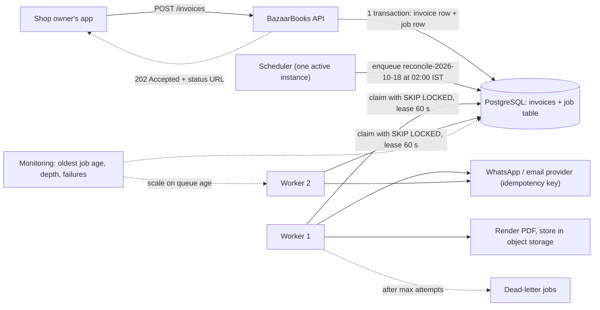
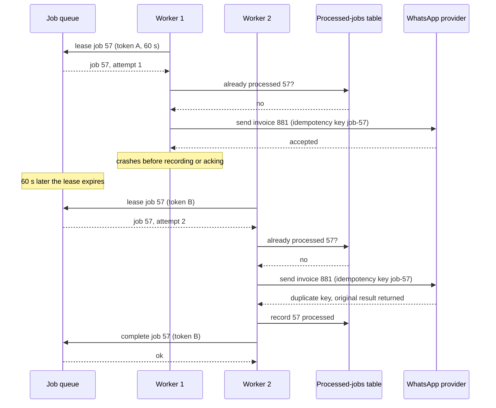

Some work doesn't need to happen while the user waits: rendering a PDF, sending a WhatsApp message, resizing a photo, reconciling yesterday's payments, exporting a report. Doing it inside the request makes pages slow and fragile. Doing it in the background makes the system faster and more reliable, but only if you handle what background work brings with it: jobs that run twice, jobs that fail halfway, jobs that pile up, and schedules that fire on three servers at once.

## Learning objectives

By the end of this lesson you will be able to:

1. Decide which work belongs in the request and which belongs in the background, and design the user experience for it (`202 Accepted`, status, notification).
2. Size workers with Little's law, and estimate queue backlog and drain time during a spike.
3. Implement in-process background work in ASP.NET Core with `BackgroundService` and bounded `Channel<T>`, and know when it is not durable enough.
4. Choose between a database-backed job table, a message broker and a job library such as Hangfire or Quartz.NET.
5. Make jobs safe under at-least-once delivery: leases, retries with backoff and jitter, dead-lettering and idempotency.
6. Run recurring jobs correctly across many instances: single-run locks, time zones, overlap and missed runs.

## Prerequisites

- [Background services and hosted workers](#/lesson/m03-background-services): `IHostedService` and `BackgroundService` basics.
- [Asynchronous programming with async/await](#/lesson/m03-async-await): tasks, cancellation tokens.
- [Stateless versus stateful services](#/lesson/m11-stateless): why work must not depend on one particular server.

## Explain it like I'm a beginner

Think of a busy South Indian restaurant at lunchtime.

The **waiter** takes your order and gives you a token number. He doesn't stand in the kitchen while your dosa cooks. That would make every other table wait. This is the **request**: answer quickly and move on.

Your order goes onto the **order rail** above the kitchen counter as a slip. That is the **job queue**. Several **cooks** (workers) take slips from the rail. When it is busy, slips pile up on the rail, but nothing is lost and no customer is turned away at the door. The rail absorbs the rush.

Now the tricky parts:

- **A cook burns his hand halfway through an order** and walks away. If the slip went into the bin when he took it, the order is lost. So the restaurant leaves the slip on the rail with a clip saying "being cooked by Ravi, until 12:10". If Ravi hasn't finished by 12:10, another cook takes it. That clip is a **lease**.
- **But Ravi may have actually served it** and simply forgot to remove the slip. Then a second dosa is cooked for the same table. That is **at-least-once delivery**: every order is cooked at least once, occasionally twice. The fix is that before cooking, the cook checks the table: "Has table 12 already got order 57?" That makes the order **idempotent**: doing it twice has the same effect as doing it once.
- **Every morning at 7, someone must prepare the chutney.** That is a **scheduled job**. If three cooks each think it's their job, you get three buckets of chutney. One person must be responsible (a **single-run lock**).

## First-principles explanation

### Why move work to the background?

1. **Latency.** The user waits for 200 ms instead of 6 s. A GST invoice PDF that takes 300 ms to render plus 2 s to deliver over WhatsApp is not something anyone should wait for.
2. **Reliability.** If the email provider is down for 10 minutes, a background job retries later. An inline call fails the user's whole request.
3. **Smoothing spikes.** Arrivals can exceed processing capacity for a while. The queue holds the difference, and workers catch up afterwards.
4. **Isolation.** CPU-heavy work runs on separate worker instances, away from the web servers.
5. **Time-based work.** Reminders at 9 am, nightly reconciliation, monthly statements.

**What stays in the request?** Anything the user needs for the immediate answer, and anything that must be checked before saying "yes": validation, authorisation, the core state change (the invoice row is saved). Then enqueue the rest, in the **same transaction** as the state change where possible, so you never save the invoice and lose the job (see [Transactional outbox](#/lesson/m12-outbox)).

**The user experience** changes too. The API returns `202 Accepted` with a status link (`/jobs/{id}`), or the UI shows "Sending…" and updates via polling, push notification or a webhook when the job is done (see [WebSockets, SSE and long polling](#/lesson/m10-realtime)).

### Kinds of background work

| Kind | Example | Notes |
|---|---|---|
| Fire-and-forget | Send the invoice on WhatsApp after saving it | Most common |
| Delayed | Remind the customer if unpaid after 3 days | Needs a "not before" time |
| Recurring (cron) | Reconcile UPI settlements every night at 02:00 IST | Needs single-run guarantees |
| Batch / fan-out | Generate 200,000 monthly statements | Split into many small jobs |
| Long-running workflow | Onboarding: KYC → bank verification → activation | Multi-step; see [Sagas](#/lesson/m12-sagas) |

### Back-of-the-envelope: sizing workers with Little's law

**BazaarBooks** is an accounting app for small shops. After each sale it renders a GST invoice PDF and sends it to the customer on WhatsApp or email.

- 200,000 shops × 25 invoices a day = 5 million jobs/day. 5,000,000 ÷ 86,400 ≈ 58 jobs/s on average. Shops are busiest in the evening, so assume ×4 at peak: **about 230 jobs/s**.
- Each job takes about 300 ms of CPU to render and about 500 ms waiting for the messaging provider: **0.8 s in total** (estimates; measure yours).

**Little's law** says that the average number of jobs in progress equals the arrival rate times the average time each job takes: **L = λ × W**. Here L = 230 × 0.8 ≈ **184 jobs in flight** at peak.

- If each worker instance runs 20 jobs concurrently and you target 70 % utilisation, you need 184 ÷ (20 × 0.7) ≈ 13.1, so **14 worker instances** at peak.
- CPU check: 230 jobs/s × 0.3 CPU-s = 69 CPU-seconds per second, so about 69 cores busy just rendering. At 70 % utilisation that's about 100 cores, around 7 cores per instance across 14 instances. CPU, not concurrency, is the real constraint, so size instances accordingly.

**What if you only have capacity for 200 jobs/s?** For the two-hour peak, the backlog grows by (230 − 200) × 7,200 s = **216,000 jobs**. After the peak, arrivals drop to about 60/s, and the backlog drains at 200 − 60 = 140 jobs/s: 216,000 ÷ 140 ≈ 1,540 s, about **26 minutes**. Whether that is acceptable is a product question: "invoices may arrive up to 30 minutes late on busy evenings". If not, autoscale workers on queue depth or job age.

### In-process background work in ASP.NET Core

**`BackgroundService`** is a long-running task hosted inside your app. The host starts it after the app starts and signals its `stoppingToken` on shutdown. Things to know:

- It is a **singleton**. To use scoped services such as a `DbContext`, create a scope per unit of work with `IServiceScopeFactory.CreateAsyncScope()`.
- **Unhandled exceptions stop the host** by default since .NET 6 (`BackgroundServiceExceptionBehavior.StopHost`). Catch and log per job inside your loop, so one bad job doesn't take down the process.
- **Shutdown has a deadline.** `HostOptions.ShutdownTimeout` (30 seconds by default in current .NET) is how long the host waits for services to stop. Orchestrators such as Kubernetes have their own grace period. A job that needs 5 minutes will be killed mid-way during a deploy unless it can be checkpointed or released for another worker.

**`Channel<T>`** (System.Threading.Channels) is a fast, thread-safe, in-memory queue between producers (request handlers) and consumers (a `BackgroundService`). Always use a **bounded** channel. When it's full, `BoundedChannelFullMode.Wait` makes producers wait (backpressure), and other modes drop items. An unbounded channel turns a slow consumer into an out-of-memory crash.

**The big limitation: in-process queues are not durable.** If the process crashes or is redeployed, everything in the channel is gone. And the work only runs on the instance that received the request. Use in-process queues for work you can afford to lose or can rebuild: refreshing a cache, writing non-critical analytics events, warming thumbnails that are regenerated on demand anyway. For an invoice the customer is waiting for, use a durable queue.

**`PeriodicTimer`** is the simplest way to run something every N minutes inside a `BackgroundService`. But with 6 instances, it runs on all 6. Recurring work needs a single-run mechanism, covered below.

### Durable job queues: three families

**1. A job table in your database.** A `job` table with `status`, `run_after`, `attempts`, `locked_until` and a payload. Workers claim jobs with PostgreSQL's `FOR UPDATE SKIP LOCKED`, so concurrent workers never pick the same row and never wait on each other:

```sql
UPDATE job SET locked_until = now() + interval '60 seconds', attempts = attempts + 1
WHERE job_id IN (
    SELECT job_id FROM job
    WHERE status = 'queued' AND run_after <= now()
      AND (locked_until IS NULL OR locked_until < now())
    ORDER BY run_after
    LIMIT 20
    FOR UPDATE SKIP LOCKED)
RETURNING job_id, job_type, payload, attempts;
```

- **Strength**: the job is inserted in the *same transaction* as the business change. "Invoice saved" and "invoice job queued" either both happen or neither does. No extra infrastructure.
- **Limits**: every claim and completion is a write on your primary database, and polling adds load. Fine for tens to hundreds of jobs per second on a healthy primary (estimate; measure), not for tens of thousands. Keep the table small by deleting or archiving finished jobs.

**2. A message broker** (RabbitMQ, Azure Service Bus, Amazon SQS, Kafka). Built for high throughput, with acknowledgements, visibility timeouts, dead-letter queues and many consumers (see [Message queues](#/lesson/m12-message-queues)). You need the outbox pattern to publish reliably alongside a database change. Scheduling and per-job status tracking are more limited, depending on the broker.

**3. A job library** that sits on top of storage you already have:

- **Hangfire** stores jobs in a database (SQL Server and Redis officially, PostgreSQL through a community storage package), and gives you fire-and-forget, delayed and recurring (cron) jobs, automatic retries, and a web dashboard showing queued, failed and succeeded jobs. You enqueue a method call, and a server component in your app or a worker process runs it.
- **Quartz.NET** is a scheduler first: jobs plus triggers (simple intervals, calendars, cron), misfire policies for runs missed while the scheduler was down, `[DisallowConcurrentExecution]` to prevent overlapping runs, and clustering through a shared database job store so a trigger fires on only one node.

| | DB job table | Message broker | Hangfire-style library | Quartz-style scheduler |
|---|---|---|---|---|
| Durable | Yes | Yes | Yes | Yes, with a DB job store |
| Same transaction as business data | Yes | No (needs outbox) | Yes, if it shares the DB | Not its focus |
| Throughput | Moderate | High | Moderate (storage-bound) | Not for high-volume queues |
| Recurring / cron | Build it | Limited | Yes | Yes, its core strength |
| Dashboard and retries | Build it | Broker tools + your code | Yes | Partial |
| Best for | Small/medium apps on PostgreSQL | High volume, many consumers, events | Fast start, ops visibility | Complex schedules and calendars |

A common, practical combination: a job library or job table for application jobs, a broker for high-volume events between services, and one scheduler that *enqueues* recurring work rather than doing it itself.

### Delivery guarantees: why jobs run twice

A worker takes a job, does the work, and then acknowledges it. If the worker crashes **after** doing the work but **before** the acknowledgement, the queue can't tell the difference between "done" and "never started". It must choose:

- **At-most-once**: remove the job when it's taken. A crash loses it. Acceptable only for work you can lose.
- **At-least-once**: keep it until acknowledged, with a **lease** (visibility timeout). If the lease expires, another worker gets it. A crash means it runs again.

Durable queues give you at-least-once. "Exactly once" in the sense of the work happening exactly once isn't something a queue can promise. You get **effectively once** by making jobs **idempotent** (see [Delivery guarantees](#/lesson/m12-delivery-guarantees)).

Ways to make a job idempotent:

- **Natural idempotency**: "set invoice 881 status to `Sent`" can run twice harmlessly. "Add ₹500 to the balance" cannot. Prefer the first kind of operation.
- **An idempotency key with a processed table** (an inbox): record `job_id` in a table with a unique constraint *in the same transaction* as the job's database effect. A second run hits the constraint, or sees the row, and skips (see [Idempotent consumers](#/lesson/m12-idempotent-consumers)).
- **External side effects** (a WhatsApp message, an email, a payment): pass an idempotency key to the provider if it supports one. If it doesn't, record "sending" before the call and "sent" after, and accept that a crash in between may cause one duplicate, or check the provider's status before resending.
- **Fencing with lease tokens**: each lease gets a new token. A worker whose lease expired (because it was paused, say, by a long garbage collection) must not be able to complete the job after another worker took it over. Completion checks the token.

### Retries, backoff and dead letters

Not every failure deserves a retry.

- **Transient** (timeouts, connection resets, `503`, rate limits): retry with **exponential backoff and jitter**. Delays such as 1 s, 2 s, 4 s, 8 s up to a cap, each multiplied by a random factor so that thousands of failed jobs don't retry in lockstep and hit the provider together (see [Timeouts, retries and backoff with jitter](#/lesson/m10-timeouts-retries)).
- **Permanent** (invalid phone number, malformed payload, a bug): retrying won't help. Send it straight to a **dead-letter queue** with the error, and alert.
- **Max attempts**: after N transient failures, dead-letter it too. A job that has failed eight times in a row is probably not transient.

A dead-letter queue is only useful if someone looks at it: alert on its size, show it on a dashboard, and give operators a way to fix and replay jobs (see [Retries and dead-letter queues](#/lesson/m12-retries-dlq)).

### Recurring jobs across many instances

- **Single run**: with 6 instances, use a scheduler with a clustered store (Quartz-style), a recurring job registry (Hangfire-style), or a distributed lock. In PostgreSQL, `pg_try_advisory_lock(key)` gives a simple lock held by one session. With a lease-style lock (a row with `locked_until`), the holder must renew it, and a crashed holder's lock expires.
- **Time zones**: "02:00 every night" in which zone? Store schedules with an explicit zone (`Asia/Kolkata`). India has no daylight saving time, but if you also serve, say, the UK, a 01:30 job is skipped or run twice on DST change days. Run the trigger in UTC with a zone-aware calculation.
- **Overlap**: if the nightly reconciliation sometimes takes 70 minutes and runs hourly, two runs overlap and fight over the same rows. Disallow concurrent runs, or make the job skip if the previous run hasn't finished.
- **Missed runs**: if the scheduler was down at 02:00, should the job run when it comes back (catch up), or wait for tomorrow (skip)? Decide per job. Catching up 30 missed runs of a "every minute" job at once is a self-inflicted spike.
- **Make the scheduler enqueue, not execute.** The scheduler puts "reconcile 2026-10-18" on the queue. Workers do the work with the usual retries and idempotency. The date in the payload makes it idempotent ("reconcile *this* day") instead of "reconcile yesterday", which changes meaning if a retry runs after midnight.

### Long-running jobs

- **Chunk the work.** Instead of one job that sends 200,000 statements, one job splits the work into 2,000 jobs of 100 each. Each finishes in seconds, retries cheaply, and spreads across workers.
- **Checkpoint.** A long job records progress (the last processed id) so a retry resumes rather than restarting.
- **Honour cancellation.** Pass the `stoppingToken` through. On shutdown, stop taking new jobs, finish or release current ones within the grace period.
- **Heartbeat** to extend a lease for legitimately long work, rather than setting every lease to an hour.

### Priorities and fairness

- **Separate queues by urgency.** An OTP SMS must not wait behind 50,000 report jobs, so give urgent work its own queue and workers.
- **Fairness between tenants.** Limit concurrent jobs per tenant so one big export can't delay everyone's invoices.

### Observability

The most important signal is **the age of the oldest waiting job**, because it tells you directly how late work is. Also track queue depth, throughput, processing time (p50, p95), failure and retry rates, and dead-letter count. Autoscale workers on queue depth or oldest-job age, not on CPU alone: workers waiting on a slow provider can have low CPU and a huge backlog.

### What breaks first under load

1. **A downstream provider** (WhatsApp, email, payment gateway) rate-limits or slows down, so jobs take longer, L = λ × W grows, and workers run out of concurrency. Rate-limit your calls and back off.
2. **The database job table** under heavy polling: many workers polling every 100 ms means constant queries on the primary. Use longer poll intervals with `LISTEN/NOTIFY` wake-ups, or move to a broker.
3. **Retry storms** after an outage: every failed job retries at the same moment. Jitter and a retry budget prevent it.
4. **Memory** in unbounded in-process queues.

### Failure modes and mitigations

| Failure | Effect | Mitigation |
|---|---|---|
| Worker crashes mid-job | Job runs again on another worker | Leases + idempotent jobs |
| Lease expires while a slow worker is still running | Two workers run the job; the old one tries to complete | Lease tokens (fencing); heartbeats for long jobs |
| Process redeployed with jobs in a `Channel` | Jobs lost | Only non-critical work in memory; durable queue for the rest |
| Poison job (always fails) | Retries forever, blocks a worker | Max attempts, classify permanent errors, dead-letter |
| Recurring job runs on every instance | Duplicate emails or double processing | Clustered scheduler or distributed lock |
| Overlapping recurring runs | Conflicting updates | Disallow concurrency; idempotent per-period payloads |
| Saved business row, lost job | Invoice never sent | Enqueue in the same transaction (job table or outbox) |
| Backlog grows during a spike | Late notifications | Autoscale on queue age; separate urgent queue; communicate delay |

### Consistency trade-offs

Background work makes the system eventually consistent: the invoice exists before its PDF does. Design for that in the UI ("Sending…", then "Delivered") and the API (`202` with a status endpoint). Be explicit about which state is the source of truth (the invoice row) and which is derived (the PDF, the delivery status).

### Cost drivers

- **Worker compute**, sized for peak unless you autoscale. Idle workers at 3 am are pure cost, so scale down or use consumption-based compute for spiky loads.
- **Broker or job storage**: per-message pricing for managed queues, or extra load on your database.
- **Downstream per-message fees** (WhatsApp, SMS, email), multiplied by duplicates if jobs aren't idempotent.
- **Operations**: dashboards, dead-letter handling and replay tooling take engineering time.

### When a simpler design is enough

- If the work takes 50 ms and rarely fails, just do it in the request.
- If losing the work occasionally is fine (refreshing a cache), a bounded `Channel` plus a `BackgroundService` is enough.
- For a small app on PostgreSQL with a few jobs per second, a job table with `SKIP LOCKED`, or a job library on the same database, beats introducing a broker.
- For one nightly task on one instance, a `PeriodicTimer`, a lock and a log line can be enough. Add a scheduler when there are several schedules or several instances.

## Visual explanation

### Architecture: request path, job queue, workers and scheduler



Reading the arrows:

- **App → API → PostgreSQL**: the API saves the invoice and inserts the job row in one transaction, so a saved invoice always has its job.
- **API → app (dotted)**: the user gets `202 Accepted` immediately, with a URL to check delivery status.
- **Scheduler → PostgreSQL**: recurring work is *enqueued* by a single active scheduler, with the business date in the payload, not executed by it.
- **Workers → PostgreSQL**: each worker claims a batch with `FOR UPDATE SKIP LOCKED` and a 60-second lease. Two workers never claim the same job, and a crashed worker's lease expires so another can take over.
- **Workers → object storage and the messaging provider**: the slow, failure-prone work happens here, away from user requests. The provider receives an idempotency key, so a retried job doesn't send the message twice.
- **Worker → dead letters**: jobs that fail permanently, or too often, are parked for humans.
- **Monitoring**: watches the oldest job age and queue depth, and scales workers on them.

### Sequence: at-least-once delivery with a crash and an idempotent retry



Worker 1 leases job 57, sends the invoice, then crashes before recording or acknowledging it. The queue can't know the work happened, so after the lease expires it hands job 57 to worker 2 with a new lease token. Worker 2's processed-jobs check also says "no", because worker 1 never recorded it. The second line of defence is the provider's idempotency key: it recognises `job-57`, doesn't send a second message, and returns the original result. Worker 2 records the job as processed and completes it with token B. If worker 1 came back to life and tried to complete with token A, the queue would reject it.

## Step-by-step example

BazaarBooks' first version rendered the invoice PDF and called the WhatsApp provider inside `POST /invoices`. Median response time was 2.4 s, and whenever the provider had a slow minute, shop owners saw errors and created duplicate invoices by pressing "Save" again.

### Step 1 — split the request

`POST /invoices` now validates, saves the invoice, inserts a `send-invoice` job in the same transaction, and returns `202 Accepted` with `/invoices/{id}/delivery`. Median response time falls to about 120 ms (estimate). The duplicate-save problem goes away because the request no longer fails when the provider is slow, and the client sends an idempotency key for the save itself (see [Idempotency keys](#/lesson/m10-idempotency)).

### Step 2 — choose the queue

The team is on PostgreSQL with modest volume today (about 20 jobs/s at peak). They choose a job table with `SKIP LOCKED` and plan to move high-volume notifications to a broker when peak exceeds a few hundred jobs per second.

### Step 3 — make the job idempotent

The `send-invoice` handler: (1) checks the processed-jobs table, (2) renders the PDF to a deterministic key `invoices/{invoiceId}.pdf` (re-rendering overwrites the same object, harmless), (3) calls the provider with idempotency key `job-{jobId}`, (4) records the job as processed and updates the delivery status, in one transaction.

### Step 4 — retries and dead letters

Timeouts and `5xx` from the provider: retry up to 6 times with exponential backoff and full jitter, base 5 s, cap 10 minutes. An invalid phone number (`400`): dead-letter immediately, and show "Couldn't deliver: check the customer's number" in the shop owner's app.

### Step 5 — recurring reconciliation

At 02:00 IST, a scheduler enqueues `reconcile-settlements` with payload `{ "date": "2026-10-18" }`. It runs on one instance, thanks to a lock. The job is idempotent per date: it replaces that date's reconciliation results instead of appending.

### Step 6 — watch and scale

Alert if the oldest queued `send-invoice` job is older than 5 minutes. Autoscale workers between 2 and 20 on queue age. Separate queue for OTP messages, with its own workers, so they're never stuck behind invoices.

## Production-style C# implementation

The code below implements a durable-style job pipeline with in-memory fakes: a job queue with leases and fencing tokens, a retry policy with jitter, a worker `BackgroundService` that resolves handlers by job type, an idempotent invoice handler, a bounded `Channel` for non-critical in-process work, and a single-instance daily scheduler. In production, the queue implementation would be the PostgreSQL job table above, or a broker.

```text
BazaarBooks.Api/
  Program.cs
  Jobs/JobContracts.cs
  Jobs/InMemoryJobQueue.cs
  Jobs/RetryPolicy.cs
  Jobs/JobWorker.cs
  Jobs/InProcessWorkQueue.cs
  Jobs/DailyScheduler.cs
  Invoices/SendInvoiceHandler.cs
```

```csharp file=Jobs/JobContracts.cs
namespace BazaarBooks.Jobs;

public sealed record JobLease(Guid JobId, string JobType, string PayloadJson, int Attempt, Guid LeaseToken);

public interface IJobQueue
{
    Task<Guid> EnqueueAsync(string jobType, string payloadJson, DateTimeOffset? runAfter, CancellationToken ct);
    Task<IReadOnlyList<JobLease>> LeaseAsync(int max, TimeSpan leaseFor, CancellationToken ct);
    Task<bool> CompleteAsync(Guid jobId, Guid leaseToken, CancellationToken ct);
    Task<bool> FailAsync(Guid jobId, Guid leaseToken, string error, DateTimeOffset? retryAt, CancellationToken ct);
}

/// <summary>One handler per job type, registered as a keyed service.</summary>
public interface IJobHandler
{
    Task HandleAsync(JobLease job, CancellationToken ct);
}

/// <summary>Throw for failures that retrying cannot fix (bad input, invalid phone number).</summary>
public sealed class PermanentJobException(string message) : Exception(message);
```

```csharp file=Jobs/InMemoryJobQueue.cs
namespace BazaarBooks.Jobs;

/// <summary>Models the PostgreSQL job table: run_after, attempts, a lease with a token, and dead letters.</summary>
public sealed class InMemoryJobQueue(TimeProvider clock) : IJobQueue
{
    private sealed class Row
    {
        public required Guid Id; public required string Type; public required string Payload;
        public DateTimeOffset RunAfter; public int Attempts; public DateTimeOffset? LockedUntil; public Guid LeaseToken;
        public long Seq; public string? LastError;
    }

    private readonly List<Row> _rows = new();
    private readonly List<(Guid Id, string Error)> _dead = new();
    private readonly Lock _gate = new();
    private long _seq;

    public IReadOnlyList<(Guid Id, string Error)> DeadLetters { get { lock (_gate) return _dead.ToList(); } }

    public TimeSpan OldestWaitingAge
    {
        get
        {
            lock (_gate)
            {
                var now = clock.GetUtcNow();
                var waiting = _rows.Where(r => r.RunAfter <= now && (r.LockedUntil is null || r.LockedUntil < now)).ToList();
                return waiting.Count == 0 ? TimeSpan.Zero : now - waiting.Min(r => r.RunAfter);
            }
        }
    }

    public Task<Guid> EnqueueAsync(string jobType, string payloadJson, DateTimeOffset? runAfter, CancellationToken ct)
    {
        var row = new Row { Id = Guid.CreateVersion7(), Type = jobType, Payload = payloadJson, RunAfter = runAfter ?? clock.GetUtcNow() };
        lock (_gate) { row.Seq = _seq++; _rows.Add(row); }
        return Task.FromResult(row.Id);
    }

    public Task<IReadOnlyList<JobLease>> LeaseAsync(int max, TimeSpan leaseFor, CancellationToken ct)
    {
        var now = clock.GetUtcNow();
        lock (_gate)   // the database version uses FOR UPDATE SKIP LOCKED instead of a lock
        {
            var leased = _rows
                .Where(r => r.RunAfter <= now && (r.LockedUntil is null || r.LockedUntil < now))
                .OrderBy(r => r.RunAfter).ThenBy(r => r.Seq)
                .Take(max).ToList();
            foreach (var r in leased) { r.Attempts++; r.LockedUntil = now + leaseFor; r.LeaseToken = Guid.NewGuid(); }
            return Task.FromResult<IReadOnlyList<JobLease>>(
                leased.Select(r => new JobLease(r.Id, r.Type, r.Payload, r.Attempts, r.LeaseToken)).ToList());
        }
    }

    public Task<bool> CompleteAsync(Guid jobId, Guid leaseToken, CancellationToken ct)
    {
        lock (_gate)
        {
            var row = _rows.FirstOrDefault(r => r.Id == jobId);
            if (row is null || row.LeaseToken != leaseToken) return Task.FromResult(false);   // fencing
            _rows.Remove(row);
            return Task.FromResult(true);
        }
    }

    public Task<bool> FailAsync(Guid jobId, Guid leaseToken, string error, DateTimeOffset? retryAt, CancellationToken ct)
    {
        lock (_gate)
        {
            var row = _rows.FirstOrDefault(r => r.Id == jobId);
            if (row is null || row.LeaseToken != leaseToken) return Task.FromResult(false);
            row.LastError = error;
            if (retryAt is null) { _rows.Remove(row); _dead.Add((row.Id, error)); }
            else { row.RunAfter = retryAt.Value; row.LockedUntil = null; }
            return Task.FromResult(true);
        }
    }
}
```

```csharp file=Jobs/RetryPolicy.cs
namespace BazaarBooks.Jobs;

public sealed class RetryPolicy(TimeSpan baseDelay, TimeSpan maxDelay, int maxAttempts, Func<double> random)
{
    public static RetryPolicy Default { get; } = new(TimeSpan.FromSeconds(5), TimeSpan.FromMinutes(10), 6, Random.Shared.NextDouble);

    /// <summary>Returns when to retry, or null to dead-letter.</summary>
    public DateTimeOffset? NextAttempt(Exception error, int attempt, DateTimeOffset now)
    {
        if (error is PermanentJobException or ArgumentException or FormatException) return null;
        if (attempt >= maxAttempts) return null;

        // Exponential backoff with "full jitter": a random delay between 0 and the capped exponential value.
        var exponentialMs = Math.Min(maxDelay.TotalMilliseconds, baseDelay.TotalMilliseconds * Math.Pow(2, attempt - 1));
        return now + TimeSpan.FromMilliseconds(random() * exponentialMs);
    }
}
```

```csharp file=Jobs/JobWorker.cs
namespace BazaarBooks.Jobs;

public sealed class JobWorkerOptions
{
    public int BatchSize { get; set; } = 20;
    public TimeSpan Lease { get; set; } = TimeSpan.FromSeconds(60);
    public TimeSpan IdleDelay { get; set; } = TimeSpan.FromSeconds(1);
}

/// <summary>Claims jobs, runs each in its own DI scope with a timeout, and completes, retries or dead-letters it.</summary>
public sealed class JobWorker(IJobQueue queue, IServiceScopeFactory scopes, RetryPolicy retry, JobWorkerOptions options,
    TimeProvider clock, ILogger<JobWorker> log) : BackgroundService
{
    protected override async Task ExecuteAsync(CancellationToken stoppingToken)
    {
        while (!stoppingToken.IsCancellationRequested)
        {
            IReadOnlyList<JobLease> batch;
            try { batch = await queue.LeaseAsync(options.BatchSize, options.Lease, stoppingToken); }
            catch (OperationCanceledException) { break; }
            catch (Exception ex) { log.LogError(ex, "Leasing failed"); await Task.Delay(options.IdleDelay, clock, stoppingToken); continue; }

            if (batch.Count == 0) { await Task.Delay(options.IdleDelay, clock, stoppingToken).ContinueWith(_ => { }); continue; }

            // Run the batch concurrently; each job is isolated so one failure doesn't affect the others.
            await Task.WhenAll(batch.Select(job => RunOneAsync(job, stoppingToken)));
        }
    }

    public async Task RunOneAsync(JobLease job, CancellationToken stoppingToken)
    {
        // Finish well inside the lease, or another worker may take the job over.
        using var timeout = CancellationTokenSource.CreateLinkedTokenSource(stoppingToken);
        timeout.CancelAfter(options.Lease * 0.8);
        try
        {
            await using var scope = scopes.CreateAsyncScope();
            var handler = scope.ServiceProvider.GetRequiredKeyedService<IJobHandler>(job.JobType);
            await handler.HandleAsync(job, timeout.Token);
            if (!await queue.CompleteAsync(job.JobId, job.LeaseToken, CancellationToken.None))
                log.LogWarning("Job {JobId} lease was lost before completion; another worker owns it", job.JobId);
        }
        catch (OperationCanceledException) when (stoppingToken.IsCancellationRequested)
        {
            // Shutting down: don't record a failure. The lease expires and another worker picks the job up.
        }
        catch (Exception ex)
        {
            var retryAt = retry.NextAttempt(ex, job.Attempt, clock.GetUtcNow());
            await queue.FailAsync(job.JobId, job.LeaseToken, ex.Message, retryAt, CancellationToken.None);
            if (retryAt is null) log.LogError(ex, "Job {JobId} ({Type}) dead-lettered after attempt {Attempt}", job.JobId, job.JobType, job.Attempt);
            else log.LogWarning(ex, "Job {JobId} failed, retry at {RetryAt}", job.JobId, retryAt);
        }
    }
}
```

```csharp file=Jobs/InProcessWorkQueue.cs
using System.Threading.Channels;

namespace BazaarBooks.Jobs;

/// <summary>Bounded, in-memory queue for work that may be lost on restart (cache refresh, non-critical analytics).</summary>
public sealed class InProcessWorkQueue
{
    private readonly Channel<Func<CancellationToken, ValueTask>> _channel =
        Channel.CreateBounded<Func<CancellationToken, ValueTask>>(new BoundedChannelOptions(1_000)
        {
            FullMode = BoundedChannelFullMode.Wait,   // backpressure instead of unbounded memory growth
            SingleReader = true,
        });

    public ValueTask QueueAsync(Func<CancellationToken, ValueTask> work, CancellationToken ct) => _channel.Writer.WriteAsync(work, ct);

    public IAsyncEnumerable<Func<CancellationToken, ValueTask>> ReadAllAsync(CancellationToken ct) => _channel.Reader.ReadAllAsync(ct);
}

public sealed class InProcessWorker(InProcessWorkQueue queue, ILogger<InProcessWorker> log) : BackgroundService
{
    protected override async Task ExecuteAsync(CancellationToken stoppingToken)
    {
        try
        {
            await foreach (var work in queue.ReadAllAsync(stoppingToken))
            {
                try { await work(stoppingToken); }
                catch (Exception ex) when (ex is not OperationCanceledException) { log.LogError(ex, "In-process work item failed"); }
            }
        }
        catch (OperationCanceledException) { /* shutting down */ }
    }
}
```

```csharp file=Jobs/DailyScheduler.cs
namespace BazaarBooks.Jobs;

public interface IDistributedLock
{
    /// <summary>Returns true if this instance now holds the named lock until it expires.</summary>
    Task<bool> TryAcquireAsync(string name, TimeSpan holdFor, CancellationToken ct);
}

/// <summary>Stand-in for pg_try_advisory_lock or a lease row. Works within one process only.</summary>
public sealed class InMemoryDistributedLock(TimeProvider clock) : IDistributedLock
{
    private readonly Dictionary<string, DateTimeOffset> _held = new();
    private readonly Lock _gate = new();

    public Task<bool> TryAcquireAsync(string name, TimeSpan holdFor, CancellationToken ct)
    {
        lock (_gate)
        {
            var now = clock.GetUtcNow();
            if (_held.TryGetValue(name, out var until) && until > now) return Task.FromResult(false);
            _held[name] = now + holdFor;
            return Task.FromResult(true);
        }
    }
}

/// <summary>At a local time each day, one instance enqueues a job for the previous business date.
/// It only enqueues; workers do the work with retries and idempotency.</summary>
public sealed class DailyScheduler(IJobQueue queue, IDistributedLock locks, TimeProvider clock, ILogger<DailyScheduler> log)
    : BackgroundService
{
    private static readonly TimeZoneInfo India = TimeZoneInfo.FindSystemTimeZoneById("Asia/Kolkata");
    private static readonly TimeOnly RunAt = new(2, 0);

    public static DateTimeOffset NextRunUtc(DateTimeOffset nowUtc, TimeZoneInfo zone, TimeOnly runAt)
    {
        var local = TimeZoneInfo.ConvertTime(nowUtc, zone);
        var candidate = new DateTimeOffset(DateOnly.FromDateTime(local.DateTime).ToDateTime(runAt), local.Offset);
        if (candidate <= local) candidate = candidate.AddDays(1);
        return candidate.ToUniversalTime();
    }

    protected override async Task ExecuteAsync(CancellationToken stoppingToken)
    {
        while (!stoppingToken.IsCancellationRequested)
        {
            var next = NextRunUtc(clock.GetUtcNow(), India, RunAt);
            try { await Task.Delay(next - clock.GetUtcNow(), clock, stoppingToken); }
            catch (OperationCanceledException) { break; }

            var businessDate = DateOnly.FromDateTime(TimeZoneInfo.ConvertTime(next, India).DateTime).AddDays(-1);
            var lockName = $"reconcile-settlements:{businessDate:yyyy-MM-dd}";
            if (!await locks.TryAcquireAsync(lockName, TimeSpan.FromHours(23), stoppingToken)) continue;   // another instance did it

            await queue.EnqueueAsync("reconcile-settlements", $$"""{"date":"{{businessDate:yyyy-MM-dd}}"}""", null, stoppingToken);
            log.LogInformation("Enqueued settlement reconciliation for {Date}", businessDate);
        }
    }
}
```

```csharp file=Invoices/SendInvoiceHandler.cs
using System.Collections.Concurrent;
using System.Text.Json;
using BazaarBooks.Jobs;

namespace BazaarBooks.Invoices;

public sealed record SendInvoicePayload(long InvoiceId, string Phone);

/// <summary>The messaging provider. The idempotency key makes a retried send a no-op on the provider's side.</summary>
public interface IMessageSender
{
    Task SendInvoiceAsync(string phone, long invoiceId, string idempotencyKey, CancellationToken ct);
}

public sealed class FakeMessageSender : IMessageSender
{
    public ConcurrentDictionary<string, long> Sent { get; } = new();
    public Task SendInvoiceAsync(string phone, long invoiceId, string idempotencyKey, CancellationToken ct)
    {
        if (!phone.StartsWith("+91", StringComparison.Ordinal) || phone.Length != 13)
            throw new PermanentJobException($"Invalid Indian mobile number '{phone}'.");
        Sent.TryAdd(idempotencyKey, invoiceId);   // a duplicate key is ignored, like a real idempotent API
        return Task.CompletedTask;
    }
}

/// <summary>Inbox of processed job ids. In PostgreSQL: a table with a primary key on job_id, written in the
/// same transaction as the job's database effects.</summary>
public interface IProcessedJobs
{
    Task<bool> ContainsAsync(Guid jobId, CancellationToken ct);
    Task AddAsync(Guid jobId, CancellationToken ct);
}

public sealed class InMemoryProcessedJobs : IProcessedJobs
{
    private readonly ConcurrentDictionary<Guid, byte> _ids = new();
    public Task<bool> ContainsAsync(Guid jobId, CancellationToken ct) => Task.FromResult(_ids.ContainsKey(jobId));
    public Task AddAsync(Guid jobId, CancellationToken ct) { _ids.TryAdd(jobId, 0); return Task.CompletedTask; }
}

public sealed class SendInvoiceHandler(IMessageSender sender, IProcessedJobs processed, ILogger<SendInvoiceHandler> log) : IJobHandler
{
    public async Task HandleAsync(JobLease job, CancellationToken ct)
    {
        if (await processed.ContainsAsync(job.JobId, ct)) { log.LogInformation("Job {JobId} already processed; skipping", job.JobId); return; }

        var payload = JsonSerializer.Deserialize<SendInvoicePayload>(job.PayloadJson)
                      ?? throw new PermanentJobException("Empty payload.");

        // The PDF lives at a deterministic key (invoices/{id}.pdf), so re-rendering on a retry just overwrites it.
        await sender.SendInvoiceAsync(payload.Phone, payload.InvoiceId, $"job-{job.JobId}", ct);
        await processed.AddAsync(job.JobId, ct);
    }
}
```

```csharp file=Program.cs
using System.Text.Json;
using BazaarBooks.Invoices;
using BazaarBooks.Jobs;

var builder = WebApplication.CreateBuilder(args);

builder.Services.AddSingleton(TimeProvider.System);
builder.Services.AddSingleton<InMemoryJobQueue>();
builder.Services.AddSingleton<IJobQueue>(sp => sp.GetRequiredService<InMemoryJobQueue>());
builder.Services.AddSingleton(RetryPolicy.Default);
builder.Services.AddSingleton(new JobWorkerOptions());
builder.Services.AddSingleton<IDistributedLock, InMemoryDistributedLock>();

builder.Services.AddSingleton<IMessageSender, FakeMessageSender>();
builder.Services.AddSingleton<IProcessedJobs, InMemoryProcessedJobs>();
builder.Services.AddKeyedScoped<IJobHandler, SendInvoiceHandler>("send-invoice");

builder.Services.AddSingleton<InProcessWorkQueue>();
builder.Services.AddHostedService<InProcessWorker>();
builder.Services.AddHostedService<JobWorker>();      // in production, often a separate worker deployment
builder.Services.AddHostedService<DailyScheduler>();

// Give in-flight jobs time to finish on deploys; align with the orchestrator's grace period.
builder.Services.Configure<HostOptions>(o => o.ShutdownTimeout = TimeSpan.FromSeconds(45));

var app = builder.Build();

app.MapPost("/invoices", async (NewInvoice req, IJobQueue queue, InProcessWorkQueue local, ILogger<Program> log, CancellationToken ct) =>
{
    var invoiceId = Random.Shared.NextInt64(100_000, 999_999);   // stands in for the saved invoice's id
    // In production: insert the invoice and the job row in ONE database transaction.
    var jobId = await queue.EnqueueAsync("send-invoice",
        JsonSerializer.Serialize(new SendInvoicePayload(invoiceId, req.CustomerPhone)), null, ct);

    // Non-critical, losable work goes to the in-process queue.
    await local.QueueAsync(_ => { log.LogInformation("Refreshing sales cache for shop {Shop}", req.ShopId); return ValueTask.CompletedTask; }, ct);

    return Results.Accepted($"/jobs/{jobId}", new { invoiceId, jobId, status = "queued" });
});

app.MapGet("/ops/queue", (InMemoryJobQueue q) => new { oldestWaitingSeconds = q.OldestWaitingAge.TotalSeconds, deadLetters = q.DeadLetters.Count });

app.Run();

public sealed record NewInvoice(long ShopId, string CustomerPhone, decimal Amount);
```

Design notes:

- **Keyed handlers** (`AddKeyedScoped<IJobHandler, …>("send-invoice")`) map job types to classes without a giant `switch`, and each job gets its own DI scope, which matters when handlers use a `DbContext`.
- **The handler timeout is shorter than the lease** (80 %), so a slow job is cancelled before another worker could take it over.
- **Shutdown doesn't record failures.** A job interrupted by a deploy just lets its lease expire, and it runs again elsewhere. That's safe only because handlers are idempotent.
- **Completion uses the lease token.** A worker whose lease expired gets `false` and logs it instead of overwriting another worker's result.
- **The scheduler enqueues with a business date and a per-date lock**, so retries and duplicates are harmless.
- **Two queues, two durability levels**: a durable queue for invoices, a bounded `Channel` for cache refreshes.

## Bad design vs good design

**Bad**:

```csharp
app.MapPost("/invoices", (NewInvoice req) =>
{
    // Fire-and-forget on the thread pool: no durability, no retries, no backpressure.
    _ = Task.Run(async () => await SendWhatsAppAsync(req));
    return Results.Ok();
});
```

Plus a `PeriodicTimer` in every instance that "reconciles yesterday" at 02:00.

What goes wrong: on every deploy, invoices in flight are silently lost. When the provider is slow, thousands of `Task.Run` calls pile up on the thread pool and memory grows. Exceptions vanish because nobody awaits the task. With 6 instances, reconciliation runs 6 times at 02:00 and produces 6 sets of results. A run that starts at 23:59 because of a retry "reconciles yesterday", which is now the wrong day.

**Good**: durable job queue written in the same transaction, leases with tokens, idempotent handlers, retries with jitter and dead letters, a single scheduler that enqueues per-date jobs, bounded in-process queues only for losable work, and alerts on queue age.

**Is the good design always worth it?** No. If a background task is "refresh this cache entry" and losing it costs nothing, `Task.Run` is still wrong (no backpressure, lost exceptions), but a bounded `Channel` with a `BackgroundService` is all you need. Durable queues earn their keep when the work matters to a customer or to money.

:::callout type=mistake title="Assuming a job runs exactly once"
Every durable queue redelivers in some failure case: a crash after the work, a lease that expires during a long GC pause, a network blip on the acknowledgement. Write every handler as if it will run twice, and test it that way.
:::

:::callout type=tradeoff title="Job table in your database versus a message broker"
A job table gives you transactional enqueueing and no new infrastructure, at the cost of load on your primary database and a throughput ceiling. A broker scales much further and decouples services, but you need an outbox to publish reliably and more operational knowledge. Start with the table for modest volumes, move hot job types to a broker when measurements say so.
:::

## Practical playground

Use the queue simulator to feel Little's law and backlog growth.

1. Set the arrival rate slightly above the processing rate (for example 230 versus 200 jobs/s), run for a while, and watch the queue length and the waiting time grow steadily, not level off.
2. Reduce arrivals below capacity and watch the backlog drain at the difference between the two rates.
3. Increase the number of consumers until the queue stays near empty at peak. Compare the number you needed with the Little's law calculation above.
4. Add failures with retries, and see how retries add load to the same queue.

:::playground type=sim sim=queue title="Workers, arrival rate and backlog"
Model BazaarBooks' `send-invoice` queue. Try 230 jobs/s arriving against 200 jobs/s of capacity, then add consumers until the oldest job's waiting time stays flat.
:::

## Exercises

:::exercise id=m11-background-processing-ex1 difficulty=beginner kind=code title="Queue maths: Little's law, workers, backlog and drain time"
Implement four helpers that answer "how many workers?" and "how late will we be?".
::requirements
- `QueueMath.InFlight(double arrivalsPerSec, TimeSpan avgDuration)` returns λ × W (Little's law).
- `QueueMath.WorkersNeeded(double arrivalsPerSec, TimeSpan avgDuration, int concurrencyPerWorker, double targetUtilisation)` returns `ceil(InFlight ÷ (concurrencyPerWorker × targetUtilisation))`. `targetUtilisation` must be in `(0, 1]`.
- `QueueMath.BacklogAfter(double arrivalsPerSec, double capacityPerSec, TimeSpan duration)` returns the jobs waiting after `duration`, starting from empty: `max(0, (arrivals − capacity) × seconds)`.
- `QueueMath.DrainTime(double backlog, double arrivalsPerSec, double capacityPerSec)` returns how long it takes to empty the backlog. If `backlog` is 0, return `TimeSpan.Zero`. If capacity is not greater than arrivals, throw `InvalidOperationException` (it never drains).
::acceptance
- 230 jobs/s × 0.8 s → 184 in flight.
- 184 in flight, 20 per worker, 70 % utilisation → 14 workers.
- 230 arriving against 200 capacity for 2 hours → 216,000 backlog.
- Draining 216,000 at 60 arriving and 200 capacity → about 1,543 s.
- Capacity below arrivals → no backlog growth if the order is reversed (backlog stays 0), and `DrainTime` throws when capacity ≤ arrivals.
::hint
Little's law: jobs in progress = arrival rate × time each job spends in the system.
::hint
For drain time, the backlog shrinks at the *spare* capacity: capacity minus the arrivals that keep coming.
::hint
`Math.Ceiling` returns a `double`. Cast to `int` after rounding up.
::hint
```csharp
public static TimeSpan DrainTime(double backlog, double arrivalsPerSec, double capacityPerSec)
{
    if (backlog <= 0) return TimeSpan.Zero;
    if (capacityPerSec <= arrivalsPerSec) throw new InvalidOperationException("Backlog never drains.");
    return TimeSpan.FromSeconds(backlog / (capacityPerSec - arrivalsPerSec));
}
```
::starter
```csharp file=QueueMath.cs
using System;

public static class QueueMath
{
    public static double InFlight(double arrivalsPerSec, TimeSpan avgDuration) => throw new NotImplementedException();

    public static int WorkersNeeded(double arrivalsPerSec, TimeSpan avgDuration, int concurrencyPerWorker, double targetUtilisation) =>
        throw new NotImplementedException();

    public static double BacklogAfter(double arrivalsPerSec, double capacityPerSec, TimeSpan duration) => throw new NotImplementedException();

    public static TimeSpan DrainTime(double backlog, double arrivalsPerSec, double capacityPerSec) => throw new NotImplementedException();
}
```
::tests
```csharp file=QueueMathTests.cs
using System;
using Xunit;

public class QueueMathTests
{
    [Fact] public void Littles_law() => Assert.Equal(184.0, QueueMath.InFlight(230, TimeSpan.FromMilliseconds(800)), 6);

    [Fact] public void Workers_for_peak() => Assert.Equal(14, QueueMath.WorkersNeeded(230, TimeSpan.FromMilliseconds(800), 20, 0.7));

    [Fact] public void Backlog_grows_during_spike() =>
        Assert.Equal(216_000.0, QueueMath.BacklogAfter(230, 200, TimeSpan.FromHours(2)), 3);

    [Fact] public void No_backlog_when_capacity_is_enough() =>
        Assert.Equal(0.0, QueueMath.BacklogAfter(150, 200, TimeSpan.FromHours(2)), 6);

    [Fact] public void Drain_time() => Assert.Equal(1542.857, QueueMath.DrainTime(216_000, 60, 200).TotalSeconds, 2);

    [Fact] public void Empty_backlog_drains_instantly() => Assert.Equal(TimeSpan.Zero, QueueMath.DrainTime(0, 300, 200));

    [Fact] public void Never_drains_throws() => Assert.Throws<InvalidOperationException>(() => QueueMath.DrainTime(10, 200, 200));

    [Fact] public void Bad_utilisation_throws() =>
        Assert.Throws<ArgumentOutOfRangeException>(() => QueueMath.WorkersNeeded(10, TimeSpan.FromSeconds(1), 5, 0));
}
```
::solution
```csharp file=QueueMath.cs
using System;

public static class QueueMath
{
    public static double InFlight(double arrivalsPerSec, TimeSpan avgDuration) => arrivalsPerSec * avgDuration.TotalSeconds;

    public static int WorkersNeeded(double arrivalsPerSec, TimeSpan avgDuration, int concurrencyPerWorker, double targetUtilisation)
    {
        if (targetUtilisation <= 0 || targetUtilisation > 1) throw new ArgumentOutOfRangeException(nameof(targetUtilisation));
        if (concurrencyPerWorker <= 0) throw new ArgumentOutOfRangeException(nameof(concurrencyPerWorker));
        return (int)Math.Ceiling(InFlight(arrivalsPerSec, avgDuration) / (concurrencyPerWorker * targetUtilisation));
    }

    public static double BacklogAfter(double arrivalsPerSec, double capacityPerSec, TimeSpan duration) =>
        Math.Max(0, (arrivalsPerSec - capacityPerSec) * duration.TotalSeconds);

    public static TimeSpan DrainTime(double backlog, double arrivalsPerSec, double capacityPerSec)
    {
        if (backlog <= 0) return TimeSpan.Zero;
        if (capacityPerSec <= arrivalsPerSec) throw new InvalidOperationException("Capacity must exceed arrivals for the backlog to drain.");
        return TimeSpan.FromSeconds(backlog / (capacityPerSec - arrivalsPerSec));
    }
}
```

184 ÷ (20 × 0.7) = 184 ÷ 14 ≈ 13.14, rounded up to 14. The drain-time result is the one people forget: a backlog drains at the spare capacity, not the full capacity, because new jobs keep arriving. That's why a small sustained overload produces a long tail of lateness.
::mistakes
- Dividing the backlog by full capacity, ignoring that new jobs keep arriving.
- Sizing workers at 100 % utilisation, which leaves no room for spikes or slow providers.
- Using average arrivals for sizing when the business cares about the evening peak.
::extensions
Add `MaxAcceptableLatency(double backlog, double capacityPerSec)` and use it to decide when to autoscale: if the oldest job would wait longer than 5 minutes, add workers.
:::

:::exercise id=m11-background-processing-ex2 difficulty=beginner kind=hld title="Take invoice delivery out of the request path"
BazaarBooks' `POST /invoices` saves the invoice, renders a PDF and calls the WhatsApp provider before responding. Median latency is 2.4 s. When the provider is slow, requests time out and shop owners save duplicate invoices.

Redesign the starter graph so the request returns quickly and delivery is reliable. Add a scheduler for the nightly settlement reconciliation.
::acceptance
- The API enqueues work (`queue` node, or a database job table described in labels) and returns `202 Accepted`.
- `worker` nodes do PDF rendering and provider calls, with retries and a dead-letter path.
- A `scheduler` node enqueues the nightly reconciliation rather than running it on every API instance.
- PDFs go to `object-storage`.
- Notes explain how a job survives a worker crash and why it won't send two messages.
::hint
What must happen before the API can say "saved"? Only that stays in the request.
::hint
Where does the job live so that a saved invoice always has one? Think about transactions.
::hint
At-least-once means duplicates. What does the worker send to the provider to prevent a second message?
::hint
Edges: client → lb → api → db (invoice + job in one transaction); worker → db (claim); worker → object-storage; worker → external provider; scheduler → db or queue; monitoring watches the queue.
::starter
```json
{
  "nodes": [
    { "id": "shop", "type": "client", "label": "Shop owner's app", "props": { "rps": 230 } },
    { "id": "lb", "type": "load-balancer", "label": "Load balancer" },
    { "id": "api", "type": "app-server", "label": "API (renders PDF + calls WhatsApp inline)", "props": { "instances": 6 } },
    { "id": "db", "type": "database", "label": "PostgreSQL" },
    { "id": "wa", "type": "external", "label": "WhatsApp / email provider" }
  ],
  "edges": [
    { "from": "shop", "to": "lb", "kind": "sync" },
    { "from": "lb", "to": "api", "kind": "sync" },
    { "from": "api", "to": "db", "kind": "sync", "label": "save invoice" },
    { "from": "api", "to": "wa", "kind": "sync", "label": "send invoice (2 s)" }
  ]
}
```
::solution
```json
{
  "nodes": [
    { "id": "shop", "type": "client", "label": "Shop owner's app", "props": { "rps": 230 } },
    { "id": "lb", "type": "load-balancer", "label": "Load balancer" },
    { "id": "api", "type": "app-server", "label": "API (save + enqueue, returns 202)", "props": { "instances": 4 } },
    { "id": "db", "type": "database", "label": "PostgreSQL: invoices + job table (SKIP LOCKED)", "props": { "multiAz": true } },
    { "id": "w", "type": "worker", "label": "Invoice workers (lease 60 s, idempotent)", "props": { "instances": 14 } },
    { "id": "os", "type": "object-storage", "label": "invoices/{id}.pdf" },
    { "id": "wa", "type": "external", "label": "WhatsApp / email provider (idempotency key)" },
    { "id": "dlq", "type": "queue", "label": "Dead-letter jobs (alerted)" },
    { "id": "sch", "type": "scheduler", "label": "Scheduler: reconcile-settlements {date} at 02:00 IST" },
    { "id": "mon", "type": "monitoring", "label": "Oldest job age, depth, failures" }
  ],
  "edges": [
    { "from": "shop", "to": "lb", "kind": "sync" },
    { "from": "lb", "to": "api", "kind": "sync" },
    { "from": "api", "to": "db", "kind": "sync", "label": "invoice + job, one transaction" },
    { "from": "w", "to": "db", "kind": "sync", "label": "claim, complete, retry" },
    { "from": "w", "to": "os", "kind": "sync", "label": "write PDF" },
    { "from": "w", "to": "wa", "kind": "sync", "label": "send with key job-{id}" },
    { "from": "w", "to": "dlq", "kind": "async", "label": "permanent or max attempts" },
    { "from": "sch", "to": "db", "kind": "async", "label": "enqueue per-date job" },
    { "from": "mon", "to": "db", "kind": "sync", "label": "queue metrics" }
  ]
}
```

The API now saves the invoice and the job row in one transaction and returns `202` in roughly a hundred milliseconds. If a worker crashes after sending, its lease expires and another worker retries the job. The retry passes the same idempotency key (`job-{id}`) to the provider, so the customer gets one message, and the processed-jobs table stops later duplicates. The scheduler only enqueues a job with an explicit date, so reconciliation runs once per date even with many API instances, and workers handle it with the same retries.
::mistakes
- Keeping PDF rendering in the request "because it's only 300 ms". At 230 per second it is 69 CPU cores of web-server time.
- Using an in-memory queue for invoices, so deploys lose them.
- Running the reconciliation timer on every API instance.
- No dead-letter path, so a bad phone number retries forever.
::extensions
Add a separate high-priority queue and workers for OTP messages, and explain why it must not share workers with invoices.
:::

:::exercise id=m11-background-processing-ex3 difficulty=intermediate kind=code title="Retry rules: classify, back off and jitter"
Implement `RetryRules`, which decides whether a failed job is retried and when.
::requirements
- `Delay(int attempt, TimeSpan baseDelay, TimeSpan cap, Func<double> random)` returns `random() × min(cap, baseDelay × 2^(attempt − 1))` ("full jitter"). `attempt` starts at 1; `attempt < 1` throws `ArgumentOutOfRangeException`. It must not overflow for large attempts.
- `Decide(Exception error, int attempt, int maxAttempts)` returns `Outcome.DeadLetter` for permanent errors (`PermanentJobException`, `ArgumentException` and its subclasses, `FormatException`), `Outcome.DeadLetter` when `attempt >= maxAttempts`, and `Outcome.Retry` otherwise (timeouts, I/O errors, HTTP errors and unknown exceptions are treated as transient).
::acceptance
- Base 1 s, cap 60 s, random 0.5: attempt 1 → 0.5 s; attempt 3 → 2 s; attempt 20 → 30 s (capped).
- Attempt 1,000 doesn't overflow and is capped too.
- `random` returning 0 gives a zero delay.
- A `TimeoutException` on attempt 2 of 6 → `Retry`; on attempt 6 of 6 → `DeadLetter`.
- An `ArgumentNullException` on attempt 1 → `DeadLetter`.
::hint
Compute the exponential part in `double` milliseconds and cap it before multiplying by the random factor.
::hint
`Math.Pow(2, 999)` is a huge but finite `double`, and `Math.Min` with the cap brings it back. Don't use `1 << (attempt - 1)` with `int`s.
::hint
Check permanent errors first, then the attempt limit.
::hint
```csharp
var expMs = Math.Min(cap.TotalMilliseconds, baseDelay.TotalMilliseconds * Math.Pow(2, attempt - 1));
return TimeSpan.FromMilliseconds(random() * expMs);
```
::starter
```csharp file=RetryRules.cs
using System;

public enum Outcome { Retry, DeadLetter }

public sealed class PermanentJobException(string message) : Exception(message);

public static class RetryRules
{
    public static TimeSpan Delay(int attempt, TimeSpan baseDelay, TimeSpan cap, Func<double> random) => throw new NotImplementedException();

    public static Outcome Decide(Exception error, int attempt, int maxAttempts) => throw new NotImplementedException();
}
```
::tests
```csharp file=RetryRulesTests.cs
using System;
using System.IO;
using Xunit;

public class RetryRulesTests
{
    private static readonly TimeSpan Base = TimeSpan.FromSeconds(1);
    private static readonly TimeSpan Cap = TimeSpan.FromSeconds(60);

    [Fact] public void First_attempt_is_jittered_base() => Assert.Equal(TimeSpan.FromMilliseconds(500), RetryRules.Delay(1, Base, Cap, () => 0.5));

    [Fact] public void Third_attempt_doubles_twice() => Assert.Equal(TimeSpan.FromSeconds(2), RetryRules.Delay(3, Base, Cap, () => 0.5));

    [Fact] public void Large_attempt_is_capped() => Assert.Equal(TimeSpan.FromSeconds(30), RetryRules.Delay(20, Base, Cap, () => 0.5));

    [Fact] public void Huge_attempt_does_not_overflow() => Assert.Equal(TimeSpan.FromSeconds(30), RetryRules.Delay(1_000, Base, Cap, () => 0.5));

    [Fact] public void Zero_random_is_zero_delay() => Assert.Equal(TimeSpan.Zero, RetryRules.Delay(4, Base, Cap, () => 0.0));

    [Fact] public void Attempt_zero_throws() => Assert.Throws<ArgumentOutOfRangeException>(() => RetryRules.Delay(0, Base, Cap, () => 0.5));

    [Fact] public void Timeout_is_retried_until_limit()
    {
        Assert.Equal(Outcome.Retry, RetryRules.Decide(new TimeoutException(), 2, 6));
        Assert.Equal(Outcome.DeadLetter, RetryRules.Decide(new TimeoutException(), 6, 6));
    }

    [Fact] public void Io_error_is_transient() => Assert.Equal(Outcome.Retry, RetryRules.Decide(new IOException("reset"), 1, 6));

    [Fact] public void Argument_errors_are_permanent() =>
        Assert.Equal(Outcome.DeadLetter, RetryRules.Decide(new ArgumentNullException("phone"), 1, 6));

    [Fact] public void Permanent_job_exception_is_dead_lettered() =>
        Assert.Equal(Outcome.DeadLetter, RetryRules.Decide(new PermanentJobException("bad number"), 1, 6));
}
```
::solution
```csharp file=RetryRules.cs
using System;

public enum Outcome { Retry, DeadLetter }

public sealed class PermanentJobException(string message) : Exception(message);

public static class RetryRules
{
    public static TimeSpan Delay(int attempt, TimeSpan baseDelay, TimeSpan cap, Func<double> random)
    {
        if (attempt < 1) throw new ArgumentOutOfRangeException(nameof(attempt));
        var expMs = Math.Min(cap.TotalMilliseconds, baseDelay.TotalMilliseconds * Math.Pow(2, attempt - 1));
        return TimeSpan.FromMilliseconds(random() * expMs);
    }

    public static Outcome Decide(Exception error, int attempt, int maxAttempts)
    {
        if (error is PermanentJobException or ArgumentException or FormatException) return Outcome.DeadLetter;
        return attempt >= maxAttempts ? Outcome.DeadLetter : Outcome.Retry;
    }
}
```

"Full jitter" spreads retries uniformly between zero and the backoff ceiling. After a 5-minute provider outage, 50,000 failed jobs then retry spread over the window instead of all at 1 s, 2 s, 4 s together, which would knock the recovering provider straight back over. `ArgumentNullException` and `ArgumentOutOfRangeException` inherit from `ArgumentException`, so the type pattern catches them all.
::alternatives
"Equal jitter" (half fixed, half random) keeps a minimum delay, which some teams prefer so that retries never fire immediately. "Decorrelated jitter" bases each delay on the previous one. All three avoid synchronised retries; full jitter is the simplest.
::mistakes
- Retrying permanent errors, so a malformed payload burns through every attempt and delays the alert.
- No cap, so attempt 15 waits nine hours.
- Integer shifts (`1 << attempt`) that overflow or go negative.
- Retrying without jitter, which turns an outage into synchronised waves.
::extensions
Add a retry budget: if more than 20 % of jobs in the last minute were retries, stop scheduling new retries for a while and alert.
:::

:::exercise id=m11-background-processing-ex4 difficulty=intermediate kind=code title="Run a job at most once per idempotency key"
Implement `IdempotentRunner`, which wraps a job's work so it has an effect at most once per key, even when the same job is delivered twice or concurrently.
::requirements
- `IdempotentRunner(IProcessedStore store)`. The starter includes `IProcessedStore` and a complete `InMemoryProcessedStore`.
- `RunAsync(string key, Func<CancellationToken, Task> work, CancellationToken ct)` returns `true` if it ran `work` now, `false` if the key was already processed.
- If `work` throws, the key is **not** marked processed, the exception propagates, and a later call runs `work` again.
- Concurrent calls with the **same** key must run `work` only once. Calls with **different** keys must be able to run at the same time.
::acceptance
- Two sequential calls with the same key → work runs once; results `true`, then `false`.
- A failing first run followed by a successful second run → work ran twice; key processed after the second.
- Ten concurrent calls with the same key → work runs exactly once; exactly one call returns `true`.
- Two different keys started together both run without waiting for each other.
::hint
Checking "processed?" and then doing the work is a race if two calls check at the same moment. You need mutual exclusion per key.
::hint
A `ConcurrentDictionary<string, SemaphoreSlim>` gives each key its own lock without serialising different keys.
::hint
Inside the per-key lock: check the store, run the work, mark processed. Mark only after the work succeeds.
::hint
```csharp
var gate = _gates.GetOrAdd(key, _ => new SemaphoreSlim(1, 1));
await gate.WaitAsync(ct);
try
{
    if (await _store.IsProcessedAsync(key, ct)) return false;
    await work(ct);
    await _store.MarkProcessedAsync(key, ct);
    return true;
}
finally { gate.Release(); }
```
::starter
```csharp file=IdempotentRunner.cs
using System;
using System.Collections.Concurrent;
using System.Threading;
using System.Threading.Tasks;

public interface IProcessedStore
{
    Task<bool> IsProcessedAsync(string key, CancellationToken ct);
    Task MarkProcessedAsync(string key, CancellationToken ct);
}

public sealed class InMemoryProcessedStore : IProcessedStore
{
    private readonly ConcurrentDictionary<string, byte> _keys = new();
    public Task<bool> IsProcessedAsync(string key, CancellationToken ct) => Task.FromResult(_keys.ContainsKey(key));
    public Task MarkProcessedAsync(string key, CancellationToken ct) { _keys.TryAdd(key, 0); return Task.CompletedTask; }
}

public sealed class IdempotentRunner
{
    public IdempotentRunner(IProcessedStore store) => throw new NotImplementedException();

    public Task<bool> RunAsync(string key, Func<CancellationToken, Task> work, CancellationToken ct) => throw new NotImplementedException();
}
```
::tests
```csharp file=IdempotentRunnerTests.cs
using System;
using System.Linq;
using System.Threading;
using System.Threading.Tasks;
using Xunit;

public class IdempotentRunnerTests
{
    [Fact]
    public async Task Second_run_is_skipped()
    {
        var runs = 0;
        var r = new IdempotentRunner(new InMemoryProcessedStore());
        Assert.True(await r.RunAsync("job-57", _ => { runs++; return Task.CompletedTask; }, CancellationToken.None));
        Assert.False(await r.RunAsync("job-57", _ => { runs++; return Task.CompletedTask; }, CancellationToken.None));
        Assert.Equal(1, runs);
    }

    [Fact]
    public async Task Failure_is_not_marked_processed()
    {
        var store = new InMemoryProcessedStore();
        var r = new IdempotentRunner(store);
        var runs = 0;
        await Assert.ThrowsAsync<TimeoutException>(() => r.RunAsync("job-58", _ => { runs++; throw new TimeoutException(); }, CancellationToken.None));
        Assert.False(await store.IsProcessedAsync("job-58", CancellationToken.None));
        Assert.True(await r.RunAsync("job-58", _ => { runs++; return Task.CompletedTask; }, CancellationToken.None));
        Assert.Equal(2, runs);
    }

    [Fact]
    public async Task Concurrent_duplicates_run_once()
    {
        var runs = 0;
        var r = new IdempotentRunner(new InMemoryProcessedStore());
        var results = await Task.WhenAll(Enumerable.Range(0, 10).Select(_ => r.RunAsync("job-59", async ct =>
        {
            Interlocked.Increment(ref runs);
            await Task.Delay(50, ct);
        }, CancellationToken.None)));
        Assert.Equal(1, runs);
        Assert.Equal(1, results.Count(x => x));
    }

    [Fact]
    public async Task Different_keys_run_in_parallel()
    {
        var r = new IdempotentRunner(new InMemoryProcessedStore());
        var bothStarted = new TaskCompletionSource();
        var started = 0;
        async Task Work(CancellationToken ct)
        {
            if (Interlocked.Increment(ref started) == 2) bothStarted.SetResult();
            await bothStarted.Task.WaitAsync(TimeSpan.FromSeconds(5), ct);   // deadlocks if keys were serialised
        }
        var all = await Task.WhenAll(r.RunAsync("a", Work, CancellationToken.None), r.RunAsync("b", Work, CancellationToken.None));
        Assert.True(all.All(x => x));
    }
}
```
::solution
```csharp file=IdempotentRunner.cs
using System;
using System.Collections.Concurrent;
using System.Threading;
using System.Threading.Tasks;

public interface IProcessedStore
{
    Task<bool> IsProcessedAsync(string key, CancellationToken ct);
    Task MarkProcessedAsync(string key, CancellationToken ct);
}

public sealed class InMemoryProcessedStore : IProcessedStore
{
    private readonly ConcurrentDictionary<string, byte> _keys = new();
    public Task<bool> IsProcessedAsync(string key, CancellationToken ct) => Task.FromResult(_keys.ContainsKey(key));
    public Task MarkProcessedAsync(string key, CancellationToken ct) { _keys.TryAdd(key, 0); return Task.CompletedTask; }
}

public sealed class IdempotentRunner
{
    private readonly IProcessedStore _store;
    private readonly ConcurrentDictionary<string, SemaphoreSlim> _gates = new();

    public IdempotentRunner(IProcessedStore store) => _store = store;

    public async Task<bool> RunAsync(string key, Func<CancellationToken, Task> work, CancellationToken ct)
    {
        var gate = _gates.GetOrAdd(key, _ => new SemaphoreSlim(1, 1));
        await gate.WaitAsync(ct);
        try
        {
            if (await _store.IsProcessedAsync(key, ct)) return false;
            await work(ct);
            await _store.MarkProcessedAsync(key, ct);
            return true;
        }
        finally
        {
            gate.Release();
        }
    }
}
```

This protects against duplicates **inside one process**. Across several worker instances, the per-key lock must live where all workers can see it. In PostgreSQL the usual answer is to do the work's database changes and `INSERT INTO processed_job (job_id) VALUES (...)` in **one transaction**, with a primary key on `job_id`. A concurrent duplicate either waits on that row's lock and then fails the insert, or sees the row and skips. For external side effects, combine this with the provider's idempotency key, because the database can't roll back a WhatsApp message.
::alternatives
Use the queue's own deduplication (some brokers can drop messages with the same id within a time window) as a first filter, but still keep the inbox check: deduplication windows are limited and don't cover redelivery after a crash.
::mistakes
- Marking the key processed **before** the work. A crash then means the work never happens.
- One global lock, which serialises all jobs and destroys throughput.
- Thinking an in-process lock protects against duplicates on another worker instance.
- Never removing old semaphores; in production keep the inbox in the database and expire old rows.
::extensions
Store the result (for example the provider's message id) with the key, and return it on duplicate calls so callers see the same outcome both times.
:::

:::exercise id=m11-background-processing-ex5 difficulty=advanced kind=code title="A lease-based job queue with fencing tokens and dead letters"
Implement `LeaseQueue`, an in-memory model of a durable job queue: visibility timeouts (leases), delayed jobs, retries, dead-lettering, and fencing tokens so that a worker whose lease expired can't complete a job another worker owns.
::requirements
- `LeaseQueue(TimeProvider clock, int maxAttempts)`.
- `Guid Enqueue(string payload, DateTimeOffset? notBefore = null)`.
- `IReadOnlyList<LeasedJob> Lease(int max, TimeSpan leaseFor)` returns up to `max` jobs that are due (`notBefore <= now`) and not currently leased (no lease, or lease expired), oldest enqueued first. Each lease increments the job's `Attempt` and creates a **new** `LeaseToken`. A due, unleased job whose `Attempt` has already reached `maxAttempts` (its last lease expired without completion) is moved to dead letters instead of being leased.
- `bool Complete(Guid id, Guid token)` removes the job and returns `true` only if `token` is the job's current token.
- `bool Fail(Guid id, Guid token, TimeSpan retryAfter)` returns `false` for a wrong token. Otherwise, if `Attempt >= maxAttempts` the job moves to dead letters; else it becomes due again at `now + retryAfter` with its lease cleared.
- `IReadOnlyList<Guid> DeadLetters` and `int PendingCount` (jobs not completed and not dead).
::acceptance
- Three enqueued jobs, `Lease(2)` returns the first two; the next `Lease(2)` returns the third; then nothing.
- After a lease expires, the job is leased again with `Attempt` 2 and a new token. Completing with the old token fails; with the new token it succeeds.
- A job with `notBefore` in 10 minutes isn't leased until then.
- With `maxAttempts` 2: lease → fail → lease → fail puts the job in dead letters.
- With `maxAttempts` 2: lease → expire → lease → expire → the next `Lease` dead-letters it and returns nothing.
::hint
Keep one record per job with: payload, sequence number, `NotBefore`, `Attempt`, `LeaseToken`, `LeasedUntil`.
::hint
"Leasable" means: due, and either never leased or `LeasedUntil <= now`. Sort by sequence number.
::hint
In `Lease`, before taking a candidate, check `Attempt >= maxAttempts`. If so, move it to dead letters and keep looking.
::hint
Fencing is just `job.LeaseToken == token`. Because every lease creates a new token, an old worker's token can never match again.
::hint
```csharp
foreach (var j in _jobs.Values.OrderBy(j => j.Seq))
{
    if (leased.Count == max) break;
    if (j.NotBefore > now || (j.LeasedUntil is { } until && until > now)) continue;
    if (j.Attempt >= _maxAttempts) { DeadLetter(j); continue; }
    j.Attempt++; j.LeaseToken = Guid.NewGuid(); j.LeasedUntil = now + leaseFor;
    leased.Add(new LeasedJob(j.Id, j.Payload, j.Attempt, j.LeaseToken));
}
```
::starter
```csharp file=LeaseQueue.cs
using System;
using System.Collections.Generic;
using System.Linq;

public sealed record LeasedJob(Guid Id, string Payload, int Attempt, Guid LeaseToken);

public sealed class LeaseQueue
{
    public LeaseQueue(TimeProvider clock, int maxAttempts) => throw new NotImplementedException();

    public IReadOnlyList<Guid> DeadLetters => throw new NotImplementedException();
    public int PendingCount => throw new NotImplementedException();

    public Guid Enqueue(string payload, DateTimeOffset? notBefore = null) => throw new NotImplementedException();
    public IReadOnlyList<LeasedJob> Lease(int max, TimeSpan leaseFor) => throw new NotImplementedException();
    public bool Complete(Guid id, Guid token) => throw new NotImplementedException();
    public bool Fail(Guid id, Guid token, TimeSpan retryAfter) => throw new NotImplementedException();
}
```
::tests
```csharp file=LeaseQueueTests.cs
using System;
using System.Linq;
using Xunit;

public sealed class FakeClock(DateTimeOffset start) : TimeProvider
{
    private DateTimeOffset _now = start;
    public override DateTimeOffset GetUtcNow() => _now;
    public void Advance(TimeSpan by) => _now += by;
}

public class LeaseQueueTests
{
    private static readonly TimeSpan Lease30 = TimeSpan.FromSeconds(30);
    private static (LeaseQueue, FakeClock) Make(int maxAttempts = 5)
    {
        var clock = new FakeClock(new DateTimeOffset(2026, 10, 19, 18, 0, 0, TimeSpan.Zero));
        return (new LeaseQueue(clock, maxAttempts), clock);
    }

    [Fact] public void Leases_in_order_without_double_handing()
    {
        var (q, _) = Make();
        var a = q.Enqueue("a"); var b = q.Enqueue("b"); var c = q.Enqueue("c");
        Assert.Equal(new[] { a, b }, q.Lease(2, Lease30).Select(j => j.Id).ToArray());
        Assert.Equal(c, Assert.Single(q.Lease(2, Lease30)).Id);
        Assert.Empty(q.Lease(2, Lease30));
    }

    [Fact] public void Expired_lease_is_fenced()
    {
        var (q, clock) = Make();
        q.Enqueue("invoice-881");
        var first = q.Lease(1, Lease30).Single();
        clock.Advance(TimeSpan.FromSeconds(31));
        var second = q.Lease(1, Lease30).Single();
        Assert.Equal(first.Id, second.Id);
        Assert.Equal(2, second.Attempt);
        Assert.NotEqual(first.LeaseToken, second.LeaseToken);
        Assert.False(q.Complete(first.Id, first.LeaseToken));
        Assert.True(q.Complete(second.Id, second.LeaseToken));
        Assert.Equal(0, q.PendingCount);
    }

    [Fact] public void Delayed_job_waits()
    {
        var (q, clock) = Make();
        q.Enqueue("reminder", clock.GetUtcNow().AddMinutes(10));
        Assert.Empty(q.Lease(1, Lease30));
        clock.Advance(TimeSpan.FromMinutes(10));
        Assert.Single(q.Lease(1, Lease30));
    }

    [Fact] public void Fail_schedules_retry()
    {
        var (q, clock) = Make();
        q.Enqueue("x");
        var j = q.Lease(1, Lease30).Single();
        Assert.True(q.Fail(j.Id, j.LeaseToken, TimeSpan.FromMinutes(1)));
        Assert.Empty(q.Lease(1, Lease30));
        clock.Advance(TimeSpan.FromMinutes(1));
        Assert.Equal(2, q.Lease(1, Lease30).Single().Attempt);
    }

    [Fact] public void Repeated_failures_dead_letter()
    {
        var (q, clock) = Make(maxAttempts: 2);
        var id = q.Enqueue("bad");
        var j1 = q.Lease(1, Lease30).Single();
        q.Fail(j1.Id, j1.LeaseToken, TimeSpan.FromSeconds(5));
        clock.Advance(TimeSpan.FromSeconds(5));
        var j2 = q.Lease(1, Lease30).Single();
        Assert.True(q.Fail(j2.Id, j2.LeaseToken, TimeSpan.FromSeconds(5)));
        Assert.Contains(id, q.DeadLetters);
        Assert.Equal(0, q.PendingCount);
    }

    [Fact] public void Repeated_crashes_dead_letter()
    {
        var (q, clock) = Make(maxAttempts: 2);
        var id = q.Enqueue("crashy");
        q.Lease(1, Lease30); clock.Advance(TimeSpan.FromSeconds(31));
        q.Lease(1, Lease30); clock.Advance(TimeSpan.FromSeconds(31));
        Assert.Empty(q.Lease(1, Lease30));
        Assert.Contains(id, q.DeadLetters);
    }

    [Fact] public void Wrong_token_cannot_fail() 
    {
        var (q, _) = Make();
        q.Enqueue("x");
        var j = q.Lease(1, Lease30).Single();
        Assert.False(q.Fail(j.Id, Guid.NewGuid(), TimeSpan.Zero));
    }
}
```
::solution
```csharp file=LeaseQueue.cs
using System;
using System.Collections.Generic;
using System.Linq;

public sealed record LeasedJob(Guid Id, string Payload, int Attempt, Guid LeaseToken);

public sealed class LeaseQueue
{
    private sealed class Job
    {
        public required Guid Id; public required string Payload; public required long Seq;
        public DateTimeOffset NotBefore; public int Attempt; public Guid LeaseToken; public DateTimeOffset? LeasedUntil;
    }

    private readonly TimeProvider _clock;
    private readonly int _maxAttempts;
    private readonly Dictionary<Guid, Job> _jobs = new();
    private readonly List<Guid> _dead = new();
    private readonly object _gate = new();
    private long _seq;

    public LeaseQueue(TimeProvider clock, int maxAttempts)
    {
        if (maxAttempts < 1) throw new ArgumentOutOfRangeException(nameof(maxAttempts));
        _clock = clock;
        _maxAttempts = maxAttempts;
    }

    public IReadOnlyList<Guid> DeadLetters { get { lock (_gate) return _dead.ToList(); } }
    public int PendingCount { get { lock (_gate) return _jobs.Count; } }

    public Guid Enqueue(string payload, DateTimeOffset? notBefore = null)
    {
        lock (_gate)
        {
            var job = new Job { Id = Guid.NewGuid(), Payload = payload, Seq = _seq++, NotBefore = notBefore ?? _clock.GetUtcNow() };
            _jobs[job.Id] = job;
            return job.Id;
        }
    }

    public IReadOnlyList<LeasedJob> Lease(int max, TimeSpan leaseFor)
    {
        lock (_gate)
        {
            var now = _clock.GetUtcNow();
            var leased = new List<LeasedJob>();
            foreach (var j in _jobs.Values.OrderBy(j => j.Seq).ToList())
            {
                if (leased.Count == max) break;
                if (j.NotBefore > now || (j.LeasedUntil is { } until && until > now)) continue;
                if (j.Attempt >= _maxAttempts) { DeadLetter(j); continue; }   // crashed on its last attempt
                j.Attempt++;
                j.LeaseToken = Guid.NewGuid();
                j.LeasedUntil = now + leaseFor;
                leased.Add(new LeasedJob(j.Id, j.Payload, j.Attempt, j.LeaseToken));
            }
            return leased;
        }
    }

    public bool Complete(Guid id, Guid token)
    {
        lock (_gate)
        {
            if (!_jobs.TryGetValue(id, out var j) || j.LeaseToken != token) return false;
            _jobs.Remove(id);
            return true;
        }
    }

    public bool Fail(Guid id, Guid token, TimeSpan retryAfter)
    {
        lock (_gate)
        {
            if (!_jobs.TryGetValue(id, out var j) || j.LeaseToken != token) return false;
            if (j.Attempt >= _maxAttempts) { DeadLetter(j); return true; }
            j.NotBefore = _clock.GetUtcNow() + retryAfter;
            j.LeasedUntil = null;
            return true;
        }
    }

    private void DeadLetter(Job j)
    {
        _jobs.Remove(j.Id);
        _dead.Add(j.Id);
    }
}
```

This is the core of every durable queue, in about 80 lines. The PostgreSQL version maps one to one: `Lease` is the `UPDATE … WHERE job_id IN (SELECT … FOR UPDATE SKIP LOCKED)` shown earlier, with `lease_token = gen_random_uuid()`; `Complete` is `DELETE … WHERE job_id = $1 AND lease_token = $2`; and the token check is what keeps a worker that was paused past its lease from deleting a job someone else is now running. Note the two roads to the dead-letter list: explicit failures, and jobs that crash their worker on every attempt (the "poison job" that never even gets to report failure).
::alternatives
Instead of moving dead jobs to a separate list, keep them in the same table with `status = 'dead'`, which makes replaying them a single `UPDATE`. Brokers do the equivalent with a dead-letter queue and a max-delivery-count setting.
::mistakes
- Removing the job when it is leased (at-most-once), so a crash loses it.
- Reusing the same token across leases, which defeats fencing.
- Counting attempts only on explicit failures, so a job that crashes its worker every time is retried forever.
- Iterating the dictionary while removing from it, instead of iterating a copy.
::extensions
Add `Heartbeat(Guid id, Guid token, TimeSpan extendBy)` so long jobs can extend their lease, and a `Replay(Guid deadId)` that moves a dead job back with `Attempt = 0`.
:::

## Automated testing

**1. Unit-test the pieces with a fake clock.** Retry policy, lease queue, scheduler's `NextRunUtc` and idempotent runner are deterministic with `TimeProvider` and injected randomness. Test boundaries: the exact second a lease expires, attempt equal to the maximum, a schedule computed just before and just after 02:00 IST.

```csharp
[Fact]
public void Next_run_is_tonight_at_two_ist_when_called_in_the_evening()
{
    var ist = TimeZoneInfo.FindSystemTimeZoneById("Asia/Kolkata");
    var now = new DateTimeOffset(2026, 10, 19, 15, 0, 0, TimeSpan.Zero);          // 20:30 IST
    Assert.Equal(new DateTimeOffset(2026, 10, 19, 20, 30, 0, TimeSpan.Zero),      // 02:00 IST on the 20th
                 DailyScheduler.NextRunUtc(now, ist, new TimeOnly(2, 0)));
}
```

**2. Test handlers for "run twice".** For each handler, call it twice with the same job and assert a single effect: one message in `FakeMessageSender.Sent`, one row, one PDF key. Then make the fake throw a transient error on the first call and assert that the retry succeeds and still has one effect. This is the most valuable test in a background system.

**3. Test the worker loop end to end.** Run `JobWorker.RunOneAsync` against `InMemoryJobQueue` with a handler that throws `PermanentJobException` and assert the job lands in dead letters after one attempt. With a handler that throws `TimeoutException`, assert a retry is scheduled. With a real database in CI, run two workers against the job table and assert no job is processed by both (count handler invocations per job id).

## Real-world application

- **E-commerce and fintech**: order confirmations, invoices, refunds and settlement reconciliation run as jobs, with idempotency keys on every call to payment providers.
- **Media processing**: uploads trigger jobs to transcode video, generate thumbnails and scan for malware (see [Object storage](#/lesson/m11-object-storage)).
- **Reporting**: month-end statements and large exports are split into per-tenant or per-batch jobs, run at lower priority than user-facing work, and delivered by link when ready.
- **Notifications**: OTP and alert messages use a dedicated high-priority queue; marketing campaigns use a separate, rate-limited one.

## Interview questions

:::interview
::q beginner
Why move work out of the HTTP request into a background job? Give two examples.
::a
To keep requests fast and reliable. The user only waits for what they need now; slow or failure-prone work (calling third parties, rendering files) runs separately, can retry, and can't make the request fail. Queues also absorb spikes and let heavy work run on separate workers. Examples: sending an invoice by WhatsApp after saving it, and generating thumbnails after an upload. The API typically returns `202 Accepted` with a status link.
::q beginner
What's the difference between a `BackgroundService` with a `Channel` and a durable job queue?
::a
A `BackgroundService` reading from a `Channel` runs inside one app process, and the queue lives in memory. It's fast and simple, but jobs are lost on a crash or deploy, and work stays on the instance that received it. A durable job queue (a database table, a broker, or a library like Hangfire) stores jobs outside the process, so they survive restarts, can be processed by any worker, and get retries and dead-lettering. Use in-memory queues only for work you can afford to lose.
::q intermediate
Your job queue is at-least-once. How do you stop customers receiving duplicate messages?
::a
Make the job idempotent. Record processed job ids in an inbox table with a unique key, written in the same transaction as the job's database effects, and skip if the id is already there. For the external send, pass an idempotency key (for example `job-{id}`) to the provider so a retried call doesn't send a second message. Where the provider has no idempotency support, record "sending" before and "sent" after, and check the provider's status before resending after a crash. Also use lease tokens so a worker whose lease expired can't complete a job someone else now owns.
::q intermediate
How would you run a nightly job in an app with six instances?
::a
Make sure only one instance triggers it: a scheduler with a clustered job store (Quartz-style), a recurring job registered in a job library (Hangfire-style), or a distributed lock such as a PostgreSQL advisory lock or a lease row. Have the trigger *enqueue* a job with an explicit business date (`reconcile 2026-10-18`) rather than doing the work, so workers apply retries and idempotency, and a late retry doesn't process the wrong day. Define the schedule in an explicit time zone, decide what happens on missed runs (catch up or skip), and disallow overlapping runs.
::q advanced
Invoices go out up to 40 minutes late every evening. Walk through the diagnosis and fixes.
::a
First, measure: oldest job age, queue depth, arrival rate and processing time over the evening. Apply Little's law: if arrivals are 230/s and each job takes 0.8 s, you need about 184 jobs in flight; if workers provide 160, a backlog grows during the peak and drains slowly at the spare capacity. Then find why processing is slow: CPU-bound rendering (scale out workers or right-size them), a slow or rate-limiting provider (respect its limits, add concurrency only if it allows), retries adding load (jitter, retry budget), or the job table's polling overhead on the primary. Fixes: autoscale workers on queue age, a separate queue for urgent messages, and an SLO ("95 % of invoices delivered within 2 minutes") with an alert on oldest-job age.
::q advanced
Compare a PostgreSQL job table with `SKIP LOCKED` to a message broker for background jobs. When would you switch?
::a
The job table's big advantage is transactional enqueueing: the business row and the job commit together, so you never lose or invent jobs, and you need no new infrastructure. `SKIP LOCKED` lets many workers claim different rows without blocking each other. Its costs: every claim, completion and poll is a write or query on your primary, so it competes with user traffic, and throughput has a ceiling (often hundreds of jobs per second on a healthy primary, as an estimate). A broker scales much further, supports many consumer groups and fan-out, and keeps load off the database, but needs the outbox pattern to publish reliably, and per-job status and scheduling must be built around it. Switch for job types whose volume or fan-out is hurting the primary, measured by load and queue latency, and keep low-volume, transaction-heavy jobs in the table if it's working.
:::

## Summary and revision

**Key takeaways**

- Keep validation and the core state change in the request; move slow, failure-prone and scheduled work to the background, and return `202` with a status.
- Little's law (L = λ × W) sizes workers. A backlog grows at arrivals minus capacity, and drains only at the spare capacity.
- `BackgroundService` + bounded `Channel` is for losable, in-process work. Durable queues are for work that matters.
- Job table with `SKIP LOCKED` for transactional, moderate-volume jobs; brokers for high volume; Hangfire-style libraries for dashboards and easy retries; Quartz-style schedulers for complex schedules.
- Durable queues are at-least-once. Use leases, lease tokens (fencing) and idempotent handlers.
- Retry transient errors with exponential backoff and jitter, dead-letter permanent errors and repeat offenders, and watch the dead-letter queue.
- Recurring jobs: one trigger across instances, explicit time zones, per-date payloads, no overlap, a decision on missed runs.
- Watch the oldest job's age, and scale on it.

**Terminology**: background job, worker, job queue, Little's law, backlog, backpressure, bounded channel, `BackgroundService`, lease / visibility timeout, lease token / fencing, at-most-once, at-least-once, effectively once, idempotency key, inbox, exponential backoff, jitter, dead-letter queue, poison job, cron, misfire, `SKIP LOCKED`.

:::flashcards
Q: Little's law?
A: Jobs in progress = arrival rate × time per job (L = λW). 230 jobs/s × 0.8 s = 184 in flight.
Q: How fast does a backlog drain?
A: At capacity minus ongoing arrivals: 216,000 jobs at 200 − 60 = 140 jobs/s ≈ 26 minutes.
Q: Why use a bounded Channel?
A: When it's full, producers wait (backpressure) instead of memory growing until the process crashes.
Q: What does a lease (visibility timeout) do?
A: Hides a claimed job from other workers for a while. If the worker doesn't complete it in time, the job becomes available again.
Q: What is a fencing (lease) token for?
A: Each lease gets a new token, and completion requires the current one, so a worker whose lease expired can't complete a job another worker now owns.
Q: Why does at-least-once delivery cause duplicates?
A: A worker can finish the work and crash before acknowledging. The queue can't tell, so it redelivers.
Q: What is full jitter?
A: Retry delay = random(0 … min(cap, base × 2^(attempt−1))), which spreads retries so failed jobs don't retry in waves.
Q: Why should a scheduler enqueue "reconcile 2026-10-18" rather than "reconcile yesterday"?
A: The explicit date makes the job idempotent and correct even if it retries or runs late, after midnight.
:::

## Knowledge check

:::quiz pass=70
::q single
Jobs arrive at 300 per second and each takes 0.5 s on average. How many jobs are in progress at once, on average?
- [ ] 600
- [x] 150
- [ ] 300
- [ ] 0.5
> Little's law: L = λ × W = 300 × 0.5 = 150. Size workers so that 150 concurrent jobs fit with headroom.
::q single
During a 1-hour peak, 500 jobs/s arrive and workers process 450 jobs/s. After the peak, arrivals drop to 150 jobs/s. Roughly how long does the backlog take to clear?
- [ ] About 7 minutes.
- [x] About 10 minutes.
- [ ] About 1 hour.
- [ ] It never clears.
> Backlog = (500 − 450) × 3,600 = 180,000 jobs. It drains at 450 − 150 = 300 jobs/s, so 180,000 ÷ 300 = 600 s, about 10 minutes.
::q single
A team sends invoice emails with `_ = Task.Run(...)` from the request handler. What is the most serious problem?
- [ ] `Task.Run` is slower than a `Channel`.
- [x] Work in flight is lost on deploys or crashes, exceptions go unobserved, and there's no backpressure or retry.
- [ ] Emails will be sent twice.
- [ ] It doesn't compile in ASP.NET Core.
> Fire-and-forget on the thread pool has no durability, no error handling and no limit. Customer-facing work needs a durable queue.
::q single
A worker sends a WhatsApp message, then crashes before acknowledging the job. The job is redelivered. What prevents a second message?
- [ ] Making the lease longer.
- [ ] Using at-most-once delivery.
- [x] An idempotency key passed to the provider (and a processed-jobs check), so the repeat is recognised.
- [ ] Restarting the worker faster.
> At-least-once delivery will redeliver. Idempotency, at the provider and in your inbox table, makes the second run harmless. At-most-once would lose jobs instead.
::q multi
Which are good reasons to send a failed job straight to the dead-letter queue instead of retrying? (Select all that apply.)
- [x] The payload can't be parsed.
- [x] The provider says the phone number is invalid.
- [ ] The provider returned a timeout.
- [x] The job has already failed the maximum number of attempts.
> Permanent errors won't be fixed by waiting, and repeated failures signal a problem for humans. Timeouts are transient and deserve a retry with backoff.
::q single
A nightly job is implemented as a `PeriodicTimer` in the API, which runs on 5 instances. What happens, and what's the fix?
- [ ] It runs once, because timers are shared.
- [x] It runs five times; use a single trigger (clustered scheduler, recurring job registry or distributed lock) that enqueues one job with an explicit date.
- [ ] It runs only on the first instance to start.
- [ ] It doesn't run, because timers are disabled in production.
> Every instance has its own timer. One trigger plus an idempotent per-date job keeps it to one effective run.
::q single
Worker A's lease on job 42 expired during a long pause; worker B leased job 42 and is processing it. Worker A wakes up and tries to complete job 42. What should the queue do?
- [ ] Accept it, because the work is done.
- [x] Reject it, because A's lease token is no longer the current one.
- [ ] Delete the job and B's work.
- [ ] Re-run the job a third time.
> Fencing tokens stop stale workers from completing or failing jobs they no longer own. B's completion, with the current token, is the one that counts.
:::

## Completion criteria

You have finished this lesson when you can:

- [ ] Score at least 70 % on the knowledge check.
- [ ] Complete exercises 1, 3, 4 and 5 with `dotnet test` passing on the downloaded projects.
- [ ] Complete the HLD exercise and compare your graph with the reference.
- [ ] Size a worker pool with Little's law and estimate backlog and drain time for a given spike.
- [ ] Explain, in under two minutes, why jobs run twice and the three things you do about it (leases with tokens, idempotent handlers, provider idempotency keys).
