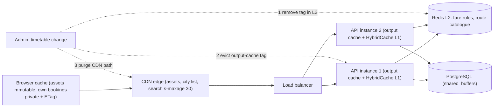

Most systems that feel fast are not fast at doing work; they are good at not doing it. Between a user's tap and your PostgreSQL disk there are half a dozen places where an answer can be kept and reused. This lesson maps those places, shows what each one is good at, and teaches the part that trips up even experienced teams: how the layers interact, so a "five-minute TTL" does not quietly become a sixteen-minute stale page.

## Learning objectives

By the end of this lesson you will be able to:

1. Name the caching layers in a typical web system (browser, CDN, reverse proxy, in-process, distributed, database buffer cache) and what each is best and worst at.
2. Calculate how hit ratios at several layers combine to reduce origin load and latency.
3. Write correct HTTP caching headers: `Cache-Control` (`max-age`, `s-maxage`, `private`, `no-cache`, `no-store`, `immutable`, `stale-while-revalidate`), `ETag` and `Vary`.
4. Use ASP.NET Core output caching for whole responses and HybridCache for data, with tag-based invalidation.
5. Reason about worst-case staleness across layers and design invalidation that reaches every layer that matters.
6. Read the PostgreSQL buffer cache hit ratio and know what it tells you.
7. Decide what *not* to cache, and when one layer is enough.

## Prerequisites

- [Latency numbers and latency budgets](#/lesson/m11-latency-numbers): caching is about replacing slow steps with fast ones.
- [HTTP fundamentals](#/lesson/m10-http-fundamentals): headers, methods and status codes such as `304 Not Modified`.
- [Stateless versus stateful services](#/lesson/m11-stateless): a local cache is a form of instance state.
- Deeper dives come later: [why caching works](#/lesson/m12-why-caching), [cache patterns](#/lesson/m12-cache-patterns) and [invalidation and TTL](#/lesson/m12-invalidation-ttl).

## Explain it like I'm a beginner

Think of how you get a cup of tea at home in Chennai.

- **In your hand already**: the cup you poured five minutes ago. Instant. (The browser cache: the user's own device.)
- **The flask on the table**: tea made this morning. A few seconds away, shared by the family. (A CDN or reverse proxy: shared copies close to many users.)
- **The pot on the stove**: still warm, in the kitchen. (Your app server's memory.)
- **The tea shop downstairs**: they make it fresh but you must walk there. (The distributed cache or the database.)
- **Growing and drying the leaves**: nobody does this per cup. (The database reading from disk and computing the answer.)

Each step closer to you is faster but holds less, and its tea gets older. The flask is convenient, but if someone wanted fresh tea with less sugar, the flask is wrong until it is emptied and refilled. That is **staleness**, and emptying the flask on purpose is **invalidation**.

Two more things the analogy shows. First, the layers **stack**: if the flask was filled from a pot that was already two hours old, the flask's tea is older than the flask's own "made at" label suggests. Second, some things must never come from a shared flask: your own medicine, measured for you (private, per-user data).

## First-principles explanation

### The layers, from the user inwards

| Layer | Where | Typical latency (order of magnitude) | Shared by | Controlled by | Best for |
|---|---|---|---|---|---|
| Browser / app cache | User's device | ~0 ms (no network) | One user | HTTP headers, service worker, app code | Static assets, the user's own recent data |
| CDN edge | Data centre near the user | ~5–50 ms | Everyone in that region | HTTP headers, CDN rules, purge API | Static assets, public pages and API responses |
| Reverse proxy / gateway cache | In front of your app (NGINX, Varnish, ASP.NET Core output cache) | ~1 ms inside your network | Everyone hitting that proxy | Proxy config, `s-maxage`, output-cache policies | Whole responses for popular public endpoints |
| In-process (L1) | App instance's memory (`IMemoryCache`) | ~microseconds | One instance | Your code | Hot, small, rarely changing data |
| Distributed (L2) | Redis, Memcached | ~0.5–2 ms in the same region | All instances | Your code | Data shared across instances, computed results, sessions |
| Database buffer cache | PostgreSQL `shared_buffers` + OS page cache | Memory speed instead of disk | All queries | Database config, working-set size | Recently used table and index pages |

The latency figures are rough orders of magnitude for planning (see [latency numbers](#/lesson/m11-latency-numbers)); measure your own.

Moving inwards, each layer is **closer to the source of truth**, easier to invalidate and more personalised, but each hit saves less. Moving outwards, each hit saves more (no network, no server work at all) but the copy is harder to control: you cannot purge a browser cache.

### How layers combine: the arithmetic

Each layer only sees the requests that the layers outside it missed. If layer *i* has hit ratio *hᵢ*, the load reaching the origin is:

```text
origin RPS = incoming RPS × (1 − h₁) × (1 − h₂) × … × (1 − hₙ)
```

Worked example: a national intercity bus-booking site at peak.

```text
Incoming page and API requests:       50,000 RPS
Browser cache hit ratio:              30 %   → 35,000 RPS reach the CDN
CDN hit ratio (of what reaches it):   80 %   → 7,000 RPS reach the app
App cache (HybridCache) hit ratio:    90 %   → 700 RPS reach PostgreSQL
```

PostgreSQL sees 700 queries per second instead of 50,000. A 71× reduction from three layers, none of which is spectacular on its own.

Average latency works the same way: every request pays the cost of each layer it reaches.

```text
Layer costs: browser 0 ms, CDN 20 ms, app cache 1 ms, database 30 ms
Share reaching each: 100 %, 70 %, 14 %, 1.4 %
Average ≈ 0 + 0.70 × 20 + 0.14 × 1 + 0.014 × 30 ≈ 14.6 ms of cache-and-data time
```

The CDN hop dominates the average, which is why the **browser cache is the most valuable layer for repeat visitors**: it removes the network entirely.

Two warnings about hit ratios:

- **Outer layers take the easy requests.** The CDN absorbs popular, cacheable responses, so the app cache sees the long tail and its hit ratio *drops*. A layer's hit ratio depends on what the layers outside it already removed.
- **Load is about misses, not hits.** Going from 90 % to 95 % hit ratio halves origin load. Going from 99 % to 99.5 % halves it again. Small changes at the top end matter a lot.

### How staleness adds up

Each layer can serve a copy until its TTL expires. If a layer refills from another cache, it may refill with data that is already old:

```text
Redis TTL 600 s, CDN s-maxage 300 s, browser max-age 60 s

t = 0      Price changes in PostgreSQL. Redis still holds the old price (cached at t = −1).
t = 599    Redis entry expires. (Old price was served to the CDN at t = 598.)
t = 898    CDN entry expires. (Old price was served to a browser at t = 897.)
t = 957    Browser entry expires.
Worst case ≈ 600 + 300 + 60 = 960 s of staleness, not 60 s.
```

**Worst-case staleness is roughly the sum of the TTLs of the layers in the chain.** When a product manager says "prices must be no more than 5 minutes stale", that budget must be split across *all* layers, or invalidation must actively reach them.

### HTTP caching headers: controlling the outer layers

You cannot run code in a browser cache or (usually) a CDN's cache logic, so you control them with response headers defined in RFC 9111.

| Directive | Meaning |
|---|---|
| `max-age=N` | Any cache may treat the response as fresh for N seconds. |
| `s-maxage=N` | Overrides `max-age` for **shared** caches (CDN, proxies) only. Lets the CDN keep it longer than browsers. |
| `public` | Shared caches may store it, even if the request had an `Authorization` header. |
| `private` | Only the user's own browser may store it; shared caches must not. |
| `no-cache` | May be stored, but must be **revalidated** with the origin before every use (cheap with `ETag`). Not "do not cache". |
| `no-store` | Must not be stored anywhere. For sensitive data. |
| `immutable` | The content at this URL will never change; do not even revalidate. For fingerprinted assets like `app.3f9a2c.js`. |
| `stale-while-revalidate=N` | After expiry, a cache may serve the stale copy for up to N seconds while it fetches a fresh one in the background. |
| `stale-if-error=N` | If the origin fails, a cache may serve a stale copy for up to N seconds. |

Two companion mechanisms:

- **Validators.** `ETag: "v42"` (or `Last-Modified`) lets a cache ask "has it changed?" with `If-None-Match: "v42"`. If not, the origin returns **`304 Not Modified`** with no body. Revalidation still costs a round-trip but saves bandwidth and server work.
- **`Vary`.** `Vary: Accept-Language` tells caches to keep separate copies per language. Varying on high-cardinality headers (`User-Agent`, `Cookie`) destroys the hit ratio; vary on as little as possible.

Typical recipes:

```text
Fingerprinted JS/CSS/images:      Cache-Control: public, max-age=31536000, immutable
City list (changes monthly):      Cache-Control: public, max-age=300, s-maxage=3600
Search results (fine if 30 s old): Cache-Control: public, max-age=0, s-maxage=30, stale-while-revalidate=30
User's own bookings page:         Cache-Control: private, no-cache   + ETag
Payment receipt, KYC documents:   Cache-Control: no-store
```

Fingerprinting (putting a content hash in the file name) is what makes year-long caching safe: a new deployment produces new file names, so there is never anything to invalidate.

### The inner layers in ASP.NET Core

**Response caching middleware** (`UseResponseCaching`) is an HTTP cache inside your server that follows the headers above, including the client's request headers. Because clients can bypass it with `Cache-Control: no-cache` on the request, it is mostly useful when you want standards-following proxy behaviour.

**Output caching** (`AddOutputCache` / `UseOutputCache`, .NET 7+) is a server-controlled cache of whole responses. You decide per endpoint how long to cache, what to vary by (query keys, route values, headers) and which **tags** to attach; you can evict by tag when data changes. It ignores the client's attempts to bypass it, protects against stampedes by default (concurrent requests for the same uncached response wait for one to finish), and by default does not cache authenticated requests or responses that set cookies. The store is in-memory per instance by default; a Redis-backed store is available for sharing across instances.

**`IMemoryCache`** is a per-instance key-value cache for data. **`IDistributedCache`** is the shared byte-array abstraction for Redis and others. **HybridCache** (.NET 9+) combines them: an in-memory L1 in front of an optional distributed L2, with serialization, **stampede protection** (only one caller per key runs the factory), and **tags** for group invalidation. It is the recommended default for caching data in new ASP.NET Core code.

Choosing between them:

| Need | Use |
|---|---|
| Cache a whole public GET response for N seconds | Output caching (plus `s-maxage` so the CDN can cache it too) |
| Cache data used by several endpoints (city list, fare rules) | HybridCache |
| Share data across instances | HybridCache with a Redis L2, or `IDistributedCache` directly |
| Tiny, hot, never-changing lookup | `IMemoryCache` or a static frozen dictionary loaded at start-up |

### The database's own cache

PostgreSQL keeps recently used 8 KB pages of tables and indexes in **`shared_buffers`** (a common starting point is about 25 % of RAM on a dedicated server), and the operating system's page cache holds more. A query that finds its pages there avoids disk entirely. You can see how often that happens:

```sql
-- Share of block reads served from shared_buffers, per database
SELECT datname,
       round(100.0 * blks_hit / nullif(blks_hit + blks_read, 0), 2) AS hit_pct
FROM pg_stat_database
WHERE datname = current_database();

-- Per table: which tables keep going to disk?
SELECT relname, heap_blks_read, heap_blks_hit,
       round(100.0 * heap_blks_hit / nullif(heap_blks_hit + heap_blks_read, 0), 2) AS hit_pct
FROM pg_statio_user_tables
ORDER BY heap_blks_read DESC
LIMIT 10;
```

On a transactional database whose working set fits in memory, this ratio is usually very high (often above 99 %). A low ratio on a hot table means the working set no longer fits, or a query is scanning far more than it needs (a missing index). Note that `blks_read` counts reads from outside `shared_buffers`, some of which the OS page cache still serves from memory, so the ratio is a guide, not a precise disk-read count.

This layer is "free": you do not write code for it. But it explains a common surprise: after a restart or failover, the buffer cache is cold and the same queries are slower for minutes. Extensions such as `pg_prewarm` can reload hot pages.

### What not to cache, or where not to cache it

- **Per-user data in shared caches.** A CDN or output cache serving one user's bookings to another user is a data breach. Mark responses `private` or `no-store`, and make sure your output-cache policies vary by user or skip authenticated requests (the default).
- **Data that must be exactly current at the moment of decision.** Seat availability can be shown from a 2-second cache, but the booking itself must check and lock the seat in the database.
- **Cheap queries.** Caching a 1 ms primary-key lookup in Redis (also about 1 ms) adds a dependency and a staleness problem for no gain.
- **Things with unbounded keys.** Caching every search combination with a long TTL fills memory with entries that are never reused. Watch the hit ratio per key prefix.

### Invalidation across layers

Two broad strategies, often combined:

1. **Short TTLs** at the layers you cannot control (browsers) and acceptable TTLs elsewhere, so staleness is bounded by design.
2. **Active invalidation** where you can reach the layer: remove the Redis key or tag, evict the output-cache tag, call the CDN purge API, and bump a version in URLs or ETags so browsers revalidate.

Order matters when invalidating several layers. Clear from the **inside out**: first the distributed cache, then output caches, then the CDN. If you purge the CDN first, it may immediately refill from an app cache that still holds the old value.

A neat alternative is **versioned keys**: include a version number in the cache key or URL (`/api/cities?v=17`, `cities:v17`). Changing the data bumps the version, and old entries simply stop being requested and expire on their own.

### Failure modes

| Failure | What happens | Mitigation |
|---|---|---|
| Private data cached publicly | One user sees another's data | `private`/`no-store`; never output-cache authenticated responses without varying by user; test headers in CI |
| Stacked TTLs | Data far staler than any single TTL suggests | Budget staleness across layers; invalidate inside-out |
| Cache stampede after expiry or purge | Thousands of simultaneous misses hit the database | Stampede protection (HybridCache, output caching), `stale-while-revalidate`, jittered TTLs ([cache failures](#/lesson/m12-cache-failures)) |
| Redis outage | Every request falls through to PostgreSQL | L1 in front of L2; circuit breaker on the cache; load-shed if the database cannot take full load |
| Cold caches after deploy or failover | Slow responses for minutes | Warm critical keys; keep L2 across deploys; prewarm the database |
| High-cardinality `Vary` or keys | Hit ratio near zero, memory full | Vary by as little as possible; normalise query strings |

### When a simpler design is enough

- A small internal app: database buffer cache plus good indexes is often all you need. Add `IMemoryCache` for one or two slow lookups.
- A content site: fingerprinted assets with `immutable`, HTML with a short `s-maxage` behind a CDN, and no application cache at all.
- A single-instance API: `IMemoryCache` or HybridCache without an L2. Add Redis when you have several instances and the database load justifies it.

Every layer you add is another place where data can be stale and another thing to invalidate. Add layers from the outside in only when measurements show the origin needs relief.

## Visual explanation

### Architecture: where each kind of data is cached



Requests flow from left to right and stop at the first layer that has a fresh answer. The **browser** keeps fingerprinted assets for a year and the user's own bookings page privately, revalidating it with an `ETag`. The **CDN** keeps public data: assets, the city list for an hour, and search results for 30 seconds. Each **API instance** has an output cache for whole responses and a HybridCache L1 for data, both in its own memory. **Redis** is the shared L2, so a value computed by instance 1 is reused by instance 2. **PostgreSQL**'s buffer cache keeps hot pages in memory. The dotted arrows show invalidation after an admin changes a timetable, numbered **inside out**: Redis first, then output caches, then the CDN, so no outer layer refills from a stale inner one.

### Sequence: revalidation and stale-while-revalidate

```mermaid
sequenceDiagram
    participant U as Browser
    participant C as CDN edge
    participant O as ASP.NET Core origin
    participant H as HybridCache (L1 then L2)
    U->>C: GET /api/search?from=DEL&to=JAI&date=2026-03-15
    Note over C: copy is 40 s old, s-maxage 30, stale-while-revalidate 30
    C-->>U: 200 stale copy (Age 40), fast
    C->>O: background refresh, If-None-Match "s-981"
    O->>H: GetOrCreate search:DEL:JAI:2026-03-15
    H-->>O: hit in L2 (L1 expired)
    O->>O: compute ETag, still "s-981"
    O-->>C: 304 Not Modified, Cache-Control s-maxage=30
    Note over C: copy is fresh again for 30 s, no body transferred
    U->>C: GET /api/me/bookings (private, no-cache)
    C->>O: forwarded, never stored at the edge
    O-->>U: 200 with ETag "b-7"
```



The first request reaches the **CDN** when its copy is 40 seconds old: past `s-maxage=30` but inside the `stale-while-revalidate` window. The CDN answers immediately with the stale copy, so the user does not wait, and refreshes in the background with a conditional request carrying the copy's `ETag`. The **origin** asks **HybridCache**, which finds the value in L2 (its L1 copy had expired), computes the same ETag and returns **`304 Not Modified`**: no body, just new freshness. The second request is for the user's own bookings, marked `private, no-cache`, so the CDN forwards it without storing it and the browser revalidates it on each use.

## Step-by-step example

**Scenario.** The bus-booking site from the arithmetic section. Peak is 50,000 RPS during festival travel. PostgreSQL is at 85 % CPU and p95 latency is 1.8 seconds. There is no caching except a CDN for images.

### Step 1 — Classify the data by freshness and audience

| Data | Changes | Audience | Acceptable staleness |
|---|---|---|---|
| JS, CSS, operator logos | Each deploy | Everyone | Forever (fingerprinted) |
| City and route catalogue | A few times a month | Everyone | 1 hour, or invalidated on change |
| Search results (route + date) | Prices and seat counts change constantly | Everyone | 30 seconds for listing; exact at booking |
| Seat map for one trip | Every booking | Everyone | 2–5 seconds for display |
| My bookings | When I book or cancel | One user | None, but revalidation is fine |
| Payment receipt | Never | One user | Must not be stored in shared caches |

### Step 2 — Fix the outer layers with headers

Assets get `public, max-age=31536000, immutable` (file names already include a hash). The catalogue gets `public, max-age=300, s-maxage=3600`. Search gets `public, max-age=0, s-maxage=30, stale-while-revalidate=30`. My bookings gets `private, no-cache` with an `ETag`. Receipts get `no-store`.

Load at the app tier falls from 50,000 RPS to roughly 7,000 RPS (the browser and CDN numbers from earlier). That alone took the database from 85 % to under 30 % CPU in this scenario.

### Step 3 — Add server-side caches for what still arrives

- Output cache for `/api/search` (30 s, varying by `from`, `to`, `date`, tagged `search`), so a burst of identical searches arriving at one instance computes once.
- HybridCache for the route catalogue and fare rules (L1 2 minutes, L2 in Redis 1 hour, tagged `catalogue`). Search results are built from these, so even a search cache miss is cheaper.
- Seat maps: output cache of 2 seconds. During a sale, a popular trip gets hundreds of seat-map requests per second; a 2-second cache turns them into at most one database query per instance per 2 seconds.

### Step 4 — Budget staleness

Catalogue: L1 2 min + L2 60 min + CDN 60 min + browser 5 min ≈ 2 hours worst case without invalidation. Too long when a route is cancelled, so changes to the catalogue trigger invalidation inside out: `RemoveByTagAsync("catalogue")`, `EvictByTagAsync("catalogue")`, then a CDN purge of `/api/cities*`. With invalidation, the remaining staleness is the browser's 5 minutes, which product accepts.

### Step 5 — Keep the booking path exact

The booking API never reads seats from any cache. It runs `SELECT … FOR UPDATE` on the seat row (or an equivalent optimistic check) in PostgreSQL. Caches make browsing fast; the database makes booking correct.

### Step 6 — Measure

Dashboards show hit ratio per layer (CDN analytics, output-cache and HybridCache metrics, `pg_stat_database`), origin RPS, and p95 latency per endpoint. The team also alerts when the CDN hit ratio drops suddenly, which usually means someone shipped a response with `Set-Cookie` or `Cache-Control: private` on a public endpoint.

## Production-style C# implementation

The code below implements the caching plan for the bus-booking API: HTTP header presets, an ETag helper for conditional requests, output-cache policies with tags, a route catalogue served through HybridCache, and an admin endpoint that invalidates inside out. `HybridCache`'s abstract class ships with ASP.NET Core, but its default implementation (`AddHybridCache`) lives in the `Microsoft.Extensions.Caching.Hybrid` package, which is not available to the offline checker; so a small in-process stand-in is included and the production registration is shown in a comment.

```text
BusBooking.Api/
  Program.cs
  Caching/CacheHeaders.cs
  Caching/ETags.cs
  Caching/RouteCatalogue.cs
  Caching/InProcessHybridCache.cs
```

```csharp file=Caching/CacheHeaders.cs
using Microsoft.Net.Http.Headers;

namespace BusBooking.Api.Caching;

/// <summary>Named Cache-Control presets so every endpoint picks a deliberate policy.</summary>
public static class CacheHeaders
{
    public const string Immutable = "public, max-age=31536000, immutable";
    public const string Catalogue = "public, max-age=300, s-maxage=3600";
    public const string SharedShortLived = "public, max-age=0, s-maxage=30, stale-while-revalidate=30, stale-if-error=300";
    public const string PrivateRevalidate = "private, no-cache";
    public const string NoStore = "no-store";

    public static void Apply(HttpResponse response, string cacheControl, string? vary = null)
    {
        response.Headers[HeaderNames.CacheControl] = cacheControl;
        if (vary is not null) response.Headers[HeaderNames.Vary] = vary;
    }
}
```

```csharp file=Caching/ETags.cs
using System.Security.Cryptography;
using System.Text;
using Microsoft.Net.Http.Headers;

namespace BusBooking.Api.Caching;

public static class ETags
{
    /// <summary>A strong ETag derived from a version or content fingerprint.</summary>
    public static string From(string version)
    {
        byte[] hash = SHA256.HashData(Encoding.UTF8.GetBytes(version));
        return $"\"{Convert.ToHexString(hash, 0, 8).ToLowerInvariant()}\"";
    }

    /// <summary>True if the request's If-None-Match matches (weak comparison, as RFC 9110 requires
    /// for If-None-Match), so the server can answer 304 Not Modified without a body.</summary>
    public static bool IsNotModified(HttpRequest request, string etag)
    {
        string header = request.Headers[HeaderNames.IfNoneMatch].ToString();
        if (string.IsNullOrWhiteSpace(header)) return false;
        if (header.Trim() == "*") return true;
        string target = Strip(etag);
        return header.Split(',').Any(candidate => Strip(candidate.Trim()) == target);
    }

    private static string Strip(string tag) => tag.StartsWith("W/", StringComparison.Ordinal) ? tag[2..] : tag;
}
```

ETags let browsers and CDNs keep a copy and ask "still the same?" cheaply. Deriving the ETag from a **version** (a row's `updated_at`, an `xmin`, or a counter) avoids loading and hashing the full response just to discover that nothing changed.

```csharp file=Caching/RouteCatalogue.cs
using Microsoft.Extensions.Caching.Hybrid;

namespace BusBooking.Api.Caching;

public sealed record City(string Code, string Name, string State);

public interface ICityRepository
{
    Task<IReadOnlyList<City>> GetAllAsync(CancellationToken ct);
}

/// <summary>Stand-in for a PostgreSQL query such as SELECT code, name, state FROM cities ORDER BY name.</summary>
public sealed class InMemoryCityRepository : ICityRepository
{
    private static readonly City[] Cities =
    [
        new("DEL", "Delhi", "Delhi"), new("JAI", "Jaipur", "Rajasthan"),
        new("BLR", "Bengaluru", "Karnataka"), new("MAA", "Chennai", "Tamil Nadu"),
        new("HYD", "Hyderabad", "Telangana"), new("PNQ", "Pune", "Maharashtra"),
    ];

    public int Calls { get; private set; }

    public Task<IReadOnlyList<City>> GetAllAsync(CancellationToken ct)
    {
        Calls++;
        return Task.FromResult<IReadOnlyList<City>>(Cities);
    }
}

/// <summary>Data caching for the route catalogue. HybridCache gives an in-memory L1, an optional
/// Redis L2, stampede protection (one factory call per key) and tag invalidation.</summary>
public sealed class RouteCatalogue(HybridCache cache, ICityRepository repository)
{
    public const string Tag = "catalogue";
    private static readonly HybridCacheEntryOptions Options = new()
    {
        Expiration = TimeSpan.FromHours(1),            // L2 (and L1 upper bound)
        LocalCacheExpiration = TimeSpan.FromMinutes(2), // L1: short, limits cross-instance staleness
    };

    public ValueTask<IReadOnlyList<City>> CitiesAsync(CancellationToken ct) =>
        cache.GetOrCreateAsync(
            "catalogue:cities:v1",
            repository,
            static (repo, token) => new ValueTask<IReadOnlyList<City>>(repo.GetAllAsync(token)),
            Options,
            [Tag],
            ct);

    public ValueTask InvalidateAsync(CancellationToken ct) => cache.RemoveByTagAsync(Tag, ct);
}
```

The `static` lambda with an explicit state argument avoids allocating a closure on every call, the pattern HybridCache's API is designed for. The key includes a version (`v1`): if the shape of `City` changes in a deployment, bumping it to `v2` stops new code from reading old entries.

```csharp file=Caching/InProcessHybridCache.cs
using System.Collections.Concurrent;
using Microsoft.Extensions.Caching.Hybrid;

namespace BusBooking.Api.Caching;

/// <summary>Offline stand-in for HybridCache: single-level, in-process, with stampede protection
/// and tags. Production uses builder.Services.AddHybridCache() plus a Redis IDistributedCache.</summary>
public sealed class InProcessHybridCache(TimeProvider clock) : HybridCache
{
    private sealed record Entry(object? Value, DateTimeOffset ExpiresAt, string[] Tags);

    private readonly ConcurrentDictionary<string, Entry> _entries = new(StringComparer.Ordinal);
    private readonly ConcurrentDictionary<string, Lazy<Task<object?>>> _inFlight = new(StringComparer.Ordinal);
    private static readonly TimeSpan DefaultExpiration = TimeSpan.FromMinutes(5);

    public override async ValueTask<T> GetOrCreateAsync<TState, T>(string key, TState state,
        Func<TState, CancellationToken, ValueTask<T>> factory, HybridCacheEntryOptions? options = null,
        IEnumerable<string>? tags = null, CancellationToken cancellationToken = default)
    {
        if (_entries.TryGetValue(key, out var hit) && hit.ExpiresAt > clock.GetUtcNow()) return (T)hit.Value!;

        var load = _inFlight.GetOrAdd(key, _ => new Lazy<Task<object?>>(async () =>
        {
            T value = await factory(state, cancellationToken);
            Store(key, value, options, tags);
            return value;
        }));
        try { return (T)(await load.Value)!; }
        finally { _inFlight.TryRemove(new KeyValuePair<string, Lazy<Task<object?>>>(key, load)); }
    }

    public override ValueTask SetAsync<T>(string key, T value, HybridCacheEntryOptions? options = null,
        IEnumerable<string>? tags = null, CancellationToken cancellationToken = default)
    {
        Store(key, value, options, tags);
        return ValueTask.CompletedTask;
    }

    public override ValueTask RemoveAsync(string key, CancellationToken cancellationToken = default)
    {
        _entries.TryRemove(key, out _);
        return ValueTask.CompletedTask;
    }

    public override ValueTask RemoveByTagAsync(string tag, CancellationToken cancellationToken = default)
    {
        foreach (var (key, entry) in _entries)
            if (entry.Tags.Contains(tag, StringComparer.Ordinal)) _entries.TryRemove(key, out _);
        return ValueTask.CompletedTask;
    }

    private void Store<T>(string key, T value, HybridCacheEntryOptions? options, IEnumerable<string>? tags)
    {
        TimeSpan ttl = options?.LocalCacheExpiration ?? options?.Expiration ?? DefaultExpiration;
        _entries[key] = new Entry(value, clock.GetUtcNow() + ttl, tags?.ToArray() ?? []);
    }
}
```

The stand-in shows the two behaviours that matter most in a multi-layer design: **stampede protection** (concurrent misses for one key share one `Lazy<Task>`, so the factory runs once) and **tag invalidation**. The real HybridCache adds the Redis L2, serialization and size limits.

```csharp file=Program.cs
using BusBooking.Api.Caching;
using Microsoft.AspNetCore.OutputCaching;
using Microsoft.Extensions.Caching.Hybrid;
using Microsoft.Net.Http.Headers;

var builder = WebApplication.CreateBuilder(args);

builder.Services.AddSingleton(TimeProvider.System);
builder.Services.AddSingleton<InMemoryCityRepository>();
builder.Services.AddSingleton<ICityRepository>(sp => sp.GetRequiredService<InMemoryCityRepository>());

// Data cache. Production:
//   builder.Services.AddStackExchangeRedisCache(o => o.Configuration = "...");   // becomes the L2
//   builder.Services.AddHybridCache();
builder.Services.AddSingleton<HybridCache, InProcessHybridCache>();
builder.Services.AddSingleton<RouteCatalogue>();

// Whole-response cache, controlled by the server, with tags for eviction.
builder.Services.AddOutputCache(options =>
{
    options.AddPolicy("catalogue", p => p.Expire(TimeSpan.FromMinutes(5)).Tag(RouteCatalogue.Tag));
    options.AddPolicy("search", p => p.Expire(TimeSpan.FromSeconds(30)).SetVaryByQuery("from", "to", "date").Tag("search"));
    options.AddPolicy("seatmap", p => p.Expire(TimeSpan.FromSeconds(2)).Tag("seats"));
});

var app = builder.Build();

// Fingerprinted assets (app.3f9a2c.js): cache for a year, never revalidate.
app.UseStaticFiles(new StaticFileOptions
{
    OnPrepareResponse = ctx => CacheHeaders.Apply(ctx.Context.Response, CacheHeaders.Immutable),
});
app.UseOutputCache();

app.MapGet("/api/cities", async (HttpContext http, RouteCatalogue catalogue, CancellationToken ct) =>
{
    CacheHeaders.Apply(http.Response, CacheHeaders.Catalogue);
    return Results.Ok(await catalogue.CitiesAsync(ct));
}).CacheOutput("catalogue");

app.MapGet("/api/search", (string from, string to, DateOnly date, HttpContext http) =>
{
    CacheHeaders.Apply(http.Response, CacheHeaders.SharedShortLived);
    // Real code: build results from cached catalogue + fare rules + a seat-count query.
    var trips = new[] { new { tripId = 9101, from, to, date, departs = "21:30", seatsLeft = 12, fareRupees = 899 } };
    return Results.Ok(trips);
}).CacheOutput("search");

app.MapGet("/api/trips/{tripId:int}/seats", (int tripId, HttpContext http) =>
{
    CacheHeaders.Apply(http.Response, "public, max-age=0, s-maxage=2");
    return Results.Ok(new { tripId, available = new[] { "A1", "A2", "B4" } });
}).CacheOutput("seatmap");

// Per-user data: never in shared caches; the browser revalidates using the ETag.
app.MapGet("/api/me/bookings", (HttpContext http) =>
{
    const string version = "user-42:bookings:rev-7"; // real code: max(updated_at) for this user's bookings
    string etag = ETags.From(version);
    CacheHeaders.Apply(http.Response, CacheHeaders.PrivateRevalidate);
    http.Response.Headers[HeaderNames.ETag] = etag;
    return ETags.IsNotModified(http.Request, etag)
        ? Results.StatusCode(StatusCodes.Status304NotModified)
        : Results.Ok(new[] { new { pnr = "BX7Q2K", tripId = 9101, seat = "A2" } });
});

app.MapGet("/api/me/receipts/{pnr}", (string pnr, HttpContext http) =>
{
    CacheHeaders.Apply(http.Response, CacheHeaders.NoStore);
    return Results.Ok(new { pnr, amountRupees = 899, gstRupees = 45 });
});

// Invalidate inside out: data cache, then response caches, then (in production) the CDN.
app.MapPost("/admin/catalogue/changed", async (RouteCatalogue catalogue, IOutputCacheStore outputCache, CancellationToken ct) =>
{
    await catalogue.InvalidateAsync(ct);
    await outputCache.EvictByTagAsync(RouteCatalogue.Tag, ct);
    // await cdn.PurgeAsync(["/api/cities*"], ct);   // CDN purge API call, provider-specific
    return Results.NoContent();
});

app.Run();
```

Decisions worth defending:

1. **Every endpoint states its policy explicitly.** Named presets make code review easy: a reviewer can see at a glance that receipts are `no-store` and search is shared for 30 seconds.
2. **Output-cache and HTTP headers are set together.** The output cache protects the origin from bursts; `s-maxage` lets the CDN do the same job further out. Without the header, the CDN would forward every request.
3. **Seat maps get a 2-second cache, booking gets none.** A tiny TTL absorbs the read storm for popular trips; correctness lives in the booking transaction.
4. **Invalidation runs inside out**, so the output cache cannot refill from a stale HybridCache entry and the CDN cannot refill from a stale output cache.
5. **The default output-cache policy skips authenticated requests.** `/api/me/*` endpoints carry no output-cache policy at all, by design.

## Bad design vs good design

**Bad: "add Redis in front of everything".**

```csharp
// Caches per-user data under a key that ignores the user, with a long TTL. A data leak waiting to happen.
app.MapGet("/api/me/bookings", async (IDistributedCache cache, HttpContext http) =>
{
    string? json = await cache.GetStringAsync("bookings");          // same key for every user
    http.Response.Headers.CacheControl = "public, max-age=3600";      // CDN may now cache it too
    return json;
});
```

Problems: one key for all users, a `public` header on private data, a one-hour TTL nobody budgeted, no invalidation when a booking changes, and Redis added for a query that was cheap anyway. Meanwhile static assets have no caching headers, so every page view re-downloads 2 MB of JavaScript.

**Good:**

- Classify data by audience and acceptable staleness before choosing layers.
- Push public, cacheable responses as far out as possible with correct headers; fingerprint assets.
- Keep per-user data `private` (browser only) or `no-store`.
- Use output caching for bursty public endpoints and HybridCache for shared data, with tags.
- Budget staleness across layers and invalidate inside out.
- Keep decisions (booking, payment, stock reservation) on the database.

:::callout type=mistake title="Reading no-cache as do-not-cache"
`Cache-Control: no-cache` means "store it, but check with me before using it". It works well with ETags: the revalidation returns a tiny `304`. If you truly must not store a response (bank statements, identity documents), use `no-store`.
:::

:::callout type=tradeoff title="Every layer is another copy to keep correct"
Each layer improves latency or origin load, and each adds a TTL to the staleness budget, a place to invalidate, and a failure mode. Two well-chosen layers with correct headers usually beat five layers that nobody can reason about.
:::

## Practical playground

The graph below is the bus-booking site before the redesign: a client hitting a load balancer, two API instances and PostgreSQL, with no caching. Open it in the HLD canvas and add layers: a `cdn` with a `ttlSeconds` for public data, a `cache` node for the Redis L2, and labels on the API nodes for output caching and HybridCache L1. Next to each layer, write the data it holds, its TTL, and the request rate you expect it to pass inwards using the hit-ratio formula. Finally, write the worst-case staleness for the city list with and without invalidation.

:::playground type=hld title="Add caching layers to the bus-booking site"
```json
{
  "nodes": [
    { "id": "users", "type": "client", "label": "Travellers (web + app)", "props": { "rps": 50000 } },
    { "id": "lb", "type": "load-balancer", "label": "Load balancer" },
    { "id": "api", "type": "app-server", "label": "Booking API (no caching)", "props": { "instances": 2 } },
    { "id": "db", "type": "database", "label": "PostgreSQL (85 % CPU)", "props": { "replicas": 0 } }
  ],
  "edges": [
    { "from": "users", "to": "lb", "kind": "sync" },
    { "from": "lb", "to": "api", "kind": "sync" },
    { "from": "api", "to": "db", "kind": "sync", "label": "every request" }
  ]
}
```
:::

## Exercises

:::exercise id=m11-caching-layers-ex1 difficulty=beginner kind=code title="Layered cache arithmetic"
Write the three calculations from this lesson so you can use them in design reviews.
::requirements
- `LayeredCacheMath.OriginRps(double incomingRps, params double[] hitRatios)` returns the requests per second that miss every layer.
- `LayeredCacheMath.AverageLatencyMs(IReadOnlyList<(double HitRatio, double LatencyMs)> layers, double originLatencyMs)`: every request pays the latency of each layer it reaches; requests that miss all layers also pay `originLatencyMs`.
- `LayeredCacheMath.WorstCaseStaleness(params TimeSpan[] ttls)` returns the sum of the TTLs.
- Hit ratios outside `[0, 1]`, negative RPS, negative latencies or negative TTLs throw `ArgumentOutOfRangeException`.
::acceptance
- `OriginRps(50_000, 0.3, 0.8, 0.9)` = 700.
- Layers (0.3, 0 ms), (0.8, 20 ms), (0.9, 1 ms) with a 30 ms origin give 14.56 ms.
- `WorstCaseStaleness(60 s, 300 s, 600 s)` = 960 s.
- `OriginRps(1000)` with no layers returns 1000.
::hint
Each layer passes on `(1 − hit ratio)` of what it receives.
::hint
For latency, keep a running "share of requests that reached this layer", starting at 1.0.
::hint
Add `reach × latency` for each layer, then multiply `reach` by `(1 − hitRatio)` before moving on. After the loop, add `reach × originLatency`.
::hint
```csharp
double reach = 1, total = 0;
foreach (var (h, ms) in layers) { total += reach * ms; reach *= 1 - h; }
return total + reach * originLatencyMs;
```
::starter
```csharp file=LayeredCacheMath.cs
using System;
using System.Collections.Generic;

public static class LayeredCacheMath
{
    public static double OriginRps(double incomingRps, params double[] hitRatios) => throw new NotImplementedException();

    public static double AverageLatencyMs(IReadOnlyList<(double HitRatio, double LatencyMs)> layers, double originLatencyMs) =>
        throw new NotImplementedException();

    public static TimeSpan WorstCaseStaleness(params TimeSpan[] ttls) => throw new NotImplementedException();
}
```
::tests
```csharp file=LayeredCacheMathTests.cs
using System;
using Xunit;

public class LayeredCacheMathTests
{
    [Fact] public void Three_layers_reduce_origin_load() => Assert.Equal(700, LayeredCacheMath.OriginRps(50_000, 0.3, 0.8, 0.9), 6);
    [Fact] public void No_layers_pass_everything() => Assert.Equal(1000, LayeredCacheMath.OriginRps(1000), 6);

    [Fact]
    public void Average_latency_counts_every_layer_reached() =>
        Assert.Equal(14.56, LayeredCacheMath.AverageLatencyMs(new[] { (0.3, 0.0), (0.8, 20.0), (0.9, 1.0) }, 30), 6);

    [Fact]
    public void Staleness_adds_up() =>
        Assert.Equal(TimeSpan.FromSeconds(960),
            LayeredCacheMath.WorstCaseStaleness(TimeSpan.FromSeconds(60), TimeSpan.FromSeconds(300), TimeSpan.FromSeconds(600)));

    [Fact]
    public void Invalid_inputs_throw()
    {
        Assert.Throws<ArgumentOutOfRangeException>(() => LayeredCacheMath.OriginRps(100, 1.2));
        Assert.Throws<ArgumentOutOfRangeException>(() => LayeredCacheMath.OriginRps(-1, 0.5));
        Assert.Throws<ArgumentOutOfRangeException>(() => LayeredCacheMath.AverageLatencyMs(new[] { (0.5, -1.0) }, 30));
        Assert.Throws<ArgumentOutOfRangeException>(() => LayeredCacheMath.WorstCaseStaleness(TimeSpan.FromSeconds(-5)));
    }
}
```
::solution
```csharp file=LayeredCacheMath.cs
using System;
using System.Collections.Generic;

public static class LayeredCacheMath
{
    public static double OriginRps(double incomingRps, params double[] hitRatios)
    {
        if (incomingRps < 0) throw new ArgumentOutOfRangeException(nameof(incomingRps));
        double remaining = incomingRps;
        foreach (double h in hitRatios) remaining *= 1 - CheckRatio(h);
        return remaining;
    }

    public static double AverageLatencyMs(IReadOnlyList<(double HitRatio, double LatencyMs)> layers, double originLatencyMs)
    {
        if (originLatencyMs < 0) throw new ArgumentOutOfRangeException(nameof(originLatencyMs));
        double reach = 1.0, total = 0.0;
        foreach (var (hitRatio, latencyMs) in layers)
        {
            if (latencyMs < 0) throw new ArgumentOutOfRangeException(nameof(layers), "Latency cannot be negative.");
            total += reach * latencyMs;
            reach *= 1 - CheckRatio(hitRatio);
        }
        return total + reach * originLatencyMs;
    }

    public static TimeSpan WorstCaseStaleness(params TimeSpan[] ttls)
    {
        TimeSpan sum = TimeSpan.Zero;
        foreach (var ttl in ttls)
        {
            if (ttl < TimeSpan.Zero) throw new ArgumentOutOfRangeException(nameof(ttls));
            sum += ttl;
        }
        return sum;
    }

    private static double CheckRatio(double h) =>
        h is >= 0 and <= 1 ? h : throw new ArgumentOutOfRangeException(nameof(h), h, "Hit ratio must be in [0, 1].");
}
```

The latency model charges a layer's lookup cost to every request that reaches it, hit or miss, which is how real caches behave: a CDN miss still pays the trip to the edge.
::mistakes
- Multiplying by the hit ratio instead of the miss ratio.
- Adding hit ratios ("30 % + 80 % + 90 %").
- Taking the maximum TTL as the worst-case staleness instead of the sum.
::extensions
Add `MarginalValue(int layerIndex)`: how much origin RPS rises if that layer's hit ratio drops to zero, to show which layer you can least afford to lose.
:::

:::exercise id=m11-caching-layers-ex2 difficulty=beginner kind=written title="Headers for six responses"
A state transport corporation's booking site serves the responses below. For each, write the `Cache-Control` header (and `ETag` or `Vary` if needed), and name the outermost layer allowed to cache it.

1. `/assets/app.7c1e9a.js`
2. `/api/depots` (list of 400 bus depots, changes a few times a year)
3. `/api/search?from=PNQ&to=MUM&date=2026-03-15` (public, fine if 30 s old)
4. `/api/me/tickets` (the logged-in user's tickets)
5. `/api/me/tickets/{pnr}/pdf` (a ticket with name, age and phone number)
6. `/` (home page HTML, same for everyone in English and Marathi, chosen by `Accept-Language`)
::acceptance
- Uses `immutable` with a long `max-age` for the fingerprinted asset.
- Uses `s-maxage` for at least one shared-cache case and explains why it differs from `max-age`.
- Marks per-user responses `private` (with revalidation) or `no-store`, and never `public`.
- Adds `Vary: Accept-Language` (and nothing broader) for the home page.
::hint
Which responses are the same for everyone, and which belong to one person?
::hint
For the asset, ask: can the content at this exact URL ever change?
::hint
For the PDF with personal details, should even the user's own browser keep a copy on disk?
::solution
1. `Cache-Control: public, max-age=31536000, immutable`. Browser and CDN. The hash in the file name changes on each deploy, so the URL's content never changes.
2. `Cache-Control: public, max-age=3600, s-maxage=86400`, plus an `ETag`. CDN. Browsers recheck hourly; the CDN keeps it a day and is purged when depots change.
3. `Cache-Control: public, max-age=0, s-maxage=30, stale-while-revalidate=30`. CDN. Browsers do not reuse it (prices move), but the CDN absorbs identical searches for 30 s and refreshes in the background.
4. `Cache-Control: private, no-cache` with `ETag`. Browser only. The browser may keep it but must revalidate; a `304` makes that cheap.
5. `Cache-Control: no-store`. Nowhere. It contains personal data; shared devices (cyber cafés, office PCs) should not keep it.
6. `Cache-Control: public, max-age=60, s-maxage=300` with `Vary: Accept-Language`. CDN, which keeps one copy per language. Normalise the header at the CDN (map variants such as `mr-IN,mr;q=0.9` to `mr`) so the vary does not explode into hundreds of copies.
::mistakes
- Using `no-cache` for the PDF and believing it is not stored.
- Marking `/api/me/tickets` as `public` because "the user is authenticated anyway".
- Using `Vary: User-Agent` or `Vary: Cookie` on the home page, which fragments the CDN cache.
:::

:::exercise id=m11-caching-layers-ex3 difficulty=intermediate kind=code title="Freshness and conditional requests"
Implement the core decisions an HTTP cache makes (simplified from RFC 9111): may I store this, how long is it fresh, is it fresh now, and does a conditional request match?
::requirements
- `HttpFreshness.IsStorable(string cacheControl, bool sharedCache)`: false for `no-store`; false for `private` when `sharedCache`; otherwise true.
- `HttpFreshness.Lifetime(string cacheControl, bool sharedCache)`: for shared caches `s-maxage` wins over `max-age`; private caches ignore `s-maxage`. Returns `null` if neither is present.
- `HttpFreshness.IsFresh(CachedResponse response, DateTimeOffset now, bool sharedCache)`: current age = `AgeSeconds` + (`now − StoredAt`). Fresh if a lifetime exists, the age is below it, and `no-cache` is absent.
- `HttpFreshness.ConditionalStatus(string? ifNoneMatch, string currentETag)`: 304 if the header is `*` or any listed tag matches using weak comparison (ignore a `W/` prefix); otherwise 200.
- Directive names are case-insensitive; values may be quoted (`max-age="60"`).
::acceptance
- `public, max-age=60, s-maxage=300` → 300 s for a shared cache, 60 s for a browser.
- `private, max-age=60` is storable by a browser but not by a CDN.
- A response stored 50 s ago with `Age: 5` and `max-age=60` is fresh; stored 58 s ago it is stale.
- `If-None-Match: "v6", W/"v7"` against `"v7"` returns 304.
::hint
Parse the header once into a dictionary: split on commas, trim, split each part on the first `=`, lower-case the name, strip quotes from the value.
::hint
Use `StringComparer.OrdinalIgnoreCase` for the dictionary so `Max-Age` works.
::hint
For `IsFresh`, compute `age = response.AgeSeconds + (now − response.StoredAt).TotalSeconds` and compare with `Lifetime(...)`.
::hint
```csharp
static string StripWeak(string t) => t.StartsWith("W/") ? t[2..] : t;
return ifNoneMatch.Split(',').Select(t => StripWeak(t.Trim())).Contains(StripWeak(currentETag)) ? 304 : 200;
```
::starter
```csharp file=HttpFreshness.cs
using System;
using System.Collections.Generic;
using System.Linq;

public sealed record CachedResponse(DateTimeOffset StoredAt, string CacheControl, int AgeSeconds = 0);

public static class HttpFreshness
{
    public static bool IsStorable(string cacheControl, bool sharedCache) => throw new NotImplementedException();

    public static TimeSpan? Lifetime(string cacheControl, bool sharedCache) => throw new NotImplementedException();

    public static bool IsFresh(CachedResponse response, DateTimeOffset now, bool sharedCache) => throw new NotImplementedException();

    public static int ConditionalStatus(string? ifNoneMatch, string currentETag) => throw new NotImplementedException();
}
```
::tests
```csharp file=HttpFreshnessTests.cs
using System;
using Xunit;

public class HttpFreshnessTests
{
    private static readonly DateTimeOffset T0 = new(2026, 3, 15, 9, 0, 0, TimeSpan.Zero);

    [Fact]
    public void Shared_caches_prefer_s_maxage() =>
        Assert.Equal(TimeSpan.FromSeconds(300), HttpFreshness.Lifetime("public, max-age=60, s-maxage=300", sharedCache: true));

    [Fact]
    public void Browsers_ignore_s_maxage() =>
        Assert.Equal(TimeSpan.FromSeconds(60), HttpFreshness.Lifetime("public, max-age=60, s-maxage=300", sharedCache: false));

    [Fact]
    public void No_lifetime_without_directives() =>
        Assert.Null(HttpFreshness.Lifetime("public", sharedCache: true));

    [Fact]
    public void Directives_are_case_insensitive_and_may_be_quoted() =>
        Assert.Equal(TimeSpan.FromSeconds(60), HttpFreshness.Lifetime("Public, Max-Age=\"60\"", sharedCache: false));

    [Fact]
    public void Private_is_not_storable_in_shared_caches()
    {
        Assert.False(HttpFreshness.IsStorable("private, max-age=60", sharedCache: true));
        Assert.True(HttpFreshness.IsStorable("private, max-age=60", sharedCache: false));
        Assert.False(HttpFreshness.IsStorable("no-store", sharedCache: false));
    }

    [Fact]
    public void Age_header_counts_towards_freshness()
    {
        Assert.True(HttpFreshness.IsFresh(new CachedResponse(T0, "max-age=60", AgeSeconds: 5), T0.AddSeconds(50), false));
        Assert.False(HttpFreshness.IsFresh(new CachedResponse(T0, "max-age=60", AgeSeconds: 5), T0.AddSeconds(58), false));
    }

    [Fact]
    public void No_cache_always_requires_revalidation() =>
        Assert.False(HttpFreshness.IsFresh(new CachedResponse(T0, "no-cache, max-age=600"), T0.AddSeconds(1), true));

    [Fact]
    public void Conditional_requests()
    {
        Assert.Equal(304, HttpFreshness.ConditionalStatus("\"v7\"", "\"v7\""));
        Assert.Equal(304, HttpFreshness.ConditionalStatus("\"v6\", W/\"v7\"", "\"v7\""));
        Assert.Equal(304, HttpFreshness.ConditionalStatus("*", "\"v7\""));
        Assert.Equal(200, HttpFreshness.ConditionalStatus("\"v6\"", "\"v7\""));
        Assert.Equal(200, HttpFreshness.ConditionalStatus(null, "\"v7\""));
    }
}
```
::solution
```csharp file=HttpFreshness.cs
using System;
using System.Collections.Generic;
using System.Linq;

public sealed record CachedResponse(DateTimeOffset StoredAt, string CacheControl, int AgeSeconds = 0);

public static class HttpFreshness
{
    public static bool IsStorable(string cacheControl, bool sharedCache)
    {
        var d = Parse(cacheControl);
        if (d.ContainsKey("no-store")) return false;
        if (sharedCache && d.ContainsKey("private")) return false;
        return true;
    }

    public static TimeSpan? Lifetime(string cacheControl, bool sharedCache)
    {
        var d = Parse(cacheControl);
        if (sharedCache && Seconds(d, "s-maxage") is { } shared) return TimeSpan.FromSeconds(shared);
        return Seconds(d, "max-age") is { } maxAge ? TimeSpan.FromSeconds(maxAge) : null;
    }

    public static bool IsFresh(CachedResponse response, DateTimeOffset now, bool sharedCache)
    {
        if (Parse(response.CacheControl).ContainsKey("no-cache")) return false;
        TimeSpan? lifetime = Lifetime(response.CacheControl, sharedCache);
        if (lifetime is null) return false;
        double ageSeconds = response.AgeSeconds + (now - response.StoredAt).TotalSeconds;
        return ageSeconds < lifetime.Value.TotalSeconds;
    }

    public static int ConditionalStatus(string? ifNoneMatch, string currentETag)
    {
        if (string.IsNullOrWhiteSpace(ifNoneMatch)) return 200;
        if (ifNoneMatch.Trim() == "*") return 304;
        string target = StripWeak(currentETag.Trim());
        return ifNoneMatch.Split(',').Any(t => StripWeak(t.Trim()) == target) ? 304 : 200;
    }

    private static Dictionary<string, string?> Parse(string cacheControl)
    {
        var result = new Dictionary<string, string?>(StringComparer.OrdinalIgnoreCase);
        foreach (string part in cacheControl.Split(',', StringSplitOptions.RemoveEmptyEntries | StringSplitOptions.TrimEntries))
        {
            int eq = part.IndexOf('=');
            if (eq < 0) result[part] = null;
            else result[part[..eq].Trim()] = part[(eq + 1)..].Trim().Trim('"');
        }
        return result;
    }

    private static long? Seconds(Dictionary<string, string?> d, string name) =>
        d.TryGetValue(name, out var v) && long.TryParse(v, out long s) && s >= 0 ? s : null;

    private static string StripWeak(string tag) => tag.StartsWith("W/", StringComparison.Ordinal) ? tag[2..] : tag;
}
```

Real caches also handle `Expires`, heuristic freshness for responses with `Last-Modified` but no explicit lifetime, `must-revalidate`, and the `stale-*` extensions. The core decisions are the four above.
::mistakes
- Letting browsers use `s-maxage`, which makes them keep data longer than intended.
- Ignoring the `Age` header, so a response that already spent 4 minutes in a CDN is treated as brand new by the browser.
- Using strong comparison for `If-None-Match`, so weak ETags (common after compression) never produce a `304`.
::extensions
Add `CanServeStale(response, now, sharedCache, originFailed)` that honours `stale-while-revalidate` and `stale-if-error` windows.
:::

:::exercise id=m11-caching-layers-ex4 difficulty=intermediate kind=sql ordered=true title="Which tables miss the buffer cache?"
The table `table_io` is a snapshot of `pg_statio_user_tables` from the bus-booking database: blocks read from outside `shared_buffers` (`heap_blks_read`) and blocks found in it (`heap_blks_hit`). Find the tables that matter (at least 1,000 block accesses in total) whose hit ratio is below 99 %. Return `relname` and `hit_ratio_pct` (percentage, rounded to 2 decimal places), worst first.
::setup
```sql
CREATE TABLE table_io (
    relname        text PRIMARY KEY,
    heap_blks_read bigint NOT NULL,
    heap_blks_hit  bigint NOT NULL
);
INSERT INTO table_io VALUES
    ('bookings',   120000,  9880000),
    ('seat_holds', 900000,  2100000),
    ('routes',         50,  4999950),
    ('payments',    30000,  1470000),
    ('audit_log', 2400000,   600000),
    ('cities',          0,        0),
    ('coupons',       400,      300);
```
::check
```sql
SELECT relname,
       ROUND(100.0 * heap_blks_hit / (heap_blks_hit + heap_blks_read), 2) AS hit_ratio_pct
FROM table_io
WHERE heap_blks_hit + heap_blks_read >= 1000
  AND 100.0 * heap_blks_hit / (heap_blks_hit + heap_blks_read) < 99
ORDER BY hit_ratio_pct;
```
::acceptance
- Returns exactly four rows: `audit_log`, `seat_holds`, `payments`, `bookings`, in that order.
- Excludes `cities` without a division-by-zero error and excludes `coupons` (too few accesses).
- Percentages are rounded to two decimals (for example `20.00`, `98.80`).
- Explains in one sentence what you would investigate for the worst table.
::hint
Hit ratio = hits ÷ (hits + reads). Multiply by `100.0` (not `100`) so PostgreSQL does not do integer division.
::hint
Filter out small tables first; that also removes the row whose total is zero.
::hint
You cannot reference the alias `hit_ratio_pct` in `WHERE`, but you can in `ORDER BY`.
::hint
```sql
SELECT relname, ROUND(100.0 * heap_blks_hit / (heap_blks_hit + heap_blks_read), 2) AS hit_ratio_pct
FROM table_io
WHERE heap_blks_hit + heap_blks_read >= 1000 AND ...
ORDER BY hit_ratio_pct;
```
::solution
```sql
SELECT relname,
       ROUND(100.0 * heap_blks_hit / (heap_blks_hit + heap_blks_read), 2) AS hit_ratio_pct
FROM table_io
WHERE heap_blks_hit + heap_blks_read >= 1000
  AND 100.0 * heap_blks_hit / (heap_blks_hit + heap_blks_read) < 99
ORDER BY hit_ratio_pct;
```

Result: `audit_log` 20.00, `seat_holds` 70.00, `payments` 98.00, `bookings` 98.80.

**Interpretation.** `audit_log` is probably written constantly and read by occasional full scans (a report or an export), which drags cold pages from disk; move that reporting to a replica or add an index on the reporting filter. `seat_holds` at 70 % is more worrying because it is on the booking hot path: check `EXPLAIN (ANALYZE, BUFFERS)` for sequential scans, and consider whether expired holds are being deleted, since a table full of dead rows has a working set far larger than its live data.
::mistakes
- Integer division (`100 * hits / total` with bigint columns) truncating every ratio.
- Dividing without guarding against a zero total.
- Treating a low ratio on a rarely used table as a problem; filter by volume first.
:::

:::exercise id=m11-caching-layers-ex5 difficulty=advanced kind=code title="A two-level cache with stampede protection and invalidation"
Build a small version of what HybridCache does: an in-memory L1 per instance, a shared L2 (`IDistributedCache`), one factory call per key under concurrency, and invalidation that reaches other instances' L1 through a message bus.
::requirements
- `IInvalidationBus` and `InMemoryInvalidationBus` are provided.
- `TwoLevelCache(IDistributedCache l2, IInvalidationBus bus, TimeProvider clock, TimeSpan l1Ttl, TimeSpan l2Ttl)`.
- `Task<string> GetOrCreateAsync(string key, Func<CancellationToken, Task<string>> factory, CancellationToken ct = default)`:
  - return from L1 if present and not expired (by `clock`);
  - otherwise, with **at most one concurrent load per key**, read L2; if found, put it in L1 and return it;
  - otherwise call the factory, write L2 (absolute expiry `l2Ttl`) and L1, and return the value.
- A factory that throws must not be cached; the next call tries again.
- `Task InvalidateAsync(string key, CancellationToken ct = default)` removes the key from L1 and L2 and publishes the key on the bus; every `TwoLevelCache` subscribed to the bus removes it from its L1.
- `int L1Count` returns the number of entries in L1.
::acceptance
- 50 concurrent callers for one missing key cause exactly one factory call.
- A second instance sharing L2 gets the value without calling its factory.
- After L1 expires (advance the fake clock), the value comes from L2, not the factory.
- Invalidating on instance A makes instance B call its factory on the next read.
- A failing factory is retried on the next call.
::hint
Keep L1 as a `ConcurrentDictionary<string, (string Value, DateTimeOffset ExpiresAt)>`.
::hint
For single-flight, store a `Lazy<Task<string>>` per key in a second `ConcurrentDictionary`; every concurrent caller awaits the same task.
::hint
Remove the in-flight entry in a `finally` block using `TryRemove(KeyValuePair)` so you only remove *your* entry, and failures are not cached.
::hint
Subscribe to the bus in the constructor: `bus.Subscribe(key => _l1.TryRemove(key, out _));`
::hint
```csharp
var load = _inFlight.GetOrAdd(key, k => new Lazy<Task<string>>(() => LoadAsync(k, factory, ct)));
try { return await load.Value; }
finally { _inFlight.TryRemove(new KeyValuePair<string, Lazy<Task<string>>>(key, load)); }
```
::starter
```csharp file=TwoLevelCache.cs
using System;
using System.Collections.Concurrent;
using System.Collections.Generic;
using System.Threading;
using System.Threading.Tasks;
using Microsoft.Extensions.Caching.Distributed;

public interface IInvalidationBus
{
    void Publish(string key);
    void Subscribe(Action<string> handler);
}

/// <summary>Stand-in for Redis pub/sub or a message broker topic.</summary>
public sealed class InMemoryInvalidationBus : IInvalidationBus
{
    private readonly List<Action<string>> _handlers = new();
    public void Publish(string key) { lock (_handlers) foreach (var h in _handlers) h(key); }
    public void Subscribe(Action<string> handler) { lock (_handlers) _handlers.Add(handler); }
}

public sealed class TwoLevelCache
{
    public TwoLevelCache(IDistributedCache l2, IInvalidationBus bus, TimeProvider clock, TimeSpan l1Ttl, TimeSpan l2Ttl) =>
        throw new NotImplementedException();

    public int L1Count => throw new NotImplementedException();

    public Task<string> GetOrCreateAsync(string key, Func<CancellationToken, Task<string>> factory, CancellationToken ct = default) =>
        throw new NotImplementedException();

    public Task InvalidateAsync(string key, CancellationToken ct = default) => throw new NotImplementedException();
}
```
::tests
```csharp file=TwoLevelCacheTests.cs
using System;
using System.Linq;
using System.Threading;
using System.Threading.Tasks;
using Microsoft.Extensions.Caching.Distributed;
using Microsoft.Extensions.Caching.Memory;
using Microsoft.Extensions.Options;
using Xunit;

public class TwoLevelCacheTests
{
    private sealed class ManualClock(DateTimeOffset start) : TimeProvider
    {
        private DateTimeOffset _now = start;
        public override DateTimeOffset GetUtcNow() => _now;
        public void Advance(TimeSpan by) => _now += by;
    }

    private sealed class CountingCache(IDistributedCache inner) : IDistributedCache
    {
        public int Reads;
        public byte[]? Get(string key) { Interlocked.Increment(ref Reads); return inner.Get(key); }
        public Task<byte[]?> GetAsync(string key, CancellationToken token = default) { Interlocked.Increment(ref Reads); return inner.GetAsync(key, token); }
        public void Set(string key, byte[] value, DistributedCacheEntryOptions options) => inner.Set(key, value, options);
        public Task SetAsync(string key, byte[] value, DistributedCacheEntryOptions options, CancellationToken token = default) => inner.SetAsync(key, value, options, token);
        public void Refresh(string key) => inner.Refresh(key);
        public Task RefreshAsync(string key, CancellationToken token = default) => inner.RefreshAsync(key, token);
        public void Remove(string key) => inner.Remove(key);
        public Task RemoveAsync(string key, CancellationToken token = default) => inner.RemoveAsync(key, token);
    }

    private static readonly DateTimeOffset T0 = new(2026, 3, 15, 9, 0, 0, TimeSpan.Zero);
    private static IDistributedCache NewL2() => new MemoryDistributedCache(Options.Create(new MemoryDistributedCacheOptions()));

    private static TwoLevelCache NewCache(IDistributedCache l2, IInvalidationBus bus, TimeProvider clock) =>
        new(l2, bus, clock, TimeSpan.FromMinutes(1), TimeSpan.FromHours(1));

    [Fact]
    public async Task Concurrent_misses_call_the_factory_once()
    {
        var cache = NewCache(NewL2(), new InMemoryInvalidationBus(), new ManualClock(T0));
        int calls = 0;
        var gate = new TaskCompletionSource();
        async Task<string> Factory(CancellationToken _) { Interlocked.Increment(ref calls); await gate.Task; return "fares-v1"; }

        var callers = Enumerable.Range(0, 50).Select(_ => cache.GetOrCreateAsync("fares:DEL-JAI", Factory)).ToArray();
        gate.SetResult();
        var results = await Task.WhenAll(callers);

        Assert.Equal(1, calls);
        Assert.All(results, r => Assert.Equal("fares-v1", r));
    }

    [Fact]
    public async Task Second_instance_reads_from_l2()
    {
        var l2 = NewL2(); var bus = new InMemoryInvalidationBus(); var clock = new ManualClock(T0);
        var a = NewCache(l2, bus, clock);
        var b = NewCache(l2, bus, clock);
        await a.GetOrCreateAsync("cities", _ => Task.FromResult("DEL,JAI,BLR"));

        int bCalls = 0;
        string value = await b.GetOrCreateAsync("cities", _ => { bCalls++; return Task.FromResult("from-db"); });

        Assert.Equal("DEL,JAI,BLR", value);
        Assert.Equal(0, bCalls);
    }

    [Fact]
    public async Task Expired_l1_falls_back_to_l2()
    {
        var l2 = new CountingCache(NewL2()); var clock = new ManualClock(T0);
        var cache = NewCache(l2, new InMemoryInvalidationBus(), clock);
        int calls = 0;
        Task<string> Factory(CancellationToken _) { calls++; return Task.FromResult("v1"); }

        await cache.GetOrCreateAsync("k", Factory);
        int readsAfterFirst = l2.Reads;
        await cache.GetOrCreateAsync("k", Factory);              // L1 hit
        Assert.Equal(readsAfterFirst, l2.Reads);

        clock.Advance(TimeSpan.FromMinutes(2));                    // L1 expired
        Assert.Equal("v1", await cache.GetOrCreateAsync("k", Factory));
        Assert.Equal(1, calls);
        Assert.True(l2.Reads > readsAfterFirst);
    }

    [Fact]
    public async Task Invalidation_reaches_other_instances()
    {
        var l2 = NewL2(); var bus = new InMemoryInvalidationBus(); var clock = new ManualClock(T0);
        var a = NewCache(l2, bus, clock);
        var b = NewCache(l2, bus, clock);
        await b.GetOrCreateAsync("route:9101", _ => Task.FromResult("21:30"));
        Assert.Equal(1, b.L1Count);

        await a.InvalidateAsync("route:9101");

        Assert.Equal(0, b.L1Count);
        Assert.Equal("22:15", await b.GetOrCreateAsync("route:9101", _ => Task.FromResult("22:15")));
    }

    [Fact]
    public async Task Failures_are_not_cached()
    {
        var cache = NewCache(NewL2(), new InMemoryInvalidationBus(), new ManualClock(T0));
        await Assert.ThrowsAsync<InvalidOperationException>(() =>
            cache.GetOrCreateAsync("k", _ => Task.FromException<string>(new InvalidOperationException("db down"))));
        Assert.Equal("ok", await cache.GetOrCreateAsync("k", _ => Task.FromResult("ok")));
    }
}
```
::solution
```csharp file=TwoLevelCache.cs
using System;
using System.Collections.Concurrent;
using System.Collections.Generic;
using System.Threading;
using System.Threading.Tasks;
using Microsoft.Extensions.Caching.Distributed;

public interface IInvalidationBus
{
    void Publish(string key);
    void Subscribe(Action<string> handler);
}

/// <summary>Stand-in for Redis pub/sub or a message broker topic.</summary>
public sealed class InMemoryInvalidationBus : IInvalidationBus
{
    private readonly List<Action<string>> _handlers = new();
    public void Publish(string key) { lock (_handlers) foreach (var h in _handlers) h(key); }
    public void Subscribe(Action<string> handler) { lock (_handlers) _handlers.Add(handler); }
}

public sealed class TwoLevelCache
{
    private readonly IDistributedCache _l2;
    private readonly IInvalidationBus _bus;
    private readonly TimeProvider _clock;
    private readonly TimeSpan _l1Ttl;
    private readonly DistributedCacheEntryOptions _l2Options;
    private readonly ConcurrentDictionary<string, (string Value, DateTimeOffset ExpiresAt)> _l1 = new(StringComparer.Ordinal);
    private readonly ConcurrentDictionary<string, Lazy<Task<string>>> _inFlight = new(StringComparer.Ordinal);

    public TwoLevelCache(IDistributedCache l2, IInvalidationBus bus, TimeProvider clock, TimeSpan l1Ttl, TimeSpan l2Ttl)
    {
        _l2 = l2; _bus = bus; _clock = clock; _l1Ttl = l1Ttl;
        _l2Options = new DistributedCacheEntryOptions { AbsoluteExpirationRelativeToNow = l2Ttl };
        _bus.Subscribe(key => _l1.TryRemove(key, out _));
    }

    public int L1Count => _l1.Count;

    public async Task<string> GetOrCreateAsync(string key, Func<CancellationToken, Task<string>> factory, CancellationToken ct = default)
    {
        if (_l1.TryGetValue(key, out var entry) && entry.ExpiresAt > _clock.GetUtcNow()) return entry.Value;

        var load = _inFlight.GetOrAdd(key, k => new Lazy<Task<string>>(() => LoadAsync(k, factory, ct)));
        try { return await load.Value; }
        finally { _inFlight.TryRemove(new KeyValuePair<string, Lazy<Task<string>>>(key, load)); }
    }

    public async Task InvalidateAsync(string key, CancellationToken ct = default)
    {
        await _l2.RemoveAsync(key, ct);   // inside out: shared layer first
        _l1.TryRemove(key, out _);
        _bus.Publish(key);                // then every instance's L1
    }

    private async Task<string> LoadAsync(string key, Func<CancellationToken, Task<string>> factory, CancellationToken ct)
    {
        string? fromL2 = await _l2.GetStringAsync(key, ct);
        if (fromL2 is not null)
        {
            PutL1(key, fromL2);
            return fromL2;
        }

        string value = await factory(ct);
        await _l2.SetStringAsync(key, value, _l2Options, ct);
        PutL1(key, value);
        return value;
    }

    private void PutL1(string key, string value) => _l1[key] = (value, _clock.GetUtcNow() + _l1Ttl);
}
```

**Design notes.** The in-flight dictionary holds a `Lazy<Task>` rather than a `Task` because `GetOrAdd` may run its value factory more than once under contention; `Lazy` guarantees only one load starts. Removing exactly our entry in `finally` means a failure is not remembered, and a later caller starts a fresh load. Invalidation clears L2 before telling other instances, so an instance that reloads immediately after the message cannot pick up the old value from L2.
::alternatives
HybridCache provides all of this plus serialization of any type, size limits and tags; prefer it in production. Some teams skip the bus and rely on a short L1 TTL (for example 30 seconds) as the only cross-instance invalidation, which is simpler and often good enough. Another option is versioned keys: store a version counter in L2 and include it in L1 keys.
::mistakes
- Caching the `Task` of a failed load, so one database blip poisons the key until expiry.
- Passing the first caller's `CancellationToken` into the shared load: if that caller cancels, everyone waiting fails. (The solution keeps this simple; HybridCache handles it by cancelling only when all callers have cancelled.)
- Publishing the invalidation before removing from L2, so other instances immediately refill L1 from the stale L2 value.
::extensions
Add tags: `GetOrCreateAsync(key, factory, tags)` and `InvalidateTagAsync(tag)`, storing a tag → keys index in L2, and publish each removed key on the bus.
:::

## Automated testing

Caching bugs are usually header bugs or invalidation bugs. Both are testable.

**1. Header contract tests.** With `WebApplicationFactory`, call each endpoint and assert its `Cache-Control`. This catches the classic leak where someone adds `public` to a per-user endpoint, or an asset loses `immutable`.

```csharp
[Theory]
[InlineData("/api/me/bookings", "private, no-cache")]
[InlineData("/api/me/receipts/BX7Q2K", "no-store")]
[InlineData("/api/cities", "public, max-age=300, s-maxage=3600")]
public async Task Endpoints_declare_their_cache_policy(string path, string expected)
{
    using var client = factory.CreateClient();
    var response = await client.GetAsync(path);
    Assert.Equal(expected, response.Headers.CacheControl?.ToString());
}
```

**2. Conditional request tests.** Request `/api/me/bookings`, read the `ETag`, request again with `If-None-Match`, and assert `304` with an empty body.

**3. Stampede tests.** As in exercise 5: start 50 concurrent requests for one cold key against a fake repository that counts calls and assert exactly one call.

**4. Invalidation tests.** Call the read endpoint, change the data in the fake repository, call the admin invalidation endpoint, and assert the next read returns the new data. Without the invalidation call, assert that the old data is still served (proving the cache is actually in use).

**5. Load tests with cache metrics.** Measure hit ratio per layer and origin RPS under realistic traffic, and run a "cold start" test (empty Redis and output caches) to see whether the database survives the first minute after a deploy or a Redis failover.

## Real-world application

- **News and sports sites** cache article pages at the CDN for seconds to minutes with `stale-while-revalidate`, so a breaking story with a sudden traffic spike is served from the edge, and purge on edit.
- **E-commerce and ticketing** cache catalogues and search results heavily but keep stock, seat and payment decisions on the database. A system like a ticketing platform during a big sale typically shows availability from a short-lived cache and confirms it transactionally.
- **Government portals** in India (tax, transport, land records) serve large static forms and documents that benefit from CDN caching with fingerprinted URLs, while personal records stay `private` or `no-store`.
- **ASP.NET Core apps** commonly combine output caching for public GET endpoints with HybridCache over Redis for shared data, and use output-cache tags plus `RemoveByTagAsync` for invalidation.
- **PostgreSQL** operators watch buffer hit ratios and plan memory so the working set fits; a sudden drop often signals a new query pattern or table bloat rather than a need for an application cache.

## Interview questions

:::interview
::q beginner
Name the main caching layers between a user and the database.
::a
The browser (or mobile app) cache on the device; a CDN edge near the user; a reverse proxy or gateway cache in front of the application (including ASP.NET Core output caching); an in-process cache in each app instance; a distributed cache such as Redis shared by all instances; and the database's own buffer cache (PostgreSQL `shared_buffers` plus the OS page cache). Outer layers save more per hit but are harder to control and invalidate.
::q beginner
What is the difference between `no-cache` and `no-store`?
::a
`no-cache` allows storing the response but requires revalidation with the origin before each use, typically with an `ETag` and a cheap `304 Not Modified`. `no-store` forbids storing it anywhere, which is what sensitive personal or financial data needs.
::q intermediate
Your browser TTL is 60 s, CDN TTL 5 minutes and Redis TTL 10 minutes. A product manager asks how stale prices can be. What do you answer, and how would you reduce it?
::a
In the worst case roughly the sum, about 16 minutes, because each layer can refill from an inner layer that is itself near the end of its TTL. To reduce it, either budget the TTLs so the sum meets the requirement, or invalidate actively on price change: remove the Redis key or tag, evict output-cache tags, purge the CDN path, in that inside-out order. The browser's TTL is the part you cannot purge, so keep it short (or use `no-cache` with ETags) for data that changes.
::q intermediate
When would you use ASP.NET Core output caching versus HybridCache?
::a
Output caching stores whole HTTP responses for endpoints whose output is the same for many callers, controlled by the server, varying by query or route, with tags for eviction and built-in stampede protection; it skips authenticated requests by default. HybridCache stores data objects used by many endpoints or services, with an in-memory L1, an optional distributed L2, serialization, stampede protection and tags. Often both: output caching on a public search endpoint and HybridCache for the reference data the search is built from.
::q advanced
Three cache layers give 30 %, 80 % and 90 % hit ratios. Someone proposes adding a fourth with a 50 % hit ratio. How do you evaluate it?
::a
First, the current origin load is incoming × 0.7 × 0.2 × 0.1 = 1.4 % of traffic; a fourth layer at 50 % halves that to 0.7 %. Then ask whether the origin actually needs the relief (is the database near capacity, or is latency acceptable?), what the layer costs in latency for every request that reaches it (a miss still pays its lookup), how much staleness it adds to the budget, how it will be invalidated, and what happens when it fails. Also note that the 50 % is measured on traffic the outer layers already filtered, so it may be lower than expected. If the origin has headroom, the extra layer is complexity without benefit.
::q advanced
After a deploy, all instances start with empty caches and the database falls over. How do you prevent this?
::a
Keep the shared L2 (Redis) across deploys so only L1 is cold; deploy gradually (rolling or canary) so only a fraction of instances start cold at once; rely on stampede protection so concurrent misses for a key cause one load; warm critical keys at start-up before the readiness check passes; use `stale-while-revalidate` and `stale-if-error` at the CDN so outer layers keep serving; and add load shedding or a concurrency limit on the expensive queries. For the database itself, a failover to a standby with a cold buffer cache can be softened with `pg_prewarm`. Finally, load-test the cold-start scenario so you know the database's real headroom.
:::

## Summary and revision

**Key takeaways**

- Requests stop at the first layer with a fresh answer: browser, CDN, reverse proxy or output cache, in-process L1, distributed L2, database buffer cache.
- Origin load = incoming × Π(1 − hit ratio). Small hit-ratio changes at the top end make large load differences.
- Worst-case staleness is about the sum of TTLs along the chain; budget it or invalidate actively, inside out.
- HTTP headers control the outer layers: `max-age`, `s-maxage`, `private`, `no-cache` (revalidate), `no-store` (never store), `immutable`, `stale-while-revalidate`, plus `ETag` and a minimal `Vary`.
- In ASP.NET Core, output caching handles whole responses and HybridCache handles data, both with stampede protection and tags.
- The PostgreSQL buffer cache hit ratio shows whether the working set fits in memory.
- Never put per-user data in shared caches; keep decisions such as bookings and payments on the database.
- Add layers from the outside in, only when measurements show the origin needs relief.

**Terminology**: browser cache, CDN, reverse proxy cache, output caching, in-process cache, distributed cache, L1, L2, HybridCache, buffer cache, `shared_buffers`, hit ratio, TTL, staleness, invalidation, purge, `Cache-Control`, `s-maxage`, `no-cache`, `no-store`, `immutable`, `stale-while-revalidate`, `ETag`, `304 Not Modified`, `Vary`, fingerprinting, stampede protection, tags.

:::flashcards
Q: Formula for origin load behind several cache layers?
A: Incoming RPS × (1 − h₁) × (1 − h₂) × … × (1 − hₙ).
Q: Worst-case staleness across stacked caches?
A: Roughly the sum of the TTLs along the chain, unless invalidation actively reaches each layer.
Q: max-age versus s-maxage?
A: max-age applies to all caches; s-maxage overrides it for shared caches (CDN, proxies) only.
Q: What does Cache-Control: immutable promise, and when is it safe?
A: The content at this URL never changes, so caches need not revalidate. Safe for fingerprinted assets whose file name changes when content changes.
Q: What does a 304 Not Modified save?
A: The response body and server rendering work; the cache keeps its copy and gets fresh validity.
Q: Output caching versus HybridCache in ASP.NET Core?
A: Output caching stores whole HTTP responses per endpoint; HybridCache stores data objects with L1 + optional L2, stampede protection and tags.
Q: In what order should you invalidate cache layers?
A: Inside out: distributed cache, then output or proxy caches, then the CDN, so outer layers cannot refill from stale inner ones.
Q: What does a low PostgreSQL buffer hit ratio on a hot table suggest?
A: The working set no longer fits in memory, or a query reads far more than needed (missing index, bloat).
:::

## Knowledge check

:::quiz pass=70
::q single
Traffic is 20,000 RPS. The browser cache hits 25 %, the CDN 80 % of what reaches it, and the app cache 75 % of what reaches it. How many RPS reach the database?
- [ ] 1,000
- [x] 750
- [ ] 3,000
- [ ] 5,000
> 20,000 × 0.75 × 0.20 × 0.25 = 750.
::q single
Redis holds prices for 10 minutes, the CDN for 5 minutes and browsers for 1 minute. With no active invalidation, what is the realistic worst-case staleness of a price a user sees?
- [ ] 1 minute
- [ ] 5 minutes
- [ ] 10 minutes
- [x] About 16 minutes
> Each layer can refill from an inner layer near the end of its own TTL, so the TTLs add up.
::q single
An endpoint returns the logged-in user's bookings. Which header is most appropriate?
- [ ] `Cache-Control: public, max-age=300`
- [x] `Cache-Control: private, no-cache` with an `ETag`
- [ ] `Cache-Control: s-maxage=60`
- [ ] No header; caches will figure it out
> Per-user data must not be stored by shared caches. `private, no-cache` lets the browser keep it and revalidate cheaply.
::q single
After a deploy, a team notices the CDN hit ratio for `/api/cities` dropped from 95 % to 0 %. What is the most likely cause?
- [x] The response now includes `Set-Cookie` or `Cache-Control: private`, so the CDN refuses to store it.
- [ ] Redis was restarted.
- [ ] PostgreSQL's buffer cache is cold.
- [ ] The output cache expired.
> Outer layers obey response headers. A cookie or a `private` directive on a public endpoint silently disables shared caching.
::q multi
Which statements about ASP.NET Core output caching are true? (Select all that apply.)
- [x] It is controlled by the server, not by the client's request headers.
- [x] It can evict entries by tag when data changes.
- [ ] It caches authenticated requests by default.
- [x] It protects against stampedes for the same uncached response by default.
> By default output caching skips authenticated requests and responses that set cookies.
::q single
A catalogue change must reach every layer quickly. In which order should you invalidate?
- [ ] CDN, then output cache, then Redis.
- [x] Redis (data), then output cache, then CDN.
- [ ] Only the CDN; inner layers will catch up.
- [ ] All at the same time, order does not matter.
> Purging the CDN first lets it refill from inner layers that still hold the old data.
::q single
`pg_statio_user_tables` shows a 70 % buffer hit ratio on `seat_holds`, a table on the booking hot path. What should you look at first?
- [ ] Add a Redis cache in front of all seat queries.
- [x] The query plans on that table (sequential scans, missing indexes) and table bloat from undeleted expired holds.
- [ ] Increase the CDN TTL for seat maps.
- [ ] Nothing; 70 % is normal for hot tables.
> A hot table that keeps going to disk usually has a query or bloat problem. Fix the root cause before adding layers.
:::

## Completion criteria

You have finished this lesson when you can:

- [ ] Score at least 70 % on the knowledge check.
- [ ] Draw the six caching layers and say what belongs in each for a system you know.
- [ ] Write correct `Cache-Control` headers for static assets, public API data, per-user data and sensitive documents.
- [ ] Complete exercises 1, 3 and 5 with `dotnet test` passing, and exercise 4 in the SQL playground.
- [ ] Calculate origin load and worst-case staleness for a layered design and explain how you would reduce staleness.
