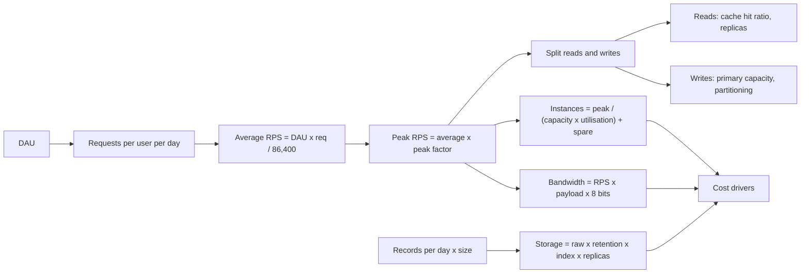
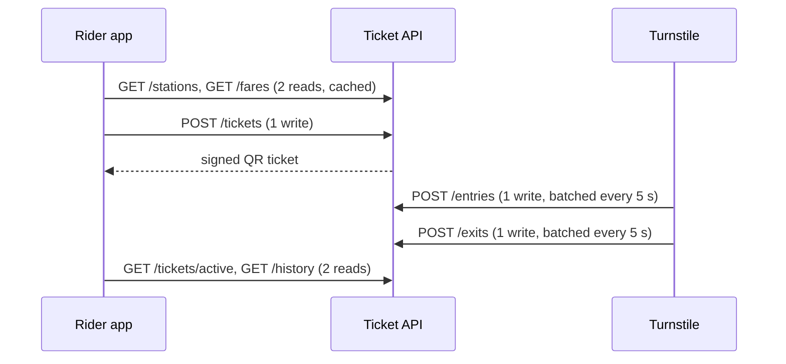

Capacity estimation answers one question before any design decision: **how big is this?** A system that handles 20 requests per second and stores 50 GB a year is a different animal from one that handles 50,000 requests per second and stores 2 PB. You do not need precision; you need the right order of magnitude, quickly, with arithmetic that others can check. This lesson gives you the formulas, the handy numbers and the habits.

## Learning objectives

By the end of this lesson you will be able to:

1. Convert daily users and actions into average and peak requests per second (RPS), and choose a sensible peak factor.
2. Split traffic into reads and writes and explain how the read/write ratio shapes the design.
3. Estimate bandwidth in MB/s and Mbit/s without mixing up bits and bytes.
4. Estimate storage over several years, including indexes, replication and growth.
5. Use powers of two and rounded constants (86,400 ≈ 10⁵) to do this arithmetic in your head.
6. Turn the estimates into instance counts with headroom, and recognise when the numbers say a simple design is enough.

## Prerequisites

- [Non-functional requirements](#/lesson/m11-nfrs): estimates are the load at which NFRs must hold.
- [Clarifying requirements](#/lesson/m11-clarifying-requirements): you need users, use cases and peak events before you can estimate.
- Multiplication, division and powers of ten. Nothing else.

## Explain it like I'm a beginner

A caterer planning a wedding does not count grains of rice. They ask: how many guests? (500.) How much does one guest eat? (About 300 g of rice.) So 150 kg of rice, plus 10 % spare. They also ask: will everyone eat at once, or over three hours? Because if all 500 arrive at 9 p.m., they need 25 serving counters, not 5.

Capacity estimation is the same:

- **How many guests?** How many users use the system each day (daily active users, DAU).
- **How much does each eat?** How many requests each user makes per day, and how big each request and each stored item is.
- **Do they all eat at once?** The average rate over a day versus the rush (peak).
- **How much spare?** Headroom for the unexpected and for a server failing.

The result is a handful of numbers: requests per second at peak, megabytes per second of network traffic, terabytes of storage per year, and how many servers you need. Those numbers decide whether you need one database or twenty.

## First-principles explanation

### The handy constants

| Quantity | Exact | Round to |
|---|---|---|
| Seconds in a day | 86,400 | ≈ 10⁵ (100,000) for mental maths |
| Seconds in a 30-day month | 2,592,000 | ≈ 2.5 × 10⁶ |
| Seconds in a year | 31,536,000 | ≈ 3 × 10⁷ (or π × 10⁷) |
| 1 million requests per day | 11.6 RPS | ≈ 12 RPS |
| 1 billion requests per day | 11,574 RPS | ≈ 12,000 RPS |
| 1 byte | 8 bits | Network speeds are in bits, storage in bytes |

The single most useful line: **1 million per day ≈ 12 per second.** Memorise it and most estimates become one multiplication.

Using 10⁵ instead of 86,400 makes your answer about 14 % low. That is well within the accuracy you need, but say "roughly" and round up when sizing capacity.

### Powers of two (and ten)

Storage and memory sizes come in powers of two. For estimation, treat each step of 2¹⁰ as "×1,000":

| Power of two | Exact bytes | Approximately | Name (binary / decimal) |
|---|---|---|---|
| 2¹⁰ | 1,024 | 1 thousand | KiB / KB |
| 2²⁰ | 1,048,576 | 1 million | MiB / MB |
| 2³⁰ | 1,073,741,824 | 1 billion | GiB / GB |
| 2⁴⁰ | ≈ 1.1 × 10¹² | 1 trillion | TiB / TB |
| 2⁵⁰ | ≈ 1.13 × 10¹⁵ | 1 quadrillion | PiB / PB |

The difference between 1 GB (10⁹ bytes) and 1 GiB (2³⁰ bytes) is about 7 %, and grows to about 13 % at PB. Pick one convention per estimate and state it. Cloud providers bill storage in GB or GiB depending on the service, so check before turning an estimate into a cost.

### Typical sizes (estimates to adjust)

| Item | Rough size |
|---|---|
| UUID / `bigint` id / timestamp | 16 B / 8 B / 8 B |
| Short text field (name, city) | 20–100 B |
| Typical relational row with a few columns | 100 B – 1 KB |
| JSON API response for one entity | 1–5 KB |
| Thumbnail image | 10–50 KB |
| Phone photo (JPEG) | 1–4 MB |
| A4 scanned PDF page | 100 KB – 1 MB |
| 1 minute of 1080p video at 5 Mbit/s | 5 Mbit/s × 60 s ÷ 8 ≈ 37.5 MB |

These are ballpark figures for estimation, not measurements. When you have real data (an existing database, a sample of uploads), use it.

### Traffic: average and peak RPS

```text
average RPS = DAU × requests per user per day ÷ 86,400
peak RPS    = average RPS × peak factor
```

Where do "requests per user per day" come from? From the use cases: list what a user does in a session and count the API calls each action makes. Opening an app often makes 3–10 calls (profile, feed, notifications, configuration), not one.

The **peak factor** captures how unevenly traffic arrives:

| Traffic shape | Typical peak factor (peak hour ÷ daily average) |
|---|---|
| Global consumer app, users in many time zones | 1.5–2 |
| Single-country consumer app (one time zone, evening peak) | 2–4 |
| Office or business app (9-to-6 working hours) | 3–5 |
| Event-driven spikes (ticket sale opens, exam results, festival sale, Tatkal train booking at 10:00) | 10–100 over minutes |

These ranges are rules of thumb. If you have a daily traffic curve, use it: peak RPS = requests in the busiest hour (or minute) ÷ seconds in that hour (or minute). For event spikes, estimate the burst directly: "200,000 people try to book in the first 2 minutes" is 200,000 ÷ 120 ≈ 1,700 RPS, regardless of the daily average.

### Reads versus writes

Split traffic into reads (queries that do not change data) and writes (inserts, updates, deletes). The **read/write ratio** shapes the design:

- **Read-heavy (10:1 to 100:1 or more):** news feeds, product catalogues, bill lookups. Caching and read replicas help a lot.
- **Write-heavy (1:1 or below):** logging, telemetry, IoT sensors, parcel-scan events. Caching barely helps; you need efficient write paths, batching, append-only storage and partitioning.
- **Balanced, but writes must be correct:** payments, bookings. Writes are few but need transactions.

Also note **write amplification**: one logical write may produce several physical writes (the row, 3 indexes, the write-ahead log, a replica, an audit row, an outbox event).

### Bandwidth

```text
bandwidth (bytes/s) = RPS × average payload size
bandwidth (bits/s)  = bytes/s × 8
```

Example: 3,000 RPS × 50 KB = 150,000 KB/s ≈ 150 MB/s ≈ 1.2 Gbit/s. Separate **ingress** (data coming in: uploads) from **egress** (data going out: downloads and API responses): cloud providers usually charge for egress to the internet, and egress is often 10–100× larger for read-heavy apps. Large static content usually belongs on a CDN, which takes most egress away from your origin.

### Storage

```text
raw per day   = new records per day × bytes per record
raw per year  = raw per day × 365
total         = raw × retention (years) × (1 + index overhead) × replication factor
```

- **Index overhead:** in a relational database, indexes often add 30–100 % on top of table data, depending on how many you have. Estimate 50 % unless you know better.
- **Replication factor:** a primary plus two replicas stores three copies. Managed object storage usually includes its redundancy in the price per GB, so do not multiply again for that.
- **Backups:** point-in-time recovery keeps base backups and write-ahead logs; budget extra (often 1–2× the database size, depending on retention).
- **Growth:** if users grow 50 % a year, storage *added* per year grows too. Year three adds 1.5² = 2.25× what year one added.

### From RPS to servers

```text
instances = ceil( peak RPS ÷ (capacity per instance × target utilisation) ) + spare
```

- **Capacity per instance** comes from a load test of *your* code on *your* instance size. Without one, state an assumption ("about 1,000 simple JSON requests per second per 4-vCPU instance for a lightweight ASP.NET Core endpoint; to be verified by a load test").
- **Target utilisation** of 60–70 % leaves room for bursts and garbage-collection pauses.
- **Spare** (N+1, or enough to survive losing a whole zone) keeps you within target when an instance or zone fails.

The same reasoning applies to databases (queries per second per core, connections), caches (operations per second, memory) and queues (messages per second per partition).

### Accuracy and honesty

- **Aim for the right order of magnitude.** 2,300 RPS versus 3,000 RPS does not change the design. 230 versus 23,000 does.
- **Show the arithmetic.** It lets others check it and lets you correct one input without redoing everything.
- **Label assumptions.** "Assume 2 photos per visit" is honest; a precise-looking number with no source is not.
- **Round up for capacity, round consistently for comparison.**

### When the numbers say "simple"

Most business systems are smaller than they feel. An internal app for 2,000 employees making 200 requests each per working day is 400,000 requests a day: about 12 RPS average and maybe 50 RPS at peak. One pair of small instances and one PostgreSQL server handle that with lots of room. Saying so, with the arithmetic, is a strong answer. [Scaling a real system from 100 to 10 million users](#/lesson/m17-scaling-journey) applies exactly this habit: it re-estimates traffic and storage at each growth stage of a grocery-delivery app and changes the architecture only when the numbers (and measurements) say the current one will break.

## Visual explanation

### From inputs to design decisions



Read it left to right. The **user numbers** (DAU and requests per user) give the **average RPS**; the **peak factor** turns that into the number you design for. Peak traffic splits into **reads**, which caches and replicas can absorb, and **writes**, which must land on a primary and may need partitioning. The same peak drives the **instance count** and, multiplied by payload size, the **bandwidth**. Separately, **record counts and sizes** drive **storage**, once you account for retention, index overhead and replication. All three (instances, bandwidth, storage) feed **cost**, which is covered in [Cost estimation](#/lesson/m11-cost-estimation).

### Counting requests per ride in a metro ticketing app



To estimate, you first count what one unit of user activity costs. One ride here produces **4 reads** (stations, fares, active tickets, history) and **3 writes** (purchase, entry tap, exit tap). Turnstiles batch their taps every 5 seconds, so the number of *HTTP calls* from turnstiles is lower than the number of *taps*, but the database still sees one row per tap. Writing the flow down like this turns "a metro app" into a per-ride count you can multiply.

## Step-by-step example

Three worked examples, each with the arithmetic shown. All inputs are assumptions you would confirm with the interviewer or stakeholder.

### Example A — Metro QR ticketing

**Inputs.** 2.5 million rides a day; 80 % use QR tickets (2 M rides). Per ride: 4 reads, 3 writes. Morning and evening commutes: assume 15 % of the day's rides happen in the busiest hour.

```text
Writes per day:   2 M rides × 3              = 6 M
Reads per day:    2 M rides × 4              = 8 M
Average writes:   6 M ÷ 86,400               ≈ 69 writes/s
Average reads:    8 M ÷ 86,400               ≈ 93 reads/s
Peak hour writes: 6 M × 0.15 ÷ 3,600         = 250 writes/s
Peak hour reads:  8 M × 0.15 ÷ 3,600         ≈ 333 reads/s
Peak factor:      250 ÷ 69                   ≈ 3.6   (fits "single-city commute" pattern)
Read/write ratio: 8 : 6                      ≈ 1.3 : 1  (not read-heavy)
Storage (rows):   6 M writes × 300 B         = 1.8 GB/day ≈ 660 GB/year raw
                  × 1.5 for indexes          ≈ 1 TB/year in the primary
```

**Conclusion.** About 600 RPS at peak and 1 TB a year. One well-sized PostgreSQL primary with a standby handles this; partition the taps table by month so old months can be archived. Because the ratio is close to 1:1, caching helps only for stations and fares (which change rarely), not for the write-heavy taps.

### Example B — Patient-photo storage for a skin and dental clinic chain

**Inputs.** 1,500 clinics. Staff upload about 300 clinical photos per clinic per working day (roughly 30 patients × 10 photos: before and after treatment, X-ray snapshots), 2.5 MB each, between 08:00 and 18:00, six days a week (about 300 working days a year). Medical records are kept for 8 years (assume this for medico-legal reasons; confirm the actual rule with the client's compliance team). Thumbnails add 5 %. The chain opens 20 % more clinics each year.

```text
Photos per day:     1,500 × 300                          = 450,000
Raw bytes per day:  450,000 × 2.5 MB                     = 1,125,000 MB ≈ 1.1 TB/day
Per year (300 working days): 1.1 TB × 300                ≈ 340 TB/year (year 1)
With thumbnails:    340 × 1.05                           ≈ 355 TB/year
Ingress during the day: 1.125 TB ÷ 36,000 s (10 hours)   ≈ 31 MB/s ≈ 250 Mbit/s average
Upload RPS:         450,000 ÷ 36,000                     = 12.5 uploads/s (peak maybe ×3 ≈ 40/s)
Metadata rows:      450,000 × 500 B                      = 225 MB/day ≈ 70 GB/year (tiny)
Year 2 added:       355 × 1.2 ≈ 426 TB; year 3: 355 × 1.44 ≈ 511 TB
Three-year total:   355 + 426 + 511                      ≈ 1.3 PB
```

**Conclusion.** The request rate is trivial (40 uploads/s), but storage reaches petabytes within three years (and 8-year retention means nothing is deleted for a long time), so storage dominates cost. The design follows: photos go directly from the phone to object storage using presigned URLs (the API never touches the bytes), with lifecycle rules that move photos older than 90 days to a cheaper, colder tier. Metadata sits comfortably in PostgreSQL. Because these are health records, the photos must be encrypted at rest, never publicly readable, and served only through short-lived signed URLs after an access check. A good interview answer stops to say: "the hard part here is storage cost, not traffic."

### Example C — Parcel-scan event ingestion for a courier network

A system like a national parcel courier's tracking backbone. **Inputs (assumptions).** 12 million scan events a day (pickup, hub in, hub out, out for delivery, delivered) from handheld scanners and delivery agents' phones across 1,000 hubs. Each event: 1 KB of JSON plus a 100 KB photo (parcel label or proof of delivery). Peak: festival-sale weeks are 2× a normal day, and the busiest hour holds 10 % of the day's scans. Events are kept 1 year online, then archived. Customer tracking-page reads are served from a separate cached read model and estimated separately; this example sizes the scan-ingestion path.

```text
Average events:      12 M ÷ 86,400                    ≈ 139 events/s
Busiest hour:        12 M × 0.10 ÷ 3,600              ≈ 333 events/s
Festival busiest hour: 333 × 2                        ≈ 670 events/s  → design for ~700/s
Ingress (JSON):      700 × 1 KB                       = 700 KB/s (small)
Ingress (images):    700 × 100 KB                     = 70 MB/s ≈ 560 Mbit/s
Event storage:       12 M × 1 KB                      = 12 GB/day ≈ 4.4 TB/year (× 1.5 indexes ≈ 6.6 TB)
Image storage:       12 M × 100 KB                    = 1.2 TB/day ≈ 440 TB/year
Read/write:          writes dominate; reads on this path are delivery disputes, audits and analytics (perhaps 1:20)
```

**Conclusion.** About 700 writes per second at peak: write-heavy, with steady 560 Mbit/s of image ingress. That points to a queue or stream in front of the database to absorb bursts and let scanners and phones buffer offline during network drops, batched inserts into a time-partitioned table, and images in object storage referenced by key. Analytics should run on a separate copy, not the ingest database.

## Production-style C# implementation

The estimator below is the arithmetic of this lesson in code. Teams use helpers like this in design reviews ("what if DAU doubles?") and in tests that keep documented capacity numbers honest. The ASP.NET Core endpoint lets anyone run "what-if" scenarios from a browser or a script.

```text
Capacity.Planner/
  Program.cs
  Estimation/Units.cs
  Estimation/TrafficEstimator.cs
  Estimation/StorageEstimator.cs
  Estimation/InstanceSizer.cs
```

```csharp file=Estimation/Units.cs
namespace Capacity.Planner.Estimation;

public static class Units
{
    public const double SecondsPerDay = 86_400;
    public const double SecondsPerYear = 365 * SecondsPerDay;

    /// <summary>Formats bytes with binary units (KiB, MiB, ...) and one decimal place.</summary>
    public static string Bytes(double bytes)
    {
        string[] units = ["B", "KiB", "MiB", "GiB", "TiB", "PiB", "EiB"];
        int i = 0;
        while (Math.Abs(bytes) >= 1024 && i < units.Length - 1)
        {
            bytes /= 1024;
            i++;
        }
        return i == 0 ? $"{bytes:0} B" : $"{bytes:0.0} {units[i]}";
    }

    public static double BytesPerSecondToMbps(double bytesPerSecond) => bytesPerSecond * 8 / 1_000_000;
}
```

```csharp file=Estimation/TrafficEstimator.cs
namespace Capacity.Planner.Estimation;

public sealed record TrafficInput(long DailyActiveUsers, double RequestsPerUserPerDay, double PeakFactor, double ReadShare);

public sealed record TrafficEstimate(double AverageRps, double PeakRps, double PeakReadRps, double PeakWriteRps);

public static class TrafficEstimator
{
    public static TrafficEstimate Estimate(TrafficInput input)
    {
        if (input.DailyActiveUsers < 0 || input.RequestsPerUserPerDay < 0)
            throw new ArgumentOutOfRangeException(nameof(input), "Users and requests must be non-negative.");
        if (input.PeakFactor < 1) throw new ArgumentOutOfRangeException(nameof(input), "Peak factor must be at least 1.");
        if (input.ReadShare is < 0 or > 1) throw new ArgumentOutOfRangeException(nameof(input), "Read share must be in [0, 1].");

        double avg = input.DailyActiveUsers * input.RequestsPerUserPerDay / Units.SecondsPerDay;
        double peak = avg * input.PeakFactor;
        return new TrafficEstimate(avg, peak, peak * input.ReadShare, peak * (1 - input.ReadShare));
    }

    /// <summary>Burst sizing for events such as a ticket sale: N attempts within a window.</summary>
    public static double BurstRps(long attempts, TimeSpan window) =>
        window > TimeSpan.Zero ? attempts / window.TotalSeconds : throw new ArgumentOutOfRangeException(nameof(window));
}
```

```csharp file=Estimation/StorageEstimator.cs
namespace Capacity.Planner.Estimation;

public sealed record StorageInput(
    double RecordsPerDay,
    double BytesPerRecord,
    int Years,
    double AnnualGrowth,      // 0.2 = 20 % more records added each year than the year before
    double IndexOverhead,     // 0.5 = indexes add 50 %
    int Copies);              // primary + replicas stored by us

public static class StorageEstimator
{
    /// <summary>Cumulative stored bytes at the end of each year.</summary>
    public static IReadOnlyList<double> CumulativeBytesByYear(StorageInput s)
    {
        if (s.Years < 1 || s.Copies < 1) throw new ArgumentOutOfRangeException(nameof(s));
        if (s.AnnualGrowth < 0 || s.IndexOverhead < 0) throw new ArgumentOutOfRangeException(nameof(s));

        double firstYearRaw = s.RecordsPerDay * s.BytesPerRecord * 365;
        var result = new List<double>(s.Years);
        double total = 0;
        for (int year = 0; year < s.Years; year++)
        {
            double addedRaw = firstYearRaw * Math.Pow(1 + s.AnnualGrowth, year);
            total += addedRaw * (1 + s.IndexOverhead) * s.Copies;
            result.Add(total);
        }
        return result;
    }
}
```

```csharp file=Estimation/InstanceSizer.cs
namespace Capacity.Planner.Estimation;

public static class InstanceSizer
{
    /// <summary>Instances needed for <paramref name="peakRps"/> at a target utilisation,
    /// spread over <paramref name="zones"/> so that losing one zone still leaves enough.</summary>
    public static int Instances(double peakRps, double rpsPerInstance, double targetUtilisation, int zones)
    {
        if (rpsPerInstance <= 0 || targetUtilisation is <= 0 or > 1 || zones < 1)
            throw new ArgumentOutOfRangeException(nameof(rpsPerInstance));

        int needed = (int)Math.Ceiling(peakRps / (rpsPerInstance * targetUtilisation));
        needed = Math.Max(needed, 1);
        if (zones == 1) return needed + 1;                       // N+1 within one zone

        // Survive losing a zone: the remaining (zones - 1) zones must carry everything.
        int perZone = (int)Math.Ceiling((double)needed / (zones - 1));
        return perZone * zones;
    }
}
```

```csharp file=Program.cs
using Capacity.Planner.Estimation;

var builder = WebApplication.CreateBuilder(args);
var app = builder.Build();

// POST /estimate/traffic { "dailyActiveUsers": 2000000, "requestsPerUserPerDay": 7, "peakFactor": 3.6, "readShare": 0.57 }
app.MapPost("/estimate/traffic", (TrafficInput input) =>
{
    var t = TrafficEstimator.Estimate(input);
    return Results.Ok(new
    {
        averageRps = Math.Round(t.AverageRps, 1),
        peakRps = Math.Round(t.PeakRps, 1),
        peakReadRps = Math.Round(t.PeakReadRps, 1),
        peakWriteRps = Math.Round(t.PeakWriteRps, 1),
        apiInstancesTwoZones = InstanceSizer.Instances(t.PeakRps, rpsPerInstance: 1_000, targetUtilisation: 0.65, zones: 2),
    });
});

// POST /estimate/storage { "recordsPerDay": 450000, "bytesPerRecord": 2621440, "years": 3, "annualGrowth": 0.2, "indexOverhead": 0.05, "copies": 1 }
app.MapPost("/estimate/storage", (StorageInput input) =>
    Results.Ok(StorageEstimator.CumulativeBytesByYear(input).Select((b, i) => new { year = i + 1, total = Units.Bytes(b) })));

app.MapGet("/estimate/burst", (long attempts, int seconds) =>
    Results.Ok(new { rps = Math.Round(TrafficEstimator.BurstRps(attempts, TimeSpan.FromSeconds(seconds)), 1) }));

app.Run();
```

Design notes:

1. **Inputs are explicit records.** Every assumption (peak factor, read share, growth, index overhead) has a name, so a reviewer can challenge one number without hunting through a spreadsheet.
2. **Zone-aware sizing.** `InstanceSizer` sizes for losing a whole zone, the most common mistake in capacity plans that look fine on paper. With 2 zones, each zone must carry 100 % of the load.
3. **Binary units in output.** `Units.Bytes` prints KiB, MiB and so on, so nobody mistakes 1.1 TiB for 1.1 TB without noticing. Use whichever convention your organisation bills in, but print the unit.
4. **Pure functions.** No I/O and no clock, so these are trivially unit-testable and safe to run in a notebook or CI.

## Bad design vs good design

**Bad: the precise-looking guess.** "We will have 47,382 RPS." Where from? Nobody knows. The number has five significant figures and no derivation, so nobody can check it, and when the real load is 900 RPS the team has already bought a sharded cluster.

**Bad: the average-only plan.** A university results portal is sized for the yearly average (a few requests per second). On results day, 300,000 students refresh at 10:00 and the site is down for three hours.

**Bad: bits versus bytes.** "We need 100 MB/s of bandwidth, so a 100 Mbit/s link is enough." It is eight times too small.

**Good:**

- Inputs listed and labelled as assumptions, with sources where possible.
- Average and peak (or burst) computed separately, with the peak factor justified.
- Reads and writes split; bandwidth in both bytes and bits; storage with retention, indexes, replication and growth.
- Instances sized for peak at a target utilisation plus zone-loss headroom.
- A one-line conclusion: what the numbers imply for the design (and whether a simple design is enough).

:::callout type=mistake title="Forgetting the multipliers"
The raw number is rarely the number you need. Storage needs index overhead, replicas and backups. RPS needs fan-out (one page = many API calls) and retries. Instance counts need headroom and zone loss. Write the multipliers explicitly so they are not forgotten or double-counted.
:::

:::callout type=tip title="Sanity-check with a second route"
Estimate the same quantity two ways. Storage from records × size should agree, within a factor of 2, with "how much does an existing similar system store per user?". If they disagree by 10×, one of your inputs is wrong.
:::

## Practical playground

The graph below is a first sketch of the parcel-scan ingestion system from Example C, with the client node's `rps` set to the festival peak of 700 events per second. Open it in the HLD canvas and annotate each node with the numbers it must handle: events per second, MB/s of images, storage per year. Then decide: does the database need a queue in front of it? Where do the images go? How many API instances do you need at 1,000 events/s per instance and 65 % utilisation across two zones?

:::playground type=hld title="Size the parcel-scan ingestion pipeline"
```json
{
  "nodes": [
    { "id": "hub", "type": "client", "label": "Hub scanners and courier phones (1,000 hubs)", "props": { "rps": 700 } },
    { "id": "lb", "type": "load-balancer", "label": "Load balancer" },
    { "id": "api", "type": "app-server", "label": "Ingest API", "props": { "instances": 2 } },
    { "id": "db", "type": "database", "label": "PostgreSQL (events + images)", "props": { "replicas": 0 } }
  ],
  "edges": [
    { "from": "hub", "to": "lb", "kind": "sync" },
    { "from": "lb", "to": "api", "kind": "sync" },
    { "from": "api", "to": "db", "kind": "sync", "label": "1 KB event + 100 KB image per row" }
  ]
}
```
:::

## Exercises

:::exercise id=m11-capacity-estimation-ex1 difficulty=beginner kind=code title="The four formulas every estimate uses"
Implement the basic helpers: average RPS, peak RPS, bits-per-second conversion and a binary-unit byte formatter.
::requirements
- `Estimate.AverageRps(long dau, double requestsPerUser)` = `dau × requestsPerUser ÷ 86,400`.
- `Estimate.PeakRps(double averageRps, double peakFactor)`; a peak factor below 1 throws `ArgumentOutOfRangeException`.
- `Estimate.Mbps(double bytesPerSecond)` = bytes × 8 ÷ 1,000,000 (network megabits are decimal).
- `Estimate.FormatBytes(double bytes)` uses 1,024 steps and units `B, KiB, MiB, GiB, TiB, PiB`, one decimal place for KiB and above (`"1.5 GiB"`), whole bytes below 1,024 (`"512 B"`). Use invariant culture.
- Negative inputs to `AverageRps` throw `ArgumentOutOfRangeException`.
::acceptance
- 10 M DAU × 20 requests ≈ 2,314.8 average RPS; × 3 ≈ 6,944.4 peak.
- 150 MB/s (150,000,000 B/s) = 1,200 Mbit/s.
- 1,610,612,736 bytes formats as `"1.5 GiB"`.
- 512 bytes formats as `"512 B"`.
::hint
These are one-liners except the formatter. Validate first, then compute.
::hint
For the formatter, divide by 1,024 while the value is at least 1,024 and you have a bigger unit available.
::hint
Use `ToString("0.0", CultureInfo.InvariantCulture)` so the decimal separator is a dot on every machine.
::hint
```csharp
while (bytes >= 1024 && i < Units.Length - 1) { bytes /= 1024; i++; }
```
::starter
```csharp file=Estimate.cs
using System;
using System.Globalization;

public static class Estimate
{
    public static double AverageRps(long dau, double requestsPerUser) => throw new NotImplementedException();

    public static double PeakRps(double averageRps, double peakFactor) => throw new NotImplementedException();

    public static double Mbps(double bytesPerSecond) => throw new NotImplementedException();

    public static string FormatBytes(double bytes) => throw new NotImplementedException();
}
```
::tests
```csharp file=EstimateTests.cs
using System;
using Xunit;

public class EstimateTests
{
    [Fact]
    public void Average_rps() => Assert.Equal(2314.8, Estimate.AverageRps(10_000_000, 20), 1);

    [Fact]
    public void Peak_rps() => Assert.Equal(6944.4, Estimate.PeakRps(Estimate.AverageRps(10_000_000, 20), 3), 1);

    [Fact]
    public void One_million_a_day_is_about_twelve_per_second() => Assert.Equal(11.57, Estimate.AverageRps(1_000_000, 1), 2);

    [Fact]
    public void Bytes_to_megabits() => Assert.Equal(1200.0, Estimate.Mbps(150_000_000), 6);

    [Theory]
    [InlineData(512, "512 B")]
    [InlineData(1536, "1.5 KiB")]
    [InlineData(1_610_612_736, "1.5 GiB")]
    [InlineData(1_099_511_627_776, "1.0 TiB")]
    public void Format_bytes(double bytes, string expected) => Assert.Equal(expected, Estimate.FormatBytes(bytes));

    [Fact]
    public void Invalid_inputs_throw()
    {
        Assert.Throws<ArgumentOutOfRangeException>(() => Estimate.PeakRps(100, 0.5));
        Assert.Throws<ArgumentOutOfRangeException>(() => Estimate.AverageRps(-1, 10));
    }
}
```
::solution
```csharp file=Estimate.cs
using System;
using System.Globalization;

public static class Estimate
{
    private static readonly string[] Units = { "B", "KiB", "MiB", "GiB", "TiB", "PiB" };

    public static double AverageRps(long dau, double requestsPerUser)
    {
        if (dau < 0 || requestsPerUser < 0) throw new ArgumentOutOfRangeException(nameof(dau), "Inputs must be non-negative.");
        return dau * requestsPerUser / 86_400.0;
    }

    public static double PeakRps(double averageRps, double peakFactor)
    {
        if (peakFactor < 1) throw new ArgumentOutOfRangeException(nameof(peakFactor), peakFactor, "Peak factor must be at least 1.");
        return averageRps * peakFactor;
    }

    public static double Mbps(double bytesPerSecond) => bytesPerSecond * 8 / 1_000_000.0;

    public static string FormatBytes(double bytes)
    {
        int i = 0;
        while (bytes >= 1024 && i < Units.Length - 1)
        {
            bytes /= 1024;
            i++;
        }
        return i == 0
            ? bytes.ToString("0", CultureInfo.InvariantCulture) + " B"
            : bytes.ToString("0.0", CultureInfo.InvariantCulture) + " " + Units[i];
    }
}
```

Worked numbers: 10,000,000 × 20 = 200,000,000 requests a day; ÷ 86,400 ≈ 2,314.8 RPS; × 3 ≈ 6,944 RPS. 150,000,000 bytes/s × 8 = 1.2 × 10⁹ bits/s = 1,200 Mbit/s, which needs more than a 1 Gbit/s link.
::mistakes
- Dividing by 3,600 (seconds per hour) instead of 86,400.
- Forgetting `× 8`, which makes the bandwidth eight times too small.
- Using the current culture, which prints "1,5 GiB" on machines set to many European locales.
::extensions
Add `FormatBytesDecimal` with 1,000 steps and KB/MB/GB, and print both side by side to show the 7 % gap at GB scale.
:::

:::exercise id=m11-capacity-estimation-ex2 difficulty=beginner kind=written title="Estimate an exam-results portal"
A state school board publishes Class 12 results online. Facts you are given: 1.2 million students; on results day, assume 70 % check within the first 30 minutes after 10:00, each student loads the result page 3 times (refreshes, sharing), and each page load makes 2 API calls. A result response is 4 KB. On a normal day the site gets 50,000 page loads.

Compute: (a) normal-day average RPS, (b) results-day burst RPS in the first 30 minutes, (c) the ratio between them, (d) egress bandwidth during the burst in Mbit/s, (e) the storage for all results (1 KB per student, 3 copies).
::acceptance
- Every number shows its arithmetic.
- The burst is computed from the window, not from a daily peak factor.
- Bandwidth is given in both MB/s and Mbit/s.
- The answer states one design consequence of the burst.
::hint
Normal day: page loads × API calls per page ÷ 86,400.
::hint
Burst: 1.2 M × 0.7 students, × 3 loads, × 2 calls, all within 1,800 seconds.
::hint
Egress = burst RPS × 4 KB. Then × 8 for bits.
::hint
Storage is tiny; think about what that means for caching.
::solution
(a) 50,000 × 2 = 100,000 calls ÷ 86,400 ≈ **1.2 RPS**.

(b) 1,200,000 × 0.7 = 840,000 students × 3 × 2 = 5,040,000 calls ÷ 1,800 s = **2,800 RPS** (and the first few minutes will be higher still; design for perhaps 2× that, about 5,600 RPS).

(c) 2,800 ÷ 1.16 ≈ **2,400×** the normal average. No daily peak factor would have predicted that.

(d) 2,800 × 4 KB = 11,200 KB/s ≈ **11.2 MB/s ≈ 90 Mbit/s** (≈ 180 Mbit/s at the 2× design figure).

(e) 1,200,000 × 1 KB = 1.2 GB × 3 copies = **3.6 GB**.

**Consequence.** The whole dataset fits in memory many times over and never changes after publication. Pre-render or cache every result (in the app's memory cache and at a CDN with a short TTL keyed by roll number and a verification field), so the database sees almost none of the burst. Add a waiting-room or rate limiter in front for the first minutes.
::mistakes
- Applying a peak factor of 3 to the daily average and sizing for 4 RPS.
- Forgetting that each page load makes two API calls.
- Treating 90 MB/s and 90 Mbit/s as the same thing.
:::

:::exercise id=m11-capacity-estimation-ex3 difficulty=intermediate kind=code title="Storage over five years with growth"
Write a planner that projects storage year by year, including growth in the amount of data added each year, index overhead, replicas and an optional retention limit after which old data is deleted.
::requirements
- `StoragePlan.Project(double firstYearRawBytes, double annualGrowth, double indexOverhead, int copies, int years, int? retentionYears)` returns a `double[]` with the total stored bytes at the end of each year.
- Data added in year `y` (0-based) is `firstYearRawBytes × (1 + annualGrowth)^y`, stored with `(1 + indexOverhead) × copies`.
- If `retentionYears` is set, only the most recent `retentionYears` years of data are kept at the end of each year.
- Invalid inputs (`years < 1`, `copies < 1`, negative growth or overhead, `retentionYears < 1`) throw `ArgumentOutOfRangeException`.
::acceptance
- 100 TB first year, 0 % growth, 0 overhead, 1 copy, 3 years → 100, 200, 300 TB.
- 100 TB, 20 % growth, 50 % overhead, 2 copies, 3 years → 300, 660, 1,092 TB.
- With a 2-year retention, the year-3 total keeps only years 2 and 3.
::hint
Compute the stored size added each year first, in a list.
::hint
The total at the end of year `y` is the sum of the added sizes for the years still retained.
::hint
With retention `r`, at year `y` you sum indexes `max(0, y − r + 1)` to `y`.
::hint
Year sizes for the second acceptance case (in TB): 100 × 1.5 × 2 = 300; 120 × 3 = 360; 144 × 3 = 432. Totals 300, 660, 1,092.
::starter
```csharp file=StoragePlan.cs
using System;
using System.Linq;

public static class StoragePlan
{
    public static double[] Project(double firstYearRawBytes, double annualGrowth, double indexOverhead, int copies, int years, int? retentionYears)
        => throw new NotImplementedException();
}
```
::tests
```csharp file=StoragePlanTests.cs
using System;
using Xunit;

public class StoragePlanTests
{
    private const double TB = 1e12;

    [Fact]
    public void Flat_growth_adds_linearly()
    {
        var p = StoragePlan.Project(100 * TB, 0, 0, 1, 3, null);
        Assert.Equal(new[] { 100 * TB, 200 * TB, 300 * TB }, p);
    }

    [Fact]
    public void Growth_overhead_and_copies()
    {
        var p = StoragePlan.Project(100 * TB, 0.2, 0.5, 2, 3, null);
        Assert.Equal(300, p[0] / TB, 6);
        Assert.Equal(660, p[1] / TB, 6);
        Assert.Equal(1092, p[2] / TB, 6);
    }

    [Fact]
    public void Retention_drops_old_years()
    {
        var p = StoragePlan.Project(100 * TB, 0.2, 0.5, 2, 3, retentionYears: 2);
        Assert.Equal(300, p[0] / TB, 6);
        Assert.Equal(660, p[1] / TB, 6);
        Assert.Equal(792, p[2] / TB, 6);
    }

    [Fact]
    public void Invalid_inputs_throw()
    {
        Assert.Throws<ArgumentOutOfRangeException>(() => StoragePlan.Project(1, 0, 0, 0, 3, null));
        Assert.Throws<ArgumentOutOfRangeException>(() => StoragePlan.Project(1, -0.1, 0, 1, 3, null));
        Assert.Throws<ArgumentOutOfRangeException>(() => StoragePlan.Project(1, 0, 0, 1, 0, null));
        Assert.Throws<ArgumentOutOfRangeException>(() => StoragePlan.Project(1, 0, 0, 1, 3, 0));
    }
}
```
::solution
```csharp file=StoragePlan.cs
using System;
using System.Linq;

public static class StoragePlan
{
    public static double[] Project(double firstYearRawBytes, double annualGrowth, double indexOverhead, int copies, int years, int? retentionYears)
    {
        if (firstYearRawBytes < 0 || annualGrowth < 0 || indexOverhead < 0) throw new ArgumentOutOfRangeException(nameof(firstYearRawBytes));
        if (copies < 1) throw new ArgumentOutOfRangeException(nameof(copies));
        if (years < 1) throw new ArgumentOutOfRangeException(nameof(years));
        if (retentionYears is < 1) throw new ArgumentOutOfRangeException(nameof(retentionYears));

        double multiplier = (1 + indexOverhead) * copies;
        double[] added = Enumerable.Range(0, years)
            .Select(y => firstYearRawBytes * Math.Pow(1 + annualGrowth, y) * multiplier)
            .ToArray();

        var totals = new double[years];
        for (int y = 0; y < years; y++)
        {
            int from = retentionYears is int r ? Math.Max(0, y - r + 1) : 0;
            double sum = 0;
            for (int k = from; k <= y; k++) sum += added[k];
            totals[y] = sum;
        }
        return totals;
    }
}
```

With retention 2, year 3 keeps years 2 and 3: 360 + 432 = 792 TB. Retention is often the biggest lever on long-term storage cost, which is why it belongs in the clarifying questions ("how long must we keep photos?").
::mistakes
- Applying growth to the cumulative total instead of to the data added each year.
- Multiplying by copies for managed object storage whose price already includes redundancy.
- An off-by-one in retention that keeps three years when two were asked for.
::extensions
Add a cold-tier move: data older than 1 year costs 40 % of hot storage. Return cost per year as well as bytes.
:::

:::exercise id=m11-capacity-estimation-ex4 difficulty=intermediate kind=sql title="Measure the peak factor from a real day of traffic"
The `requests` table holds one row per request for a whole day. Instead of guessing the peak factor, measure it.
::requirements
Return one row with:
- `avg_rps`: requests in the day ÷ 86,400, rounded to 3 decimals.
- `peak_rps`: requests in the busiest minute ÷ 60, rounded to 3 decimals.
- `peak_factor`: `peak_rps ÷ avg_rps` computed from the unrounded values, rounded to 2 decimals.
- `read_write_ratio`: `GET` count ÷ non-`GET` count, rounded to 1 decimal.
Use `numeric` for rounding (`round(x::numeric, n)`).
::acceptance
- `avg_rps` is 1.167, `peak_rps` is 5.000, `peak_factor` is 4.29 and `read_write_ratio` is 9.0.
::setup
```sql
CREATE TABLE requests (
    id     bigserial PRIMARY KEY,
    ts     timestamptz NOT NULL,
    method text        NOT NULL
);
INSERT INTO requests (ts, method)
SELECT timestamptz '2026-10-19 00:00:00+00' + m * interval '1 minute' + (k % 60) * interval '1 second',
       CASE WHEN k % 10 = 0 THEN 'POST' ELSE 'GET' END
FROM generate_series(0, 1439) AS m
CROSS JOIN LATERAL generate_series(1, CASE WHEN m BETWEEN 600 AND 659 THEN 300 ELSE 60 END) AS k;
```
::hint
`date_trunc('minute', ts)` groups requests by minute.
::hint
The busiest minute is `max(count)` over those groups; compute it in a CTE.
::hint
Use `count(*) FILTER (WHERE method = 'GET')` and the same for other methods.
::hint
```sql
WITH per_minute AS (
  SELECT date_trunc('minute', ts) AS minute, count(*) AS n FROM requests GROUP BY 1
), totals AS (
  SELECT count(*) AS total,
         count(*) FILTER (WHERE method = 'GET') AS reads,
         count(*) FILTER (WHERE method <> 'GET') AS writes
  FROM requests
)
SELECT ...
```
::check
```sql
WITH per_minute AS (
    SELECT date_trunc('minute', ts) AS minute, count(*) AS n
    FROM requests
    GROUP BY 1
), totals AS (
    SELECT count(*) AS total,
           count(*) FILTER (WHERE method = 'GET')  AS reads,
           count(*) FILTER (WHERE method <> 'GET') AS writes
    FROM requests
)
SELECT round((t.total / 86400.0)::numeric, 3)                              AS avg_rps,
       round(((SELECT max(n) FROM per_minute) / 60.0)::numeric, 3)          AS peak_rps,
       round((((SELECT max(n) FROM per_minute) / 60.0) / (t.total / 86400.0))::numeric, 2) AS peak_factor,
       round((t.reads::numeric / t.writes), 1)                              AS read_write_ratio
FROM totals t;
```
::solution
```sql
WITH per_minute AS (
    SELECT date_trunc('minute', ts) AS minute, count(*) AS n
    FROM requests
    GROUP BY 1
), totals AS (
    SELECT count(*) AS total,
           count(*) FILTER (WHERE method = 'GET')  AS reads,
           count(*) FILTER (WHERE method <> 'GET') AS writes
    FROM requests
)
SELECT round((t.total / 86400.0)::numeric, 3)                              AS avg_rps,
       round(((SELECT max(n) FROM per_minute) / 60.0)::numeric, 3)          AS peak_rps,
       round((((SELECT max(n) FROM per_minute) / 60.0) / (t.total / 86400.0))::numeric, 2) AS peak_factor,
       round((t.reads::numeric / t.writes), 1)                              AS read_write_ratio
FROM totals t;
```

**Arithmetic.** 1,380 normal minutes × 60 + 60 busy minutes × 300 = 82,800 + 18,000 = 100,800 requests. Average: 100,800 ÷ 86,400 ≈ 1.167 RPS. Busiest minute: 300 requests ÷ 60 = 5 RPS. Peak factor: 5 ÷ 1.1667 ≈ 4.29. Writes are every 10th request: 1,380 × 6 + 60 × 30 = 10,080; reads 90,720; ratio 9.0.

Note the granularity: measured per *minute* the peak factor is 4.3; measured per *second* it would be higher; per *hour* it is the same here because the busy period is exactly one hour. Always state the window you measured over.
::mistakes
- Dividing `count(*)` by 86400 with integer division, which returns 1.
- Computing the peak factor from the rounded values, which gives 4.28 instead of 4.29.
- Measuring the peak per hour and calling it a per-second figure.
:::

:::exercise id=m11-capacity-estimation-ex5 difficulty=advanced kind=code title="A tier-by-tier capacity model"
Turn traffic numbers into a sizing for each tier: API instances, cache, read replicas and the write primary.
::requirements
- `TierInput(double PeakRps, double ReadShare, double CacheHitRatio, double ApiRpsPerInstance, double ReplicaReadQps, double PrimaryWriteQps, double TargetUtilisation, int Zones)`.
- `TierModel.Size(TierInput i)` returns `TierPlan(int ApiInstances, double DbReadQps, int ReadReplicas, double DbWriteQps, bool WritesFitOnePrimary)`:
  - `ApiInstances`: `ceil(PeakRps ÷ (ApiRpsPerInstance × TargetUtilisation))`, then sized so losing one zone still leaves that many (as in `InstanceSizer`); with 1 zone add 1 spare.
  - `DbReadQps = PeakRps × ReadShare × (1 − CacheHitRatio)`.
  - `ReadReplicas = ceil(DbReadQps ÷ (ReplicaReadQps × TargetUtilisation))`, minimum 0 (reads may be served by the primary when this is 0 — keep it simple).
  - `DbWriteQps = PeakRps × (1 − ReadShare)`.
  - `WritesFitOnePrimary = DbWriteQps ≤ PrimaryWriteQps × TargetUtilisation`.
- Ratios outside `[0, 1]`, non-positive capacities, utilisation outside `(0, 1]` or `Zones < 1` throw `ArgumentOutOfRangeException`.
::acceptance
- 6,000 peak RPS, 90 % reads, 80 % hit ratio, 1,000 RPS per API instance, 5,000 QPS per replica, 3,000 write QPS per primary, 60 % utilisation, 2 zones → 20 API instances, 1,080 DB read QPS, 1 replica, 600 write QPS, writes fit.
- The same with a 0 % hit ratio needs 2 replicas (5,400 QPS).
- 20,000 RPS with 50 % reads does not fit one primary at 3,000 QPS.
::hint
Compute each tier independently from the same inputs.
::hint
API: 6,000 ÷ (1,000 × 0.6) = 10 needed; with 2 zones each zone must hold 10, so 20 in total.
::hint
DB reads: 6,000 × 0.9 × 0.2 = 1,080 QPS; 1,080 ÷ (5,000 × 0.6) = 0.36 → 1 replica.
::hint
Validate all inputs in one helper before computing anything.
::starter
```csharp file=TierModel.cs
using System;

public sealed record TierInput(
    double PeakRps, double ReadShare, double CacheHitRatio,
    double ApiRpsPerInstance, double ReplicaReadQps, double PrimaryWriteQps,
    double TargetUtilisation, int Zones);

public sealed record TierPlan(int ApiInstances, double DbReadQps, int ReadReplicas, double DbWriteQps, bool WritesFitOnePrimary);

public static class TierModel
{
    public static TierPlan Size(TierInput i) => throw new NotImplementedException();
}
```
::tests
```csharp file=TierModelTests.cs
using System;
using Xunit;

public class TierModelTests
{
    private static TierInput Baseline() => new(6_000, 0.9, 0.8, 1_000, 5_000, 3_000, 0.6, 2);

    [Fact]
    public void Baseline_plan()
    {
        var p = TierModel.Size(Baseline());
        Assert.Equal(20, p.ApiInstances);
        Assert.Equal(1080, p.DbReadQps, 6);
        Assert.Equal(1, p.ReadReplicas);
        Assert.Equal(600, p.DbWriteQps, 6);
        Assert.True(p.WritesFitOnePrimary);
    }

    [Fact]
    public void No_cache_needs_more_replicas()
    {
        var p = TierModel.Size(Baseline() with { CacheHitRatio = 0 });
        Assert.Equal(5400, p.DbReadQps, 6);
        Assert.Equal(2, p.ReadReplicas);
    }

    [Fact]
    public void Write_heavy_load_overflows_one_primary()
    {
        var p = TierModel.Size(Baseline() with { PeakRps = 20_000, ReadShare = 0.5 });
        Assert.Equal(10_000, p.DbWriteQps, 6);
        Assert.False(p.WritesFitOnePrimary);
    }

    [Fact]
    public void Single_zone_adds_one_spare() =>
        Assert.Equal(11, TierModel.Size(Baseline() with { Zones = 1 }).ApiInstances);

    [Fact]
    public void Three_zones_spread_the_spare() =>
        Assert.Equal(15, TierModel.Size(Baseline() with { Zones = 3 }).ApiInstances);

    [Fact]
    public void Invalid_inputs_throw()
    {
        Assert.Throws<ArgumentOutOfRangeException>(() => TierModel.Size(Baseline() with { CacheHitRatio = 1.2 }));
        Assert.Throws<ArgumentOutOfRangeException>(() => TierModel.Size(Baseline() with { TargetUtilisation = 0 }));
        Assert.Throws<ArgumentOutOfRangeException>(() => TierModel.Size(Baseline() with { ApiRpsPerInstance = 0 }));
        Assert.Throws<ArgumentOutOfRangeException>(() => TierModel.Size(Baseline() with { Zones = 0 }));
    }
}
```
::solution
```csharp file=TierModel.cs
using System;

public sealed record TierInput(
    double PeakRps, double ReadShare, double CacheHitRatio,
    double ApiRpsPerInstance, double ReplicaReadQps, double PrimaryWriteQps,
    double TargetUtilisation, int Zones);

public sealed record TierPlan(int ApiInstances, double DbReadQps, int ReadReplicas, double DbWriteQps, bool WritesFitOnePrimary);

public static class TierModel
{
    public static TierPlan Size(TierInput i)
    {
        Validate(i);

        int needed = Math.Max(1, (int)Math.Ceiling(i.PeakRps / (i.ApiRpsPerInstance * i.TargetUtilisation)));
        int api = i.Zones == 1
            ? needed + 1
            : (int)Math.Ceiling((double)needed / (i.Zones - 1)) * i.Zones;

        double dbReads = i.PeakRps * i.ReadShare * (1 - i.CacheHitRatio);
        int replicas = (int)Math.Ceiling(dbReads / (i.ReplicaReadQps * i.TargetUtilisation));

        double dbWrites = i.PeakRps * (1 - i.ReadShare);
        bool fits = dbWrites <= i.PrimaryWriteQps * i.TargetUtilisation;

        return new TierPlan(api, dbReads, Math.Max(0, replicas), dbWrites, fits);
    }

    private static void Validate(TierInput i)
    {
        ArgumentNullException.ThrowIfNull(i);
        if (i.PeakRps < 0) throw new ArgumentOutOfRangeException(nameof(i.PeakRps));
        if (i.ReadShare is < 0 or > 1) throw new ArgumentOutOfRangeException(nameof(i.ReadShare));
        if (i.CacheHitRatio is < 0 or > 1) throw new ArgumentOutOfRangeException(nameof(i.CacheHitRatio));
        if (i.ApiRpsPerInstance <= 0 || i.ReplicaReadQps <= 0 || i.PrimaryWriteQps <= 0)
            throw new ArgumentOutOfRangeException(nameof(i.ApiRpsPerInstance), "Capacities must be positive.");
        if (i.TargetUtilisation is <= 0 or > 1) throw new ArgumentOutOfRangeException(nameof(i.TargetUtilisation));
        if (i.Zones < 1) throw new ArgumentOutOfRangeException(nameof(i.Zones));
    }
}
```

**Reading the plan.** At 6,000 RPS the API tier needs 10 instances' worth of capacity; surviving a zone loss doubles that to 20 across two zones, or 15 across three (each zone holds 5, any two zones carry 10). The cache is what keeps the database small: an 80 % hit ratio cuts database reads from 5,400 to 1,080 QPS, one replica instead of two. A cache outage would therefore push 5,400 QPS onto a tier sized for 1,080, which is why cache failure belongs in your failure scenarios. At 20,000 RPS with half the traffic writing, 10,000 write QPS far exceeds one primary's 1,800 usable QPS: that is the signal for batching, a queue in front of the database, or partitioning.

All capacity numbers here (1,000 RPS per instance, 5,000 QPS per replica, 3,000 write QPS per primary) are illustrative assumptions. Real values depend heavily on query shape, instance size and indexes; get them from a load test.
::alternatives
A simulation that varies the peak minute by minute (from a measured traffic curve) gives better answers for autoscaling than a single peak number, at the cost of needing real traffic data.
::mistakes
- Sizing replicas for total reads instead of cache misses, which over-provisions; or for misses only without asking what happens when the cache is down, which under-provisions in an incident.
- Forgetting zone loss, so the plan only works when every zone is healthy.
- Treating write capacity as additive across replicas; replicas do not take writes.
::extensions
Add a `CacheDown` flag that recomputes the plan with a 0 % hit ratio and reports how many extra replicas the incident would need.
:::

:::exercise id=m11-capacity-estimation-ex6 difficulty=advanced kind=hld title="Size the parcel-scan ingestion pipeline"
Using Example C's numbers (700 events/s at the festival peak, 1 KB event + 100 KB image, 4.4 TB/year of events and about 440 TB/year of images), redesign the playground graph. Assume an ingest API instance handles 1,000 events/s at 65 % target utilisation, and scanners must keep working for up to 30 minutes of network loss at a hub.
::acceptance
- Images are stored in object storage, not in the database.
- A queue or stream absorbs bursts between the API and the database; its retention covers at least the 30-minute outage catch-up.
- API instance count is justified with arithmetic and zone-loss headroom.
- Event storage is partitioned by time, and analytics do not run on the ingest database.
- The solution shows bandwidth and storage figures for each data path.
::hint
Which path carries 70 MB/s and which carries 0.7 MB/s?
::hint
700 ÷ (1,000 × 0.65) ≈ 1.08 → 2 instances needed; with 2 zones, each zone must hold 2.
::hint
After a 30-minute outage, a hub uploads its backlog: 30 × 60 × (its share of 700/s). How long can the stream retain events?
::hint
Add `object-storage`, `stream` (or `queue`), `worker` for batch inserts, and a `read-replica` or separate analytics store.
::starter
```json
{
  "nodes": [
    { "id": "hub", "type": "client", "label": "Hub scanners and courier phones (1,000 hubs)", "props": { "rps": 700 } },
    { "id": "lb", "type": "load-balancer", "label": "Load balancer" },
    { "id": "api", "type": "app-server", "label": "Ingest API", "props": { "instances": 2 } },
    { "id": "db", "type": "database", "label": "PostgreSQL (events + images)", "props": { "replicas": 0 } }
  ],
  "edges": [
    { "from": "hub", "to": "lb", "kind": "sync" },
    { "from": "lb", "to": "api", "kind": "sync" },
    { "from": "api", "to": "db", "kind": "sync", "label": "1 KB event + 100 KB image per row" }
  ]
}
```
::solution
```json
{
  "nodes": [
    { "id": "hub", "type": "client", "label": "Scanners and courier phones (local buffer 30+ min)", "props": { "rps": 700 } },
    { "id": "lb", "type": "load-balancer", "label": "Load balancer", "props": { "multiAz": true } },
    { "id": "api", "type": "app-server", "label": "Ingest API (validates, signs URLs)", "props": { "instances": 4, "multiAz": true } },
    { "id": "os", "type": "object-storage", "label": "Label and delivery photos (~440 TB/year, cold tier after 90 days)" },
    { "id": "st", "type": "stream", "label": "Scan events stream (7-day retention)" },
    { "id": "w", "type": "worker", "label": "Batch writer (500 rows per insert)", "props": { "instances": 3 } },
    { "id": "db", "type": "database", "label": "PostgreSQL, events partitioned by day (~6.6 TB/year with indexes)", "props": { "replicas": 1, "multiAz": true } },
    { "id": "an", "type": "read-replica", "label": "Analytics / disputes replica" },
    { "id": "mon", "type": "monitoring", "label": "Lag, backlog, ingest RPS" }
  ],
  "edges": [
    { "from": "hub", "to": "lb", "kind": "sync", "label": "events 0.7 MB/s" },
    { "from": "lb", "to": "api", "kind": "sync" },
    { "from": "hub", "to": "os", "kind": "sync", "label": "images via presigned URL, 70 MB/s" },
    { "from": "api", "to": "st", "kind": "async", "label": "append event" },
    { "from": "st", "to": "w", "kind": "async" },
    { "from": "w", "to": "db", "kind": "sync", "label": "batched inserts" },
    { "from": "db", "to": "an", "kind": "async", "label": "replication" },
    { "from": "st", "to": "mon", "kind": "async" }
  ]
}
```

**Arithmetic.**

- *API instances:* 700 ÷ (1,000 × 0.65) = 1.08 → 2 needed. With two zones each zone must carry 2 on its own: **4 instances**. Recovery bursts after an outage are absorbed by the stream, not by adding instances.
- *Bandwidth:* events 700 × 1 KB ≈ 0.7 MB/s through the API; images 700 × 100 KB = 70 MB/s ≈ 560 Mbit/s straight to object storage, never through the API.
- *Outage catch-up:* if 10 % of hubs (70 events/s) are offline for 30 minutes, they buffer 70 × 1,800 = 126,000 events and upload them on reconnection. At an extra 300 events/s of spare capacity that clears in about 7 minutes. Stream retention of 7 days covers worker outages too.
- *Database:* 12 M rows/day; batched inserts of 500 rows mean about 1.4 insert statements per second at peak instead of 700. Daily partitions make "drop data older than 1 year" a metadata operation. About 6.6 TB/year including indexes.
- *Images:* about 440 TB/year; a lifecycle rule moves objects older than 90 days to a cold tier, which is the main cost lever.
- *Analytics* run on a replica so dispute searches ("the app says delivered, but I never got it") cannot slow ingestion.
::mistakes
- Storing images as `bytea` in PostgreSQL, which turns 440 TB/year into database storage, backups and replication traffic.
- Sizing the API for 700/s and forgetting the zone-loss and catch-up headroom.
- No local buffering on the scanner or phone, so a network drop loses scan events.
:::

## Automated testing

Estimates go stale. Three habits keep them honest:

**1. Unit-test the estimator.** The arithmetic is simple, but a wrong constant (3,600 instead of 86,400) or a bits/bytes slip silently ruins every plan built on it. Pin the worked examples from this lesson as tests:

```csharp
[Fact]
public void Metro_example_peak_hour_writes()
{
    double writesPerDay = 2_000_000 * 3;
    double peakHourWrites = writesPerDay * 0.15 / 3_600;
    Assert.Equal(250, peakHourWrites, 6);
}

[Fact]
public void Zone_loss_doubles_instances_with_two_zones() =>
    Assert.Equal(20, InstanceSizer.Instances(peakRps: 6_000, rpsPerInstance: 1_000, targetUtilisation: 0.6, zones: 2));
```

**2. Measure the inputs.** Every assumption in a capacity plan should become a production metric: DAU, requests per user, peak-minute RPS, average payload size, rows per day, bytes per row (PostgreSQL's `pg_total_relation_size` divided by row count). The SQL exercise above is exactly this kind of check. When a measured value drifts from the assumption by more than 2×, revisit the plan.

**3. Load-test the per-instance capacity.** The most important number in any sizing ("one instance handles 1,000 RPS") is the one most often guessed. Run a load test (k6, JMeter, Azure Load Testing) against one instance with realistic requests, increase load until p99 latency breaks its target, and record that RPS. Use 60–70 % of it as the planning figure.

**4. Test the peak, not just the average.** Before known events (results day, a sale, a tax deadline), run a load test at the estimated burst RPS for at least the expected burst duration, including cache-cold start.

## Real-world application

- **Ticketing and railway booking** systems face bursts when booking windows open (for example, Tatkal booking in Indian railways opening at a fixed time). The design problem is the first few minutes, which is why such systems use queues, waiting rooms and rate limits rather than sizing for the daily average.
- **Exam and results portals** have a few hours a year of extreme load against a tiny, static dataset. Estimation shows the right answer is aggressive caching and CDNs, not bigger databases.
- **Medical-imaging and clinic-record platforms** (patient photos, X-rays, scanned reports) have low request rates and very large, long-retained storage. Estimates point the design at object storage, lifecycle tiers and upload paths that bypass the API.
- **Telemetry, parcel-tracking and IoT ingestion** systems are write-heavy. Estimates point to streams, batching and time-partitioned tables.
- **Cloud capacity planning** guidance, such as Azure's Well-Architected performance pillar, recommends the same loop: estimate, load-test, monitor actuals, adjust.

## Interview questions

:::interview
::q beginner
How do you estimate requests per second from daily active users?
::a
Average RPS = DAU × requests per user per day ÷ 86,400. For example, 10 M DAU × 20 requests = 200 M requests a day ≈ 2,300 RPS on average. Then multiply by a peak factor, typically 2–4 for a single-country consumer app, to get the number I design for: about 7,000 RPS. For event spikes I estimate the burst directly from how many attempts arrive in how many seconds.
::q beginner
Why do bits and bytes matter in bandwidth estimates?
::a
Storage and payload sizes are in bytes, network links in bits; one byte is eight bits. 100 MB/s of traffic needs about 800 Mbit/s of link capacity. Mixing them up under-sizes the network eightfold. I always write both: "150 MB/s ≈ 1.2 Gbit/s".
::q intermediate
How does the read/write ratio influence the design?
::a
Read-heavy systems (10:1 or more) benefit from caches, CDNs and read replicas, which absorb most traffic before it reaches the primary database. Write-heavy systems gain little from caching; they need efficient write paths: batching, queues or streams to absorb bursts, append-only and time-partitioned storage, and eventually partitioning across primaries. The ratio also tells me where consistency matters: in a booking system, writes are few but must be transactional.
::q intermediate
Walk through a storage estimate for three years.
::a
Records per day × bytes per record × 365 gives raw data for year one. Apply growth to the amount added each year (for 20 % growth, year two adds 1.2× and year three 1.44× what year one added). Multiply by index overhead (often 1.3–2× for relational data) and by the number of copies we store (primary plus replicas), then add backup storage. Apply retention if old data is deleted or archived. I would also separate large blobs (images, PDFs) into object storage and estimate them separately, because they usually dominate cost.
::q advanced
Your estimate says one PostgreSQL primary will handle the load. What would make you change that conclusion?
::a
Peak write QPS approaching what a load test shows the primary can sustain at acceptable p99 (after batching); working-set size exceeding memory so reads hit disk; connection counts beyond what the pooler and server handle; a single hot table or row with lock contention; maintenance windows (vacuum, index builds) that no longer fit; or recovery targets that a very large single database cannot meet (restore time grows with size). Each points to a specific remedy: batching or a queue, replicas and caching, partitioning, or sharding by a key such as tenant or region.
::q advanced
How would you estimate capacity for a burst such as a ticket sale opening at 10:00?
::a
I would estimate the number of attempts and the window directly: for example 500,000 users trying in the first 2 minutes, each making about 5 requests, is 2.5 M requests in 120 s ≈ 21,000 RPS, far above any daily-average figure. I would also note the shape: everyone targets the same few items, so the problem is contention, not just volume. The design follows: a waiting room or token-based admission control to cap concurrency, caching for all read-only pages, inventory decremented atomically with short holds, autoscaling warmed up before 10:00 rather than reacting to the spike, and a load test at that rate beforehand.
:::

## Summary and revision

**Key takeaways**

- 1 million per day ≈ 12 per second. 86,400 ≈ 10⁵ for mental maths.
- Average RPS = DAU × requests per user ÷ 86,400; peak = average × peak factor. For events, estimate the burst from attempts ÷ window.
- Split reads and writes. The ratio decides between caching and write-path engineering.
- Bandwidth = RPS × payload; × 8 for bits. Separate ingress from egress.
- Storage = records × size × days × retention × index overhead × copies, plus growth and backups. Blobs usually dominate.
- Instances = peak ÷ (capacity × utilisation), plus zone-loss headroom. Capacity per instance comes from a load test.
- Aim for the right order of magnitude, show the arithmetic, label assumptions, and say when the numbers mean a simple design is enough.

**Terminology**: DAU, MAU, RPS, QPS, peak factor, burst, read/write ratio, write amplification, ingress, egress, bandwidth, Mbit/s, KiB/MiB/GiB, index overhead, replication factor, retention, target utilisation, N+1.

:::flashcards
Q: 1 million requests per day is roughly how many per second?
A: About 12 (11.6).
Q: Formula for average RPS?
A: DAU × requests per user per day ÷ 86,400.
Q: Typical peak factor for a single-country consumer app?
A: About 2–4 (peak hour ÷ daily average). Event spikes can be 10–100× over minutes.
Q: Convert 150 MB/s to bits per second.
A: 150 × 8 = 1,200 Mbit/s = 1.2 Gbit/s.
Q: 2^10, 2^20, 2^30, 2^40 bytes are roughly?
A: A thousand (KiB), a million (MiB), a billion (GiB), a trillion (TiB).
Q: Multipliers to remember for storage?
A: Retention, index overhead (often 1.3–2×), copies (primary + replicas), backups, growth per year.
Q: Formula for instance count?
A: ceil(peak RPS ÷ (capacity per instance × target utilisation)), plus headroom to survive losing an instance or a zone.
Q: Why separate blobs from rows in estimates?
A: Images, video and PDFs usually dominate storage and bandwidth and belong in object storage, not the database.
:::

## Knowledge check

:::quiz pass=70
::q single
An app has 5 million DAU, each making 30 API calls a day, with a peak factor of 3. What is the peak RPS, roughly?
- [ ] About 600
- [ ] About 1,700
- [x] About 5,200
- [ ] About 150,000
> 5 M × 30 = 150 M a day ÷ 86,400 ≈ 1,736 average RPS; × 3 ≈ 5,200 at peak.
::q single
A results portal gets 2 RPS on a normal day. On results day 600,000 students each make 4 requests in the first 20 minutes. What should you design for?
- [ ] 6 RPS (normal × 3).
- [ ] 20 RPS (normal × 10).
- [x] About 2,000 RPS or more (2.4 M requests ÷ 1,200 s), plus a margin for the first minutes.
- [ ] 600,000 RPS.
> Bursts must be estimated from attempts ÷ window. A daily peak factor badly underestimates event spikes.
::q single
Uploads arrive at 40 MB/s. Which network capacity is closest to what you need?
- [ ] 40 Mbit/s
- [ ] 100 Mbit/s
- [x] 320 Mbit/s, plus headroom
- [ ] 4 Gbit/s
> 40 MB/s × 8 = 320 Mbit/s.
::q single
A system ingests IoT sensor readings: 50,000 writes/s and 500 reads/s. Which approach fits the ratio best?
- [ ] Add a large read cache in front of the database.
- [x] Buffer writes in a stream, batch inserts, and use time-partitioned storage.
- [ ] Add five read replicas.
- [ ] Put the API behind a CDN.
> A 100:1 write-heavy workload gains little from caching or replicas. Engineer the write path.
::q multi
Which multipliers belong in a three-year storage estimate for a relational table? (Select all that apply.)
- [x] Index overhead
- [x] Number of copies the team stores (primary and replicas)
- [x] Growth in records added per year
- [ ] The peak factor of request traffic
> Peak factor affects throughput, not how much data accumulates.
::q single
Peak traffic needs 8 API instances' worth of capacity. You deploy across 2 zones and must survive losing one. How many instances?
- [ ] 8
- [ ] 9
- [ ] 12
- [x] 16
> After losing a zone, the survivor must carry all the load on its own: 8 per zone, 16 in total.
::q single
Your estimate says 25 RPS at peak and 30 GB per year. What is the best conclusion to state?
- [ ] We need sharding from day one.
- [x] A pair of small instances and one PostgreSQL database are enough with large headroom; revisit if load grows 50×.
- [ ] We need Kafka to handle the writes.
- [ ] We need a multi-region active-active deployment.
> Estimation is also how you prove that a simple design is enough.
:::

## Completion criteria

You have finished this lesson when you can:

- [ ] Score at least 70 % on the knowledge check.
- [ ] Estimate average RPS, peak RPS, bandwidth and three-year storage for a new prompt in under five minutes, with arithmetic.
- [ ] Recite "1 million per day ≈ 12 per second" and the powers of two up to PiB.
- [ ] Complete exercises 1, 3 and 5 with all tests passing and exercise 4 in the SQL playground.
- [ ] Complete exercise 6 in the HLD canvas and justify every instance count and data path with numbers.
