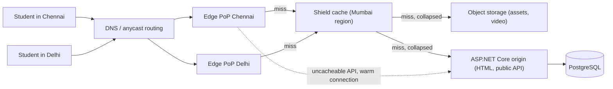
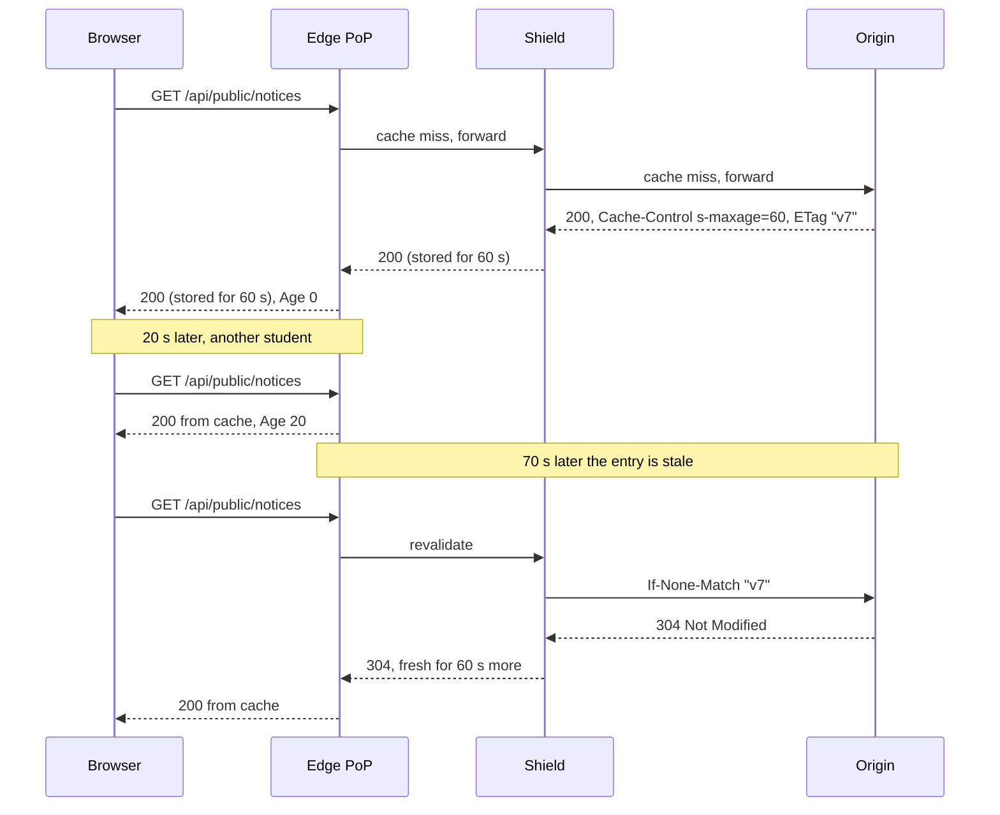

Most of the bytes your users download are not produced by your code. They are JavaScript bundles, images, fonts, video segments and PDFs that are the same for everyone. A content delivery network (CDN) is the layer that serves those bytes from a machine near the user, so your servers only handle the work that is truly unique per request.

## Learning objectives

By the end of this lesson you will be able to:

1. Explain what a CDN is, and name its parts: edge points of presence, shield (mid-tier) caches and the origin.
2. Estimate how much traffic a CDN takes off your origin for a given hit ratio, using back-of-the-envelope numbers.
3. Choose between pull and push CDNs, and design cache keys that give high hit ratios without mixing up users.
4. Control caching with `Cache-Control` (`max-age`, `s-maxage`, `immutable`, `stale-while-revalidate`, `private`, `no-store`).
5. Pick between purging and versioned (fingerprinted) URLs for invalidation, and know why versioned URLs usually win.
6. Protect paid or private content with signed URLs, and implement signing and checking in ASP.NET Core.
7. Explain dynamic acceleration, the failure modes of a CDN (stampedes, leaked private pages, CDN outage), its cost drivers, and when you do not need one at all.

## Prerequisites

- [HTTP fundamentals](#/lesson/m10-http-fundamentals): methods, status codes and headers, especially `Cache-Control` and `ETag`.
- [Caching layers in a system](#/lesson/m11-caching-layers): where caches sit between the browser and the database.
- [Latency numbers and latency budgets](#/lesson/m11-latency-numbers): why distance costs milliseconds.

## Explain it like I'm a beginner

Think about how milk reaches a family in Pune. The dairy plant (the **origin**) is hundreds of kilometres away. If every family drove to the plant for each litre, the roads would jam and the plant would spend all day at the gate. Instead, milk travels in bulk to a regional chiller, then to a local shop at the end of your lane. You walk two minutes and buy it. The shop only orders more from the plant when its fridge runs low.

A CDN is that network of local shops, for internet content.

- The **origin** is your own server or storage bucket, where the real copy of each file lives.
- The **edge** servers are the local shops, spread across many cities. Each city location is called a **point of presence** (PoP).
- The regional chiller is the **shield** (also called a mid-tier or origin shield). It sits between the edges and the origin so that 50 shops don't all phone the plant at once.
- "The shop has it in the fridge" is a **cache hit**. "The shop has to order it" is a **cache miss**.
- The "best before" date on the packet is the **TTL** (time to live): how long the shop may sell that copy before checking with the plant again.

Two things make the analogy break, and they matter. First, milk is the same for everyone, but some web pages are personal ("Hello, Priya, your fees are due"). A shop must never hand Priya's packet to Rahul. Second, a dairy can recall a bad batch only by visiting every shop. A CDN has the same problem when you change a file: every edge may still hold the old copy.

## First-principles explanation

### Why a CDN exists: distance, handshakes and load

Three forces push you towards a CDN.

**1. Distance costs time.** Light in optical fibre travels about 200,000 km per second, roughly two-thirds of its speed in a vacuum. A Mumbai user talking to a server in the US East Coast is about 13,000 km away in a straight line, and real cable routes are longer. One round trip (request there, answer back) therefore takes at least 130 ms in theory and usually 180–250 ms in practice (estimate). A Mumbai user talking to an edge PoP in Mumbai pays perhaps 5–20 ms (estimate).

**2. Handshakes multiply that distance.** Before the first byte of a page arrives over HTTPS, the browser needs a TCP handshake (1 round trip) and a TLS 1.3 handshake (1 more round trip), then the request itself (1 round trip). With HTTP/3 over QUIC, the transport and TLS handshakes are combined, but you still pay at least one round trip before the request. Three round trips at 200 ms is 600 ms before anything shows. Three round trips at 15 ms is 45 ms. A CDN terminates those handshakes at the edge.

**3. Your origin has limited capacity and bandwidth.** If one page view needs 40 requests for bundles, images and fonts, your origin serves 40 requests per page. With a CDN at a 95 % hit ratio, it serves 2.

### Back-of-the-envelope: how much does a CDN take off the origin?

Take an ed-tech platform with 2 million daily active users (DAU) in India. Each user views 10 pages a day. Each page needs 40 static requests and, after the browser's own cache, about 0.4 MB of fresh downloads.

- Requests: 2,000,000 × 10 × 40 = 800 million requests/day. 800,000,000 ÷ 86,400 s ≈ 9,300 RPS average. Evening study hours are busy, so assume ×3 for peak: about **28,000 RPS**.
- Bandwidth: 2,000,000 × 10 × 0.4 MB = 8,000,000 MB = 8 TB/day. 8 TB ÷ 86,400 s ≈ 93 MB/s ≈ 740 Mbit/s average, about **2.2 Gbit/s at peak**.

Now put a CDN in front with a 95 % request hit ratio:

- Origin requests: 28,000 × 0.05 = **1,400 RPS** at peak.
- Origin bandwidth (if byte hit ratio is also around 95 %): 2.2 Gbit/s × 0.05 ≈ **110 Mbit/s**.

A cluster of a few application servers handles 1,400 RPS of static file misses comfortably. 28,000 RPS and 2.2 Gbit/s of egress would need a much bigger fleet and a large network bill. Notice how sensitive this is: at a 90 % hit ratio the origin sees 2,800 RPS, twice as much. **Each percentage point of hit ratio near the top is worth a lot.** That is why most CDN design work is about raising the hit ratio safely.

### The parts of a CDN

- **Edge PoPs**: clusters of cache servers in many cities. Users reach the nearest one through DNS-based routing or anycast (see [DNS and traffic routing](#/lesson/m11-dns-routing)).
- **Tiered caching / shield**: a second layer of larger caches in a few regions. Edges that miss ask the shield first. Without it, 100 edge PoPs that all miss on a new file send 100 requests to your origin. With a shield, the origin sees one per shield region.
- **Origin**: where the authoritative copy lives. Often an object storage bucket for files (see [Object storage](#/lesson/m11-object-storage)) and your ASP.NET Core app for API responses and HTML.
- **Control plane**: configuration, rules, certificates, purge API, logs. Changes here can take seconds to minutes to reach every PoP.

### Pull CDN versus push CDN

A **pull CDN** fetches from the origin on the first request for an object, caches it, and serves later requests from the cache until the TTL ends. You just point the CDN at an origin hostname. This is the default for almost everyone: no upload step, and only popular objects take up cache space. The cost is that the first user in each region after a deploy or expiry pays the miss latency.

A **push CDN** (or pre-positioned content) means you upload content to the CDN's storage ahead of time. It suits large files with predictable demand, such as a 2 GB game patch or a recorded lecture series released at 9 am. You control exactly what is there and when, but you must manage uploads, deletions and storage cost yourself.

Many real setups are a mix: a pull CDN in front of an object storage bucket that you push to. Your deploy pipeline "pushes" to the bucket, and the CDN "pulls" from the bucket.

### What the CDN uses to decide "is this the same thing?": the cache key

The **cache key** is the identity of a cached object. By default it is roughly *scheme + host + path + query string*. Two requests with the same key get the same cached response.

Getting the key right is a balancing act:

- **Too broad a key** (too much in it) splits one object into many cache entries and kills the hit ratio. Example: including the full query string when marketing adds `?utm_source=whatsapp&utm_campaign=diwali` to every link. Each campaign creates a fresh miss for the same image.
- **Too narrow a key** (too little in it) mixes up different responses. Example: ignoring the `?w=200` resize parameter, so a 200-pixel thumbnail is served where a 1,200-pixel hero image was expected. Or worse, ignoring a header that changes the response, so one user's page is served to another.

The `Vary` response header tells caches which request headers change the response. `Vary: Accept-Encoding` is normal (a Brotli copy and a gzip copy). `Vary: Cookie` or `Vary: User-Agent` usually destroys the hit ratio, because there are thousands of distinct values. Good CDN configuration normalises keys: drop tracking parameters, sort the remaining ones, and bucket `Accept-Encoding` into a few values.

### Telling caches what to do: Cache-Control

The origin controls caching with response headers (defined in RFC 9111). The important directives:

| Directive | Meaning | Typical use |
|---|---|---|
| `max-age=N` | Anyone may reuse this for N seconds | Static assets |
| `s-maxage=N` | Shared caches (CDN, proxies) use N instead of `max-age` | API responses you want the CDN to cache but browsers to recheck |
| `public` | Shared caches may store it, even for authenticated requests | Public content |
| `private` | Only the user's browser may store it | Personal pages |
| `no-store` | Nobody may store it | Banking pages, one-time tokens |
| `no-cache` | Store it, but revalidate with the origin before every reuse | HTML shell that must be fresh |
| `immutable` | It will never change during its lifetime; don't revalidate | Fingerprinted files |
| `stale-while-revalidate=N` | After expiry, serve the stale copy for up to N s while refreshing in the background | Feeds, listings |
| `stale-if-error=N` | If the origin fails, serve stale for up to N s | Resilience |

**Revalidation** saves bandwidth when content hasn't changed. The cache sends the stored `ETag` back as `If-None-Match`. If the origin answers `304 Not Modified`, only headers travel, not the body.

Many CDNs also let you set TTLs in their own rules, or read a CDN-specific header, which overrides the origin's headers. Pick one source of truth. If the CDN rule says "cache everything for a day" and your origin says `private`, the rule may win, and that is how private pages leak.

### Invalidation: purging versus versioned URLs

You deployed a new `app.js`. Edges around the country still hold the old one for up to the TTL. You have two options.

**Purge (invalidation API).** You ask the CDN to delete `/assets/app.js` everywhere. It works, but:

- Propagation takes from about a second to a few minutes depending on the provider, and it is eventually consistent. For a while, some PoPs serve new and some old.
- After the purge every edge misses at once, so the origin gets a burst of requests (a small stampede).
- Some providers charge for, or rate-limit, purge requests.
- The user's browser cache is not purged. If you sent `max-age=31536000`, the browser keeps the old file for a year.

**Versioned URLs (fingerprinting / cache busting).** Put a hash of the file's content in its name: `app.3f9a1c2b.js`. The HTML references the new name after each deploy. The old URL is never reused, so it can be cached forever with `immutable`, and the new one is a fresh key, so no purge is needed. The HTML page itself (which contains the references) gets a short TTL or `no-cache`, so users pick up the new references quickly.

This is why the standard recipe is: **fingerprinted assets cached for a year, HTML cached briefly, purge reserved for content that must keep its URL** (a news article, a public notice, a product price page). For that last group, many CDNs support purge by **tag** (sometimes called surrogate keys or cache tags): the origin labels responses with tags like `notice-42`, and one purge call drops every URL carrying that tag.

ASP.NET Core 9 and later include `MapStaticAssets`, which fingerprints files at build time, serves compressed variants, and sets long-lived caching headers for fingerprinted URLs. For a single-page app built with Vite or webpack, the bundler does the fingerprinting.

### Private and paid content: signed URLs

A CDN serves anything with a valid key to anyone who asks. For a paid course video, you don't want a link that works forever for everyone it is shared with. A **signed URL** adds an expiry time and a cryptographic signature to the URL: `/videos/42/master.m3u8?exp=1760000000&sig=ab12…`. The signature is an HMAC (a keyed hash) over the path and expiry, made with a secret that only your app and the CDN know. The edge checks the signature and expiry before serving. Change any character and the signature fails. Wait past `exp` and it fails.

Important details:

- Exclude `exp` and `sig` from the cache key. Otherwise each user's unique signature makes a unique cache entry, and your hit ratio drops to near zero.
- For streaming video, one playlist references hundreds of segment files. Signing each is awkward, so providers offer **signed cookies** or path-prefix tokens that cover `/videos/42/*`.
- Keep lifetimes short (minutes to hours). A signed URL is a bearer token: whoever holds it can use it until it expires.
- Rotate keys, and support two active keys during rotation.

### Dynamic acceleration: CDNs for content you can't cache

Even uncacheable API calls get faster through a CDN, for three reasons:

1. **The handshakes happen near the user.** TCP and TLS terminate at the edge in 15 ms round trips instead of 200 ms ones.
2. **The edge keeps warm, long-lived connections to your origin**, so there is no new handshake per request on the long leg.
3. **The provider's backbone** can route traffic over its own network instead of the public internet path, which can avoid congested links.

Add DDoS absorption, a web application firewall (WAF) and TLS certificate management at the edge, and this is why many teams put even their API behind a CDN or an edge proxy such as Azure Front Door.

### What breaks first under load

1. **The origin after a purge or a cold start.** A purge or a new region with empty caches turns 95 % hits into 100 % misses for a few minutes. Mitigations: a shield tier, request collapsing (the edge sends one request to origin for many concurrent misses on the same key, which most CDNs do), `stale-while-revalidate`, and warming important URLs before a launch.
2. **Long-tail content.** A catalogue of 5 million product images where each is viewed twice a week will never be hot in every PoP. The hit ratio stays low, and the shield and origin take the load. Bigger shields and longer TTLs help. Some content is simply not CDN-friendly.
3. **Cache-busting traffic.** Random query strings (`?x=8f3a…`), sent by accident or by an attacker, create misses on purpose. Normalise or whitelist query parameters in the cache key.

### Failure modes and how to mitigate them

| Failure | What users see | Mitigation |
|---|---|---|
| Personal page cached as public | User A sees User B's name or data. A serious security incident | `private, no-store` on anything personal; never cache responses with `Set-Cookie`; don't let CDN rules override origin headers on `/api/me`-style paths |
| Error page cached | A brief 500 is served from cache for an hour | Send `no-store` on 5xx; cache 404s for only a minute (negative caching) |
| Origin down | Errors on every miss | `stale-if-error`, health-checked origin failover |
| CDN provider outage | Whole site unreachable, even though origin is fine | Multi-CDN with DNS-level failover for large sites; for most sites, accept the risk and document it |
| Stale content after a change | Old price or notice shown for TTL | Versioned URLs; tag purge; short TTL plus `stale-while-revalidate` |
| Leaked signed link | Paid video shared on a Telegram group | Short expiry, signed cookies tied to session, rate limits per token |

### Consistency trade-offs

A CDN is an eventually consistent copy of your origin. Every TTL is a promise: "I accept that users may see data up to N seconds old." For a JavaScript bundle, N can be a year, because the URL changes on every deploy. For a list of exam notices, 60 seconds may be acceptable. For a bank balance or seat availability, N is zero, so don't cache it at a shared layer at all. Write the acceptable staleness down per content type. It's a product decision, not just a technical one.

### Cost drivers

- **Egress (data out) per GB** is usually the largest line item. Using the 8 TB/day example, that's about 240 TB per month. Prices vary a lot by provider, region and commitment, so get quotes rather than trusting a blog post.
- **Requests** are often billed per 10,000 or per million. Small files mean many requests.
- **Origin egress**: every miss also costs egress from your cloud to the CDN. A higher hit ratio cuts both bills.
- **Extras**: WAF rules, edge compute invocations, log delivery, purge requests, premium features such as tag purge.

Compression (Brotli for text), modern image formats (AVIF/WebP) and right-sized images often cut the bill more than any pricing negotiation.

### When a simpler design is enough

- An internal tool used by 300 employees in one Gurgaon office, served from a data centre 20 km away: no CDN. Serve static files from ASP.NET Core with good cache headers. The browser cache does most of the work.
- A small app whose users are in one region close to the server: the browser cache plus an in-app output cache is plenty.
- A startup's first launch: a managed hosting platform with a built-in CDN, or one CDN in front of an object storage bucket. You don't need tiered caching, multi-CDN or edge functions on day one.

Add a CDN when users are far from your servers, when static bandwidth starts to dominate your bill, when you expect sudden spikes (results day, a sale, a cricket final), or when you need DDoS protection at the edge.

## Visual explanation

### Architecture: where a CDN sits



How to read it, arrow by arrow:

- **Students → DNS / anycast**: the browser looks up `cdn.examprep.in`. The provider's routing returns, or steers packets to, a nearby PoP.
- **DNS → Edge PoPs**: Chennai users land on the Chennai PoP and Delhi users on the Delhi PoP. Each PoP has its own cache.
- **Edges → Shield (on a miss)**: rather than both PoPs calling the origin, they ask one regional shield. If the shield has the object, the origin never hears about it.
- **Shield → Object storage / ASP.NET Core**: only shield misses reach the origin, and concurrent misses for the same key are collapsed into one request. Files come from object storage. HTML and cacheable public API responses come from the app.
- **Dotted edge → ASP.NET Core**: personal or uncacheable API calls pass straight through the edge. They still benefit, because TLS ended near the user and the edge holds warm connections to the origin.
- **ASP.NET Core → PostgreSQL**: only the app talks to the database. The CDN never does.

### Sequence: miss, hit, and revalidation



The first request misses at every layer and goes to the origin, which returns the body plus caching instructions and an `ETag` (a version label). Both the shield and the edge store it. The second student, 20 seconds later, gets the copy straight from the edge. The `Age` header shows how old it is. After 60 seconds the entry is stale. The edge doesn't throw it away. It asks "is version v7 still current?", and the origin answers `304 Not Modified` with no body. Only a few hundred bytes cross the long link, and the copy becomes fresh again. With `stale-while-revalidate`, the third student wouldn't even wait for that check.

## Step-by-step example

We'll design the CDN layer for **ExamPrep**, the ed-tech platform from the estimate above: 2 M DAU, a React single-page app, course videos, practice-test PDFs, a public notices feed and a personal dashboard.

### Step 1 — classify every kind of content

| Content | Same for everyone? | Changes how? | Decision |
|---|---|---|---|
| `/assets/app.3f9a1c2b.js`, CSS, fonts | Yes | Never (new name per deploy) | Cache 1 year, `immutable` |
| `/` and `/index.html` (SPA shell) | Yes | Every deploy | `max-age=0` for browsers (revalidate each use), `s-maxage=120` at CDN |
| `/media/thumbnails/*.webp` | Yes | Rarely | 1 day, `stale-while-revalidate` |
| `/api/public/notices` | Yes | Few times a day | `s-maxage=60`, browsers `max-age=0`, tag purge on edit |
| `/videos/{id}/*` (HLS segments) | Yes, but paid | Never | Long TTL, **signed** access |
| `/api/me/*` dashboard | No | Constantly | `private, no-store`, pass-through |

### Step 2 — set the cache key rules

- Strip `utm_*`, `fbclid` and `gclid` from the key. Marketing links shouldn't create misses.
- Keep `w` and `q` for the image resizer. Sort parameters so `?w=200&q=80` and `?q=80&w=200` are one entry.
- Exclude `exp` and `sig` on `/videos/*`, which are validated but not part of the key.
- Bucket `Accept-Encoding` into `br`, `gzip` and `identity`.

### Step 3 — choose invalidation per class

Assets use fingerprinting, so no purge is ever needed. Notices use tag purge (`notices`) when an admin publishes. The SPA shell has a 2-minute CDN TTL, so after a deploy users see the new version within about 2 minutes, which product accepted.

### Step 4 — protect the videos

The app issues a signed playlist URL valid for 30 minutes after checking the student's subscription. The CDN validates the signature. Segments are covered by a path-prefix token or signed cookie for `/videos/42/`.

## Production-style C# implementation

The origin's job is to send correct caching headers, generate versioned asset URLs, sign private URLs, and call the CDN's purge API when public content changes. The CDN vendor's SDK is hidden behind an interface, so this code compiles and is testable without it.

```text
ExamPrep.Api/
  Program.cs
  Cdn/CdnOptions.cs
  Cdn/CacheRuleCatalog.cs
  Cdn/CdnCacheHeadersMiddleware.cs
  Cdn/AssetManifest.cs
  Cdn/SignedUrlSigner.cs
  Cdn/CdnPurgeClient.cs
  Notices/NoticeBoard.cs
```

```csharp file=Cdn/CdnOptions.cs
namespace ExamPrep.Cdn;

public sealed class CdnOptions
{
    /// <summary>Public CDN hostname, for example https://cdn.examprep.in</summary>
    public string BaseUrl { get; set; } = "https://cdn.examprep.in";

    /// <summary>Base64 HMAC key shared with the CDN's token-auth feature. Load from a secret store.</summary>
    public string SigningKeyBase64 { get; set; } = Convert.ToBase64String(new byte[32]);

    public TimeSpan MaxSignedLifetime { get; set; } = TimeSpan.FromHours(6);
}
```

```csharp file=Cdn/CacheRuleCatalog.cs
using System.Text.RegularExpressions;

namespace ExamPrep.Cdn;

public enum CacheClass { ImmutableAsset, Media, PublicApi, HtmlShell, Private, Error }

public sealed record CacheRule(CacheClass Class, string CacheControl);

/// <summary>One place that decides caching for every path. Keeping it in one class makes it testable
/// and stops individual endpoints from inventing their own headers.</summary>
public sealed partial class CacheRuleCatalog
{
    [GeneratedRegex(@"\.[0-9a-f]{8}\.[a-z0-9]+$")]
    private static partial Regex Fingerprinted();

    public CacheRule Resolve(string path, bool isAuthenticated, int statusCode)
    {
        if (statusCode >= 500) return new(CacheClass.Error, "no-store");
        if (isAuthenticated || path.StartsWith("/api/me", StringComparison.OrdinalIgnoreCase))
            return new(CacheClass.Private, "private, no-store");
        if (statusCode == 404) return new(CacheClass.Error, "public, max-age=60");

        if (path.StartsWith("/assets/", StringComparison.Ordinal) && Fingerprinted().IsMatch(path))
            return new(CacheClass.ImmutableAsset, "public, max-age=31536000, immutable");
        if (path.StartsWith("/media/", StringComparison.Ordinal))
            return new(CacheClass.Media, "public, max-age=86400, stale-while-revalidate=3600");
        if (path.StartsWith("/api/public/", StringComparison.Ordinal))
            return new(CacheClass.PublicApi, "public, max-age=0, s-maxage=60, stale-while-revalidate=30, stale-if-error=600");

        // HTML shell and anything unclassified: browsers revalidate, CDN keeps it briefly.
        // Not "no-cache, s-maxage=120": no-cache applies to shared caches too, so the CDN would revalidate every request.
        return new(CacheClass.HtmlShell, "public, max-age=0, s-maxage=120");
    }
}
```

```csharp file=Cdn/CdnCacheHeadersMiddleware.cs
namespace ExamPrep.Cdn;

/// <summary>Applies the catalog's rule just before headers are sent, when the status code is known.</summary>
public sealed class CdnCacheHeadersMiddleware(RequestDelegate next, CacheRuleCatalog catalog)
{
    public Task InvokeAsync(HttpContext context)
    {
        context.Response.OnStarting(() =>
        {
            var response = context.Response;
            var rule = catalog.Resolve(context.Request.Path.Value ?? "/",
                context.User.Identity?.IsAuthenticated == true, response.StatusCode);

            // Safety net: a response that sets a cookie is personal by definition.
            response.Headers.CacheControl = response.Headers.SetCookie.Count > 0 ? "private, no-store" : rule.CacheControl;
            if (rule.Class is CacheClass.PublicApi or CacheClass.HtmlShell)
                response.Headers.Vary = "Accept-Encoding";
            return Task.CompletedTask;
        });
        return next(context);
    }
}
```

```csharp file=Cdn/AssetManifest.cs
using System.Security.Cryptography;
using Microsoft.Extensions.Options;

namespace ExamPrep.Cdn;

/// <summary>Maps logical names (app.js) to fingerprinted names (app.3f9a1c2b.js). Built at deploy time.</summary>
public sealed class AssetManifest
{
    private readonly Dictionary<string, string> _map;
    private AssetManifest(Dictionary<string, string> map) => _map = map;

    public static AssetManifest FromPairs(IReadOnlyDictionary<string, string> pairs) =>
        new(new Dictionary<string, string>(pairs, StringComparer.OrdinalIgnoreCase));

    /// <summary>app.js + content → app.{first 8 hex chars of SHA-256}.js</summary>
    public static string Fingerprint(string logicalName, ReadOnlySpan<byte> content)
    {
        var hash = Convert.ToHexString(SHA256.HashData(content)).ToLowerInvariant()[..8];
        var dot = logicalName.LastIndexOf('.');
        return dot < 0 ? $"{logicalName}.{hash}" : $"{logicalName[..dot]}.{hash}{logicalName[dot..]}";
    }

    public string Resolve(string logicalName) =>
        _map.TryGetValue(logicalName, out var real) ? real
            : throw new KeyNotFoundException($"Asset '{logicalName}' is not in the manifest. Was the build published?");
}

public sealed class AssetUrlBuilder(AssetManifest manifest, IOptions<CdnOptions> options)
{
    private readonly string _base = options.Value.BaseUrl.TrimEnd('/');
    public string Url(string logicalName) => $"{_base}/assets/{manifest.Resolve(logicalName)}";
}
```

```csharp file=Cdn/SignedUrlSigner.cs
using System.Security.Cryptography;
using System.Text;
using Microsoft.Extensions.Options;

namespace ExamPrep.Cdn;

public enum SignedUrlStatus { Valid, Expired, BadSignature }

/// <summary>HMAC-SHA256 token over "path|exp". Mirrors the generic token-auth scheme most CDNs offer;
/// check your provider's exact format before using this against a real edge.</summary>
public sealed class SignedUrlSigner(IOptions<CdnOptions> options, TimeProvider clock)
{
    private readonly byte[] _key = Convert.FromBase64String(options.Value.SigningKeyBase64);
    private readonly TimeSpan _max = options.Value.MaxSignedLifetime;

    public string Sign(string path, TimeSpan validFor)
    {
        if (validFor <= TimeSpan.Zero || validFor > _max)
            throw new ArgumentOutOfRangeException(nameof(validFor), $"Lifetime must be between 0 and {_max}.");
        var exp = clock.GetUtcNow().Add(validFor).ToUnixTimeSeconds();
        return $"{path}?exp={exp}&sig={Signature(path, exp)}";
    }

    public SignedUrlStatus Check(string path, long exp, string sig)
    {
        var expected = Encoding.ASCII.GetBytes(Signature(path, exp));
        var actual = Encoding.ASCII.GetBytes(sig ?? "");
        if (!CryptographicOperations.FixedTimeEquals(expected, actual)) return SignedUrlStatus.BadSignature;
        return clock.GetUtcNow().ToUnixTimeSeconds() > exp ? SignedUrlStatus.Expired : SignedUrlStatus.Valid;
    }

    private string Signature(string path, long exp) =>
        Convert.ToHexString(HMACSHA256.HashData(_key, Encoding.UTF8.GetBytes($"{path}|{exp}"))).ToLowerInvariant();
}
```

```csharp file=Cdn/CdnPurgeClient.cs
using Microsoft.Extensions.Logging;

namespace ExamPrep.Cdn;

/// <summary>Wraps the vendor purge API (by path or by tag). The real implementation calls the provider's
/// REST endpoint with retries; keep the vendor SDK out of business code.</summary>
public interface ICdnPurgeClient
{
    Task PurgeTagsAsync(IReadOnlyCollection<string> tags, CancellationToken ct);
}

public sealed class LoggingCdnPurgeClient(ILogger<LoggingCdnPurgeClient> logger) : ICdnPurgeClient
{
    public Task PurgeTagsAsync(IReadOnlyCollection<string> tags, CancellationToken ct)
    {
        logger.LogInformation("CDN purge requested for tags {Tags}", string.Join(",", tags));
        return Task.CompletedTask;
    }
}
```

```csharp file=Notices/NoticeBoard.cs
using System.Collections.Concurrent;

namespace ExamPrep.Notices;

public sealed record Notice(int Id, string Text, DateTimeOffset UpdatedAt);

/// <summary>In-memory stand-in for the notices table.</summary>
public sealed class NoticeBoard(TimeProvider clock)
{
    private readonly ConcurrentDictionary<int, Notice> _items = new();
    public IReadOnlyList<Notice> All() => _items.Values.OrderByDescending(n => n.UpdatedAt).ToList();
    public Notice Upsert(int id, string text) => _items[id] = new Notice(id, text, clock.GetUtcNow());
}
```

```csharp file=Program.cs
using ExamPrep.Cdn;
using ExamPrep.Notices;

var builder = WebApplication.CreateBuilder(args);

builder.Services.Configure<CdnOptions>(builder.Configuration.GetSection("Cdn"));
builder.Services.AddSingleton(TimeProvider.System);
builder.Services.AddSingleton<CacheRuleCatalog>();
builder.Services.AddSingleton(_ => AssetManifest.FromPairs(new Dictionary<string, string>
{
    ["app.js"] = "app.3f9a1c2b.js",     // generated by the build pipeline in real life
    ["app.css"] = "app.91d0e4aa.css",
}));
builder.Services.AddSingleton<AssetUrlBuilder>();
builder.Services.AddSingleton<SignedUrlSigner>();
builder.Services.AddSingleton<ICdnPurgeClient, LoggingCdnPurgeClient>();
builder.Services.AddSingleton<NoticeBoard>();

var app = builder.Build();
app.UseMiddleware<CdnCacheHeadersMiddleware>();

app.MapGet("/", (AssetUrlBuilder assets) => Results.Content(
    $"<!doctype html><link rel=stylesheet href=\"{assets.Url("app.css")}\"><div id=root></div><script src=\"{assets.Url("app.js")}\"></script>",
    "text/html"));

app.MapGet("/api/public/notices", (NoticeBoard board, HttpContext ctx) =>
{
    ctx.Response.Headers["Cache-Tag"] = "notices";   // header name varies by CDN provider
    return Results.Ok(board.All());
});

// In production this endpoint requires an admin policy.
app.MapPut("/admin/notices/{id:int}", async (int id, string text, NoticeBoard board, ICdnPurgeClient purge, CancellationToken ct) =>
{
    board.Upsert(id, text);
    await purge.PurgeTagsAsync(["notices"], ct);    // write first, then purge
    return Results.NoContent();
});

app.MapGet("/api/me/videos/{id:int}/link", (int id, SignedUrlSigner signer) =>
    // A real handler checks the student's subscription before signing.
    Results.Ok(new { url = signer.Sign($"/videos/{id}/master.m3u8", TimeSpan.FromMinutes(30)) }));

app.Run();
```

Design notes:

- **One rule catalog.** Endpoints don't set `Cache-Control` themselves. A single class makes the policy reviewable, and the middleware applies it in `OnStarting`, after the status code is known, so a 500 is never cached.
- **Safety net on `Set-Cookie`.** If anything sets a cookie, the response becomes `private, no-store`. This one line prevents the most common CDN data leak.
- **Write, then purge.** If you purge first and the database write is slow, an edge can refetch the *old* data and cache it for another 60 seconds. For extra safety, purge again a few seconds later, or rely on the short `s-maxage`.
- **`max-age=0, s-maxage=120` for the shell, not `no-cache, s-maxage=120`.** `no-cache` binds shared caches as well, so combining it with `s-maxage` makes the CDN revalidate every request and the 2-minute edge TTL never takes effect.
- **Signing uses `TimeProvider`** so tests can control time, and `FixedTimeEquals` so the comparison doesn't leak timing information.

## Bad design vs good design

**Bad**: a team puts a CDN in front of their whole ASP.NET Core site and adds one rule: "cache everything for 1 hour". Their bundle is `/js/app.js` with no fingerprint. On each deploy they call "purge all".

What goes wrong:

- `/api/me/fees` is cached. A student in Jaipur sees another student's fee dues. This is a privacy incident, not a bug.
- A 30-second database blip produces 500 errors that stay cached for an hour.
- After each "purge all", every PoP misses at once. The origin, sized for 1,400 RPS, gets more than 20,000 RPS for a few minutes, and the deploy looks like an outage.
- Browsers hold the old `app.js` while the new HTML expects new functions, so users see a blank screen until they hard-refresh.

**Good**: the design above. Content is classified. Personal paths are `private, no-store`. Errors are `no-store`. Assets are fingerprinted and immutable. The HTML shell is short-lived. Public data has a short `s-maxage` plus tag purge. Private media uses signed URLs.

**Is the good design always worth it?** For a small site, a simpler version is fine: fingerprinted assets with a one-year TTL, and *no CDN caching at all* for HTML and API responses. That alone captures most of the benefit with almost no risk. Add API caching at the CDN only when you have measured that it matters.

:::callout type=mistake title="Trusting the CDN's default behaviour"
Defaults differ by provider. Some honour origin `Cache-Control`, some apply their own TTL when the origin sends none, and some ignore query strings by default. Read your provider's caching rules, and test with `curl -I` on a real URL, looking at `Cache-Control`, `Age` and the provider's hit/miss header.
:::

:::callout type=tradeoff title="Long TTL versus freshness"
A long TTL gives a high hit ratio and a cheap bill, but stale content. A short TTL gives fresh content and more origin load. Versioned URLs let you have both for static files. For data, `stale-while-revalidate` is the middle ground: users get a fast answer, and the cache refreshes behind the scenes.
:::

## Practical playground

Use the cache simulator to feel how the hit ratio changes origin load. Treat the "cache" as a CDN edge and the "backend" as your origin.

1. Start at a hit ratio of 0.90. Note the requests reaching the backend.
2. Move it to 0.95, then 0.99. Compare with the arithmetic in this lesson: going from 90 % to 95 % halves origin load, and going from 95 % to 99 % cuts it by five times.
3. Simulate a purge by setting the hit ratio to 0 for a moment, and watch the backend spike. That burst is what a shield tier and request collapsing protect you from.

:::playground type=sim sim=cache hitRatio=0.9 title="CDN hit ratio versus origin load"
Model the CDN edge as the cache and your ASP.NET Core origin as the backend. Try 0.90, 0.95 and 0.99, then 0 to simulate a global purge.
:::

## Exercises

:::exercise id=m11-cdn-ex1 difficulty=beginner kind=code title="Pick the right Cache-Control header"
Implement `CacheHeaderPicker.For(path, authenticated, status)`, which returns the `Cache-Control` value the origin should send. The rules are checked **in this order**:

1. Status 500 or above → `no-store`
2. Authenticated, or path starts with `/api/me` → `private, no-store`
3. Status 404 → `public, max-age=60`
4. Path starts with `/assets/` and the file name is fingerprinted (it ends in `.` + 8 lowercase hex characters + `.` + extension, like `app.3f9a1c2b.js`) → `public, max-age=31536000, immutable`
5. Path starts with `/assets/` but is not fingerprinted → `public, max-age=300`
6. Path starts with `/api/public/` → `public, max-age=0, s-maxage=60, stale-while-revalidate=30`
7. Anything else → `no-cache`
::acceptance
- `/assets/app.3f9a1c2b.js`, anonymous, 200 → one-year immutable.
- `/assets/app.js` → `public, max-age=300`.
- `/api/me/fees` → `private, no-store`, even when anonymous.
- A 503 on any path → `no-store`, even for assets.
- An authenticated request for a fingerprinted asset → `private, no-store` (the rule order wins).
::hint
The order of the checks is the whole exercise. Write them as a chain of early `return` statements.
::hint
Errors come first, because caching a failure is the worst outcome. Privacy comes second.
::hint
For the fingerprint, a regular expression on the end of the path works: `\.[0-9a-f]{8}\.[a-z0-9]+$`.
::hint
```csharp
if (status >= 500) return "no-store";
if (authenticated || path.StartsWith("/api/me", StringComparison.OrdinalIgnoreCase)) return "private, no-store";
if (status == 404) return "public, max-age=60";
```
::starter
```csharp file=CacheHeaderPicker.cs
using System;
using System.Text.RegularExpressions;

public static class CacheHeaderPicker
{
    public static string For(string path, bool authenticated, int status) => throw new NotImplementedException();
}
```
::tests
```csharp file=CacheHeaderPickerTests.cs
using Xunit;

public class CacheHeaderPickerTests
{
    [Fact] public void Fingerprinted_asset_is_immutable() =>
        Assert.Equal("public, max-age=31536000, immutable", CacheHeaderPicker.For("/assets/app.3f9a1c2b.js", false, 200));

    [Fact] public void Plain_asset_is_short() =>
        Assert.Equal("public, max-age=300", CacheHeaderPicker.For("/assets/app.js", false, 200));

    [Fact] public void Personal_api_is_private_even_if_anonymous() =>
        Assert.Equal("private, no-store", CacheHeaderPicker.For("/api/me/fees", false, 200));

    [Fact] public void Server_error_is_never_stored() =>
        Assert.Equal("no-store", CacheHeaderPicker.For("/assets/app.3f9a1c2b.js", false, 503));

    [Fact] public void Authenticated_beats_asset_rule() =>
        Assert.Equal("private, no-store", CacheHeaderPicker.For("/assets/app.3f9a1c2b.js", true, 200));

    [Fact] public void Not_found_is_cached_briefly() =>
        Assert.Equal("public, max-age=60", CacheHeaderPicker.For("/media/missing.png", false, 404));

    [Fact] public void Public_api_uses_s_maxage() =>
        Assert.Equal("public, max-age=0, s-maxage=60, stale-while-revalidate=30", CacheHeaderPicker.For("/api/public/notices", false, 200));

    [Fact] public void Everything_else_revalidates() =>
        Assert.Equal("no-cache", CacheHeaderPicker.For("/", false, 200));
}
```
::solution
Early returns in the specified order. The regular expression is compiled once as a static field.

```csharp file=CacheHeaderPicker.cs
using System;
using System.Text.RegularExpressions;

public static class CacheHeaderPicker
{
    private static readonly Regex Fingerprint = new(@"\.[0-9a-f]{8}\.[a-z0-9]+$", RegexOptions.Compiled);

    public static string For(string path, bool authenticated, int status)
    {
        if (status >= 500) return "no-store";
        if (authenticated || path.StartsWith("/api/me", StringComparison.OrdinalIgnoreCase)) return "private, no-store";
        if (status == 404) return "public, max-age=60";
        if (path.StartsWith("/assets/", StringComparison.Ordinal))
            return Fingerprint.IsMatch(path) ? "public, max-age=31536000, immutable" : "public, max-age=300";
        if (path.StartsWith("/api/public/", StringComparison.Ordinal))
            return "public, max-age=0, s-maxage=60, stale-while-revalidate=30";
        return "no-cache";
    }
}
```

Why does a non-fingerprinted asset get only 5 minutes? Its URL is reused across deploys, so a long TTL would pin users to an old file. Once every asset is fingerprinted, rule 5 should almost never fire. Log when it does.
::mistakes
- Putting the asset rule before the error rule, so a 503 on `app.js` gets cached for a year.
- Using `max-age` instead of `s-maxage` for the public API, which makes browsers hold stale data too.
- Treating `no-cache` as "do not cache". It means "store, but revalidate before each use". `no-store` means "do not store".
::extensions
Return a small record with `CacheControl` and `Vary`, and add `Vary: Accept-Encoding` for compressible responses.
:::

:::exercise id=m11-cdn-ex2 difficulty=beginner kind=hld title="Put a CDN in front of a struggling origin"
ExamPrep serves everything, including bundles, thumbnails and video segments, directly from 4 ASP.NET Core servers behind a load balancer. At the evening peak of 28,000 RPS, the servers are at 90 % CPU and the egress bill is growing fast.

Add a CDN layer to the starter graph so that static traffic is served near users and only misses reach the origin. Move files to a better origin than the app servers. Explain in two or three sentences what load each node now carries.
::acceptance
- A `dns` node and a `cdn` node sit between the client and everything else.
- Static files have an `object-storage` origin; the app servers no longer serve them.
- The CDN still forwards uncacheable API traffic to the load balancer.
- Your notes estimate origin RPS for a 95 % hit ratio (show the arithmetic).
::hint
Which requests are the same for every user? Those are the ones the CDN can absorb.
::hint
A CDN can have more than one origin: object storage for `/assets` and `/videos`, the load balancer for `/api` and HTML.
::hint
28,000 RPS × (1 − 0.95) = ? That is the miss traffic, split between the two origins.
::hint
Shape: client → dns → cdn; cdn → object-storage (async is wrong here, use sync); cdn → load-balancer → app-server → database.
::starter
```json
{
  "nodes": [
    { "id": "c", "type": "client", "label": "Students (web + app)", "props": { "rps": 28000 } },
    { "id": "lb", "type": "load-balancer", "label": "Load balancer" },
    { "id": "api", "type": "app-server", "label": "ASP.NET Core (serves files too)", "props": { "instances": 4 } },
    { "id": "db", "type": "database", "label": "PostgreSQL", "props": { "replicas": 1 } }
  ],
  "edges": [
    { "from": "c", "to": "lb", "kind": "sync" },
    { "from": "lb", "to": "api", "kind": "sync" },
    { "from": "api", "to": "db", "kind": "sync", "label": "SQL" }
  ]
}
```
::solution
Reference design:

```json
{
  "nodes": [
    { "id": "c", "type": "client", "label": "Students (web + app)", "props": { "rps": 28000 } },
    { "id": "dns", "type": "dns", "label": "DNS (CDN hostname)" },
    { "id": "cdn", "type": "cdn", "label": "CDN edge + shield", "props": { "ttlSeconds": 31536000 } },
    { "id": "s3", "type": "object-storage", "label": "Object storage (assets, thumbnails, video)" },
    { "id": "lb", "type": "load-balancer", "label": "Load balancer", "props": { "multiAz": true } },
    { "id": "api", "type": "app-server", "label": "ASP.NET Core API + HTML", "props": { "instances": 3 } },
    { "id": "db", "type": "database", "label": "PostgreSQL", "props": { "replicas": 1, "multiAz": true } }
  ],
  "edges": [
    { "from": "c", "to": "dns", "kind": "sync", "label": "resolve" },
    { "from": "c", "to": "cdn", "kind": "sync", "label": "HTTPS" },
    { "from": "cdn", "to": "s3", "kind": "sync", "label": "static misses" },
    { "from": "cdn", "to": "lb", "kind": "sync", "label": "API + HTML" },
    { "from": "lb", "to": "api", "kind": "sync" },
    { "from": "api", "to": "db", "kind": "sync", "label": "SQL" }
  ]
}
```

Reasoning: at a 95 % hit ratio, 28,000 × 0.05 = 1,400 RPS of static misses reach object storage, which is built for that load and is cheaper per GB than app servers. The app servers now only handle HTML and API calls. If that is about 1,500 RPS (estimate), 3 instances spread across zones are enough, and the CPU spent on file serving is gone. The CDN also terminates TLS near users, so API calls get faster too.
::mistakes
- Pointing the client directly at object storage and skipping the CDN. You lose edge caching and pay full egress.
- Leaving the app servers as the origin for static files, which keeps the CPU problem on cache misses and deploys.
::extensions
Add a second region for the API and explain how DNS or the CDN chooses between the two origins.
:::

:::exercise id=m11-cdn-ex3 difficulty=intermediate kind=code title="Normalise the cache key"
Marketing adds tracking parameters to every link, and the hit ratio for images has dropped from 96 % to 81 %. Implement `CacheKeyBuilder.Build(Uri url, string? acceptEncoding)` with these rules:

- Host is lower-cased. The path keeps its case (paths are case-sensitive).
- Drop query parameters whose name starts with `utm_`, and the parameters `fbclid` and `gclid`.
- Sort the remaining parameters by name (ordinal), then by their full `name=value` text. Keep their raw text.
- Encoding bucket: `br` if the header contains `br`, else `gzip` if it contains `gzip`, else `identity`.
- Format: `{host}{path}?{query}|{bucket}`. Omit the `?` when no parameters remain.
::acceptance
- `https://CDN.Example.in/img/Logo.png?utm_source=x&w=200` with `gzip, deflate, br` → `cdn.example.in/img/Logo.png?w=200|br`.
- `?w=200&h=100` and `?h=100&w=200` produce the same key.
- A URL with only tracking parameters has no `?` in its key.
- A missing `Accept-Encoding` header gives the bucket `identity`.
- A flag parameter with no value (`?debug`) is kept as `debug`.
::hint
`Uri.Host` and `Uri.AbsolutePath` give you the parts. `Uri.Query` includes the leading `?`.
::hint
Split the query on `&`, ignore empty pieces, and find the name as the text before the first `=`.
::hint
Filter with `name.StartsWith("utm_", StringComparison.OrdinalIgnoreCase) || name is "fbclid" or "gclid"`.
::hint
```csharp
var kept = parts.Select(p => (Name: p.Split('=', 2)[0], Raw: p))
                .Where(p => !IsTracking(p.Name))
                .OrderBy(p => p.Name, StringComparer.Ordinal).ThenBy(p => p.Raw, StringComparer.Ordinal);
```
::starter
```csharp file=CacheKeyBuilder.cs
using System;
using System.Linq;

public static class CacheKeyBuilder
{
    public static string Build(Uri url, string? acceptEncoding) => throw new NotImplementedException();
}
```
::tests
```csharp file=CacheKeyBuilderTests.cs
using System;
using Xunit;

public class CacheKeyBuilderTests
{
    [Fact] public void Drops_tracking_and_buckets_brotli() =>
        Assert.Equal("cdn.example.in/img/Logo.png?w=200|br",
            CacheKeyBuilder.Build(new Uri("https://CDN.Example.in/img/Logo.png?utm_source=x&w=200"), "gzip, deflate, br"));

    [Fact] public void Parameter_order_does_not_matter()
    {
        var a = CacheKeyBuilder.Build(new Uri("https://cdn.example.in/t.webp?w=200&h=100"), "gzip");
        var b = CacheKeyBuilder.Build(new Uri("https://cdn.example.in/t.webp?h=100&w=200"), "gzip");
        Assert.Equal(a, b);
        Assert.Equal("cdn.example.in/t.webp?h=100&w=200|gzip", a);
    }

    [Fact] public void Only_tracking_means_no_query() =>
        Assert.Equal("cdn.example.in/a.css|identity",
            CacheKeyBuilder.Build(new Uri("https://cdn.example.in/a.css?utm_medium=wa&fbclid=abc&gclid=1"), null));

    [Fact] public void Flag_parameter_is_kept() =>
        Assert.Equal("cdn.example.in/x?debug|identity", CacheKeyBuilder.Build(new Uri("https://cdn.example.in/x?debug"), "deflate"));

    [Fact] public void Path_case_is_preserved() =>
        Assert.NotEqual(CacheKeyBuilder.Build(new Uri("https://cdn.example.in/A.png"), null),
                        CacheKeyBuilder.Build(new Uri("https://cdn.example.in/a.png"), null));
}
```
::solution
```csharp file=CacheKeyBuilder.cs
using System;
using System.Linq;

public static class CacheKeyBuilder
{
    private static bool IsTracking(string name) =>
        name.StartsWith("utm_", StringComparison.OrdinalIgnoreCase)
        || name.Equals("fbclid", StringComparison.OrdinalIgnoreCase)
        || name.Equals("gclid", StringComparison.OrdinalIgnoreCase);

    private static string Bucket(string? acceptEncoding)
    {
        var h = acceptEncoding ?? "";
        if (h.Contains("br", StringComparison.OrdinalIgnoreCase)) return "br";
        if (h.Contains("gzip", StringComparison.OrdinalIgnoreCase)) return "gzip";
        return "identity";
    }

    public static string Build(Uri url, string? acceptEncoding)
    {
        var kept = url.Query.TrimStart('?')
            .Split('&', StringSplitOptions.RemoveEmptyEntries)
            .Select(p => (Name: p.Split('=', 2)[0], Raw: p))
            .Where(p => !IsTracking(p.Name))
            .OrderBy(p => p.Name, StringComparer.Ordinal)
            .ThenBy(p => p.Raw, StringComparer.Ordinal)
            .Select(p => p.Raw)
            .ToList();

        var query = kept.Count == 0 ? "" : "?" + string.Join('&', kept);
        return $"{url.Host.ToLowerInvariant()}{url.AbsolutePath}{query}|{Bucket(acceptEncoding)}";
    }
}
```

In a real CDN you express these rules in the provider's configuration, not in C#. Writing them as code first makes the rules explicit and testable, and the same function is useful in your origin's own output cache and in log analysis ("how many distinct keys did we serve yesterday?").
::alternatives
An allow-list ("keep only `w`, `h`, `q`") is safer than a block-list, because it also defeats random cache-busting parameters. Use an allow-list for image and asset paths. Use a block-list only where the set of valid parameters is open-ended.
::mistakes
- Lower-casing the whole URL. `/A.png` and `/a.png` can be different files.
- Keying on the raw `Accept-Encoding` header. Browsers send dozens of slightly different strings, and each would be a separate cache entry.
- Dropping *all* query parameters, which breaks image resizing and paging.
:::

:::exercise id=m11-cdn-ex4 difficulty=intermediate kind=code title="Signed URLs for paid videos"
Implement `UrlSigner`, which produces and checks links of the form `/videos/42/master.m3u8?exp=<unix seconds>&sig=<hex>`.

- `sig` is the lowercase hex HMAC-SHA256 of `"{path}|{exp}"` using the secret key.
- `Sign(path, validFor)` throws `ArgumentOutOfRangeException` if `validFor` is zero or less, or more than 24 hours.
- `Check(signedUrl)` returns `BadSignature` if the URL is malformed or the signature doesn't match, `Expired` if the signature matches but the current time is after `exp`, otherwise `Valid`.
- Use the injected `TimeProvider` for "now", and a constant-time comparison for the signature.
::acceptance
- A freshly signed URL checks as `Valid`.
- After 31 minutes, a 30-minute link checks as `Expired`.
- Changing the video id in the path, or increasing `exp`, gives `BadSignature`.
- A lifetime of 25 hours throws.
::hint
Signing and checking must compute the signature in exactly the same way. Put it in one private method.
::hint
`HMACSHA256.HashData(key, bytes)` and `Convert.ToHexString(...)` do the crypto. `CryptographicOperations.FixedTimeEquals` compares safely.
::hint
To check, split the URL at `?`, then split the query at `&` and read `exp` and `sig`. If either is missing or `exp` is not a number, return `BadSignature`.
::hint
Check the signature before the expiry. An attacker who changes `exp` must get `BadSignature`, not `Valid`.
::hint
```csharp
var exp = _clock.GetUtcNow().Add(validFor).ToUnixTimeSeconds();
return $"{path}?exp={exp}&sig={Sig(path, exp)}";
```
::starter
```csharp file=UrlSigner.cs
using System;
using System.Linq;
using System.Security.Cryptography;
using System.Text;

public enum UrlCheck { Valid, Expired, BadSignature }

public sealed class UrlSigner
{
    public static readonly TimeSpan MaxLifetime = TimeSpan.FromHours(24);
    private readonly byte[] _key;
    private readonly TimeProvider _clock;

    public UrlSigner(byte[] key, TimeProvider clock) { _key = key; _clock = clock; }

    public string Sign(string path, TimeSpan validFor) => throw new NotImplementedException();
    public UrlCheck Check(string signedUrl) => throw new NotImplementedException();
}
```
::tests
```csharp file=UrlSignerTests.cs
using System;
using System.Text;
using Xunit;

public sealed class ManualClock(DateTimeOffset start) : TimeProvider
{
    private DateTimeOffset _now = start;
    public override DateTimeOffset GetUtcNow() => _now;
    public void Advance(TimeSpan by) => _now += by;
}

public class UrlSignerTests
{
    private static readonly byte[] Key = Encoding.UTF8.GetBytes("test-key-0123456789-abcdefghijkl");
    private static (UrlSigner, ManualClock) Make()
    {
        var clock = new ManualClock(new DateTimeOffset(2026, 3, 1, 10, 0, 0, TimeSpan.Zero));
        return (new UrlSigner(Key, clock), clock);
    }

    [Fact] public void Fresh_link_is_valid()
    {
        var (s, _) = Make();
        var url = s.Sign("/videos/42/master.m3u8", TimeSpan.FromMinutes(30));
        Assert.StartsWith("/videos/42/master.m3u8?exp=", url);
        Assert.Equal(UrlCheck.Valid, s.Check(url));
    }

    [Fact] public void Old_link_is_expired()
    {
        var (s, clock) = Make();
        var url = s.Sign("/videos/42/master.m3u8", TimeSpan.FromMinutes(30));
        clock.Advance(TimeSpan.FromMinutes(31));
        Assert.Equal(UrlCheck.Expired, s.Check(url));
    }

    [Fact] public void Changed_path_fails()
    {
        var (s, _) = Make();
        var url = s.Sign("/videos/42/master.m3u8", TimeSpan.FromMinutes(30));
        Assert.Equal(UrlCheck.BadSignature, s.Check(url.Replace("/42/", "/43/")));
    }

    [Fact] public void Extended_expiry_fails()
    {
        var (s, _) = Make();
        var url = s.Sign("/videos/42/master.m3u8", TimeSpan.FromMinutes(30));
        var exp = long.Parse(url.Split("exp=")[1].Split('&')[0]);
        Assert.Equal(UrlCheck.BadSignature, s.Check(url.Replace($"exp={exp}", $"exp={exp + 86400}")));
    }

    [Fact] public void Garbage_is_bad_signature()
    {
        var (s, _) = Make();
        Assert.Equal(UrlCheck.BadSignature, s.Check("/videos/42/master.m3u8"));
        Assert.Equal(UrlCheck.BadSignature, s.Check("/videos/42/master.m3u8?exp=abc&sig=00"));
    }

    [Fact] public void Too_long_lifetime_throws()
    {
        var (s, _) = Make();
        Assert.Throws<ArgumentOutOfRangeException>(() => s.Sign("/v", TimeSpan.FromHours(25)));
    }
}
```
::solution
```csharp file=UrlSigner.cs
using System;
using System.Linq;
using System.Security.Cryptography;
using System.Text;

public enum UrlCheck { Valid, Expired, BadSignature }

public sealed class UrlSigner
{
    public static readonly TimeSpan MaxLifetime = TimeSpan.FromHours(24);
    private readonly byte[] _key;
    private readonly TimeProvider _clock;

    public UrlSigner(byte[] key, TimeProvider clock) { _key = key; _clock = clock; }

    public string Sign(string path, TimeSpan validFor)
    {
        if (validFor <= TimeSpan.Zero || validFor > MaxLifetime)
            throw new ArgumentOutOfRangeException(nameof(validFor));
        var exp = _clock.GetUtcNow().Add(validFor).ToUnixTimeSeconds();
        return $"{path}?exp={exp}&sig={Sig(path, exp)}";
    }

    public UrlCheck Check(string signedUrl)
    {
        var q = signedUrl.IndexOf('?');
        if (q < 0) return UrlCheck.BadSignature;
        var path = signedUrl[..q];
        var pairs = signedUrl[(q + 1)..].Split('&', StringSplitOptions.RemoveEmptyEntries)
            .Select(p => p.Split('=', 2)).Where(p => p.Length == 2)
            .ToDictionary(p => p[0], p => p[1]);
        if (!pairs.TryGetValue("exp", out var expText) || !long.TryParse(expText, out var exp)) return UrlCheck.BadSignature;
        if (!pairs.TryGetValue("sig", out var sig)) return UrlCheck.BadSignature;

        var expected = Encoding.ASCII.GetBytes(Sig(path, exp));
        if (!CryptographicOperations.FixedTimeEquals(expected, Encoding.ASCII.GetBytes(sig))) return UrlCheck.BadSignature;
        return _clock.GetUtcNow().ToUnixTimeSeconds() > exp ? UrlCheck.Expired : UrlCheck.Valid;
    }

    private string Sig(string path, long exp) =>
        Convert.ToHexString(HMACSHA256.HashData(_key, Encoding.UTF8.GetBytes($"{path}|{exp}"))).ToLowerInvariant();
}
```

The signature covers both the path and the expiry, so neither can be changed. `FixedTimeEquals` takes the same time whether the first or last byte differs, which stops an attacker from guessing a signature byte by byte from response times. The edge must exclude `exp` and `sig` from the cache key, or every signed link becomes its own cache entry.
::mistakes
- Signing only the path. Then anyone can set `exp` to the year 2099.
- Comparing signatures with `==`, which can leak timing information.
- Using `DateTime.Now`, which ties the code to the server's time zone and can't be tested.
- Issuing links valid for days "to be safe". A signed URL is a bearer token: shorter is safer.
::extensions
Support key rotation: add a `kid` parameter naming the key, and accept two keys during a rotation window.
:::

:::exercise id=m11-cdn-ex5 difficulty=advanced kind=written title="Results day at a state examination board"
A state examination board publishes Class 12 results at 10:00 am. About 1.2 million students and parents try to view them, and most of them try within the first 20 minutes. A student enters a roll number and date of birth and sees a marksheet. Last year the site went down for two hours.

Write a design (about one page) for the delivery layer. Cover:

1. The traffic estimate, with the arithmetic.
2. What can be cached at the CDN, and how, given that every marksheet is personal.
3. How you invalidate or correct a marksheet if the board fixes an error at 11:30.
4. What happens if your CDN provider has an outage at 10:05.
5. What you would *not* build, because it isn't worth it for one morning a year.
::acceptance
- Shows peak RPS arithmetic and states assumptions.
- Finds a way to make marksheet responses cacheable without letting one student see another's result.
- Handles corrections without relying on the full TTL running out.
- Has a CDN-outage plan and states its cost.
- Names at least one thing deliberately left out.
::hint
Results never change once published, except for rare corrections. That makes them excellent cache candidates, if the URL is unique per student and unguessable.
::hint
What if the URL were derived from the roll number *and* the date of birth, for example a hash of both? Then knowing the URL proves you know both.
::hint
You could pre-generate 1.2 million small JSON or PDF files into object storage before 10:00 and let the CDN serve them. Then the origin barely works at all.
::hint
For the estimate: 1.2 M users × about 3 requests each (page, lookup, PDF) in 20 minutes = 3.6 M ÷ 1,200 s = 3,000 RPS average in that window. Spikes in the first minute could be 5–10 times that.
::solution
**Estimate.** 1.2 M users, about 3 requests each (shell, lookup, marksheet), mostly within 20 minutes: 3.6 M ÷ 1,200 s ≈ 3,000 RPS on average across the window. The first minute is far worse. If 20 % of users arrive in the first 60 seconds, that is 240,000 users × 3 ÷ 60 ≈ 12,000 RPS. Plan for about 15,000 RPS (estimate). Static assets come on top of that, but they are fingerprinted and cached.

**Make marksheets cacheable.** The night before, a batch job generates one JSON file per student and writes it to object storage under an unguessable key: `/r/{hex(SHA-256(salt + roll + "|" + dob))}.json`. The salt is secret, so keys can't be computed from a list of roll numbers. The browser computes nothing. It posts the roll number and date of birth to a tiny lookup endpoint, which returns the key (or the edge computes it, if edge functions are available). The marksheet URL is fetched through the CDN with `public, max-age=3600`. The URL is effectively a password, so serving it from a shared cache is safe. The lookup endpoint is cheap, is rate-limited per IP, and can even be cached by the CDN for the pair. Before 10:00, warm the shield by requesting a sample of keys, and pre-load the shell and assets.

**Corrections at 11:30.** Write the corrected JSON to a *new* key version (add a version suffix) and update the lookup mapping. The lookup endpoint's response has a short TTL of about 60 s, so within a minute users fetch the new URL. Also purge the old object by URL for completeness. The shell shows "last updated" so support staff can confirm.

**CDN outage at 10:05.** Option A: a second CDN configured against the same object-storage origin, with DNS failover (a low TTL of 60 s on the hostname, set a week before). The cost is a second contract and duplicate configuration. Option B: fail over to serving directly from object storage behind a static-site endpoint, accepting higher latency and egress cost for an hour. Option C: publish results through partner channels as well (SMS by roll number, a DigiLocker-style service), which spreads load across systems. Choose based on budget. For a board that failed last year, Option A plus C is justified for this one morning.

**Not built.** No live database queries per marksheet view. No edge business logic beyond the hash. No per-user personalisation on the page. No multi-region active-active database. The data is read-only on that day.

**Failure to watch for.** The lookup endpoint becomes the hot spot. Keep it stateless and horizontally scaled, back it with an in-memory dictionary loaded at start-up (1.2 M entries × about 100 bytes ≈ 120 MB, which fits in memory), and put a waiting room in front if RPS exceeds capacity.
::mistakes
- Caching `/result?roll=123` publicly. Anyone can then enumerate roll numbers and read everyone's results.
- Relying on a 1-hour TTL to fix a wrong marksheet.
- Designing for 1.2 M requests per second. Read the time window carefully: the load is spread over minutes, not one second.
- Forgetting DNS TTL. Failing over to a second CDN is useless if resolvers keep the old answer for a day.
:::

## Automated testing

Test caching at three levels.

**1. Unit-test the policy.** The rule catalog is a pure function of path, authentication and status, so table-driven tests cover it completely.

```csharp
public class CacheRuleCatalogTests
{
    private readonly CacheRuleCatalog _c = new();

    [Theory]
    [InlineData("/assets/app.3f9a1c2b.js", false, 200, "public, max-age=31536000, immutable")]
    [InlineData("/api/me/fees", false, 200, "private, no-store")]
    [InlineData("/api/public/notices", false, 503, "no-store")]
    public void Resolves(string path, bool auth, int status, string expected) =>
        Assert.Equal(expected, _c.Resolve(path, auth, status).CacheControl);
}
```

**2. Integration-test the headers.** Use `WebApplicationFactory<Program>` (from `Microsoft.AspNetCore.Mvc.Testing`) to send real requests through the middleware pipeline and assert on the response headers. The most valuable test is a privacy guard: call every personal endpoint and assert that `Cache-Control` contains `private` or `no-store`.

```csharp
[Fact]
public async Task Personal_endpoints_are_never_publicly_cacheable()
{
    using var client = _factory.CreateClient();
    var resp = await client.GetAsync("/api/me/videos/42/link");
    var cc = resp.Headers.CacheControl!;
    Assert.True(cc.Private || cc.NoStore);
}
```

**3. Test against the real CDN after each deploy.** A synthetic check requests a few URLs twice through the CDN hostname and asserts that the second response is a hit (look at `Age` or the provider's cache-status header), that a personal URL is a miss, and that `/` returns the current release's asset names. Run it from two or three regions.

## Real-world application

- **Video streaming** (a service like Netflix, Hotstar or YouTube): video is split into small segments (HLS/DASH), each a cacheable file. Popular titles are pre-positioned in ISP-hosted caches before peak hours. That is push for predictable demand and pull for the long tail. Streaming a cricket final to many millions of viewers at once is mostly a CDN problem.
- **E-commerce product images**: an image service at the origin resizes on demand (`?w=400&q=80`), and the CDN caches each size. An allow-list of widths stops attackers from generating millions of variants.
- **Government and exam portals**: results, admit cards and exam timetables see sharp, predictable spikes. Pre-generated static files behind a CDN are cheaper and more reliable than scaling a database for one morning.
- **Maps in ride-hailing and delivery apps**: map imagery is served as tiles (`/tiles/{z}/{x}/{y}.png`). Tiles for one map release never change, so they get a versioned path per release (`/tiles/2026-10/...`) and a one-year TTL. Riders and drivers on slow mobile networks in smaller towns benefit the most.
- **A growing product**: in [Scaling a real system from 100 to 10 million users](#/lesson/m17-scaling-journey), a grocery-delivery app adds a CDN at its second growth stage, when product images reach terabytes a day, using versioned image names instead of purges; later the same edge also carries the WAF and bot protection.

## Interview questions

:::interview
::q beginner
What is a CDN, and why does it make a website faster?
::a
A CDN is a network of cache servers in many cities (edge PoPs) that serve copies of your content close to users. It is faster for three reasons: shorter distance means shorter round trips; TCP and TLS handshakes complete near the user; and popular content never leaves the edge, so the origin isn't a bottleneck. It also reduces origin load and egress cost. At a 95 % hit ratio, the origin sees only 5 % of requests.
::q beginner
What is the difference between `no-cache` and `no-store`?
::a
`no-store` means no cache may keep a copy at all. Use it for sensitive or personal responses. `no-cache` means a cache may store the response but must revalidate it with the origin (using `ETag`/`If-None-Match`) before every reuse. It suits an HTML shell that must always be current but rarely changes, because a `304` is cheap.
::q intermediate
How do you deploy a new JavaScript bundle so that every user gets it, without purging the CDN?
::a
Fingerprint the file name with a hash of its content (`app.3f9a1c2b.js`) and cache it for a year with `immutable`. The HTML that references it has a short CDN TTL (`s-maxage`) and `max-age=0` for browsers, so they revalidate it on every use. After a deploy, the HTML points to a new name, which is a new cache key, so nothing needs purging. Old names stay valid for users who still have the old HTML open. Keep old files in storage for a while so those users don't get 404s.
::q intermediate
Your image hit ratio dropped from 96 % to 80 % after a marketing campaign. What happened, and how do you fix it?
::a
Most likely the cache key now includes tracking parameters (`utm_*`, `fbclid`), so every campaign link is a new key for the same image. Fix it by normalising the cache key: strip tracking parameters or, better, allow-list the parameters that change the image (`w`, `q`), and sort them. Also check whether a new `Vary` header or a cookie is being included in the key. Verify by counting distinct cache keys per object in the CDN logs.
::q advanced
A user reports seeing another user's account page. Your site sits behind a CDN. Walk through the investigation and the fix.
::a
Treat it as a security incident first: purge the affected paths, and temporarily set a CDN rule to bypass the cache for that path prefix. Then investigate. Check the response headers the origin sends for that URL (`Cache-Control`, `Set-Cookie`, `Vary`). Check the CDN rules for an override like "cache everything" on that path. Check the cache key: does it ignore the cookie or auth header while the response depends on it? Typical root causes: a missing `private`/`no-store`, a CDN rule overriding origin headers, or a personalised page served on a public URL. Fixes: send `private, no-store` from a central policy, add a safety net (any `Set-Cookie` or authenticated request forces `no-store`), make the CDN honour origin headers on dynamic paths, and add an integration test that asserts every personal endpoint is non-cacheable. Afterwards, assess which data was exposed and to whom, using CDN logs, and follow your breach-notification process.
::q advanced
How would you design CDN delivery for paid course videos so links can't be shared freely, while still getting a high hit ratio?
::a
Keep the video files themselves public-cacheable at the edge (same bytes for every viewer), but require a token to *access* them. The app checks the subscription and issues a short-lived signed URL or signed cookie (HMAC over path prefix + expiry, optionally bound to a session or IP range). The edge validates the token and excludes it from the cache key, so all viewers share one cached copy. For HLS, use a signed cookie or path-prefix token so every segment is covered. Add key rotation with a key id, short lifetimes (tens of minutes, renewed by the player), rate limits per token, and watermarking if piracy is a real business risk.
:::

## Summary and revision

**Key takeaways**

- A CDN serves content from edge PoPs near users. A shield tier protects the origin, and only misses reach your servers.
- Hit ratio is the key number: going from 90 % to 95 % halves origin load.
- Pull CDNs are the default. Push (pre-positioning) suits big, predictable releases.
- The cache key decides what counts as "the same object". Normalise it: strip tracking parameters, sort parameters, and bucket encodings.
- Control caching from the origin with `Cache-Control`: `s-maxage` for the CDN, `private`/`no-store` for personal data, `immutable` for fingerprinted files.
- Prefer versioned URLs to purges. Keep purge (ideally by tag) for content whose URL must stay the same.
- Signed URLs or cookies protect paid content. Keep the token out of the cache key.
- Even uncacheable traffic benefits through TLS termination at the edge and warm origin connections.
- The worst CDN bug is caching a personal page publicly. Guard against it in code and in tests.

**Terminology**: edge, PoP, origin, shield / tiered cache, hit ratio, cache key, `Vary`, TTL, `s-maxage`, revalidation, `ETag`, purge, cache tag / surrogate key, fingerprinting, signed URL, request collapsing, dynamic acceleration.

:::flashcards
Q: What does an origin shield (tiered cache) do?
A: It sits between many edge PoPs and the origin, so edge misses ask the shield first. The origin sees roughly one request per shield region instead of one per PoP.
Q: Origin load at 28,000 RPS and a 95 % hit ratio?
A: 28,000 × 0.05 = 1,400 RPS. At 90 % it would be 2,800 RPS, twice as much.
Q: `s-maxage` versus `max-age`?
A: `s-maxage` applies only to shared caches (CDN, proxies) and overrides `max-age` there; `max-age` also applies to the browser.
Q: Why fingerprint asset file names?
A: Each version gets a new URL, so it can be cached for a year with `immutable` and never needs purging.
Q: Pull CDN versus push CDN?
A: Pull fetches from the origin on the first miss and caches it. Push means you upload content to the CDN ahead of time, which suits big, predictable releases.
Q: Two ways a cache key can be wrong?
A: Too broad (tracking parameters or `Vary: Cookie` split one object into many entries, so the hit ratio drops) or too narrow (ignoring something that changes the response, so users get the wrong content).
Q: What must a CDN do with `exp` and `sig` on a signed URL?
A: Validate them, then exclude them from the cache key so all viewers share one cached copy.
Q: What should the origin send on a 500 error?
A: `Cache-Control: no-store`, so a brief failure is not cached and served for the whole TTL.
Q: What is dynamic acceleration?
A: Speeding up uncacheable requests by terminating TCP/TLS at the edge, reusing warm connections to the origin, and routing over the provider's backbone.
:::

## Knowledge check

:::quiz pass=70
::q single
Your origin serves 30,000 RPS of static requests at peak. The CDN hit ratio improves from 90 % to 98 %. Roughly what happens to origin static traffic?
- [ ] It drops from 27,000 to 29,400 RPS.
- [x] It drops from 3,000 to 600 RPS.
- [ ] It drops by 8 %.
- [ ] It does not change; the hit ratio only affects users.
> Misses are what reach the origin: 30,000 × 0.10 = 3,000 and 30,000 × 0.02 = 600. A few points of hit ratio at the top end cut origin load by a factor of 5.
::q single
After a deploy, some users get a blank page: the new HTML calls functions that the cached old `/js/app.js` doesn't have. What is the most robust fix?
- [ ] Purge the CDN after every deploy.
- [ ] Set `max-age=60` on `app.js`.
- [x] Fingerprint asset names so each build has new URLs, and give the HTML a short TTL.
- [ ] Turn off the CDN for JavaScript.
> Versioned URLs make old and new builds different cache keys. Purging doesn't clear browser caches, and a short TTL on assets throws away most of the CDN's benefit.
::q single
Which header set is right for `/api/public/notices`, which you want the CDN to cache for one minute while browsers always recheck?
- [ ] `private, max-age=60`
- [x] `public, max-age=0, s-maxage=60`
- [ ] `no-store, s-maxage=60`
- [ ] `public, max-age=60, immutable`
> `s-maxage` applies to shared caches only. `max-age=0` keeps browsers from reusing a stale copy without asking. `private` would stop the CDN from storing it, and `no-store` stops everyone.
::q multi
Which of these can cause one user to see another user's personal page through a CDN? (Select all that apply.)
- [x] A CDN rule that caches everything under `/` for one hour, overriding origin headers.
- [x] A personalised response sent with `Cache-Control: public, max-age=300`.
- [ ] Fingerprinted JavaScript cached with `immutable`.
- [x] A cache key that ignores the auth cookie on a path whose response depends on it.
> All three correct options make a personal response shareable. Fingerprinted assets are identical for every user, so caching them publicly is safe.
::q single
You sell course videos. Each viewer gets a signed URL with a unique `sig`. The CDN hit ratio for videos is close to 0 %. Why?
- [ ] Signed content can never be cached.
- [x] The signature parameters are part of the cache key, so each viewer creates a separate cache entry.
- [ ] HMAC is too slow for edge servers.
- [ ] Video files are too large to cache.
> Configure the CDN to validate `exp` and `sig` and then remove them from the cache key. The bytes are the same for every viewer.
::q single
A news site must correct a headline on an article URL that can't change. What is the best approach?
- [ ] Wait for the 24-hour TTL to expire.
- [ ] Rename the article URL.
- [x] Use a short CDN TTL with `stale-while-revalidate` for articles, and purge by URL or tag when an editor publishes a correction.
- [ ] Mark the article `no-store`.
> Content whose URL must stay stable is what purge (ideally by tag) is for. A short TTL bounds the damage if a purge fails. `no-store` throws away the CDN's benefit on the busiest pages.
::q single
An internal attendance app is used by 250 staff in one office, 15 km from the data centre. Should you add a CDN?
- [ ] Yes, every production app needs a CDN.
- [x] Probably not. Fingerprinted assets with long browser-cache headers give most of the benefit.
- [ ] Yes, but only with push mode.
- [ ] Only if you also add multi-CDN failover.
> Users are close to the server, traffic is tiny, and the browser cache handles repeat visits. A CDN adds cost, configuration and a new failure mode for almost no gain.
:::

## Completion criteria

You have finished this lesson when you can:

- [ ] Score at least 70 % on the knowledge check.
- [ ] Complete exercises 1 and 3 or 4, with `dotnet test` passing on the downloaded project.
- [ ] Complete the HLD exercise and compare your graph with the reference.
- [ ] Explain, in under two minutes and with numbers, how a CDN's hit ratio changes the origin's load and the egress bill.
- [ ] List the `Cache-Control` header you would send for an asset, an HTML shell, a public API response, a personal page and an error.
