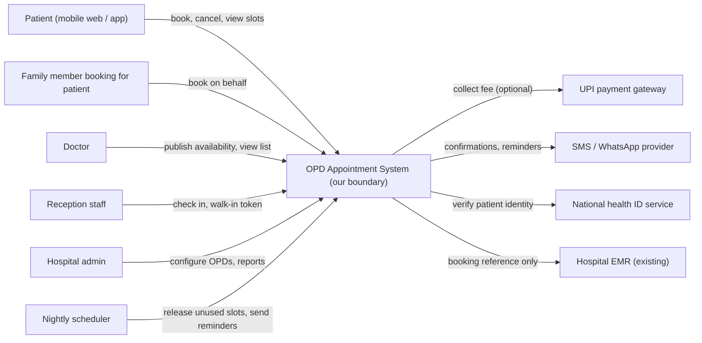
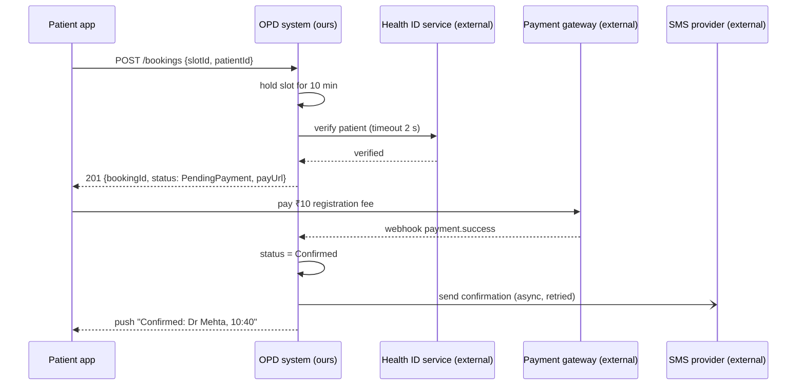

Most failed designs are not wrong answers; they are right answers to the wrong question. The first four minutes of an HLD interview, and the first meeting of a real project, exist to find the right question: who will use the system, what they must be able to do, what the system is responsible for and what it is not. This lesson gives you a method and a question bank for doing that quickly.

## Learning objectives

By the end of this lesson you will be able to:

1. Identify the actors of a system: primary users, secondary users, operators and external systems.
2. Turn a vague prompt into 3–6 core use cases, each with a clear actor and outcome.
3. Draw a system boundary (context diagram) that separates what you build from what you integrate with.
4. Write an explicit in-scope and out-of-scope list and a list of assumptions with sensible defaults.
5. Use a categorised question bank and pick the questions that actually change the design.
6. Express the system boundary in ASP.NET Core code as interfaces (ports) for every external system.

## Prerequisites

- [The 12-step HLD framework](#/lesson/m11-hld-framework): this lesson expands steps 1 and 2.
- [Functional and non-functional requirements](#/lesson/m02-requirements).
- Helpful: [Hexagonal architecture](#/lesson/m02-hexagonal), which gives the code-level view of a boundary.

## Explain it like I'm a beginner

Suppose your uncle says, "Build me a website for my shop." Before writing anything you would ask: What do you sell? Do customers order online or just look at prices? Who delivers? Do you take UPI? Will your staff update the stock, or will you? Is this one shop or all five branches?

Each answer changes what you build. "Just show prices" is a weekend's work. "Orders with UPI, delivery tracking and stock across five branches" is months of work and needs a payment provider, a delivery partner and a proper database.

Three ideas carry this whole lesson:

- **Who is involved?** The people and other systems that interact with yours (actors). Your uncle's customers, his staff, the UPI payment provider and the courier company are all actors.
- **What must they be able to do?** The few main jobs the system must perform (use cases). "Customer places an order and pays by UPI" is one.
- **Where is the fence?** The line between what you build and what you only connect to (the system boundary). You build the order website. You do *not* build UPI or the courier's tracking system; you call them.

Writing down the fence, and what is outside it, is called scoping. It is how you keep a project, or a 45-minute interview, from growing without limit.

## First-principles explanation

### Why clarifying is a design activity, not a formality

A prompt like "design a hospital appointment system" hides at least a hundred decisions. Some of them change the architecture completely:

- Is it one clinic with three doctors, or 600 government hospitals across a state? (Single server versus a multi-tenant platform.)
- Do patients pay online at booking time? (A payment integration with timeouts, refunds and reconciliation.)
- Do walk-in tokens and online bookings share the same queue? (A real-time queue system at every OPD counter.)
- Must the system work when a rural hospital's internet drops? (Offline-first clients and synchronisation.)

Asking about these early is not politeness. It is the cheapest design work you will ever do: changing a sentence on a whiteboard costs nothing, changing a deployed system costs months.

### Actors: everyone and everything that touches the system

An **actor** is a role that interacts with the system from outside. Classify actors into four groups, because each group raises different requirements:

| Actor type | Who | Typical requirements they bring |
|---|---|---|
| **Primary users** | People the system exists for: patients booking appointments | Usability, latency, mobile access, languages |
| **Secondary users** | People who support the primary flow: doctors, reception staff | Dashboards, overrides, bulk actions, shifts |
| **Operators and admins** | Hospital administrators, support staff, auditors | Configuration, reports, audit logs, access control |
| **External systems** | Payment gateway, SMS or WhatsApp provider, national health ID service, the hospital's existing records system | Integration contracts, timeouts, failure handling, data ownership |

Two habits help:

1. **Name roles, not people.** "Receptionist" is an actor; "Mrs Sharma" is a person who may play several roles.
2. **Include non-human actors.** A scheduler that releases unused slots at 9 a.m. is an actor too (a time-based trigger). So is a government reporting system that pulls data every night.

### Use cases: what each actor needs to achieve

A **use case** is a goal an actor achieves with the system, written as *actor + verb + outcome*: "Patient books an OPD slot with a chosen doctor and receives a confirmation." Good use cases are:

- **Outcome-based**, not screen-based. "Patient sees a calendar" is a screen; "patient books a slot" is a goal.
- **Few.** In an interview, 3–6 core use cases. More belong to "later" or "out of scope".
- **Ranked.** Use a simple scheme such as **MoSCoW**: Must have, Should have, Could have, Won't have (this time). Design the architecture for the Musts and check that the Shoulds fit.

Also write one or two **abuse cases**: what a malicious or careless actor might do. "A tout books 200 slots with fake numbers and resells them" is an abuse case that changes the design (OTP verification, per-phone limits, rate limiting).

### The system boundary

The **system boundary** separates what your team builds and operates from what it only integrates with. Drawing it answers questions that otherwise cause arguments later:

- **Who owns this data?** If the hospital's existing records system (an electronic medical record, EMR) owns patient history, your system must not become a second, conflicting copy. You store a reference.
- **Who is responsible when it fails?** If the SMS provider is outside the boundary, you design for its failure (retries, a fallback channel) but you do not fix it.
- **What is the contract?** Every arrow that crosses the boundary needs an API contract, a timeout and a failure plan.

The standard picture is a **context diagram** (level 1 of the C4 model): your system as one box in the middle, actors around it, arrows labelled with what flows across.

### Scope: in, out, and later

Scoping is choosing what to build *now*. Write two lists and say them aloud:

- **In scope:** the Must-have use cases.
- **Out of scope:** things that are related but you will not design today, with a one-line reason. "Billing and insurance claims: separate system, we only pass a booking reference." "Doctors' prescriptions: owned by the EMR."

An out-of-scope list is not a weakness. It shows you can see the whole problem and are choosing deliberately. In an interview it also invites correction: if the interviewer actually cares about billing, they will say so now.

### Assumptions: proposing defaults instead of asking forever

You cannot ask about everything. For anything not worth a question, **state an assumption with a sensible default** and move on: "I'll assume patients book at most 30 days ahead and each slot is 10 minutes, unless you'd like otherwise."

This technique (propose, do not interrogate) has three advantages: it is fast, it shows judgement, and it gives the interviewer an easy way to steer. Keep a visible list of assumptions; you will refer back to it when estimating.

### The question bank

Questions fall into categories. You will not ask all of them; pick the ones whose answers would change the design.

| Category | Questions that usually change the design |
|---|---|
| **Users and actors** | Who are the users? How many (DAU, total)? Which countries, languages, devices? Are there admin or operator roles? |
| **Core features** | What are the 3–5 things users must be able to do? Which one matters most? Anything explicitly out? |
| **Scale and growth** | How many requests, records, files? What is the peak and when (morning rush, festival sale, exam result day)? Growth in a year? |
| **Data** | What do we store? How big is one item? How long do we keep it? Who owns it? Is any of it personal or sensitive? |
| **Read/write pattern** | Mostly reads or writes? Are some items much hotter than others? |
| **Latency** | Which actions need an instant answer, and which can complete later? |
| **Consistency** | What must never be wrong (money, seat or slot counts)? What may be briefly stale (counts, feeds)? |
| **Availability** | What happens to the business if this is down for an hour? Which flows must keep working? |
| **Security and compliance** | Who may see what? Any regulation (health data, payments, data residency in India)? Audit needs? |
| **Integrations** | Which external systems do we call or get called by? Do they have SLAs, rate limits? |
| **Clients and offline** | Web, mobile, kiosks, IoT devices? Must anything work offline? |
| **Constraints** | Budget, team size, deadline, mandated cloud or technology, existing systems to reuse? |

Order matters. Ask about **users and core features first**, because everything else depends on them. Ask about **scale** next, because it decides the architecture's shape. Leave detailed security and integration questions for when they matter.

### How to ask well

- **Closed questions with a proposed answer:** "Can I assume online payment is optional at booking?" beats "What about payments?"
- **One question, one decision:** know why you are asking. If no answer would change your design, do not ask.
- **Quantify:** "How many hospitals: ten or a thousand?" gets a usable number.
- **Write answers down** where both of you can see them.
- **Confirm the summary:** "So: patients book OPD slots online, 600 hospitals, payment optional, SMS confirmation, walk-ins out of scope. Correct?"

### When a simpler scope is enough

If the answers describe a small, single-site system (one clinic, three doctors, 60 appointments a day), say so and design accordingly: one web app, one database, an SMS integration. The skill is not asking many questions; it is asking the questions that tell you how big the problem really is.

## Visual explanation

### Context diagram for a state-wide OPD appointment system



The single box in the middle is everything our team builds and runs. **Patients** and **family members** are primary users; we keep them as two actors because "book on behalf of someone else" raises consent and identity questions. **Doctors** and **reception staff** are secondary users who keep the primary flow working: doctors publish availability, reception checks patients in and issues walk-in tokens. The **admin** configures OPDs and pulls reports. On the right are **external systems** we integrate with but do not own: the payment gateway (only when a fee applies), the messaging provider, a national health ID service for identity verification, and the hospital's existing EMR, to which we send only a booking reference because the EMR owns clinical data. The **scheduler** at the bottom is a non-human actor that triggers time-based jobs. Every arrow crossing the boundary will need a contract, a timeout and a failure plan.

### A booking that crosses the boundary



Read the arrows as boundary crossings. The patient's request enters our system, which holds the slot for 10 minutes so two patients cannot pay for the same one. Identity verification crosses the boundary synchronously with a **2-second timeout**: if the external service is slow, we can fall back to OTP-only verification rather than block booking. The payment happens between the patient and the gateway; we learn the result through a **webhook**, an inbound call from an external system that we must authenticate and handle idempotently. The SMS is sent **asynchronously** (the half arrow) and retried, so the messaging provider's outages delay confirmations but never fail bookings. Notice how much of the design came directly from clarifying three facts: payment is optional and small, identity verification exists, and SMS is required.

## Step-by-step example

**Prompt:** "Design an appointment system for government hospitals."

### Step 1 — Find the actors

Ask: "Who uses it, apart from patients?" Answer: doctors, reception staff, hospital administrators, and a state health department that wants daily reports. External systems: a UPI payment gateway (for a ₹10 registration fee in some hospitals), an SMS provider, a national health ID service and each hospital's existing EMR.

### Step 2 — Find the core use cases

| # | Actor | Use case | Priority |
|---|---|---|---|
| 1 | Patient / family | Book an OPD slot with a department or doctor | Must |
| 2 | Patient | Cancel or reschedule | Must |
| 3 | Reception | Check the patient in and print a token | Must |
| 4 | Doctor | Publish availability, see today's list | Must |
| 5 | Admin | Configure departments, slot lengths, holidays | Should |
| 6 | State department | Daily aggregate report | Could |
| 7 | Patient | Video consultation | Won't (this phase) |

Abuse case: touts bulk-book slots in popular departments and sell them. This adds per-phone booking limits, OTP verification and identity checks.

### Step 3 — Ask the scale questions

- "How many hospitals and OPD visits a day?" *About 600 hospitals; around 150,000 OPD visits a day statewide, about 40 % booked online.*
- "When is the peak?" *Booking opens at 8 a.m. for the next 7 days; most bookings happen between 8:00 and 8:30.*
- "How far ahead?" *7 days.*

These three answers already tell us the interesting load is the 8 a.m. burst, not the daily total (we estimate it properly in [Capacity estimation](#/lesson/m11-capacity-estimation)).

### Step 4 — Draw the boundary and decide data ownership

- We own: slots, bookings, check-ins, tokens, notifications log.
- The EMR owns: medical history, prescriptions, diagnoses. We send a booking reference; we never copy clinical data.
- The health ID service owns identity. We store the verified ID reference and phone number.
- The payment gateway owns card and UPI details. We store a payment reference and status only.

### Step 5 — Write the scope and assumptions

- **In scope:** use cases 1–4, plus 5 at a basic level.
- **Out of scope:** video consultation, billing beyond the registration fee, pharmacy, lab orders, the reporting warehouse (we export a daily file).
- **Assumptions:** slot length is configured per department (default 10 minutes); bookings open 7 days ahead at 08:00; patients may hold one active booking per department; walk-ins are handled by reception using the same slot pool; Hindi and English UI at launch.

### Step 6 — Confirm and move on

"So: online OPD booking for 600 hospitals, about 60,000 online bookings a day with a sharp 8 a.m. burst, payment optional, SMS confirmations, identity through the health ID service, and the EMR stays the source of clinical truth. Video, billing and pharmacy are out. Correct?" The interviewer agrees and adds one thing: "Rural hospitals have unreliable internet." That single sentence adds an offline requirement for reception check-in, which is exactly why you confirm.

## Production-style C# implementation

In code, the system boundary becomes a set of **interfaces for every external actor** (ports), with real implementations (adapters) plugged in at startup. The domain logic never references an SMS company's SDK or a payment gateway's HTTP client directly. This makes the boundary visible in the code, testable with fakes, and replaceable when the hospital switches providers.

```text
Opd.Appointments/
  Program.cs
  Boundary/ExternalPorts.cs
  Boundary/FakeAdapters.cs
  Scope/ScopeRegister.cs
  Booking/BookingService.cs
```

```csharp file=Boundary/ExternalPorts.cs
namespace Opd.Appointments.Boundary;

// One interface per external actor from the context diagram. Each method states
// what crosses the boundary, nothing more.

public interface IHealthIdVerifier
{
    /// <summary>Returns a verified identity reference, or null if the ID is unknown.</summary>
    Task<string?> VerifyAsync(string healthId, CancellationToken ct);
}

public interface IPaymentGateway
{
    /// <summary>Creates a payment request and returns a URL the patient opens to pay.</summary>
    Task<PaymentLink> CreatePaymentAsync(Guid bookingId, decimal amountRupees, CancellationToken ct);
}

public sealed record PaymentLink(string PaymentReference, Uri PayUrl);

public interface IPatientNotifier
{
    Task SendAsync(string phone, string message, CancellationToken ct);
}

public interface IEmrBookingSink
{
    /// <summary>Sends only a booking reference to the hospital EMR. Clinical data stays in the EMR.</summary>
    Task PublishBookingReferenceAsync(Guid bookingId, string hospitalCode, CancellationToken ct);
}
```

```csharp file=Boundary/FakeAdapters.cs
using System.Collections.Concurrent;

namespace Opd.Appointments.Boundary;

// In-memory adapters for development and tests. Production adapters wrap the
// provider's HTTP API with timeouts and retries (see m10-timeouts-retries).

public sealed class FakeHealthIdVerifier : IHealthIdVerifier
{
    public Task<string?> VerifyAsync(string healthId, CancellationToken ct) =>
        Task.FromResult<string?>(healthId.Length == 14 && healthId.All(char.IsDigit) ? $"verified:{healthId}" : null);
}

public sealed class FakePaymentGateway : IPaymentGateway
{
    public Task<PaymentLink> CreatePaymentAsync(Guid bookingId, decimal amountRupees, CancellationToken ct) =>
        Task.FromResult(new PaymentLink($"pay_{bookingId:N}", new Uri($"https://pay.example.test/{bookingId:N}")));
}

public sealed class OutboxNotifier : IPatientNotifier
{
    // Messages are queued, not sent inline: an SMS outage must never fail a booking.
    public ConcurrentQueue<(string Phone, string Message)> Outbox { get; } = new();

    public Task SendAsync(string phone, string message, CancellationToken ct)
    {
        Outbox.Enqueue((phone, message));
        return Task.CompletedTask;
    }
}

public sealed class NullEmrSink : IEmrBookingSink
{
    public Task PublishBookingReferenceAsync(Guid bookingId, string hospitalCode, CancellationToken ct) => Task.CompletedTask;
}
```

```csharp file=Scope/ScopeRegister.cs
namespace Opd.Appointments.Scope;

public enum Priority { Must, Should, Could, Wont }

public sealed record UseCase(string Actor, string Goal, Priority Priority);

public sealed record Assumption(string Text, string DefaultValue, bool Confirmed);

/// <summary>The clarified requirements, kept in code so they can be served to the team,
/// checked in tests, and diffed in code review when scope changes.</summary>
public sealed class ScopeRegister
{
    public List<UseCase> UseCases { get; } =
    [
        new("Patient", "Book an OPD slot and receive confirmation", Priority.Must),
        new("Patient", "Cancel or reschedule a booking", Priority.Must),
        new("Reception", "Check a patient in and issue a token", Priority.Must),
        new("Doctor", "Publish availability and view today's list", Priority.Must),
        new("Admin", "Configure departments, slot length and holidays", Priority.Should),
        new("State department", "Download a daily aggregate report", Priority.Could),
        new("Patient", "Video consultation", Priority.Wont),
    ];

    public List<string> OutOfScope { get; } =
    [
        "Billing beyond the registration fee (hospital billing system)",
        "Prescriptions and medical history (owned by the EMR)",
        "Pharmacy and lab orders",
    ];

    public List<Assumption> Assumptions { get; } =
    [
        new("Slot length per department", "10 minutes", Confirmed: true),
        new("Booking window", "7 days ahead, opens 08:00", Confirmed: true),
        new("Active bookings per patient per department", "1", Confirmed: false),
    ];

    public IEnumerable<UseCase> InScope => UseCases.Where(u => u.Priority is Priority.Must or Priority.Should);

    public IEnumerable<Assumption> OpenAssumptions => Assumptions.Where(a => !a.Confirmed);
}
```

```csharp file=Booking/BookingService.cs
using Opd.Appointments.Boundary;

namespace Opd.Appointments.Booking;

public sealed record BookingRequest(Guid SlotId, string HealthId, string Phone, string HospitalCode, decimal FeeRupees);

public sealed record BookingResult(Guid BookingId, string Status, Uri? PayUrl);

/// <summary>Domain logic. It depends only on ports, so every boundary crossing is explicit.</summary>
public sealed class BookingService(
    IHealthIdVerifier verifier,
    IPaymentGateway payments,
    IPatientNotifier notifier,
    IEmrBookingSink emr)
{
    private static readonly TimeSpan IdentityTimeout = TimeSpan.FromSeconds(2);

    public async Task<BookingResult> BookAsync(BookingRequest request, CancellationToken ct)
    {
        string? identity = await VerifyWithTimeoutAsync(request.HealthId, ct);
        if (identity is null)
            return new BookingResult(Guid.Empty, "IdentityNotVerified", null);

        var bookingId = Guid.NewGuid();

        if (request.FeeRupees > 0)
        {
            var link = await payments.CreatePaymentAsync(bookingId, request.FeeRupees, ct);
            return new BookingResult(bookingId, "PendingPayment", link.PayUrl);
        }

        await emr.PublishBookingReferenceAsync(bookingId, request.HospitalCode, ct);
        await notifier.SendAsync(request.Phone, $"OPD booking {bookingId.ToString()[..8]} confirmed.", ct);
        return new BookingResult(bookingId, "Confirmed", null);
    }

    private async Task<string?> VerifyWithTimeoutAsync(string healthId, CancellationToken ct)
    {
        using var cts = CancellationTokenSource.CreateLinkedTokenSource(ct);
        cts.CancelAfter(IdentityTimeout);
        try
        {
            return await verifier.VerifyAsync(healthId, cts.Token);
        }
        catch (OperationCanceledException) when (!ct.IsCancellationRequested)
        {
            // Clarified requirement: if the health ID service is slow, fall back to OTP-verified phone.
            return $"otp-fallback:{healthId}";
        }
    }
}
```

```csharp file=Program.cs
using Opd.Appointments.Boundary;
using Opd.Appointments.Booking;
using Opd.Appointments.Scope;

var builder = WebApplication.CreateBuilder(args);

// Adapters for each external actor. Swap these registrations for real HTTP adapters in production.
builder.Services.AddSingleton<IHealthIdVerifier, FakeHealthIdVerifier>();
builder.Services.AddSingleton<IPaymentGateway, FakePaymentGateway>();
builder.Services.AddSingleton<IPatientNotifier, OutboxNotifier>();
builder.Services.AddSingleton<IEmrBookingSink, NullEmrSink>();
builder.Services.AddSingleton<ScopeRegister>();
builder.Services.AddScoped<BookingService>();

var app = builder.Build();

app.MapPost("/bookings", async (BookingRequest req, BookingService svc, CancellationToken ct) =>
{
    var result = await svc.BookAsync(req, ct);
    return result.Status == "IdentityNotVerified"
        ? Results.UnprocessableEntity(new { error = "Health ID could not be verified." })
        : Results.Created($"/bookings/{result.BookingId}", result);
});

// The clarified scope is served to the team (and to the API docs) from one source of truth.
app.MapGet("/scope", (ScopeRegister scope) => new
{
    inScope = scope.InScope,
    outOfScope = scope.OutOfScope,
    openAssumptions = scope.OpenAssumptions,
});

app.Run();
```

Design points to defend:

1. **One port per external actor.** The context diagram and the `Boundary` folder match one to one. A reviewer can check that every arrow crossing the boundary has an interface, a timeout and a failure behaviour.
2. **The notifier is an outbox, not a direct send.** The requirement "SMS confirmation" was clarified as *asynchronous*; the code makes it impossible to fail a booking because the SMS provider is down.
3. **The EMR port carries a reference only.** The data-ownership decision from step 4 is enforced by the method signature: there is no parameter for clinical data.
4. **The identity timeout fallback encodes a clarified answer.** Without the clarifying question "what if the ID service is slow?", the code would either hang or fail.

## Bad design vs good design

**Bad: the boundless system.** The team hears "appointment system" and designs patient records, prescriptions, a pharmacy module, billing, a reporting warehouse and video consultation. The database gets a `patients` table with blood group and diagnoses that conflicts with the EMR. Every hospital's EMR now disagrees with the appointment system's copy, nobody knows which is right, and the project is six months late because it rebuilt half of an EMR.

**Bad: hidden external dependencies.** The domain code calls the SMS provider's SDK directly inside the booking transaction. When the provider has a two-hour outage on a Monday morning, no one can book an appointment anywhere in the state.

**Good:**

- A context diagram agreed in the first meeting, with each external system labelled with what crosses the boundary.
- An explicit out-of-scope list ("clinical data stays in the EMR") that the whole team can point to.
- Ports for every external actor, with fakes for tests and timeouts plus fallbacks in the real adapters.
- Assumptions written down with defaults and marked confirmed or open.

:::callout type=mistake title="Asking questions that do not change the design"
"Which font do you want?" and "Should the button be blue?" waste interview minutes. Before asking, check: would any answer change a component, a number or a data-ownership decision? If not, assume a default or skip it.
:::

:::callout type=tradeoff title="Narrow scope versus future-proofing"
A narrow scope ships sooner and is easier to make reliable. But some decisions are expensive to change later, such as the tenant model (one database per hospital or shared) or identity. Keep the *scope* narrow, but ask the one or two questions about the future that would force a redesign, and record the answers.
:::

## Practical playground

The graph below is a first attempt at the OPD system where the boundary is blurred: the API writes clinical data into its own database, calls the SMS provider synchronously and has no identity service. Open it in the HLD canvas. Mark which nodes are inside your boundary and which are external actors, remove anything that belongs to the EMR, and make every boundary crossing either asynchronous or protected by a timeout. Add the nightly scheduler as an actor.

:::playground type=hld title="Draw the boundary for the OPD appointment system"
```json
{
  "nodes": [
    { "id": "pat", "type": "client", "label": "Patients", "props": { "rps": 400 } },
    { "id": "staff", "type": "client", "label": "Reception + doctors", "props": { "rps": 60 } },
    { "id": "lb", "type": "load-balancer", "label": "Load balancer" },
    { "id": "api", "type": "app-server", "label": "OPD API", "props": { "instances": 2 } },
    { "id": "db", "type": "database", "label": "PostgreSQL (bookings + diagnoses + prescriptions)" },
    { "id": "sms", "type": "external", "label": "SMS provider" },
    { "id": "pg", "type": "external", "label": "UPI payment gateway" }
  ],
  "edges": [
    { "from": "pat", "to": "lb", "kind": "sync" },
    { "from": "staff", "to": "lb", "kind": "sync" },
    { "from": "lb", "to": "api", "kind": "sync" },
    { "from": "api", "to": "db", "kind": "sync" },
    { "from": "api", "to": "sms", "kind": "sync", "label": "inside booking transaction" },
    { "from": "api", "to": "pg", "kind": "sync" }
  ]
}
```
:::

## Exercises

:::exercise id=m11-clarifying-requirements-ex1 difficulty=beginner kind=code title="Pick the questions worth asking"
You have a bank of candidate questions, each tagged with a category and an impact score (how much the answer could change the design, 1–5). You have time for only a few. Write a picker that covers as many categories as possible and then fills the remaining time with the highest-impact questions.
::requirements
- `Question(string Category, string Text, int Impact)`. Impact outside 1–5 throws `ArgumentOutOfRangeException` in the picker.
- `QuestionPicker.Pick(IReadOnlyList<Question> bank, int max)`:
  1. For each category, take its single highest-impact question (ties: earliest in the bank).
  2. If there are more categories than `max`, keep the `max` category picks with the highest impact (ties: earliest in the bank).
  3. Fill any remaining slots with the highest-impact unpicked questions (ties: earliest in the bank).
  4. Return the result ordered by impact descending, ties by position in the bank.
- `max < 1` throws `ArgumentOutOfRangeException`.
::acceptance
- With three categories and `max = 3`, one question per category is returned.
- With `max = 5`, the two extra slots go to the highest-impact remaining questions.
- With more categories than `max`, the lowest-impact categories are dropped.
- Equal impacts keep bank order.
::hint
Track each question's original index so ties can be broken by bank order.
::hint
`GroupBy(q => q.Category)` then, inside each group, order by impact descending and index ascending and take the first.
::hint
Use a `HashSet<int>` of picked indexes so the fill step skips them.
::hint
```csharp
var indexed = bank.Select((q, i) => (q, i)).ToList();
var firsts = indexed.GroupBy(x => x.q.Category)
    .Select(g => g.OrderByDescending(x => x.q.Impact).ThenBy(x => x.i).First())
    .OrderByDescending(x => x.q.Impact).ThenBy(x => x.i).Take(max).ToList();
```
::starter
```csharp file=QuestionPicker.cs
using System;
using System.Collections.Generic;
using System.Linq;

public sealed record Question(string Category, string Text, int Impact);

public static class QuestionPicker
{
    public static List<Question> Pick(IReadOnlyList<Question> bank, int max) => throw new NotImplementedException();
}
```
::tests
```csharp file=QuestionPickerTests.cs
using System;
using System.Collections.Generic;
using System.Linq;
using Xunit;

public class QuestionPickerTests
{
    private static readonly List<Question> Bank = new()
    {
        new("Users", "Who are the users?", 5),
        new("Users", "Which languages?", 2),
        new("Scale", "How many bookings a day?", 5),
        new("Scale", "When is the peak?", 4),
        new("Integrations", "Is payment required?", 4),
        new("Integrations", "Which SMS provider?", 1),
    };

    [Fact]
    public void One_per_category_when_max_equals_categories()
    {
        var picked = QuestionPicker.Pick(Bank, 3);
        Assert.Equal(new[] { "Who are the users?", "How many bookings a day?", "Is payment required?" }, picked.Select(q => q.Text).ToArray());
    }

    [Fact]
    public void Extra_slots_go_to_highest_impact_remaining()
    {
        var picked = QuestionPicker.Pick(Bank, 5);
        Assert.Equal(new[] { "Who are the users?", "How many bookings a day?", "When is the peak?", "Is payment required?", "Which languages?" },
            picked.Select(q => q.Text).ToArray());
    }

    [Fact]
    public void Lowest_impact_categories_dropped_when_max_is_small()
    {
        var bank = new List<Question>
        {
            new("Security", "Any regulation?", 3),
            new("Users", "Who are the users?", 5),
            new("Clients", "Offline needed?", 4),
        };
        var picked = QuestionPicker.Pick(bank, 2);
        Assert.Equal(new[] { "Who are the users?", "Offline needed?" }, picked.Select(q => q.Text).ToArray());
    }

    [Fact]
    public void Ties_keep_bank_order()
    {
        var bank = new List<Question> { new("A", "a1", 3), new("B", "b1", 3), new("A", "a2", 3) };
        Assert.Equal(new[] { "a1", "b1", "a2" }, QuestionPicker.Pick(bank, 3).Select(q => q.Text).ToArray());
    }

    [Fact]
    public void Invalid_inputs_throw()
    {
        Assert.Throws<ArgumentOutOfRangeException>(() => QuestionPicker.Pick(Bank, 0));
        Assert.Throws<ArgumentOutOfRangeException>(() => QuestionPicker.Pick(new List<Question> { new("A", "bad", 9) }, 1));
    }
}
```
::solution
```csharp file=QuestionPicker.cs
using System;
using System.Collections.Generic;
using System.Linq;

public sealed record Question(string Category, string Text, int Impact);

public static class QuestionPicker
{
    public static List<Question> Pick(IReadOnlyList<Question> bank, int max)
    {
        ArgumentNullException.ThrowIfNull(bank);
        if (max < 1) throw new ArgumentOutOfRangeException(nameof(max));
        foreach (var q in bank)
            if (q.Impact is < 1 or > 5) throw new ArgumentOutOfRangeException(nameof(bank), q.Impact, $"Impact of '{q.Text}' must be 1-5.");

        var indexed = bank.Select((q, i) => (Q: q, I: i)).ToList();

        var picked = indexed
            .GroupBy(x => x.Q.Category)
            .Select(g => g.OrderByDescending(x => x.Q.Impact).ThenBy(x => x.I).First())
            .OrderByDescending(x => x.Q.Impact).ThenBy(x => x.I)
            .Take(max)
            .ToList();

        var used = picked.Select(x => x.I).ToHashSet();
        picked.AddRange(indexed
            .Where(x => !used.Contains(x.I))
            .OrderByDescending(x => x.Q.Impact).ThenBy(x => x.I)
            .Take(max - picked.Count));

        return picked.OrderByDescending(x => x.Q.Impact).ThenBy(x => x.I).Select(x => x.Q).ToList();
    }
}
```

Breadth first, then depth: covering every category once protects you from the classic miss (never asking about scale, or never asking about integrations), and the fill step spends the rest of the time where answers matter most.
::mistakes
- Sorting the whole bank by impact and taking the top N, which can return five scale questions and nothing about users.
- Losing bank order on ties because `OrderByDescending` on impact alone is used after a `GroupBy`.
- Validating impact only for picked questions, so a bad entry slips through silently.
::extensions
Add a time cost per question (in seconds) and pick under a time budget instead of a count. This becomes a small knapsack problem.
:::

:::exercise id=m11-clarifying-requirements-ex2 difficulty=beginner kind=written title="Actors and boundary for water-tanker booking"
A city water utility wants residents of areas without piped supply to book water tankers online. Tankers are run by private contractors. The utility's billing system already exists. Payment is by UPI.

Write: (a) the actors in the four groups, (b) 4–6 use cases with MoSCoW priorities, (c) one abuse case, (d) the system boundary: what you own and what is external, with what crosses each boundary.
::acceptance
- Actors include at least one external system and one non-human or operator actor.
- Use cases are written as actor + verb + outcome and are prioritised.
- The abuse case leads to a concrete design consequence.
- The boundary states data ownership for billing and for tanker GPS location.
::hint
Think beyond residents: who drives the tanker? Who assigns tankers? Who audits?
::hint
Contractors' tankers may already have GPS devices. Is their tracking system yours?
::hint
Abuse: what if a contractor marks a delivery "done" without delivering?
::hint
Use "what crosses the arrow" labels: booking reference, payment status, GPS points, invoice.
::solution
**(a) Actors.** Primary: residents. Secondary: tanker drivers (mobile app), contractor dispatchers, utility zone officers. Operators: utility admins and auditors. External systems: UPI payment gateway, SMS provider, contractors' GPS tracking platforms, the utility's billing system. Non-human: a scheduler that escalates bookings not assigned within 2 hours.

**(b) Use cases.** Must: resident books a tanker for a date and slot and pays; dispatcher assigns a tanker and driver; driver confirms delivery with photo and OTP from the resident; resident tracks the tanker on the day. Should: zone officer views pending bookings and escalations. Could: monthly consumption report per area. Won't: dynamic pricing.

**(c) Abuse case.** A contractor marks deliveries complete without delivering, to claim payment. Consequence: delivery requires the resident's OTP *and* a GPS point within 100 m of the address; disputed deliveries hold contractor payout.

**(d) Boundary.** We own bookings, assignments, delivery proofs and the notification log. External: payment gateway (we store payment reference and status), billing system (we send a daily file of completed deliveries; billing owns invoices), contractor GPS platforms (we pull location points through their API during an active delivery and keep them 30 days; they own the device data), SMS provider (we send messages asynchronously).
::mistakes
- Listing only "resident" and "admin" as actors.
- Making the GPS platform part of your system and promising to run tanker hardware.
- Duplicating invoices in your database, creating two sources of truth with billing.
:::

:::exercise id=m11-clarifying-requirements-ex3 difficulty=intermediate kind=hld title="Fix the blurred boundary"
Starting from the playground graph, produce an architecture where the boundary is explicit. Clinical data must stay in the EMR, SMS must never block booking, identity must be verified through the health ID service with a timeout, and a scheduler must release unpaid holds after 10 minutes.
::acceptance
- The database stores bookings and slots only; diagnoses and prescriptions are removed.
- The SMS provider is reached through a queue and worker.
- The EMR and health ID service appear as `external` nodes with labelled edges.
- A `scheduler` node releases expired holds.
- The solution explains what crosses each boundary edge.
::hint
Start by listing which data in the database label belongs to someone else.
::hint
Every `external` node should be reached by an edge whose label says what crosses it.
::hint
A synchronous SMS call inside a booking transaction couples your availability to the provider's.
::hint
Add `queue`, `worker`, `scheduler`, and two `external` nodes (EMR, health ID).
::starter
```json
{
  "nodes": [
    { "id": "pat", "type": "client", "label": "Patients", "props": { "rps": 400 } },
    { "id": "staff", "type": "client", "label": "Reception + doctors", "props": { "rps": 60 } },
    { "id": "lb", "type": "load-balancer", "label": "Load balancer" },
    { "id": "api", "type": "app-server", "label": "OPD API", "props": { "instances": 2 } },
    { "id": "db", "type": "database", "label": "PostgreSQL (bookings + diagnoses + prescriptions)" },
    { "id": "sms", "type": "external", "label": "SMS provider" },
    { "id": "pg", "type": "external", "label": "UPI payment gateway" }
  ],
  "edges": [
    { "from": "pat", "to": "lb", "kind": "sync" },
    { "from": "staff", "to": "lb", "kind": "sync" },
    { "from": "lb", "to": "api", "kind": "sync" },
    { "from": "api", "to": "db", "kind": "sync" },
    { "from": "api", "to": "sms", "kind": "sync", "label": "inside booking transaction" },
    { "from": "api", "to": "pg", "kind": "sync" }
  ]
}
```
::solution
```json
{
  "nodes": [
    { "id": "pat", "type": "client", "label": "Patients", "props": { "rps": 400 } },
    { "id": "staff", "type": "client", "label": "Reception + doctors", "props": { "rps": 60 } },
    { "id": "lb", "type": "load-balancer", "label": "Load balancer" },
    { "id": "api", "type": "app-server", "label": "OPD API", "props": { "instances": 2, "multiAz": true } },
    { "id": "db", "type": "database", "label": "PostgreSQL (slots, bookings, check-ins)", "props": { "replicas": 1 } },
    { "id": "q", "type": "queue", "label": "Notifications + EMR events" },
    { "id": "w", "type": "worker", "label": "Integration worker", "props": { "instances": 2 } },
    { "id": "sch", "type": "scheduler", "label": "Release unpaid holds every minute" },
    { "id": "id", "type": "external", "label": "Health ID service" },
    { "id": "pg", "type": "external", "label": "UPI payment gateway" },
    { "id": "sms", "type": "external", "label": "SMS provider" },
    { "id": "emr", "type": "external", "label": "Hospital EMR" }
  ],
  "edges": [
    { "from": "pat", "to": "lb", "kind": "sync" },
    { "from": "staff", "to": "lb", "kind": "sync" },
    { "from": "lb", "to": "api", "kind": "sync" },
    { "from": "api", "to": "db", "kind": "sync", "label": "slots, bookings" },
    { "from": "api", "to": "id", "kind": "sync", "label": "verify ID (2 s timeout, OTP fallback)" },
    { "from": "api", "to": "pg", "kind": "sync", "label": "create payment link" },
    { "from": "pg", "to": "api", "kind": "async", "label": "payment webhook" },
    { "from": "api", "to": "q", "kind": "async", "label": "booking.confirmed" },
    { "from": "q", "to": "w", "kind": "async" },
    { "from": "w", "to": "sms", "kind": "sync", "label": "confirmation text" },
    { "from": "w", "to": "emr", "kind": "sync", "label": "booking reference only" },
    { "from": "sch", "to": "db", "kind": "sync", "label": "expire holds older than 10 min" }
  ]
}
```

**Boundary crossings.** Health ID: a patient ID goes out, a verified reference comes back; 2-second timeout with OTP fallback. Payment gateway: we send booking id and amount and receive a signed webhook with the payment status; card and UPI details never enter our system. SMS: phone number and message text, asynchronous with retries. EMR: booking reference, hospital code, department and time; no clinical data flows either way. The scheduler is an internal actor that keeps the slot pool honest when patients abandon payment.
::mistakes
- Moving diagnoses into a separate "clinical service" you own, which still duplicates the EMR.
- Forgetting the inbound webhook edge from the payment gateway.
- Labelling edges with technologies ("REST") instead of what crosses them.
:::

:::exercise id=m11-clarifying-requirements-ex4 difficulty=intermediate kind=code title="Which external systems can take us down?"
After clarifying, you have a list of use cases with priorities and the external systems each one calls, marked synchronous or asynchronous. Write an analyser that tells the team which external systems are on the critical path of Must-have use cases.
::requirements
- `Dependency(string ExternalSystem, bool Synchronous)` and `UseCaseSpec(string Name, string Priority, IReadOnlyList<Dependency> Dependencies)`. Priority is one of `Must`, `Should`, `Could`, `Wont` (case-insensitive); anything else throws `ArgumentException`.
- `BoundaryAnalyzer.CriticalExternals(IEnumerable<UseCaseSpec> useCases)` returns external system names that are called **synchronously** by at least one **Must** use case, sorted alphabetically, without duplicates.
- `BoundaryAnalyzer.BlastRadius(IEnumerable<UseCaseSpec> useCases, string external)` returns the names of use cases (any priority) that call `external` synchronously, in input order.
- External names compare case-insensitively; return the spelling of the first occurrence.
::acceptance
- An SMS provider called only asynchronously is not critical.
- A system called synchronously only by a Should use case is not critical.
- `BlastRadius` for the payment gateway lists every synchronous caller.
- An invalid priority throws.
::hint
Filter first: `Must` use cases, then their synchronous dependencies.
::hint
Use a `Dictionary<string, string>` with `StringComparer.OrdinalIgnoreCase` to remember the first spelling of each name.
::hint
Validate priorities up front so even non-Must use cases with a typo are rejected.
::hint
```csharp
foreach (var d in uc.Dependencies.Where(d => d.Synchronous))
    seen.TryAdd(d.ExternalSystem, d.ExternalSystem);
```
::starter
```csharp file=BoundaryAnalyzer.cs
using System;
using System.Collections.Generic;
using System.Linq;

public sealed record Dependency(string ExternalSystem, bool Synchronous);

public sealed record UseCaseSpec(string Name, string Priority, IReadOnlyList<Dependency> Dependencies);

public static class BoundaryAnalyzer
{
    public static List<string> CriticalExternals(IEnumerable<UseCaseSpec> useCases) => throw new NotImplementedException();

    public static List<string> BlastRadius(IEnumerable<UseCaseSpec> useCases, string external) => throw new NotImplementedException();
}
```
::tests
```csharp file=BoundaryAnalyzerTests.cs
using System;
using System.Collections.Generic;
using Xunit;

public class BoundaryAnalyzerTests
{
    private static List<UseCaseSpec> Opd() => new()
    {
        new("Book slot", "Must", new List<Dependency> { new("Health ID", true), new("Payment gateway", true), new("SMS", false) }),
        new("Cancel booking", "must", new List<Dependency> { new("payment gateway", true), new("SMS", false) }),
        new("Check in", "Must", new List<Dependency>()),
        new("Daily report", "Could", new List<Dependency> { new("State portal", true) }),
        new("Configure OPD", "Should", new List<Dependency> { new("Directory", true) }),
    };

    [Fact]
    public void Critical_externals_are_sync_dependencies_of_musts() =>
        Assert.Equal(new List<string> { "Health ID", "Payment gateway" }, BoundaryAnalyzer.CriticalExternals(Opd()));

    [Fact]
    public void Async_only_dependencies_are_not_critical() =>
        Assert.DoesNotContain("SMS", BoundaryAnalyzer.CriticalExternals(Opd()));

    [Fact]
    public void Blast_radius_lists_sync_callers_in_order() =>
        Assert.Equal(new List<string> { "Book slot", "Cancel booking" }, BoundaryAnalyzer.BlastRadius(Opd(), "PAYMENT GATEWAY"));

    [Fact]
    public void Blast_radius_ignores_async_calls() =>
        Assert.Empty(BoundaryAnalyzer.BlastRadius(Opd(), "SMS"));

    [Fact]
    public void Invalid_priority_throws()
    {
        var bad = new List<UseCaseSpec> { new("X", "Urgent", new List<Dependency>()) };
        Assert.Throws<ArgumentException>(() => BoundaryAnalyzer.CriticalExternals(bad));
    }
}
```
::solution
```csharp file=BoundaryAnalyzer.cs
using System;
using System.Collections.Generic;
using System.Linq;

public sealed record Dependency(string ExternalSystem, bool Synchronous);

public sealed record UseCaseSpec(string Name, string Priority, IReadOnlyList<Dependency> Dependencies);

public static class BoundaryAnalyzer
{
    private static readonly HashSet<string> Priorities = new(StringComparer.OrdinalIgnoreCase) { "Must", "Should", "Could", "Wont" };

    public static List<string> CriticalExternals(IEnumerable<UseCaseSpec> useCases)
    {
        var list = Validate(useCases);
        var seen = new Dictionary<string, string>(StringComparer.OrdinalIgnoreCase);
        foreach (var uc in list.Where(u => u.Priority.Equals("Must", StringComparison.OrdinalIgnoreCase)))
            foreach (var d in uc.Dependencies.Where(d => d.Synchronous))
                seen.TryAdd(d.ExternalSystem, d.ExternalSystem);
        return seen.Values.OrderBy(n => n, StringComparer.OrdinalIgnoreCase).ToList();
    }

    public static List<string> BlastRadius(IEnumerable<UseCaseSpec> useCases, string external)
    {
        ArgumentException.ThrowIfNullOrWhiteSpace(external);
        return Validate(useCases)
            .Where(u => u.Dependencies.Any(d => d.Synchronous && d.ExternalSystem.Equals(external, StringComparison.OrdinalIgnoreCase)))
            .Select(u => u.Name)
            .ToList();
    }

    private static List<UseCaseSpec> Validate(IEnumerable<UseCaseSpec> useCases)
    {
        ArgumentNullException.ThrowIfNull(useCases);
        var list = useCases.ToList();
        foreach (var uc in list)
            if (!Priorities.Contains(uc.Priority))
                throw new ArgumentException($"Unknown priority '{uc.Priority}' for '{uc.Name}'.", nameof(useCases));
        return list;
    }
}
```

The output is a to-do list for the design: every critical external needs a timeout, a fallback or a way to move it off the synchronous path. Here, the payment gateway's blast radius covers both booking and cancellation, which is a strong argument for making refunds on cancellation asynchronous.
::mistakes
- Counting asynchronous dependencies as critical, which hides the benefit of queues.
- Case-sensitive comparison, so "payment gateway" and "Payment gateway" become two systems.
- Ignoring priority, so a nightly report's dependency is treated like the booking path.
::extensions
Add availability numbers per external system and compute the ceiling each Must use case inherits (multiply the availabilities of its synchronous dependencies), as in [Availability](#/lesson/m11-availability).
:::

:::exercise id=m11-clarifying-requirements-ex5 difficulty=advanced kind=code title="Slot holds that expire"
Clarifying the payment flow produced a requirement: "a slot is held for the patient for 10 minutes while they pay; unpaid holds are released automatically; a slot can never be confirmed for two patients." Implement it with an injectable clock.
::requirements
- `SlotHolds(TimeProvider clock, TimeSpan holdFor)`.
- `Guid? TryHold(string slotId, string patientId)`: returns a hold id, or `null` if the slot has an active (unexpired) hold or is confirmed. An expired hold does not block a new one.
- `bool Confirm(Guid holdId)`: confirms if the hold exists and has not expired; returns `false` otherwise. A confirmed slot can never be held again.
- `int ReleaseExpired()`: removes expired, unconfirmed holds and returns how many were removed.
- Thread-safe: 100 parallel `TryHold` calls on one slot produce exactly one hold.
::acceptance
- A second patient cannot hold a slot while the first hold is active.
- After 10 minutes, the slot can be held by someone else, and the old hold cannot be confirmed.
- Confirmed slots stay unavailable forever.
- `ReleaseExpired` counts only expired, unconfirmed holds.
- Parallel holds produce one winner.
::hint
Store one record per slot: who holds it, when the hold expires, and whether it is confirmed.
::hint
Expiry is a comparison with `clock.GetUtcNow()`, so tests can move time with a fake `TimeProvider` instead of sleeping.
::hint
A single `lock` object around the dictionary is acceptable here; correctness first, then optimise.
::hint
Keep a second dictionary from hold id to slot id so `Confirm` can find the slot.
::hint
```csharp
if (_slots.TryGetValue(slotId, out var s) && (s.Confirmed || s.ExpiresAt > now)) return null;
var hold = new SlotState(Guid.NewGuid(), patientId, now + _holdFor, false);
```
::starter
```csharp file=SlotHolds.cs
using System;
using System.Collections.Generic;

public sealed class SlotHolds
{
    public SlotHolds(TimeProvider clock, TimeSpan holdFor) => throw new NotImplementedException();

    public Guid? TryHold(string slotId, string patientId) => throw new NotImplementedException();

    public bool Confirm(Guid holdId) => throw new NotImplementedException();

    public int ReleaseExpired() => throw new NotImplementedException();
}
```
::tests
```csharp file=SlotHoldsTests.cs
using System;
using System.Collections.Concurrent;
using System.Linq;
using System.Threading.Tasks;
using Xunit;

public sealed class ManualClock : TimeProvider
{
    private DateTimeOffset _now = new(2026, 10, 19, 8, 0, 0, TimeSpan.Zero);
    public override DateTimeOffset GetUtcNow() => _now;
    public void Advance(TimeSpan by) => _now += by;
}

public class SlotHoldsTests
{
    private static readonly TimeSpan Ten = TimeSpan.FromMinutes(10);

    [Fact]
    public void Active_hold_blocks_others()
    {
        var holds = new SlotHolds(new ManualClock(), Ten);
        Assert.NotNull(holds.TryHold("s1", "asha"));
        Assert.Null(holds.TryHold("s1", "ravi"));
    }

    [Fact]
    public void Expired_hold_frees_slot_and_cannot_confirm()
    {
        var clock = new ManualClock();
        var holds = new SlotHolds(clock, Ten);
        var first = holds.TryHold("s1", "asha")!.Value;
        clock.Advance(TimeSpan.FromMinutes(11));
        Assert.False(holds.Confirm(first));
        Assert.NotNull(holds.TryHold("s1", "ravi"));
    }

    [Fact]
    public void Confirmed_slot_is_never_available_again()
    {
        var clock = new ManualClock();
        var holds = new SlotHolds(clock, Ten);
        var h = holds.TryHold("s1", "asha")!.Value;
        Assert.True(holds.Confirm(h));
        clock.Advance(TimeSpan.FromHours(5));
        Assert.Null(holds.TryHold("s1", "ravi"));
        Assert.Equal(0, holds.ReleaseExpired());
    }

    [Fact]
    public void Release_counts_expired_unconfirmed_only()
    {
        var clock = new ManualClock();
        var holds = new SlotHolds(clock, Ten);
        holds.TryHold("s1", "a");
        holds.TryHold("s2", "b");
        holds.Confirm(holds.TryHold("s3", "c")!.Value);
        clock.Advance(TimeSpan.FromMinutes(10) + TimeSpan.FromSeconds(1));
        holds.TryHold("s4", "d");
        Assert.Equal(2, holds.ReleaseExpired());
    }

    [Fact]
    public void Parallel_holds_have_one_winner()
    {
        var holds = new SlotHolds(new ManualClock(), Ten);
        var wins = new ConcurrentBag<Guid>();
        Parallel.For(0, 100, i => { var h = holds.TryHold("hot", $"p{i}"); if (h is not null) wins.Add(h.Value); });
        Assert.Single(wins);
    }
}
```
::solution
```csharp file=SlotHolds.cs
using System;
using System.Collections.Generic;
using System.Linq;

public sealed class SlotHolds
{
    private sealed record SlotState(Guid HoldId, string PatientId, DateTimeOffset ExpiresAt, bool Confirmed);

    private readonly TimeProvider _clock;
    private readonly TimeSpan _holdFor;
    private readonly Dictionary<string, SlotState> _slots = new();
    private readonly Dictionary<Guid, string> _holdToSlot = new();
    private readonly object _gate = new();

    public SlotHolds(TimeProvider clock, TimeSpan holdFor)
    {
        ArgumentNullException.ThrowIfNull(clock);
        if (holdFor <= TimeSpan.Zero) throw new ArgumentOutOfRangeException(nameof(holdFor));
        _clock = clock;
        _holdFor = holdFor;
    }

    public Guid? TryHold(string slotId, string patientId)
    {
        lock (_gate)
        {
            var now = _clock.GetUtcNow();
            if (_slots.TryGetValue(slotId, out var s) && (s.Confirmed || s.ExpiresAt > now))
                return null;
            if (s is not null) _holdToSlot.Remove(s.HoldId);

            var hold = new SlotState(Guid.NewGuid(), patientId, now + _holdFor, Confirmed: false);
            _slots[slotId] = hold;
            _holdToSlot[hold.HoldId] = slotId;
            return hold.HoldId;
        }
    }

    public bool Confirm(Guid holdId)
    {
        lock (_gate)
        {
            if (!_holdToSlot.TryGetValue(holdId, out var slotId)) return false;
            var s = _slots[slotId];
            if (s.HoldId != holdId || s.Confirmed || s.ExpiresAt <= _clock.GetUtcNow()) return false;
            _slots[slotId] = s with { Confirmed = true };
            return true;
        }
    }

    public int ReleaseExpired()
    {
        lock (_gate)
        {
            var now = _clock.GetUtcNow();
            var expired = _slots.Where(kv => !kv.Value.Confirmed && kv.Value.ExpiresAt <= now).ToList();
            foreach (var (slotId, state) in expired)
            {
                _slots.Remove(slotId);
                _holdToSlot.Remove(state.HoldId);
            }
            return expired.Count;
        }
    }
}
```

In PostgreSQL the same rule is a `slot_holds` row with `expires_at` and a unique constraint on `slot_id` for confirmed bookings; a scheduled job (or `DELETE … WHERE expires_at < now() AND NOT confirmed`) does the release. Expiry is checked at read time too, so a late scheduler never lets an expired hold be confirmed.
::alternatives
- A per-slot lock (`ConcurrentDictionary<string, object>`) scales better under many slots, at the cost of more code.
- Redis `SET slot:s1 holdId NX PX 600000` implements the hold with automatic expiry; confirmation then needs a durable write to the database.
::mistakes
- Relying only on `ReleaseExpired` to free slots, so a slow scheduler blocks patients longer than 10 minutes.
- Using `DateTime.Now` instead of an injected clock, which makes the tests sleep or flake.
- Allowing `Confirm` on an expired hold because the scheduler has not run yet.
::extensions
Add `Extend(Guid holdId)` that adds 5 minutes once, for patients whose UPI app is slow, and make sure an extension cannot revive an expired hold.
:::

## Automated testing

Requirements are testable when they are written precisely. Three practical techniques:

**1. Turn clarified answers into acceptance tests.** "A slot can never be confirmed for two patients" becomes a parallel test like exercise 5. "SMS outages must not fail bookings" becomes a test with a notifier that throws:

```csharp
private sealed class BrokenNotifier : IPatientNotifier
{
    public Task SendAsync(string phone, string message, CancellationToken ct) => throw new HttpRequestException("SMS provider down");
}
```

In the production design the notifier writes to an outbox, so a broken provider is exercised in the worker's tests, not the booking test. If a booking test fails because of this fake, the boundary has leaked.

**2. Test each port's failure behaviour.** For every external actor in the context diagram, write at least one test where the fake is slow, one where it throws and one where it returns nonsense. The `BookingService` identity fallback is tested with a verifier that waits longer than 2 seconds and asserting the result status is not an error.

**3. Keep the scope register under test.** A test that asserts "no Must use case depends synchronously on the SMS provider" (using exercise 4's analyser on the register) turns an architectural decision into a build failure if someone breaks it later. ArchUnit-style tests (for example NetArchTest) can additionally check that the `Booking` namespace never references a provider SDK namespace.

**4. Contract tests at the boundary.** For external systems you do not control, record their real responses in a sandbox and replay them in tests of the adapter, so a provider's breaking change is caught before production.

## Real-world application

- **Government digital services** (appointments, certificates, grievance portals) almost always integrate with existing state systems for identity, payments and records. Clarifying data ownership early prevents the common failure of a new portal silently becoming a second, inconsistent registry.
- **Infrastructure project platforms** that track highways or metro construction have many actors: contractors, independent engineers, the client authority, site supervisors, and external systems such as GIS servers and document management. A context diagram is usually the first deliverable of the design phase.
- **E-commerce and food delivery** systems like the large consumer apps treat payment, maps and messaging as external systems behind clear interfaces, so they can switch or add providers per region.
- **Product requirement documents** in most companies include goals, non-goals (out of scope) and open questions. The "non-goals" section is the out-of-scope list from this lesson.
- **Interviews.** Interviewers often hide one important requirement (offline mode, a regulatory constraint, a huge peak) and wait to see whether you ask. A short, well-chosen set of questions finds it.

## Interview questions

:::interview
::q beginner
What is an actor, and why include external systems as actors?
::a
An actor is a role that interacts with the system from outside: a patient, a doctor, an admin, or another system such as a payment gateway or SMS provider. External systems are actors because they place requirements on the design: they have their own APIs, latency, rate limits and outages, and they own their data. Listing them early tells you where you need contracts, timeouts and failure handling.
::q beginner
Why should you state what is out of scope?
::a
It keeps the problem finishable, shows you have seen the whole space and are choosing deliberately, and invites correction early. If the interviewer or stakeholder actually needs an out-of-scope feature, they tell you before you design the wrong thing. At work, an agreed non-goals list prevents scope creep.
::q intermediate
How do you decide which clarifying questions to ask when time is short?
::a
I ask only questions whose answers would change a component, a number or a data-ownership decision. I start with users and core use cases, then scale and peak, then consistency and latency for the main flow, then integrations and constraints. For anything else I state an assumption with a default ("I'll assume a 7-day booking window") and move on. Proposing a default is faster than asking an open question and still lets the interviewer correct me.
::q intermediate
What is a system boundary, and how does it show up in code?
::a
It separates what my team builds and operates from what we integrate with. In a diagram it is the box in a context diagram. In code each external actor becomes an interface (a port) owned by the domain, such as `IPaymentGateway` or `IPatientNotifier`, with adapters that wrap the provider's API registered in DI. The domain never references a provider SDK, so the boundary is enforceable, testable with fakes and replaceable.
::q advanced
A stakeholder insists your appointment system must also store patients' medical histories "for convenience". How do you respond?
::a
I would clarify the underlying need (doctors want to see history when they open the day's list) and the data ownership: the hospital EMR is the system of record. Copying clinical data creates two sources of truth, sync bugs, a larger security and compliance surface for sensitive health data, and more cost. I would propose linking instead: we pass the booking reference to the EMR, and the doctor's view deep-links into the EMR record, or we fetch a read-only summary on demand with the doctor's authorization and do not persist it. If they still need a copy, I would document it as a decision with owners, retention and consent, and estimate the extra work.
::q advanced
Midway through the design, the interviewer adds "rural hospitals have unreliable internet". What changes?
::a
It adds an offline requirement for the actors at those hospitals, mainly reception check-in. I would revisit the boundary: the reception client becomes partly inside our system's responsibility (an offline-capable app with local storage). Check-ins are queued locally with idempotency keys and synced later; the day's booking list is downloaded each morning; conflicts are resolved by server rules (a check-in for a cancelled booking is flagged, not rejected). Online booking stays server-side. I would also update the NFRs: "check-in works for at least 4 hours offline" and "sync completes within 5 minutes of reconnection".
:::

## Summary and revision

**Key takeaways**

- Clarifying is design work: a few right questions decide the architecture.
- Actors come in four groups: primary users, secondary users, operators and admins, and external systems. Include non-human actors such as schedulers.
- Write 3–6 core use cases as actor + verb + outcome, ranked with MoSCoW, plus one abuse case.
- Draw the system boundary as a context diagram. Every arrow that crosses it needs a contract, a timeout and a failure plan, and a clear data owner.
- Say what is out of scope. State assumptions with defaults instead of asking open questions.
- In code, each external actor is a port (interface) with adapters; the domain never touches provider SDKs.
- If the answers describe a small system, design a small system.

**Terminology**: actor, primary and secondary user, external system, use case, abuse case, MoSCoW, system boundary, context diagram, C4 model, scope, non-goal, assumption, data ownership, system of record, port, adapter.

:::flashcards
Q: Four groups of actors?
A: Primary users, secondary users, operators/admins, and external systems (plus non-human actors such as schedulers).
Q: How should a use case be written?
A: Actor + verb + outcome, e.g. "Patient books an OPD slot and receives confirmation". Outcome-based, not screen-based.
Q: What is MoSCoW?
A: A prioritisation scheme: Must have, Should have, Could have, Won't have (this time).
Q: What is a context diagram?
A: Level 1 of the C4 model: your system as one box, with actors and external systems around it and labelled arrows for what crosses the boundary.
Q: Why write an abuse case?
A: It reveals design requirements for misuse, such as rate limits, OTP verification or audit trails, that normal use cases miss.
Q: Propose or ask?
A: For low-impact unknowns, propose a default ("I'll assume a 7-day window") instead of asking an open question.
Q: Three things every boundary-crossing arrow needs?
A: A contract, a timeout, and a failure plan (plus a clear data owner).
Q: How does a system boundary show up in ASP.NET Core code?
A: As interfaces (ports) for each external actor, with adapters registered in DI; the domain never references provider SDKs.
:::

## Knowledge check

:::quiz pass=70
::q single
The prompt is "design a ticketing system". Which first question most changes the design?
- [ ] "Which colour scheme should the app use?"
- [x] "Who are the users and what are they ticketing: support issues, movie seats or train journeys?"
- [ ] "Should we use PostgreSQL or MySQL?"
- [ ] "Which cloud region should we deploy to?"
> The word "ticketing" covers completely different systems. Users and core use cases come first; technology choices come later.
::q single
A municipal app sends SMS confirmations through a provider. Where is the provider relative to the system boundary, and what follows?
- [ ] Inside; we must monitor its servers.
- [x] Outside; we need a contract, a timeout and a plan for its outages, such as sending asynchronously with retries.
- [ ] Inside; it should share our database.
- [ ] Outside; so we can ignore its failures.
> External systems are outside the boundary. We do not fix them, but we design for their failure.
::q single
Which is the best way to handle an unknown that has little effect on the design?
- [ ] Ask a long open-ended question about it.
- [ ] Ignore it completely.
- [x] State an assumption with a sensible default and move on.
- [ ] Design for every possible answer.
> Proposing a default is fast, shows judgement and lets the interviewer correct you if it matters.
::q multi
Which of these are actors for a hospital OPD booking system? (Select all that apply.)
- [x] Reception staff
- [x] The SMS provider
- [x] A nightly scheduler that releases unused slots
- [ ] The PostgreSQL database the team operates
> Actors are outside the boundary. The team's own database is part of the system, not an actor.
::q single
A stakeholder wants the appointment system to keep its own copy of diagnoses from the EMR. What is the main risk?
- [ ] Bookings will be slower.
- [x] Two sources of truth for sensitive clinical data, with sync bugs and a larger compliance surface.
- [ ] The EMR will run out of storage.
- [ ] Patients will not receive SMS.
> Data ownership is a boundary decision. Duplicating another system's records creates inconsistency and risk.
::q single
Which statement is a well-formed use case?
- [ ] "A calendar screen with green and red slots."
- [ ] "The booking microservice."
- [x] "Patient cancels a booking and the slot becomes available to others."
- [ ] "Use Redis for slot availability."
> Use cases name an actor, an action and an outcome. Screens, services and technologies are design details.
::q single
Your analysis shows the payment gateway is called synchronously by both "book" and "cancel", which are Must-have use cases. What is the best next step?
- [ ] Remove payments from scope.
- [x] Give the gateway calls timeouts and fallbacks, and consider moving refunds on cancellation to an asynchronous flow.
- [ ] Add a second database.
- [ ] Nothing; external systems are someone else's problem.
> Critical external dependencies need protection. Making the less time-sensitive call (refund) asynchronous shrinks the blast radius.
:::

## Completion criteria

You have finished this lesson when you can:

- [ ] Score at least 70 % on the knowledge check.
- [ ] Draw a context diagram for a new prompt in under five minutes, with labelled boundary crossings.
- [ ] Write an in-scope list, an out-of-scope list and three assumptions with defaults for any prompt.
- [ ] Complete exercises 1, 4 and 5 with all tests passing.
- [ ] Complete exercise 3 in the HLD canvas and explain what crosses every boundary edge.
