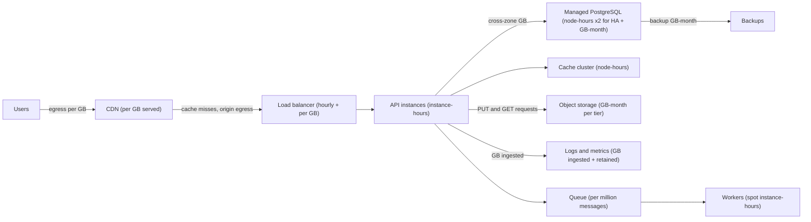
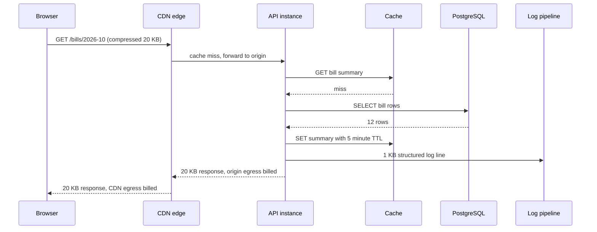
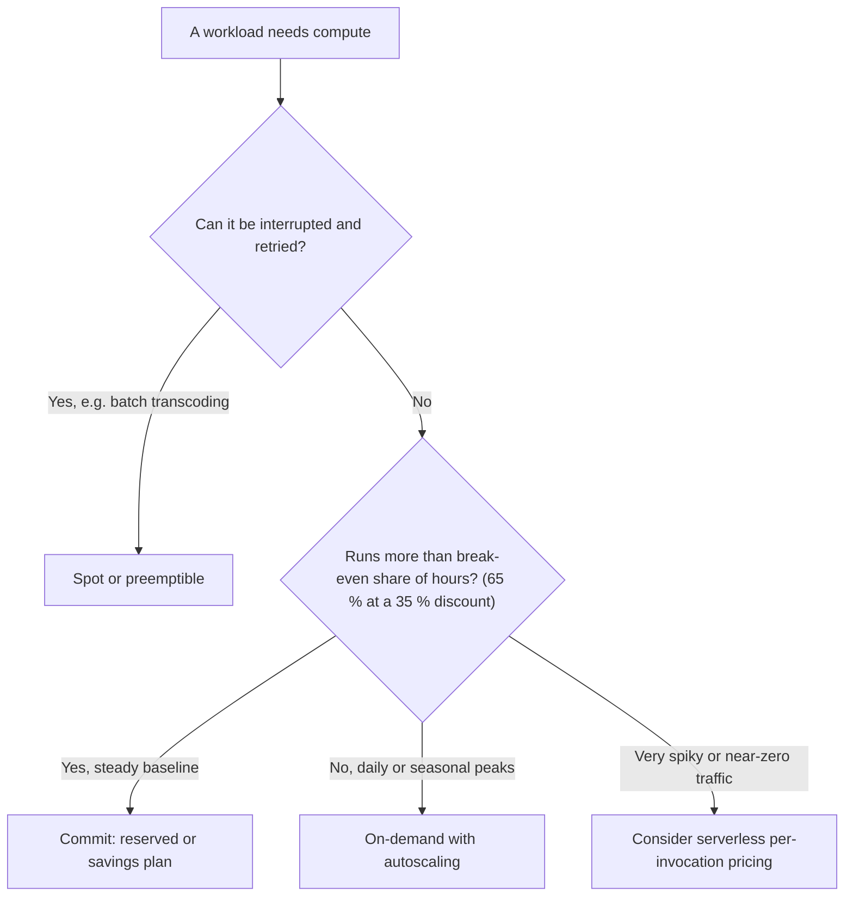

A design that meets every latency and availability target but costs ten times the budget is not a good design. Cost estimation turns the numbers from [capacity estimation](#/lesson/m11-capacity-estimation) (requests per second, gigabytes, instances) into money per month, so you can compare options, spot the one line item that dominates the bill, and know what each request costs you. This lesson gives you the cost drivers, a set of clearly labelled illustrative unit prices, the arithmetic for on-demand versus committed pricing, and a C# calculator you can keep next to your design documents.

## Learning objectives

By the end of this lesson you will be able to:

1. Name the main cloud cost drivers (compute, storage, data transfer, managed services, observability) and the meter each one is billed on.
2. Build a monthly cost estimate line by line from a capacity estimate, with every unit price labelled as an assumption and a date.
3. Calculate cost per request, per user and per transaction (unit economics), and separate fixed from variable cost.
4. Decide between on-demand, reserved (committed) and spot capacity using break-even utilisation.
5. Find hidden costs — egress, cross-zone traffic, NAT processing, logs, idle environments — before they surprise you.
6. Implement a testable cost calculator in ASP.NET Core with prices loaded through the options pattern.

## Prerequisites

- [Capacity estimation](#/lesson/m11-capacity-estimation): cost is capacity multiplied by price, so you need RPS, bandwidth and storage first.
- [Object storage](#/lesson/m11-object-storage): storage tiers and lifecycle rules are major cost levers.
- [Scaling](#/lesson/m11-scaling): autoscaling changes how many hours you pay for.
- Comfort with multiplication and percentages. No finance background needed.

## Explain it like I'm a beginner

Think about running a household for a month. Some costs are **fixed**: rent is the same whether you are home or travelling. Some are **metered**: electricity is charged per unit, mobile data per gigabyte over your plan. Some have a **commitment discount**: a yearly gym membership is cheaper per month than paying monthly, but only if you actually go. And some are **hidden**: the late fee you forgot about, or the water heater left on all day.

Cloud costs work exactly the same way:

- **Rent → servers that run all the time** (compute, billed per hour or per second).
- **Electricity units → storage** (billed per gigabyte per month) and **data sent out to users** (billed per gigabyte, called egress).
- **Gym membership → reserved capacity** (commit for one or three years, pay less per hour, pay even if unused).
- **Hidden fees → logs, traffic between data-centre zones, idle test servers, network gateways.**

Cost estimation is writing the household budget *before* you move in. You list each item, multiply quantity by price, add them up, and then look for the item that is surprisingly large. Very often one line (video bandwidth, a high-availability database, log storage) is half the bill, and that is where design effort pays off.

## First-principles explanation

### The formula behind every line

Every line of a cloud bill is:

```text
monthly cost = quantity × unit price × time (or volume)
```

The hard part is not the multiplication. It is knowing **what the meter measures** for each service and getting the quantity from your capacity estimate.

| Cost driver | What the meter usually measures | Comes from |
|---|---|---|
| Compute (VMs, containers) | instance-hours or vCPU-seconds and GB-seconds | peak RPS ÷ capacity per instance, and how many hours they run |
| Managed database | instance-hours (×2 or more for high availability) + GB-month of storage + backup GB-month + sometimes I/O | data size, query load, HA requirement |
| Block storage (disks) | provisioned GB-month (you pay for size, not usage) + sometimes provisioned IOPS | disk size you chose |
| Object storage | stored GB-month per tier + per-1,000 requests + retrieval fees for cold tiers | blob volume, retention, access pattern |
| Data transfer out (egress) | GB leaving the provider to the internet, usually tiered | RPS × response size, video bitrate |
| Cross-zone / cross-region traffic | GB moved between availability zones or regions | replication, chatty services across zones |
| Load balancers, gateways, NAT | hourly charge + per-GB or per-capacity-unit processing | traffic volume |
| Serverless functions | invocations + GB-seconds of execution | requests × duration × memory |
| Observability | log GB ingested + GB-month retained + metric series + traces | requests × log bytes per request, cardinality |
| Support, licences, people | fixed monthly fees, per-core licences, engineer time | organisation |

One constant to memorise: **a month is about 730 hours** (8,760 hours a year ÷ 12). A server that runs all the time costs its hourly price × 730.

### Illustrative unit prices (assumptions)

:::callout type=warning title="These prices are assumptions, not quotes"
The table below uses round, illustrative numbers shaped like public list prices of large cloud providers in 2025–26. Real prices differ by provider, region (Indian regions such as Mumbai or Pune are often priced differently from US regions), instance family, operating system, contract and date, and they change. Before you put any number in a proposal, check the provider's current pricing page or calculator and write the date next to it. Everything in this lesson uses these figures so the arithmetic is consistent and checkable.
:::

| Item (illustrative) | Assumed unit price (USD) | Monthly equivalent |
|---|---|---|
| General-purpose VM, 2 vCPU / 8 GB (`gp-2x8`), on demand | $0.10 per hour | $73 |
| General-purpose VM, 4 vCPU / 16 GB (`gp-4x16`), on demand | $0.20 per hour | $146 |
| Managed PostgreSQL, 2 vCPU / 8 GB (`pg-2x8`), one node | $0.20 per hour | $146 |
| Managed PostgreSQL, 4 vCPU / 16 GB (`pg-4x16`), one node | $0.40 per hour | $292 (×2 with a standby: $584) |
| Managed database storage | $0.12 per GB-month | |
| Database backup storage | $0.02 per GB-month | |
| Block SSD disk | $0.10 per GB-month | |
| Object storage, hot / infrequent / archive tier | $0.020 / $0.010 / $0.002 per GB-month | |
| Internet egress | first 100 GB free, then $0.09 per GB, falling with volume | |
| CDN egress | $0.05 per GB (blended) | |
| Cross-zone traffic | $0.01 per GB in each direction | |
| Load balancer | about $25 per month base | |
| NAT gateway | $0.045 per hour + $0.045 per GB processed | |
| Log ingestion | $0.50 per GB ingested | |
| One-year / three-year commitment discount | 35 % / 55 % off on-demand | |
| Spot / preemptible discount | 60–90 % off, can be reclaimed at short notice | |

Where an Indian-rupee figure helps, this lesson converts at an assumed ₹85 per US dollar.

### Fixed versus variable cost

Split every estimate into two parts:

- **Fixed (baseline) cost** does not change much with traffic: the minimum number of servers, a high-availability database pair, load balancers, support plans. A system serving 10 requests a day still pays it.
- **Variable cost** grows with usage: egress, log volume, serverless invocations, extra autoscaled instances, storage that accumulates.

This split explains a pattern you will see in every estimate: **cost per request falls as traffic grows** because the fixed part is shared across more requests, until variable costs dominate and cost per request flattens out. It also explains why small internal systems should avoid architectures with a large fixed cost (several clusters, multi-region active-active) that only pay off at scale.

### Unit economics: cost per request, per user, per transaction

Total monthly cost is useful for budgets. **Cost per unit of business value** is useful for decisions:

```text
monthly requests        = average RPS × 2,592,000   (seconds in a 30-day month)
cost per million req    = monthly cost ÷ monthly requests × 1,000,000
cost per active user    = monthly cost ÷ monthly active users
cost per transaction    = monthly cost ÷ business transactions (payments, bookings, filings)
```

If a payment costs you ₹0.40 of infrastructure and you earn ₹2 per payment, you have room. If a free video lesson costs ₹3 of bandwidth per view, the business model needs to know. Engineers who can say "this feature adds $0.02 per thousand requests" have a much better conversation with product owners than those who say "it needs more servers".

### On-demand, reserved and spot

Providers sell the same compute in three ways:

- **On-demand**: pay per hour (or second) with no commitment. Most flexible, most expensive per hour.
- **Committed (reserved instances, savings plans)**: promise to pay for a level of usage for one or three years in exchange for a discount (we assume 35 % and 55 %). You pay whether you use it or not.
- **Spot (preemptible)**: spare capacity at a large discount, but the provider can take it back with short notice (often a couple of minutes). Fine for work that can be interrupted and retried; wrong for a primary database.

The key number is **break-even utilisation**:

```text
break-even utilisation = committed hourly price ÷ on-demand hourly price = 1 − discount
```

With a 35 % one-year discount, break-even is 65 %. If an instance would run more than 65 % of the hours in the month (about 475 of 730 hours), committing is cheaper; below that, on-demand is cheaper. So the standard strategy is:

1. **Commit to the baseline**: the number of instances you run 24×7 even at the quietest hour.
2. **Run the daily peak on demand** with autoscaling.
3. **Run interruptible batch work on spot**: video transcoding, report generation, machine-learning training with checkpoints.

Commitments are a financial decision on top of a technical one. Do not commit until you have a few weeks of real usage data; a design that changes instance families in month two wastes a three-year commitment.

### Storage cost has a time dimension

Compute cost stops when you switch the server off. Storage cost **accumulates**: data you write this month is billed every month until you delete it. A system adding 10 TB a month pays for 10 TB in month one, 20 TB in month two, and 120 TB in month twelve. That is why **retention policies** and **lifecycle tiers** (move objects older than 90 days to a cheaper tier, delete after 7 years) are often the largest long-term savings in storage-heavy systems such as site-photo archives, CCTV footage or document management.

Cold tiers have their own costs: retrieval fees per GB, minimum storage durations (deleting early still bills the minimum), and slower access. A tier that saves 90 % on storage but is read every week can cost more than the hot tier.

### Egress: the cost that grows with success

Data coming **in** to a cloud provider (ingress) is usually free. Data going **out** to the internet (egress) is usually charged per GB, tiered so that the price per GB falls at higher volume. For read-heavy and media-heavy systems, egress is often the largest line item, and it grows directly with user success.

Levers for egress:

- **Smaller responses**: compression (Brotli or gzip for JSON and HTML), pagination, returning only needed fields.
- **Lower bitrates for media**: an adaptive bitrate ladder that does not default to the highest quality on small screens.
- **A CDN**: CDN egress is often cheaper per GB than origin egress, and cache hits avoid origin egress entirely (see [CDN architecture](#/lesson/m11-cdn)).
- **Keep traffic inside the provider**: services talking within the same region and zone avoid transfer charges.

### Hidden costs that appear on real bills

| Hidden cost | Why it surprises people | Mitigation |
|---|---|---|
| Cross-zone traffic | Multi-zone deployments send every replicated write and many service calls across zones, billed per GB both ways | Keep chatty services zone-local, compress replication, measure it |
| NAT gateway processing | Private instances pulling container images or calling external APIs pay per GB through the NAT | Private endpoints to provider services, image caches |
| Log and metric volume | Debug logging at 2 KB per request × 100 M requests = 200 GB a month of ingestion | Log levels, sampling, shorter retention, avoid high-cardinality labels |
| Idle non-production environments | Dev, test and UAT copies running 24×7 can cost as much as production | Schedule them off at night and weekends (they run ~50 of 168 hours a week) |
| Over-provisioned disks and IOPS | Block storage bills the provisioned size, not what is used | Right-size, grow disks when needed |
| Orphaned resources | Snapshots, unattached disks, old load balancers, public IP addresses | Tagging, periodic clean-up reports |
| Backups and point-in-time recovery | Retained WAL and snapshots can exceed the database size | Explicit retention tied to the recovery requirement |

### Cost is a design constraint, not an afterthought

Many design choices are cost choices in disguise:

- **High availability** roughly doubles database and often compute cost. Is a 99.9 % target enough, or does the business need 99.99 %? (See [Availability](#/lesson/m11-availability).)
- **Multi-region** can triple cost (more instances, cross-region replication traffic, more operations work).
- **Caching** adds a cache cluster but can remove database replicas. Estimate both sides.
- **Managed versus self-hosted**: a managed database costs more per hour than a VM, but self-hosting adds engineer time for patching, backups and failover. People are the most expensive resource in most Indian and global teams alike; include them.
- **Serverless versus always-on**: per-invocation pricing wins at low or spiky traffic and loses at high steady traffic. Find the crossover with arithmetic, not opinion.

### When a simple estimate is enough

For a system costing a few hundred dollars a month, a one-page spreadsheet with ten lines is enough. Spend effort in proportion to the bill: optimising a $40 log line by a week of engineering is a loss. The goal of a cost estimate in a design review is to find the **order of magnitude** and the **dominant line**, not to predict the invoice to the rupee.

## Visual explanation

### Where the money goes in a typical web system



Each arrow and box carries a different meter. **Users** pull bytes through the **CDN**, which bills per GB served; only cache misses travel to the origin and incur origin egress. The **load balancer** has a base hourly fee plus a processing charge. **API instances** are billed per instance-hour, so their cost depends on how many run and for how long. The **database** is billed per node-hour (doubled with a standby for high availability), per GB-month of storage, and for **backups**; traffic between the API and a database in another zone adds cross-zone charges. The **cache** is node-hours. **Object storage** bills stored GB-month per tier plus per-request fees. **Logs and metrics** bill on GB ingested and retained, which grows with every request. **Workers** behind a **queue** process interruptible jobs, a natural fit for spot pricing. When you estimate, walk this picture box by box so nothing is missed.

### The cost trail of one request



Follow one request and note which meters tick. The **browser** asks the **CDN**; on a miss the CDN forwards to an **API instance**, whose instance-hour is already paid but whose CPU time this request uses. The API checks the **cache** (node-hours, already paid) and on a miss queries **PostgreSQL** (database node-hours, and I/O on some services). It writes the result back to the cache and emits a **log line** (1 KB of ingestion, charged per GB). The response leaves the origin (origin egress per GB) and then leaves the CDN to the user (CDN egress per GB). On a cache hit at the CDN, only the last step happens. Multiply each per-request cost by 2.6 million for every 1 RPS of average traffic over a 30-day month and you have most of the variable bill.

### Choosing a pricing model



Start with interruptibility: if the work can be stopped and resumed (jobs with checkpoints, queue consumers that re-process messages), spot capacity is the cheapest. If not, compare how many hours the capacity is busy with the break-even utilisation. A steady baseline that runs every hour of the month is a commitment candidate. Daily peaks that run a few hours a day belong on on-demand with autoscaling. Workloads that are idle most of the time may be cheapest as serverless functions billed per invocation. Most real systems use all three at once.

## Step-by-step example

Three worked examples. Every unit price comes from the illustrative table above; replace them with current prices for real decisions.

### Example A — A municipal property-tax portal

**Inputs (assumptions).** A city with 2 million properties. Citizens look up and pay tax online. Average 50 RPS, average response 20 KB after compression, 1 KB of logs per request. Three `gp-4x16` API instances across two zones. Managed PostgreSQL `pg-4x16` with a standby (HA), 200 GB of data, 400 GB of retained backups. Payment receipts as PDFs: 2 million × 200 KB = 400 GB in object storage. One load balancer. Assume $40 a month for NAT and miscellaneous networking.

```text
Monthly requests:   50 RPS × 2,592,000 s                 = 129.6 M requests
Compute:            3 × $0.20 × 730 h                    = $438
Database nodes:     2 × $0.40 × 730 h                    = $584
Database storage:   200 GB × 2 nodes × $0.12             = $48
Backups:            400 GB × $0.02                       = $8
Object storage:     400 GB × $0.02                       = $8
Egress:             129.6 M × 20 KB = 2,592 GB
                    (2,592 − 100 free) × $0.09           ≈ $224
Logs:               129.6 M × 1 KB = 129.6 GB × $0.50    ≈ $65
Load balancer:                                           = $25
NAT and misc (assumed):                                  = $40
--------------------------------------------------------------------
Total                                                    ≈ $1,440 per month (≈ ₹1.22 lakh)
Cost per million requests: $1,440 ÷ 129.6                ≈ $11.1
Cost per property per year: $1,440 × 12 ÷ 2 M            ≈ $0.0086 (≈ ₹0.73)
```

**Reading the bill.** The database pair ($632 with storage) is 44 % of the total, compute 30 %, egress 16 %. Almost all of it is **fixed**: if traffic doubles, compute and egress grow but the database probably does not, so the cost per request falls.

**Optimisations, with arithmetic.**

- *Commit to the baseline.* The 3 API instances and the database pair run 24×7. A one-year commitment saves 35 % of ($438 + $584) ≈ **$358 a month**, about 25 % of the bill, with no design change.
- *Is HA required?* Dropping the standby saves $292 + $24 = $316, but a database failure would then mean restoring from backup (tens of minutes to hours). For a tax portal with a deadline rush, keep HA; that is a trade-off decision, not a cost decision alone.
- *Logs.* Sampling successful-request logs at 10 % while keeping all errors cuts ingestion by about 90 % of the $65. Worth an afternoon, not a week.

### Example B — Recorded video lectures (egress dominates)

**Inputs (assumptions).** An online learning platform. 100,000 learners a day each watch 45 minutes at an average 1.5 Mbit/s (720p). 20,000 lecture hours stored in 3 renditions at an average 1 GB per lecture-hour per rendition.

```text
Bytes per viewer per day: 1.5 Mbit/s × 2,700 s ÷ 8           ≈ 506 MB
Daily egress:             506 MB × 100,000                   ≈ 50.6 TB
Monthly egress:           50.6 TB × 30                       ≈ 1,519 TB ≈ 1.5 PB
Egress cost at $0.05/GB blended (CDN, volume tier):
                          1,519,000 GB × $0.05              ≈ $75,900 per month
Storage:                  20,000 h × 3 × 1 GB = 60 TB × $0.02 ≈ $1,200 per month
Compute for the API and player pages (assumed):             ≈ $2,000 per month
```

**Reading the bill.** Egress is about **95 %** of the cost and about 60 times storage. Optimising API servers is irrelevant. The design levers are all about bytes delivered:

- Default mobile playback to 480p at 1.0 Mbit/s instead of 1.5: a third fewer bytes, roughly **$25,000 a month** saved for viewers who accept it.
- Better codecs (for example AV1 or HEVC where devices support them) can deliver similar quality at a lower bitrate, with higher encoding compute cost: a trade worth estimating.
- At petabyte scale, negotiated CDN commitments matter more than list prices. That is a procurement conversation your estimate makes possible.

### Example C — Reserved versus on-demand for a seasonal workload

**Inputs (assumptions).** A tax-filing service similar to a GST return portal. Baseline: 4 `gp-4x16` instances all month. Around the monthly filing deadline, 8 extra instances for 5 days, 10 hours a day. On-demand $0.20/h; one-year commitment at 35 % off = $0.13/h effective.

```text
Baseline, all on-demand:   4 × 730 h × $0.20             = $584
Baseline, committed:       4 × 730 h × $0.13             = $379.60
Peak hours:                8 × 5 days × 10 h             = 400 instance-hours
Peak on-demand:            400 × $0.20                   = $80
Peak if committed:         8 × 730 h × $0.13             = $759.20 (for 400 hours of use)
Peak utilisation:          400 ÷ (8 × 730)               ≈ 6.8 %  (break-even is 65 %)

Option 1, all on-demand:   $584 + $80                    = $664
Option 2, commit all 12:   12 × 730 × $0.13              = $1,138.80
Option 3, commit baseline, peak on-demand: $379.60 + $80 = $459.60   ← cheapest
```

**Reading it.** Committing to everything is the most expensive option even though the per-hour price is lowest, because you pay for 5,840 hours to use 400. Commit to the floor, rent the peaks.

## Production-style C# implementation

A cost calculator belongs next to the design, in code, so that "what if traffic doubles?" or "what if we drop HA?" is a one-line change that anyone can run and review. The price sheet is loaded through the options pattern from configuration, so prices live in `appsettings.json` with a date, not scattered through code.

```text
Cost.Planner/
  Program.cs
  Costing/PriceSheet.cs
  Costing/Model.cs
  Costing/CostCalculator.cs
  Costing/CommitmentAdvisor.cs
```

```csharp file=Costing/PriceSheet.cs
namespace Cost.Planner.Costing;

public enum Commitment { OnDemand, OneYear, ThreeYear, Spot }

/// <summary>One step of tiered pricing. The last tier must use double.PositiveInfinity.</summary>
public sealed record PriceTier(double UpToGb, double PricePerGb);

/// <summary>
/// Unit prices used by the calculator. The defaults are ILLUSTRATIVE ASSUMPTIONS, not quotes.
/// Override them from configuration ("Pricing" section) with current list prices for your
/// provider and region, and record the date in <see cref="PricesAsOf"/>.
/// </summary>
public sealed class PriceSheet
{
    public string Currency { get; set; } = "USD";
    public string PricesAsOf { get; set; } = "illustrative defaults - replace before use";
    public double HoursPerMonth { get; set; } = 730;

    public Dictionary<string, double> VmHourly { get; set; } = new()
    {
        ["gp-2x8"] = 0.10,
        ["gp-4x16"] = 0.20,
        ["gp-8x32"] = 0.40,
    };

    public Dictionary<string, double> ManagedDbHourly { get; set; } = new()
    {
        ["pg-2x8"] = 0.20,
        ["pg-4x16"] = 0.40,
        ["pg-8x32"] = 0.80,
    };

    public double OneYearDiscount { get; set; } = 0.35;
    public double ThreeYearDiscount { get; set; } = 0.55;
    public double SpotDiscount { get; set; } = 0.70;

    public double DbStorageGbMonth { get; set; } = 0.12;
    public double BackupGbMonth { get; set; } = 0.02;
    public double BlockStorageGbMonth { get; set; } = 0.10;
    public double ObjectStorageGbMonth { get; set; } = 0.02;
    public double CdnEgressPerGb { get; set; } = 0.05;
    public double LogIngestPerGb { get; set; } = 0.50;
    public double LoadBalancerMonthly { get; set; } = 25;

    // Note: the configuration binder appends to non-empty collections, so if you bind tiers from
    // configuration, clear this default first or bind into an empty list.
    public List<PriceTier> InternetEgressTiers { get; set; } =
    [
        new PriceTier(100, 0),
        new PriceTier(10_100, 0.09),
        new PriceTier(50_100, 0.085),
        new PriceTier(double.PositiveInfinity, 0.07),
    ];

    public double DiscountFor(Commitment commitment) => commitment switch
    {
        Commitment.OnDemand => 0,
        Commitment.OneYear => OneYearDiscount,
        Commitment.ThreeYear => ThreeYearDiscount,
        Commitment.Spot => SpotDiscount,
        _ => throw new ArgumentOutOfRangeException(nameof(commitment)),
    };
}
```

```csharp file=Costing/Model.cs
namespace Cost.Planner.Costing;

public sealed record ComputeLine(string Name, string Size, int Count, Commitment Commitment = Commitment.OnDemand, double? HoursPerMonth = null);

public sealed record DatabaseLine(string Name, string Size, bool HighAvailability, double StorageGb, double BackupGb, Commitment Commitment = Commitment.OnDemand);

public sealed record Deployment(
    IReadOnlyList<ComputeLine> Compute,
    IReadOnlyList<DatabaseLine> Databases,
    int LoadBalancers,
    double BlockStorageGb,
    double FixedExtrasMonthly = 0);

/// <summary>Traffic and data that drive variable cost. Sizes are decimal (1 GB = 1,000,000 KB).</summary>
public sealed record Workload(
    double AverageRps,
    double AverageResponseKb,
    double LogBytesPerRequest,
    double ObjectStorageGb,
    double CdnHitRatio = 0);

public sealed record CostLine(string Category, string Item, double Monthly, string Basis);

public sealed record CostReport(
    string Currency,
    string PricesAsOf,
    IReadOnlyList<CostLine> Lines,
    double MonthlyTotal,
    double MonthlyRequests,
    double CostPerMillionRequests)
{
    public IReadOnlyDictionary<string, double> ByCategory =>
        Lines.GroupBy(l => l.Category).ToDictionary(g => g.Key, g => Math.Round(g.Sum(l => l.Monthly), 2));

    public CostLine Largest => Lines.MaxBy(l => l.Monthly)!;
}

public sealed record CostRequest(Deployment Deployment, Workload Workload);

public sealed record CommitmentRequest(int[] HourlyDemand, double Discount);
```

```csharp file=Costing/CostCalculator.cs
using Microsoft.Extensions.Options;

namespace Cost.Planner.Costing;

public interface ICostCalculator
{
    CostReport Estimate(Deployment deployment, Workload workload);
}

public sealed class CostCalculator(IOptions<PriceSheet> options) : ICostCalculator
{
    public const double SecondsPerMonth = 30 * 86_400; // 2,592,000
    private readonly PriceSheet _p = options.Value;

    public CostReport Estimate(Deployment deployment, Workload workload)
    {
        ArgumentNullException.ThrowIfNull(deployment);
        ArgumentNullException.ThrowIfNull(workload);
        if (workload.CdnHitRatio is < 0 or > 1) throw new ArgumentOutOfRangeException(nameof(workload), "CDN hit ratio must be in [0, 1].");

        var lines = new List<CostLine>();

        foreach (var c in deployment.Compute)
        {
            double hourly = Price(_p.VmHourly, c.Size) * (1 - _p.DiscountFor(c.Commitment));
            double hours = c.HoursPerMonth ?? _p.HoursPerMonth;
            lines.Add(new CostLine("compute", c.Name, hourly * hours * c.Count,
                $"{c.Count} x {c.Size} x {hours:0} h at {hourly:0.000}/h ({c.Commitment})"));
        }

        foreach (var db in deployment.Databases)
        {
            int nodes = db.HighAvailability ? 2 : 1;
            double hourly = Price(_p.ManagedDbHourly, db.Size) * (1 - _p.DiscountFor(db.Commitment));
            lines.Add(new CostLine("database", db.Name, hourly * _p.HoursPerMonth * nodes,
                $"{nodes} node(s) x {db.Size} at {hourly:0.000}/h ({db.Commitment})"));
            lines.Add(new CostLine("storage", $"{db.Name} storage", db.StorageGb * nodes * _p.DbStorageGbMonth,
                $"{db.StorageGb:0} GB x {nodes} node(s)"));
            lines.Add(new CostLine("storage", $"{db.Name} backups", db.BackupGb * _p.BackupGbMonth, $"{db.BackupGb:0} GB"));
        }

        lines.Add(new CostLine("storage", "block disks", deployment.BlockStorageGb * _p.BlockStorageGbMonth, $"{deployment.BlockStorageGb:0} GB provisioned"));
        lines.Add(new CostLine("storage", "object storage (hot)", workload.ObjectStorageGb * _p.ObjectStorageGbMonth, $"{workload.ObjectStorageGb:0} GB"));
        lines.Add(new CostLine("network", "load balancers", deployment.LoadBalancers * _p.LoadBalancerMonthly, $"{deployment.LoadBalancers} x base fee"));

        double requests = workload.AverageRps * SecondsPerMonth;
        double servedGb = requests * workload.AverageResponseKb / 1_000_000;
        double originGb = servedGb * (1 - workload.CdnHitRatio);
        lines.Add(new CostLine("egress", "origin egress", TieredCost(originGb, _p.InternetEgressTiers), $"{originGb:0} GB"));
        if (workload.CdnHitRatio > 0)
            lines.Add(new CostLine("egress", "CDN egress", servedGb * _p.CdnEgressPerGb, $"{servedGb:0} GB"));

        double logGb = requests * workload.LogBytesPerRequest / 1_000_000_000;
        lines.Add(new CostLine("observability", "log ingestion", logGb * _p.LogIngestPerGb, $"{logGb:0.0} GB"));

        if (deployment.FixedExtrasMonthly > 0)
            lines.Add(new CostLine("other", "fixed extras (assumed)", deployment.FixedExtrasMonthly, "estimate"));

        double total = lines.Sum(l => l.Monthly);
        double perMillion = requests > 0 ? total / requests * 1_000_000 : 0;
        return new CostReport(_p.Currency, _p.PricesAsOf, lines, total, requests, perMillion);
    }

    /// <summary>Applies tiered per-GB pricing: each GB is charged at the rate of the tier it falls in.</summary>
    public static double TieredCost(double gb, IReadOnlyList<PriceTier> tiers)
    {
        if (gb < 0) throw new ArgumentOutOfRangeException(nameof(gb));
        double lower = 0, cost = 0;
        foreach (var tier in tiers)
        {
            if (gb <= lower) break;
            cost += (Math.Min(gb, tier.UpToGb) - lower) * tier.PricePerGb;
            lower = tier.UpToGb;
        }
        return cost;
    }

    private static double Price(Dictionary<string, double> sheet, string size) =>
        sheet.TryGetValue(size, out var price)
            ? price
            : throw new KeyNotFoundException($"No price for size '{size}'. Add it to the price sheet.");
}
```

```csharp file=Costing/CommitmentAdvisor.cs
namespace Cost.Planner.Costing;

public sealed record CommitmentAdvice(int CommitTo, double BreakEvenUtilisation, IReadOnlyList<double> ShareOfHoursAtOrAbove);

public static class CommitmentAdvisor
{
    /// <summary>
    /// Given instances needed per hour over a representative period, returns how many instances to commit to.
    /// Level k is worth committing when demand is at least k for a share of hours >= (1 - discount).
    /// </summary>
    public static CommitmentAdvice Advise(IReadOnlyList<int> hourlyDemand, double discount)
    {
        ArgumentNullException.ThrowIfNull(hourlyDemand);
        if (hourlyDemand.Count == 0) throw new ArgumentException("Need at least one hour of demand.", nameof(hourlyDemand));
        if (discount is <= 0 or >= 1) throw new ArgumentOutOfRangeException(nameof(discount));
        if (hourlyDemand.Any(d => d < 0)) throw new ArgumentOutOfRangeException(nameof(hourlyDemand));

        double breakEven = 1 - discount;
        int max = hourlyDemand.Max();
        var shares = new List<double>(max);
        int commit = 0;
        for (int k = 1; k <= max; k++)
        {
            double share = hourlyDemand.Count(d => d >= k) / (double)hourlyDemand.Count;
            shares.Add(share);
            if (share >= breakEven) commit = k;
        }
        return new CommitmentAdvice(commit, breakEven, shares);
    }
}
```

```csharp file=Program.cs
using Cost.Planner.Costing;

var builder = WebApplication.CreateBuilder(args);

// Prices come from configuration ("Pricing" section) so they can be updated, dated and reviewed
// without a code change. The class defaults are illustrative assumptions only.
builder.Services.AddOptions<PriceSheet>().BindConfiguration("Pricing");
builder.Services.AddSingleton<ICostCalculator, CostCalculator>();

var app = builder.Build();

// POST /cost/estimate with a Deployment and a Workload returns line items, totals and cost per million requests.
app.MapPost("/cost/estimate", (CostRequest request, ICostCalculator calculator) =>
{
    var report = calculator.Estimate(request.Deployment, request.Workload);
    return Results.Ok(new
    {
        report.Currency,
        report.PricesAsOf,
        monthlyTotal = Math.Round(report.MonthlyTotal, 2),
        costPerMillionRequests = Math.Round(report.CostPerMillionRequests, 2),
        largest = report.Largest.Item,
        report.ByCategory,
        report.Lines,
    });
});

// POST /cost/commitment { "hourlyDemand": [2,2,...,6,...], "discount": 0.35 }
app.MapPost("/cost/commitment", (CommitmentRequest request) =>
    Results.Ok(CommitmentAdvisor.Advise(request.HourlyDemand, request.Discount)));

app.Run();
```

Design notes:

1. **Prices are data with a date.** `PriceSheet` is bound from configuration and carries `PricesAsOf`, which is echoed in every report. A cost estimate without a price date is a guess nobody can check later.
2. **Every line has a basis.** `CostLine.Basis` records the quantity and rate ("3 x gp-4x16 x 730 h at 0.200/h"), so a reviewer can challenge one input without reverse-engineering the total.
3. **Category totals and the largest line.** `ByCategory` and `Largest` answer the two questions a design review asks first: "where does the money go?" and "what do we optimise?".
4. **Tiered egress is modelled honestly.** A flat per-GB rate over-estimates large volumes and under-estimates small ones; `TieredCost` charges each GB at its tier's rate.
5. **Pure, testable core.** No clock, no I/O. The calculator can be pinned with tests that reproduce the worked examples, so a refactor cannot silently change an estimate.

## Bad design vs good design

**Bad: compute-only estimates.** "Three VMs at $146 each, so $438 a month." The real bill adds a database pair, storage, backups, egress, logs and a load balancer and comes to $1,440, more than three times the estimate. The project is now over budget in month one.

**Bad: prices hard-coded with no date.** A constant `const double EgressPerGb = 0.12;` copied from a blog post two years ago. Nobody knows the source, the region or whether it was ever right.

**Bad: commit to the peak.** The team buys three-year commitments for the 12 instances they need during filing week. Utilisation is 7 %, and they pay for 5,840 hours a month to use 400.

**Bad: ignoring the time dimension of storage.** Year-one storage looks cheap, so no lifecycle rules are set. By year three the archive is 36 times larger and the storage line is the largest on the bill.

**Good:**

- A line-item estimate covering compute, database, storage (including backups), egress, networking, observability and non-production environments.
- Every unit price labelled with source and date, and the arithmetic shown.
- Fixed and variable cost separated, with cost per million requests and per business transaction.
- Commitments sized to the measured baseline, on-demand for peaks, spot for interruptible work.
- The dominant line identified and the design discussion focused there.
- A statement of when the estimate should be revisited (traffic 3× higher, new region, new media feature).

:::callout type=tradeoff title="Cheaper is not always better"
Removing the database standby, running one zone, or cutting log retention all save money and all increase risk. Present cost changes together with what they do to availability, recovery time and debuggability, and let the business choose with both numbers in front of it. That conversation is covered in [Explaining trade-offs](#/lesson/m11-trade-offs).
:::

:::callout type=mistake title="Mixing GB and GiB, and per-month with per-day"
Providers bill some services in GB (10⁹ bytes) and some in GiB (2³⁰ bytes), some per hour and some per second, some per month of 730 hours and some per calendar month. Pick one convention per estimate, state it, and convert at the edges.
:::

## Practical playground

The playground loads a month of daily billing data for a small platform, broken down by service, category and environment, together with request counts. Use SQL to answer the questions a cost review asks: Which category is largest? How much do non-production environments cost? What is the cost per million requests for each production service? Which service's cost grew fastest in the second half of the month?

:::playground type=sql title="Explore a month of billing data"
```sql
CREATE TABLE billing (
    day       date          NOT NULL,
    service   text          NOT NULL,
    env       text          NOT NULL,
    category  text          NOT NULL,
    cost_usd  numeric(10,2) NOT NULL
);

INSERT INTO billing (day, service, env, category, cost_usd)
SELECT d::date, s.service, s.env, s.category,
       round((s.base * CASE WHEN extract(day FROM d) > 15 AND s.service = 'media' THEN 1.6 ELSE 1 END)::numeric, 2)
FROM generate_series(date '2026-09-01', date '2026-09-30', interval '1 day') AS d
CROSS JOIN (VALUES
    ('payments-api', 'prod', 'compute',        14.40),
    ('payments-api', 'prod', 'database',       19.20),
    ('payments-api', 'prod', 'egress',          3.10),
    ('media',        'prod', 'egress',         85.00),
    ('media',        'prod', 'object-storage', 12.00),
    ('media',        'prod', 'compute',         6.00),
    ('search',       'prod', 'compute',         9.60),
    ('platform',     'prod', 'observability',   7.50),
    ('payments-api', 'uat',  'compute',         4.80),
    ('payments-api', 'uat',  'database',        9.60),
    ('media',        'dev',  'compute',         4.80)
) AS s(service, env, category, base);

CREATE TABLE requests_daily (
    day      date   NOT NULL,
    service  text   NOT NULL,
    requests bigint NOT NULL
);

INSERT INTO requests_daily (day, service, requests)
SELECT d::date, r.service, r.requests
FROM generate_series(date '2026-09-01', date '2026-09-30', interval '1 day') AS d
CROSS JOIN (VALUES ('payments-api', 3000000), ('media', 1500000), ('search', 4000000)) AS r(service, requests);

-- Try: SELECT category, sum(cost_usd) FROM billing GROUP BY category ORDER BY 2 DESC;
```
:::

## Exercises

:::exercise id=m11-cost-estimation-ex1 difficulty=beginner kind=code title="Cost arithmetic helpers"
Implement the four helpers every cost estimate uses.
::requirements
- `CloudMath.MonthlyCompute(double hourlyPrice, int instances, double hoursPerMonth = 730)` returns `hourlyPrice × instances × hoursPerMonth`.
- `CloudMath.StorageMonthly(double gb, double pricePerGbMonth)` returns `gb × pricePerGbMonth`.
- `CloudMath.MonthlyRequests(double averageRps)` uses a 30-day month (2,592,000 seconds).
- `CloudMath.CostPerMillionRequests(double monthlyCost, double monthlyRequests)` returns cost per 1,000,000 requests.
- Negative prices, quantities, instance counts or hours throw `ArgumentOutOfRangeException`; `monthlyRequests <= 0` throws `ArgumentOutOfRangeException`.
::acceptance
- 3 instances at $0.20/h for 730 hours cost $438.
- 500 GB at $0.023 per GB-month cost $11.50.
- 1,000 average RPS is 2,592,000,000 requests a month.
- $1,296 over 2.592 billion requests is $0.50 per million.
::hint
These are one-line formulas. Validate the inputs first, then multiply.
::hint
2,592,000 = 30 × 86,400. Define it as a constant so tests and code agree.
::hint
Cost per million = monthly cost ÷ monthly requests × 1,000,000. Guard against division by zero.
::hint
```csharp
if (hourlyPrice < 0) throw new ArgumentOutOfRangeException(nameof(hourlyPrice));
return hourlyPrice * instances * hoursPerMonth;
```
::starter
```csharp file=CloudMath.cs
using System;

public static class CloudMath
{
    public const double HoursPerMonth = 730;
    public const double SecondsPerMonth = 2_592_000;

    public static double MonthlyCompute(double hourlyPrice, int instances, double hoursPerMonth = HoursPerMonth)
        => throw new NotImplementedException();

    public static double StorageMonthly(double gb, double pricePerGbMonth)
        => throw new NotImplementedException();

    public static double MonthlyRequests(double averageRps)
        => throw new NotImplementedException();

    public static double CostPerMillionRequests(double monthlyCost, double monthlyRequests)
        => throw new NotImplementedException();
}
```
::tests
```csharp file=CloudMathTests.cs
using System;
using Xunit;

public class CloudMathTests
{
    [Fact]
    public void Compute_for_a_full_month() => Assert.Equal(438, CloudMath.MonthlyCompute(0.20, 3), 6);

    [Fact]
    public void Compute_for_part_of_a_month() => Assert.Equal(80, CloudMath.MonthlyCompute(0.20, 8, hoursPerMonth: 50), 6);

    [Fact]
    public void Storage() => Assert.Equal(11.5, CloudMath.StorageMonthly(500, 0.023), 6);

    [Fact]
    public void Requests_per_month() => Assert.Equal(2_592_000_000, CloudMath.MonthlyRequests(1_000), 0);

    [Fact]
    public void Cost_per_million() => Assert.Equal(0.5, CloudMath.CostPerMillionRequests(1_296, 2_592_000_000), 6);

    [Fact]
    public void Invalid_inputs_throw()
    {
        Assert.Throws<ArgumentOutOfRangeException>(() => CloudMath.MonthlyCompute(-0.1, 1));
        Assert.Throws<ArgumentOutOfRangeException>(() => CloudMath.MonthlyCompute(0.1, -1));
        Assert.Throws<ArgumentOutOfRangeException>(() => CloudMath.StorageMonthly(-5, 0.02));
        Assert.Throws<ArgumentOutOfRangeException>(() => CloudMath.MonthlyRequests(-1));
        Assert.Throws<ArgumentOutOfRangeException>(() => CloudMath.CostPerMillionRequests(100, 0));
    }
}
```
::solution
```csharp file=CloudMath.cs
using System;

public static class CloudMath
{
    public const double HoursPerMonth = 730;
    public const double SecondsPerMonth = 2_592_000;

    public static double MonthlyCompute(double hourlyPrice, int instances, double hoursPerMonth = HoursPerMonth)
    {
        if (hourlyPrice < 0) throw new ArgumentOutOfRangeException(nameof(hourlyPrice));
        if (instances < 0) throw new ArgumentOutOfRangeException(nameof(instances));
        if (hoursPerMonth < 0) throw new ArgumentOutOfRangeException(nameof(hoursPerMonth));
        return hourlyPrice * instances * hoursPerMonth;
    }

    public static double StorageMonthly(double gb, double pricePerGbMonth)
    {
        if (gb < 0) throw new ArgumentOutOfRangeException(nameof(gb));
        if (pricePerGbMonth < 0) throw new ArgumentOutOfRangeException(nameof(pricePerGbMonth));
        return gb * pricePerGbMonth;
    }

    public static double MonthlyRequests(double averageRps)
    {
        if (averageRps < 0) throw new ArgumentOutOfRangeException(nameof(averageRps));
        return averageRps * SecondsPerMonth;
    }

    public static double CostPerMillionRequests(double monthlyCost, double monthlyRequests)
    {
        if (monthlyCost < 0) throw new ArgumentOutOfRangeException(nameof(monthlyCost));
        if (monthlyRequests <= 0) throw new ArgumentOutOfRangeException(nameof(monthlyRequests), "Need at least one request.");
        return monthlyCost / monthlyRequests * 1_000_000;
    }
}
```

Worked numbers: 0.20 × 3 × 730 = 438. 1,000 × 2,592,000 = 2.592 × 10⁹. 1,296 ÷ 2,592,000,000 × 1,000,000 = 0.5.
::mistakes
- Using 720 hours (30 × 24) for some lines and 730 for others in the same estimate.
- Using 86,400 × 31 for some months and × 30 for others without saying so.
- Returning `Infinity` for cost per million when there were no requests, which then pollutes dashboards.
::extensions
Add `MonthlyComputeCommitted(hourlyPrice, instances, discount)` and a test that reproduces Example C's $379.60.
:::

:::exercise id=m11-cost-estimation-ex2 difficulty=beginner kind=written title="Estimate the bill for a clinic appointment app"
A chain of 40 clinics runs an appointment-booking app. Using the illustrative price table from this lesson, estimate the monthly bill and the cost per million requests.

Deployment: 2 × `gp-2x8` API instances 24×7, one load balancer, managed PostgreSQL `pg-2x8` **without** a standby, 50 GB of data, 100 GB of backups. Workload: 10 RPS on average, 8 KB average response, 1 KB of logs per request. Ignore object storage and NAT.

Then answer: the clinic owners ask for high availability on the database. What does it add to the bill, as an amount and a percentage, and would you recommend it?
::acceptance
- Each line shows quantity × unit price.
- Monthly requests are computed from the average RPS.
- Egress applies the 100 GB free tier.
- The HA question is answered with numbers and with a reason that is not only about cost.
::hint
List the lines first: compute, database nodes, database storage, backups, load balancer, egress, logs.
::hint
Monthly requests = 10 × 2,592,000 = 25.92 million.
::hint
Egress = 25.92 M × 8 KB = 207.36 GB. Only the part above 100 GB is charged at $0.09.
::hint
HA adds a second database node and a second copy of storage. Compare the extra cost with what an outage during clinic hours costs.
::solution
```text
Compute:          2 × $0.10 × 730          = $146.00
Database node:    1 × $0.20 × 730          = $146.00
DB storage:       50 GB × $0.12            =   $6.00
Backups:          100 GB × $0.02           =   $2.00
Load balancer:                              =  $25.00
Requests:         10 × 2,592,000           = 25.92 M
Egress:           25.92 M × 8 KB = 207.36 GB
                  (207.36 − 100) × $0.09   ≈   $9.66
Logs:             25.92 GB × $0.50         ≈  $12.96
---------------------------------------------------
Total                                       ≈ $347.62 per month (≈ ₹29,500)
Cost per million: 347.62 ÷ 25.92            ≈ $13.41
```

**High availability.** A standby adds one node ($146) and one storage copy ($6): **$152 more, about 44 %**, taking the bill to roughly $500.

**Recommendation.** For 40 clinics booking patients during working hours, a database failure without a standby means restoring from backup or waiting for the provider to replace the node, which can take from tens of minutes to hours, and receptionists fall back to paper. $152 a month (about ₹13,000) is small next to an afternoon of disrupted clinics. Recommend HA, and fund it partly by committing the two API instances and the database for one year (35 % of $444 ≈ $155 saved), which almost pays for it.
::mistakes
- Forgetting the free egress tier or charging egress on ingress.
- Doubling only the node cost for HA and forgetting the second storage copy.
- Answering the HA question with cost alone and no mention of recovery time.
:::

:::exercise id=m11-cost-estimation-ex3 difficulty=intermediate kind=code title="How many instances should we commit to?"
Given the number of instances needed in each hour of a representative period, find the number of committed (reserved) instances that minimises total cost. Committed instances are paid for every hour; any demand above them is paid on demand.
::requirements
- `CommitmentPlanner.DailyCost(IReadOnlyList<int> hourlyDemand, int reserved, double onDemandHourly, double reservedHourly)` returns `reserved × hours × reservedHourly + Σ max(0, demand − reserved) × onDemandHourly`, where `hours` is the number of entries.
- `CommitmentPlanner.Plan(...)` (same inputs except `reserved`) tries every reserved count from 0 to the maximum demand and returns `CommitmentPlan(int Reserved, double Cost, double AllOnDemandCost)` for the cheapest. On a tie (within 1e-9), choose the smaller reserved count.
- An empty list throws `ArgumentException`; negative demand, negative `reserved` or non-positive prices throw `ArgumentOutOfRangeException`.
- `CommitmentPlan.Savings` is `AllOnDemandCost − Cost`.
::acceptance
- Demand of 2 for 8 hours, 6 for 10 hours and 10 for 6 hours, with $0.20 on demand and $0.12 reserved, gives 6 reserved, a cost of $22.08 and all-on-demand cost of $27.20.
- When the reserved price is not lower than on-demand, the plan reserves 0.
- A flat demand of 5 every hour reserves 5.
::hint
Write `DailyCost` first; `Plan` is a loop over candidate reserved counts calling it.
::hint
All-on-demand cost is just `DailyCost` with `reserved = 0`.
::hint
Keep the best cost and count; replace them only when a new cost is lower by more than 1e-9, which keeps the smaller count on ties.
::hint
Check your understanding with the break-even rule: with reserved/on-demand = 0.6, level k is worth reserving if demand ≥ k for at least 60 % of hours. Demand ≥ 6 holds for 16 of 24 hours (67 %), demand ≥ 7 for only 6 hours (25 %).
::hint
```csharp
var best = (Reserved: 0, Cost: DailyCost(d, 0, od, rs));
for (int r = 1; r <= d.Max(); r++)
{
    double c = DailyCost(d, r, od, rs);
    if (c < best.Cost - 1e-9) best = (r, c);
}
```
::starter
```csharp file=CommitmentPlanner.cs
using System;
using System.Collections.Generic;
using System.Linq;

public sealed record CommitmentPlan(int Reserved, double Cost, double AllOnDemandCost)
{
    public double Savings => AllOnDemandCost - Cost;
}

public static class CommitmentPlanner
{
    public static double DailyCost(IReadOnlyList<int> hourlyDemand, int reserved, double onDemandHourly, double reservedHourly)
        => throw new NotImplementedException();

    public static CommitmentPlan Plan(IReadOnlyList<int> hourlyDemand, double onDemandHourly, double reservedHourly)
        => throw new NotImplementedException();
}
```
::tests
```csharp file=CommitmentPlannerTests.cs
using System;
using System.Linq;
using Xunit;

public class CommitmentPlannerTests
{
    private static int[] FilingDay() =>
        Enumerable.Repeat(2, 8).Concat(Enumerable.Repeat(6, 10)).Concat(Enumerable.Repeat(10, 6)).ToArray();

    [Fact]
    public void Daily_cost_for_given_reservation()
    {
        Assert.Equal(23.36, CommitmentPlanner.DailyCost(FilingDay(), 2, 0.20, 0.12), 6);
        Assert.Equal(28.8, CommitmentPlanner.DailyCost(FilingDay(), 10, 0.20, 0.12), 6);
        Assert.Equal(27.2, CommitmentPlanner.DailyCost(FilingDay(), 0, 0.20, 0.12), 6);
    }

    [Fact]
    public void Picks_the_cheapest_reservation()
    {
        var plan = CommitmentPlanner.Plan(FilingDay(), 0.20, 0.12);
        Assert.Equal(6, plan.Reserved);
        Assert.Equal(22.08, plan.Cost, 6);
        Assert.Equal(27.2, plan.AllOnDemandCost, 6);
        Assert.Equal(5.12, plan.Savings, 6);
    }

    [Fact]
    public void No_discount_means_no_reservation() =>
        Assert.Equal(0, CommitmentPlanner.Plan(FilingDay(), 0.20, 0.20).Reserved);

    [Fact]
    public void Flat_demand_reserves_everything()
    {
        var plan = CommitmentPlanner.Plan(Enumerable.Repeat(5, 24).ToArray(), 0.20, 0.12);
        Assert.Equal(5, plan.Reserved);
        Assert.Equal(14.4, plan.Cost, 6);
    }

    [Fact]
    public void Invalid_inputs_throw()
    {
        Assert.Throws<ArgumentException>(() => CommitmentPlanner.Plan(Array.Empty<int>(), 0.2, 0.1));
        Assert.Throws<ArgumentOutOfRangeException>(() => CommitmentPlanner.Plan(new[] { 1, -1 }, 0.2, 0.1));
        Assert.Throws<ArgumentOutOfRangeException>(() => CommitmentPlanner.Plan(new[] { 1, 2 }, 0, 0.1));
        Assert.Throws<ArgumentOutOfRangeException>(() => CommitmentPlanner.DailyCost(new[] { 1, 2 }, -1, 0.2, 0.1));
    }
}
```
::solution
```csharp file=CommitmentPlanner.cs
using System;
using System.Collections.Generic;
using System.Linq;

public sealed record CommitmentPlan(int Reserved, double Cost, double AllOnDemandCost)
{
    public double Savings => AllOnDemandCost - Cost;
}

public static class CommitmentPlanner
{
    public static double DailyCost(IReadOnlyList<int> hourlyDemand, int reserved, double onDemandHourly, double reservedHourly)
    {
        Validate(hourlyDemand, onDemandHourly, reservedHourly);
        if (reserved < 0) throw new ArgumentOutOfRangeException(nameof(reserved));

        double committed = reserved * hourlyDemand.Count * reservedHourly;
        double burst = hourlyDemand.Sum(d => Math.Max(0, d - reserved)) * onDemandHourly;
        return committed + burst;
    }

    public static CommitmentPlan Plan(IReadOnlyList<int> hourlyDemand, double onDemandHourly, double reservedHourly)
    {
        Validate(hourlyDemand, onDemandHourly, reservedHourly);

        double allOnDemand = DailyCost(hourlyDemand, 0, onDemandHourly, reservedHourly);
        int bestReserved = 0;
        double bestCost = allOnDemand;
        for (int r = 1; r <= hourlyDemand.Max(); r++)
        {
            double cost = DailyCost(hourlyDemand, r, onDemandHourly, reservedHourly);
            if (cost < bestCost - 1e-9)
            {
                bestCost = cost;
                bestReserved = r;
            }
        }
        return new CommitmentPlan(bestReserved, bestCost, allOnDemand);
    }

    private static void Validate(IReadOnlyList<int> hourlyDemand, double onDemandHourly, double reservedHourly)
    {
        ArgumentNullException.ThrowIfNull(hourlyDemand);
        if (hourlyDemand.Count == 0) throw new ArgumentException("Need at least one hour of demand.", nameof(hourlyDemand));
        if (hourlyDemand.Any(d => d < 0)) throw new ArgumentOutOfRangeException(nameof(hourlyDemand), "Demand cannot be negative.");
        if (onDemandHourly <= 0) throw new ArgumentOutOfRangeException(nameof(onDemandHourly));
        if (reservedHourly <= 0) throw new ArgumentOutOfRangeException(nameof(reservedHourly));
    }
}
```

**Why 6?** Each extra reserved instance costs 24 × $0.12 = $2.88 a day and saves $0.20 for every hour it would otherwise be bought on demand. It pays off if it is needed for more than 2.88 ÷ 0.20 = 14.4 hours. The 6th instance is needed for 16 hours (the 10 hours at 6 plus the 6 hours at 10), so reserve it. The 7th is needed for only 6 hours, so do not. That is the break-even utilisation rule (0.12 ÷ 0.20 = 60 % of 24 hours = 14.4 hours) in action.
::alternatives
The closed-form rule (reserve level k when the share of hours with demand ≥ k is at least the price ratio) gives the same answer in one pass over sorted demand, which matters when you plan per hour over a whole year (8,760 entries) for many instance families.
::mistakes
- Charging reserved instances only for the hours they are used; commitments are paid for every hour.
- Sizing commitments from one busy day instead of a representative period with quiet nights and weekends.
- Choosing the larger count on a tie, which adds commitment risk for no saving.
::extensions
Accept a second commitment tier (three-year at a deeper discount) and choose how many instances to put in each tier.
:::

:::exercise id=m11-cost-estimation-ex4 difficulty=intermediate kind=sql title="Cost per thousand requests by service" ordered=true
A billing export holds one row per day, service and cost category. A second table holds daily request counts per service. Produce a cost review for September.
::requirements
Return one row per service with:
- `service`
- `monthly_cost`: the sum of `cost_usd`.
- `monthly_requests`: the sum of `requests`.
- `cost_per_1k`: `monthly_cost ÷ (monthly_requests ÷ 1000)`, rounded to 4 decimal places.

Order by `monthly_cost` descending.
::acceptance
- `search-api` is first with 1,950.00, 30,000,000 requests and 0.0650 per thousand.
- `orders-api` is 1,500.00, 60,000,000 and 0.0250.
- `reports` is 600.00, 300,000 and 2.0000.
::setup
```sql
CREATE TABLE billing_lines (
    day      date          NOT NULL,
    service  text          NOT NULL,
    category text          NOT NULL,
    cost_usd numeric(10,2) NOT NULL
);
INSERT INTO billing_lines (day, service, category, cost_usd)
SELECT d::date, s.service, s.category, s.cost
FROM generate_series(date '2026-09-01', date '2026-09-30', interval '1 day') AS d
CROSS JOIN (VALUES
    ('orders-api', 'compute', 40.00),
    ('orders-api', 'egress',  10.00),
    ('search-api', 'compute', 60.00),
    ('search-api', 'storage',  5.00),
    ('reports',    'compute', 20.00)
) AS s(service, category, cost);

CREATE TABLE traffic (
    day      date   NOT NULL,
    service  text   NOT NULL,
    requests bigint NOT NULL
);
INSERT INTO traffic (day, service, requests)
SELECT d::date, t.service, t.requests
FROM generate_series(date '2026-09-01', date '2026-09-30', interval '1 day') AS d
CROSS JOIN (VALUES ('orders-api', 2000000), ('search-api', 1000000), ('reports', 10000)) AS t(service, requests);
```
::hint
You need totals from two tables per service. What happens if you join the tables row by row first and then sum?
::hint
Joining on `service` and `day` before summing still multiplies: each day has several billing rows (one per category) but one traffic row, so requests get counted once per category.
::hint
Aggregate each table separately in a CTE, then join the two aggregates on `service`.
::hint
```sql
WITH c AS (SELECT service, sum(cost_usd) AS monthly_cost FROM billing_lines GROUP BY service),
     r AS (SELECT service, sum(requests) AS monthly_requests FROM traffic GROUP BY service)
SELECT ...
FROM c JOIN r USING (service)
ORDER BY monthly_cost DESC;
```
::check
```sql
WITH c AS (
    SELECT service, sum(cost_usd) AS monthly_cost
    FROM billing_lines
    GROUP BY service
), r AS (
    SELECT service, sum(requests) AS monthly_requests
    FROM traffic
    GROUP BY service
)
SELECT c.service,
       c.monthly_cost,
       r.monthly_requests,
       round(c.monthly_cost / (r.monthly_requests / 1000.0), 4) AS cost_per_1k
FROM c
JOIN r USING (service)
ORDER BY c.monthly_cost DESC;
```
::solution
```sql
WITH c AS (
    SELECT service, sum(cost_usd) AS monthly_cost
    FROM billing_lines
    GROUP BY service
), r AS (
    SELECT service, sum(requests) AS monthly_requests
    FROM traffic
    GROUP BY service
)
SELECT c.service,
       c.monthly_cost,
       r.monthly_requests,
       round(c.monthly_cost / (r.monthly_requests / 1000.0), 4) AS cost_per_1k
FROM c
JOIN r USING (service)
ORDER BY c.monthly_cost DESC;
```

**Arithmetic.** `search-api`: (60 + 5) × 30 = 1,950; 1,000,000 × 30 = 30 M requests; 1,950 ÷ 30,000 = 0.065 per thousand. `orders-api`: 50 × 30 = 1,500 over 60 M = 0.025. `reports`: 20 × 30 = 600 over 300,000 = 2.0 per thousand.

**What the review should say.** `reports` is the cheapest service in total but by far the most expensive per request: 80 times `orders-api`. That is fine if each report is valuable, and a signal to check whether it runs on an oversized always-on instance that could be scheduled or run as a job instead. Total cost and unit cost tell different stories; show both.
::mistakes
- Joining the raw tables and summing afterwards, which multiplies `orders-api` requests by 2 (two categories) and `search-api` by 2.
- Integer division (`requests / 1000`) that silently truncates for small services.
- Reporting only totals, which hides the expensive-per-request service.
:::

:::exercise id=m11-cost-estimation-ex5 difficulty=advanced kind=code title="Tiered egress and the CDN decision"
Egress is usually priced in tiers: the first block of GB at one price, the next at a lower price, and so on. Implement tiered pricing and use it to compare serving directly from the origin with serving through a CDN.
::requirements
- `PriceTier(double UpToGb, double PricePerGb)`: tiers are given in ascending `UpToGb` order and the last tier's `UpToGb` is `double.PositiveInfinity`.
- `EgressPricing.Cost(double gb, IReadOnlyList<PriceTier> tiers)` charges each GB at the price of the tier it falls into.
- `EgressPricing.Compare(double totalGb, double cdnHitRatio, IReadOnlyList<PriceTier> originTiers, IReadOnlyList<PriceTier> cdnTiers)` returns `CdnComparison(double WithoutCdn, double WithCdn)`:
  - Without CDN: all `totalGb` is origin egress.
  - With CDN: origin serves only misses (`totalGb × (1 − hitRatio)`, priced with origin tiers) and the CDN serves all `totalGb` (priced with CDN tiers).
- `CdnComparison.Savings` is `WithoutCdn − WithCdn` (negative when the CDN costs more).
- Empty tiers, tiers not strictly ascending, or a last tier that is not infinite throw `ArgumentException`. Negative GB or a hit ratio outside `[0, 1]` throws `ArgumentOutOfRangeException`.
::acceptance
- With origin tiers (100 GB free, up to 10,100 at $0.09, up to 50,100 at $0.085, then $0.07): 50 GB costs $0, 1,100 GB costs $90 and 60,100 GB costs $5,000.
- 50,000 GB at a 90 % hit ratio with CDN tiers (up to 10,000 at $0.06, then $0.04): without CDN $4,291.50, with CDN $2,641.00, savings $1,650.50.
- At a 0 % hit ratio the CDN costs more than it saves.
::hint
Walk the tiers keeping the lower bound of the current tier. Stop when the lower bound reaches the total.
::hint
The GB inside a tier is `min(gb, tier.UpToGb) − lower`.
::hint
Validate tiers once in a helper and call it from both public methods.
::hint
Check the 60,100 GB case by hand: 100 free, 10,000 × 0.09 = 900, 40,000 × 0.085 = 3,400, 10,000 × 0.07 = 700. Total 5,000.
::hint
```csharp
double lower = 0, cost = 0;
foreach (var t in tiers)
{
    if (gb <= lower) break;
    cost += (Math.Min(gb, t.UpToGb) - lower) * t.PricePerGb;
    lower = t.UpToGb;
}
```
::starter
```csharp file=EgressPricing.cs
using System;
using System.Collections.Generic;

public sealed record PriceTier(double UpToGb, double PricePerGb);

public sealed record CdnComparison(double WithoutCdn, double WithCdn)
{
    public double Savings => WithoutCdn - WithCdn;
}

public static class EgressPricing
{
    public static double Cost(double gb, IReadOnlyList<PriceTier> tiers) => throw new NotImplementedException();

    public static CdnComparison Compare(double totalGb, double cdnHitRatio, IReadOnlyList<PriceTier> originTiers, IReadOnlyList<PriceTier> cdnTiers)
        => throw new NotImplementedException();
}
```
::tests
```csharp file=EgressPricingTests.cs
using System;
using Xunit;

public class EgressPricingTests
{
    private static readonly PriceTier[] Origin =
    {
        new PriceTier(100, 0),
        new PriceTier(10_100, 0.09),
        new PriceTier(50_100, 0.085),
        new PriceTier(double.PositiveInfinity, 0.07),
    };

    private static readonly PriceTier[] Cdn =
    {
        new PriceTier(10_000, 0.06),
        new PriceTier(double.PositiveInfinity, 0.04),
    };

    [Theory]
    [InlineData(50, 0)]
    [InlineData(1_100, 90)]
    [InlineData(60_100, 5_000)]
    public void Tiered_cost(double gb, double expected) => Assert.Equal(expected, EgressPricing.Cost(gb, Origin), 6);

    [Fact]
    public void Cdn_saves_money_at_high_hit_ratio()
    {
        var c = EgressPricing.Compare(50_000, 0.9, Origin, Cdn);
        Assert.Equal(4_291.5, c.WithoutCdn, 6);
        Assert.Equal(2_641, c.WithCdn, 6);
        Assert.Equal(1_650.5, c.Savings, 6);
    }

    [Fact]
    public void Cdn_costs_more_with_no_hits() => Assert.True(EgressPricing.Compare(50_000, 0, Origin, Cdn).Savings < 0);

    [Fact]
    public void Invalid_tiers_throw()
    {
        Assert.Throws<ArgumentException>(() => EgressPricing.Cost(10, Array.Empty<PriceTier>()));
        Assert.Throws<ArgumentException>(() => EgressPricing.Cost(10, new[] { new PriceTier(100, 0.1), new PriceTier(50, 0.05), new PriceTier(double.PositiveInfinity, 0.01) }));
        Assert.Throws<ArgumentException>(() => EgressPricing.Cost(10, new[] { new PriceTier(100, 0.1) }));
    }

    [Fact]
    public void Invalid_numbers_throw()
    {
        Assert.Throws<ArgumentOutOfRangeException>(() => EgressPricing.Cost(-1, Origin));
        Assert.Throws<ArgumentOutOfRangeException>(() => EgressPricing.Compare(100, 1.5, Origin, Cdn));
    }
}
```
::solution
```csharp file=EgressPricing.cs
using System;
using System.Collections.Generic;

public sealed record PriceTier(double UpToGb, double PricePerGb);

public sealed record CdnComparison(double WithoutCdn, double WithCdn)
{
    public double Savings => WithoutCdn - WithCdn;
}

public static class EgressPricing
{
    public static double Cost(double gb, IReadOnlyList<PriceTier> tiers)
    {
        ValidateTiers(tiers);
        if (gb < 0) throw new ArgumentOutOfRangeException(nameof(gb));

        double lower = 0, cost = 0;
        foreach (var tier in tiers)
        {
            if (gb <= lower) break;
            cost += (Math.Min(gb, tier.UpToGb) - lower) * tier.PricePerGb;
            lower = tier.UpToGb;
        }
        return cost;
    }

    public static CdnComparison Compare(double totalGb, double cdnHitRatio, IReadOnlyList<PriceTier> originTiers, IReadOnlyList<PriceTier> cdnTiers)
    {
        if (cdnHitRatio is < 0 or > 1) throw new ArgumentOutOfRangeException(nameof(cdnHitRatio));
        double without = Cost(totalGb, originTiers);
        double with = Cost(totalGb * (1 - cdnHitRatio), originTiers) + Cost(totalGb, cdnTiers);
        return new CdnComparison(without, with);
    }

    private static void ValidateTiers(IReadOnlyList<PriceTier> tiers)
    {
        ArgumentNullException.ThrowIfNull(tiers);
        if (tiers.Count == 0) throw new ArgumentException("At least one tier is required.", nameof(tiers));
        for (int i = 1; i < tiers.Count; i++)
            if (tiers[i].UpToGb <= tiers[i - 1].UpToGb)
                throw new ArgumentException("Tiers must be strictly ascending.", nameof(tiers));
        if (!double.IsPositiveInfinity(tiers[^1].UpToGb))
            throw new ArgumentException("The last tier must be unbounded.", nameof(tiers));
        foreach (var t in tiers)
            if (t.PricePerGb < 0) throw new ArgumentException("Prices cannot be negative.", nameof(tiers));
    }
}
```

**Arithmetic for the comparison.** Without CDN: 100 free + 10,000 × 0.09 (900) + 39,900 × 0.085 (3,391.50) = $4,291.50. With CDN: origin serves 5,000 GB of misses: 4,900 × 0.09 = $441; CDN serves 50,000 GB: 10,000 × 0.06 (600) + 40,000 × 0.04 (1,600) = $2,200; total $2,641. Savings $1,650.50, about 38 %.

At 0 % hits you pay origin egress for everything **and** CDN egress for everything: the CDN is pure extra cost. The break-even hit ratio for these prices is where the saved origin GB pay for the CDN GB; computing it is a good extension. In practice CDNs are also chosen for latency and origin protection, not only price, so a CDN with a modest hit ratio can still be right.
::alternatives
Many providers charge little or nothing for origin-to-CDN transfer within their own network. Model that with a separate "origin to CDN" tier list instead of reusing internet egress tiers.
::mistakes
- Applying the price of the highest tier reached to all GB ("volume pricing") when the provider uses per-tier pricing, or the opposite. Read the pricing page carefully: both models exist.
- Forgetting that the CDN serves all bytes, not only hits.
- Accepting unsorted tiers, which silently produces wrong totals.
::extensions
Write `BreakEvenHitRatio(totalGb, originTiers, cdnTiers)` using binary search over the hit ratio, and plot savings from 0 % to 100 %.
:::

:::exercise id=m11-cost-estimation-ex6 difficulty=advanced kind=hld title="Cut the bill of a video-lecture platform"
The graph below is a first design for Example B's lecture platform: 20,000 concurrent viewers at the evening peak, each fetching a 6-second video segment every 6 seconds (about 3,300 segment requests per second, about 30 Gbit/s at 1.5 Mbit/s each). Videos are served from the API instances' local disks; uploads are transcoded on the same instances.

Redesign it to reduce cost without hurting playback. Justify each change with the illustrative prices and arithmetic: which line items shrink, which appear, and the estimated monthly effect.
::acceptance
- Video bytes are served by a CDN from object storage, not by API instances.
- Transcoding runs on separate, interruptible workers fed by a queue, on spot capacity.
- The API tier is sized for API calls only, with a committed baseline.
- Storage has lifecycle tiers for old or rarely watched lectures.
- A cost dashboard or budget alert is part of the design.
- Every change has a cost estimate with arithmetic and a stated trade-off.
::hint
Which component carries 30 Gbit/s today? What is the cheapest way to deliver bytes that never change?
::hint
Transcoding is CPU-heavy, bursty and restartable. Which pricing model fits work that can be interrupted?
::hint
Once video bytes leave the API, how many API requests per second remain (pages, progress tracking, search)?
::hint
Add `cdn`, `object-storage`, `queue`, `worker` and `monitoring` nodes. Shrink the API's `instances`.
::starter
```json
{
  "nodes": [
    { "id": "viewers", "type": "client", "label": "Learners (20,000 concurrent at peak)", "props": { "rps": 3300 } },
    { "id": "lb", "type": "load-balancer", "label": "Load balancer" },
    { "id": "api", "type": "app-server", "label": "API + video files on local disks + transcoding", "props": { "instances": 30 } },
    { "id": "db", "type": "database", "label": "PostgreSQL (courses, progress)", "props": { "replicas": 1 } }
  ],
  "edges": [
    { "from": "viewers", "to": "lb", "kind": "sync", "label": "segments + API, ~30 Gbit/s" },
    { "from": "lb", "to": "api", "kind": "sync" },
    { "from": "api", "to": "db", "kind": "sync" }
  ]
}
```
::solution
```json
{
  "nodes": [
    { "id": "viewers", "type": "client", "label": "Learners (20,000 concurrent at peak)", "props": { "rps": 3300 } },
    { "id": "cdn", "type": "cdn", "label": "CDN (video segments, 95%+ hit ratio)" },
    { "id": "os", "type": "object-storage", "label": "Renditions (hot), infrequent tier after 180 days without views" },
    { "id": "lb", "type": "load-balancer", "label": "Load balancer" },
    { "id": "api", "type": "app-server", "label": "API only (pages, progress, search)", "props": { "instances": 4, "multiAz": true } },
    { "id": "db", "type": "database", "label": "PostgreSQL (courses, progress)", "props": { "replicas": 1, "multiAz": true } },
    { "id": "q", "type": "queue", "label": "Transcode jobs" },
    { "id": "w", "type": "worker", "label": "Transcoders on spot, checkpoint per rendition", "props": { "instances": 6 } },
    { "id": "mon", "type": "monitoring", "label": "Cost per viewer-hour, budget alerts" }
  ],
  "edges": [
    { "from": "viewers", "to": "cdn", "kind": "sync", "label": "video segments ~30 Gbit/s" },
    { "from": "cdn", "to": "os", "kind": "sync", "label": "misses only" },
    { "from": "viewers", "to": "lb", "kind": "sync", "label": "API ~200 RPS" },
    { "from": "lb", "to": "api", "kind": "sync" },
    { "from": "api", "to": "db", "kind": "sync" },
    { "from": "api", "to": "q", "kind": "async", "label": "new upload" },
    { "from": "q", "to": "w", "kind": "async" },
    { "from": "w", "to": "os", "kind": "sync", "label": "write renditions" },
    { "from": "api", "to": "mon", "kind": "async" },
    { "from": "cdn", "to": "mon", "kind": "async" }
  ]
}
```

**Changes and estimates (illustrative prices).**

1. **Video through a CDN from object storage.** 1.5 PB a month of segments. From the origin at volume-tier prices (about $0.07 per GB beyond 50 TB) that is roughly 1,519,000 × $0.07 ≈ $106,000. Through a CDN at a blended $0.05 per GB with a 95 % hit ratio: CDN ≈ $75,900, plus tiered origin egress for 5 % misses (76 TB) ≈ $6,100, total ≈ **$82,000**, saving roughly $24,000 a month, and the API no longer carries 30 Gbit/s. Trade-off: CDN configuration, cache invalidation for re-uploaded lectures, and signed URLs to protect paid content.
2. **API right-sized.** Without segments, the API serves pages, progress pings and search: perhaps 200 RPS at peak. 30 large instances become 4 `gp-4x16` across two zones: from 30 × $146 = $4,380 to 4 × $146 = $584, and with a one-year commitment ≈ $380. Saving ≈ **$4,000 a month**.
3. **Transcoding on spot workers.** Assume 200 new lecture-hours a month × 3 renditions × 1 instance-hour each = 600 instance-hours. On demand: 600 × $0.20 = $120; on spot at 70 % off: $36. Small in money, but it removes CPU spikes from the API and lets uploads queue rather than slow playback. Trade-off: jobs must checkpoint and retry when an instance is reclaimed.
4. **Storage lifecycle.** 60 TB at $0.02 = $1,200. If 60 % of lectures are not watched for 180 days and move to an infrequent tier at $0.01, storage becomes 24 × $0.02 + 36 × $0.01 = $840, saving $360 a month. Trade-off: retrieval fees and slightly slower first playback of old lectures. A modest gain; do it, but it is not where the money is.
5. **Bitrate policy.** The biggest remaining lever: defaulting mobile to 1.0 Mbit/s cuts the CDN line by up to a third (about $25,000). Trade-off: picture quality, so offer a "high quality" toggle.
6. **Monitoring.** Track cost per viewer-hour (total ÷ hours watched: about $82,000 ÷ 2.25 M viewer-hours ≈ $0.036) and alert on budget. A sudden jump usually means a cache misconfiguration sending traffic to the origin.

**Conclusion.** Bytes delivered are about 95 % of the bill. Server optimisation saves thousands; delivery optimisation saves tens of thousands. Say that first in the review.
::mistakes
- Spending most of the redesign on the database or API, which together are under 5 % of the bill.
- Putting the primary database or the API baseline on spot capacity.
- Assuming the CDN removes egress cost entirely: it changes the price per GB and removes origin load, but users still receive every byte.
:::

## Automated testing

Cost estimates rot in two ways: the arithmetic breaks during a refactor, and the assumptions drift from reality. Test both.

**1. Pin the worked examples as unit tests.** If the calculator ever stops producing Example A's numbers, someone changed a formula or a default price, and the test makes that visible in review.

```csharp
[Fact]
public void Commitment_break_even_matches_discount()
{
    var advice = CommitmentAdvisor.Advise(new[] { 4, 4, 4, 4, 12, 12 }, discount: 0.35);
    Assert.Equal(0.65, advice.BreakEvenUtilisation, 6);
    Assert.Equal(4, advice.CommitTo); // 12 instances are needed only a third of the time
}

[Fact]
public void Tiered_egress_charges_each_tier_at_its_own_rate()
{
    var tiers = new[] { new PriceTier(100, 0), new PriceTier(double.PositiveInfinity, 0.09) };
    Assert.Equal(9.0, CostCalculator.TieredCost(200, tiers), 6);
}
```

**2. Test that prices are dated.** A small test or startup check that fails when `PricesAsOf` still holds the illustrative default in production configuration stops placeholder prices reaching a real proposal.

**3. Compare estimates with actual bills.** Export the provider's billing data (most providers can deliver daily cost files to object storage or a data warehouse) and compare each category with the estimate monthly. A category more than 2× off means an assumption is wrong; update the model, not just the spreadsheet.

**4. Put cost in the pull request.** Infrastructure-as-code tools and plugins (for example Infracost for Terraform) can comment the estimated monthly cost change on a pull request. Reviewers then see "+$900/month" next to "add a second NAT gateway".

**5. Alert on budgets and anomalies.** Budgets with alerts at 50 %, 80 % and 100 % of the monthly figure, plus anomaly detection on daily spend per service, catch runaway costs (a logging loop, a misconfigured CDN) in days rather than at month-end.

## Real-world application

- **FinOps practice.** Many organisations now run cost as an engineering discipline: tagging every resource with owner and environment, showing teams their own cost per unit of business value, and reviewing commitments quarterly. The FinOps Foundation's framework describes this loop as inform, optimise, operate.
- **Cloud well-architected frameworks.** Both Microsoft's and AWS's frameworks include a cost-optimisation pillar with the same core ideas as this lesson: measure, right-size, use commitments for steady load, use spot for interruptible load, and design for cost from the start.
- **Media and education platforms.** Video-heavy products are dominated by delivery cost, which is why they invest in bitrate ladders, codecs and CDN negotiations long before optimising servers.
- **Government and infrastructure portals.** Systems like tax, property or tender portals have low average load with sharp deadline peaks. The cost-efficient pattern is a committed small baseline, on-demand or serverless peaks, and aggressive caching of public pages.
- **Construction and survey data platforms.** Drone imagery, site photos and BIM files make storage and retrieval the dominant cost. Lifecycle tiers and "process near the data" designs matter more than compute discounts.

## Interview questions

:::interview
::q beginner
What are the main components of a cloud bill for a typical web application?
::a
Compute (instance-hours for API servers and workers), managed databases (node-hours, doubled with a standby, plus storage and backups), storage (block disks by provisioned GB, object storage by stored GB per tier), data transfer (egress to the internet, cross-zone and cross-region traffic), networking services (load balancers, NAT gateways), observability (log ingestion and retention, metrics) and support or licences. I estimate each line as quantity × unit price, with prices labelled by source and date, then look for the dominant line.
::q beginner
How do you calculate cost per request, and why is it useful?
::a
Monthly requests = average RPS × 2,592,000 seconds. Cost per million requests = monthly cost ÷ monthly requests × 1,000,000. For example, $1,440 a month at 50 RPS (129.6 M requests) is about $11 per million. It is useful because it connects infrastructure to the business: you can compare it with revenue per request, see whether a feature makes requests more expensive, and notice that cost per request usually falls as traffic grows because fixed costs are shared.
::q intermediate
When should you buy reserved or committed capacity instead of on-demand?
::a
When the capacity would run more than the break-even share of hours, which equals the committed price ÷ the on-demand price, or 1 − discount. With a 35 % discount, break-even is 65 % of the month. So commit to the baseline you run around the clock (measured over a few weeks, not guessed), run daily or seasonal peaks on demand with autoscaling, and put interruptible batch work on spot. Committing to peak capacity is the classic mistake: you pay for every hour of a commitment whether you use it or not.
::q intermediate
Your design's estimate is dominated by egress. What can you do?
::a
Reduce the bytes and change where they come from. Compress text responses, paginate and trim payloads, and for media lower default bitrates and use more efficient codecs. Serve static and media content from a CDN, which is usually cheaper per GB and removes origin egress for cache hits, and raise the hit ratio with longer TTLs and versioned URLs. Keep internal traffic inside one region and zone where possible. At large volume, negotiate committed-use pricing. Each lever has a trade-off (quality, freshness, complexity), so I estimate the saving of each and start with the largest.
::q advanced
A product manager asks you to cut infrastructure cost by 30 %. How do you approach it?
::a
First, get the facts: the bill broken down by service, category and environment, and cost per unit of business value. Then rank by size: the top few lines are usually most of the bill. Quick wins without design change: commit to the measured baseline, switch off or schedule non-production environments, delete orphaned resources, right-size over-provisioned instances and disks, reduce log volume. Then design changes with estimates: caching to remove replicas, CDN for egress, lifecycle tiers for old data, spot for batch. For each I present the saving and the risk (availability, recovery time, debuggability) so the business chooses knowingly. Finally, put budgets, alerts and cost-per-unit dashboards in place so the saving does not erode.
::q advanced
How would you compare serverless functions with always-on containers for an API on cost?
::a
Model both as a function of traffic. Serverless cost ≈ invocations × price per million + invocations × duration × memory × price per GB-second, so it is almost entirely variable and near zero when idle. Containers cost instance-hours regardless of traffic, with a step every time you add an instance. Plot both against average RPS: serverless wins at low and spiky traffic, containers win at high steady traffic, and there is a crossover point. I would compute that point with current prices and our measured duration and memory, then add non-price factors: cold-start latency, execution time limits, connection handling to PostgreSQL (functions can exhaust database connections without a pooler), and the team's operational skills.
:::

## Summary and revision

**Key takeaways**

- Every line of a bill is quantity × unit price × time or volume. Know what each meter measures.
- A month is about 730 hours; a 30-day month is 2,592,000 seconds.
- Unit prices in estimates are assumptions: label them with source, region and date, and check current pricing pages before decisions.
- Separate fixed from variable cost; report cost per million requests and per business transaction.
- Break-even utilisation for commitments = 1 − discount. Commit to the baseline, rent the peaks, put interruptible work on spot.
- Storage accumulates over time; retention and lifecycle tiers are the main levers.
- Egress grows with success and often dominates read-heavy and media systems; CDNs, compression and bitrates are the levers.
- Watch hidden costs: cross-zone traffic, NAT processing, logs, idle environments, orphaned resources, backups.
- Find the dominant line and spend design effort there, and always show what a saving does to risk.

**Terminology**: on-demand, reserved instance, savings plan, spot / preemptible, break-even utilisation, egress, ingress, tiered pricing, GB-month, instance-hour, unit economics, fixed versus variable cost, lifecycle policy, FinOps, cost allocation tags.

:::flashcards
Q: How many hours are in a billing month, roughly?
A: About 730 (8,760 hours a year ÷ 12).
Q: Formula for cost per million requests?
A: Monthly cost ÷ (average RPS × 2,592,000) × 1,000,000.
Q: Break-even utilisation for a commitment with a 35 % discount?
A: 65 % of hours (1 − discount). Above it, committing is cheaper.
Q: Which workloads suit spot or preemptible capacity?
A: Interruptible, retryable work: batch jobs with checkpoints, transcoding, queue consumers. Not primary databases.
Q: Why does storage cost keep rising even with flat traffic?
A: Data accumulates; every month you pay for everything stored so far unless retention or lifecycle rules remove or tier it.
Q: Name four hidden cloud costs.
A: Cross-zone traffic, NAT gateway processing, log ingestion and retention, idle non-production environments (also orphaned disks and snapshots, backups).
Q: What usually dominates the bill of a video platform?
A: Egress (bytes delivered to viewers), often far above compute and storage.
Q: Fixed versus variable cost?
A: Fixed: baseline servers, HA database, load balancers, paid regardless of traffic. Variable: egress, logs, autoscaled instances, invocations, which grow with usage.
:::

## Knowledge check

:::quiz pass=70
::q single
Four API instances at an assumed $0.20 per hour run all month. What is the monthly compute cost?
- [ ] $80
- [ ] $146
- [x] $584
- [ ] $5,840
> 4 × $0.20 × 730 hours = $584.
::q single
An instance is needed 10 hours a day, every day. A one-year commitment gives a 35 % discount. Which is cheaper for that instance?
- [x] On-demand, because it is used about 42 % of hours, below the 65 % break-even.
- [ ] The commitment, because the hourly price is lower.
- [ ] They cost the same.
- [ ] Spot, because it is always cheapest for any workload.
> 10 ÷ 24 ≈ 42 % utilisation. Committing means paying 0.65 × 730 hours of on-demand price for 304 hours of use, more than paying on demand for those hours.
::q single
A platform streams recorded lectures to 100,000 learners a day. Which line item should you investigate first?
- [ ] Database storage
- [ ] Load balancer fees
- [x] Egress (bytes delivered to viewers)
- [ ] Log retention
> At about 500 MB per viewer per day, monthly egress is around 1.5 PB, which dwarfs compute and storage.
::q single
A service costs $2,000 a month and serves an average of 200 RPS. What is the cost per million requests, roughly?
- [ ] $0.39
- [x] $3.86
- [ ] $38.60
- [ ] $10.00
> 200 × 2,592,000 = 518.4 M requests. $2,000 ÷ 518.4 ≈ $3.86 per million.
::q multi
Which of these are commonly overlooked costs in a first estimate? (Select all that apply.)
- [x] Traffic between availability zones
- [x] Log ingestion and retention
- [x] Development and test environments running 24×7
- [ ] The number of lines of C# code in the service
> Code size has no direct meter. Cross-zone transfer, logs and idle environments appear on real bills and are often missed.
::q single
Which workload is the best fit for spot (preemptible) capacity?
- [ ] The primary PostgreSQL database
- [ ] The single API instance of an internal app
- [x] Nightly report generation that checkpoints progress and can resume
- [ ] The load balancer
> Spot instances can be reclaimed at short notice. Only work that can be interrupted and resumed should run on them.
::q single
A team wants to save money by removing the database standby. What is the best way to present this?
- [ ] Do it quietly, since cost savings are always good.
- [x] Show the monthly saving together with the change in recovery time and availability, and let the business decide.
- [ ] Refuse, since availability always beats cost.
- [ ] Replace the standby with more API instances.
> Cost changes are trade-offs. Present both sides with numbers.
::q single
The CDN hit ratio for static content drops from 95 % to 60 % after a deployment. What happens to origin egress?
- [ ] It halves.
- [ ] It stays the same because the CDN still serves every byte.
- [x] It rises about 8× (misses go from 5 % to 40 % of bytes).
- [ ] It drops to zero.
> Origin egress is proportional to the miss ratio: 40 % ÷ 5 % = 8×. A budget alert on origin egress catches this kind of regression.
:::

## Completion criteria

You have finished this lesson when you can:

- [ ] Score at least 70 % on the knowledge check.
- [ ] Produce a line-item monthly estimate for a new design in under 15 minutes, with dated price assumptions and the dominant line identified.
- [ ] Explain break-even utilisation and size a commitment from an hourly demand profile.
- [ ] Complete exercises 1, 3 and 5 with all tests passing and exercise 4 in the SQL playground.
- [ ] Complete exercise 6 in the HLD canvas with a cost estimate and trade-off for every change.
