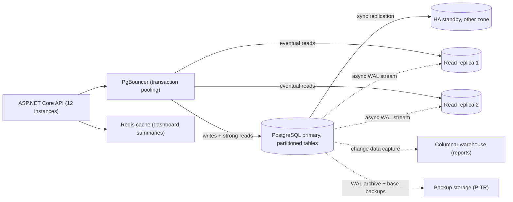
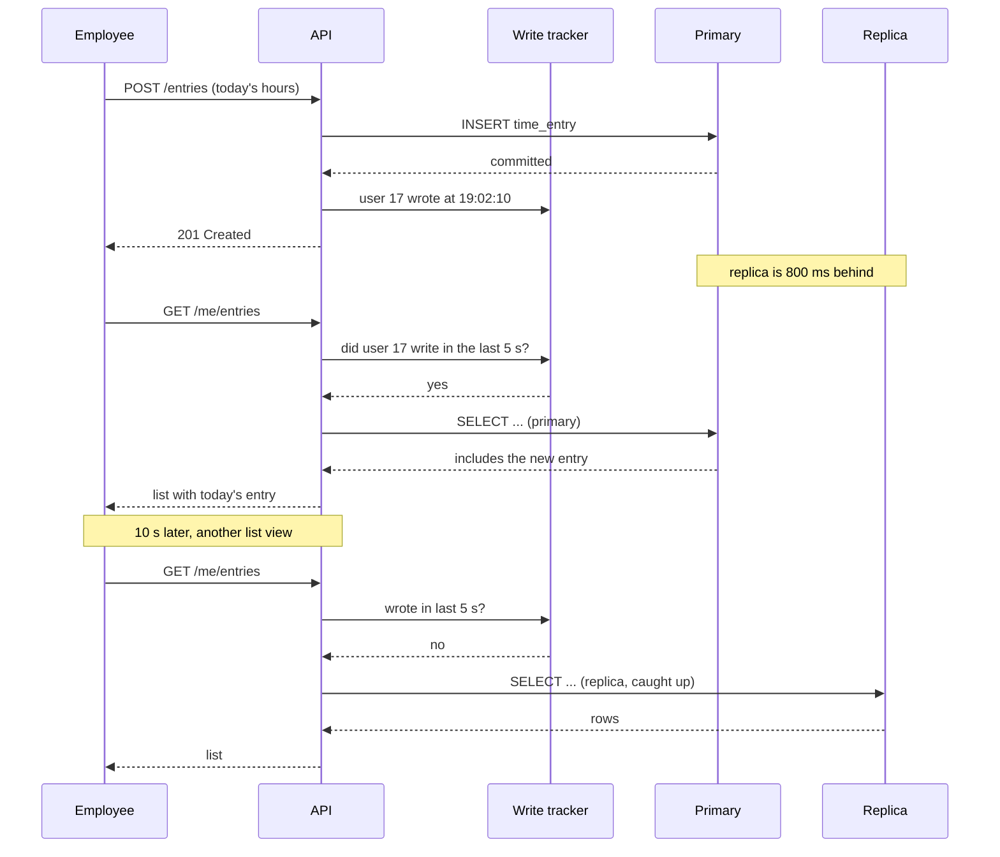

Application servers are easy to scale: they hold no data, so you add more. The database is where the data lives, so every scaling step there has a cost in consistency, complexity or money. This lesson gives you a ladder to climb one rung at a time, the numbers that tell you when to climb, and a way to choose a database by how the data is read and written.

## Learning objectives

By the end of this lesson you will be able to:

1. Estimate read rate, write rate and storage growth for a database, and say which limit a single PostgreSQL primary hits first.
2. Climb the scaling ladder in order: tune, scale up, pool connections, add replicas, cache, partition, split by function, and shard as the last step.
3. Route reads to replicas safely, including read-your-writes and lag limits, and implement the routing in ASP.NET Core.
4. Choose a shard key, and explain hot shards, cross-shard queries and resharding cost.
5. Match access patterns to store types (relational, key-value, document, wide-column, search, columnar) and justify polyglot persistence or the lack of it.
6. Explain high availability, backups and restore time as part of the database design.

## Prerequisites

- [Capacity estimation](#/lesson/m11-capacity-estimation): RPS, peak factors and storage maths.
- [Indexes, composite indexes, B-tree and hash](#/lesson/m09-indexes): the cheapest scaling step is often an index.
- [Caching layers in a system](#/lesson/m11-caching-layers): where an application cache sits relative to the database.

## Explain it like I'm a beginner

Picture a single government records office in a district town. One clerk keeps the master register (the **primary database**). Every new entry and every question goes to that clerk.

As the town grows, the office tries things in a sensible order:

1. **Work smarter.** Put tabs in the register so the clerk finds pages faster (**indexes**, **query tuning**).
2. **Hire a faster clerk with a bigger desk** (**vertical scaling**: a bigger server).
3. **Manage the queue.** Instead of 500 people crowding the desk, a token system lets 20 in at a time (**connection pooling**).
4. **Make photocopies for reading.** Assistant clerks hold copies of the register and answer "what does page 40 say?" questions. Copies are updated every few minutes, so they can be slightly behind (**read replicas**, **replication lag**).
5. **Put a notice board outside** with the ten most-asked answers (**caching**).
6. **Split the register into yearly volumes.** Old volumes go to the archive shelf (**partitioning**).
7. **Move unrelated work to other offices.** Land records go to one office, birth certificates to another (**functional partitioning**).
8. **Finally, open several branch offices**, each owning the registers for some villages. A citizen must go to the right branch, and a question about two villages in different branches needs two visits (**sharding**).

Each step solves a real problem and adds a new one. A good architect climbs only as far as the numbers demand.

## First-principles explanation

### Start with the numbers

Take **HourLog**, a multi-tenant timesheet and expense SaaS (think a Jira- or Harvest-style tool) used by IT-services firms, design agencies and consultancies across India. Employees log hours against client projects, start and stop timers, update tasks and file expense claims (receipt photos go to object storage, only their metadata to the database). Managers approve timesheets and watch project dashboards.

Today:

- 60,000 employees, each making about 40 writes a day (time entries, timer start and stop, task updates, comments, expense lines): 60,000 × 40 = 2.4 M writes/day. 2,400,000 ÷ 86,400 ≈ 28 writes/s average. Most timesheets are filled in at the end of the working day, between 5 and 8 pm, so assume ×5 for peak: about **140 writes/s**.
- Reads (dashboards, lists, approvals): 60,000 users × 300 reads/day = 18 M reads/day ≈ 210/s average, ×4 for peak ≈ **850 reads/s**.
- Storage: 2.4 M rows/day × about 1 KB per row (with overhead) ≈ 2.4 GB/day ≈ 880 GB/year. Indexes typically add a lot on top. Assume ×2: about **1.8 TB/year** (estimate).

A single well-configured PostgreSQL server on modern hardware handles this comfortably, *if* queries are indexed. Many teams would jump to "microservices with sharded NoSQL" here. The numbers say: one primary, one standby for availability, good indexes, and a plan for storage.

Now suppose a few large enterprise customers plus steady growth bring 10× over three years: **1,400 writes/s**, **8,500 reads/s** at peak, and about **18 TB/year**. Now the ladder matters.

### What a single primary runs out of, in order

Different workloads hit different walls. Watch these:

1. **CPU from bad queries.** One missing index can turn a 2 ms lookup into a 2 s sequential scan. This is the most common "the database is slow" cause by far, and the fix is free.
2. **Connections.** Each PostgreSQL connection is a separate server process using memory. Fifty app instances with a pool of 100 each want 5,000 connections, far beyond what a server should hold. Connection storms during deploys or autoscaling are a classic outage.
3. **Memory for the working set.** Performance falls off a cliff when the frequently-used data and indexes no longer fit in RAM and reads go to disk.
4. **Read throughput.** Dashboards and lists grow faster than writes.
5. **Write throughput.** Every write produces WAL (the write-ahead log), index updates and later vacuum work. Write capacity is the hardest limit, because replicas don't help with it.
6. **Operational size.** A 20 TB database takes a long time to back up, restore, replicate to a new standby or vacuum. **Restore time is part of your recovery-time objective.** If restoring takes 10 hours, your RTO is at least 10 hours, whatever the architecture diagram says.

### The scaling ladder

Climb in this order. Each rung is cheaper and safer than the next.

**Rung 0 — Tune.** Use `EXPLAIN ANALYZE` (see [Query planning](#/lesson/m09-query-planning)), add the right composite indexes, remove N+1 query patterns, use keyset pagination instead of large `OFFSET`s. It is common for this alone to cut database load several times over.

**Rung 1 — Scale up (vertical).** A bigger instance: more cores, more RAM, faster disks. Managed PostgreSQL services offer large instances, and moving up is often a few minutes of planned downtime or a failover. It costs more money but no code. The limit is the largest machine you can buy, and price grows faster than size near the top.

**Rung 2 — Pool connections.** Npgsql pools connections inside each app process. Put an external pooler such as PgBouncer (in transaction mode) between many app instances and the database, so 5,000 client connections share, say, 200 server connections. Transaction mode has a price: session state (`SET`, temporary tables, advisory locks, `LISTEN`) does not survive between transactions, and prepared statements need PgBouncer 1.21 or later with `max_prepared_statements` enabled. See [Database connection pooling](#/lesson/m09-connection-pooling).

**Rung 3 — Read replicas.** The primary streams its WAL to one or more replicas, which apply it and serve read-only queries. Writes still go to the primary.

- **Asynchronous replication** (the common default) means the primary doesn't wait for replicas. Writes are fast, but replicas lag behind: normally milliseconds to a second, sometimes much longer during heavy writes or long-running replica queries (estimate).
- **Synchronous replication** makes a commit wait until a standby confirms. No data loss on failover, but every write pays a network round trip, and a slow standby slows all writes. It is usually used for one HA standby, not for read scaling.
- **Lag causes visible bugs.** An employee submits today's time entry, the page reloads from a replica that is 800 ms behind, and the entry is "missing". The fix is **read-your-writes**: route a user's reads to the primary for a few seconds after they write, or read from a replica only once it has replayed past the write's position. See [Read replicas and replication lag](#/lesson/m09-replicas).
- **Capacity maths.** Suppose one node handles about 3,000 simple reads/s before latency degrades (estimate; measure your own) and you plan at 60 % utilisation, so 1,800 reads/s per node. If 5,100 of the 8,500 reads/s can tolerate lag, they need 5,100 ÷ 1,800 ≈ 2.8 → 3 replicas, plus one spare so losing one doesn't overload the rest: 4.

**Rung 4 — Cache.** Many reads are repeated: the project dashboard summary is viewed hundreds of times between updates. Cache-aside in Redis or in memory (see [Cache patterns](#/lesson/m12-cache-patterns)) can remove a large share of reads. At a 90 % hit ratio on the dashboard endpoints, 3,000 dashboard reads/s become 300 database reads/s. The cost is staleness and invalidation work.

**Rung 5 — Partition tables.** PostgreSQL declarative partitioning splits one logical table into child tables by range (for example by month), list or hash. Benefits:

- **Partition pruning**: a query with `WHERE entry_date >= '2026-10-01'` reads only October's partition.
- **Cheap retention**: dropping or detaching last year's partition takes moments, while `DELETE` of 900 million rows creates a huge amount of vacuum work.
- **Smaller indexes per partition**, and maintenance (vacuum, reindex) per partition.

Partitioning is still **one database on one server**. It doesn't add write capacity. It makes big tables manageable.

**Rung 6 — Split by function.** Move workloads that don't belong in the transactional database:

- Heavy analytics and reports → a columnar warehouse or OLAP store, fed by change data capture or a nightly export. A "billable hours by client by month for five years" query should not compete with the 7 pm timesheet peak.
- Full-text search → a search engine.
- Files → object storage, with only metadata in the database (see [Object storage](#/lesson/m11-object-storage)).
- Separate bounded contexts (billing, identity) can own separate databases.

**Rung 7 — Shard.** When writes or data size exceed what one primary can handle, split the data across several independent primaries. Each **shard** holds a subset of rows, chosen by a **shard key**. This is the only rung that scales writes linearly, and it is by far the most expensive in complexity.

### Sharding in detail

**Choosing the shard key.** A good key:

- Appears in almost every query, so each request goes to one shard. For a multi-tenant SaaS, `tenant_id` (the customer company) is the natural choice: every query is "within my company".
- Spreads data and load evenly. Problem: tenants aren't equal. One IT-services customer with 20,000 employees may produce 30 % of all rows. A **hot shard** holding that tenant is the bottleneck.
- Keeps related data together, so transactions and joins stay inside one shard.

**Routing strategies.**

| Strategy | How | Good | Bad |
|---|---|---|---|
| Hash | `hash(tenant_id) mod N` | Even spread, no lookup | Changing N moves most keys |
| Range | Tenant ids A–F → shard 1 … | Range scans | Hot ranges; manual splits |
| Directory | A lookup table maps each tenant to a shard | Can move one tenant; can isolate big tenants | The directory must be fast and highly available |
| Consistent hashing | Keys and shards on a ring | Adding a shard moves only ~1/N of keys | More complex. See [Sharding and consistent hashing](#/lesson/m13-sharding) |

A common practical design is **directory with hash fallback**: big tenants are pinned to dedicated shards in a small lookup table, and everyone else is placed by hash.

**What you give up.**

- **Cross-shard queries** ("total hours logged across all tenants") must fan out to every shard and merge results, or run in the analytics store instead.
- **Cross-shard transactions** need sagas or two-phase commit. Design so that they're rare.
- **Global uniqueness**: sequences are per shard, so use UUIDs (UUIDv7 sorts by time and indexes well) or shard-prefixed ids.
- **Resharding**: moving data between shards while the system is live (copy, catch up, switch, verify) is a project in itself.
- **Operations**: N primaries, N standbys, N sets of backups, schema migrations applied N times.

PostgreSQL itself doesn't shard automatically. Options include application-level sharding (your code picks the connection), extensions such as Citus that distribute tables across nodes, or a distributed SQL database. Each moves complexity rather than removing it.

### High availability is a separate question from scaling

Replicas for reads and a standby for failover are related but different. For availability:

- Run the primary with a **standby in another availability zone**, usually with synchronous or near-synchronous replication, and automatic failover (managed services do this). Failover typically takes tens of seconds to a couple of minutes (estimate). Apps must reconnect and retry.
- **Backups with point-in-time recovery** (base backups plus archived WAL) protect against the failure replication can't: a bad migration or a `DELETE` without `WHERE` is replicated to every replica instantly.
- **Test restores** and time them. That number is your real RTO for data-loss scenarios.

### SQL or NoSQL: choose by access pattern

"SQL doesn't scale" is not a useful rule. Choose by asking: *how is this data written, how is it read, and what must be consistent?*

| Access pattern | Good fit | Why | Watch out for |
|---|---|---|---|
| Transactions across several entities, constraints, ad-hoc queries, reporting joins | Relational (PostgreSQL) | ACID, joins, mature tooling | Write scaling beyond one primary needs sharding |
| Get/put by key at very high rates, simple values | Key-value (Redis, DynamoDB-style) | Predictable low latency, scales horizontally | No ad-hoc queries; you model for each access path |
| Whole aggregates read and written together, flexible shape | Document store, or PostgreSQL `jsonb` | Matches the object shape | Cross-document consistency; duplicated data |
| Huge write volume, queries by partition key and time | Wide-column (Cassandra-style) | Spreads writes over many nodes | Query-first modelling; limited secondary queries |
| Metrics and sensor readings over time | Time-series store or a PostgreSQL time-series extension | Compression, time bucketing, retention | Not for relational business data |
| Free-text search, relevance, facets | Search engine | Inverted indexes | It is a derived copy, not the source of truth |
| Large analytical scans and aggregations | Columnar warehouse / OLAP | Reads only the needed columns, compresses well | Not for row-by-row OLTP updates |
| Relationship traversal ("friends of friends") | Graph database | Fast multi-hop traversal | Niche; often a relational recursive CTE is enough |

**Default to PostgreSQL** for business data. It covers relational, `jsonb` documents, full-text search for moderate needs, and has extensions for time-series and geospatial data. Add a specialised store when one access pattern clearly outgrows it. Every extra store (polyglot persistence) brings another technology to run, monitor, back up and keep in sync. Keeping copies in sync safely usually needs the [transactional outbox](#/lesson/m12-outbox), never a "write to both" in the request handler.

### What breaks first under load

1. **A missing index or a new slow query** after a release, often in a dashboard. Watch `pg_stat_statements` for the top queries by total time.
2. **Connection exhaustion** during autoscaling or deploys. Pooling and connection limits per app fix it.
3. **Replica lag** during the evening write peak, which turns into "my entry disappeared" support tickets.
4. **The hot tenant** after sharding. One shard at 90 % CPU while the others idle.

### Failure modes and mitigations

| Failure | Effect | Mitigation |
|---|---|---|
| Primary crashes | Writes fail until failover | Standby in another zone, automatic failover, client retries with backoff |
| Failover promotes a lagging replica (async) | Last few seconds of writes lost (RPO > 0) | Synchronous standby for HA; accept and document RPO |
| Replica lag spikes | Stale reads; read-your-writes bugs | Lag monitoring; route to primary above a lag limit; sticky-after-write |
| Bad migration or bulk delete | Replicated everywhere instantly | PITR backups; expand/contract migrations; review destructive SQL |
| Cache stampede after a cache flush | Database overwhelmed | Request coalescing, TTL jitter, warm-up (see [cache failures](#/lesson/m12-cache-failures)) |
| Hot shard | One shard saturated | Directory-based placement; dedicated shard for big tenants |
| Split-brain after a bad failover | Two primaries accept writes | Managed failover with fencing; never promote by hand without fencing |

### Consistency trade-offs

Each rung weakens consistency somewhere. Replicas give stale reads. Caches give staler reads. Separate stores are eventually consistent with the source. Shards lose cheap cross-shard transactions. Write down, per screen or endpoint, what staleness is acceptable: "dashboard totals may be 60 s old" is fine, "the approval button must see the latest status" means primary reads.

### Cost drivers

- **Instance size**, mostly driven by RAM for the working set. The largest instances cost disproportionately more.
- **Each replica is a full copy**: compute, storage and IOPS again.
- **Storage and IOPS**, including backups and WAL archives kept for the PITR window.
- **Cross-zone and cross-region transfer** for replication.
- **People**: every extra database technology and every shard adds operational work. This is often the largest real cost.

### When a simpler design is enough

At HourLog's current 140 writes/s and 850 reads/s, the right design is: one primary with an HA standby, good indexes, Npgsql pooling, monthly partitions on the biggest table for retention, and daily-tested backups. No replicas for reads yet, no cache yet, no shards. Add each rung when a measured limit approaches, not because a diagram of a much larger company has it.

## Visual explanation

### Architecture: the database tier after several rungs



Reading the arrows:

- **API → PgBouncer**: many app instances share a small number of real database connections.
- **API → Redis**: dashboard summaries are read cache-aside, so most dashboard views never reach PostgreSQL.
- **PgBouncer → primary**: all writes, and reads that must be current (approvals, read-your-writes), go to the primary.
- **PgBouncer → replicas**: lists and dashboards that tolerate a second or so of lag go to replicas.
- **Primary → HA standby (sync)**: a standby in another zone confirms each commit, so a failover loses nothing. It serves no traffic.
- **Primary → replicas (dotted, async)**: WAL is streamed without waiting, which is why replicas can lag.
- **Primary → warehouse**: changes flow to the analytics store, so five-year reports never compete with the evening write peak.
- **Primary → backup storage**: base backups and archived WAL allow point-in-time recovery from mistakes that replication would copy everywhere.

### Sequence: read-your-writes with a lagging replica



The employee's write goes to the primary, and the API records the time of the write. Moments later the employee's list request would normally go to a replica, but the replica is 800 ms behind and would not show the new entry. Because the tracker says this user wrote within the last 5 seconds, the API reads from the primary instead, and the entry appears. Ten seconds later the window has passed, the replica has caught up, and reads return to the replica. Only the few users who just wrote put load on the primary.

## Step-by-step example

HourLog has grown 10×: 1,400 writes/s and 8,500 reads/s at peak, 18 TB a year. We climb the ladder.

### Step 1 — measure and tune

`pg_stat_statements` shows the top query by total time is the project dashboard: a `SUM` over all of a project's entries, run on every page view. A composite index on `(project_id, entry_date)` and a daily summary table cut its cost dramatically. Always start here.

### Step 2 — scale up and pool

Move the primary to a larger instance with enough RAM to hold the hot data (the last 90 days of entries and their indexes). Put PgBouncer in front: 40 app instances × 20 client connections = 800 clients share about 150 server connections.

### Step 3 — partition the big table

```sql
CREATE TABLE time_entry (
    tenant_id   bigint      NOT NULL,
    project_id  bigint      NOT NULL,
    entry_id    uuid        NOT NULL,
    entry_date  date        NOT NULL,
    activity    text        NOT NULL,
    hours       numeric(5,2) NOT NULL,
    created_by  bigint      NOT NULL,
    PRIMARY KEY (entry_id, entry_date)
) PARTITION BY RANGE (entry_date);

CREATE TABLE time_entry_2026_10 PARTITION OF time_entry
    FOR VALUES FROM ('2026-10-01') TO ('2026-11-01');
CREATE INDEX ON time_entry (project_id, entry_date);
```

A partitioned table's primary key must include the partition key, which is why it is `(entry_id, entry_date)`. Partitions are created ahead of time by a scheduled job. Data older than three years is detached and moved to cheaper storage.

### Step 4 — replicas and read routing

Reads: about 60 % are dashboards and lists that tolerate a second of lag. 8,500 × 0.6 ≈ 5,100 reads/s for replicas. At about 1,800 reads/s per node (3,000 at 60 % utilisation, estimate), that's 2.8 → 3 replicas, plus 1 spare = 4. The remaining 3,400 reads/s (approvals, read-your-writes, small lookups) stay on the primary, which also handles 1,400 writes/s.

### Step 5 — cache the dashboards

Project summaries are cached for 60 s and invalidated when an entry is added. Suppose 3,000 of the 5,100 eventual reads/s are dashboard views. At a 90 % hit ratio they become 300, so replicas carry about 2,100 + 300 = 2,400 reads/s: 2,400 ÷ 1,800 ≈ 1.3 → 2 replicas, plus 1 spare = 3 instead of 4. The cache is worth it only if it costs less than the replica it removes, and the database must still survive a cold cache (see the failure table above).

### Step 6 — decide about sharding

Writes: 1,400/s on a large primary is within what PostgreSQL can do with good hardware and tuning (estimate; load-test it). Storage: 18 TB/year is a concern for operations, but partitioning and archiving keep the hot set small. **Decision: don't shard yet.** Plan for it: every table already carries `tenant_id`, ids are UUIDv7, and no query joins across tenants. If writes reach about 60 % of the primary's measured limit, introduce tenant sharding with a directory, starting by moving the largest tenant to its own shard.

## Production-style C# implementation

The code shows the parts the application owns: routing each query to the primary or a replica with read-your-writes and a lag limit, a tenant shard directory, and a cache-aside dashboard service. The database is an in-memory fake behind interfaces, so everything compiles and runs without PostgreSQL.

```text
HourLog.Api/
  Program.cs
  Data/DbRouting.cs
  Data/TenantShardDirectory.cs
  Timesheets/TimeEntryStore.cs
  Timesheets/ProjectSummaryService.cs
```

With Npgsql in a real app, a multi-host data source can pick primary or standby connections for you. This snippet needs the Npgsql package, so it is not part of the compiled set:

```csharp
// Npgsql: one data source over several hosts, then pick by role.
var multi = new NpgsqlDataSourceBuilder(
        "Host=pg-primary,pg-replica-1,pg-replica-2;Database=hourlog;Username=app")
    .BuildMultiHost();
var primary  = multi.WithTargetSession(TargetSessionAttributes.Primary);
var replicas = multi.WithTargetSession(TargetSessionAttributes.PreferStandby);
```

```csharp file=Data/DbRouting.cs
using System.Collections.Concurrent;

namespace HourLog.Data;

public enum DbRole { Primary, Replica }

/// <summary>How fresh a read must be. Each endpoint declares this explicitly.</summary>
public enum ReadFreshness { Eventual, ReadYourWrites, Strong }

public interface IReplicaLagMonitor
{
    /// <summary>Latest measured lag of the replica pool (for example from pg_stat_replication on the primary).</summary>
    TimeSpan CurrentLag { get; }
}

public sealed class FixedLagMonitor : IReplicaLagMonitor
{
    public TimeSpan CurrentLag { get; set; } = TimeSpan.FromMilliseconds(200);
}

public sealed class DbRoutingOptions
{
    public TimeSpan StickyAfterWrite { get; set; } = TimeSpan.FromSeconds(5);
    public TimeSpan MaxReplicaLag { get; set; } = TimeSpan.FromSeconds(2);
}

/// <summary>Decides primary or replica per query. Writes always go to the primary.</summary>
public sealed class DbRouter(IReplicaLagMonitor lag, TimeProvider clock, DbRoutingOptions options)
{
    private readonly ConcurrentDictionary<string, DateTimeOffset> _lastWrite = new();

    public DbRole ForWrite(string userId)
    {
        _lastWrite[userId] = clock.GetUtcNow();
        return DbRole.Primary;
    }

    public DbRole ForRead(string userId, ReadFreshness freshness)
    {
        if (freshness == ReadFreshness.Strong) return DbRole.Primary;
        if (lag.CurrentLag > options.MaxReplicaLag) return DbRole.Primary;   // replicas too far behind
        if (freshness == ReadFreshness.ReadYourWrites
            && _lastWrite.TryGetValue(userId, out var at)
            && clock.GetUtcNow() - at < options.StickyAfterWrite)
            return DbRole.Primary;
        return DbRole.Replica;
    }
}
```

```csharp file=Data/TenantShardDirectory.cs
using System.Text;

namespace HourLog.Data;

/// <summary>Directory with hash fallback: big tenants are pinned to a shard; everyone else is placed by a stable hash.</summary>
public sealed class TenantShardDirectory(int shardCount, IReadOnlyDictionary<long, int> pinned)
{
    public int ShardCount => shardCount;

    public int ShardFor(long tenantId)
    {
        if (pinned.TryGetValue(tenantId, out var shard)) return shard;
        // Never use GetHashCode() for placement: it is randomised per process in .NET.
        return (int)(StableHash(tenantId.ToString()) % (uint)shardCount);
    }

    private static uint StableHash(string key)
    {
        uint hash = 2166136261;                       // FNV-1a, 32-bit
        foreach (var b in Encoding.UTF8.GetBytes(key)) { hash ^= b; hash *= 16777619; }
        return hash;
    }
}
```

```csharp file=Timesheets/TimeEntryStore.cs
using System.Collections.Concurrent;
using HourLog.Data;

namespace HourLog.Timesheets;

public sealed record TimeEntry(Guid Id, long TenantId, long ProjectId, DateOnly Date, string Activity, decimal Hours, string CreatedBy);

public interface ITimeEntryStore
{
    Task AddAsync(TimeEntry entry, CancellationToken ct);
    Task<IReadOnlyList<TimeEntry>> ForProjectAsync(long projectId, DbRole role, CancellationToken ct);
    Task<IReadOnlyList<TimeEntry>> ForUserAsync(string userId, DbRole role, CancellationToken ct);
}

/// <summary>Stand-in for PostgreSQL. A real implementation opens a connection from the primary or replica data source by role.</summary>
public sealed class InMemoryTimeEntryStore : ITimeEntryStore
{
    private readonly ConcurrentBag<TimeEntry> _rows = new();
    public ConcurrentDictionary<DbRole, int> QueriesByRole { get; } = new();

    public Task AddAsync(TimeEntry entry, CancellationToken ct)
    {
        _rows.Add(entry);
        QueriesByRole.AddOrUpdate(DbRole.Primary, 1, (_, n) => n + 1);
        return Task.CompletedTask;
    }

    public Task<IReadOnlyList<TimeEntry>> ForProjectAsync(long projectId, DbRole role, CancellationToken ct)
    {
        QueriesByRole.AddOrUpdate(role, 1, (_, n) => n + 1);
        return Task.FromResult<IReadOnlyList<TimeEntry>>(_rows.Where(r => r.ProjectId == projectId).ToList());
    }

    public Task<IReadOnlyList<TimeEntry>> ForUserAsync(string userId, DbRole role, CancellationToken ct)
    {
        QueriesByRole.AddOrUpdate(role, 1, (_, n) => n + 1);
        return Task.FromResult<IReadOnlyList<TimeEntry>>(
            _rows.Where(r => r.CreatedBy == userId).OrderByDescending(r => r.Date).ToList());
    }
}
```

```csharp file=Timesheets/ProjectSummaryService.cs
using Microsoft.Extensions.Caching.Memory;
using HourLog.Data;

namespace HourLog.Timesheets;

public sealed record ProjectSummary(long ProjectId, int Entries, decimal TotalHours, DateOnly? LastEntry);

/// <summary>Cache-aside over replica reads. Writes go to the primary and evict the cached summary.</summary>
public sealed class ProjectSummaryService(ITimeEntryStore store, DbRouter router, IMemoryCache cache)
{
    private static readonly TimeSpan Ttl = TimeSpan.FromSeconds(60);
    private static string Key(long projectId) => $"project-summary:{projectId}";

    public async Task<ProjectSummary> GetAsync(long projectId, string userId, CancellationToken ct)
    {
        if (cache.TryGetValue(Key(projectId), out ProjectSummary? hit) && hit is not null) return hit;

        var role = router.ForRead(userId, ReadFreshness.Eventual);
        var rows = await store.ForProjectAsync(projectId, role, ct);
        var summary = new ProjectSummary(projectId, rows.Count, rows.Sum(r => r.Hours),
            rows.Count == 0 ? null : rows.Max(r => r.Date));

        cache.Set(Key(projectId), summary, Ttl);
        return summary;
    }

    public async Task<TimeEntry> AddEntryAsync(TimeEntry entry, CancellationToken ct)
    {
        router.ForWrite(entry.CreatedBy);
        await store.AddAsync(entry, ct);
        cache.Remove(Key(entry.ProjectId));   // write first, then evict
        return entry;
    }
}
```

```csharp file=Program.cs
using HourLog.Data;
using HourLog.Timesheets;

var builder = WebApplication.CreateBuilder(args);

builder.Services.AddMemoryCache();
builder.Services.AddSingleton(TimeProvider.System);
builder.Services.AddSingleton(new DbRoutingOptions());
builder.Services.AddSingleton<IReplicaLagMonitor, FixedLagMonitor>();
builder.Services.AddSingleton<DbRouter>();
builder.Services.AddSingleton(new TenantShardDirectory(4, new Dictionary<long, int> { [1001] = 3 }));  // big tenant pinned
builder.Services.AddSingleton<ITimeEntryStore, InMemoryTimeEntryStore>();
builder.Services.AddSingleton<ProjectSummaryService>();

var app = builder.Build();

app.MapPost("/projects/{projectId:long}/entries", async (long projectId, NewEntry body, ProjectSummaryService svc, CancellationToken ct) =>
{
    // In production, user and tenant come from the authenticated principal.
    var entry = new TimeEntry(Guid.CreateVersion7(), body.TenantId, projectId, body.Date, body.Activity, body.Hours, body.UserId);
    await svc.AddEntryAsync(entry, ct);
    return Results.Created($"/entries/{entry.Id}", entry);
});

app.MapGet("/projects/{projectId:long}/summary", (long projectId, string userId, ProjectSummaryService svc, CancellationToken ct) =>
    svc.GetAsync(projectId, userId, ct));

app.MapGet("/me/entries", async (string userId, DbRouter router, ITimeEntryStore store, CancellationToken ct) =>
    await store.ForUserAsync(userId, router.ForRead(userId, ReadFreshness.ReadYourWrites), ct));

app.MapGet("/debug/shard/{tenantId:long}", (long tenantId, TenantShardDirectory dir) => new { tenantId, shard = dir.ShardFor(tenantId) });

app.Run();

public sealed record NewEntry(long TenantId, string UserId, DateOnly Date, string Activity, decimal Hours);
```

Design notes:

- **Every read declares its freshness.** `Eventual`, `ReadYourWrites` or `Strong` is a product decision per endpoint, and putting it in the call makes it reviewable.
- **Lag limit as a circuit breaker.** If replicas fall more than 2 s behind, reads move to the primary. Watch out: during a write storm this adds load to the primary exactly when it is busiest. Pair it with alerts, and consider shedding non-critical reads instead.
- **The sticky window is per process.** With many API instances, store the last-write time somewhere shared (a short-lived cookie or a Redis key), or route by the WAL position the write returned.
- **`Guid.CreateVersion7()`** gives time-ordered ids that index well and stay unique across future shards.
- **Stable hashing.** `string.GetHashCode()` differs between processes in .NET, so it must never decide data placement.

## Bad design vs good design

**Bad**: at 300 writes/s, a team decides "PostgreSQL won't scale" and shards across 8 databases by `hash(user_id) mod 8`. Project data written by different employees lands on different shards. Every project dashboard fans out to 8 databases. A report needs data from all shards and runs in application code. Adding a 9th shard would move almost all users. Backups, migrations and monitoring are now 8 times the work, and there are still no replicas or standbys, so any one of 8 failures breaks part of the product.

**Good**: one primary with an HA standby, tuned queries, pooling, partitioning for retention, replicas and caching as reads grow, analytics moved to a warehouse. Every table carries `tenant_id` so that, if sharding is ever needed, the shard key is the tenant, which keeps each tenant's data and transactions on one shard.

**Is the good design always right?** If you know from day one that write volume will exceed a single primary (an IoT platform ingesting 500,000 sensor readings per second, say), start with a store designed for that write pattern for the readings, and keep relational data in PostgreSQL. The ladder is a default, not a law.

:::callout type=mistake title="Using replicas as backups"
A replica copies every change immediately, including `DROP TABLE` and a mistaken `UPDATE` without `WHERE`. Replicas protect against hardware failure, not human error. You still need point-in-time recovery backups, and tested restores.
:::

:::callout type=tradeoff title="Synchronous versus asynchronous replication"
Synchronous replication means a failover loses no committed data, but every commit waits for the standby, and a slow or unreachable standby can stall writes. Asynchronous replication is faster and more tolerant, but a failover may lose the last moments of writes. Many teams use one synchronous HA standby in another zone and asynchronous read replicas.
:::

## Practical playground

The SQL playground below creates a small partitioned `time_entry` table with two monthly partitions. Try these:

1. `EXPLAIN SELECT * FROM time_entry WHERE entry_date >= '2026-10-01';` and confirm only the October partition is scanned (partition pruning).
2. Run the same without the date filter and see both partitions appear.
3. Find the busiest tenants with `GROUP BY tenant_id`, and decide whether hash sharding by tenant would be balanced.
4. Try `DROP TABLE time_entry_2026_09;` and notice how cheap retention becomes.

:::playground type=sql title="Partition pruning and tenant skew"
```sql
CREATE TABLE time_entry (
  tenant_id  int NOT NULL,
  project_id int NOT NULL,
  entry_id   int NOT NULL,
  entry_date date NOT NULL,
  activity   text NOT NULL,
  hours      numeric(5,2) NOT NULL,
  PRIMARY KEY (entry_id, entry_date)
) PARTITION BY RANGE (entry_date);
CREATE TABLE time_entry_2026_09 PARTITION OF time_entry FOR VALUES FROM ('2026-09-01') TO ('2026-10-01');
CREATE TABLE time_entry_2026_10 PARTITION OF time_entry FOR VALUES FROM ('2026-10-01') TO ('2026-11-01');
INSERT INTO time_entry VALUES
  (1, 10, 1, '2026-09-28', 'Development', 6.5),
  (1, 10, 2, '2026-10-02', 'Development', 7.0),
  (1, 11, 3, '2026-10-03', 'Code review', 2.0),
  (1, 11, 4, '2026-10-05', 'Testing', 4.5),
  (2, 20, 5, '2026-10-04', 'Client meeting', 1.5),
  (3, 30, 6, '2026-09-30', 'Design', 5.0),
  (3, 30, 7, '2026-10-06', 'Design', 6.0),
  (1, 12, 8, '2026-10-07', 'Support', 3.5);
```
:::

## Exercises

:::exercise id=m11-database-architecture-ex1 difficulty=beginner kind=code title="Database capacity calculator"
Before choosing a rung of the ladder, you need three numbers. Implement them in `DbCapacity`.
::requirements
- `ReplicasNeeded(double replicaReadsPerSec, double readsPerNode, double targetUtilisation, int spares)` returns `ceil(replicaReadsPerSec ÷ (readsPerNode × targetUtilisation)) + spares`, or `0` if `replicaReadsPerSec` is 0.
- `StorageTbPerYear(double rowsPerDay, double bytesPerRow, double indexFactor)` returns `rowsPerDay × bytesPerRow × indexFactor × 365 ÷ 10^12`.
- `WriteHeadroomExceeded(double peakWritesPerSec, double measuredPrimaryLimit, double threshold)` returns `true` when peak writes exceed `measuredPrimaryLimit × threshold`.
- Utilisation and threshold must be in `(0, 1]`; otherwise throw `ArgumentOutOfRangeException`.
::acceptance
- 5,100 reads/s, 3,000 per node, 0.6 utilisation, 1 spare → 4 replicas.
- 2.4 M rows/day × 1,000 bytes × 2 → about 1.75 TB/year.
- 1,400 writes/s against a measured limit of 4,000 at a 0.6 threshold → not exceeded; 2,500 → exceeded.
- Utilisation 0 or 1.5 throws.
::hint
Work out what one node can serve *at the target utilisation* first. Then divide.
::hint
`Math.Ceiling` returns a `double`. Cast the result to `int` after rounding up.
::hint
For storage, multiply everything per day, then by 365, then divide by 1e12 to get terabytes.
::hint
```csharp
var perNode = readsPerNode * targetUtilisation;
return (int)Math.Ceiling(replicaReadsPerSec / perNode) + spares;
```
::starter
```csharp file=DbCapacity.cs
using System;

public static class DbCapacity
{
    public static int ReplicasNeeded(double replicaReadsPerSec, double readsPerNode, double targetUtilisation, int spares) =>
        throw new NotImplementedException();

    public static double StorageTbPerYear(double rowsPerDay, double bytesPerRow, double indexFactor) =>
        throw new NotImplementedException();

    public static bool WriteHeadroomExceeded(double peakWritesPerSec, double measuredPrimaryLimit, double threshold) =>
        throw new NotImplementedException();
}
```
::tests
```csharp file=DbCapacityTests.cs
using System;
using Xunit;

public class DbCapacityTests
{
    [Fact] public void Replicas_for_hourlog() => Assert.Equal(4, DbCapacity.ReplicasNeeded(5_100, 3_000, 0.6, 1));

    [Fact] public void No_reads_no_replicas() => Assert.Equal(0, DbCapacity.ReplicasNeeded(0, 3_000, 0.6, 1));

    [Fact] public void Storage_per_year() => Assert.Equal(1.752, DbCapacity.StorageTbPerYear(2_400_000, 1_000, 2), 3);

    [Fact] public void Headroom_ok() => Assert.False(DbCapacity.WriteHeadroomExceeded(1_400, 4_000, 0.6));

    [Fact] public void Headroom_exceeded() => Assert.True(DbCapacity.WriteHeadroomExceeded(2_500, 4_000, 0.6));

    [Fact] public void Bad_utilisation_throws()
    {
        Assert.Throws<ArgumentOutOfRangeException>(() => DbCapacity.ReplicasNeeded(100, 1_000, 0, 0));
        Assert.Throws<ArgumentOutOfRangeException>(() => DbCapacity.ReplicasNeeded(100, 1_000, 1.5, 0));
    }

    [Fact] public void Bad_threshold_throws() =>
        Assert.Throws<ArgumentOutOfRangeException>(() => DbCapacity.WriteHeadroomExceeded(1, 1, 0));
}
```
::solution
```csharp file=DbCapacity.cs
using System;

public static class DbCapacity
{
    private static void CheckFraction(double value, string name)
    {
        if (value <= 0 || value > 1) throw new ArgumentOutOfRangeException(name, "Must be in (0, 1].");
    }

    public static int ReplicasNeeded(double replicaReadsPerSec, double readsPerNode, double targetUtilisation, int spares)
    {
        CheckFraction(targetUtilisation, nameof(targetUtilisation));
        if (replicaReadsPerSec <= 0) return 0;
        var perNode = readsPerNode * targetUtilisation;
        return (int)Math.Ceiling(replicaReadsPerSec / perNode) + spares;
    }

    public static double StorageTbPerYear(double rowsPerDay, double bytesPerRow, double indexFactor) =>
        rowsPerDay * bytesPerRow * indexFactor * 365 / 1e12;

    public static bool WriteHeadroomExceeded(double peakWritesPerSec, double measuredPrimaryLimit, double threshold)
    {
        CheckFraction(threshold, nameof(threshold));
        return peakWritesPerSec > measuredPrimaryLimit * threshold;
    }
}
```

5,100 ÷ (3,000 × 0.6) = 5,100 ÷ 1,800 ≈ 2.83, rounded up to 3, plus 1 spare = 4. The `readsPerNode` and `measuredPrimaryLimit` inputs must come from a load test on your own queries and hardware. Numbers from someone else's blog post can be off by ten times in either direction.
::mistakes
- Planning replicas at 100 % utilisation, leaving no headroom for spikes or a failed replica.
- Forgetting the spare: losing one of three fully loaded replicas overloads the other two.
- Treating storage as rows × bytes only. Indexes, bloat and WAL can double or triple it.
::extensions
Add `MonthsUntilFull(double currentTb, double growthTbPerYear, double diskTb, double maxFill)` and use it to decide when partition archiving must start.
:::

:::exercise id=m11-database-architecture-ex2 difficulty=beginner kind=hld title="Scale HourLog's read path"
HourLog's single PostgreSQL primary is at 85 % CPU during the evening peak. Analysis shows 8,500 reads/s and 1,400 writes/s. About 60 % of reads are dashboards and lists that can be a second stale, and the project dashboard is the most repeated read.

Change the starter graph to take read load off the primary without sharding. Add notes on which reads go where and why.
::acceptance
- At least two `read-replica` nodes fed asynchronously from the primary.
- A `cache` node used by the API for dashboard summaries, with a TTL.
- The primary keeps writes and reads that must be current.
- The primary has an HA standby or `multiAz` set.
- Notes give the replica count arithmetic and name which endpoints read from where.
::hint
Which reads can be stale? Those can move to replicas.
::hint
Which single read is repeated most? That's the cache candidate.
::hint
5,100 eventual reads/s ÷ (3,000 reads/s per node × 0.6) ≈ 2.8, so 3 replicas, or 2 if the cache takes most dashboard reads. Keep a spare either way.
::hint
Edges: api → cache, api → db (writes), api → replicas (reads), db → replicas (async).
::starter
```json
{
  "nodes": [
    { "id": "users", "type": "client", "label": "Employees + managers", "props": { "rps": 9900 } },
    { "id": "lb", "type": "load-balancer", "label": "Load balancer" },
    { "id": "api", "type": "app-server", "label": "HourLog API", "props": { "instances": 12 } },
    { "id": "db", "type": "database", "label": "PostgreSQL primary (85 % CPU)", "props": { "replicas": 0 } }
  ],
  "edges": [
    { "from": "users", "to": "lb", "kind": "sync" },
    { "from": "lb", "to": "api", "kind": "sync" },
    { "from": "api", "to": "db", "kind": "sync", "label": "all reads + writes" }
  ]
}
```
::solution
```json
{
  "nodes": [
    { "id": "users", "type": "client", "label": "Employees + managers", "props": { "rps": 9900 } },
    { "id": "lb", "type": "load-balancer", "label": "Load balancer", "props": { "multiAz": true } },
    { "id": "api", "type": "app-server", "label": "HourLog API", "props": { "instances": 12 } },
    { "id": "cache", "type": "cache", "label": "Redis: project summaries", "props": { "ttlSeconds": 60 } },
    { "id": "db", "type": "database", "label": "PostgreSQL primary + sync HA standby", "props": { "multiAz": true } },
    { "id": "r1", "type": "read-replica", "label": "Replica 1 (lists, dashboards)" },
    { "id": "r2", "type": "read-replica", "label": "Replica 2 (lists, dashboards)" },
    { "id": "r3", "type": "read-replica", "label": "Replica 3 (spare)" }
  ],
  "edges": [
    { "from": "users", "to": "lb", "kind": "sync" },
    { "from": "lb", "to": "api", "kind": "sync" },
    { "from": "api", "to": "cache", "kind": "sync", "label": "summary cache-aside" },
    { "from": "api", "to": "db", "kind": "sync", "label": "writes, approvals, read-your-writes" },
    { "from": "api", "to": "r1", "kind": "sync", "label": "eventual reads" },
    { "from": "api", "to": "r2", "kind": "sync", "label": "eventual reads" },
    { "from": "api", "to": "r3", "kind": "sync", "label": "eventual reads" },
    { "from": "db", "to": "r1", "kind": "async", "label": "WAL stream" },
    { "from": "db", "to": "r2", "kind": "async", "label": "WAL stream" },
    { "from": "db", "to": "r3", "kind": "async", "label": "WAL stream" }
  ]
}
```

Arithmetic: 60 % of 8,500 ≈ 5,100 reads/s can be eventual. At about 1,800 reads/s per replica (3,000 at 60 % utilisation, estimate) that's 3 replicas. Caching project summaries for 60 s with a 90 % hit ratio removes most dashboard reads, so 2 replicas carry the load and the third is a spare. The primary keeps 1,400 writes/s plus about 3,400 reads/s that must be current: approvals, "my entries" just after a write (read-your-writes), and anything that leads to a write decision. The HA standby is separate from the read replicas and takes no traffic.
::mistakes
- Sending approval checks to a replica. A stale "pending" status can let someone approve twice.
- Counting the HA standby as a read replica. If it serves reads and the primary fails, you lose both at once.
- Adding replicas without lag monitoring or a read-your-writes rule.
::extensions
Add a columnar warehouse fed from the primary for the head-office reports, and estimate how many reads/s it removes.
:::

:::exercise id=m11-database-architecture-ex3 difficulty=intermediate kind=code title="Route reads between primary and replica"
Implement `ReadRouter`, which decides where each query goes.
::requirements
- Constructor: `ReadRouter(TimeProvider clock, TimeSpan stickyWindow, TimeSpan maxLag)`.
- `RecordWrite(string userId)` remembers the time of the user's latest write.
- `ReportReplicaLag(TimeSpan lag)` stores the latest measured replica lag. Before any report, assume lag is unknown and route eventual reads to the **primary** (safe default).
- `Route(string userId, Freshness f)` returns `Target.Primary` or `Target.Replica`:
  1. `Strong` → primary.
  2. Lag unknown, or lag greater than `maxLag` → primary.
  3. `ReadYourWrites` and the user wrote less than `stickyWindow` ago → primary.
  4. Otherwise → replica.
::acceptance
- An eventual read with lag 200 ms and max lag 2 s → replica.
- A read-your-writes read 1 s after the user's write (window 5 s) → primary; 6 s after → replica.
- Another user who didn't write → replica, even right after the first user's write.
- Lag of 3 s with max 2 s → primary for every freshness level.
- Before any lag report → primary.
::hint
Store the lag as a nullable `TimeSpan?` so "unknown" is a real state.
::hint
Use a `ConcurrentDictionary<string, DateTimeOffset>` for last writes; many requests run in parallel.
::hint
Check the rules in the order given. `Strong` first, then lag, then the sticky window.
::hint
```csharp
if (f == Freshness.Strong) return Target.Primary;
if (_lag is not { } lag || lag > _maxLag) return Target.Primary;
```
::starter
```csharp file=ReadRouter.cs
using System;
using System.Collections.Concurrent;

public enum Target { Primary, Replica }
public enum Freshness { Eventual, ReadYourWrites, Strong }

public sealed class ReadRouter
{
    public ReadRouter(TimeProvider clock, TimeSpan stickyWindow, TimeSpan maxLag) => throw new NotImplementedException();

    public void RecordWrite(string userId) => throw new NotImplementedException();

    public void ReportReplicaLag(TimeSpan lag) => throw new NotImplementedException();

    public Target Route(string userId, Freshness f) => throw new NotImplementedException();
}
```
::tests
```csharp file=ReadRouterTests.cs
using System;
using Xunit;

public sealed class TestClock(DateTimeOffset start) : TimeProvider
{
    private DateTimeOffset _now = start;
    public override DateTimeOffset GetUtcNow() => _now;
    public void Advance(TimeSpan by) => _now += by;
}

public class ReadRouterTests
{
    private static (ReadRouter, TestClock) Make()
    {
        var clock = new TestClock(new DateTimeOffset(2026, 10, 19, 19, 0, 0, TimeSpan.Zero));
        var r = new ReadRouter(clock, TimeSpan.FromSeconds(5), TimeSpan.FromSeconds(2));
        r.ReportReplicaLag(TimeSpan.FromMilliseconds(200));
        return (r, clock);
    }

    [Fact] public void Eventual_read_goes_to_replica() => Assert.Equal(Target.Replica, Make().Item1.Route("u1", Freshness.Eventual));

    [Fact] public void Strong_read_goes_to_primary() => Assert.Equal(Target.Primary, Make().Item1.Route("u1", Freshness.Strong));

    [Fact] public void Read_your_writes_is_sticky_then_releases()
    {
        var (r, clock) = Make();
        r.RecordWrite("u1");
        clock.Advance(TimeSpan.FromSeconds(1));
        Assert.Equal(Target.Primary, r.Route("u1", Freshness.ReadYourWrites));
        clock.Advance(TimeSpan.FromSeconds(5));
        Assert.Equal(Target.Replica, r.Route("u1", Freshness.ReadYourWrites));
    }

    [Fact] public void Other_users_are_not_affected()
    {
        var (r, _) = Make();
        r.RecordWrite("u1");
        Assert.Equal(Target.Replica, r.Route("u2", Freshness.ReadYourWrites));
    }

    [Fact] public void High_lag_forces_primary()
    {
        var (r, _) = Make();
        r.ReportReplicaLag(TimeSpan.FromSeconds(3));
        Assert.Equal(Target.Primary, r.Route("u2", Freshness.Eventual));
    }

    [Fact] public void Unknown_lag_is_primary()
    {
        var clock = new TestClock(DateTimeOffset.UnixEpoch);
        var r = new ReadRouter(clock, TimeSpan.FromSeconds(5), TimeSpan.FromSeconds(2));
        Assert.Equal(Target.Primary, r.Route("u1", Freshness.Eventual));
    }
}
```
::solution
```csharp file=ReadRouter.cs
using System;
using System.Collections.Concurrent;

public enum Target { Primary, Replica }
public enum Freshness { Eventual, ReadYourWrites, Strong }

public sealed class ReadRouter
{
    private readonly TimeProvider _clock;
    private readonly TimeSpan _sticky;
    private readonly TimeSpan _maxLag;
    private readonly ConcurrentDictionary<string, DateTimeOffset> _lastWrite = new();
    private TimeSpan? _lag;

    public ReadRouter(TimeProvider clock, TimeSpan stickyWindow, TimeSpan maxLag)
    {
        _clock = clock;
        _sticky = stickyWindow;
        _maxLag = maxLag;
    }

    public void RecordWrite(string userId) => _lastWrite[userId] = _clock.GetUtcNow();

    public void ReportReplicaLag(TimeSpan lag) => _lag = lag;

    public Target Route(string userId, Freshness f)
    {
        if (f == Freshness.Strong) return Target.Primary;
        if (_lag is not { } lag || lag > _maxLag) return Target.Primary;
        if (f == Freshness.ReadYourWrites
            && _lastWrite.TryGetValue(userId, out var at)
            && _clock.GetUtcNow() - at < _sticky)
            return Target.Primary;
        return Target.Replica;
    }
}
```

The sticky window should be comfortably longer than normal replica lag (here 5 s against a 2 s limit). Unknown lag routes to the primary because a monitoring gap shouldn't silently turn into stale reads. In production you'd also expire old entries from `_lastWrite`, or keep the last-write time in a cookie so it works across many API instances.
::alternatives
PostgreSQL can tell you exactly how far a replica has replayed. The primary returns its WAL position after a commit (`pg_current_wal_lsn()`), and the app reads from a replica only once the replica's `pg_last_wal_replay_lsn()` has passed it. That is precise but needs the position carried with the user (a cookie or header). The time window is simpler and good enough for most apps.
::mistakes
- A global "someone wrote recently" flag instead of per user, which sends everyone to the primary at peak.
- Treating unknown lag as zero.
- Using `DateTime.Now`, which breaks across time zones and can't be tested.
::extensions
Add a `MaxPrimaryReadShare` guard: if more than 50 % of reads in the last 10 s went to the primary, log a warning, because the routing rules may be overloading it.
:::

:::exercise id=m11-database-architecture-ex4 difficulty=intermediate kind=sql ordered=true title="Find the hot tenants before you shard"
Before choosing between hash sharding and a directory, you must know whether a few tenants dominate. Write a query that returns the top 3 tenants by number of time entries, with `tenant_id`, `entries` and `pct` (their share of all entries, as a percentage rounded to 1 decimal place), ordered by `entries` descending and then `tenant_id` ascending.
::setup
```sql
CREATE TABLE tenant (
  tenant_id int PRIMARY KEY,
  name      text NOT NULL
);
CREATE TABLE time_entry (
  entry_id   int PRIMARY KEY,
  tenant_id  int NOT NULL REFERENCES tenant (tenant_id),
  project_id int NOT NULL,
  entry_date date NOT NULL
);
INSERT INTO tenant VALUES (1,'Infotech Services'),(2,'PixelCraft Agency'),(3,'Ledger Consultants'),(4,'Northwind Analytics'),(5,'Bluepeak Labs');
INSERT INTO time_entry
SELECT g, CASE WHEN g <= 600 THEN 1 WHEN g <= 780 THEN 2 WHEN g <= 900 THEN 3 WHEN g <= 960 THEN 4 ELSE 5 END,
       g % 40, DATE '2026-10-01' + (g % 19)
FROM generate_series(1, 1000) AS g;
```
::check
```sql
SELECT tenant_id,
       count(*) AS entries,
       round(100.0 * count(*) / sum(count(*)) OVER (), 1) AS pct
FROM time_entry
GROUP BY tenant_id
ORDER BY entries DESC, tenant_id
LIMIT 3;
```
::acceptance
- Returns tenants 1, 2 and 3 with 600, 180 and 120 entries.
- `pct` is 60.0, 18.0 and 12.0.
- The percentage is computed over **all** tenants, not just the top 3.
::hint
Start with `GROUP BY tenant_id` and `count(*)`.
::hint
You need the total across all groups on every row. A window function over the grouped result can do that: `sum(count(*)) OVER ()`.
::hint
Apply `LIMIT 3` last. If you compute the total in a subquery after limiting, the percentages will be wrong.
::hint
Multiply by `100.0` (not `100`) to avoid integer division, then `round(..., 1)`.
::solution
```sql
SELECT tenant_id,
       count(*) AS entries,
       round(100.0 * count(*) / sum(count(*)) OVER (), 1) AS pct
FROM time_entry
GROUP BY tenant_id
ORDER BY entries DESC, tenant_id
LIMIT 3;
```

The window function runs after grouping, so `sum(count(*)) OVER ()` is the total of all group counts (1,000), placed on every row. `LIMIT` runs after that, so the total still covers all five tenants.

**What the result means for design**: tenant 1 owns 60 % of the data. With `hash(tenant_id) mod 4`, whichever shard gets tenant 1 holds at least 60 % of all rows, and the others share the rest. Sharding by tenant hash alone would not balance load. Options: pin tenant 1 to its own dedicated shard (directory), or, if one tenant is too big for any single node, shard *within* that tenant by `project_id`.
::mistakes
- `100 * count(*) / total` with integers, which truncates 18.0 to 18 and 12.5 to 12.
- Computing the percentage only over the top 3 rows.
- Forgetting the `tenant_id` tie-breaker, which makes order unstable when counts are equal.
:::

:::exercise id=m11-database-architecture-ex5 difficulty=advanced kind=code title="Shard map with pinned tenants and a resharding report"
Implement `ShardMap`, a directory-with-hash-fallback router, plus a method that shows why `mod N` hashing makes adding shards painful.
::requirements
- `ShardMap(int shardCount)`; `shardCount` must be at least 1.
- `static uint Fnv1a(string key)`: 32-bit FNV-1a over the UTF-8 bytes (offset basis 2166136261, prime 16777619).
- `Pin(string tenantId, int shard)` places a tenant on a specific shard. A shard outside `[0, shardCount)` throws `ArgumentOutOfRangeException`.
- `ShardFor(string tenantId)` returns the pinned shard if there is one, otherwise `Fnv1a(tenantId) % shardCount`.
- `static double FractionMoved(IEnumerable<string> tenants, int fromShards, int toShards)` returns the share of tenants whose hash-based shard (ignoring pins) differs between the two shard counts.
::acceptance
- `Fnv1a("")` is `0x811C9DC5`, `Fnv1a("a")` is `0xE40C292C`, `Fnv1a("foobar")` is `0xBF9CF968`.
- The same tenant always maps to the same shard.
- A pinned tenant ignores the hash.
- 10,000 tenants across 4 shards: every shard gets between 2,200 and 2,800.
- Going from 4 to 8 shards moves about half the tenants; from 4 to 5 moves about 80 %.
::hint
FNV-1a: start with the offset basis; for each byte, XOR it in, then multiply by the prime. `uint` arithmetic wraps around automatically, which is what you want (C# is unchecked by default).
::hint
Keep pins in a `Dictionary<string, int>`. Check it before hashing.
::hint
For `FractionMoved`, compare `hash % from` with `hash % to` for every tenant and count differences.
::hint
Why half for 4 → 8? `h % 8` equals `h % 4` exactly when `h % 8 < 4`, which is half of all hashes. For 4 → 5, a key stays only when both remainders agree, which happens for about 1 in 5 keys.
::hint
```csharp
public static uint Fnv1a(string key)
{
    uint hash = 2166136261;
    foreach (var b in Encoding.UTF8.GetBytes(key)) { hash ^= b; hash *= 16777619; }
    return hash;
}
```
::starter
```csharp file=ShardMap.cs
using System;
using System.Collections.Generic;
using System.Linq;
using System.Text;

public sealed class ShardMap
{
    public ShardMap(int shardCount) => throw new NotImplementedException();

    public int ShardCount => throw new NotImplementedException();

    public static uint Fnv1a(string key) => throw new NotImplementedException();

    public void Pin(string tenantId, int shard) => throw new NotImplementedException();

    public int ShardFor(string tenantId) => throw new NotImplementedException();

    public static double FractionMoved(IEnumerable<string> tenants, int fromShards, int toShards) => throw new NotImplementedException();
}
```
::tests
```csharp file=ShardMapTests.cs
using System;
using System.Linq;
using Xunit;

public class ShardMapTests
{
    private static readonly string[] Tenants = Enumerable.Range(1, 10_000).Select(i => $"tenant-{i}").ToArray();

    [Fact] public void Fnv_test_vectors()
    {
        Assert.Equal(0x811C9DC5u, ShardMap.Fnv1a(""));
        Assert.Equal(0xE40C292Cu, ShardMap.Fnv1a("a"));
        Assert.Equal(0xBF9CF968u, ShardMap.Fnv1a("foobar"));
    }

    [Fact] public void Placement_is_stable()
    {
        var a = new ShardMap(4);
        var b = new ShardMap(4);
        Assert.Equal(a.ShardFor("tenant-42"), b.ShardFor("tenant-42"));
    }

    [Fact] public void Pin_overrides_hash()
    {
        var m = new ShardMap(4);
        var hashed = m.ShardFor("big-customer");
        var target = (hashed + 1) % 4;
        m.Pin("big-customer", target);
        Assert.Equal(target, m.ShardFor("big-customer"));
    }

    [Fact] public void Pin_out_of_range_throws() =>
        Assert.Throws<ArgumentOutOfRangeException>(() => new ShardMap(4).Pin("t", 4));

    [Fact] public void Spread_is_even()
    {
        var m = new ShardMap(4);
        var counts = Tenants.GroupBy(m.ShardFor).Select(g => g.Count()).ToList();
        Assert.Equal(4, counts.Count);
        Assert.All(counts, c => Assert.InRange(c, 2_200, 2_800));
    }

    [Fact] public void Doubling_moves_about_half() => Assert.InRange(ShardMap.FractionMoved(Tenants, 4, 8), 0.45, 0.55);

    [Fact] public void Adding_one_shard_moves_most() => Assert.InRange(ShardMap.FractionMoved(Tenants, 4, 5), 0.75, 0.85);

    [Fact] public void Zero_shards_throws() => Assert.Throws<ArgumentOutOfRangeException>(() => new ShardMap(0));
}
```
::solution
```csharp file=ShardMap.cs
using System;
using System.Collections.Generic;
using System.Linq;
using System.Text;

public sealed class ShardMap
{
    private readonly Dictionary<string, int> _pins = new(StringComparer.Ordinal);

    public ShardMap(int shardCount)
    {
        if (shardCount < 1) throw new ArgumentOutOfRangeException(nameof(shardCount));
        ShardCount = shardCount;
    }

    public int ShardCount { get; }

    public static uint Fnv1a(string key)
    {
        uint hash = 2166136261;
        foreach (var b in Encoding.UTF8.GetBytes(key)) { hash ^= b; hash *= 16777619; }
        return hash;
    }

    public void Pin(string tenantId, int shard)
    {
        if (shard < 0 || shard >= ShardCount) throw new ArgumentOutOfRangeException(nameof(shard));
        _pins[tenantId] = shard;
    }

    public int ShardFor(string tenantId) =>
        _pins.TryGetValue(tenantId, out var pinned) ? pinned : (int)(Fnv1a(tenantId) % (uint)ShardCount);

    public static double FractionMoved(IEnumerable<string> tenants, int fromShards, int toShards)
    {
        var list = tenants.ToList();
        if (list.Count == 0) return 0;
        var moved = list.Count(t => { var h = Fnv1a(t); return h % (uint)fromShards != h % (uint)toShards; });
        return (double)moved / list.Count;
    }
}
```

The report is the lesson: with `mod N`, adding one shard to four moves about 80 % of tenants, which means copying 80 % of your data while the system is live. Doubling moves half. That's why real systems use one of three approaches: a **directory** (move tenants one at a time, on purpose), **consistent hashing** with virtual nodes (adding a shard moves about 1/N of keys), or **many logical shards on few physical servers** (for example 256 logical shards on 4 servers, moving whole logical shards when a server is added).
::alternatives
Pre-split into many logical shards from the start. The hash picks a logical shard (`h % 256`), and a small table maps logical shards to physical servers. Adding a server means moving some logical shards, without rehashing any key.
::mistakes
- Using `string.GetHashCode()`, which is randomised per process, so two API instances disagree on placement.
- Casting the hash to `int` before `%`, which gives negative shard numbers for large hashes.
- Forgetting that pinned tenants also need moving when their shard is split.
::extensions
Add `Plan(int newShardCount)` that lists every non-pinned tenant whose shard changes, and estimate the copy time at 50 MB/s if each tenant holds 2 GB.
:::

## Automated testing

**1. Unit-test routing and placement.** `DbRouter`, `TenantShardDirectory` and the summary service are plain classes with injected `TimeProvider` and fakes. Test the rules that protect correctness: approvals always go to the primary, a user sees their own write immediately, high lag moves reads to the primary, and the shard function gives the same answer in two different processes (compare against fixed expected values, as the FNV test vectors do).

**2. Test against a real PostgreSQL in CI.** In-memory fakes can't show query plans or replication lag. Use a disposable PostgreSQL container in the pipeline to run migrations, then assert with `EXPLAIN` that key queries use their indexes and that date-filtered queries prune partitions:

```csharp
[Fact]
public async Task Dashboard_query_prunes_to_one_partition()
{
    var plan = await _db.ExplainAsync("SELECT * FROM time_entry WHERE entry_date >= DATE '2026-10-01'");
    Assert.DoesNotContain("time_entry_2026_09", plan);
}
```

**3. Load-test the database tier.** Replay a production-like mix (write-heavy evening peak plus dashboards) against a staging copy, and record the reads/s and writes/s at which latency rises sharply. Those measured numbers, not estimates, go into the capacity calculator. Also time a full restore from backup at least quarterly.

## Real-world application

- **Most SaaS products** run for years on one PostgreSQL or MySQL primary with a standby and a few replicas. Sharding usually comes late, by tenant.
- **Multi-tenant platforms** often isolate their largest customers on dedicated databases (a directory of tenant → database), which also helps with data-residency and noisy-neighbour complaints.
- **Payments and ledgers** keep balances in a relational database with strong consistency, and push events to other stores for analytics and search.
- **IoT and telemetry**, such as smart electricity meters or delivery-fleet GPS trackers, write very high volumes of time-stamped readings. They go to a time-series or wide-column store, while device and customer data stays relational.
- **Growing products climb the ladder in stages.** [Scaling a real system from 100 to 10 million users](#/lesson/m17-scaling-journey) follows a grocery-delivery app from one PostgreSQL VM to a managed primary with a standby, then replicas and caching, then monthly partitions, and finally per-city partitioning, each step triggered by a measured limit rather than a diagram.
- **Government dashboards** that aggregate data from many districts typically pair a transactional database with a separate reporting store, so month-end reports never slow down data entry.

## Interview questions

:::interview
::q beginner
What is a read replica, and what problem does it not solve?
::a
A read replica is a copy of the primary database that receives the primary's changes (in PostgreSQL, by streaming the WAL) and serves read-only queries. It increases read capacity and can help availability. It doesn't increase write capacity, because every write still goes to the primary and is replayed on every replica. It doesn't protect against human error either: a bad `DELETE` is replicated immediately. And with asynchronous replication, replicas lag, so reads can be stale.
::q beginner
Partitioning versus sharding: what's the difference?
::a
Partitioning splits a big table into smaller child tables (for example by month) **inside one database server**. It helps queries (partition pruning), retention (drop old partitions) and maintenance, but not total write capacity. Sharding splits data across **several independent database servers**, each with its own primary, chosen by a shard key such as `tenant_id`. It scales writes and storage, but adds cross-shard queries, cross-shard transactions, resharding and operational cost.
::q intermediate
A user saves a form and the page that loads next doesn't show the change. You use read replicas. Explain and fix.
::a
The write went to the primary, but the next read went to an asynchronous replica that hadn't replayed the change yet (replication lag). Fix with read-your-writes: route that user's reads to the primary for a short window after a write (a few seconds, longer than normal lag), or track the WAL position of the write and read from a replica only once it has replayed past it. Also monitor lag and route reads to the primary when lag exceeds a limit. Make it an explicit freshness level per endpoint, not a global switch.
::q intermediate
How do you choose a shard key for a multi-tenant SaaS product?
::a
Choose a key that is in almost every query, keeps related data and transactions together, and spreads load. For multi-tenant SaaS that is usually `tenant_id`: each request touches one tenant, so one shard. Check skew first, because a few large tenants can dominate. Use a directory so big tenants can be pinned to dedicated shards, and a hash or logical shards for the rest. Avoid keys like `created_at` (all new writes hit one shard) or `user_id` when data is shared across users within a project (queries would fan out).
::q advanced
Your PostgreSQL primary is at 80 % CPU at peak. Walk through what you'd do, in order.
::a
First measure: `pg_stat_statements` for top queries by total time, and split reads from writes. (1) Tune: fix missing indexes, N+1 queries, large offsets; this alone often solves it. (2) Check connections and add pooling if there are connection storms. (3) Scale up the instance if the working set doesn't fit in RAM or CPU is genuinely busy. (4) Move eventual reads to replicas with read-your-writes routing and lag limits. (5) Cache the most repeated reads. (6) Move analytics and search out to dedicated stores. (7) Partition big tables for retention and maintenance. Only if *writes* are the limit and the above are done, plan sharding by a key such as tenant, starting with the largest tenants via a directory. At every step, say what consistency you trade and test restore time as the data grows.
::q advanced
When would you choose a NoSQL database over PostgreSQL for part of a system? Give an example and the trade-offs.
::a
When one access pattern clearly doesn't fit a single relational primary. Example: delivery-fleet telemetry at 200,000 readings per second, always written append-only and read by device and time range. A wide-column or time-series store spreads those writes across many nodes and keeps time-ordered data together by device. Trade-offs: no joins or ad-hoc queries, you model tables per query, consistency is often tunable or eventual, and you run another technology. Keep the business data (vehicles, customers, orders, users) in PostgreSQL, where transactions and constraints matter, and connect the two with events (outbox) instead of dual writes. If the volume were 2,000 readings per second, PostgreSQL with partitioning would likely be enough, and simpler.
:::

## Summary and revision

**Key takeaways**

- Estimate reads/s, writes/s and storage growth first. One tuned PostgreSQL primary handles more than most teams think.
- Climb the ladder: tune → scale up → pool → replicas → cache → partition → split by function → shard.
- Replicas scale reads, not writes. Asynchronous replicas lag, so route with explicit freshness levels and read-your-writes.
- Partitioning makes big tables manageable inside one server. Sharding splits data across servers and is the last resort.
- A good shard key is in every query, keeps transactions local and spreads load. Check tenant skew; use a directory for big tenants.
- `mod N` hashing moves most keys when N changes. Use directories, logical shards or consistent hashing.
- HA (standby, failover) and backups (PITR, tested restores) are separate from read scaling. Replicas are not backups.
- Choose stores by access pattern. Default to PostgreSQL, add specialised stores for clear needs, and sync them with an outbox.

**Terminology**: primary, standby, read replica, WAL, synchronous / asynchronous replication, replication lag, read-your-writes, connection pooling, partition pruning, functional partitioning, shard, shard key, hot shard, directory-based sharding, resharding, PITR, RPO, RTO, polyglot persistence.

:::flashcards
Q: Do read replicas increase write capacity?
A: No. Every write still goes to the primary and is replayed on each replica.
Q: How many replicas for 5,100 reads/s at 3,000 per node and 60 % target utilisation, with one spare?
A: 5,100 ÷ 1,800 ≈ 2.8 → 3, plus 1 spare = 4.
Q: Partitioning versus sharding in one line each?
A: Partitioning splits a table inside one server. Sharding splits data across several independent servers.
Q: Why can't replicas replace backups?
A: Mistakes like a bad DELETE replicate instantly. Only point-in-time backups let you go back.
Q: What is read-your-writes?
A: A guarantee that a user sees their own recent writes, usually by reading from the primary for a short window after writing.
Q: Why does `hash mod N` make resharding expensive?
A: Changing N changes the remainder for most keys: 4 → 5 shards moves about 80 % of keys.
Q: Three properties of a good shard key?
A: Present in almost every query, keeps related data and transactions on one shard, spreads load evenly.
Q: What is the first rung of the scaling ladder?
A: Tuning: indexes, query fixes and removing N+1 patterns, found with pg_stat_statements and EXPLAIN ANALYZE.
:::

## Knowledge check

:::quiz pass=70
::q single
HourLog has 140 writes/s and 850 reads/s at peak, with 1.8 TB of growth per year. What's the most appropriate database design today?
- [ ] Shard across 8 PostgreSQL servers by user id.
- [ ] Move everything to a wide-column NoSQL store.
- [x] One tuned PostgreSQL primary with an HA standby, pooling, partitioning for retention and tested backups.
- [ ] Three read replicas and a Redis cache in front of every query.
> These numbers are well within a single well-indexed primary. Add replicas, caches or shards when a measured limit approaches.
::q single
Writes are the bottleneck on your primary: CPU is high from inserts and index updates, and reads are already on replicas. Which step actually adds write capacity?
- [ ] Add two more read replicas.
- [ ] Increase the cache TTL.
- [x] Shard the write-heavy data across several primaries (after tuning and scaling up).
- [ ] Partition the table by month on the same server.
> Replicas and caches only reduce reads. Partitioning helps manageability on one server. Only sharding spreads writes over multiple primaries.
::q single
An approval screen reads a request's status from a replica that's 1 s behind. What can go wrong?
- [ ] Nothing; 1 s is negligible.
- [x] Two approvers can both see "pending" and both approve, or someone acts on an outdated status.
- [ ] The replica will reject the query.
- [ ] The primary will be overloaded.
> Reads that lead to a decision or a write need current data. Route them to the primary (strong freshness) and use a conditional update to guard the transition.
::q multi
Which statements about partitioning a 2-billion-row `time_entry` table by month are true? (Select all that apply.)
- [x] Queries filtered by date can skip irrelevant partitions.
- [x] Dropping a year of old data can be done by dropping partitions instead of a huge DELETE.
- [ ] It doubles write capacity.
- [x] The primary key must include the partition key.
> Partitioning helps pruning, retention and per-partition maintenance on one server. It doesn't add write capacity.
::q single
Your largest tenant has 60 % of all rows. You plan to shard by `hash(tenant_id) mod 4`. What happens?
- [ ] Each shard gets about 25 % of rows.
- [x] One shard holds at least 60 % of the data and load, so it becomes the bottleneck.
- [ ] The hash spreads the big tenant's rows over all shards.
- [ ] The database rebalances automatically.
> Hashing places a whole tenant on one shard. Pin the big tenant to a dedicated shard with a directory, or shard that tenant internally by another key.
::q single
You need to store GPS readings from 50,000 delivery vehicles, 4 readings per second each, queried by vehicle and time range. Vehicle, driver and customer data needs transactions. What's a sensible split?
- [ ] Everything in one PostgreSQL table without partitioning.
- [x] Readings in a time-series or wide-column store (or a partitioned time-series extension), vehicle, driver and customer data in PostgreSQL.
- [ ] Everything in a key-value cache.
- [ ] Everything in a graph database.
> 50,000 × 4 = 200,000 writes/s of append-only, time-ordered data suits a store built for that pattern, while transactional business data stays relational.
::q single
After a developer ran `UPDATE project SET budget = 0` without a `WHERE`, what lets you recover?
- [ ] Promote a read replica.
- [ ] Fail over to the HA standby.
- [x] Point-in-time recovery from base backups and archived WAL to just before the statement.
- [ ] Clear the Redis cache.
> Replicas and standbys received the bad update within moments. Only PITR can return to a moment before the mistake.
:::

## Completion criteria

You have finished this lesson when you can:

- [ ] Score at least 70 % on the knowledge check.
- [ ] Complete exercises 1, 3 and 5 with `dotnet test` passing on the downloaded projects.
- [ ] Complete the HLD and SQL exercises and compare with the references.
- [ ] Recite the scaling ladder in order and give the trade-off each rung introduces.
- [ ] Estimate reads/s, writes/s and storage for a product, and justify which rung it needs today.
