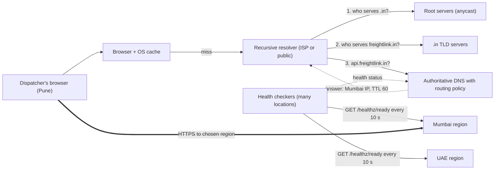
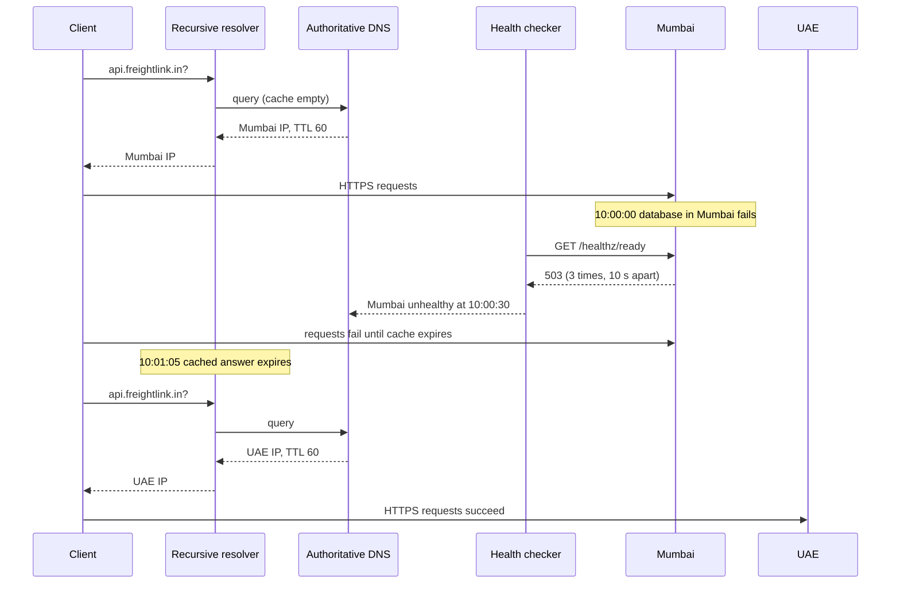

Every request your users send starts with a question they never see: "which machine is `api.freightlink.in`?" The Domain Name System (DNS) answers it. Because DNS is the first hop, it is also the first place you can steer traffic: to the nearest region, away from a broken one, or 5 % of users towards a new release. This lesson explains how that answer is produced, how long it is remembered, and how to use it as a routing tool without being surprised by its caching.

## Learning objectives

By the end of this lesson you will be able to:

1. Trace a DNS lookup through the stub resolver, recursive resolver, root, TLD and authoritative servers, and say where caching happens.
2. Choose TTLs deliberately, and calculate how a TTL affects query load, change speed and worst-case failover time.
3. Explain and choose between simple, weighted, latency-based, geolocation (GeoDNS) and failover routing policies.
4. Explain anycast, how it differs from DNS-based routing, and why CDNs and DNS providers use it.
5. Design health-checked regional failover, including detection time, hysteresis and capacity in the surviving region.
6. Implement the supporting pieces in ASP.NET Core: readiness endpoints for DNS health checks, a drain switch, and an `HttpClient` that notices DNS changes.
7. Recognise when one region with a plain DNS record is enough.

## Prerequisites

- [HTTP fundamentals](#/lesson/m10-http-fundamentals): what happens after the IP address is known.
- [Latency numbers and latency budgets](#/lesson/m11-latency-numbers): why a round trip from Chennai to Frankfurt costs far more than one to Mumbai.
- [Availability, reliability and the nines](#/lesson/m11-availability): serial and parallel availability, which you will use for failover maths.

## Explain it like I'm a beginner

Imagine you want to phone the FreightLink office but you only know its name.

1. You first check your own phone's contact list. That is your **browser and operating system cache**.
2. If it isn't there, you ask the receptionist in your building. She looks up numbers for everyone in the building, and she keeps a notebook of numbers she found recently. She is the **recursive resolver** (run by your ISP, your company, or a public service such as 8.8.8.8 or 1.1.1.1).
3. If her notebook doesn't have it, she calls the national directory, which says "for `.in` names, call the `.in` desk". That is a **root server**.
4. The `.in` desk says "for `freightlink.in`, call FreightLink's own switchboard". That is the **TLD (top-level domain) server**.
5. FreightLink's switchboard gives the actual number. That is the **authoritative server**, the only one that truly knows.

The receptionist writes the number in her notebook with a note: "trust this for 5 minutes". That note is the **TTL (time to live)**. For the next 5 minutes, everyone in the building who asks gets the notebook answer instantly, and FreightLink's switchboard isn't disturbed.

FreightLink's switchboard can also be clever: "you're calling from Pune, here is the Mumbai number" (**geo or latency routing**), or "Mumbai's line is dead, here is Dubai" (**failover**). The catch is the notebook: people whose receptionist wrote down Mumbai keep calling it until the note expires. Short notes mean quick switching but a busy switchboard. That tension is most of this lesson.

## First-principles explanation

### What DNS stores: records

A DNS zone (all the names under `freightlink.in`) is a set of **records**. Each has a name, a type, a value and a TTL.

| Type | Maps | Example | Notes |
|---|---|---|---|
| `A` | Name → IPv4 address | `api.freightlink.in → 20.198.10.4` | The common case |
| `AAAA` | Name → IPv6 address | `api.freightlink.in → 2603:1040::4` | Serve both where you can |
| `CNAME` | Name → another name (an alias) | `www → freightlink.azurefd.net` | Not allowed at the zone apex (`freightlink.in` itself) |
| `ALIAS` / `ANAME` / apex flattening | Apex name → another name, resolved by the provider | `freightlink.in → lb-123.example.net` | Provider-specific, works around the CNAME rule |
| `NS` | Zone → its authoritative servers | `freightlink.in → ns1.dnsprovider.net` | Set at the registrar |
| `MX` | Domain → mail servers | `freightlink.in → mail.provider.com` | Don't break email during migrations |
| `TXT` | Name → free text | SPF, domain verification | |
| `CAA` | Which certificate authorities may issue certificates | `0 issue "letsencrypt.org"` | Small security win |

### The resolution chain

When a browser in Pune needs `api.freightlink.in`:

1. **Browser cache**, then the **operating system's stub resolver** cache. Hit: about 0 ms.
2. **Recursive resolver**. If it has a fresh cached answer, it returns it. A hit costs one round trip to the resolver, typically 1–30 ms (estimate).
3. On a miss, the resolver walks the tree: root → `.in` TLD → `freightlink.in` authoritative. Root and TLD answers (the `NS` records) have long TTLs, often days, so busy resolvers almost always have them cached. In practice a miss usually costs one extra round trip to your authoritative servers.

A completely cold lookup can take 100–300 ms (estimate), which is why browsers support `<link rel="dns-prefetch">`.

**Negative answers are cached too.** A "doesn't exist" (`NXDOMAIN`) answer is cached for a time set in the zone's `SOA` record, so looking up a hostname before creating it can make it "missing" for minutes afterwards.

### TTL: the central trade-off

The TTL says how long any cache may reuse an answer. It controls three things at once.

| | Long TTL (e.g. 1 hour to 1 day) | Short TTL (e.g. 30–60 s) |
|---|---|---|
| Change and failover speed | Slow: old answers live for up to the TTL | Fast |
| Query load on your authoritative servers | Low | High |
| Lookup latency for users | Usually a cache hit | More cache misses |
| Survives a DNS provider outage | Yes, cached answers keep working for hours | Barely: caches empty within a minute |
| Cost (managed DNS bills per query) | Low | Higher |

**Back-of-the-envelope: how many queries reach your authoritative servers?** Each recursive resolver that serves your users asks again about once per TTL for each hostname, no matter how many users sit behind it. Suppose your users are spread across about 20,000 active resolvers (estimate: ISPs, mobile carriers, offices, public resolvers' many nodes), and each page uses 3 of your hostnames.

- TTL 300 s: 20,000 × 3 ÷ 300 = **200 queries per second**.
- TTL 30 s: 20,000 × 3 ÷ 30 = **2,000 queries per second**, which is 2,000 × 86,400 ≈ 173 million queries a day.

Managed DNS is priced per million queries, so a 10× shorter TTL is roughly a 10× larger DNS bill. For most companies that is still small next to compute, but it is not free.

**TTLs are a request, not a guarantee.** Some resolvers enforce a minimum TTL. Browsers keep their own short cache. Some application runtimes cache longer than you asked. Long-lived connections are the biggest gap: a client with an open HTTP/2 or WebSocket connection doesn't look up DNS again at all until that connection closes.

In .NET this is very concrete. `HttpClient` with `SocketsHttpHandler` pools connections, and a pooled connection keeps talking to the IP it first connected to. If you fail over DNS from Mumbai to Dubai, a long-running service that calls your API keeps hitting Mumbai until its pooled connections are recycled. Setting `PooledConnectionLifetime` (for example to 2 minutes) makes the handler open fresh connections, with fresh DNS lookups, regularly. `IHttpClientFactory` also rotates handlers (2 minutes by default) for the same reason.

**The migration trick.** Before you change a record that has a 1-day TTL, lower the TTL to 60 s *at least one old TTL in advance*, here more than 24 hours before the change. Caches that fetched the record under the old TTL must expire before they see the new, short TTL. Make the change, confirm it, then raise the TTL again.

### Routing policies: making the answer depend on the question

An authoritative DNS service doesn't have to return the same answer to everyone. Managed DNS and traffic-manager services offer routing policies (names differ by provider):

- **Simple**: one answer (or a fixed set) for everyone.
- **Weighted**: return endpoint A for 90 % of queries and B for 10 %. Useful for canary releases, gradual migrations and blue/green cutovers. Because resolvers cache, the split is per resolver, not per user, so 10 % of *queries* is only roughly 10 % of *users*.
- **Latency-based**: the provider keeps measurements of latency from networks to your regions and returns the region that is fastest for the asker.
- **Geolocation (GeoDNS)**: answer by the asker's country or continent. Used for data residency ("Indian users must be served from Indian regions"), language-specific sites, and licensing. Always define a default for locations you didn't list.
- **Geoproximity / performance**: nearest by distance, with a bias you can tune to shift load.
- **Failover**: return the primary while its health check passes, otherwise the secondary.
- **Multivalue**: return several healthy IPs and let the client pick. A cheap way to spread load, not a real load balancer.

Many services let you nest these, for example geolocation first, then failover within the group.

**How does the DNS server know where the user is?** It usually doesn't. It sees the IP address of the **recursive resolver**, not the user. That works when the user's ISP resolver is nearby. It works badly when a user in Chennai uses a public resolver whose node happens to be in Singapore. The EDNS Client Subnet extension (ECS, RFC 7871) lets the resolver pass a truncated piece of the user's address (for example a /24) so the authoritative server can answer better. Not every resolver sends it, some deliberately don't for privacy, and it reduces cache sharing. So treat geo and latency routing as "usually right", not "always right".

### Anycast: one address, many places

DNS-based routing gives different users different IP addresses. **Anycast** gives everyone the *same* IP address, announced from many data centres at once through BGP, the internet's routing protocol. Routers send each packet to the "closest" announcement in network terms (fewest hops and the operators' routing preferences, which is often, but not always, the geographically nearest site).

- **Who uses it**: DNS itself (root servers and most large DNS providers run their name servers on anycast), public resolvers such as 1.1.1.1 and 8.8.8.8, CDNs, and DDoS-protection edges.
- **Failover is fast.** If a site fails, it stops announcing the route and packets flow to the next site within seconds to a minute or so, as BGP converges (estimate). No DNS TTL is involved.
- **DDoS absorption.** An attack is spread over every site instead of hitting one.
- **The catch for TCP.** If routing changes in the middle of a connection, packets may land at a different site that knows nothing about that connection, which then resets. Short connections such as DNS over UDP or a quick HTTP request don't notice. Operators keep routes stable and design for this.
- **You rarely run it yourself.** It needs your own IP block and BGP sessions. Most teams get anycast from a CDN, a global load balancer or a managed DNS service.

| | DNS-based routing | Anycast |
|---|---|---|
| What differs per user | The IP address returned | Nothing. The network picks the path |
| Failover speed | Detection + TTL + client caching (minutes) | BGP convergence (seconds to a minute or so) |
| Precision of "nearest" | Based on resolver location, improved by ECS | Based on network topology |
| Who can operate it | Anyone with managed DNS | Network operators, CDNs, cloud providers |
| Long-lived TCP | Unaffected until reconnect | May reset on route changes |

### Health-checked failover, step by step

Failover routing needs two things: a reliable way to decide "this region is down", and a way to move users.

**Detection.** The DNS provider probes a health URL in each region from several locations around the world, for example every 10 s. A region is marked unhealthy only after, say, 3 consecutive failures, *and* only when a majority of probe locations agree. That avoids failing over because one probe location had a network blip.

**Worst-case failover time** is the sum of the delays:

- Detection: 10 s interval × 3 failures = 30 s.
- Propagation inside the DNS provider: a few seconds (estimate).
- Cached answers: up to the TTL, say 60 s.
- Client-side extras: browser caches and pooled connections, say up to 60 s more.

Total: about 30 + 5 + 60 + 60 ≈ **155 s, roughly 2.5 minutes** in the worst case. Most users move sooner. Write the number down. If the business needs 30 seconds, DNS failover alone can't deliver it, and you need anycast, a global load balancer, or client-side retry to a second hostname.

**Hysteresis** (being slower to come back than to leave). If a region is marked healthy after one good probe, a half-broken region flaps in and out of DNS, and users bounce between regions. Require, say, 3 consecutive successes before restoring it, and alert on flapping.

**Fail open, not closed.** If every endpoint is marked unhealthy, most providers return all of them anyway. That is the right default: a health-check bug shouldn't turn into a total outage. Your own policy code should do the same.

**What the health check should test.** A shallow check (`/healthz/live` returns 200 if the process runs) says nothing about whether the region can serve customers. A deep check that pings every downstream dependency can mark *all* regions unhealthy when a shared dependency (a payment gateway) is slow. The usual middle ground is a **readiness check for regional dependencies only**: "can this region reach its own database and cache?" Add a manual **drain switch** so operators can take a region out of DNS on purpose for maintenance.

**Capacity in the surviving region.** Two regions each at 70 % CPU put 140 % on the survivor. For two-region active-active, keep each at or below about 50 % at peak, or make sure autoscaling can double the survivor within your failover window. The data must be there too (see [Choosing and scaling the database tier](#/lesson/m11-database-architecture)).

### DNS routing versus load balancing

DNS chooses **a region or an entry point**. A load balancer inside the region chooses **a server** (see [Load balancing algorithms](#/lesson/m11-load-balancing)). Don't use DNS to balance individual servers: caching makes the split uneven and slow to change.

### What breaks first under load

1. **The surviving region after a failover.** The DNS part works, then the secondary collapses under double load. Plan capacity and test it.
2. **Your authoritative DNS under attack.** A large DDoS on a DNS provider can make many websites unreachable even though their servers are fine. Large-scale public incidents like this have happened (the 2016 attack on the Dyn DNS service is the well-known example). Mitigations: a provider on anycast, a second DNS provider listed in your `NS` records, and TTLs long enough that caches carry you through a short outage.

### Failure modes and mitigations

| Failure | What users see | Mitigation |
|---|---|---|
| Long TTL during an emergency move | Users stuck on a dead region for hours | Keep TTLs on routable records at 60–300 s. Lower them in advance before planned changes |
| Health check too shallow | DNS keeps sending users to a region that returns errors | Readiness check covers regional database and cache |
| Health check too deep | A shared dependency blip marks every region unhealthy | Check regional dependencies only; fail open |
| Flapping | Users bounce between regions; caches and sessions churn | Hysteresis; alert on state changes |
| Dangling `CNAME` to a deleted cloud resource | An attacker claims the resource and serves content on your subdomain (subdomain takeover) | Delete DNS records before resources; audit regularly |
| Registrar account compromise | Your whole domain points elsewhere | Registrar lock, MFA, DNSSEC where supported |
| Clients ignore TTL (pooled connections) | Some traffic keeps hitting the old region | `PooledConnectionLifetime`, connection draining, short keep-alive on the old region |

### Consistency trade-offs

DNS is an eventually consistent, cached database. "DNS propagation" is really caches expiring one by one, up to the TTL. Every change has a mixed period when some users are on the old region and some on the new, so both must serve correctly: compatible API versions and one clear rule about which region accepts writes.

### Cost drivers

- **DNS queries**: priced per million, driven by TTL and resolver count.
- **Health checks and traffic policies**: priced per check or policy.
- **The second region**: by far the biggest cost. Routing is cheap; a warm standby with replicated databases and cross-region transfer is not. Do the [cost estimation](#/lesson/m11-cost-estimation) before promising multi-region.

### When a simpler design is enough

- One region with an availability target of 99.9 %: a single `A`/`ALIAS` record pointing at a zone-redundant load balancer, TTL 300 s, and a managed DNS provider. No routing policies at all.
- Users all in one country, one region nearby: geo and latency routing buy nothing.
- You already use a CDN or global edge in front of everything: let it do the routing (it is usually anycast). Your DNS just points one name at it.

[Scaling a real system from 100 to 10 million users](#/lesson/m17-scaling-journey) shows this in practice: a grocery app runs on one region and one DNS name for most of its growth, and only reaches for multi-region routing when a measured need appears.

Add DNS routing policies when you have more than one region *and* a reason: users on several continents, a data-residency rule, a disaster-recovery target that one region can't meet, or a migration you want to do gradually.

## Visual explanation

### Architecture: resolution chain and regional routing



How to read it:

- **Browser → OS cache → recursive resolver**: local caches are tried first. Only a miss leaves the device.
- **Resolver → root → TLD → authoritative (1, 2, 3)**: on a cold miss the resolver walks the tree. Steps 1 and 2 are almost always cached already, because their TTLs are long.
- **Health checkers → regions**: the DNS provider's probes call a readiness URL in each region from several places.
- **Health checkers → authoritative (dotted)**: health results feed the routing policy, so the answer changes when a region fails.
- **Authoritative → resolver (dotted)**: the answer comes back with a TTL. The resolver caches it and serves every user behind it until the TTL ends.
- **Browser → Mumbai (thick)**: only now does the real HTTPS traffic start, and it goes straight to the chosen region. DNS is not in the data path after the lookup.

### Sequence: a regional failure and failover



The client first gets Mumbai with a 60-second TTL. When Mumbai's database fails, its readiness endpoint returns 503. After three failed probes (30 s), the health checker marks Mumbai unhealthy. Clients keep failing until their resolver's cached answer expires, at about 10:01:05. The next lookup returns the UAE address and requests succeed. The outage is detection plus TTL, so both numbers belong in your recovery-time objective.

## Step-by-step example

**FreightLink** is a freight-tracking platform. Shippers and truck dispatchers in India and the Gulf use a web dashboard and a mobile app. The current design is one region (Mumbai). The business wants a recovery target of under 5 minutes if Mumbai is lost, and Gulf customers complain that pages are slow.

### Step 1 — estimate the traffic

- 400,000 daily active users, about 60 API calls each per day: 400,000 × 60 = 24 million calls/day. 24,000,000 ÷ 86,400 ≈ 280 RPS average. Business hours concentrate traffic, so assume ×4 for peak: about **1,100 RPS**.
- Split: about 75 % India, 25 % Gulf (estimate from the analytics dashboard).

Each region on its own must be able to take all 1,100 RPS at peak if the other fails.

### Step 2 — choose regions and the data rule

Add a second region in the UAE. Two regions accepting writes to the same shipment would need conflict resolution, so writes stay **active-passive**: the primary database is in Mumbai, and the UAE serves reads from an asynchronous replica and forwards writes. (The customers' contracts allow an encrypted replica abroad for disaster recovery; if they didn't, Indian users could not fail over to the UAE at all, and you would need a second Indian region instead. That is a business decision, not a routing one.) Promoting the UAE replica is a deliberate operator action, because asynchronous replication may have lost the last few seconds of writes; routing can't decide that.

### Step 3 — choose the records and policies

| Name | Policy | TTL | Why |
|---|---|---|---|
| `freightlink.in` (apex) | `ALIAS` to the CDN | 300 s | Marketing site, served by the CDN |
| `app.freightlink.in` | `CNAME` to the CDN | 300 s | Static SPA, the CDN routes via anycast |
| `api.freightlink.in` | Geolocation: India → India group, Gulf → Gulf group, default → India group. Inside each group: failover to the other region | 60 s | Steering and failover |
| `MX`, `TXT` | Simple | 3600 s | Email doesn't move with the app |

### Step 4 — set up health checks

- Each region exposes `/healthz/ready`, which checks the region's own database connection and cache, and a drain flag. It does not check the shared SMS provider.
- Probes every 10 s from at least three locations. Unhealthy after 3 failures. Healthy again after 3 successes.

### Step 5 — check the failover target

Worst case: 30 s detection + 60 s TTL + up to 60 s client-side ≈ 2.5 minutes. That meets the 5-minute target with room to spare. The mobile app also retries once against `api-alt.freightlink.in`, a name that always points at the other region, which covers clients with stale caches.

### Step 6 — check capacity

The UAE region normally carries 25 % of 1,100 ≈ 275 RPS. On failover it gets 1,100 RPS. Either keep 4× its normal instance count warm, or configure autoscaling with a minimum high enough to absorb the first few minutes. The team chooses a warm minimum of 50 % of full capacity plus autoscaling, and runs a failover drill every quarter.

## Production-style C# implementation

DNS routing itself runs in your DNS provider. Your ASP.NET Core code has three jobs: expose honest health endpoints for the provider to probe, let operators drain a region, and make sure your own outbound calls follow DNS changes. Below that, a small in-process model of the routing policy lets you unit-test routing rules before you configure them in the provider.

```text
FreightLink.Api/
  Program.cs
  Routing/RoutingModel.cs
  Routing/HealthTracker.cs
  Routing/TrafficPolicy.cs
  Health/RegionReadinessCheck.cs
```

```csharp file=Routing/RoutingModel.cs
namespace FreightLink.Routing;

/// <summary>One regional entry point that DNS can return.</summary>
public sealed record RegionEndpoint(string Name, string Address, string Region, int Priority = 1, int Weight = 100);

/// <summary>What the DNS server knows about the asker: a country (from resolver IP or ECS) and the nearest region.</summary>
public sealed record ClientHint(string? Country, string? NearestRegion);

public interface IHealthView
{
    bool IsHealthy(string endpointName);
}
```

```csharp file=Routing/HealthTracker.cs
namespace FreightLink.Routing;

/// <summary>Turns raw probe results into a stable healthy/unhealthy state with hysteresis:
/// leave after N consecutive failures, come back only after M consecutive successes.</summary>
public sealed class HealthTracker(int failuresToEject = 3, int successesToRestore = 3) : IHealthView
{
    private sealed class State { public bool Healthy = true; public int Fails; public int Oks; }

    private readonly Dictionary<string, State> _states = new(StringComparer.OrdinalIgnoreCase);
    private readonly Lock _gate = new();

    public event Action<string, bool>? StateChanged;

    public void Record(string endpointName, bool probeSucceeded)
    {
        bool? changedTo = null;
        lock (_gate)
        {
            if (!_states.TryGetValue(endpointName, out var s)) _states[endpointName] = s = new State();
            if (probeSucceeded) { s.Oks++; s.Fails = 0; } else { s.Fails++; s.Oks = 0; }

            if (s.Healthy && s.Fails >= failuresToEject) { s.Healthy = false; changedTo = false; }
            else if (!s.Healthy && s.Oks >= successesToRestore) { s.Healthy = true; changedTo = true; }
        }
        if (changedTo is { } now) StateChanged?.Invoke(endpointName, now);   // raise outside the lock
    }

    public bool IsHealthy(string endpointName)
    {
        lock (_gate) return !_states.TryGetValue(endpointName, out var s) || s.Healthy;
    }
}
```

```csharp file=Routing/TrafficPolicy.cs
namespace FreightLink.Routing;

/// <summary>A testable model of a nested DNS policy: geofence → health filter → priority failover → nearest.
/// The real decision runs in the DNS provider; this mirrors its configuration so rules can be unit-tested.</summary>
public sealed class TrafficPolicy(
    IReadOnlyList<RegionEndpoint> endpoints,
    IReadOnlyDictionary<string, string[]> allowedRegionsByCountry,
    IHealthView health)
{
    public IReadOnlyList<RegionEndpoint> Answer(ClientHint client)
    {
        // 1. Geofence: data-residency rules restrict which regions may serve this country.
        var candidates = endpoints.ToList();
        if (client.Country is { } c && allowedRegionsByCountry.TryGetValue(c, out var allowed))
            candidates = candidates.Where(e => allowed.Contains(e.Region, StringComparer.OrdinalIgnoreCase)).ToList();
        if (candidates.Count == 0) return [];

        // 2. Health: drop unhealthy endpoints, but fail open if that would leave nothing.
        var healthy = candidates.Where(e => health.IsHealthy(e.Name)).ToList();
        var pool = healthy.Count > 0 ? healthy : candidates;

        // 3. Failover: only the best (lowest) priority level that still has endpoints.
        var best = pool.Min(e => e.Priority);
        var tier = pool.Where(e => e.Priority == best).ToList();

        // 4. Nearest first, then the rest (multivalue answer; resolvers usually use the first).
        return tier.OrderByDescending(e => string.Equals(e.Region, client.NearestRegion, StringComparison.OrdinalIgnoreCase))
                   .ThenBy(e => e.Name, StringComparer.Ordinal)
                   .ToList();
    }
}
```

```csharp file=Health/RegionReadinessCheck.cs
using Microsoft.Extensions.Diagnostics.HealthChecks;

namespace FreightLink.Health;

/// <summary>Lets operators take a region out of DNS rotation on purpose (maintenance, a bad deploy).</summary>
public sealed class RegionDrainSwitch
{
    private volatile bool _draining;
    public bool IsDraining => _draining;
    public void Drain() => _draining = true;
    public void Undrain() => _draining = false;
}

/// <summary>Checks only this region's own dependencies. A shared third-party outage must not mark every region down.</summary>
public interface IRegionalDependencyProbe
{
    Task<bool> CanReachRegionalDatabaseAsync(CancellationToken ct);
}

public sealed class InMemoryDependencyProbe : IRegionalDependencyProbe
{
    public bool DatabaseUp { get; set; } = true;
    public Task<bool> CanReachRegionalDatabaseAsync(CancellationToken ct) => Task.FromResult(DatabaseUp);
}

public sealed class RegionReadinessCheck(RegionDrainSwitch drain, IRegionalDependencyProbe probe) : IHealthCheck
{
    public async Task<HealthCheckResult> CheckHealthAsync(HealthCheckContext context, CancellationToken cancellationToken = default)
    {
        if (drain.IsDraining) return HealthCheckResult.Unhealthy("region is draining");
        return await probe.CanReachRegionalDatabaseAsync(cancellationToken)
            ? HealthCheckResult.Healthy()
            : HealthCheckResult.Unhealthy("regional database unreachable");
    }
}
```

```csharp file=Program.cs
using FreightLink.Health;
using FreightLink.Routing;
using Microsoft.AspNetCore.Diagnostics.HealthChecks;

var builder = WebApplication.CreateBuilder(args);

builder.Services.AddSingleton<RegionDrainSwitch>();
builder.Services.AddSingleton<IRegionalDependencyProbe, InMemoryDependencyProbe>();
builder.Services.AddHealthChecks()
    .AddCheck<RegionReadinessCheck>("region-ready", tags: ["ready"]);

// Outbound calls: recycle pooled connections so a DNS change is noticed within ~2 minutes.
builder.Services.AddHttpClient("carrier-api", c => c.BaseAddress = new Uri("https://api.carrier.example"))
    .ConfigurePrimaryHttpMessageHandler(() => new SocketsHttpHandler
    {
        PooledConnectionLifetime = TimeSpan.FromMinutes(2),
        PooledConnectionIdleTimeout = TimeSpan.FromSeconds(60),
    });

// Routing model, mirroring the DNS provider's policy, used by tests and a debug endpoint.
builder.Services.AddSingleton<HealthTracker>();
builder.Services.AddSingleton<IHealthView>(sp => sp.GetRequiredService<HealthTracker>());
builder.Services.AddSingleton(sp => new TrafficPolicy(
    [
        new RegionEndpoint("mumbai", "20.198.10.4", "india", Priority: 1),
        new RegionEndpoint("uae", "20.74.5.9", "gulf", Priority: 1),
    ],
    // Residency geofences: country → regions allowed to serve it. Empty for FreightLink, whose contracts allow
    // failover abroad. A rule such as ["IN"] = ["india"] would keep Indian users on Indian regions even in failover.
    new Dictionary<string, string[]>(),
    sp.GetRequiredService<IHealthView>()));

var app = builder.Build();

// Liveness: "is the process up?" Used by the orchestrator to restart, never by DNS.
app.MapHealthChecks("/healthz/live", new HealthCheckOptions { Predicate = _ => false });
// Readiness: "can this region serve customers?" This is what DNS health checks probe.
app.MapHealthChecks("/healthz/ready", new HealthCheckOptions { Predicate = r => r.Tags.Contains("ready") });

// In production these require an operator policy and are audited.
app.MapPost("/ops/drain", (RegionDrainSwitch s) => { s.Drain(); return Results.NoContent(); });
app.MapPost("/ops/undrain", (RegionDrainSwitch s) => { s.Undrain(); return Results.NoContent(); });

app.MapGet("/debug/route", (string? country, string? near, TrafficPolicy policy) =>
    Results.Ok(policy.Answer(new ClientHint(country, near)).Select(e => e.Address)));

app.Run();
```

Design notes:

- **Liveness and readiness are different questions.** Liveness checks nothing (`Predicate = _ => false` means "200 if the process answers"). Readiness checks the regional database and the drain flag. Pointing DNS at liveness is the classic shallow-check mistake.
- **The drain switch** turns readiness red on purpose. DNS stops sending new users within detection + TTL, and existing connections finish. Do it before maintenance, and before deploying a risky change to one region.
- **Fail open** is implemented in `TrafficPolicy`: if every endpoint is unhealthy, return them all instead of an empty answer.
- **Geofence before health.** FreightLink has no residency geofence, but many products do. When a rule says "Indian users may only be served from Indian regions", the geofence must run *before* the health filter, so a failed Mumbai can't push those users abroad automatically. If health ran first, a regional outage would silently break a legal rule.
- **`PooledConnectionLifetime`** is the one-line fix for "we failed over DNS but our services kept calling the dead region".

## Bad design vs good design

**Bad**: a team serves `api.freightlink.in` with a plain `A` record, TTL 86,400 s (one day), pointing at the Mumbai load balancer. For "disaster recovery" they keep a UAE region and a runbook that says "change the A record". The DNS provider's health check probes `/` on the load balancer, which returns the SPA's static page. The UAE region runs 2 small instances to save money.

What goes wrong on the day Mumbai's database fails:

- The health check stays green, because `/` doesn't touch the database. Nothing fails over automatically.
- The on-call engineer changes the record after 20 minutes, but resolvers keep the old answer for up to 24 hours.
- The users who do move overwhelm 2 small instances in the UAE, so the "recovered" region also fails.

**Good**: TTL 60 s on routable names, a readiness check that covers the regional database, failover routing with hysteresis, a drain switch, the survivor sized (or autoscaled) for full load, `PooledConnectionLifetime` on clients, and a failover drill every quarter so the numbers are measured, not assumed.

**Is the good design always worth it?** No. A second region doubles a large part of your infrastructure bill and adds data-replication problems. If the business can tolerate a few hours of downtime once in a long while, a single region with multiple availability zones, good backups and a tested restore is simpler and often more reliable in practice.

:::callout type=mistake title="Changing a record with a long TTL in an emergency"
If your record has a 24-hour TTL, lowering it now doesn't help: caches will only see the new, lower TTL after the old one expires. TTL changes must be made in advance. Decide the TTL for every routable name before you need it.
:::

:::callout type=tradeoff title="Short TTL versus DNS-provider resilience"
A 30-second TTL gives fast failover but means caches empty quickly if your DNS provider itself is down. A 1-hour TTL survives a provider outage but makes failover slow. Many teams use 60–300 s for routable names, plus a second DNS provider for the zone, and keep long TTLs on records that never move (MX, TXT).
:::

## Practical playground

The graph below is FreightLink today: one region behind a single DNS name. Turn it into the design from the step-by-step example: add a second region (`load-balancer`, `app-server`, `read-replica`), relabel the `dns` node with its policy (geolocation + failover, TTL 60 s), and add a `monitoring` node for the health checkers. For each new edge, note what happens to it when Mumbai fails.

:::playground type=hld title="Add a second region behind DNS failover"
```json
{
  "nodes": [
    { "id": "users", "type": "client", "label": "Shippers and dispatchers (India + Gulf)", "props": { "rps": 1100 } },
    { "id": "dns", "type": "dns", "label": "api.freightlink.in (simple A record, TTL 86400)" },
    { "id": "lb1", "type": "load-balancer", "label": "Mumbai load balancer", "props": { "region": "ap-south", "multiAz": true } },
    { "id": "api1", "type": "app-server", "label": "Tracking API (Mumbai)", "props": { "instances": 4, "region": "ap-south" } },
    { "id": "db1", "type": "database", "label": "PostgreSQL primary (Mumbai)", "props": { "replicas": 1, "multiAz": true } }
  ],
  "edges": [
    { "from": "users", "to": "dns", "kind": "sync", "label": "resolve" },
    { "from": "users", "to": "lb1", "kind": "sync", "label": "HTTPS" },
    { "from": "lb1", "to": "api1", "kind": "sync" },
    { "from": "api1", "to": "db1", "kind": "sync", "label": "SQL" }
  ]
}
```
:::

## Exercises

:::exercise id=m11-dns-routing-ex1 difficulty=beginner kind=code title="DNS arithmetic: query load, failover time and migration timing"
Write three small helpers that an engineer uses when choosing TTLs.
::requirements
- `DnsMath.AuthoritativeQps(int resolvers, int hostnames, int ttlSeconds)` returns the queries per second reaching your authoritative servers: `resolvers × hostnames ÷ ttl` as a `double`.
- `DnsMath.WorstCaseFailover(TimeSpan checkInterval, int failuresToEject, TimeSpan ttl, TimeSpan clientExtra)` returns `checkInterval × failuresToEject + ttl + clientExtra`.
- `DnsMath.EarliestSafeCutover(DateTimeOffset ttlLoweredAt, TimeSpan oldTtl)` returns the earliest time you may change the record: the moment the TTL was lowered plus the *old* TTL.
- Any non-positive `ttlSeconds`, `resolvers`, `hostnames` or `failuresToEject` throws `ArgumentOutOfRangeException`.
::acceptance
- 20,000 resolvers × 3 hostnames at TTL 300 → 200 QPS; at TTL 30 → 2,000 QPS.
- 10 s × 3 + 60 s + 60 s → 150 s.
- TTL lowered at 2026-11-01 09:00 with an old TTL of 1 day → earliest cutover 2026-11-02 09:00.
- A TTL of 0 throws.
::hint
These are one-line formulas. The exercise is about knowing which TTL matters when.
::hint
For the migration, think about the resolver that fetched the record one second before you lowered the TTL. How long will it keep the old answer?
::hint
`TimeSpan` supports multiplication by an `int` or `double` (`interval * 3`), and `DateTimeOffset + TimeSpan` works directly.
::hint
```csharp
public static double AuthoritativeQps(int resolvers, int hostnames, int ttlSeconds)
{
    if (resolvers <= 0) throw new ArgumentOutOfRangeException(nameof(resolvers));
    // ... same for the others
    return (double)resolvers * hostnames / ttlSeconds;
}
```
::starter
```csharp file=DnsMath.cs
using System;

public static class DnsMath
{
    public static double AuthoritativeQps(int resolvers, int hostnames, int ttlSeconds) => throw new NotImplementedException();

    public static TimeSpan WorstCaseFailover(TimeSpan checkInterval, int failuresToEject, TimeSpan ttl, TimeSpan clientExtra) =>
        throw new NotImplementedException();

    public static DateTimeOffset EarliestSafeCutover(DateTimeOffset ttlLoweredAt, TimeSpan oldTtl) => throw new NotImplementedException();
}
```
::tests
```csharp file=DnsMathTests.cs
using System;
using Xunit;

public class DnsMathTests
{
    [Fact] public void Qps_at_300s() => Assert.Equal(200.0, DnsMath.AuthoritativeQps(20_000, 3, 300), 6);

    [Fact] public void Qps_at_30s_is_ten_times_more() => Assert.Equal(2_000.0, DnsMath.AuthoritativeQps(20_000, 3, 30), 6);

    [Fact] public void Failover_sums_detection_ttl_and_client() =>
        Assert.Equal(TimeSpan.FromSeconds(150),
            DnsMath.WorstCaseFailover(TimeSpan.FromSeconds(10), 3, TimeSpan.FromSeconds(60), TimeSpan.FromSeconds(60)));

    [Fact] public void Cutover_waits_for_old_ttl()
    {
        var lowered = new DateTimeOffset(2026, 11, 1, 9, 0, 0, TimeSpan.FromHours(5.5));
        Assert.Equal(lowered.AddDays(1), DnsMath.EarliestSafeCutover(lowered, TimeSpan.FromDays(1)));
    }

    [Fact] public void Zero_ttl_throws() =>
        Assert.Throws<ArgumentOutOfRangeException>(() => DnsMath.AuthoritativeQps(10, 1, 0));

    [Fact] public void Zero_failures_throws() =>
        Assert.Throws<ArgumentOutOfRangeException>(() =>
            DnsMath.WorstCaseFailover(TimeSpan.FromSeconds(10), 0, TimeSpan.FromSeconds(60), TimeSpan.Zero));
}
```
::solution
```csharp file=DnsMath.cs
using System;

public static class DnsMath
{
    public static double AuthoritativeQps(int resolvers, int hostnames, int ttlSeconds)
    {
        if (resolvers <= 0) throw new ArgumentOutOfRangeException(nameof(resolvers));
        if (hostnames <= 0) throw new ArgumentOutOfRangeException(nameof(hostnames));
        if (ttlSeconds <= 0) throw new ArgumentOutOfRangeException(nameof(ttlSeconds));
        return (double)resolvers * hostnames / ttlSeconds;
    }

    public static TimeSpan WorstCaseFailover(TimeSpan checkInterval, int failuresToEject, TimeSpan ttl, TimeSpan clientExtra)
    {
        if (failuresToEject <= 0) throw new ArgumentOutOfRangeException(nameof(failuresToEject));
        return checkInterval * failuresToEject + ttl + clientExtra;
    }

    public static DateTimeOffset EarliestSafeCutover(DateTimeOffset ttlLoweredAt, TimeSpan oldTtl) => ttlLoweredAt + oldTtl;
}
```

Cast to `double`, or integer division silently rounds (`1_000 / 300` = 3). The cutover rule uses the **old** TTL because a resolver that cached the record just before you lowered the TTL still holds an answer that says "trust me for a day".
::mistakes
- Using the new, short TTL for the cutover time. Caches that fetched under the old TTL won't ask again until it expires.
- Forgetting client-side caching and pooled connections in the failover estimate.
- Thinking query load depends on users. It depends on resolvers and TTL, because users behind one resolver share its cache.
::extensions
Add `AvailabilityLost(TimeSpan failoverTime, int incidentsPerYear)` that returns the yearly downtime budget consumed by failovers, and compare it with a 99.95 % target.
:::

:::exercise id=m11-dns-routing-ex2 difficulty=beginner kind=hld title="Give the tracking API a standby region"
FreightLink runs in Mumbai only, behind a plain `A` record with a 24-hour TTL. The business wants users moved to a second region within 5 minutes if Mumbai fails. Writes must still go to one primary database.

Change the starter graph: add a second region, change the DNS node to a health-checked failover policy, and show the health checker. In your notes, compute the worst-case failover time and the capacity the standby needs.
::acceptance
- A second `load-balancer` + `app-server` pair in another region.
- The `dns` node label states the policy and a TTL of 300 s or less.
- A `monitoring` node probes both regions.
- The standby region has data: a `read-replica` (or a replicated database) fed from the primary.
- Notes show failover time arithmetic and state that the standby must handle the full 1,100 RPS.
::hint
DNS only chooses the region. Each region still needs its own load balancer and servers.
::hint
Where does the standby read data from? Without a replica, the standby region has servers but nothing to serve.
::hint
Detection = interval × failures. Add the TTL, then a client-side allowance.
::hint
Shape: users → dns; users → lb1 and users → lb2 (the DNS answer decides which); lb2 → api2 → replica; db1 → replica (async replication); monitoring → lb1, monitoring → lb2.
::starter
```json
{
  "nodes": [
    { "id": "users", "type": "client", "label": "Shippers and dispatchers", "props": { "rps": 1100 } },
    { "id": "dns", "type": "dns", "label": "api.freightlink.in (A record, TTL 86400)" },
    { "id": "lb1", "type": "load-balancer", "label": "Mumbai LB", "props": { "region": "ap-south", "multiAz": true } },
    { "id": "api1", "type": "app-server", "label": "Tracking API (Mumbai)", "props": { "instances": 4 } },
    { "id": "db1", "type": "database", "label": "PostgreSQL primary", "props": { "multiAz": true } }
  ],
  "edges": [
    { "from": "users", "to": "dns", "kind": "sync", "label": "resolve" },
    { "from": "users", "to": "lb1", "kind": "sync" },
    { "from": "lb1", "to": "api1", "kind": "sync" },
    { "from": "api1", "to": "db1", "kind": "sync", "label": "SQL" }
  ]
}
```
::solution
```json
{
  "nodes": [
    { "id": "users", "type": "client", "label": "Shippers and dispatchers", "props": { "rps": 1100 } },
    { "id": "dns", "type": "dns", "label": "api.freightlink.in (failover: Mumbai primary, UAE secondary, TTL 60)" },
    { "id": "hc", "type": "monitoring", "label": "DNS health checks (/healthz/ready, 10 s, 3 fails)" },
    { "id": "lb1", "type": "load-balancer", "label": "Mumbai LB", "props": { "region": "ap-south", "multiAz": true } },
    { "id": "api1", "type": "app-server", "label": "Tracking API (Mumbai)", "props": { "instances": 4, "region": "ap-south" } },
    { "id": "db1", "type": "database", "label": "PostgreSQL primary (Mumbai)", "props": { "multiAz": true } },
    { "id": "lb2", "type": "load-balancer", "label": "UAE LB", "props": { "region": "me-central", "multiAz": true } },
    { "id": "api2", "type": "app-server", "label": "Tracking API (UAE, warm standby)", "props": { "instances": 2, "region": "me-central" } },
    { "id": "rep", "type": "read-replica", "label": "PostgreSQL replica (UAE)", "props": { "replicas": 1 } }
  ],
  "edges": [
    { "from": "users", "to": "dns", "kind": "sync", "label": "resolve" },
    { "from": "users", "to": "lb1", "kind": "sync", "label": "normal" },
    { "from": "users", "to": "lb2", "kind": "sync", "label": "after failover" },
    { "from": "hc", "to": "lb1", "kind": "sync", "label": "probe" },
    { "from": "hc", "to": "lb2", "kind": "sync", "label": "probe" },
    { "from": "lb1", "to": "api1", "kind": "sync" },
    { "from": "api1", "to": "db1", "kind": "sync", "label": "SQL" },
    { "from": "lb2", "to": "api2", "kind": "sync" },
    { "from": "api2", "to": "rep", "kind": "sync", "label": "reads" },
    { "from": "db1", "to": "rep", "kind": "async", "label": "streaming replication" }
  ]
}
```

**Failover time**: 10 s × 3 = 30 s detection, + 60 s TTL, + about 60 s client-side ≈ 150 s, under the 5-minute target. The old 24-hour TTL must be lowered at least a day before this design goes live.

**Capacity**: after failover the UAE region receives all 1,100 RPS. Two warm instances can't take that, so autoscaling must reach the full count (4, matching Mumbai) within a couple of minutes, or the warm minimum must be higher. **Writes**: if Mumbai's database is lost, the UAE replica must be promoted (manually or by a tested automation) before writes work again. DNS failover alone gives a read-only service until then. State this in the runbook.
::mistakes
- Adding a second region without any data in it.
- Keeping the 24-hour TTL. Failover then takes up to a day for many users.
- Pointing the health check at the load balancer's own health instead of an application readiness endpoint.
- Sizing the standby for its normal share of traffic rather than the full load.
::extensions
Make it active-active with geolocation routing for reads (Gulf users to the UAE), and explain what changes for writes.
:::

:::exercise id=m11-dns-routing-ex3 difficulty=intermediate kind=code title="Weighted routing for a canary release"
FreightLink is moving the API to a new cluster. Ops want DNS to send 5 % of queries to `green` and 95 % to `blue`, then raise it step by step. Implement `WeightedRouter.Pick`, which models a weighted DNS policy.
::requirements
- Constructor takes a list of `(string Name, int Weight)` endpoints and a `Func<double>` that returns a random number in `[0, 1)`. Injecting the random source makes the router testable.
- `Pick(ISet<string> unhealthy)` returns the name of one endpoint.
- Only endpoints with weight > 0 that are not in `unhealthy` take part. Choose proportionally to weight: with weights 95 and 5, a random value below 0.95 picks the first and the rest pick the second, in list order.
- If every endpoint with weight > 0 is unhealthy, **fail open**: choose among all endpoints with weight > 0, ignoring health.
- If no endpoint has weight > 0, throw `InvalidOperationException`. Negative weights throw `ArgumentOutOfRangeException` in the constructor.
::acceptance
- Weights 95/5 with random 0.10 → `blue`; with random 0.96 → `green`.
- With `blue` unhealthy, every pick is `green`.
- With both unhealthy, picks still follow the 95/5 weights.
- A weight of 0 is never picked, even when it is the only healthy endpoint left.
::hint
Picture the weights laid end to end on a line from 0 to the total. The random number, scaled by the total, lands in one segment.
::hint
First build the list of eligible endpoints (positive weight, healthy). If it is empty, fall back to all positive-weight endpoints.
::hint
Scale: `target = random() * totalWeight`. Walk the list keeping a running sum; return the first endpoint where `target < runningSum`.
::hint
```csharp
var eligible = _endpoints.Where(e => e.Weight > 0 && !unhealthy.Contains(e.Name)).ToList();
if (eligible.Count == 0) eligible = _endpoints.Where(e => e.Weight > 0).ToList();
if (eligible.Count == 0) throw new InvalidOperationException("No endpoint has weight.");
```
::hint
Floating-point rounding can leave `target` a hair above the last running sum. Return the last eligible endpoint after the loop as a safety net.
::starter
```csharp file=WeightedRouter.cs
using System;
using System.Collections.Generic;
using System.Linq;

public sealed class WeightedRouter
{
    private readonly List<(string Name, int Weight)> _endpoints;
    private readonly Func<double> _random;

    public WeightedRouter(IEnumerable<(string Name, int Weight)> endpoints, Func<double> random)
    {
        _endpoints = endpoints.ToList();
        _random = random;
    }

    public string Pick(ISet<string> unhealthy) => throw new NotImplementedException();
}
```
::tests
```csharp file=WeightedRouterTests.cs
using System;
using System.Collections.Generic;
using Xunit;

public class WeightedRouterTests
{
    private static WeightedRouter Make(double r, int blue = 95, int green = 5) =>
        new WeightedRouter(new List<(string, int)> { ("blue", blue), ("green", green) }, () => r);

    private static readonly HashSet<string> None = new();

    [Fact] public void Low_random_picks_blue() => Assert.Equal("blue", Make(0.10).Pick(None));

    [Fact] public void High_random_picks_green() => Assert.Equal("green", Make(0.96).Pick(None));

    [Fact] public void Unhealthy_blue_sends_all_to_green()
    {
        Assert.Equal("green", Make(0.10).Pick(new HashSet<string> { "blue" }));
        Assert.Equal("green", Make(0.99).Pick(new HashSet<string> { "blue" }));
    }

    [Fact] public void All_unhealthy_fails_open_with_weights()
    {
        var both = new HashSet<string> { "blue", "green" };
        Assert.Equal("blue", Make(0.10).Pick(both));
        Assert.Equal("green", Make(0.97).Pick(both));
    }

    [Fact] public void Zero_weight_is_never_picked()
    {
        var r = Make(0.99, blue: 100, green: 0);
        Assert.Equal("blue", r.Pick(None));
        Assert.Equal("blue", r.Pick(new HashSet<string> { "blue" }));
    }

    [Fact] public void No_weight_throws() =>
        Assert.Throws<InvalidOperationException>(() => Make(0.5, blue: 0, green: 0).Pick(None));

    [Fact] public void Negative_weight_throws() =>
        Assert.Throws<ArgumentOutOfRangeException>(() => Make(0.5, blue: -1));
}
```
::solution
```csharp file=WeightedRouter.cs
using System;
using System.Collections.Generic;
using System.Linq;

public sealed class WeightedRouter
{
    private readonly List<(string Name, int Weight)> _endpoints;
    private readonly Func<double> _random;

    public WeightedRouter(IEnumerable<(string Name, int Weight)> endpoints, Func<double> random)
    {
        _endpoints = endpoints.ToList();
        if (_endpoints.Any(e => e.Weight < 0)) throw new ArgumentOutOfRangeException(nameof(endpoints), "Weights cannot be negative.");
        _random = random;
    }

    public string Pick(ISet<string> unhealthy)
    {
        var eligible = _endpoints.Where(e => e.Weight > 0 && !unhealthy.Contains(e.Name)).ToList();
        if (eligible.Count == 0) eligible = _endpoints.Where(e => e.Weight > 0).ToList();   // fail open
        if (eligible.Count == 0) throw new InvalidOperationException("No endpoint has a positive weight.");

        var total = eligible.Sum(e => e.Weight);
        var target = _random() * total;
        var running = 0.0;
        foreach (var e in eligible)
        {
            running += e.Weight;
            if (target < running) return e.Name;
        }
        return eligible[^1].Name;   // guards against floating-point edge cases
    }
}
```

Weight 0 means "configured but out of rotation", so it stays out even during fail-open. The model leaves out caching: one "pick" may serve thousands of users behind one resolver, so a 5 % DNS weight is only roughly 5 % of users.
::alternatives
Split traffic at an L7 load balancer or gateway (weighted target groups or a header/cookie rule). The split is then per request and exact, changes take effect instantly, and you can pin a user to one side with a cookie. Use DNS weights for coarse moves between whole clusters or providers.
::mistakes
- Re-normalising weights to percentages with integer division and losing small weights.
- Removing unhealthy endpoints and then throwing when none remain, instead of failing open.
- Using `new Random()` inside `Pick`, which makes the behaviour untestable.
::extensions
Add a `Ramp(string name, int[] steps, TimeSpan holdEach)` plan that moves green from 5 → 25 → 50 → 100 and stops if the error rate for green rises above a threshold.
:::

:::exercise id=m11-dns-routing-ex4 difficulty=intermediate kind=code title="Health checks with hysteresis and failover"
A DNS failover policy must not flap. Implement `FailoverSelector`, which records probe results per endpoint and answers which endpoint DNS should return.
::requirements
- The constructor takes the endpoints in priority order (first is primary), `failuresToEject` and `successesToRestore`.
- `Record(string endpoint, bool ok)` updates that endpoint's consecutive-success and consecutive-failure counters. An endpoint starts healthy. It becomes unhealthy after `failuresToEject` consecutive failures, and healthy again only after `successesToRestore` consecutive successes.
- `Current()` returns the first healthy endpoint in priority order. If none is healthy, it returns the primary (fail open).
- `Transitions` counts how many times any endpoint changed state, so you can alert on flapping.
- Recording an unknown endpoint throws `ArgumentException`.
::acceptance
- With thresholds 3 and 3: two failures keep the primary; the third switches to the secondary.
- After ejection, two successes are not enough; the third restores the primary.
- Alternating fail/ok forever never ejects the primary (no flapping).
- If both are unhealthy, `Current()` returns the primary.
::hint
Keep two counters per endpoint. A success resets the failure counter, and a failure resets the success counter.
::hint
State changes only in two cases: healthy and failures reached the limit, or unhealthy and successes reached the limit.
::hint
`Current()` is a loop over the endpoints in order, returning the first healthy one, with the primary as the fallback.
::hint
```csharp
if (ok) { s.Oks++; s.Fails = 0; } else { s.Fails++; s.Oks = 0; }
if (s.Healthy && s.Fails >= _eject) { s.Healthy = false; Transitions++; }
else if (!s.Healthy && s.Oks >= _restore) { s.Healthy = true; Transitions++; }
```
::starter
```csharp file=FailoverSelector.cs
using System;
using System.Collections.Generic;

public sealed class FailoverSelector
{
    public FailoverSelector(IReadOnlyList<string> endpointsInPriorityOrder, int failuresToEject, int successesToRestore) =>
        throw new NotImplementedException();

    public int Transitions => throw new NotImplementedException();

    public void Record(string endpoint, bool ok) => throw new NotImplementedException();

    public string Current() => throw new NotImplementedException();
}
```
::tests
```csharp file=FailoverSelectorTests.cs
using System;
using Xunit;

public class FailoverSelectorTests
{
    private static FailoverSelector Make() => new FailoverSelector(new[] { "mumbai", "uae" }, 3, 3);

    [Fact] public void Third_failure_switches_to_secondary()
    {
        var f = Make();
        f.Record("mumbai", false); f.Record("mumbai", false);
        Assert.Equal("mumbai", f.Current());
        f.Record("mumbai", false);
        Assert.Equal("uae", f.Current());
        Assert.Equal(1, f.Transitions);
    }

    [Fact] public void Restore_needs_three_successes()
    {
        var f = Make();
        for (var i = 0; i < 3; i++) f.Record("mumbai", false);
        f.Record("mumbai", true); f.Record("mumbai", true);
        Assert.Equal("uae", f.Current());
        f.Record("mumbai", true);
        Assert.Equal("mumbai", f.Current());
        Assert.Equal(2, f.Transitions);
    }

    [Fact] public void Alternating_results_never_flap()
    {
        var f = Make();
        for (var i = 0; i < 50; i++) f.Record("mumbai", i % 2 == 0);
        Assert.Equal("mumbai", f.Current());
        Assert.Equal(0, f.Transitions);
    }

    [Fact] public void All_down_fails_open_to_primary()
    {
        var f = Make();
        for (var i = 0; i < 3; i++) { f.Record("mumbai", false); f.Record("uae", false); }
        Assert.Equal("mumbai", f.Current());
    }

    [Fact] public void Unknown_endpoint_throws() =>
        Assert.Throws<ArgumentException>(() => Make().Record("singapore", true));
}
```
::solution
```csharp file=FailoverSelector.cs
using System;
using System.Collections.Generic;

public sealed class FailoverSelector
{
    private sealed class State { public bool Healthy = true; public int Fails; public int Oks; }

    private readonly IReadOnlyList<string> _order;
    private readonly Dictionary<string, State> _states = new(StringComparer.OrdinalIgnoreCase);
    private readonly int _eject;
    private readonly int _restore;

    public FailoverSelector(IReadOnlyList<string> endpointsInPriorityOrder, int failuresToEject, int successesToRestore)
    {
        if (endpointsInPriorityOrder.Count == 0) throw new ArgumentException("Need at least one endpoint.");
        if (failuresToEject <= 0 || successesToRestore <= 0) throw new ArgumentOutOfRangeException(nameof(failuresToEject));
        _order = endpointsInPriorityOrder;
        foreach (var e in _order) _states[e] = new State();
        _eject = failuresToEject;
        _restore = successesToRestore;
    }

    public int Transitions { get; private set; }

    public void Record(string endpoint, bool ok)
    {
        if (!_states.TryGetValue(endpoint, out var s)) throw new ArgumentException($"Unknown endpoint '{endpoint}'.", nameof(endpoint));
        if (ok) { s.Oks++; s.Fails = 0; } else { s.Fails++; s.Oks = 0; }

        if (s.Healthy && s.Fails >= _eject) { s.Healthy = false; Transitions++; }
        else if (!s.Healthy && s.Oks >= _restore) { s.Healthy = true; Transitions++; }
    }

    public string Current()
    {
        foreach (var e in _order) if (_states[e].Healthy) return e;
        return _order[0];   // fail open
    }
}
```

Hysteresis comes from the counters resetting each other: an alternating pattern never builds three in a row either way, so the state never changes.
::mistakes
- Counting total failures instead of consecutive ones, so a region that fails 3 times in a day gets ejected.
- Restoring after one success, which causes flapping.
- Returning `null` or throwing when everything is unhealthy, turning a monitoring bug into an outage.
::extensions
Add multiple probe locations: `Record(endpoint, location, ok)`, and treat an endpoint as failing in a round only when more than half of the locations failed.
:::

:::exercise id=m11-dns-routing-ex5 difficulty=advanced kind=written title="Move a state citizen-services portal to the cloud without downtime"
A state government's citizen-services portal (certificates, grievances, payments) runs in the state data centre. It must move to a cloud region in India. Today `portal.state.gov.in` is an `A` record with a TTL of 86,400 s. Peak traffic is about 900 RPS during working hours. The portal also sends email from the same domain, and a payment gateway calls back to `portal.state.gov.in/payments/callback`. The department allows a 15-minute read-only window at most, and wants a rollback plan.

Write a migration plan (about one page) that covers:

1. A TTL schedule, with dates relative to the cutover day.
2. How you move traffic: all at once, or gradually, and how.
3. Data: how the database moves, and why DNS can't be the only switch.
4. What else depends on this name (email, callbacks, certificates) and how you protect it.
5. The rollback plan, and how long rollback takes.
::acceptance
- Lowers the TTL at least one old TTL (24 h) before the change, and explains why.
- Uses a gradual or controlled shift (weighted DNS, or a proxy) and says why DNS weights are imprecise.
- Recognises that two sites must not both accept writes, and plans a short write freeze or replication cutover.
- Leaves `MX`/`TXT` records and email authentication untouched, and handles the payment callback and TLS certificates.
- Has a rollback with a time estimate based on the TTL.
::hint
Start from the end: on cutover day you want a TTL of 60 s. When must you lower it?
::hint
Weighted DNS lets you send a small share of users to the cloud first. But what about writes from those users?
::hint
Database: set up replication from the data centre to the cloud ahead of time. At cutover: freeze writes, let replication catch up, promote the cloud copy, then shift traffic.
::hint
The payment gateway caches DNS too, possibly for longer than you'd like. Can you keep the old site forwarding callbacks to the new one for a few days?
::solution
**TTL schedule.** Day −7: inventory every record in the zone. Day −3: lower `portal.state.gov.in` from 86,400 s to 300 s. Day −1 (more than 24 hours after that change): lower it to 60 s. Every cache now refreshes within a minute. Day +7: raise it back to 3,600 s once things are stable. `MX`, SPF/DKIM `TXT` and other mail records are not touched at all.

**Database.** Set up replication from the data-centre PostgreSQL to the cloud database at least a week ahead, and verify row counts and checksums on key tables. DNS can't be the only switch because, during the mixed period, some users hit the old site and some the new. If both accept writes, data diverges (two grievances with the same number, a payment recorded in one database only). So writes must have exactly one home at every moment.

**Traffic shift.** Day −2: test the cloud site through a separate test name, reading from the replica. Cutover, at a quiet hour such as 6:00 am: switch the portal to read-only mode (the 15-minute window), wait for replication lag to reach zero, promote the cloud database, switch the old site into a reverse proxy that forwards everything to the cloud, and change the DNS record to the cloud. Within about a minute most users resolve to the cloud. Stragglers with stale caches hit the old site, which proxies them, so nobody gets errors and there is still one writer. Weighted DNS (5 % → 50 % → 100 %) suits read-only trials, but resolver caching makes the split coarse, so for the write path the proxy approach is cleaner.

**Other dependencies.** The TLS certificate for `portal.state.gov.in` must be installed on the cloud load balancer before cutover, and a `CAA` record must allow its issuer. The payment gateway's callback: its servers may cache DNS longer than 60 s or pin IPs, so keep the old site proxying `/payments/callback` for at least 7 days, and ask the gateway whether they allow-list IPs (if so, register the new egress and ingress IPs in advance).

**Rollback.** Until the cloud database has accepted writes, rollback is simple: point DNS back (about 1–2 minutes with the 60 s TTL) and keep the data centre as primary. After cloud writes start, rollback needs reverse replication (cloud → data centre) configured before cutover. Then rollback is a second, small cutover: read-only for a few minutes, promote the data-centre copy, flip DNS. Estimate 10–15 minutes. Agree rollback triggers (say, error rate above 2 % for 10 minutes) and who decides, in advance.
::mistakes
- Lowering the TTL on the morning of the move. Caches holding the 24-hour TTL won't see it.
- Letting both sites accept writes during the mixed period.
- Changing the whole zone at once and breaking email authentication.
- Forgetting partners who cache DNS or allow-list IPs, such as payment gateways.
- Having no rollback after the new database accepts its first write.
:::

## Automated testing

DNS behaviour is hard to test end to end, so test each layer you own.

**1. Unit-test the routing model.** `TrafficPolicy` and `HealthTracker` are plain classes. Table tests cover: with a residency rule configured, Indian users are never answered with a Gulf endpoint; a dead primary moves traffic to the secondary, everything dead fails open, and alternating probes don't flap.

```csharp
public class TrafficPolicyTests
{
    private sealed class FakeHealth(params string[] down) : IHealthView
    {
        public bool IsHealthy(string name) => !down.Contains(name);
    }

    private static TrafficPolicy Make(params string[] down) => new(
        [new RegionEndpoint("mumbai", "10.0.0.1", "india"), new RegionEndpoint("uae", "10.0.1.1", "gulf")],
        new Dictionary<string, string[]> { ["IN"] = ["india"] },
        new FakeHealth(down));

    [Fact]
    public void Indian_users_stay_in_india_even_when_mumbai_is_down() =>
        Assert.Equal("mumbai", Make("mumbai").Answer(new ClientHint("IN", "india")).Single().Name);

    [Fact]
    public void Gulf_users_get_uae_first() =>
        Assert.Equal("uae", Make().Answer(new ClientHint("AE", "gulf")).First().Name);
}
```

**2. Integration-test the health endpoints.** With `WebApplicationFactory<Program>`, assert that `/healthz/ready` returns 503 when the fake database probe is down or the drain switch is on, and that `/healthz/live` stays 200 in both cases. That pair of tests prevents the two classic mistakes: DNS probing a check that is too shallow, and the orchestrator restarting healthy processes because a database blipped.

**3. Test the real thing on a schedule.** Keep DNS configuration as code and review it like code. Run a regular game day: drain one region and measure how long until 95 % of synthetic clients in different cities have moved. Compare that with your calculated worst case. Use `dig` from several networks during the drill to watch answers and remaining TTLs.

## Real-world application

- **Global SaaS products** commonly use latency or geolocation routing to send users to the nearest of several regions, and failover to keep serving when one region is lost.
- **Data residency**: governments and regulated sectors (banking, health) often require citizens' data to stay in-country. GeoDNS plus regional deployments keeps Indian users on Indian regions, and the routing configuration becomes part of the compliance evidence.
- **CDNs and DNS providers** run their own edges on anycast, so `1.1.1.1` or a CDN hostname reaches a nearby site without per-user DNS answers.
- **Mobile apps** often add their own safety net on top of DNS: fallback hostnames and short connection lifetimes.

## Interview questions

:::interview
::q beginner
What happens, step by step, when a browser looks up `api.example.in` for the first time?
::a
The browser checks its own cache, then asks the operating system's stub resolver, which checks its cache. On a miss, the query goes to a recursive resolver (ISP, company or public). If that resolver has no fresh answer, it asks a root server for the `.in` servers, asks a `.in` TLD server for `example.in`'s authoritative servers, and asks the authoritative server for `api.example.in`. The answer comes back with a TTL. Every cache on the way stores it for up to that TTL. Root and TLD answers are usually cached already, so in practice a miss is often just one round trip to the authoritative server.
::q beginner
What is a TTL, and what goes wrong if it is very long or very short?
::a
The TTL tells caches how many seconds they may reuse a DNS answer. Very long (a day): changes and failovers take up to a day to reach everyone, so emergency moves are slow. Very short (a few seconds): many more queries to your authoritative servers (cost, load), slightly slower lookups, and caches empty quickly if your DNS provider has an outage. For names you may need to move, 60–300 s is a common compromise. Records that never move can have long TTLs.
::q intermediate
How would you estimate the worst-case failover time for DNS-based regional failover?
::a
Add the delays: detection (probe interval × consecutive failures, e.g. 10 s × 3 = 30 s), a few seconds of propagation in the provider, the record's TTL (e.g. 60 s), and client-side caching (browser cache, pooled connections in HTTP clients, apps that cache DNS), say up to another 60 s. That's about 2.5 minutes worst case. If the requirement is tighter, use anycast or a global load balancer in front, client-side retry to a second hostname, or shorter connection lifetimes. Then measure it in a drill.
::q intermediate
What is the difference between GeoDNS and anycast?
::a
GeoDNS gives different users different IP addresses, based on where the DNS server thinks the user is (usually the recursive resolver's IP, sometimes helped by EDNS Client Subnet). Anycast gives everyone the same IP address, announced from many sites through BGP, and the network delivers packets to the nearest site in routing terms. Anycast fails over in seconds without any TTL and spreads DDoS attacks, but needs network-level control, so most teams get it from a CDN or cloud provider. GeoDNS is easy to configure, can enforce rules like data residency, but is subject to caching and resolver-location errors.
::q advanced
You configured DNS failover with a 60 s TTL. In a drill, browsers moved within 2 minutes, but your back-end services that call the API kept hitting the dead region for 20 minutes. Why, and how do you fix it?
::a
Their HTTP clients reuse pooled, kept-alive connections to the old IP, so they never look up DNS again while those connections live. Fixes: in .NET, set `SocketsHttpHandler.PooledConnectionLifetime` (for example 1–2 minutes) or use `IHttpClientFactory`, which rotates handlers. On the server side, make the drained or failed region close idle connections (lower keep-alive timeouts, send `Connection: close` or HTTP/2 GOAWAY while draining). Then repeat the drill.
::q advanced
Design DNS for a product with users in India, the Gulf and Europe, where Indian users' data must stay in India.
::a
Use regional deployments in India, the Gulf and Europe. At DNS, nest policies: geolocation first, with India → an India-only group, Gulf → a Gulf group, Europe → a Europe group, and a default for unknown locations (e.g. Europe, or a group that excludes India-resident data paths). Within the India group, fail over between two Indian regions (or two zones) only, never abroad. That's the residency rule, enforced by having the geofence before the health filter. Within the other groups, use latency routing with failover to a neighbour. TTL 60 s on API names. Health checks probe readiness endpoints that cover regional dependencies. Geolocation is based on resolver location, so the application must still enforce residency (for example by tenant home region), with DNS only as the first steer. Plan capacity per group for losing one region.
:::

## Summary and revision

**Key takeaways**

- DNS lookups go browser → OS → recursive resolver → root → TLD → authoritative, and every layer caches for up to the TTL.
- The TTL trades change and failover speed against query load, cost and resilience to DNS-provider outages. 60–300 s suits routable names.
- Lower a TTL at least one *old* TTL before a planned change.
- Authoritative query load ≈ resolvers × hostnames ÷ TTL. It depends on resolvers, not users.
- Routing policies (weighted, latency, geolocation, failover, multivalue) change the answer per asker, but the asker is usually the resolver, so treat them as approximate.
- Anycast announces one IP from many sites. Failover takes seconds and no TTL is involved. Most teams get it from a CDN or cloud edge.
- Worst-case DNS failover ≈ detection + TTL + client-side caching. Measure it.
- Readiness checks should test regional dependencies, with hysteresis, a drain switch and fail-open behaviour.
- The surviving region must have the capacity and the data to take over.
- One region with zone redundancy and a simple record is often enough.

**Terminology**: stub resolver, recursive resolver, root, TLD, authoritative server, record types (A, AAAA, CNAME, ALIAS, NS, MX, TXT, CAA), TTL, negative caching, weighted / latency / geolocation / failover routing, EDNS Client Subnet, anycast, BGP, health check, hysteresis, fail open, drain.

:::flashcards
Q: Who does an authoritative DNS server usually "see" when answering a query?
A: The recursive resolver's IP address, not the end user's, unless the resolver sends EDNS Client Subnet.
Q: Formula for queries reaching your authoritative DNS?
A: About resolvers × hostnames ÷ TTL. 20,000 resolvers × 3 names ÷ 300 s = 200 QPS.
Q: When must you lower a 24-hour TTL before a migration?
A: At least 24 hours (one old TTL) before the change, so every cache has fetched the new, short TTL.
Q: Worst-case DNS failover time with 10 s checks, 3 failures, TTL 60 s, 60 s client caching?
A: 30 + 60 + 60 = about 150 s (plus a few seconds of provider propagation).
Q: Anycast in one sentence?
A: The same IP address is announced from many sites through BGP, so the network delivers each user to a nearby site, and failover doesn't wait for any DNS TTL.
Q: Why are DNS weights only approximate?
A: Resolvers cache one answer for the TTL and share it with every user behind them, so the split is per resolver query, not per user.
Q: Liveness versus readiness, for DNS health checks?
A: Liveness = the process is up (used for restarts). Readiness = this region can serve customers (regional DB, cache, drain flag). DNS should probe readiness.
Q: Why might .NET services ignore a DNS failover?
A: Pooled HTTP connections keep using the old IP. Set `PooledConnectionLifetime` or use `IHttpClientFactory`.
:::

## Knowledge check

:::quiz pass=70
::q single
Your API record has a TTL of 86,400 s. You plan to move it to a new region next Tuesday at 10:00. When should you lower the TTL to 60 s?
- [ ] Tuesday at 09:55.
- [ ] Tuesday at 09:00, one hour before.
- [x] By Monday 10:00 at the latest, at least 24 hours before.
- [ ] It doesn't matter; DNS changes propagate instantly to all resolvers.
> Resolvers that fetched the record under the old TTL may keep it for 24 hours. Only after that do they see the new, short TTL. Lower it at least one old TTL in advance.
::q single
You cut the TTL on three API hostnames from 300 s to 30 s. Assuming the same set of resolvers, what happens to queries reaching your authoritative DNS?
- [ ] They stay the same, because the number of users didn't change.
- [x] They rise about 10 times.
- [ ] They fall, because answers are fresher.
- [ ] They rise about 3 times, one per hostname.
> Each resolver re-asks once per TTL per hostname, so load ≈ resolvers × hostnames ÷ TTL. Dividing the TTL by 10 multiplies the load by about 10.
::q single
A DNS failover policy probes `/` on each region, which returns the static SPA page. Mumbai's database goes down. What happens?
- [ ] DNS fails over to the UAE within detection + TTL.
- [x] Nothing fails over, because `/` still returns 200 while the API returns errors.
- [ ] Both regions are marked unhealthy.
- [ ] The CDN fails over automatically.
> A shallow check measures the wrong thing. The readiness endpoint should test the region's own dependencies, such as its database, so failure is visible to the health checker.
::q single
Your health checks probe every 10 s, eject after 3 failures, the TTL is 60 s, and you allow 60 s for client caching. The business asks for users to move within 30 seconds. What is the honest answer?
- [ ] Easy: set the TTL to 0.
- [x] DNS failover alone gives about 2.5 minutes worst case; meeting 30 s needs anycast or a global load balancer, or client retries to a second hostname.
- [ ] Reduce the probe interval to 1 s and it will meet 30 s.
- [ ] DNS failover is instant once the region is marked down.
> 30 + 60 + 60 ≈ 150 s. Shrinking the probe interval removes at most ~27 s, and resolvers and clients still cache. Tighter targets need routing that doesn't depend on caches.
::q multi
Which of these make GeoDNS send a user to a far-away region? (Select all that apply.)
- [x] The user uses a public resolver whose nearest node is in another country.
- [x] The resolver doesn't send EDNS Client Subnet, so the DNS server sees only the resolver's IP.
- [ ] The record's TTL is 60 s.
- [x] The user's ISP routes DNS through a resolver in another city or country.
> Geo routing decides from the resolver's location unless ECS is present. TTL length affects how long the answer is cached, not which region is chosen.
::q single
Two regions run active-active, each at 70 % CPU at peak. One region fails and DNS moves its users to the other. What is the most likely result?
- [ ] Users see slightly slower pages.
- [x] The survivor is pushed to about 140 % of its capacity and starts failing too, unless it can scale out quickly.
- [ ] Load is shared by the DNS provider.
- [ ] Nothing, because DNS failover includes capacity planning.
> Failover moves load, it doesn't create capacity. For two-region active-active, keep each at or below about 50 % at peak, or make sure autoscaling can double the survivor in time.
::q single
After a DNS failover drill, browsers moved in 2 minutes, but a .NET worker service kept calling the old region for 30 minutes. What is the best fix?
- [ ] Lower the TTL to 1 s.
- [x] Set `PooledConnectionLifetime` on the `SocketsHttpHandler` (or use `IHttpClientFactory`) so connections, and DNS lookups, are refreshed regularly.
- [ ] Restart the worker after each failover.
- [ ] Hard-code both IP addresses in configuration.
> Pooled connections keep talking to the IP they first connected to, so DNS is never consulted again. Recycling connections fixes the root cause; TTL changes don't reach a client that isn't looking up DNS.
:::

## Completion criteria

You have finished this lesson when you can:

- [ ] Score at least 70 % on the knowledge check.
- [ ] Complete exercises 1, 3 and 4 with `dotnet test` passing on the downloaded projects.
- [ ] Complete the HLD exercise and compare your graph with the reference.
- [ ] Draw the resolution chain from memory and mark where each cache sits.
- [ ] Calculate worst-case failover time and authoritative query load for a given TTL, and explain the trade-off out loud in under two minutes.
