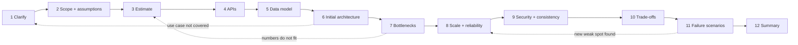
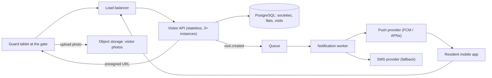
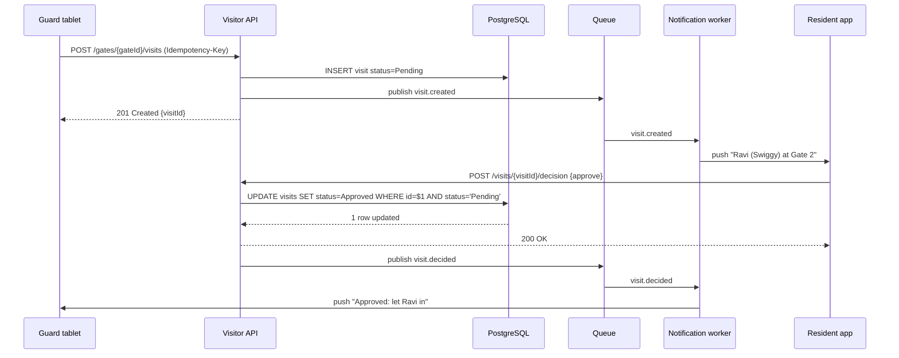

A blank whiteboard and the words "design a system like X" make most people freeze or, worse, start drawing boxes immediately. Experienced engineers do neither. They run the same small set of steps every time, in roughly the same order, and adjust the depth of each step to the problem. This lesson gives you that set of steps, shows it end to end on one realistic problem, and tells you how to spend 45 minutes on it.

## Learning objectives

By the end of this lesson you will be able to:

1. List the 12 steps of a high-level design (HLD) discussion and say what each one produces.
2. Explain why clarifying and estimating come *before* drawing an architecture.
3. Run all 12 steps on a small problem and produce a defensible first design in under an hour.
4. Budget the minutes of a 45-minute interview so you reach scaling, failures and trade-offs instead of running out of time on the API.
5. Recognise the common ways candidates and design reviews go wrong, such as gold-plating, skipping numbers or never naming a trade-off.
6. Capture each step's output in a lightweight design document that a team can review.

## Prerequisites

- [What is system design?](#/lesson/m02-what-is-system-design): what "components" and "interactions" mean.
- [Functional and non-functional requirements](#/lesson/m02-requirements): the difference between *what* the system does and *how well* it does it.
- No maths beyond multiplication and division. The details of each step are taught in the following lessons: [Clarifying requirements](#/lesson/m11-clarifying-requirements), [Non-functional requirements](#/lesson/m11-nfrs), [Capacity estimation](#/lesson/m11-capacity-estimation) and [Latency numbers](#/lesson/m11-latency-numbers).

## Explain it like I'm a beginner

Imagine a family asks a civil engineer to "build us a house". A good engineer does not start pouring concrete. They ask: how many people will live here? Do you need a parking space? What is the budget? Is the plot in an earthquake zone? Only then do they draw a floor plan, check it against the budget and the soil report, and decide where the extra steel goes.

Designing software systems works the same way:

1. **Ask questions** until you know who uses the system and what it must do (clarify requirements).
2. **Write down what you are not building** and what you are assuming (scope and assumptions).
3. **Do rough maths** on how many users, requests and gigabytes (capacity estimation).
4. **Agree the doors and windows**: how the outside world talks to the system (API design).
5. **Decide what you store and how** (data model).
6. **Draw the simplest floor plan that works** (initial architecture).
7. **Ask "where will this crack first?"** (bottlenecks).
8. **Strengthen those spots** (scaling and reliability).
9. **Add locks and make sure two people cannot book the same room** (security and consistency).
10. **Explain what you gave up for what you gained** (trade-offs).
11. **Walk through disasters**: what happens when a part fails (failure scenarios).
12. **Summarise the design in one minute** (summary).

The order matters because each step feeds the next. You cannot decide whether you need a cache until you know how many reads per second there are, and you cannot know that until you know who the users are.

## First-principles explanation

### Why a framework at all?

System design problems are deliberately open. "Design a ride-hailing app" could mean a two-week college project or a platform serving millions of trips a day. Without a method, you will either drown in detail (designing the database index for a feature nobody asked about) or stay too vague ("we'll use microservices and Kafka"). A framework gives you three things:

- **Coverage.** You will not forget security or failure handling because they are on the list.
- **Order.** Decisions are made after the facts they depend on.
- **Pace.** You know roughly how long each step deserves, so you can see when you are behind.

The framework is not a script to recite. Think of it as a pilot's checklist: the steps are fixed, but how long each takes depends on the flight.

### The 12 steps and what each produces

| # | Step | Question it answers | Output you can point at |
|---|---|---|---|
| 1 | Clarify requirements | Who uses it, and what must it do? | 3–6 core use cases, the actors |
| 2 | Scope and assumptions | What are we *not* building? What are we assuming? | In-scope / out-of-scope list, assumption list |
| 3 | Estimate | How big is it? | Average and peak requests per second (RPS), storage per year, bandwidth |
| 4 | APIs | How does the outside world talk to it? | 3–6 endpoints or events with key fields |
| 5 | Data model | What do we store, and how is it accessed? | Main entities, keys, the 2–3 hottest queries |
| 6 | Initial architecture | What is the simplest design that meets the use cases? | One diagram, every arrow explained |
| 7 | Bottlenecks | What breaks first as load grows? | A ranked list of 2–4 pressure points |
| 8 | Scale and reliability | How do we fix those pressure points? | Caching, replicas, partitioning, queues, redundancy |
| 9 | Security and consistency | Who may do what? Which data must never be wrong? | Authn/authz model, consistency choice per data type |
| 10 | Trade-offs | What did we give up, and why is that acceptable? | 2–3 explicit "we chose A over B because…" |
| 11 | Failure scenarios | What happens when X dies? | Failure → impact → mitigation table |
| 12 | Summary | Can you explain it in one minute? | A short recap plus "what I would do next" |

Steps 1–5 are about **understanding the problem**. Step 6 is the **first answer**. Steps 7–11 are about **making the answer survive reality**. Step 12 **closes the loop**.

### Step 1 — Clarify requirements

You ask questions until you can name the users (actors), the main things they do (use cases) and the things the system must *never* do wrong. Good questions are specific and change the design: "Do residents approve visitors in real time, or can approval happen later?" changes whether you need push notifications. "What colour is the app?" does not.

Aim for **3–6 core use cases**. More than that and you will not finish. The full technique, with a question bank, is in [Clarifying requirements, users and system boundaries](#/lesson/m11-clarifying-requirements).

### Step 2 — Scope and assumptions

Say out loud what you are leaving out ("payments, analytics dashboards and the admin portal are out of scope") and what you are assuming ("one society has one guard gate", "residents have smartphones"). This protects you: if the interviewer disagrees, they will tell you now instead of after you have designed the wrong thing. Here you also pin down the non-functional requirements (NFRs) with numbers: "approval notification within 3 seconds at p99", "99.9 % availability for check-in". See [Non-functional requirements](#/lesson/m11-nfrs).

### Step 3 — Estimate

Rough numbers decide the architecture. 50 requests per second fits on one small server with one PostgreSQL database. 50,000 requests per second needs caching, many app instances and probably a partitioned database. Show your arithmetic so others can check it:

```text
DAU × actions per user per day ÷ 86,400 s/day = average RPS
average RPS × peak factor (often 2–5) = peak RPS
records per day × bytes per record × 365 = storage per year
```

Round aggressively. Being within a factor of 2 is fine; being off by 1,000 is not. The method is in [Capacity estimation](#/lesson/m11-capacity-estimation).

### Step 4 — APIs

Define the contract before the internals. For each core use case write one endpoint (or event) with its method, path, key request fields and response. This forces you to decide what the client sends, what is an identifier, and what must be idempotent (safe to retry). Keep it to the use cases from step 1; you are not writing an OpenAPI file.

### Step 5 — Data model

List the main entities and their keys, then the **access patterns**: the 2–3 queries that run most often. The access patterns decide the indexes, the partition key and whether a relational database is the right choice. "Get the latest 20 visits for flat F" and "get all pending visits for gate G" are access patterns; "store visits" is not.

### Step 6 — Initial architecture

Draw the **simplest** design that satisfies the use cases at the estimated load. Usually: clients, a load balancer, a stateless API tier, one database, and maybe object storage and a queue. Explain every arrow: who calls whom, synchronously or asynchronously, and why. Resist adding Kafka, Redis and a service mesh "because big systems have them". Each addition must be justified by a number or a requirement.

### Step 7 — Bottlenecks

Walk the diagram with your numbers and ask: which component hits its limit first? Typical first casualties:

- The database primary under write load or connection count.
- A synchronous call to a slow or flaky external service (SMS, payment, push).
- Large uploads or downloads flowing through the API servers.
- A "hot" key or partition: one celebrity, one very large customer, one evening rush hour.

Rank them. You will fix the top two or three, not all of them.

### Step 8 — Scale and reliability

For each bottleneck pick a remedy and say what it costs:

| Pressure | Typical remedy | New cost or risk |
|---|---|---|
| Read-heavy database | Cache, read replicas | Stale reads, invalidation |
| Write-heavy database | Batching, partitioning by a key | Cross-partition queries become hard |
| Slow external call | Queue + worker, timeouts, retries | Eventual completion, duplicate handling |
| Big files through API | Direct-to-object-storage upload with presigned URLs | URL expiry and access control |
| Single points of failure | Multiple instances across zones, standby database | More money, failover logic |

### Step 9 — Security and consistency

Two questions:

1. **Who may do what?** Authentication (who are you?) and authorization (are you allowed to do this to *this* record?). Most real breaches are authorization bugs: user A reading user B's data by changing an id in the URL.
2. **Which data must never be wrong, and which may be briefly stale?** A visitor approval must be decided exactly once. A "visits this month" counter can be a few seconds behind. Choosing strong consistency only where it matters keeps the rest of the system cheap and fast.

### Step 10 — Trade-offs

Every design decision gives something up. Say it explicitly: "I chose push notifications with an SMS fallback over polling, because polling every 2 seconds from 8 million phones is about 4 million requests per second for nothing. The cost is a dependency on the push provider, which I handle with a fallback." Interviewers and reviewers grade this step heavily because it shows judgement, not memory. The deeper treatment is in [Explaining trade-offs and failure scenarios](#/lesson/m11-trade-offs).

### Step 11 — Failure scenarios

Pick the 3–5 most likely or most damaging failures and walk through each: **what fails → what the user sees → how the system detects it → how it recovers**. Database primary dies; push provider is down; one zone loses power; a client retries the same request five times; the society's internet connection drops.

### Step 12 — Summary

Close in about a minute: the use cases you covered, the key numbers, the shape of the architecture, the two most important trade-offs and what you would build next with more time. This is what people remember.

### The 45-minute time budget

Interviews are commonly 45–60 minutes with about 5 minutes of introductions at each end, so assume you have **about 45 minutes** of design time. This budget is a guide, not a rule:

| # | Step | Minutes | Running total |
|---|---|---|---|
| 1 | Clarify requirements | 4 | 4 |
| 2 | Scope and assumptions (with NFR numbers) | 2 | 6 |
| 3 | Estimate | 4 | 10 |
| 4 | APIs | 4 | 14 |
| 5 | Data model | 4 | 18 |
| 6 | Initial architecture | 6 | 24 |
| 7 | Bottlenecks | 4 | 28 |
| 8 | Scale and reliability | 6 | 34 |
| 9 | Security and consistency | 3 | 37 |
| 10 | Trade-offs | 3 | 40 |
| 11 | Failure scenarios | 3 | 43 |
| 12 | Summary | 2 | 45 |

Three checkpoints help you stay on time:

- **Minute 10:** you should have use cases, scope and numbers on the board.
- **Minute 24:** you should have a complete, working first architecture. If not, simplify now.
- **Minute 40:** start wrapping up even if the interviewer is enjoying a deep dive. Ask: "Shall I go deeper here, or cover failures and summarise?"

Interviewers often steer you into one deep dive (for example, "how would you store the photos?"). That is good. Borrow minutes from steps 4 and 5, which can be brief, and protect steps 10–12.

### When to compress or skip steps

- **Small internal tool** (40 users, one office): steps 3, 7 and 8 shrink to a sentence ("one VM and one PostgreSQL instance handle this with room to spare"). Saying that *is* the answer.
- **Data-heavy problem** (analytics, logging): spend longer on steps 3 and 5.
- **Correctness-heavy problem** (payments, booking): spend longer on step 9.
- **Real design review at work:** the same steps become sections of a design document, and step 11 grows into a proper failure-mode analysis.

A simpler design that meets the numbers is always the better answer. The framework exists to *prove* when a simple design is enough, not to justify a complex one.

## Visual explanation

### The framework as a flow



The solid arrows are the normal order. The dotted arrows are the loops you will actually use. While finding bottlenecks (step 7) you may realise an estimate was wrong, so you go back and fix it. While walking failures (step 11) you may discover a single point of failure, so you return to step 8 and add redundancy. While drawing the architecture (step 6) you may notice a use case you never clarified, so you ask. A framework that cannot loop back is a waterfall; this one is a checklist you revisit.

### Worked example: the initial architecture of a visitor-pass system



The guard tablet and the resident app both reach a **stateless API** through a **load balancer**, so any instance can serve any request and we can add instances at the evening peak. The API keeps visits, flats and decisions in **PostgreSQL**, which gives us transactions for the "decide exactly once" rule. Photos do **not** pass through the API: the API hands the tablet a short-lived presigned URL and the tablet uploads straight to **object storage**, which keeps about 38 MB/s (roughly 300 Mbit/s) of peak photo traffic off our servers. When a visit is created, the API puts a `visit.created` message on a **queue** instead of calling the push provider itself. A **notification worker** sends the push and, if no decision arrives within 30 seconds, an SMS. That keeps the guard's request fast even when the push provider is slow.

### Worked example: the approve-a-visitor flow



The guard creates the visit with an **idempotency key**, so if the tablet's network flickers and it retries, we do not create two visits. The API commits the row as `Pending`, publishes an event and answers the guard immediately (201). The worker pushes the request to the resident's phone. When the resident approves, the API runs a **conditional update**: only a visit that is still `Pending` can change. If a second family member taps "Deny" a moment later, their update matches zero rows and they are told someone already decided. This single SQL condition is our consistency design (step 9). The decision is then pushed back to the guard tablet through the same queue and worker.

## Step-by-step example

**Prompt:** "Design a visitor-management system for gated housing societies: the guard registers a visitor at the gate and a resident approves or denies entry from their phone." (A system like the apps many Indian housing societies use. We reason from public principles, not any company's internals.)

### Step 1 — Clarify (4 min)

Questions and the answers we assume the interviewer gives:

- Who are the users? *Guards at gates, residents (several per flat), society admins.*
- Is approval real time? *Yes. The visitor is waiting at the gate.*
- Pre-approved guests, for example a daily maid or a planned party? *Yes, as a simple pre-approval with a time window.*
- Deliveries? *Yes, they are the majority of visits.*
- Do we store visitor photos? *Yes, one photo per visit, kept for 90 days.*

Core use cases: (1) guard creates a visit, (2) resident approves or denies, (3) resident pre-approves a guest, (4) guard checks a visitor in and out, (5) resident views visit history.

### Step 2 — Scope and assumptions (2 min)

- **In scope:** the five use cases above.
- **Out of scope:** maintenance-fee payments, community chat, intercom calls, the admin billing portal.
- **Assumptions:** 20,000 societies, average 400 flats each, so 8 million flats. Guards have an Android tablet with mobile data. Residents have smartphones.
- **NFRs (numbers, not adjectives):** approval request reaches the resident within 3 s at p99; check-in API p99 under 300 ms; 99.9 % availability for the gate flow; visit records must not be lost once confirmed (durability); photos may be lost in rare cases (lower durability tier is acceptable).

### Step 3 — Estimate (4 min)

```text
Visits per day:   8 M flats × 2 visits/flat/day           = 16 M visits/day
Writes per visit: create, decide, check-in, check-out      = 4 writes
Average writes:   16 M × 4 ÷ 86,400 s                      ≈ 740 writes/s
Peak (7–9 pm delivery rush, assume ×4):                     ≈ 3,000 writes/s
Reads (history, guard dashboard ≈ 5 per visit):
                  16 M × 5 ÷ 86,400                         ≈ 925 reads/s avg, ≈ 3,700 peak
Visit rows:       16 M × 1 KB                               = 16 GB/day ≈ 5.8 TB/year
Photos:           16 M × 50 KB                              = 800 GB/day; × 90-day retention ≈ 72 TB
Photo upload at peak: 3,000 visits/s ÷ 4 writes ≈ 750 photos/s × 50 KB ≈ 37.5 MB/s (≈ 300 Mbit/s)
```

Two conclusions jump out: the **database is the busiest component** (thousands of writes per second at peak), and **photos are the biggest storage cost**, so they belong in object storage with a 90-day lifecycle rule, not in PostgreSQL.

### Step 4 — APIs (4 min)

```text
POST /gates/{gateId}/visits            { visitorName, phone, purpose, flatId, photoKey }  → 201 { visitId }
POST /visits/{visitId}/decision        { decision: approve|deny }                        → 200 | 409 already decided
POST /flats/{flatId}/preapprovals      { guestName, validFrom, validTo }                → 201 { code }
POST /visits/{visitId}/check-in        → 200 ;  POST /visits/{visitId}/check-out → 200
GET  /flats/{flatId}/visits?cursor=…&limit=20                                            → 200 { items, nextCursor }
POST /gates/{gateId}/photo-upload-url  → 200 { uploadUrl, photoKey, expiresIn: 300 }
```

The create call takes an `Idempotency-Key` header. History uses keyset pagination (a cursor), not page numbers, because rows are always being added.

### Step 5 — Data model (4 min)

```text
societies(id, name, city)
flats(id, society_id, block, number)
residents(id, flat_id, phone, push_token)
visits(id, society_id, gate_id, flat_id, visitor_name, visitor_phone, purpose,
       status, photo_key, created_at, decided_at, decided_by, checked_in_at, checked_out_at)
preapprovals(id, flat_id, guest_name, code, valid_from, valid_to)
```

Hot access patterns and their indexes:

- Pending visits at a gate: `(gate_id, status) WHERE status = 'Pending'` (a partial index).
- Recent visits for a flat: `(flat_id, created_at DESC)`.
- Every query is scoped by society, so `society_id` is the natural partition or shard key later.

### Step 6 — Initial architecture (6 min)

This is the architecture diagram above: load balancer, stateless API, PostgreSQL, object storage for photos, and a queue plus notification worker for push and SMS.

### Step 7 — Bottlenecks (4 min)

1. **PostgreSQL writes at the evening peak** (about 3,000 writes/s plus 3,700 reads/s). One well-sized primary can handle this order of load for simple indexed writes, but it is our biggest single point of failure and the first thing to saturate as we grow.
2. **The push provider.** If we call it synchronously, its slowness becomes the guard's slowness.
3. **Photo bandwidth** if uploads went through the API (they do not, by design).
4. **Large societies** (some have 3,000+ flats) make their gates hotter than average.

### Step 8 — Scale and reliability (6 min)

- Read replicas for history queries; the primary handles writes and the gate flow.
- A partitioned `visits` table by month so old data can be dropped cheaply after retention.
- When one primary is not enough, shard by `society_id` (all of a society's data on one shard; no cross-shard queries in the hot path).
- API instances across two availability zones; managed PostgreSQL with a zone-redundant standby.
- Queue and worker for notifications, with retries, a dead-letter queue and SMS fallback.

### Step 9 — Security and consistency (3 min)

- Guards authenticate with a device-bound credential tied to one society; residents with OTP login. Authorization checks that the resident belongs to the visit's flat and the guard to the visit's gate.
- The decision is **strongly consistent**: a conditional update `WHERE status = 'Pending'`. History and counters are eventually consistent (replicas may lag by a second).
- Visitor phone numbers are personal data: encrypt at rest, mask in the guard UI after check-out, delete with the 90-day retention.

### Step 10 — Trade-offs (3 min)

- **Push plus SMS fallback over polling.** Polling every 2 s from 8 M flats ≈ 4 M RPS of mostly empty requests. Push is cheaper but adds a provider dependency.
- **PostgreSQL over a NoSQL store.** The data is relational and the decision rule needs a transaction. The cost is that sharding later is manual work.
- **Asynchronous notifications.** The guard gets a fast 201, but the resident's notification can arrive a second or two later.

### Step 11 — Failure scenarios (3 min)

| Failure | User impact | Mitigation |
|---|---|---|
| Push provider down | Resident not notified | Worker falls back to SMS after 30 s; guard can call the flat |
| Society's internet drops | Guard tablet offline | Tablet queues visits locally and syncs later; pre-approved codes verified offline with a signed list |
| PostgreSQL primary fails | Writes fail for about 30–60 s | Automatic failover to standby; tablet retries with the same idempotency key |
| Resident and spouse decide at once | Conflicting decisions | Conditional update: first wins, second gets 409 |
| Tablet retries a create 3 times | Duplicate visits | Idempotency key stored with the visit |

### Step 12 — Summary (2 min)

"Five use cases for guards and residents. About 16 M visits a day, 3,000 writes per second at the evening peak, 72 TB of photos on a 90-day lifecycle. A stateless API on PostgreSQL, photos uploaded straight to object storage, notifications through a queue with SMS fallback. Decisions are decided exactly once with a conditional update. The main trade-off is asynchronous notification for a fast and resilient gate. Next I would design sharding by society and the offline mode for guard tablets."

## Production-style C# implementation

The framework is a thinking tool, but two parts of it turn into code you will reuse at work: a **time-budget planner** (useful for interviews and for time-boxed design reviews) and the **"decide exactly once"** rule from step 9, shown here as an ASP.NET Core minimal API over an in-memory repository. In production the repository would issue the conditional SQL update shown in the sequence diagram.

```text
Hld.Framework/
  Program.cs
  Framework/HldStep.cs
  Framework/TimeBudget.cs
  Visits/Visit.cs
  Visits/IVisitRepository.cs
  Visits/InMemoryVisitRepository.cs
```

```csharp file=Framework/HldStep.cs
namespace Hld.Framework;

/// <summary>The 12 steps, in their normal order.</summary>
public enum HldStep
{
    Clarify = 1,
    ScopeAndAssumptions,
    Estimate,
    Apis,
    DataModel,
    InitialArchitecture,
    Bottlenecks,
    ScaleAndReliability,
    SecurityAndConsistency,
    TradeOffs,
    FailureScenarios,
    Summary,
}
```

```csharp file=Framework/TimeBudget.cs
namespace Hld.Framework;

public sealed record StepSlot(HldStep Step, int Minutes, int EndsAtMinute);

/// <summary>Splits an interview or design-review slot across the 12 steps,
/// keeping the proportions of the 45-minute reference budget.</summary>
public static class TimeBudget
{
    public static readonly IReadOnlyDictionary<HldStep, int> Reference45 = new Dictionary<HldStep, int>
    {
        [HldStep.Clarify] = 4,
        [HldStep.ScopeAndAssumptions] = 2,
        [HldStep.Estimate] = 4,
        [HldStep.Apis] = 4,
        [HldStep.DataModel] = 4,
        [HldStep.InitialArchitecture] = 6,
        [HldStep.Bottlenecks] = 4,
        [HldStep.ScaleAndReliability] = 6,
        [HldStep.SecurityAndConsistency] = 3,
        [HldStep.TradeOffs] = 3,
        [HldStep.FailureScenarios] = 3,
        [HldStep.Summary] = 2,
    };

    /// <summary>Scales the reference budget to <paramref name="totalMinutes"/> using the
    /// largest-remainder method so the slots always add up exactly. Every step keeps at least 1 minute.</summary>
    public static IReadOnlyList<StepSlot> Plan(int totalMinutes)
    {
        if (totalMinutes < Reference45.Count)
            throw new ArgumentOutOfRangeException(nameof(totalMinutes), totalMinutes, "Need at least one minute per step.");

        int referenceTotal = Reference45.Values.Sum();
        var raw = Reference45
            .OrderBy(kv => kv.Key)
            .Select(kv => (Step: kv.Key, Exact: (double)kv.Value * totalMinutes / referenceTotal))
            .ToList();

        var minutes = raw.ToDictionary(r => r.Step, r => Math.Max(1, (int)Math.Floor(r.Exact)));
        int leftover = totalMinutes - minutes.Values.Sum();

        // Hand out the remaining minutes to the steps with the largest fractional parts.
        foreach (var r in raw.OrderByDescending(r => r.Exact - Math.Floor(r.Exact)).ThenBy(r => r.Step))
        {
            if (leftover <= 0) break;
            minutes[r.Step]++;
            leftover--;
        }
        // If the 1-minute floor overspent, take minutes back from the biggest slots.
        foreach (var step in minutes.OrderByDescending(kv => kv.Value).Select(kv => kv.Key).ToList())
        {
            if (leftover >= 0) break;
            if (minutes[step] > 1) { minutes[step]--; leftover++; }
        }

        int clock = 0;
        return minutes.OrderBy(kv => kv.Key)
            .Select(kv => new StepSlot(kv.Key, kv.Value, clock += kv.Value))
            .ToList();
    }
}
```

`TimeBudget.Plan(45)` returns the table from this lesson. `Plan(30)` gives a compressed plan for a short screening round, and `Plan(90)` a design-review agenda. The largest-remainder method matters: naive rounding of 12 slots often adds up to 44 or 46 minutes, and the whole point of a budget is that it adds up.

```csharp file=Visits/Visit.cs
namespace Hld.Framework.Visits;

public enum VisitStatus { Pending, Approved, Denied, CheckedIn, CheckedOut }

public sealed class Visit
{
    public required Guid Id { get; init; }
    public required Guid FlatId { get; init; }
    public required string GateId { get; init; }
    public required string VisitorName { get; init; }
    public VisitStatus Status { get; set; } = VisitStatus.Pending;
    public Guid? DecidedBy { get; set; }
    public DateTimeOffset CreatedAt { get; init; }
    public DateTimeOffset? DecidedAt { get; set; }
}

public enum DecisionOutcome { Applied, AlreadyDecided, NotFound }
```

```csharp file=Visits/IVisitRepository.cs
namespace Hld.Framework.Visits;

public interface IVisitRepository
{
    /// <summary>Creates a visit, or returns the existing one if this idempotency key was seen before.</summary>
    Visit CreateOrGet(string idempotencyKey, Guid flatId, string gateId, string visitorName);

    /// <summary>Atomically moves a Pending visit to Approved or Denied. Equivalent SQL:
    /// UPDATE visits SET status = @s, decided_by = @r, decided_at = now()
    /// WHERE id = @id AND status = 'Pending'</summary>
    DecisionOutcome Decide(Guid visitId, bool approve, Guid residentId);

    Visit? Find(Guid visitId);
}
```

```csharp file=Visits/InMemoryVisitRepository.cs
using System.Collections.Concurrent;

namespace Hld.Framework.Visits;

/// <summary>Thread-safe fake used for tests and offline builds. The lock per visit
/// plays the role of PostgreSQL's row lock during the conditional UPDATE.</summary>
public sealed class InMemoryVisitRepository(TimeProvider clock) : IVisitRepository
{
    private readonly ConcurrentDictionary<Guid, Visit> _visits = new();
    private readonly ConcurrentDictionary<string, Guid> _idempotency = new();

    public Visit CreateOrGet(string idempotencyKey, Guid flatId, string gateId, string visitorName)
    {
        ArgumentException.ThrowIfNullOrWhiteSpace(idempotencyKey);
        Guid id = _idempotency.GetOrAdd(idempotencyKey, _ => Guid.NewGuid());
        return _visits.GetOrAdd(id, newId => new Visit
        {
            Id = newId,
            FlatId = flatId,
            GateId = gateId,
            VisitorName = visitorName,
            CreatedAt = clock.GetUtcNow(),
        });
    }

    public DecisionOutcome Decide(Guid visitId, bool approve, Guid residentId)
    {
        if (!_visits.TryGetValue(visitId, out var visit)) return DecisionOutcome.NotFound;
        lock (visit)
        {
            if (visit.Status != VisitStatus.Pending) return DecisionOutcome.AlreadyDecided;
            visit.Status = approve ? VisitStatus.Approved : VisitStatus.Denied;
            visit.DecidedBy = residentId;
            visit.DecidedAt = clock.GetUtcNow();
            return DecisionOutcome.Applied;
        }
    }

    public Visit? Find(Guid visitId) => _visits.GetValueOrDefault(visitId);
}
```

```csharp file=Program.cs
using Hld.Framework;
using Hld.Framework.Visits;

var builder = WebApplication.CreateBuilder(args);
builder.Services.AddSingleton(TimeProvider.System);
builder.Services.AddSingleton<IVisitRepository, InMemoryVisitRepository>(); // PostgreSQL-backed in production

var app = builder.Build();

// Step 4 (APIs) in code: create is idempotent, decision is decided exactly once.
app.MapPost("/gates/{gateId}/visits", (string gateId, CreateVisitRequest req, HttpRequest http, IVisitRepository repo) =>
{
    string? key = http.Headers["Idempotency-Key"];
    if (string.IsNullOrWhiteSpace(key))
        return Results.BadRequest(new { error = "Idempotency-Key header is required." });

    var visit = repo.CreateOrGet(key, req.FlatId, gateId, req.VisitorName);
    // Production: publish visit.created to the queue here (or via an outbox), never call the push provider inline.
    return Results.Created($"/visits/{visit.Id}", new { visitId = visit.Id, status = visit.Status.ToString() });
});

app.MapPost("/visits/{visitId:guid}/decision", (Guid visitId, DecisionRequest req, IVisitRepository repo) =>
    repo.Decide(visitId, req.Approve, req.ResidentId) switch
    {
        DecisionOutcome.Applied => Results.Ok(new { visitId, status = req.Approve ? "Approved" : "Denied" }),
        DecisionOutcome.AlreadyDecided => Results.Conflict(new { error = "Another resident has already decided this visit." }),
        _ => Results.NotFound(),
    });

app.MapGet("/visits/{visitId:guid}", (Guid visitId, IVisitRepository repo) =>
    repo.Find(visitId) is { } v ? Results.Ok(v) : Results.NotFound());

// A helper for time-boxed design reviews: GET /hld/plan?minutes=60
app.MapGet("/hld/plan", (int? minutes) => TimeBudget.Plan(minutes ?? 45));

app.Run();

public sealed record CreateVisitRequest(Guid FlatId, string VisitorName);
public sealed record DecisionRequest(bool Approve, Guid ResidentId);
```

Points worth defending in a review:

1. **The idempotency key is required, not optional.** Guard tablets live on patchy mobile data and *will* retry. Making the header mandatory turns "we might get duplicates" into "we never do".
2. **409 Conflict for a second decision.** It tells the second resident the truth ("someone already decided") instead of silently overwriting the first decision.
3. **`TimeProvider` is injected.** Tests can control `CreatedAt` and `DecidedAt` without sleeping.
4. **The repository interface documents its SQL.** The in-memory lock and the `WHERE status = 'Pending'` clause provide the same guarantee: one winner.

## Bad design vs good design

**Bad: "boxes first".** The candidate hears "visitor management", draws a microservice per noun (Visitor Service, Flat Service, Guard Service, Photo Service, Notification Service), adds Kafka and Redis, and starts discussing Kubernetes. Twenty-five minutes in, nobody knows how many requests per second there are, whether approval is real time, or what happens when two residents tap different buttons. Every box is unjustified, and the one hard problem (decide exactly once) is never mentioned.

**Bad: "requirements forever".** The opposite failure. The candidate asks 25 questions, writes a beautiful list of use cases including parking-slot allocation and festival event passes, and reaches the architecture at minute 35. Scaling, failures and trade-offs never happen.

**Good: framework with a clock.**

- Five use cases and an explicit out-of-scope list by minute 6.
- Numbers by minute 10 that *justify* the later choices (photos in object storage, queue for notifications, PostgreSQL is enough for now).
- A deliberately simple first architecture by minute 24.
- Remaining time spent on the evening-peak bottleneck, the exactly-once decision and the offline gate.
- A one-minute summary with two named trade-offs.

:::callout type=mistake title="Designing for scale nobody asked for"
If your estimate says 40 requests per second, a single API instance pair and one PostgreSQL database is the right answer. Proposing sharding and a service mesh for that load signals poor judgement, not ambition. Say "this fits on one database with 20× headroom; here is the point at which I would change the design."
:::

:::callout type=tradeoff title="Breadth versus depth"
You cannot go deep on everything in 45 minutes. Covering all 12 steps shallowly and then going deep on the one or two areas the interviewer cares about beats a perfect API and no failure analysis. When unsure, ask: "Would you like me to go deeper here, or keep moving?"
:::

:::callout type=tip title="Write the step names on the board first"
Writing "Reqs · Scope · Numbers · API · Data · Arch · Bottlenecks · Scale · Sec/Consistency · Trade-offs · Failures · Summary" in a column at the edge of the whiteboard takes 20 seconds. It shows structure, reminds you what is left, and lets the interviewer see your plan.
:::

## Practical playground

The graph below is a first-draft visitor-pass design that skipped steps 3, 7 and 11: photos flow through the API, the API calls the push provider synchronously, and there is one API instance and one database. Open it in the HLD canvas and apply the framework. Use the numbers from the step-by-step example (3,000 writes/s peak, about 38 MB/s of photo uploads at peak) to justify each change you make, and write one failure scenario next to every component you add.

:::playground type=hld title="Apply the framework to a first-draft visitor-pass design"
```json
{
  "nodes": [
    { "id": "guard", "type": "client", "label": "Guard tablets", "props": { "rps": 3000 } },
    { "id": "res", "type": "client", "label": "Resident apps", "props": { "rps": 3700 } },
    { "id": "lb", "type": "load-balancer", "label": "Load balancer" },
    { "id": "api", "type": "app-server", "label": "Visitor API (handles photos too)", "props": { "instances": 1 } },
    { "id": "db", "type": "database", "label": "PostgreSQL", "props": { "replicas": 0 } },
    { "id": "push", "type": "external", "label": "Push provider" }
  ],
  "edges": [
    { "from": "guard", "to": "lb", "kind": "sync" },
    { "from": "res", "to": "lb", "kind": "sync" },
    { "from": "lb", "to": "api", "kind": "sync" },
    { "from": "api", "to": "db", "kind": "sync", "label": "visits + photo bytes" },
    { "from": "api", "to": "push", "kind": "sync", "label": "notify resident" }
  ]
}
```
:::

## Exercises

:::exercise id=m11-hld-framework-ex1 difficulty=beginner kind=code title="Scale the time budget"
Different interviews and design reviews have different lengths. Write a planner that scales the 45-minute reference budget to any length, so the slots always add up exactly.
::requirements
- `InterviewPlanner.Plan(int totalMinutes)` returns an `int[12]` with the minutes for steps 1–12 in order.
- Keep the proportions of the reference budget `{4, 2, 4, 4, 4, 6, 4, 6, 3, 3, 3, 2}`.
- The result must sum exactly to `totalMinutes`. Use the largest-remainder method; break ties by the earlier step.
- Every step gets at least 1 minute. Fewer than 12 total minutes throws `ArgumentOutOfRangeException`.
- `InterviewPlanner.CheckpointMinute(int[] plan, int step)` returns the minute at which `step` (1-based) should be finished.
::acceptance
- `Plan(45)` returns the reference budget unchanged.
- `Plan(90)` doubles every slot.
- `Plan(30)` sums to 30 and gives the initial architecture (step 6) 4 minutes.
- `CheckpointMinute(Plan(45), 6)` is 24.
- `Plan(11)` throws.
::hint
Each step's exact share is `reference[i] × total ÷ 45`. It is usually not a whole number.
::hint
Take the floor of every exact share first. The floors add up to *at most* the total; the difference is how many minutes are left to hand out.
::hint
Give one extra minute each to the steps with the biggest fractional parts. Sort by fractional part descending, then by index ascending for ties.
::hint
After that, apply the 1-minute floor. If the floor overspends, take minutes back from the largest slots.
::hint
```csharp
var exact = Reference.Select(r => (double)r * total / 45).ToArray();
var plan = exact.Select(e => (int)Math.Floor(e)).ToArray();
int left = total - plan.Sum();
foreach (var i in Enumerable.Range(0, 12).OrderByDescending(i => exact[i] - Math.Floor(exact[i])).ThenBy(i => i).Take(left))
    plan[i]++;
```
::starter
```csharp file=InterviewPlanner.cs
using System;
using System.Linq;

public static class InterviewPlanner
{
    public static readonly int[] Reference = { 4, 2, 4, 4, 4, 6, 4, 6, 3, 3, 3, 2 };

    public static int[] Plan(int totalMinutes) => throw new NotImplementedException();

    public static int CheckpointMinute(int[] plan, int step) => throw new NotImplementedException();
}
```
::tests
```csharp file=InterviewPlannerTests.cs
using System;
using System.Linq;
using Xunit;

public class InterviewPlannerTests
{
    [Fact]
    public void Forty_five_minutes_is_the_reference() =>
        Assert.Equal(InterviewPlanner.Reference, InterviewPlanner.Plan(45));

    [Fact]
    public void Ninety_minutes_doubles_every_slot() =>
        Assert.Equal(InterviewPlanner.Reference.Select(m => m * 2).ToArray(), InterviewPlanner.Plan(90));

    [Fact]
    public void Thirty_minutes_sums_exactly()
    {
        var plan = InterviewPlanner.Plan(30);
        Assert.Equal(30, plan.Sum());
        Assert.Equal(4, plan[5]);
        Assert.True(plan.All(m => m >= 1));
    }

    [Theory]
    [InlineData(12)]
    [InlineData(20)]
    [InlineData(37)]
    [InlineData(60)]
    public void Any_length_sums_exactly(int total)
    {
        var plan = InterviewPlanner.Plan(total);
        Assert.Equal(total, plan.Sum());
        Assert.True(plan.All(m => m >= 1));
    }

    [Fact]
    public void Checkpoint_after_initial_architecture() =>
        Assert.Equal(24, InterviewPlanner.CheckpointMinute(InterviewPlanner.Plan(45), 6));

    [Fact]
    public void Too_short_throws() =>
        Assert.Throws<ArgumentOutOfRangeException>(() => InterviewPlanner.Plan(11));
}
```
::solution
Floor every exact share, distribute the leftover minutes by largest fractional part, then enforce the 1-minute floor by borrowing from the biggest slots.

```csharp file=InterviewPlanner.cs
using System;
using System.Linq;

public static class InterviewPlanner
{
    public static readonly int[] Reference = { 4, 2, 4, 4, 4, 6, 4, 6, 3, 3, 3, 2 };

    public static int[] Plan(int totalMinutes)
    {
        if (totalMinutes < Reference.Length)
            throw new ArgumentOutOfRangeException(nameof(totalMinutes), totalMinutes, "Need at least one minute per step.");

        int refTotal = Reference.Sum();
        double[] exact = Reference.Select(r => (double)r * totalMinutes / refTotal).ToArray();
        int[] plan = exact.Select(e => (int)Math.Floor(e)).ToArray();

        int left = totalMinutes - plan.Sum();
        foreach (int i in Enumerable.Range(0, plan.Length)
                     .OrderByDescending(i => exact[i] - Math.Floor(exact[i]))
                     .ThenBy(i => i)
                     .Take(left))
            plan[i]++;

        for (int i = 0; i < plan.Length; i++)
        {
            while (plan[i] < 1)
            {
                int donor = Enumerable.Range(0, plan.Length).OrderByDescending(j => plan[j]).ThenBy(j => j).First();
                plan[donor]--;
                plan[i]++;
            }
        }
        return plan;
    }

    public static int CheckpointMinute(int[] plan, int step)
    {
        ArgumentNullException.ThrowIfNull(plan);
        if (step < 1 || step > plan.Length) throw new ArgumentOutOfRangeException(nameof(step));
        return plan.Take(step).Sum();
    }
}
```

For 30 minutes the exact shares are `{2.67, 1.33, 2.67, 2.67, 2.67, 4, 2.67, 4, 2, 2, 2, 1.33}`. The floors sum to 26, so the four minutes left go to the first four steps with fraction 0.67 (steps 1, 3, 4 and 5).
::mistakes
- Using `Math.Round` on each slot, which can sum to 29 or 31.
- Forgetting the 1-minute floor, which gives the summary 0 minutes in a 12-minute plan.
- Making `CheckpointMinute` 0-based in one place and 1-based in another.
::extensions
Add a `Rebalance(int[] plan, int currentStep, int minutesUsed)` that redistributes the remaining time when you are running late.
:::

:::exercise id=m11-hld-framework-ex2 difficulty=beginner kind=written title="The first ten minutes of a library seat-booking design"
Prompt: "Design a seat-booking system for a university's central library: 1,200 seats, 25,000 students, bookings in 2-hour slots."

Write what you would say and write on the board in the first ten minutes: steps 1, 2 and 3 only.
::acceptance
- At least five clarifying questions, each of which could change the design.
- Three to five core use cases and an explicit out-of-scope list.
- At least three NFRs with numbers.
- An estimate with the arithmetic shown, ending in a statement about whether a simple design is enough.
::hint
Who are the actors? Students, librarians, maybe a gate scanner.
::hint
Ask about the hard parts: how far ahead can you book, what happens to no-shows, is there a rush when booking opens?
::hint
For numbers: how many slots per day, how many bookings, and what is the burst when booking opens at, say, 8 a.m.?
::hint
25,000 students all trying to book at 08:00:00 is the interesting load, not the daily average.
::solution
**Clarifying questions:** Can a student book more than one slot per day? How far in advance does booking open? What happens if a student does not turn up (auto-release after 15 minutes)? Is check-in by QR at the gate? Are some seats special (power sockets, quiet zone)? Do librarians override bookings? Is there an exam-season rush?

**Use cases:** (1) browse free seats for a slot, (2) book a seat, (3) cancel, (4) check in by QR, (5) auto-release no-shows. **Out of scope:** book loans, fines, room bookings, analytics.

**NFRs:** booking confirmation p99 < 500 ms; no seat ever double-booked (strong consistency on the seat-slot pair); 99.5 % availability during library hours (07:00–23:00); check-in works for 10 minutes if the network is down.

**Estimate:** 1,200 seats × 8 slots/day = 9,600 seat-slots per day. Suppose 60 % are booked: about 5,800 bookings/day, which is about 0.07 per second on average: trivial. The burst matters: if booking for tomorrow opens at 08:00 and 10,000 students try in the first 60 s, that is about 170 booking attempts per second, with heavy contention on the most popular seats. Storage: 5,800 × 365 × 200 B ≈ 420 MB/year.

**Conclusion:** one API instance pair and one PostgreSQL database are plenty. The design problem is contention at 08:00 (unique constraint on `(seat_id, slot_start)`, or a short queue), not scale.
::mistakes
- Estimating only the daily average and missing the 08:00 burst.
- Listing 12 use cases, including features nobody asked for.
- NFRs written as adjectives ("fast", "reliable") without numbers.
:::

:::exercise id=m11-hld-framework-ex3 difficulty=intermediate kind=hld title="Fix the first-draft visitor-pass architecture"
The starter graph is the first draft from the playground. Apply steps 6–8 and 11 of the framework: produce an architecture that handles the evening peak (3,000 writes/s, 3,700 reads/s, about 38 MB/s of photo uploads) and survives the push provider being down.
::acceptance
- Photo bytes no longer pass through the API or the database.
- Notifications are sent asynchronously, with a fallback channel.
- No single API instance or single-zone database on the gate path.
- The solution names, for each new component, one failure scenario and its mitigation.
::hint
Which edge carries the most bytes? Which edge depends on a third party?
::hint
Object storage plus presigned URLs removes the photo bytes from your servers.
::hint
A queue between the API and the push provider turns a synchronous dependency into a retryable job.
::hint
Add instances and `multiAz`, a database standby, a read replica for history, a queue and a worker that talks to both push and SMS.
::starter
```json
{
  "nodes": [
    { "id": "guard", "type": "client", "label": "Guard tablets", "props": { "rps": 3000 } },
    { "id": "res", "type": "client", "label": "Resident apps", "props": { "rps": 3700 } },
    { "id": "lb", "type": "load-balancer", "label": "Load balancer" },
    { "id": "api", "type": "app-server", "label": "Visitor API (handles photos too)", "props": { "instances": 1 } },
    { "id": "db", "type": "database", "label": "PostgreSQL", "props": { "replicas": 0 } },
    { "id": "push", "type": "external", "label": "Push provider" }
  ],
  "edges": [
    { "from": "guard", "to": "lb", "kind": "sync" },
    { "from": "res", "to": "lb", "kind": "sync" },
    { "from": "lb", "to": "api", "kind": "sync" },
    { "from": "api", "to": "db", "kind": "sync", "label": "visits + photo bytes" },
    { "from": "api", "to": "push", "kind": "sync", "label": "notify resident" }
  ]
}
```
::solution
```json
{
  "nodes": [
    { "id": "guard", "type": "client", "label": "Guard tablets", "props": { "rps": 3000 } },
    { "id": "res", "type": "client", "label": "Resident apps", "props": { "rps": 3700 } },
    { "id": "lb", "type": "load-balancer", "label": "Zone-redundant load balancer", "props": { "multiAz": true } },
    { "id": "api", "type": "app-server", "label": "Visitor API (stateless)", "props": { "instances": 6, "multiAz": true } },
    { "id": "db", "type": "database", "label": "PostgreSQL primary + standby", "props": { "replicas": 1, "multiAz": true } },
    { "id": "rr", "type": "read-replica", "label": "Read replica (history)", "props": { "replicas": 1 } },
    { "id": "os", "type": "object-storage", "label": "Visitor photos (90-day lifecycle)" },
    { "id": "q", "type": "queue", "label": "visit events" },
    { "id": "w", "type": "worker", "label": "Notification worker", "props": { "instances": 3 } },
    { "id": "push", "type": "external", "label": "Push provider" },
    { "id": "sms", "type": "external", "label": "SMS provider (fallback)" },
    { "id": "mon", "type": "monitoring", "label": "Metrics + alerts" }
  ],
  "edges": [
    { "from": "guard", "to": "lb", "kind": "sync" },
    { "from": "res", "to": "lb", "kind": "sync" },
    { "from": "lb", "to": "api", "kind": "sync" },
    { "from": "api", "to": "db", "kind": "sync", "label": "writes + decisions" },
    { "from": "api", "to": "rr", "kind": "sync", "label": "history reads" },
    { "from": "guard", "to": "os", "kind": "sync", "label": "presigned photo upload" },
    { "from": "api", "to": "q", "kind": "async", "label": "visit.created / visit.decided" },
    { "from": "q", "to": "w", "kind": "async" },
    { "from": "w", "to": "push", "kind": "sync" },
    { "from": "w", "to": "sms", "kind": "sync", "label": "after 30 s without decision" },
    { "from": "api", "to": "mon", "kind": "async" }
  ]
}
```

**Reasoning.** About 38 MB/s of photos now goes straight from the tablets to object storage, so the API only stores a `photo_key`. Notifications are queued: if the push provider is slow, the guard still gets a 201 in milliseconds. Six API instances across two zones (an estimate: assume about 1,500 RPS per instance at the peak's 6,700 RPS, plus headroom to lose a zone) remove the single instance. The database has a standby in another zone; history reads go to a replica.

**Failure table.** Object storage unavailable → tablet keeps the photo locally and retries; the visit is still created. Queue down → API writes events to an outbox table and a relay publishes later. Worker crash → message is redelivered; the worker deduplicates by `visitId`. Push provider down → SMS after 30 s. Replica lag → history may be a second behind; the decision path always reads the primary.
::mistakes
- Moving photos into a separate "Photo Service" that still proxies the bytes.
- Adding a queue but no fallback channel, so a push outage still blocks residents.
- Adding a cache before checking whether reads are actually the bottleneck.
:::

:::exercise id=m11-hld-framework-ex4 difficulty=intermediate kind=code title="A design-notes completeness checker"
Teams often write design documents with the 12 steps as headings. Write a checker that flags the most common gaps before a review meeting.
::requirements
- `DesignNotesChecker.Check(IReadOnlyDictionary<int, string> notes)` returns a `List<string>` of problems. Keys are step numbers 1–12; values are the notes.
- A step that is missing or whitespace-only produces `"Step N missing"`.
- Step 3 (estimate) must contain at least one digit; otherwise `"Step 3 has no numbers"`.
- Step 2 must mention "out of scope" (case-insensitive); otherwise `"Step 2 has no out-of-scope list"`.
- Step 10 must contain the word "because" (case-insensitive); otherwise `"Step 10 states no reason"`.
- Keys outside 1–12 throw `ArgumentOutOfRangeException`.
- Problems are returned in step order.
::acceptance
- A complete, well-formed set of notes returns an empty list.
- An empty dictionary returns 12 "missing" problems.
- An estimate of "big, lots of users" is flagged.
- A key of 13 throws.
::hint
Loop over steps 1 to 12 and check each one; that gives step order for free.
::hint
`string.IsNullOrWhiteSpace` handles both missing and blank notes when combined with `TryGetValue`.
::hint
`text.Any(char.IsDigit)` and `text.Contains("because", StringComparison.OrdinalIgnoreCase)` cover the content rules.
::hint
Validate keys first, before building the problem list.
::starter
```csharp file=DesignNotesChecker.cs
using System;
using System.Collections.Generic;
using System.Linq;

public static class DesignNotesChecker
{
    public static List<string> Check(IReadOnlyDictionary<int, string> notes) => throw new NotImplementedException();
}
```
::tests
```csharp file=DesignNotesCheckerTests.cs
using System;
using System.Collections.Generic;
using System.Linq;
using Xunit;

public class DesignNotesCheckerTests
{
    private static Dictionary<int, string> Complete() => Enumerable.Range(1, 12).ToDictionary(i => i, i => i switch
    {
        2 => "Out of scope: payments. Assume 8 M flats.",
        3 => "16 M visits/day, 3,000 writes/s peak",
        10 => "Push over polling because polling costs 4 M RPS",
        _ => $"notes for step {i}",
    });

    [Fact]
    public void Complete_notes_have_no_problems() => Assert.Empty(DesignNotesChecker.Check(Complete()));

    [Fact]
    public void Empty_notes_report_all_twelve_missing()
    {
        var problems = DesignNotesChecker.Check(new Dictionary<int, string>());
        Assert.Equal(12, problems.Count);
        Assert.Equal("Step 1 missing", problems[0]);
        Assert.Equal("Step 12 missing", problems[11]);
    }

    [Fact]
    public void Estimate_without_numbers_is_flagged()
    {
        var notes = Complete();
        notes[3] = "big, lots of users";
        Assert.Equal(new List<string> { "Step 3 has no numbers" }, DesignNotesChecker.Check(notes));
    }

    [Fact]
    public void Blank_step_counts_as_missing()
    {
        var notes = Complete();
        notes[7] = "   ";
        Assert.Equal(new List<string> { "Step 7 missing" }, DesignNotesChecker.Check(notes));
    }

    [Fact]
    public void Scope_and_tradeoff_rules_in_step_order()
    {
        var notes = Complete();
        notes[2] = "Assume 8 M flats.";
        notes[10] = "We use push.";
        Assert.Equal(new List<string> { "Step 2 has no out-of-scope list", "Step 10 states no reason" }, DesignNotesChecker.Check(notes));
    }

    [Fact]
    public void Unknown_step_throws()
    {
        var notes = Complete();
        notes[13] = "extra";
        Assert.Throws<ArgumentOutOfRangeException>(() => DesignNotesChecker.Check(notes));
    }
}
```
::solution
```csharp file=DesignNotesChecker.cs
using System;
using System.Collections.Generic;
using System.Linq;

public static class DesignNotesChecker
{
    public static List<string> Check(IReadOnlyDictionary<int, string> notes)
    {
        ArgumentNullException.ThrowIfNull(notes);
        foreach (int key in notes.Keys)
            if (key < 1 || key > 12) throw new ArgumentOutOfRangeException(nameof(notes), key, "Steps are numbered 1 to 12.");

        var problems = new List<string>();
        for (int step = 1; step <= 12; step++)
        {
            if (!notes.TryGetValue(step, out var text) || string.IsNullOrWhiteSpace(text))
            {
                problems.Add($"Step {step} missing");
                continue;
            }
            if (step == 2 && !text.Contains("out of scope", StringComparison.OrdinalIgnoreCase))
                problems.Add("Step 2 has no out-of-scope list");
            if (step == 3 && !text.Any(char.IsDigit))
                problems.Add("Step 3 has no numbers");
            if (step == 10 && !text.Contains("because", StringComparison.OrdinalIgnoreCase))
                problems.Add("Step 10 states no reason");
        }
        return problems;
    }
}
```

The rules are deliberately crude: a digit does not prove the estimate is right, and "because" does not prove the reason is good. A checker like this catches *absence*, which is the most common problem; humans judge quality in the review.
::alternatives
Model each rule as an `IDesignRule` with `string? Evaluate(int step, string text)` so teams can add their own (for example "step 9 mentions authorization"). That is the Strategy pattern applied to linting.
::mistakes
- Checking `notes[step]` directly, which throws `KeyNotFoundException` for missing steps.
- Reporting problems in dictionary order, which is not guaranteed to be step order.
- Case-sensitive matching that misses "Out of scope".
:::

:::exercise id=m11-hld-framework-ex5 difficulty=advanced kind=code title="Decide exactly once under concurrency"
Two family members receive the same visitor notification and tap "Approve" and "Deny" within milliseconds of each other. Implement the consistency rule from step 9 so exactly one decision wins, even under heavy concurrency, and every caller learns the final outcome.
::requirements
- `VisitDecisions.Create(Guid visitId)` registers a pending visit; creating the same id twice throws `InvalidOperationException`.
- `VisitDecisions.TryDecide(Guid visitId, string decision, string residentId)` returns a `DecisionResult(bool Won, string FinalDecision, string DecidedBy)`.
- `decision` is `"approve"` or `"deny"`; anything else throws `ArgumentException`. An unknown visit throws `KeyNotFoundException`.
- The first caller wins. Every later caller gets `Won = false` and the *winner's* decision and resident.
- Must be safe when 200 threads decide the same visit at once: exactly one `Won = true`.
- Do not hold one global lock for all visits.
::acceptance
- A single decision wins.
- A second decision with a different value loses and reports the first value.
- 200 parallel deciders produce exactly one winner, and every result agrees on the final decision.
- Different visits are decided independently.
::hint
This is a compare-and-set: "set the decision only if it is still empty".
::hint
Store an immutable object per visit and replace it atomically. `Interlocked.CompareExchange` on a reference field does exactly that.
::hint
Keep a `ConcurrentDictionary<Guid, Slot>` where `Slot` is a small class holding a `Decided?` reference. Each visit has its own slot, so there is no global lock.
::hint
```csharp
var mine = new Decided(decision, residentId);
var previous = Interlocked.CompareExchange(ref slot.Value, mine, null);
return previous is null ? new(true, mine.Decision, mine.By) : new(false, previous.Decision, previous.By);
```
::starter
```csharp file=VisitDecisions.cs
using System;
using System.Collections.Concurrent;
using System.Collections.Generic;
using System.Threading;

public sealed record DecisionResult(bool Won, string FinalDecision, string DecidedBy);

public sealed class VisitDecisions
{
    public void Create(Guid visitId) => throw new NotImplementedException();

    public DecisionResult TryDecide(Guid visitId, string decision, string residentId) => throw new NotImplementedException();
}
```
::tests
```csharp file=VisitDecisionsTests.cs
using System;
using System.Collections.Concurrent;
using System.Collections.Generic;
using System.Linq;
using System.Threading.Tasks;
using Xunit;

public class VisitDecisionsTests
{
    [Fact]
    public void First_decision_wins()
    {
        var d = new VisitDecisions();
        var id = Guid.NewGuid();
        d.Create(id);
        Assert.Equal(new DecisionResult(true, "approve", "asha"), d.TryDecide(id, "approve", "asha"));
    }

    [Fact]
    public void Second_decision_loses_and_sees_the_first()
    {
        var d = new VisitDecisions();
        var id = Guid.NewGuid();
        d.Create(id);
        d.TryDecide(id, "approve", "asha");
        Assert.Equal(new DecisionResult(false, "approve", "asha"), d.TryDecide(id, "deny", "vikram"));
    }

    [Fact]
    public void Exactly_one_winner_under_contention()
    {
        var d = new VisitDecisions();
        var id = Guid.NewGuid();
        d.Create(id);
        var results = new ConcurrentBag<DecisionResult>();
        Parallel.For(0, 200, i => results.Add(d.TryDecide(id, i % 2 == 0 ? "approve" : "deny", $"r{i}")));
        Assert.Equal(1, results.Count(r => r.Won));
        Assert.Equal(1, results.Select(r => r.FinalDecision + "/" + r.DecidedBy).Distinct().Count());
    }

    [Fact]
    public void Visits_are_independent()
    {
        var d = new VisitDecisions();
        var a = Guid.NewGuid();
        var b = Guid.NewGuid();
        d.Create(a);
        d.Create(b);
        d.TryDecide(a, "deny", "x");
        Assert.True(d.TryDecide(b, "approve", "y").Won);
    }

    [Fact]
    public void Invalid_inputs()
    {
        var d = new VisitDecisions();
        var id = Guid.NewGuid();
        d.Create(id);
        Assert.Throws<InvalidOperationException>(() => d.Create(id));
        Assert.Throws<ArgumentException>(() => d.TryDecide(id, "maybe", "x"));
        Assert.Throws<KeyNotFoundException>(() => d.TryDecide(Guid.NewGuid(), "approve", "x"));
    }
}
```
::solution
Each visit owns a `Slot` whose `Value` starts as `null`. `Interlocked.CompareExchange` writes the caller's decision only if the slot is still `null`, and returns whatever was there before, so the losing callers learn the winner without a second read.

```csharp file=VisitDecisions.cs
using System;
using System.Collections.Concurrent;
using System.Collections.Generic;
using System.Threading;

public sealed record DecisionResult(bool Won, string FinalDecision, string DecidedBy);

public sealed class VisitDecisions
{
    private sealed record Decided(string Decision, string By);

    private sealed class Slot
    {
        public Decided? Value;
    }

    private readonly ConcurrentDictionary<Guid, Slot> _slots = new();

    public void Create(Guid visitId)
    {
        if (!_slots.TryAdd(visitId, new Slot()))
            throw new InvalidOperationException($"Visit {visitId} already exists.");
    }

    public DecisionResult TryDecide(Guid visitId, string decision, string residentId)
    {
        if (decision is not ("approve" or "deny"))
            throw new ArgumentException("Decision must be 'approve' or 'deny'.", nameof(decision));
        if (!_slots.TryGetValue(visitId, out var slot))
            throw new KeyNotFoundException($"Visit {visitId} not found.");

        var mine = new Decided(decision, residentId);
        var previous = Interlocked.CompareExchange(ref slot.Value, mine, null);
        return previous is null
            ? new DecisionResult(true, mine.Decision, mine.By)
            : new DecisionResult(false, previous.Decision, previous.By);
    }
}
```

This is the in-memory twin of `UPDATE … WHERE status = 'Pending'`. In PostgreSQL the row lock taken by the UPDATE serialises the two transactions; the second one re-checks the condition after the first commits, finds `status = 'Approved'`, and updates zero rows. Add `RETURNING status, decided_by` (or a follow-up SELECT when zero rows changed) to tell the loser who won.
::alternatives
- A `lock (slot)` per visit is equally correct and easier for some readers; it costs slightly more under contention.
- A database unique constraint on a `visit_decisions(visit_id)` table gives the same guarantee across many API instances, which the in-memory version cannot.
::mistakes
- Read-then-write (`if (slot.Value is null) slot.Value = mine;`), which lets two threads both see `null`.
- One global `lock` around the dictionary, which serialises every visit in the country.
- Returning `Won = false` without the winner's decision, so the second resident's screen shows nothing useful.
::extensions
Add an expiry: if no one decides within 5 minutes the visit becomes `"expired"` via the same compare-and-set, and late decisions lose to it.
:::

:::exercise id=m11-hld-framework-ex6 difficulty=advanced kind=written title="Run steps 9–12 on a metro QR-ticketing design"
A metro operator sells QR tickets in its app. The design so far: app → load balancer → ticket API → PostgreSQL; a UPI payment gateway is called synchronously during purchase; turnstiles validate the QR by calling the ticket API online. Peak: 4,000 entries per second during the 9 a.m. rush.

Complete steps 9, 10, 11 and 12 for this design.
::acceptance
- Security: authn for app users and turnstiles, authz on tickets, and how a QR code is protected from forgery and screenshot reuse.
- Consistency: which operations need strong consistency and which can be eventual.
- At least two trade-offs stated as "A over B because…, at the cost of…".
- At least four failure scenarios in a failure → impact → mitigation table, including the turnstile losing network.
- A summary of under 120 words.
::hint
What stops someone from generating their own QR code? What stops two people using one screenshot?
::hint
Turnstiles calling the API online at 4,000 entries per second during the rush is a dependency you can remove. How could a turnstile check a ticket without the network?
::hint
Signed QR payloads (a digital signature the turnstile can verify with a public key) plus a short validity window.
::hint
"Ticket used" must be recorded, but must it be recorded *before* the gate opens?
::solution
**Security.** App users log in with OTP; turnstiles use device certificates. A ticket QR encodes `ticketId, fromStation, validUntil` plus an Ed25519 (or ECDSA) signature from the ticket service. Turnstiles hold the public key and verify offline. Screenshot reuse is limited by a short validity window, a rotating QR (re-signed every 30 s in the app) and entry/exit pairing: a ticket that has already entered cannot enter again.

**Consistency.** Payment and ticket issuance are strongly consistent (one payment → one ticket, idempotency key on purchase). Entry records are eventually consistent: turnstiles record taps locally and upload within seconds. A rare double entry is detected and the ticket flagged; the business accepts that small risk over blocking the gate.

**Trade-offs.** (1) Offline signature checks over online validation, *because* 4,000 synchronous checks per second at the rush make the API a single point of failure for the gates, *at the cost of* a short window where reused screenshots can slip through. (2) Asynchronous payment confirmation (ticket shown as "processing" for a few seconds) over a fully synchronous flow, *because* gateway latency spikes should not time out the purchase, *at the cost of* a slightly more complex UI.

**Failures.**

| Failure | Impact | Mitigation |
|---|---|---|
| Turnstile loses network | Cannot upload taps | Verifies offline, buffers taps, syncs later |
| Payment gateway slow | Purchases stall | Timeout 5 s, async confirmation, retry with same idempotency key |
| Ticket API down | No new purchases | Gates keep working offline; app shows cached tickets |
| Signing key leaked | Forged tickets | Key rotation with key ids in the QR; turnstiles accept old and new for one overlap window |
| Duplicate purchase retry | Charged twice | Idempotency key per purchase attempt |

**Summary.** "QR tickets signed by the ticket service and verified offline at the gates, so 4,000 entries per second never touch our API. Purchases are idempotent and strongly consistent; entry logs are eventually consistent and reconciled. Main trade-offs: offline validation over online checks, and asynchronous payment confirmation. Next: fraud analytics on duplicate taps."
::mistakes
- Keeping turnstiles dependent on an online API call during the rush hour.
- Saying "use JWT" without explaining how the turnstile verifies it offline and how reuse is limited.
- A failure table with no detection or mitigation column.
:::

## Automated testing

The framework itself is not code, but the decisions it produces are, and they deserve tests.

**1. Consistency rules from step 9.** The "decide exactly once" rule is the most important behaviour in the visitor example. Test it with real concurrency, not just sequential calls:

```csharp
[Fact]
public void Only_one_resident_decision_is_applied()
{
    var repo = new InMemoryVisitRepository(TimeProvider.System);
    var visit = repo.CreateOrGet("key-1", Guid.NewGuid(), "gate-2", "Ravi");
    var outcomes = new ConcurrentBag<DecisionOutcome>();
    Parallel.For(0, 50, i => outcomes.Add(repo.Decide(visit.Id, i % 2 == 0, Guid.NewGuid())));
    Assert.Equal(1, outcomes.Count(o => o == DecisionOutcome.Applied));
}
```

**2. Idempotency from step 4.** Call `CreateOrGet` twice with the same key and assert the same `Id` comes back. In an integration test with `WebApplicationFactory`, post the same request twice with the same `Idempotency-Key` header and assert both responses carry the same `visitId`.

**3. Estimates from step 3.** Put the key numbers in a test so a later change to assumptions shows up in review:

```csharp
[Fact]
public void Evening_peak_writes_are_about_three_thousand_per_second()
{
    double avg = 16_000_000 * 4 / 86_400.0;
    Assert.InRange(avg * 4, 2_500, 3_500);
}
```

**4. Failure scenarios from step 11.** Each row of the failure table should become a test or a drill: a fake push sender that throws should cause the worker to schedule the SMS fallback; a repository that throws on the first call should be retried with the same idempotency key without creating a duplicate. Load tests (for example with k6 or Azure Load Testing) check the bottleneck ranking from step 7 against reality.

**5. Time-budget planner.** `TimeBudget.Plan` is pure, so property-style tests ("for every length from 12 to 120, the slots sum exactly and none is zero") are cheap and catch rounding bugs.

## Real-world application

- **Design documents at work.** Many teams' design-doc templates map almost one to one onto these steps: context and goals (1–2), scale (3), API and data (4–5), architecture (6–8), security and privacy (9), alternatives considered (10), failure modes and rollout (11), summary at the top (12). Using the same order in interviews and at work means you practise one habit.
- **Architecture review boards** in large organisations, including government and infrastructure clients, often reject proposals for missing exactly the steps candidates skip: no numbers, no failure analysis, no alternatives considered.
- **Cloud provider guidance** such as the Azure Well-Architected Framework organises reviews by pillars (reliability, security, cost, operational excellence, performance). Steps 8, 9 and 11 are where those pillars enter your design.
- **Google's SRE book** describes "non-abstract large system design": designs must come with concrete numbers and provisioning estimates, not just boxes. Step 3 is that discipline.
- **Incident post-mortems** frequently trace back to a failure scenario nobody walked through. Step 11 is cheap insurance.

## Interview questions

:::interview
::q beginner
How do you start a system design interview?
::a
I do not draw anything yet. I ask clarifying questions to find the users, the 3–6 core use cases and the hard constraints, then state what is out of scope and what I am assuming, with numeric NFRs. Then I do a quick estimate of requests per second and storage. Only after about ten minutes do I draw the simplest architecture that meets those numbers.
::q beginner
Why should you estimate before designing the architecture?
::a
Because the numbers decide the architecture. 50 requests per second fits on one server and one database; 50,000 needs caching, many instances and probably partitioning. Without numbers every component is a guess, and you risk either over-engineering a small system or under-designing a big one. Estimates also reveal the dominant cost, such as photo storage in the visitor example.
::q intermediate
You are 30 minutes into a 45-minute interview and still on the API. What do you do?
::a
Say so and change pace: "I'll keep the remaining endpoints brief so we have time for scaling and failures." Sketch the data model in two minutes, draw the simplest architecture, then pick the top two bottlenecks and the top three failure scenarios. A complete but shallow pass plus one deep area beats a perfect API and nothing else. I would also ask the interviewer where they want depth.
::q intermediate
How do you decide which bottlenecks to address?
::a
Walk the architecture with the estimates and ask which component reaches its limit first at peak: usually the database primary, a synchronous external call, large payloads through the app tier, or a hot partition. Rank by how soon and how badly each fails, then fix the top two or three. For each fix, state its new cost, for example a cache adds staleness and invalidation work.
::q advanced
How would you adapt the framework for a design review of an existing system rather than a greenfield design?
::a
Steps 1–3 become "measure": real traffic, real p99 latency, real growth rate and cost, instead of assumptions. Step 6 becomes the *current* architecture, drawn honestly. Steps 7 and 11 lean on incident history and load-test data. The proposal is then a delta: which bottleneck or failure mode it fixes, its migration plan (expand/contract, feature flags, rollback), and how we will know it worked. Trade-offs include the cost of change itself, which greenfield designs ignore.
::q advanced
An interviewer says "assume infinite scale". How does that change your approach?
::a
I still estimate, because "infinite" is not a design input; I would propose a concrete large number, for example 100 M DAU and 1 M RPS at peak, and confirm it. Then the design must avoid anything that does not scale horizontally: single primaries for hot writes, global locks, cross-partition transactions in the hot path. I would partition by a key that spreads load, use asynchronous processing and caches, and be explicit about the consistency I give up. I would also say which parts stay simple, because even "infinite" systems have small admin tools that need no sharding.
:::

## Summary and revision

**Key takeaways**

- Twelve steps: clarify → scope and assumptions → estimate → APIs → data model → initial architecture → bottlenecks → scale and reliability → security and consistency → trade-offs → failure scenarios → summary.
- Understand the problem (1–5) before answering it (6), then make the answer survive reality (7–11), then close (12).
- Numbers come before boxes. Every component must be justified by a requirement or an estimate.
- In 45 minutes: about 10 minutes to reach numbers, about 24 to reach a first architecture, the last 5 for failures and summary.
- Strong consistency only where it matters (decide exactly once); eventual consistency everywhere else.
- Always say what you gave up and why. Always walk at least three failures.
- If the numbers say a simple design is enough, the simple design is the right answer.

**Terminology**: use case, actor, scope, assumption, non-functional requirement (NFR), back-of-the-envelope estimate, RPS, peak factor, access pattern, bottleneck, idempotency key, conditional update, trade-off, failure scenario.

:::flashcards
Q: The 12 HLD steps in order?
A: Clarify, scope and assumptions, estimate, APIs, data model, initial architecture, bottlenecks, scale and reliability, security and consistency, trade-offs, failure scenarios, summary.
Q: Where should you be at minute 10 of a 45-minute interview?
A: Use cases, scope (including out of scope), NFR numbers and capacity estimates on the board.
Q: Where should you be at minute 24?
A: A complete, simplest-possible initial architecture with every arrow explained.
Q: What does step 5 (data model) need beyond the list of tables?
A: The 2–3 hottest access patterns, which decide indexes and the partition key.
Q: Formula for average RPS?
A: DAU × actions per user per day ÷ 86,400. Multiply by a peak factor (often 2–5) for peak RPS.
Q: What makes a good trade-off statement?
A: "I chose A over B because <reason with numbers>, at the cost of <what we give up>, which is acceptable because <requirement>."
Q: Four parts of a failure scenario?
A: What fails, what the user sees, how it is detected, how the system recovers.
Q: How do you make "decide exactly once" safe across many API instances?
A: A conditional update in the database, e.g. UPDATE … WHERE status = 'Pending', or a unique constraint. The first transaction wins.
:::

## Knowledge check

:::quiz pass=70
::q single
Five minutes into an interview for "design a food-delivery app", a candidate has drawn twelve microservices but asked no questions. What is the most important thing missing?
- [ ] A Kubernetes deployment plan.
- [x] Clarified use cases, scope and estimates that would justify (or rule out) those services.
- [ ] An OpenAPI specification for every service.
- [ ] A choice of programming language.
> Without requirements and numbers, every box is a guess. The framework puts clarify, scope and estimate first because they decide the architecture.
::q single
Your estimate gives 35 requests per second at peak and 20 GB of data per year. Which initial architecture is most appropriate?
- [x] Two small API instances behind a load balancer and one managed PostgreSQL database with backups.
- [ ] A sharded database with consistent hashing.
- [ ] Kafka for all writes with a CQRS read model.
- [ ] Multi-region active-active deployment.
> The numbers fit comfortably on a simple design. Proposing more signals poor judgement; say where the design would need to change instead.
::q single
At minute 38 of 45 you are deep in cache-invalidation details. What should you do?
- [ ] Keep going; depth impresses interviewers.
- [x] Briefly wrap the deep dive and cover trade-offs, the main failure scenarios and a summary.
- [ ] Start a new deep dive on the database.
- [ ] Go back and add more use cases.
> Protect steps 10–12. They show judgement and leave the strongest final impression.
::q single
In the visitor-pass design, two residents tap "Approve" and "Deny" at the same moment. Which step of the framework should have handled this, and how?
- [ ] Step 3, by estimating how often it happens.
- [ ] Step 6, by adding a second database.
- [x] Step 9, with a conditional update so only a still-pending visit can change.
- [ ] Step 12, by mentioning it in the summary.
> Step 9 covers consistency. A conditional update (or unique constraint) makes the first decision win and lets the second caller see the result.
::q multi
Which are good reasons to send notifications through a queue and worker instead of calling the push provider inside the API request? (Select all that apply.)
- [x] The guard's request stays fast even when the push provider is slow.
- [x] Failed sends can be retried and fall back to SMS without the client retrying.
- [ ] Queues guarantee that each push is delivered exactly once to the phone.
- [x] The API stays available when the push provider is down.
> Queues decouple the API from the provider's latency and availability and enable retries. They do not give end-to-end exactly-once delivery; consumers must deduplicate.
::q single
Which of these is a properly stated trade-off?
- [ ] "We use PostgreSQL because it is a good database."
- [ ] "We use Kafka for scalability."
- [x] "We upload photos directly to object storage, because 38 MB/s through the API would need extra instances, at the cost of managing presigned-URL expiry."
- [ ] "We use microservices because they are modern."
> A trade-off names the choice, the reason (ideally with numbers) and the cost.
::q single
While walking failure scenarios you discover that every API instance depends on one database VM. What does the framework suggest?
- [ ] Ignore it; failure scenarios are only for discussion.
- [x] Loop back to step 8 and add redundancy, such as a standby in another zone with automatic failover.
- [ ] Remove the database.
- [ ] Restart the interview from step 1.
> The framework loops: failure scenarios that reveal a single point of failure send you back to scale and reliability.
:::

## Completion criteria

You have finished this lesson when you can:

- [ ] Score at least 70 % on the knowledge check.
- [ ] Write the 12 steps from memory, with the output of each.
- [ ] Complete exercises 1, 4 and 5 with all tests passing.
- [ ] Complete exercise 3 in the HLD canvas and explain every arrow you added.
- [ ] Run the whole framework on a new prompt in 45 minutes with a timer, reaching the summary on time.
