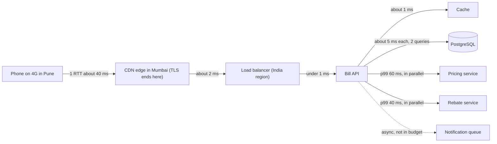
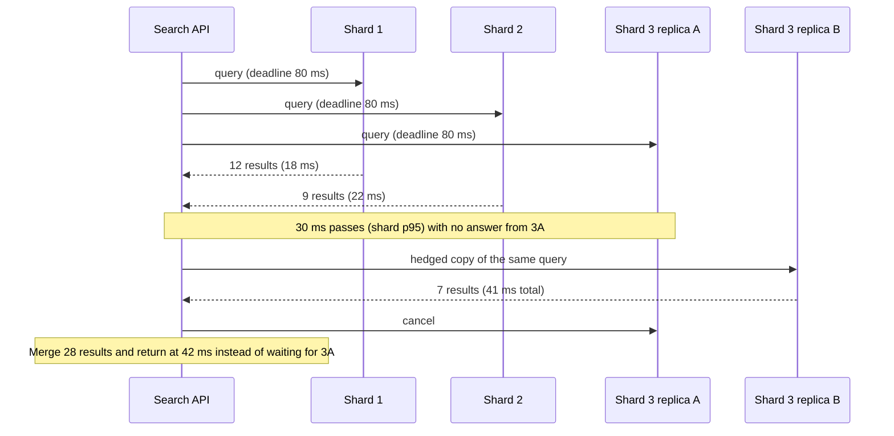

Every design decision about caching, data placement, regions and synchronous calls is really a decision about time. You cannot make those decisions well without a feel for how long things take: is reading from memory 10 times faster than from SSD, or 1,000 times? Is a call to another region 2 ms or 200 ms? This lesson gives you the order-of-magnitude numbers, shows how to split a latency target into a budget across a request path, and explains why the slowest 1 % of requests (the tail) dominates large systems.

## Learning objectives

By the end of this lesson you will be able to:

1. Recall the order of magnitude of memory, SSD, disk, network and cross-region latencies, and where those numbers come from.
2. Calculate the minimum round-trip time between two places from their distance and the speed of light in fibre.
3. Split an end-to-end latency target into a budget for each step of a request path, and check a design against it.
4. Explain tail latency and calculate how fan-out amplifies it.
5. Describe and implement mitigations: parallel calls, caching, deadlines, hedged requests and partial results.
6. Explain why latency rises sharply as utilisation approaches 100 %.

## Prerequisites

- [Non-functional requirements](#/lesson/m11-nfrs): percentiles (p50, p99) and latency targets.
- [Capacity estimation](#/lesson/m11-capacity-estimation): orders of magnitude and quick arithmetic.
- Helpful: [Timeouts, retries and backoff](#/lesson/m10-timeouts-retries).

## Explain it like I'm a beginner

Imagine you are cooking and need an ingredient.

- If it is **on the counter in front of you**, you grab it in a second. That is the CPU cache.
- If it is **in the fridge across the kitchen**, it takes 10 seconds. That is main memory (RAM).
- If it is **in the storeroom downstairs**, maybe 10 minutes. That is a fast SSD.
- If you have to **drive to a shop in the same town**, an hour or more. That is a call to another server in the same data centre.
- If it has to be **shipped from another country**, days or weeks. That is a call across continents.

Each step is not "a bit slower"; it is *many times* slower. Good cooks keep what they use most on the counter. Good system designers keep what they read most in memory (a cache), keep data close to users (a nearby region or CDN), and avoid making a user wait for an ingredient from another country.

There is a second lesson in the kitchen. If a dish needs **ten ingredients from ten different shops** and you cannot cook until all ten arrive, the dish is as late as the *slowest* delivery. Even if each shop is usually quick, one of the ten is often late. That is the tail-latency problem, and it gets worse the more things you wait for.

## First-principles explanation

### The numbers, as orders of magnitude

The table below combines the widely cited lists from Jeff Dean's talks (LADIS 2009, "numbers everyone should know") and Peter Norvig's timing table, with rough present-day ranges. Hardware changes; the **ratios** between rows change much less. Treat every number as an order-of-magnitude guide and measure your own environment before relying on one.

| Operation | Classic figure (Dean / Norvig) | Rough modern range (estimate) | Human-scale analogy if 1 ns = 1 s |
|---|---|---|---|
| L1 cache reference | 0.5 ns | ~1 ns | 1 second |
| Branch mispredict | 5 ns | a few ns | 5 seconds |
| L2 cache reference | 7 ns | ~3–10 ns | 7 seconds |
| Mutex lock/unlock (uncontended) | 25 ns | ~10–50 ns | 25 seconds |
| Main memory reference | 100 ns | ~70–120 ns | 2 minutes |
| Compress 1 KB with a fast compressor | 3–10 µs | a few µs | ~1–3 hours |
| Send 1 KB over a 1 Gbit/s link (serialisation only) | 10 µs | 8 µs (8,000 bits ÷ 10⁹ bit/s) | ~2–3 hours |
| Random 4 KB read from SSD | 150 µs | ~20–100 µs (NVMe) | ~1–2 days |
| Read 1 MB sequentially from memory | 250 µs | ~50–100 µs | ~1 day |
| Round trip within one data centre | 500 µs | ~0.1–0.5 ms (same zone) | ~1–6 days |
| Read 1 MB sequentially from SSD | 1 ms | ~0.2–1 ms (NVMe) | ~3–12 days |
| Hard-disk seek | 10 ms | 5–10 ms | ~4 months |
| Read 1 MB sequentially from hard disk | 20 ms | ~5–20 ms | ~2–8 months |
| Packet California → Netherlands → California | 150 ms | ~150 ms (bounded by physics) | ~5 years |

Five rules of thumb follow from the table:

1. **Memory is about 100× faster than SSD, and SSD is about 100× faster than spinning disk** for random access.
2. **A network round trip inside a data centre (~0.5 ms) costs about as much as thousands of memory reads.** Avoid chatty protocols: ten sequential calls to a cache cost more than one batched call.
3. **Sequential beats random.** Reading 1 MB sequentially from SSD costs roughly the same as a handful of random 4 KB reads.
4. **Distance is physics.** Cross-continent round trips do not get faster with better hardware.
5. **Bandwidth and latency are different.** A fat pipe moves many bytes per second, but the first byte still takes the round-trip time to arrive.

### Distance and the speed of light

Light in optical fibre travels at about two-thirds of its speed in vacuum: roughly **200,000 km/s**, or **5 µs per km** one way. A round trip covers the distance twice:

```text
minimum RTT ≈ 2 × distance ÷ 200,000 km/s = distance (km) ÷ 100,000 s ≈ 1 ms per 100 km
```

Straight-line (great-circle) distances give a floor; real fibre routes are longer and routers add delay, so measured round trips are commonly 1.5–2× the floor (an estimate; measure with `ping` or your cloud provider's latency tests).

| Route | Approx. great-circle distance | Physical minimum RTT | Typical real RTT (estimate) |
|---|---|---|---|
| Within one availability zone | < 1 km | ~0.01 ms | 0.1–0.5 ms (switching, stacks) |
| Between zones in one region | 10–100 km | 0.1–1 ms | ~0.5–2 ms |
| Delhi ↔ Mumbai | ~1,150 km | ~11.5 ms | ~20–35 ms |
| Mumbai ↔ Singapore | ~3,900 km | ~39 ms | ~55–80 ms |
| Mumbai ↔ London | ~7,200 km | ~72 ms | ~110–150 ms |
| Mumbai ↔ US East coast | ~12,800 km | ~128 ms | ~190–250 ms |

Two consequences matter in design:

- **Serve users from a nearby region.** A Mumbai user talking to a US-East API pays about 200 ms per round trip before your code runs. A page that needs four sequential API calls spends most of a second on physics.
- **Connection set-up multiplies RTTs.** A new HTTPS connection needs a TCP handshake (1 RTT) plus a TLS 1.3 handshake (1 RTT; TLS 1.2 needs 2) before the first request (1 RTT). That is 3 RTTs, about 600 ms to US-East from Mumbai. Keep connections alive, use HTTP/2 or HTTP/3 (QUIC combines transport and TLS set-up, and supports 0-RTT resumption), and terminate TLS close to users at a CDN edge. See [HTTP fundamentals](#/lesson/m10-http-fundamentals).

Mobile networks add their own delay: a 4G round trip from a phone to the nearest internet exchange is commonly tens of milliseconds and much worse on congested or weak signals (an estimate; it varies widely by network and location).

### What users perceive

Usability research summarised by the Nielsen Norman Group gives three limits that have held for decades:

- **About 0.1 s:** feels instantaneous.
- **About 1 s:** the user notices the delay but keeps their flow of thought.
- **About 10 s:** the limit for keeping attention; beyond it users switch tasks or leave.

These limits turn into end-to-end targets: a search-as-you-type suggestion must feel instant (under ~100 ms end to end), a page should be usable in about a second, and anything longer needs a progress indicator or an asynchronous design ("we will notify you").

### Latency budgets

A **latency budget** splits an end-to-end target into allowances for each step, the way a household budget splits a salary. If the target is "payment page usable within 1 s at p99 on 4G in India", the budget might be:

| Step | Budget (p99) | Notes |
|---|---|---|
| DNS (usually cached) | 0–20 ms | TTLs and resolver caching |
| Connection set-up | 60–120 ms | 4G RTT × 2 for TCP + TLS 1.3, avoided on reused connections |
| Request to the edge and back (network) | 60 ms | One RTT to a nearby CDN or region |
| Edge → API (same region) | 2 ms | |
| API work: auth, validation | 5 ms | Local JWT validation, no network call |
| Cache read | 2 ms | |
| Database: 2 indexed queries | 15 ms | Including pool wait |
| Downstream pricing service | 60 ms | Its own p99, measured |
| Serialisation and response | 5 ms | |
| Browser render of critical content | 200 ms | Small bundle, server-rendered first view |
| **Margin** | ~450 ms | For variance, retries and growth |

Three practical rules:

1. **Budget at the percentile you promise.** Use each component's measured p99, not its average.
2. **Adding p99s is a heuristic, not exact maths.** If a request passes through *n* independent steps and each step is within its p99 budget 99 % of the time, the chance that *some* step exceeds its budget is at most *n* % (a union bound). So the sum of the parts' p99s is at least the p(100 − *n*) of the whole: a reasonable conservative estimate for a few serial steps, and a warning that long serial chains need extra margin.
3. **Sequential calls add; parallel calls take the slowest.** Making two independent 60 ms calls in parallel costs about 60 ms (at the median), not 120 ms. But the *tail* of "wait for both" is worse than the tail of either, as the next section shows.

### Tail latency and fan-out amplification

Many requests fan out: a search queries 20 index shards, a dashboard calls 8 services, a feed loads posts from 50 friends. The response is ready only when **all** parts have answered. If each part is slow (beyond its own p99) 1 % of the time, independently:

```text
P(at least one of N parts is slow) = 1 − 0.99^N

N = 1     →  1 %
N = 10    →  1 − 0.904 = 9.6 %
N = 50    →  1 − 0.605 = 39.5 %
N = 100   →  1 − 0.366 = 63.4 %
```

With 100 parts, **almost two-thirds of user requests are as slow as a single server's p99.** This is the central observation of Dean and Barroso's *The Tail at Scale*: in large fan-out systems, rare slowness on individual machines becomes common slowness for users. It also means the service-level p99 you must achieve for each part is far stricter than the user-level target. To keep fewer than 1 % of 100-way fan-out requests slow, each part must be slow less than about 0.01 % of the time (its p99.99).

Where tail latency comes from: garbage-collection pauses, background jobs (compaction, vacuum, backups), noisy neighbours on shared hardware, lock contention, a cache miss that falls through to disk, network retransmits, and queueing when a server is briefly overloaded.

### Mitigations

| Technique | Idea | Cost |
|---|---|---|
| **Reduce fan-out** | Fewer, larger shards; precomputed aggregates; caches that answer without asking every shard | Less parallelism, more memory |
| **Parallelise independent calls** | `Task.WhenAll` instead of awaiting in sequence | More concurrent load on dependencies |
| **Cache** | Serve hot reads from memory | Staleness, invalidation |
| **Deadlines and timeouts** | Each call gets the time remaining in the budget, not a fixed 30 s | Some requests fail fast instead of finishing slowly |
| **Partial results** | Return what arrived before the deadline ("results from 19 of 20 shards") | Slightly incomplete answers |
| **Hedged requests** | If a call has not answered by about its p95, send a second copy to another replica and take whichever answers first | A few percent more load |
| **Tied requests / cancellation** | Send to two replicas, and the first to start work tells the other to cancel | More complex protocol |
| **Keep utilisation sane** | Run below about 70 % so queues stay short | More servers |

The Tail at Scale paper reports one measured example from a Bigtable benchmark: hedging a read after a 10 ms delay cut the 99.9th-percentile latency for fetching 1,000 keys from 100 servers from 1,800 ms to 74 ms while sending only 2 % more requests. Your numbers will differ, but the shape (a large tail improvement for a small load increase) is typical when the slowness is caused by transient per-server hiccups. Hedging does **not** help when every replica is slow for the same reason (overload, a slow query plan), and it must only be used for idempotent operations such as reads.

### Utilisation and queueing: why "90 % busy" means "slow"

When requests arrive randomly, a server's response time grows sharply as it approaches full utilisation. For the simplest queueing model (M/M/1: random arrivals, one server, random service times), mean time in the system is:

```text
response time = service time ÷ (1 − utilisation)

utilisation 50 %  →  2 × service time
utilisation 80 %  →  5 × service time
utilisation 90 %  → 10 × service time
utilisation 95 %  → 20 × service time
```

Real servers have many cores and are not exactly M/M/1, but the curve's shape is universal: latency stays flat until utilisation is high, then shoots up. That is why capacity plans target 60–70 % utilisation and why latency targets must be stated at a load. A related law, **Little's law** (`items in system = arrival rate × time in system`), turns latency into concurrency: at 2,000 RPS and 50 ms per request, 2,000 × 0.05 = 100 requests are in flight on average, which sizes thread pools and database connection pools.

### When a simpler design is enough

If users are in one country, the app is in a nearby region, each request makes two or three indexed queries and there is no fan-out, the latency budget is usually met without caches or hedging. Spend effort on the obvious costs first: the region, connection reuse, N+1 queries and missing indexes. Hedging and tail-tolerance techniques are for fan-out systems and strict p99 targets, not for a CRUD app with 50 RPS.

## Visual explanation

### A request path with its latency budget



The phone connects to a **CDN edge in Mumbai**, so the expensive round trips for TCP and TLS set-up happen over a short distance and the connection is reused for later requests. The edge forwards to the **load balancer and API in an Indian region**, a couple of milliseconds away. Inside the region, the API reads the bill from the **cache** (about a millisecond) and, on a miss, makes **two indexed queries** to PostgreSQL. It calls the **pricing** and **rebate** services **in parallel**, so the slower of the two (pricing, 60 ms at p99) sets that stage's cost rather than their sum. The **notification** is put on a queue asynchronously and is deliberately outside the budget: the user does not wait for an SMS to be sent. Every arrow on the critical path has a number, and their sum plus margin is the end-to-end target.

### Fan-out with a deadline and a hedged request



The search API sends the query to all three shards at once, each with a **deadline** derived from the remaining budget. Shards 1 and 2 answer quickly. Replica A of shard 3 is having a hiccup (perhaps a garbage-collection pause). When 30 ms pass without an answer, roughly that shard's p95, the API sends a **hedged copy** of the same read to replica B, which answers at 41 ms. The API cancels the request to replica A, merges the results and responds at 42 ms. Without hedging the user would have waited for replica A's slow answer, or for the 80 ms deadline. Because hedges are sent only for the slowest ~5 % of calls, the extra load is about 5 %.

## Step-by-step example

**Scenario.** A national highway authority's public "project status" page shows a map and progress for each road project. Users are mostly in India. The page currently takes about 2.5 s at p99. The target is **p99 under 800 ms** for the first useful view on a 4G phone.

### Step 1 — Measure the current path

The trace of one slow request (numbers from the team's tracing, rounded):

| Step | p99 |
|---|---|
| New TLS connection to API in a US-East region (3 RTTs × ~220 ms) | 660 ms |
| API: fetch project list from PostgreSQL (missing index, sequential scan) | 400 ms |
| API: call progress service, then contractor service, then document service, sequentially (3 × ~150 ms) | 450 ms |
| API: render map tiles server-side | 600 ms |
| Response transfer (1.8 MB JSON) on 4G | 350 ms |
| **Total** | **≈ 2,460 ms** |

### Step 2 — Fix physics first

Move the API to an Indian region and terminate TLS at a CDN edge in India. Connection set-up drops from about 660 ms to about 3 × 40 ms = 120 ms for a new connection, and close to one RTT (40 ms) for a reused one. **Saved: ~540 ms.**

### Step 3 — Fix the obvious server-side costs

Add the missing index: the query falls from 400 ms to about 5 ms. Call the three services **in parallel**: the stage now costs the slowest (about 150 ms) instead of 450 ms. **Saved: ~700 ms.**

### Step 4 — Move work off the critical path

Map tiles do not change per request: serve them as static tiles from the CDN (pre-rendered nightly). The page shows the project list first and loads the map progressively. **Saved: ~600 ms** from the critical path.

### Step 5 — Shrink the payload

Return only the fields the first view needs (about 120 KB compressed instead of 1.8 MB), paginate the rest. Transfer time falls from about 350 ms to about 40 ms. **Saved: ~310 ms.**

### Step 6 — Check against the budget

| Step | New p99 |
|---|---|
| Connection (new) | 120 ms |
| Edge → API | 5 ms |
| Database | 5 ms |
| Three services in parallel | 150 ms |
| Response transfer | 40 ms |
| Browser render of list view | 200 ms |
| **Total** | **≈ 520 ms** |

That leaves about 280 ms of margin under the 800 ms target. The remaining risk is the parallel stage: its p99 is the worst of three services, so the team adds a 200 ms deadline per call and shows a "documents loading" placeholder if the document service misses it (a partial result).

## Production-style C# implementation

Three building blocks implement the ideas in ASP.NET Core: a **request deadline** that flows through the request so every downstream call knows how much time is left, a **hedged-call helper** for idempotent reads, and a **fan-out endpoint** that queries shards in parallel and returns partial results at the deadline. Shards are faked in memory so the project compiles offline.

```text
Latency.Demo/
  Program.cs
  Latency/RequestDeadline.cs
  Latency/DeadlineMiddleware.cs
  Latency/Hedging.cs
  Latency/FanOutMath.cs
  Search/IShardClient.cs
  Search/FakeShardClient.cs
  Search/SearchService.cs
```

```csharp file=Latency/RequestDeadline.cs
namespace Latency.Demo.Latency;

/// <summary>Per-request deadline. Scoped: one instance per HTTP request.</summary>
public sealed class RequestDeadline(TimeProvider clock)
{
    private DateTimeOffset _expiresAt = DateTimeOffset.MaxValue;

    public void Set(TimeSpan budget) => _expiresAt = clock.GetUtcNow() + budget;

    public TimeSpan Remaining
    {
        get
        {
            if (_expiresAt == DateTimeOffset.MaxValue) return Timeout.InfiniteTimeSpan;
            var left = _expiresAt - clock.GetUtcNow();
            return left > TimeSpan.Zero ? left : TimeSpan.Zero;
        }
    }

    /// <summary>A token that cancels at min(step budget, time remaining for the whole request).</summary>
    public CancellationTokenSource ForStep(TimeSpan stepBudget, CancellationToken requestAborted)
    {
        var cts = CancellationTokenSource.CreateLinkedTokenSource(requestAborted);
        var remaining = Remaining;
        var limit = remaining == Timeout.InfiniteTimeSpan || stepBudget < remaining ? stepBudget : remaining;
        cts.CancelAfter(limit);
        return cts;
    }
}
```

```csharp file=Latency/DeadlineMiddleware.cs
using System.Globalization;

namespace Latency.Demo.Latency;

/// <summary>Reads an upstream deadline from the X-Deadline-Ms header (time remaining in the
/// caller's budget) or applies a default, so the whole call tree shares one budget.</summary>
public sealed class DeadlineMiddleware(RequestDelegate next)
{
    private static readonly TimeSpan Default = TimeSpan.FromMilliseconds(300);

    public async Task InvokeAsync(HttpContext context, RequestDeadline deadline)
    {
        var budget = Default;
        if (context.Request.Headers.TryGetValue("X-Deadline-Ms", out var raw)
            && double.TryParse(raw.ToString(), NumberStyles.Float, CultureInfo.InvariantCulture, out var ms) && ms > 0)
        {
            budget = TimeSpan.FromMilliseconds(Math.Min(ms, Default.TotalMilliseconds * 10));
        }
        deadline.Set(budget);
        await next(context);
    }
}
```

```csharp file=Latency/Hedging.cs
namespace Latency.Demo.Latency;

public static class Hedging
{
    /// <summary>Runs an idempotent read. If it has not completed after <paramref name="hedgeAfter"/>,
    /// starts a second attempt and returns whichever succeeds first, cancelling the other.</summary>
    public static async Task<T> HedgedAsync<T>(
        Func<int, CancellationToken, Task<T>> attempt, TimeSpan hedgeAfter, TimeProvider clock, CancellationToken ct)
    {
        using var primaryCts = CancellationTokenSource.CreateLinkedTokenSource(ct);
        using var hedgeCts = CancellationTokenSource.CreateLinkedTokenSource(ct);

        var primary = attempt(0, primaryCts.Token);
        var delay = Task.Delay(hedgeAfter, clock, ct);
        if (await Task.WhenAny(primary, delay) == primary && primary.IsCompletedSuccessfully)
            return await primary;

        var hedge = attempt(1, hedgeCts.Token);
        var pending = new List<Task<T>> { primary, hedge };
        Exception? last = null;
        while (pending.Count > 0)
        {
            var done = await Task.WhenAny(pending);
            pending.Remove(done);
            if (done.IsCompletedSuccessfully)
            {
                (done == primary ? hedgeCts : primaryCts).Cancel();
                return await done;
            }
            last = done.Exception?.InnerException ?? new OperationCanceledException();
        }
        throw last!;
    }
}
```

```csharp file=Latency/FanOutMath.cs
namespace Latency.Demo.Latency;

public static class FanOutMath
{
    /// <summary>Probability that a request waiting for all <paramref name="parts"/> sees at least one
    /// part slower than that part's percentile threshold. <paramref name="slowShare"/> is 0.01 for p99.</summary>
    public static double ProbabilityAnySlow(double slowShare, int parts) =>
        1.0 - Math.Pow(1.0 - slowShare, parts);

    /// <summary>M/M/1 mean response time: service time ÷ (1 − utilisation).</summary>
    public static TimeSpan QueueingResponseTime(TimeSpan service, double utilisation) =>
        utilisation is >= 0 and < 1
            ? TimeSpan.FromTicks((long)(service.Ticks / (1 - utilisation)))
            : throw new ArgumentOutOfRangeException(nameof(utilisation));
}
```

```csharp file=Search/IShardClient.cs
namespace Latency.Demo.Search;

public sealed record SearchHit(string ProjectId, string Title, double Score);

public interface IShardClient
{
    int ShardCount { get; }

    /// <summary>Queries one replica of one shard. Reads are idempotent, so hedging is safe.</summary>
    Task<IReadOnlyList<SearchHit>> QueryAsync(int shard, int replica, string text, CancellationToken ct);
}
```

```csharp file=Search/FakeShardClient.cs
namespace Latency.Demo.Search;

/// <summary>Simulates shards with mostly fast answers and an occasional slow one (a GC pause or
/// noisy neighbour) so hedging and deadlines have something to do. Not for production.</summary>
public sealed class FakeShardClient(TimeProvider clock) : IShardClient
{
    public int ShardCount => 8;

    public async Task<IReadOnlyList<SearchHit>> QueryAsync(int shard, int replica, string text, CancellationToken ct)
    {
        int ms = Random.Shared.NextDouble() < 0.02 ? 250 : 5 + Random.Shared.Next(15);
        await Task.Delay(TimeSpan.FromMilliseconds(ms), clock, ct);
        return [new SearchHit($"NH-{shard}{replica}{text.Length}", $"Project on shard {shard} matching '{text}'", 1.0 / (shard + 1))];
    }
}
```

```csharp file=Search/SearchService.cs
using Latency.Demo.Latency;

namespace Latency.Demo.Search;

public sealed record SearchResponse(IReadOnlyList<SearchHit> Hits, int ShardsAnswered, int ShardsTotal, bool Partial);

public sealed class SearchService(IShardClient shards, RequestDeadline deadline, TimeProvider clock)
{
    private static readonly TimeSpan HedgeAfter = TimeSpan.FromMilliseconds(30);   // about the shard p95
    private static readonly TimeSpan ShardBudget = TimeSpan.FromMilliseconds(120);

    public async Task<SearchResponse> SearchAsync(string text, CancellationToken requestAborted)
    {
        using var cts = deadline.ForStep(ShardBudget, requestAborted);

        var calls = Enumerable.Range(0, shards.ShardCount)
            .Select(shard => Hedging.HedgedAsync(
                (replica, ct) => shards.QueryAsync(shard, replica, text, ct), HedgeAfter, clock, cts.Token))
            .ToList();

        try { await Task.WhenAll(calls); }
        catch { /* individual failures and deadline cancellations are handled below */ }

        var answered = calls.Where(c => c.IsCompletedSuccessfully).ToList();
        var hits = answered.SelectMany(c => c.Result).OrderByDescending(h => h.Score).Take(20).ToList();
        return new SearchResponse(hits, answered.Count, calls.Count, Partial: answered.Count < calls.Count);
    }
}
```

```csharp file=Program.cs
using Latency.Demo.Latency;
using Latency.Demo.Search;

var builder = WebApplication.CreateBuilder(args);
builder.Services.AddSingleton(TimeProvider.System);
builder.Services.AddScoped<RequestDeadline>();
builder.Services.AddSingleton<IShardClient, FakeShardClient>();
builder.Services.AddScoped<SearchService>();

var app = builder.Build();
app.UseMiddleware<DeadlineMiddleware>();

// GET /search?q=bridge  (optionally send X-Deadline-Ms: 150 from an upstream caller)
app.MapGet("/search", async (string q, SearchService search, HttpContext http) =>
{
    var result = await search.SearchAsync(q, http.RequestAborted);
    if (result.Partial) http.Response.Headers["X-Partial-Results"] = $"{result.ShardsAnswered}/{result.ShardsTotal}";
    return Results.Ok(result);
});

// A quick way to show fan-out amplification in a design review: GET /fanout?parts=100
app.MapGet("/fanout", (int parts) => new
{
    parts,
    probabilityAnyPartBeyondP99 = Math.Round(FanOutMath.ProbabilityAnySlow(0.01, parts), 3),
});

app.Run();
```

Design points to defend:

1. **One budget for the whole call tree.** `DeadlineMiddleware` accepts the caller's remaining budget, and `RequestDeadline.ForStep` never gives a step more time than the request has left. Without this, each layer applies its own fixed timeout and a deep call chain can take far longer than the user's target.
2. **Hedging only for idempotent reads.** The shard query has no side effects, so a duplicate is harmless. Never hedge a payment or an insert without idempotency keys.
3. **Hedge at about the p95, not immediately.** Hedging every call doubles load; hedging the slowest ~5 % adds ~5 % load and removes most of the tail.
4. **Partial results are explicit.** The response says how many shards answered and sets `X-Partial-Results`, so clients and dashboards can see degraded answers instead of silently receiving fewer results.
5. **`TimeProvider` everywhere.** `Task.Delay(TimeSpan, TimeProvider, CancellationToken)` lets tests control time instead of sleeping.

## Bad design vs good design

**Bad: the chatty, distant, sequential page.** The API is in another continent "because that is where the cloud account was created". The page makes six sequential API calls. Each service sets its own 30-second timeout. A single slow shard holds every search hostage until the timeout. Averages on the dashboard look fine, so nobody notices that p99 is 4 seconds.

**Good:**

- The API runs in a region near its users, and TLS ends at a nearby edge.
- The client makes one call for the first view; the server fans out in parallel.
- A latency budget exists per step, measured at p99, with a margin.
- Deadlines propagate; each downstream call gets the time remaining, not a fixed long timeout.
- Fan-out calls are hedged at about their p95 and can return partial results.
- Servers run below about 70 % utilisation at peak so queues stay short.

:::callout type=mistake title="Retrying is not hedging"
A retry waits for a failure or timeout, then tries again: it adds latency. A hedge starts a second attempt *while the first is still running* and takes whichever finishes first: it removes latency. Retries with long timeouts make tail latency worse; hedges with short delays make it better, at the cost of a little extra load.
:::

:::callout type=tradeoff title="Lower latency usually costs money or freshness"
Every big latency win has a price: more regions (cost, data-consistency work), caches (staleness), hedging (extra load), lower utilisation (more servers), precomputation (storage and pipeline complexity). Decide with the latency target and the cost of missing it, not with "faster is always better".
:::

## Practical playground

The cache simulator below models an API that reads from a cache with 1 ms latency and falls back to a database with 20 ms latency. Start with a hit ratio of 0.8, then try 0.5 and 0.95, and watch both latency and database load. Then switch on the cache outage: note how the database line crosses its capacity and latency jumps, which is a queueing effect from the utilisation section. Write down the hit ratio you would need to meet a p99 budget of 15 ms for this step.

:::playground type=sim sim=cache title="Cache hit ratio versus latency" hitRatio=0.8 rps=1000 dbCapacityRps=600 dbLatencyMs=20 cacheLatencyMs=1 ttlSeconds=60
Adjust the hit ratio and trigger a cache outage. Compare request latency and database load with the database capacity line.
:::

## Exercises

:::exercise id=m11-latency-numbers-ex1 difficulty=beginner kind=code title="Fan-out arithmetic"
Implement the formulas that explain why fan-out makes tails common.
::requirements
- `FanOut.ProbabilityAllFast(double fastProbability, int parts)` returns `fastProbability^parts`.
- `FanOut.ProbabilityAnySlow(double fastProbability, int parts)` returns `1 − fastProbability^parts`.
- `FanOut.MaxParts(double fastProbability, double targetAllFast)` returns the largest `n ≥ 1` such that `fastProbability^n ≥ targetAllFast`, or 0 if even one part misses the target.
- `FanOut.RequiredPartFastProbability(int parts, double targetAllFast)` returns the per-part probability needed: `targetAllFast^(1/parts)`.
- Probabilities outside `(0, 1]` and `parts < 1` throw `ArgumentOutOfRangeException`.
::acceptance
- `ProbabilityAnySlow(0.99, 100)` ≈ 0.634.
- `ProbabilityAllFast(0.99, 10)` ≈ 0.904.
- `MaxParts(0.99, 0.9)` = 10.
- `RequiredPartFastProbability(100, 0.99)` ≈ 0.9999.
::hint
"All fast" means every independent part is fast: multiply the probabilities.
::hint
For `MaxParts`, take logarithms: `n ≤ ln(target) ÷ ln(p)`. Watch the division by zero when `p = 1`.
::hint
Floating-point can make `0.99^10` a hair below the exact value. Compare with a tiny tolerance or compute `n` with `Math.Floor` and then check `n + 1`.
::hint
```csharp
if (p == 1) return int.MaxValue;
int n = (int)Math.Floor(Math.Log(target) / Math.Log(p) + 1e-12);
```
::starter
```csharp file=FanOut.cs
using System;

public static class FanOut
{
    public static double ProbabilityAllFast(double fastProbability, int parts) => throw new NotImplementedException();

    public static double ProbabilityAnySlow(double fastProbability, int parts) => throw new NotImplementedException();

    public static int MaxParts(double fastProbability, double targetAllFast) => throw new NotImplementedException();

    public static double RequiredPartFastProbability(int parts, double targetAllFast) => throw new NotImplementedException();
}
```
::tests
```csharp file=FanOutTests.cs
using System;
using Xunit;

public class FanOutTests
{
    [Fact] public void Hundred_way_fan_out() => Assert.Equal(0.634, FanOut.ProbabilityAnySlow(0.99, 100), 3);
    [Fact] public void Ten_way_all_fast() => Assert.Equal(0.904, FanOut.ProbabilityAllFast(0.99, 10), 3);
    [Fact] public void Single_part() => Assert.Equal(0.01, FanOut.ProbabilityAnySlow(0.99, 1), 10);
    [Fact] public void Max_parts_for_90_percent() => Assert.Equal(10, FanOut.MaxParts(0.99, 0.9));
    [Fact] public void Max_parts_zero_when_one_part_misses() => Assert.Equal(0, FanOut.MaxParts(0.9, 0.95));
    [Fact] public void Required_per_part() => Assert.Equal(0.9999, FanOut.RequiredPartFastProbability(100, 0.99), 4);

    [Fact]
    public void Invalid_inputs_throw()
    {
        Assert.Throws<ArgumentOutOfRangeException>(() => FanOut.ProbabilityAllFast(1.5, 3));
        Assert.Throws<ArgumentOutOfRangeException>(() => FanOut.ProbabilityAllFast(0.99, 0));
        Assert.Throws<ArgumentOutOfRangeException>(() => FanOut.MaxParts(0, 0.9));
        Assert.Throws<ArgumentOutOfRangeException>(() => FanOut.RequiredPartFastProbability(10, 0));
    }
}
```
::solution
```csharp file=FanOut.cs
using System;

public static class FanOut
{
    public static double ProbabilityAllFast(double fastProbability, int parts)
    {
        CheckP(fastProbability, nameof(fastProbability));
        if (parts < 1) throw new ArgumentOutOfRangeException(nameof(parts));
        return Math.Pow(fastProbability, parts);
    }

    public static double ProbabilityAnySlow(double fastProbability, int parts) => 1.0 - ProbabilityAllFast(fastProbability, parts);

    public static int MaxParts(double fastProbability, double targetAllFast)
    {
        CheckP(fastProbability, nameof(fastProbability));
        CheckP(targetAllFast, nameof(targetAllFast));
        if (fastProbability == 1.0) return int.MaxValue;
        if (fastProbability < targetAllFast) return 0;
        int n = (int)Math.Floor(Math.Log(targetAllFast) / Math.Log(fastProbability) + 1e-12);
        return Math.Max(n, 1);
    }

    public static double RequiredPartFastProbability(int parts, double targetAllFast)
    {
        if (parts < 1) throw new ArgumentOutOfRangeException(nameof(parts));
        CheckP(targetAllFast, nameof(targetAllFast));
        return Math.Pow(targetAllFast, 1.0 / parts);
    }

    private static void CheckP(double p, string name)
    {
        if (p is <= 0 or > 1) throw new ArgumentOutOfRangeException(name, p, "Probability must be in (0, 1].");
    }
}
```

The last function is the sobering one: to keep 99 % of 100-way fan-out requests fully fast, each part must be fast 99.99 % of the time. A per-shard p99 target is not enough; you need a p99.99 target for each shard, or hedging and partial results.
::mistakes
- Using `0.01 × 100 = 100 %` (adding probabilities) instead of `1 − 0.99^100`.
- Integer division in `1 / parts`, which gives 0 and returns 1 for every input.
- Floating-point rounding that makes `MaxParts(0.99, 0.9)` return 9 or 11.
:::

:::exercise id=m11-latency-numbers-ex2 difficulty=beginner kind=written title="Orders of magnitude and the speed of light"
Answer with arithmetic:

1. Put these in order from fastest to slowest and give the order of magnitude of each: SSD random 4 KB read, main-memory reference, round trip between two zones in one region, Mumbai ↔ London round trip, L1 cache reference, hard-disk seek.
2. What is the physical minimum round-trip time from Delhi to Chennai (about 1,760 km), and roughly what would you expect to measure?
3. A user in Kolkata calls an API in a US-East region (about 12,800 km). The page needs a new HTTPS connection (TLS 1.3) and then 4 sequential API calls. Estimate the network time alone, using 1.7× the physical minimum.
4. The same page with the API in an Indian region 1,500 km away and connections reused: estimate again.
::acceptance
- Correct ordering with orders of magnitude in ns, µs and ms.
- Uses 1 ms of RTT per 100 km of distance for the minimum.
- Counts round trips for TCP, TLS and each request.
- States the saving and what it implies for region choice.
::hint
Use the table: ~1 ns, ~100 ns, tens of µs, ~1 ms, ~10 ms, ~100+ ms.
::hint
Minimum RTT ≈ distance (km) ÷ 100 in ms.
::hint
New connection: TCP 1 RTT + TLS 1.3 1 RTT. Then each sequential call is 1 RTT.
::hint
Kolkata–US East: 12,800 ÷ 100 = 128 ms minimum; × 1.7 ≈ 218 ms per round trip.
::solution
1. L1 cache (~1 ns) < main memory (~100 ns) < SSD random 4 KB read (~20–150 µs) < inter-zone round trip (~0.5–2 ms) < hard-disk seek (~5–10 ms) < Mumbai ↔ London (~110–150 ms).
2. 1,760 km ÷ 100 = **17.6 ms** minimum; expect roughly 1.5–2×, so **about 26–35 ms** measured.
3. Per round trip: 128 ms × 1.7 ≈ 218 ms. Round trips: TCP 1 + TLS 1 + 4 calls = 6. Network time ≈ 6 × 218 ≈ **1,300 ms**, before any server work.
4. Per round trip: 1,500 ÷ 100 = 15 ms × 1.7 ≈ 25 ms. With reused connections only the 4 calls count: 4 × 25 = **100 ms**. Even a new connection adds only 50 ms.

The saving is about 1.2 seconds from geography alone, more than any code optimisation could deliver. Hosting near users (and reducing sequential calls to one) comes before caching or tuning.
::mistakes
- Forgetting the TCP and TLS round trips for a new connection.
- Using one-way latency where a round trip is needed.
- Treating the physical minimum as the expected measurement.
:::

:::exercise id=m11-latency-numbers-ex3 difficulty=intermediate kind=code title="Critical-path latency of a request plan"
A request plan is a tree: some steps run one after another, some groups run in parallel. Write a model that computes the estimated p99 of the critical path and checks it against a budget.
::requirements
- `IStep` with `string Name` and `double EstimateMs()`.
- `Step(name, p99Ms)` is a leaf; negative values throw `ArgumentOutOfRangeException`.
- `Sequence(name, params IStep[] steps)`: estimate is the **sum** of children.
- `Parallel(name, params IStep[] steps)`: estimate is the **maximum** of children (a deliberately optimistic estimate; see the solution note).
- Empty groups throw `ArgumentException`.
- `LatencyBudget.Check(IStep plan, double budgetMs)` returns `BudgetResult(double EstimateMs, double MarginMs, bool Fits, string SlowestLeaf)` where `SlowestLeaf` is the name of the leaf with the largest p99 anywhere in the tree (first one on ties, depth-first in declaration order).
::acceptance
- A sequence of 5, 15 and a parallel group of 60 and 40 estimates 80 ms.
- Against a 100 ms budget the margin is 20 ms and it fits.
- The slowest leaf is the 60 ms step.
- Empty groups throw.
::hint
This is the Composite pattern: every node answers `EstimateMs()`, groups combine their children.
::hint
For the slowest leaf, walk the tree. Add an internal method that yields leaves in order.
::hint
`steps.Sum(s => s.EstimateMs())` and `steps.Max(s => s.EstimateMs())`.
::hint
Give `IStep` a method `IEnumerable<Step> Leaves()` and implement it in each type; `Step` yields itself.
::starter
```csharp file=CriticalPath.cs
using System;
using System.Collections.Generic;
using System.Linq;

public interface IStep
{
    string Name { get; }
    double EstimateMs();
    IEnumerable<Step> Leaves();
}

public sealed class Step(string name, double p99Ms) : IStep
{
    public string Name => name;
    public double EstimateMs() => throw new NotImplementedException();
    public IEnumerable<Step> Leaves() => throw new NotImplementedException();
}

public sealed class Sequence(string name, params IStep[] steps) : IStep
{
    public string Name => name;
    public double EstimateMs() => throw new NotImplementedException();
    public IEnumerable<Step> Leaves() => throw new NotImplementedException();
}

public sealed class Parallel(string name, params IStep[] steps) : IStep
{
    public string Name => name;
    public double EstimateMs() => throw new NotImplementedException();
    public IEnumerable<Step> Leaves() => throw new NotImplementedException();
}

public sealed record BudgetResult(double EstimateMs, double MarginMs, bool Fits, string SlowestLeaf);

public static class LatencyBudget
{
    public static BudgetResult Check(IStep plan, double budgetMs) => throw new NotImplementedException();
}
```
::tests
```csharp file=CriticalPathTests.cs
using System;
using Xunit;

public class CriticalPathTests
{
    private static IStep Plan() => new Sequence("request",
        new Step("auth", 5),
        new Step("db", 15),
        new Parallel("downstream", new Step("pricing", 60), new Step("rebate", 40)));

    [Fact]
    public void Sequence_adds_parallel_takes_max() => Assert.Equal(80, Plan().EstimateMs(), 6);

    [Fact]
    public void Budget_check()
    {
        var r = LatencyBudget.Check(Plan(), 100);
        Assert.Equal(80, r.EstimateMs, 6);
        Assert.Equal(20, r.MarginMs, 6);
        Assert.True(r.Fits);
        Assert.Equal("pricing", r.SlowestLeaf);
    }

    [Fact]
    public void Over_budget_has_negative_margin()
    {
        var r = LatencyBudget.Check(Plan(), 50);
        Assert.False(r.Fits);
        Assert.Equal(-30, r.MarginMs, 6);
    }

    [Fact]
    public void Nested_groups()
    {
        var plan = new Parallel("p", new Sequence("s", new Step("a", 10), new Step("b", 30)), new Step("c", 35));
        Assert.Equal(40, plan.EstimateMs(), 6);
        Assert.Equal("c", LatencyBudget.Check(plan, 100).SlowestLeaf);
    }

    [Fact]
    public void Invalid_inputs_throw()
    {
        Assert.Throws<ArgumentException>(() => new Sequence("empty").EstimateMs());
        Assert.Throws<ArgumentException>(() => new Parallel("empty").EstimateMs());
        Assert.Throws<ArgumentOutOfRangeException>(() => new Step("bad", -1).EstimateMs());
    }
}
```
::solution
```csharp file=CriticalPath.cs
using System;
using System.Collections.Generic;
using System.Linq;

public interface IStep
{
    string Name { get; }
    double EstimateMs();
    IEnumerable<Step> Leaves();
}

public sealed class Step(string name, double p99Ms) : IStep
{
    public string Name => name;

    public double EstimateMs() =>
        p99Ms >= 0 ? p99Ms : throw new ArgumentOutOfRangeException(nameof(p99Ms), p99Ms, "Latency cannot be negative.");

    public IEnumerable<Step> Leaves() { yield return this; }
}

public sealed class Sequence(string name, params IStep[] steps) : IStep
{
    public string Name => name;

    public double EstimateMs() => NonEmpty().Sum(s => s.EstimateMs());

    public IEnumerable<Step> Leaves() => NonEmpty().SelectMany(s => s.Leaves());

    private IStep[] NonEmpty() => steps.Length > 0 ? steps : throw new ArgumentException($"Sequence '{name}' is empty.");
}

public sealed class Parallel(string name, params IStep[] steps) : IStep
{
    public string Name => name;

    public double EstimateMs() => NonEmpty().Max(s => s.EstimateMs());

    public IEnumerable<Step> Leaves() => NonEmpty().SelectMany(s => s.Leaves());

    private IStep[] NonEmpty() => steps.Length > 0 ? steps : throw new ArgumentException($"Parallel group '{name}' is empty.");
}

public sealed record BudgetResult(double EstimateMs, double MarginMs, bool Fits, string SlowestLeaf);

public static class LatencyBudget
{
    public static BudgetResult Check(IStep plan, double budgetMs)
    {
        ArgumentNullException.ThrowIfNull(plan);
        double estimate = plan.EstimateMs();
        var slowest = plan.Leaves().Aggregate((best, next) => next.EstimateMs() > best.EstimateMs() ? next : best);
        return new BudgetResult(estimate, budgetMs - estimate, estimate <= budgetMs, slowest.Name);
    }
}
```

**Why "max" is optimistic for parallel groups.** If pricing and rebate each exceed their own p99 1 % of the time independently, "wait for both" exceeds 60 ms more often than 1 % of the time: up to about 2 %. For two children the error is small; for a 50-way fan-out it is large (see exercise 1). A more honest model gives each parallel group an extra allowance, or uses each child's p99.9 when the group is wide.
::alternatives
Run a Monte Carlo simulation instead: sample each leaf from its measured latency distribution (or a histogram), compute the tree's latency per sample, and read off the p99. It captures fan-out amplification exactly, at the cost of needing distributions rather than single numbers.
::mistakes
- Summing parallel steps, which overstates the cost and hides the benefit of `Task.WhenAll`.
- Reporting the slowest *top-level* child instead of the slowest leaf, so "downstream" is named instead of "pricing".
- Forgetting that `Max` on an empty sequence throws `InvalidOperationException`, not the `ArgumentException` the contract requires.
:::

:::exercise id=m11-latency-numbers-ex4 difficulty=intermediate kind=hld title="Bring the project-status page under 800 ms"
The starter graph is the highway project-status page from the step-by-step example: users in India, API in a US-East region, three services called sequentially, server-rendered map tiles and a PostgreSQL database without the right index. Redesign it to meet p99 < 800 ms for the first useful view on 4G, and annotate each edge with its budget.
::acceptance
- The API and data are in an Indian region, with TLS terminated at a nearby edge.
- The three downstream calls run in parallel with per-call deadlines.
- Map tiles are served from a CDN, not rendered per request.
- The solution includes a budget table that sums to under 800 ms with margin.
- At least one failure or slowness case returns a partial result instead of waiting.
::hint
Start with the biggest number in the measured trace. What is it caused by?
::hint
Region and edge placement fix connection set-up; parallelism fixes the sequential calls.
::hint
What on this page is the same for every user? Can it be precomputed?
::hint
Add `cdn`, set `region` on nodes, put `latencyMs` on edges or nodes, and make the three services fan out from the API.
::starter
```json
{
  "nodes": [
    { "id": "u", "type": "client", "label": "Citizens on 4G (India)", "props": { "rps": 150 } },
    { "id": "lb", "type": "load-balancer", "label": "Load balancer", "props": { "region": "US East" } },
    { "id": "api", "type": "app-server", "label": "Status API (renders map tiles)", "props": { "instances": 2, "region": "US East" } },
    { "id": "db", "type": "database", "label": "PostgreSQL (no index on project_state)", "props": { "region": "US East" } },
    { "id": "prog", "type": "app-server", "label": "Progress service", "props": { "latencyMs": 150 } },
    { "id": "con", "type": "app-server", "label": "Contractor service", "props": { "latencyMs": 150 } },
    { "id": "doc", "type": "app-server", "label": "Document service", "props": { "latencyMs": 150 } }
  ],
  "edges": [
    { "from": "u", "to": "lb", "kind": "sync", "label": "new TLS each visit" },
    { "from": "lb", "to": "api", "kind": "sync" },
    { "from": "api", "to": "db", "kind": "sync", "label": "seq scan 400 ms" },
    { "from": "api", "to": "prog", "kind": "sync", "label": "1st" },
    { "from": "prog", "to": "con", "kind": "sync", "label": "2nd (chained)" },
    { "from": "con", "to": "doc", "kind": "sync", "label": "3rd (chained)" }
  ]
}
```
::solution
```json
{
  "nodes": [
    { "id": "u", "type": "client", "label": "Citizens on 4G (India)", "props": { "rps": 150 } },
    { "id": "dns", "type": "dns", "label": "DNS (geo-routed)" },
    { "id": "cdn", "type": "cdn", "label": "CDN edge in India: TLS, static map tiles, JS", "props": { "region": "India" } },
    { "id": "lb", "type": "load-balancer", "label": "Load balancer", "props": { "region": "India Central", "multiAz": true } },
    { "id": "api", "type": "app-server", "label": "Status API (deadline 300 ms)", "props": { "instances": 2, "region": "India Central", "multiAz": true } },
    { "id": "cache", "type": "cache", "label": "Project summary cache", "props": { "ttlSeconds": 300, "latencyMs": 1 } },
    { "id": "db", "type": "database", "label": "PostgreSQL (index on project_state)", "props": { "region": "India Central", "latencyMs": 5 } },
    { "id": "prog", "type": "app-server", "label": "Progress service", "props": { "latencyMs": 150, "region": "India Central" } },
    { "id": "con", "type": "app-server", "label": "Contractor service", "props": { "latencyMs": 150, "region": "India Central" } },
    { "id": "doc", "type": "app-server", "label": "Document service", "props": { "latencyMs": 150, "region": "India Central" } },
    { "id": "tiles", "type": "object-storage", "label": "Pre-rendered map tiles (nightly job)" },
    { "id": "job", "type": "scheduler", "label": "Nightly tile render" }
  ],
  "edges": [
    { "from": "u", "to": "dns", "kind": "sync" },
    { "from": "u", "to": "cdn", "kind": "sync", "label": "~40 ms RTT, reused connection" },
    { "from": "cdn", "to": "tiles", "kind": "sync", "label": "tiles on miss only" },
    { "from": "cdn", "to": "lb", "kind": "sync", "label": "~5 ms" },
    { "from": "lb", "to": "api", "kind": "sync" },
    { "from": "api", "to": "cache", "kind": "sync", "label": "1 ms" },
    { "from": "api", "to": "db", "kind": "sync", "label": "5 ms indexed" },
    { "from": "api", "to": "prog", "kind": "sync", "label": "parallel, deadline 200 ms" },
    { "from": "api", "to": "con", "kind": "sync", "label": "parallel, deadline 200 ms" },
    { "from": "api", "to": "doc", "kind": "sync", "label": "parallel, deadline 200 ms, partial OK" },
    { "from": "job", "to": "tiles", "kind": "async", "label": "render and upload" }
  ]
}
```

**Budget (p99, first useful view).**

| Step | Budget |
|---|---|
| New connection to the India edge (TCP + TLS 1.3, 2 × 40 ms) | 80 ms |
| Request/response RTT to the edge | 40 ms |
| Edge → API | 5 ms |
| Cache or indexed DB | 5 ms |
| Three services in parallel (slowest, capped by 200 ms deadline) | 150 ms |
| Response transfer (~120 KB compressed) | 40 ms |
| Browser render of list view | 200 ms |
| **Total** | **520 ms** (≈ 280 ms margin) |

**Slowness handling.** If the document service misses its 200 ms deadline, the API returns the page without document links and a "documents loading" flag; the client fetches them separately. Map tiles load progressively from the CDN after the list view and are outside the first-view budget. Hedging is not used here: the fan-out is only three calls, and the deadline plus partial result is simpler.
::mistakes
- Keeping the US-East region and adding a cache: the 3-RTT connection cost (~650 ms) remains.
- Parallelising the calls but keeping fixed 30-second timeouts, so one slow service still holds the page.
- Counting map-tile loading inside the first-view budget instead of loading progressively.
:::

:::exercise id=m11-latency-numbers-ex5 difficulty=advanced kind=code title="A deterministic hedged-request helper"
Implement hedging so it can be tested without real time. The hedge trigger is passed in as a function, so tests decide exactly when "the hedge delay" elapses.
::requirements
- `Hedger.RunAsync<T>(Func<int, CancellationToken, Task<T>> attempt, Func<CancellationToken, Task> hedgeDelay, CancellationToken ct)` returns `HedgeResult<T>(T Value, int Winner, int AttemptsStarted)`.
- Start attempt 0 immediately. If it succeeds before `hedgeDelay` completes, return it (`AttemptsStarted = 1`).
- If `hedgeDelay` completes first, start attempt 1. Return whichever attempt succeeds first and **cancel the other attempt's token**.
- If attempt 0 fails before the hedge delay, start attempt 1 immediately (do not wait for the delay).
- If every started attempt fails, throw an `AggregateException` whose inner exceptions are the failures in attempt order (attempt 0 first), so the result does not depend on which failure happened to be observed first.
- If `ct` is cancelled, throw `OperationCanceledException`.
::acceptance
- Fast primary: winner 0, one attempt started.
- Slow primary, fast hedge: winner 1, two attempts, primary's token cancelled.
- Hedge started but primary finishes first: winner 0, hedge's token cancelled.
- Primary fails early: hedge starts at once and wins.
- Both fail: an `AggregateException` with both failures, attempt 0 first.
::hint
Use one `CancellationTokenSource` per attempt, each linked to `ct`.
::hint
`await Task.WhenAny(primary, delayTask)` tells you which happened first. A failed primary is "completed" too: check `IsCompletedSuccessfully`.
::hint
After starting the hedge, loop: `WhenAny` over the still-pending attempts, return the first success, and store each failure in an array indexed by attempt number.
::hint
To cancel the loser: `(winner == primary ? hedgeCts : primaryCts).Cancel();`.
::hint
```csharp
var first = await Task.WhenAny(primary, delay);
if (first == primary && primary.IsCompletedSuccessfully) return new(primary.Result, 0, 1);
// otherwise: start hedge (now), then race the pending attempts
```
::starter
```csharp file=Hedger.cs
using System;
using System.Collections.Generic;
using System.Threading;
using System.Threading.Tasks;

public sealed record HedgeResult<T>(T Value, int Winner, int AttemptsStarted);

public static class Hedger
{
    public static Task<HedgeResult<T>> RunAsync<T>(
        Func<int, CancellationToken, Task<T>> attempt,
        Func<CancellationToken, Task> hedgeDelay,
        CancellationToken ct) => throw new NotImplementedException();
}
```
::tests
```csharp file=HedgerTests.cs
using System;
using System.Collections.Generic;
using System.Threading;
using System.Threading.Tasks;
using Xunit;

public class HedgerTests
{
    private sealed class Script
    {
        public readonly List<TaskCompletionSource<string>> Attempts = new();
        public readonly List<CancellationToken> Tokens = new();
        public readonly TaskCompletionSource Delay = new(TaskCreationOptions.RunContinuationsAsynchronously);

        public Task<string> Attempt(int i, CancellationToken ct)
        {
            var tcs = new TaskCompletionSource<string>(TaskCreationOptions.RunContinuationsAsynchronously);
            Attempts.Add(tcs);
            Tokens.Add(ct);
            return tcs.Task;
        }

        public Task HedgeDelay(CancellationToken ct) => Delay.Task;
    }

    [Fact]
    public async Task Fast_primary_wins_alone()
    {
        var s = new Script();
        var run = Hedger.RunAsync<string>(s.Attempt, s.HedgeDelay, CancellationToken.None);
        s.Attempts[0].SetResult("primary");
        var r = await run;
        Assert.Equal(new HedgeResult<string>("primary", 0, 1), r);
    }

    [Fact]
    public async Task Slow_primary_loses_to_hedge_and_is_cancelled()
    {
        var s = new Script();
        var run = Hedger.RunAsync<string>(s.Attempt, s.HedgeDelay, CancellationToken.None);
        s.Delay.SetResult();
        await WaitFor(() => s.Attempts.Count == 2);
        s.Attempts[1].SetResult("hedge");
        var r = await run;
        Assert.Equal(new HedgeResult<string>("hedge", 1, 2), r);
        Assert.True(s.Tokens[0].IsCancellationRequested);
    }

    [Fact]
    public async Task Primary_can_still_win_after_hedge_started()
    {
        var s = new Script();
        var run = Hedger.RunAsync<string>(s.Attempt, s.HedgeDelay, CancellationToken.None);
        s.Delay.SetResult();
        await WaitFor(() => s.Attempts.Count == 2);
        s.Attempts[0].SetResult("primary");
        var r = await run;
        Assert.Equal(new HedgeResult<string>("primary", 0, 2), r);
        Assert.True(s.Tokens[1].IsCancellationRequested);
    }

    [Fact]
    public async Task Early_primary_failure_starts_hedge_immediately()
    {
        var s = new Script();
        var run = Hedger.RunAsync<string>(s.Attempt, s.HedgeDelay, CancellationToken.None);
        s.Attempts[0].SetException(new TimeoutException("replica A"));
        await WaitFor(() => s.Attempts.Count == 2);
        s.Attempts[1].SetResult("hedge");
        var r = await run;
        Assert.Equal(1, r.Winner);
        Assert.False(s.Delay.Task.IsCompleted);
    }

    [Fact]
    public async Task Both_fail_reports_every_failure_in_attempt_order()
    {
        var s = new Script();
        var run = Hedger.RunAsync<string>(s.Attempt, s.HedgeDelay, CancellationToken.None);
        s.Delay.SetResult();
        await WaitFor(() => s.Attempts.Count == 2);
        s.Attempts[1].SetException(new TimeoutException("B"));
        s.Attempts[0].SetException(new InvalidOperationException("A"));
        var ex = await Assert.ThrowsAsync<AggregateException>(() => run);
        Assert.Equal(2, ex.InnerExceptions.Count);
        Assert.IsType<InvalidOperationException>(ex.InnerExceptions[0]);
        Assert.IsType<TimeoutException>(ex.InnerExceptions[1]);
    }

    private static async Task WaitFor(Func<bool> condition)
    {
        for (int i = 0; i < 200 && !condition(); i++) await Task.Delay(5);
        Assert.True(condition(), "condition not reached");
    }
}
```
::solution
```csharp file=Hedger.cs
using System;
using System.Collections.Generic;
using System.Threading;
using System.Threading.Tasks;

public sealed record HedgeResult<T>(T Value, int Winner, int AttemptsStarted);

public static class Hedger
{
    public static async Task<HedgeResult<T>> RunAsync<T>(
        Func<int, CancellationToken, Task<T>> attempt,
        Func<CancellationToken, Task> hedgeDelay,
        CancellationToken ct)
    {
        ArgumentNullException.ThrowIfNull(attempt);
        ArgumentNullException.ThrowIfNull(hedgeDelay);
        ct.ThrowIfCancellationRequested();

        using var primaryCts = CancellationTokenSource.CreateLinkedTokenSource(ct);
        using var hedgeCts = CancellationTokenSource.CreateLinkedTokenSource(ct);

        Task<T> primary = attempt(0, primaryCts.Token);
        Task delay = hedgeDelay(ct);

        Task first = await Task.WhenAny(primary, delay).ConfigureAwait(false);
        if (first == primary && primary.IsCompletedSuccessfully)
            return new HedgeResult<T>(primary.Result, 0, 1);
        ct.ThrowIfCancellationRequested();

        // Either the hedge delay elapsed, or the primary failed early: start the hedge now.
        Task<T> hedge = attempt(1, hedgeCts.Token);
        var pending = new List<Task<T>> { hedge };
        var errors = new Exception?[2];
        if (primary.IsCompleted) errors[0] = Unwrap(primary);
        else pending.Add(primary);

        while (pending.Count > 0)
        {
            Task<T> done = await Task.WhenAny(pending).ConfigureAwait(false);
            pending.Remove(done);
            int index = done == primary ? 0 : 1;
            if (done.IsCompletedSuccessfully)
            {
                (index == 0 ? hedgeCts : primaryCts).Cancel();
                return new HedgeResult<T>(done.Result, index, 2);
            }
            errors[index] = Unwrap(done);
        }

        ct.ThrowIfCancellationRequested();
        throw new AggregateException("Every hedged attempt failed.", errors!);
    }

    private static Exception Unwrap(Task t) =>
        t.Exception?.InnerException ?? new OperationCanceledException("Attempt was cancelled.");
}
```

The helper never waits for a failed primary's hedge delay, never returns a failure while another attempt might still succeed, reports failures in attempt order (the order in which two near-simultaneous failures are *observed* is a race, so it must not decide the result), and always cancels the loser so it stops consuming resources on the replica. Because the delay is injected, production code passes `ct => Task.Delay(p95, timeProvider, ct)` and tests pass a `TaskCompletionSource` they control, so the tests are deterministic and fast.
::alternatives
- .NET resilience libraries (Polly v8 and `Microsoft.Extensions.Http.Resilience`) provide a hedging strategy with configurable delay and maximum attempts; prefer them in production `HttpClient` pipelines, and keep a hand-rolled helper like this for non-HTTP calls or for teaching.
- Tied requests (send to both replicas at once with cross-cancellation when one starts executing) reduce the hedge delay to zero at the cost of a more complex protocol between client and server.
::mistakes
- Hedging non-idempotent operations such as payments, which can execute twice.
- Forgetting to cancel the losing attempt, so every hedge doubles the work on replicas.
- Waiting for the hedge delay even after the primary has already failed, adding latency for no reason.
- Returning the first *completed* task, which may be a failure while the other attempt is about to succeed.
::extensions
Add a hedging budget: allow hedges only while hedged attempts are below 5 % of all attempts in the last minute, so a system-wide slowdown cannot double the load.
:::

## Automated testing

**1. Unit-test the latency logic with controlled time.** Deadlines, hedges and timeouts are timing logic, and timing tests that sleep are slow and flaky. Inject `TimeProvider` (or, as in exercise 5, the delay itself) and drive time from the test. `RequestDeadline.ForStep` should be tested for "never longer than the remaining request budget" and "never longer than the step budget".

```csharp
[Fact]
public void Step_budget_is_capped_by_remaining_request_time()
{
    var clock = new ManualClock();                    // a TimeProvider whose GetUtcNow() the test controls
    var deadline = new RequestDeadline(clock);
    deadline.Set(TimeSpan.FromMilliseconds(100));
    clock.Advance(TimeSpan.FromMilliseconds(70));
    Assert.Equal(TimeSpan.FromMilliseconds(30), deadline.Remaining);
}
```

**2. Assert percentiles, not averages, in performance tests.** Load tests (k6, JMeter, Azure Load Testing) should fail the build when p99 for a route exceeds its budget at the stated RPS.

**3. Trace the critical path.** Distributed tracing with OpenTelemetry (see [Logs, metrics, traces and OpenTelemetry](#/lesson/m14-observability)) shows each span's duration, so you can compare real per-step p99s with the budget table and spot sequential calls that should be parallel.

**4. Inject latency.** In staging, add artificial delay to one dependency (a fault-injection proxy or a fake client) and check that deadlines fire, partial results appear and the page still meets its budget. This is the latency equivalent of failure injection.

**5. Test from real places.** Synthetic probes from cities your users are in (Mumbai, Delhi, Chennai, Kolkata, Guwahati) measure what physics and networks actually give you, which no data-centre test can.

## Real-world application

- **Search engines and large web services** fan out each query to many index servers; *The Tail at Scale* describes the hedging, tied requests and micro-partitioning techniques used to keep their tails short.
- **Payment and UPI flows** keep the synchronous path short (debit and confirm) with strict per-hop timeouts, because a payment that hangs is worse than one that fails fast and can be retried with an idempotency key.
- **Indian government portals** serving citizens across the country benefit most from hosting in Indian regions and using CDN edges inside India; the speed-of-light arithmetic shows why a distant region costs hundreds of milliseconds per round trip.
- **Infrastructure dashboards** (highway progress, BIM viewers, drone survey maps) usually have heavy static assets; moving tiles and models to a CDN and loading them progressively matters more than API micro-optimisations.
- **Database connection pooling** is sized with Little's law: concurrent requests = arrival rate × time in system, which explains why slow queries exhaust pools during peaks.

## Interview questions

:::interview
::q beginner
Roughly how much slower is an SSD read than a memory read, and a cross-continent round trip than a same-data-centre one?
::a
A main-memory reference is on the order of 100 ns; a random 4 KB SSD read is tens to about 150 µs, so roughly 100–1,000× slower. A round trip within a data centre is about 0.5 ms; a cross-continent round trip is about 150 ms, around 300× slower and bounded by the speed of light in fibre (about 1 ms of round trip per 100 km). These ratios are why we cache hot data in memory and serve users from nearby regions.
::q beginner
What is a latency budget?
::a
It is the end-to-end latency target split into allowances for each step of the request path: network, connection set-up, edge, API logic, cache, database, downstream calls, rendering, plus a margin. Each allowance is a p99 that the owning team measures. It turns "make it fast" into concrete limits and shows where the time goes, for example that 650 ms of a 2.5 s page was TLS handshakes to a distant region.
::q intermediate
Why does fan-out make tail latency worse, and by how much?
::a
A request that waits for all N parts is as slow as its slowest part. If each part is slower than its p99 1 % of the time, independently, the chance at least one is slow is 1 − 0.99^N: about 10 % for N = 10 and 63 % for N = 100. So the user-level p99 is much worse than any single server's p99, and each part needs a far stricter target (around p99.99 for 100 parts) or mitigation: hedging, partial results, smaller fan-out.
::q intermediate
How do deadlines differ from fixed timeouts, and why propagate them?
::a
A fixed timeout gives each call its own limit, say 30 s, regardless of how much time the user's request has left. A deadline is the absolute time by which the whole request must finish; each layer passes the remaining time downstream and each call gets min(step budget, remaining). That stops deep call chains from exceeding the user target, lets servers abandon work nobody is waiting for, and makes partial results possible. gRPC has deadlines built in; over HTTP you pass a header and use linked cancellation tokens.
::q advanced
When do hedged requests help, and when do they hurt?
::a
They help when slowness is transient and per-replica: GC pauses, background compaction, noisy neighbours. Sending a second copy after about the p95 delay to another replica removes most of the tail for a few percent of extra load; The Tail at Scale reports a large p99.9 improvement for about 2 % more requests in one benchmark. They hurt when slowness is systemic (overload, a bad query plan affecting all replicas), because hedges add load exactly when the system is struggling, and they are unsafe for non-idempotent operations. Mitigate with a hedging budget, cancellation of the loser, and only hedging reads or idempotent calls.
::q advanced
Your API's p99 jumps from 80 ms to 900 ms when traffic grows from 60 % to 90 % of capacity, with no code change. Explain and fix.
::a
That is queueing. Response time grows roughly as service time ÷ (1 − utilisation): at 60 % it is 2.5× service time, at 90 % it is 10×, and the tail grows faster than the mean. Requests wait in queues (thread pool, connection pool, database) rather than being slow to process. Fixes: add capacity or autoscale earlier to keep utilisation under ~70 %, reduce service time (indexes, caching), bound queues and shed load with 503s or rate limits so waiting does not grow without limit, and size pools with Little's law. I would confirm with metrics: rising queue length and pool wait time alongside flat per-request CPU time.
:::

## Summary and revision

**Key takeaways**

- Know the ladder: cache ~1 ns, memory ~100 ns, SSD ~10–150 µs, same-DC round trip ~0.5 ms, disk seek ~10 ms, cross-continent ~150 ms. Ratios matter more than exact values; measure your own.
- Light in fibre: about 1 ms of round trip per 100 km. Real routes are 1.5–2× the minimum. Connection set-up costs several RTTs.
- Users feel ~0.1 s as instant, ~1 s as a noticeable but acceptable delay, ~10 s as the attention limit.
- Latency budgets split a p99 target across steps, with margin. Sequential steps add; parallel steps take the slowest, but widen the tail.
- Fan-out amplifies tails: 1 − 0.99^N. At N = 100, 63 % of requests hit a p99-slow part.
- Mitigate with locality, fewer sequential calls, caching, deadlines, partial results, hedging (idempotent reads only) and lower utilisation.
- Latency explodes near full utilisation: service time ÷ (1 − utilisation).

**Terminology**: latency, bandwidth, round-trip time (RTT), propagation delay, serialisation delay, p99, tail latency, fan-out, latency budget, critical path, deadline propagation, partial results, hedged request, tied request, utilisation, queueing, Little's law.

:::flashcards
Q: Order of magnitude: main memory reference vs SSD random read?
A: About 100 ns vs tens to ~150 µs: roughly 100–1,000× slower.
Q: Round trip within one data centre (classic figure)?
A: About 0.5 ms.
Q: Minimum round-trip time per 100 km of fibre?
A: About 1 ms (light travels ~200,000 km/s in fibre, ~5 µs per km one way).
Q: Round trips for a new HTTPS connection with TLS 1.3 before the first response?
A: About 3: TCP handshake, TLS handshake, then the request itself.
Q: Probability that a 100-way fan-out request hits at least one p99-slow part?
A: 1 − 0.99^100 ≈ 63 %.
Q: What is a hedged request?
A: After about the p95 delay, send a duplicate of an idempotent request to another replica and use whichever answers first, cancelling the other.
Q: M/M/1 response time at 90 % utilisation?
A: About 10× the service time (service ÷ (1 − 0.9)).
Q: Little's law?
A: Items in the system = arrival rate × time in system. 2,000 RPS × 50 ms = 100 concurrent requests.
Q: Nielsen's three response-time limits?
A: ~0.1 s feels instant, ~1 s keeps flow of thought, ~10 s is the limit of attention.
:::

## Knowledge check

:::quiz pass=70
::q single
Users in Chennai call an API hosted in a US-East region (about 14,000 km away). Which change will most reduce their latency?
- [ ] Add a Redis cache in US-East.
- [x] Serve them from an Indian region (or at least terminate TLS at an Indian CDN edge and reuse connections).
- [ ] Double the API instance count.
- [ ] Switch from JSON to a binary format.
> At about 1 ms per 100 km, the round trip alone is over 140 ms minimum, multiplied by several round trips per page. Physics dominates; only moving closer fixes it.
::q single
A dashboard calls 8 services one after another, each with a p99 of 50 ms. What is the most effective first change?
- [ ] Increase each service's timeout to 30 s.
- [x] Call independent services in parallel so the stage costs about the slowest call instead of the sum.
- [ ] Add retries to every call.
- [ ] Log every call's latency to a file.
> Sequential calls add (up to ~400 ms); parallel calls take roughly the slowest, though the tail widens slightly.
::q single
A search fans out to 50 shards. Each shard is slower than 100 ms 1 % of the time, independently. Roughly what share of searches wait more than 100 ms for at least one shard?
- [ ] 1 %
- [ ] 5 %
- [x] About 40 %
- [ ] 100 %
> 1 − 0.99^50 ≈ 0.395.
::q multi
Which are good uses of hedged requests? (Select all that apply.)
- [x] Reading a document from one of three replicas.
- [x] Querying a search shard replica.
- [ ] Charging a customer's card.
- [ ] Every request, immediately, to two replicas, to be safe.
> Hedge idempotent reads, after a delay near the p95. Non-idempotent writes can execute twice, and hedging everything doubles load.
::q single
An API's service time is 20 ms. At 95 % utilisation, roughly what mean response time does the simple queueing model predict?
- [ ] 21 ms
- [ ] 40 ms
- [x] 400 ms
- [ ] 2 s
> 20 ms ÷ (1 − 0.95) = 400 ms. Latency explodes near full utilisation.
::q single
Each step of a 4-step serial request is within its own p99 budget 99 % of the time. What does adding the four p99s tell you?
- [ ] It is exactly the p99 of the whole request.
- [x] Requests exceed the summed budget at most about 4 % of the time (by a union bound), so it is roughly a p96 or better.
- [ ] It is always far above the real p99, so it can be ignored.
- [ ] Nothing; percentiles cannot be combined.
> The sum of p99s is a practical budgeting heuristic. Each step can break its budget 1 % of the time, so up to n % of requests may break the total.
::q single
A page's API is in an Indian region, but every page view opens a new HTTPS connection over 4G (RTT about 50 ms). Which change saves the most?
- [ ] Faster JSON serialisation.
- [x] Reusing connections (keep-alive, HTTP/2 or HTTP/3) so most requests skip the TCP and TLS round trips.
- [ ] A larger database instance.
- [ ] Moving logs to a separate disk.
> A new connection costs about two extra round trips (about 100 ms here) before the request even starts.
:::

## Completion criteria

You have finished this lesson when you can:

- [ ] Score at least 70 % on the knowledge check.
- [ ] Write the latency ladder (cache, memory, SSD, data-centre RTT, disk, cross-continent) from memory with orders of magnitude.
- [ ] Estimate the minimum RTT between any two cities from their distance.
- [ ] Complete exercises 1, 3 and 5 with all tests passing.
- [ ] Complete exercise 4 in the HLD canvas with a budget table that sums correctly.
- [ ] Explain fan-out amplification and one mitigation in under two minutes.
