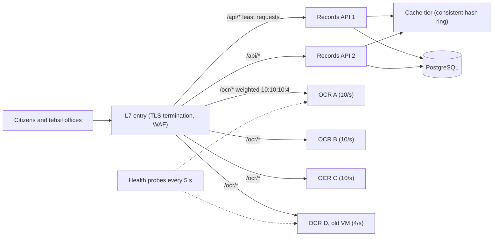
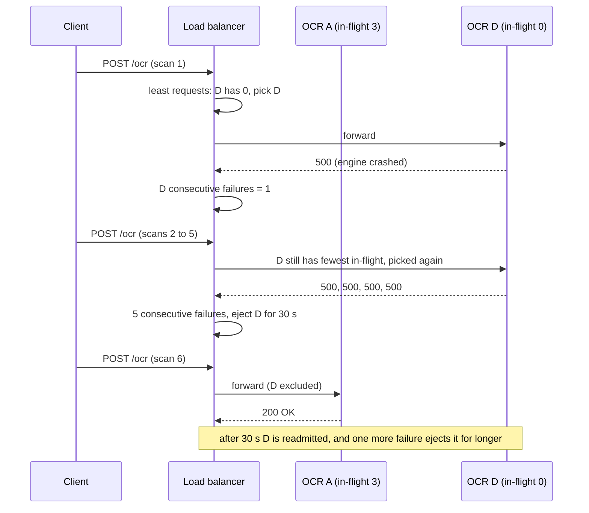

Once a service runs on more than one instance, something must decide which instance gets each request. That decision looks trivial ("take turns") until the servers are different sizes, the requests are different sizes, one server is quietly sick, or the clients hold connections open for an hour. This lesson walks through the algorithms load balancers actually use, where each one fails, and how to implement them in C#.

## Learning objectives

By the end of this lesson you will be able to:

1. Explain what a load balancer does at layer 4 (TCP/UDP) and layer 7 (HTTP), and choose between them.
2. Describe round robin, weighted round robin, least connections, least response time, IP hash, consistent hashing and power of two choices, with a failure case for each.
3. Calculate when a simple algorithm overloads a slower server, using utilisation arithmetic.
4. Design active and passive health checks, with thresholds that balance detection speed against flapping.
5. Implement round robin, smooth weighted round robin, least requests, a latency-aware policy, power of two choices and a consistent hash ring in C#.
6. Explain why long-lived connections (HTTP/2, gRPC, WebSockets) break connection-level balancing and how to fix it.
7. Decide when DNS round robin or a single managed load balancer with default settings is enough.

## Prerequisites

- [Vertical versus horizontal scaling](#/lesson/m11-scaling): load balancing is what makes horizontal scaling usable.
- [Stateless versus stateful services](#/lesson/m11-stateless): most algorithms assume any instance can serve any request.
- Helpful: [API gateways, reverse proxies and load balancers](#/lesson/m10-gateways-proxies-lb) for where these components sit.

## Explain it like I'm a beginner

Think of the billing counters at a big supermarket on a Sunday evening. A staff member at the entrance points each customer to a counter. How should she choose?

- **Take turns** (round robin): counter 1, 2, 3, 4, 1, 2… Fair, simple, and fine if every customer has a similar basket and every cashier is equally fast.
- **Give the faster cashiers more people** (weighted round robin): the experienced cashier gets two customers for every one the trainee gets.
- **Send people to the shortest queue** (least connections): look at the queues and pick the one with fewest people. Better when baskets differ a lot.
- **Send people to the queue that is moving fastest** (least response time): a short queue behind someone paying with coins is slower than a longer queue that is moving.
- **Glance at just two counters and pick the shorter** (power of two choices): she cannot check all 40 counters every second, but comparing two random ones is almost as good.
- **Regular customers always go to the same counter** (hashing): useful if that cashier keeps their loyalty card details at hand, which is the idea behind sending the same user or the same key to the same server so its cache is warm.

She also watches for a **closed counter**. If a cashier's machine is broken, she must stop sending people there (health checks). And she must decide how quickly to react: one slow customer does not mean the counter is broken (thresholds).

That is load balancing: a dispatcher, a rule for choosing, and a way to notice who is unwell.

## First-principles explanation

### What a load balancer does

A load balancer accepts traffic on one address and spreads it across a pool of backends. Along the way it usually:

- **Hides the pool** behind one stable address, so instances can come and go.
- **Detects failure** with health checks and stops sending traffic to unhealthy backends.
- **Distributes work** using an algorithm, which is the main subject of this lesson.
- **Drains** backends being removed, letting in-flight requests finish (connection draining, deregistration delay).
- At layer 7, often **terminates TLS**, routes by path or header, adds headers such as `X-Forwarded-For`, and retries failed idempotent requests.

### Layer 4 versus layer 7

| | Layer 4 (transport) | Layer 7 (application) |
|---|---|---|
| Sees | IP addresses, ports, TCP/UDP | Full HTTP: method, path, headers, cookies |
| Balances | **Connections** (or UDP flows) | **Requests** |
| TLS | Passes through (or terminates, on some products) | Usually terminates, can re-encrypt |
| Routing options | By port and IP | By path (`/api`, `/ocr`), host, header, cookie |
| Cost | Very cheap per packet; millions of connections | More CPU per request (parsing, TLS) |
| Examples | Azure Load Balancer, AWS NLB, Linux IPVS, HAProxy in TCP mode | Azure Application Gateway, Azure Front Door, AWS ALB, NGINX, HAProxy HTTP mode, YARP, Envoy |
| Best for | Non-HTTP protocols, extreme throughput, TLS passthrough | Web apps and APIs, microservice routing, per-request decisions |

A common production layout uses both: a global or regional L7 entry (Front Door, Application Gateway, or an ingress controller) and L4 load balancing underneath for the ingress nodes themselves.

#### The long-lived connection trap

An L4 balancer chooses once per **connection**. HTTP/1.1 clients open several short connections, so per-connection balancing averages out. HTTP/2 and gRPC multiplex thousands of requests over **one long-lived connection**. If a client opens a single gRPC connection and an L4 balancer pins it to pod 1, every request from that client goes to pod 1 for hours. Scale out to 10 pods and the new pods get nothing until clients reconnect.

Fixes: balance at L7 (a proxy that understands HTTP/2 and spreads individual requests), use client-side load balancing (the gRPC client resolves all pod addresses and balances itself), or set a maximum connection age on the server so clients reconnect periodically. The same issue affects WebSockets and SignalR, where the connection *is* the session.

### The algorithms

We use one running example. A state revenue department's document-scanning service converts uploaded land-record scans into searchable text (OCR). It has 4 backends. Three are normal (10 documents per second each) and one is an older VM that manages only 4 per second (a speed factor of 0.4). Total capacity is `3 × 10 + 4 = 34` documents per second. Offered load is 80 % of that: **27.2 per second**.

#### 1. Round robin

Hand out requests in turn: A, B, C, D, A, B…

```text
Each backend receives 27.2 ÷ 4 = 6.8 per second.
Normal backend:  6.8 ÷ 10 = 68 % busy. Fine.
Slow backend:    6.8 ÷ 4  = 170 % busy. Its queue grows by 2.8 requests every second.
After 60 s:      about 168 requests waiting on D; a request there waits about 42 s.
```

Round robin is perfect for identical servers and similar requests, and it is stateless and cheap. It is **blind to server speed and request size**. A quarter of users get terrible latency even though the fleet as a whole has 20 % spare capacity.

#### 2. Weighted round robin

Give each backend a weight proportional to its capacity: A, B, C = 10, D = 4. Now D receives `4 ÷ 34` of traffic, 3.2 per second, and runs at 80 % like everyone else.

A naive implementation sends D's share in a burst (A×10, B×10, C×10, D×4). **Smooth weighted round robin**, the algorithm NGINX uses, interleaves picks so no backend gets a burst: with weights 5, 1, 1 it produces `a a b a c a a` rather than `a a a a a b c`.

Weights are static. They do not notice that D is also running a backup job this afternoon, or that one request is a 300-page scan and the next is a single page.

#### 3. Least connections (least outstanding requests)

Send each request to the backend with the **fewest in-flight requests**. Slow backends finish requests more slowly, so their count stays higher and they automatically receive less. It also handles mixed request sizes: a backend stuck on a 300-page scan has a higher count. This is the default choice for most HTTP APIs with uneven request cost.

Weaknesses:

- **Fast failure looks attractive.** A backend that instantly returns `500` for everything has zero in-flight requests and attracts *more* traffic (a "black hole"). Passive health checks (below) are essential.
- **Each balancer has its own view.** With 10 load balancer nodes each tracking their own counts, every node may pick the same "least loaded" backend at once (herding).
- **New instances get flooded.** A just-started backend has zero connections and receives a burst while its caches and JIT are cold. Many balancers support **slow start**: ramp a new backend's weight up over 30–60 seconds.

#### 4. Least response time (latency-aware)

Track a moving average of each backend's latency, usually an **exponentially weighted moving average (EWMA)**, and combine it with in-flight count: `score = (latency + 1) × (inFlight + 1)`, pick the lowest. A variant called **peak EWMA** (used by Linkerd and Finagle) reacts instantly to latency increases and decays slowly, so a backend that slows down is avoided quickly.

It adapts to GC pauses, noisy neighbours and slow dependencies. It is more complex and can **oscillate**: everyone avoids a slow backend, it becomes fast, everyone rushes back. Damping (the EWMA factor) and combining with in-flight count reduce this.

#### 5. Random, and power of two choices

Picking a backend **at random** needs no shared state and is surprisingly decent on average, but by chance some backends receive noticeably more than others at any moment.

**Power of two choices (P2C)**: pick *two* backends at random and send the request to the one with fewer in-flight requests. Michael Mitzenmacher's analysis shows that this small change shrinks the maximum load dramatically compared with one random choice; most of the benefit of checking everyone comes from checking just two. In practice P2C:

- Needs only local, cheap information (two counters).
- Avoids herding, because different balancer nodes pick different random pairs.
- Avoids the worst backend almost always (it would need to be picked twice, or paired with an even worse one).

That is why modern proxies use it by default: YARP's default policy is `PowerOfTwoChoices`, and Envoy's least-request policy samples two hosts by default.

#### 6. IP hash and other key-based hashing

Hash something about the request, such as the client IP, a user id, or a document id, and use it to pick the backend: `backend = hash(key) mod N`. The same key always lands on the same backend, which gives:

- **Affinity without cookies**, useful for TCP protocols.
- **Cache locality**: if backend B caches document 42's OCR result, sending every request for document 42 to B makes its cache effective.

Two problems. **Uneven keys**: many users behind one corporate or mobile-carrier NAT share an IP, so one backend gets an office's worth of traffic. **Resizing**: with `mod N`, changing N from 4 to 5 moves about 80 % of keys to a different backend (only keys where `hash mod 4 = hash mod 5` stay). Every cache goes cold at once.

#### 7. Consistent hashing

Put backends on a **ring** of hash values (0 to 2⁶⁴ − 1). Hash each key onto the same ring and walk clockwise to the first backend. When a backend is added, it takes over only the keys between it and its predecessor; when one is removed, only its keys move to the next backend. On average only `K ÷ N` keys move (one N-th), instead of nearly all of them.

With one point per backend, the arcs are uneven, so some backends get much more than others. **Virtual nodes** fix this: place each backend at 100–200 points on the ring. More points give a smoother split, at the cost of a larger lookup table (still tiny: 4 backends × 150 points = 600 entries, a binary search of about 10 steps).

**Hot keys** still break it: if one document is requested 1,000 times a second, its owner melts. **Consistent hashing with bounded loads** (Mirrokni, Thorup and Zadimoghaddam) caps each backend at `c ×` the average load (for example `c = 1.25`); when the owner is full, the request walks clockwise to the next backend with room. You keep most of the locality and lose the hot spots.

Consistent hashing is the standard for distributed caches, sharded storage and partitioned stateful services. For stateless APIs it is usually unnecessary; use least requests or P2C ([sharding and consistent hashing](#/lesson/m13-sharding)).

#### Algorithm cheat sheet

| Algorithm | Needs | Good when | Fails when |
|---|---|---|---|
| Round robin | A counter | Identical servers, similar requests | Mixed server speeds or request sizes |
| Weighted round robin | Static weights | Known capacity differences (VM sizes, canary at 5 %) | Capacity changes at runtime |
| Least connections | In-flight counts | Uneven request cost, long requests | Fast-failing backend, many independent balancers |
| Least response time / EWMA | Latency tracking | Variable backend performance | Oscillation without damping; more complex |
| Random | Nothing | Many balancers, no shared state | Short-term imbalance |
| Power of two choices | Two in-flight counts | Default for most HTTP proxies | Very small pools (2 backends: it is just least connections) |
| IP / key hash (mod N) | A hash | Fixed pool, need affinity | Pool changes (most keys move), NAT hot spots |
| Consistent hashing | A ring | Caches, shards, stateful partitions | Hot keys (use bounded loads) |

### Health checks

An algorithm is only as good as its list of healthy backends.

**Active health checks.** The balancer probes each backend, for example `GET /health/ready` every 5 seconds with a 2-second timeout. A backend is marked unhealthy after **N consecutive failures** (unhealthy threshold, say 3) and healthy again after **M consecutive successes** (healthy threshold, say 2).

```text
Detection time ≈ interval × unhealthy threshold = 5 s × 3 = 15 s
Probe traffic:   10 balancer nodes × 40 backends ÷ 5 s = 80 probes per second (cheap, but not free)
```

Lower thresholds detect failure faster but flap on brief hiccups such as a garbage-collection pause. The readiness endpoint should check what the backend needs to serve traffic, but avoid checking a shared dependency that every backend shares: if the database is down, marking all 40 backends unhealthy at once leaves nothing to serve even cached or degraded responses. Some balancers handle this with **fail-open**: if all backends are unhealthy, send traffic to all of them anyway.

**Passive health checks (outlier detection).** The balancer watches real responses. After, for example, 5 consecutive `5xx` responses or connection failures from one backend, it ejects that backend for 30 seconds, then lets it back in. Passive checks catch problems probes miss (a backend whose `/health` works but whose OCR engine crashes) and catch them within a few requests. Envoy calls this outlier detection; NGINX has `max_fails` and `fail_timeout`. Always cap the share of backends that can be ejected at once (a **maximum ejection percentage**), or a shared failure ejects everyone.

**Draining.** When a backend is being removed (scale-in, deployment), the balancer stops sending new requests but lets existing ones finish, up to a deadline (often 30–300 seconds). The backend's readiness endpoint should start failing when it receives the shutdown signal, so it leaves the pool before it stops ([health checks and graceful shutdown](#/lesson/m03-health-shutdown)).

### Retries at the load balancer

L7 balancers can retry a failed request on another backend. That improves availability for **idempotent** requests (GET, PUT with the same body, POST with an idempotency key) and is dangerous for others (a payment POST retried on another backend may charge twice). Also, retries multiply load during an outage; cap them with a retry budget ([timeouts, retries and backoff](#/lesson/m10-timeouts-retries)).

### The load balancer must not be the single point of failure

A single NGINX VM in front of 20 backends makes the whole system as available as that VM. Options:

- **Managed load balancers** (Azure Load Balancer, Application Gateway, Front Door, AWS ALB/NLB) are redundant across zones by design.
- **Self-managed pairs** use a floating IP with VRRP (keepalived) for active-passive failover, or several active nodes behind DNS or anycast with ECMP routing.
- **Client-side load balancing** removes the middle box: each client (or a sidecar proxy in a service mesh) knows the backends from service discovery and balances itself ([service discovery](#/lesson/m10-service-discovery)).

### What breaks first under load

1. **One slow backend** with a speed-blind algorithm (round robin) builds a long queue while the others idle.
2. **Long-lived connections** pinned at L4 leave new instances empty after scale-out.
3. **The balancer itself**: TLS handshakes are CPU-heavy, and connection-tracking tables have limits. At high connection rates, TLS termination capacity is often the first limit.
4. **Hot keys** under hash-based routing.
5. **Health-check storms**: many balancer nodes × many backends × short intervals, or readiness checks that query the database on every probe.

### When a simpler design is enough

- **Two or three identical instances behind a managed load balancer with default settings** (round robin or least requests) covers most business applications. Do not tune what you have not measured.
- **DNS round robin** (several A records) is acceptable for non-critical internal services, but clients cache DNS, so failover is slow and uneven ([DNS and traffic routing](#/lesson/m11-dns-routing)).
- **No load balancer at all** for a single-instance internal tool: put a reverse proxy in front only when you need TLS termination or a second instance.
- Reach for consistent hashing only when backend-local state (cache, shard) makes locality valuable.

## Visual explanation

### Architecture: L7 entry, routing and balancing



Requests from citizens and tehsil offices arrive at one **L7 entry point**, which terminates TLS and applies a web application firewall. Because it understands HTTP, it routes by path: `/api/*` goes to the **records API** pool, balanced by least outstanding requests, and `/ocr/*` goes to the **OCR pool**, where weights 10:10:10:4 reflect the old VM's lower capacity. The records API instances talk to a **cache tier** whose nodes are chosen with a **consistent hash ring**, so each document id always maps to the same cache node and adding a node moves only a fraction of keys. The dotted arrows are **active health probes**; failing backends are taken out of the pools. The database is not load balanced at all here: it is a single primary, which is typical.

### Sequence: least requests with passive ejection



This shows why least connections needs passive health checks. **OCR D** crashes internally but still answers instantly with `500`, so its in-flight count stays at zero and the **load balancer** keeps choosing it: the black-hole effect. The balancer counts consecutive failures from D; after five it **ejects** D for 30 seconds, and scan 6 goes to **OCR A**. D's active `/health` probe may have been green all along, because the web process was fine and only the OCR engine had failed. Many implementations lengthen the ejection each time a backend is ejected again, so a persistently broken backend stays out longer.

## Step-by-step example

**Scenario.** The document-scanning service from the running example currently sits behind a load balancer using round robin. Complaints: "some scans take a minute, others take 5 seconds". Peak load is 27 documents per second.

### Step 1 — Measure per backend

Per-backend dashboards show A, B and C at about 65–70 % CPU with p95 latency of 3 seconds, and D at 100 % CPU with p95 latency of 45 seconds and a growing queue. Exactly the arithmetic above: round robin sends D 6.8 documents a second, and it can do 4.

### Step 2 — Quick fix: weights

Set weights 10, 10, 10, 4. D now receives `27.2 × 4 ÷ 34 = 3.2` per second, 80 % busy. Its p95 drops to about the same as the others. This took five minutes of configuration and fixed the obvious problem.

### Step 3 — Better fix: least outstanding requests

Scans vary from 1 page to 300 pages, so even with weights a backend can be unlucky and receive three huge scans in a row. Switch the OCR pool to least outstanding requests (or P2C). Backends busy with big scans automatically receive fewer new ones. Keep the weights as a hint if the balancer supports weighted least-request.

### Step 4 — Add passive health checks

Last month a backend's OCR engine crashed while its web process stayed up. Add outlier detection: 5 consecutive `5xx` → eject 30 seconds, maximum 25 % of the pool ejected at once (1 of 4 backends).

### Step 5 — Route by path at L7

The upload API (fast, small requests) and the OCR endpoint (slow, heavy) shared one pool, so slow scans delayed fast API calls. Split them into two pools behind path-based routing at the L7 entry, each with its own algorithm and autoscaling signal.

### Step 6 — Cache OCR results by document id

Scans are often re-requested (an officer opens the same land record several times a day). Cache OCR output in a small cache tier, choosing the cache node with consistent hashing on the document id, so adding a cache node moves only about a quarter (with 4 nodes) of the cached entries instead of almost all of them.

## Production-style C# implementation

Most teams use a managed load balancer or a proxy such as YARP, NGINX or Envoy rather than writing their own. But **client-side load balancing** inside an ASP.NET Core service is common (calling a pool of internal backends from `HttpClient`), and writing the algorithms is the best way to understand them. The code below is a small library: backend state, several policies behind one interface, passive outlier detection, a consistent hash ring, active health probing, and a `DelegatingHandler` that plugs it all into `HttpClient`.

```text
Revenue.Scanning.Gateway/
  Program.cs
  LoadBalancing/Backend.cs
  LoadBalancing/Policies.cs
  LoadBalancing/ConsistentHashRing.cs
  LoadBalancing/BackendPool.cs
  LoadBalancing/LoadBalancingHandler.cs
  LoadBalancing/ActiveHealthProber.cs
```

```csharp file=LoadBalancing/Backend.cs
namespace Revenue.Scanning.LoadBalancing;

/// <summary>Live state of one backend. Counters are updated from many threads at once.</summary>
public sealed class Backend(string id, Uri address, int weight = 1)
{
    private const double Alpha = 0.2; // EWMA smoothing: 20 % weight on the newest sample
    private readonly object _latencyGate = new();
    private long _inFlight;
    private double _ewmaMs;
    private volatile bool _probeHealthy = true;

    public string Id { get; } = id;
    public Uri Address { get; } = address;
    public int Weight { get; } = weight > 0 ? weight : throw new ArgumentOutOfRangeException(nameof(weight));

    public long InFlight => Interlocked.Read(ref _inFlight);
    public bool ProbeHealthy { get => _probeHealthy; set => _probeHealthy = value; }

    public double EwmaLatencyMs
    {
        get { lock (_latencyGate) return _ewmaMs; }
    }

    public void Start() => Interlocked.Increment(ref _inFlight);

    public void Finish(TimeSpan elapsed)
    {
        Interlocked.Decrement(ref _inFlight);
        double ms = elapsed.TotalMilliseconds;
        lock (_latencyGate) _ewmaMs = _ewmaMs == 0 ? ms : Alpha * ms + (1 - Alpha) * _ewmaMs;
    }
}
```

`Backend` holds exactly the information the algorithms need: weight (static), in-flight count (for least requests and P2C), and an EWMA of latency (for least response time). The in-flight count uses `Interlocked` because hundreds of requests start and finish concurrently.

```csharp file=LoadBalancing/Policies.cs
namespace Revenue.Scanning.LoadBalancing;

/// <summary>Chooses one backend from the currently available ones.
/// <paramref name="affinityKey"/> is used only by hash-based policies.</summary>
public interface IBalancingPolicy
{
    string Name { get; }
    Backend? Pick(IReadOnlyList<Backend> available, string? affinityKey);
}

public sealed class RoundRobinPolicy : IBalancingPolicy
{
    private int _next = -1;
    public string Name => "RoundRobin";

    public Backend? Pick(IReadOnlyList<Backend> available, string? affinityKey)
    {
        if (available.Count == 0) return null;
        uint n = (uint)Interlocked.Increment(ref _next); // unsigned: wraps safely after int.MaxValue
        return available[(int)(n % (uint)available.Count)];
    }
}

/// <summary>Smooth weighted round robin (the NGINX algorithm): weights 5,1,1 give a a b a c a a.</summary>
public sealed class SmoothWeightedRoundRobinPolicy : IBalancingPolicy
{
    private readonly Dictionary<string, int> _current = new(StringComparer.Ordinal);
    private readonly object _gate = new();
    public string Name => "SmoothWeightedRoundRobin";

    public Backend? Pick(IReadOnlyList<Backend> available, string? affinityKey)
    {
        if (available.Count == 0) return null;
        lock (_gate)
        {
            int total = 0;
            Backend? best = null;
            int bestScore = int.MinValue;
            foreach (var b in available)
            {
                int score = (_current.TryGetValue(b.Id, out int c) ? c : 0) + b.Weight;
                _current[b.Id] = score;
                total += b.Weight;
                if (score > bestScore) { best = b; bestScore = score; }
            }
            _current[best!.Id] -= total;
            return best;
        }
    }
}

public sealed class LeastRequestsPolicy : IBalancingPolicy
{
    public string Name => "LeastRequests";

    public Backend? Pick(IReadOnlyList<Backend> available, string? affinityKey)
    {
        Backend? best = null;
        double bestScore = double.MaxValue;
        foreach (var b in available)
        {
            double score = (b.InFlight + 1) / (double)b.Weight; // weighted least requests
            if (score < bestScore) { best = b; bestScore = score; }
        }
        return best;
    }
}

/// <summary>Least response time: favour backends that are both quick and not busy.</summary>
public sealed class LeastResponseTimePolicy : IBalancingPolicy
{
    public string Name => "LeastResponseTime";

    public Backend? Pick(IReadOnlyList<Backend> available, string? affinityKey)
    {
        Backend? best = null;
        double bestScore = double.MaxValue;
        foreach (var b in available)
        {
            double score = (b.EwmaLatencyMs + 1) * (b.InFlight + 1) / b.Weight;
            if (score < bestScore) { best = b; bestScore = score; }
        }
        return best;
    }
}

public sealed class PowerOfTwoChoicesPolicy(Random? random = null) : IBalancingPolicy
{
    private readonly Random _random = random ?? Random.Shared;
    public string Name => "PowerOfTwoChoices";

    public Backend? Pick(IReadOnlyList<Backend> available, string? affinityKey)
    {
        int n = available.Count;
        if (n == 0) return null;
        if (n == 1) return available[0];
        int first = _random.Next(n);
        int second = _random.Next(n - 1);
        if (second >= first) second++;                 // guarantees two different backends
        Backend a = available[first], b = available[second];
        return a.InFlight <= b.InFlight ? a : b;
    }
}

/// <summary>Same key → same backend, and only about 1/N of keys move when the pool changes.
/// Falls back to least requests when the request carries no key.</summary>
public sealed class ConsistentHashPolicy(int virtualNodes = 150) : IBalancingPolicy
{
    private readonly LeastRequestsPolicy _fallback = new();
    private ConsistentHashRing? _ring;
    private string _ringSignature = "";
    private readonly object _gate = new();
    public string Name => "ConsistentHash";

    public Backend? Pick(IReadOnlyList<Backend> available, string? affinityKey)
    {
        if (available.Count == 0) return null;
        if (affinityKey is null) return _fallback.Pick(available, null);

        ConsistentHashRing ring;
        lock (_gate)
        {
            string signature = string.Join('|', available.Select(b => b.Id).Order(StringComparer.Ordinal));
            if (_ring is null || signature != _ringSignature)
            {
                _ring = new ConsistentHashRing(available.Select(b => b.Id), virtualNodes);
                _ringSignature = signature;
            }
            ring = _ring;
        }
        string owner = ring.NodeFor(affinityKey);
        return available.First(b => b.Id == owner);
    }
}
```

All policies share one interface, so the pool can switch algorithms by configuration and tests can compare them on the same scenario. The weighted variants divide by `Weight`, so a backend with weight 10 can carry ten times the in-flight requests of a weight-1 backend before it looks equally busy. The consistent-hash policy rebuilds its ring only when the set of available backends changes, which is rare; a production version would rebuild outside the lock and swap the reference.

```csharp file=LoadBalancing/ConsistentHashRing.cs
namespace Revenue.Scanning.LoadBalancing;

/// <summary>A hash ring with virtual nodes. Immutable: build a new one when membership changes.</summary>
public sealed class ConsistentHashRing
{
    private readonly ulong[] _points;
    private readonly string[] _owners;

    public ConsistentHashRing(IEnumerable<string> nodes, int virtualNodes = 150)
    {
        if (virtualNodes < 1) throw new ArgumentOutOfRangeException(nameof(virtualNodes));
        var entries = new List<(ulong Point, string Node)>();
        foreach (string node in nodes.Distinct(StringComparer.Ordinal))
            for (int v = 0; v < virtualNodes; v++)
                entries.Add((StableHash.Of($"{node}#{v}"), node));
        if (entries.Count == 0) throw new ArgumentException("At least one node is required.", nameof(nodes));

        entries.Sort((x, y) => x.Point.CompareTo(y.Point));
        _points = entries.Select(e => e.Point).ToArray();
        _owners = entries.Select(e => e.Node).ToArray();
    }

    public string NodeFor(string key)
    {
        ulong h = StableHash.Of(key);
        int i = Array.BinarySearch(_points, h);
        if (i < 0) i = ~i;                 // index of the first point greater than h
        if (i == _points.Length) i = 0;    // wrap around the ring
        return _owners[i];
    }
}

/// <summary>Process-independent 64-bit hash. Never use string.GetHashCode() for routing:
/// it is randomised per process, so two balancer instances would disagree.</summary>
public static class StableHash
{
    public static ulong Of(string value)
    {
        ulong h = 14695981039346656037UL;          // FNV-1a offset basis
        foreach (char ch in value)
        {
            h ^= ch;
            h *= 1099511628211UL;                   // FNV-1a prime
        }
        // SplitMix64 finaliser: spreads similar inputs such as "node#1", "node#2" across the ring.
        h ^= h >> 30; h *= 0xbf58476d1ce4e5b9UL;
        h ^= h >> 27; h *= 0x94d049bb133111ebUL;
        h ^= h >> 31;
        return h;
    }
}
```

Two details catch people out. First, `string.GetHashCode()` is randomised per process in .NET, so two gateway instances would map the same key to different backends; routing needs a stable hash. Second, a plain FNV hash of similar strings (`node-a#1`, `node-a#2`) clusters on the ring; the finaliser mixes the bits so virtual nodes spread evenly.

```csharp file=LoadBalancing/BackendPool.cs
namespace Revenue.Scanning.LoadBalancing;

public sealed class OutlierOptions
{
    public int ConsecutiveFailures { get; set; } = 5;
    public TimeSpan BaseEjection { get; set; } = TimeSpan.FromSeconds(30);
    /// <summary>Never eject more than this share of the pool at once.</summary>
    public double MaxEjectedFraction { get; set; } = 0.5;
}

/// <summary>The set of backends plus passive health (outlier detection).</summary>
public sealed class BackendPool(IEnumerable<Backend> backends, OutlierOptions options)
{
    private sealed class Health
    {
        public int ConsecutiveFailures;
        public int TimesEjected;
        public DateTimeOffset EjectedUntil = DateTimeOffset.MinValue;
    }

    private readonly IReadOnlyList<Backend> _all = backends.ToList();
    private readonly Dictionary<string, Health> _health = backends.ToDictionary(b => b.Id, _ => new Health());
    private readonly object _gate = new();

    public IReadOnlyList<Backend> All => _all;

    public IReadOnlyList<Backend> Available(DateTimeOffset now)
    {
        lock (_gate)
        {
            var ok = _all.Where(b => b.ProbeHealthy && _health[b.Id].EjectedUntil <= now).ToList();
            // Fail open: if every backend looks unhealthy, try them all rather than serve nothing.
            return ok.Count > 0 ? ok : _all;
        }
    }

    public void Report(Backend backend, bool success, DateTimeOffset now)
    {
        lock (_gate)
        {
            Health h = _health[backend.Id];
            if (success) { h.ConsecutiveFailures = 0; return; }
            if (++h.ConsecutiveFailures < options.ConsecutiveFailures) return;

            int ejectedNow = _health.Values.Count(x => x.EjectedUntil > now);
            if (ejectedNow + 1 > Math.Floor(_all.Count * options.MaxEjectedFraction)) return; // cap

            h.TimesEjected++;
            h.EjectedUntil = now + options.BaseEjection * h.TimesEjected; // repeat offenders stay out longer
            h.ConsecutiveFailures = 0;
        }
    }

    public bool IsEjected(string id, DateTimeOffset now)
    {
        lock (_gate) return _health[id].EjectedUntil > now;
    }
}
```

The pool combines two health signals: `ProbeHealthy` from active probes, and ejection from passive outlier detection. Two safety valves stop health checking from causing outages: a cap on the share of the pool that can be ejected, and fail-open when nothing looks healthy.

```csharp file=LoadBalancing/LoadBalancingHandler.cs
using System.Diagnostics;

namespace Revenue.Scanning.LoadBalancing;

/// <summary>Client-side load balancing for HttpClient: picks a backend per request,
/// rewrites the URI, and feeds latency and failures back into the pool.</summary>
public sealed class LoadBalancingHandler(BackendPool pool, IBalancingPolicy policy, TimeProvider clock) : DelegatingHandler
{
    public const string AffinityHeader = "X-Document-Id";

    protected override async Task<HttpResponseMessage> SendAsync(HttpRequestMessage request, CancellationToken cancellationToken)
    {
        string? key = request.Headers.TryGetValues(AffinityHeader, out var values) ? values.FirstOrDefault() : null;
        Backend backend = policy.Pick(pool.Available(clock.GetUtcNow()), key)
            ?? throw new HttpRequestException("No backend available.");

        request.RequestUri = new Uri(backend.Address, request.RequestUri!.PathAndQuery);
        backend.Start();
        long started = Stopwatch.GetTimestamp();
        try
        {
            HttpResponseMessage response = await base.SendAsync(request, cancellationToken);
            pool.Report(backend, success: (int)response.StatusCode < 500, clock.GetUtcNow());
            return response;
        }
        catch (HttpRequestException)
        {
            pool.Report(backend, success: false, clock.GetUtcNow());
            throw;
        }
        finally
        {
            backend.Finish(Stopwatch.GetElapsedTime(started));
        }
    }
}
```

```csharp file=LoadBalancing/ActiveHealthProber.cs
namespace Revenue.Scanning.LoadBalancing;

/// <summary>Active health checks: probe /health/ready on every backend every 5 s.
/// Unhealthy after 3 consecutive failures, healthy again after 2 consecutive passes.</summary>
public sealed class ActiveHealthProber(BackendPool pool, IHttpClientFactory httpClients, ILogger<ActiveHealthProber> logger)
    : BackgroundService
{
    private const int UnhealthyThreshold = 3;
    private const int HealthyThreshold = 2;
    private readonly Dictionary<string, (int Fails, int Passes)> _streaks = new();

    protected override async Task ExecuteAsync(CancellationToken stoppingToken)
    {
        HttpClient probe = httpClients.CreateClient("probe");
        probe.Timeout = TimeSpan.FromSeconds(2);
        using var timer = new PeriodicTimer(TimeSpan.FromSeconds(5));

        while (await timer.WaitForNextTickAsync(stoppingToken))
        {
            foreach (Backend b in pool.All)
            {
                bool ok;
                try
                {
                    using var response = await probe.GetAsync(new Uri(b.Address, "/health/ready"), stoppingToken);
                    ok = response.IsSuccessStatusCode;
                }
                catch (Exception ex) when (ex is HttpRequestException or TaskCanceledException && !stoppingToken.IsCancellationRequested)
                {
                    ok = false;
                }

                var (fails, passes) = _streaks.GetValueOrDefault(b.Id);
                (fails, passes) = ok ? (0, passes + 1) : (fails + 1, 0);
                _streaks[b.Id] = (fails, passes);

                if (b.ProbeHealthy && fails >= UnhealthyThreshold)
                {
                    b.ProbeHealthy = false;
                    logger.LogWarning("Backend {Backend} marked unhealthy after {Fails} failed probes", b.Id, fails);
                }
                else if (!b.ProbeHealthy && passes >= HealthyThreshold)
                {
                    b.ProbeHealthy = true;
                    logger.LogInformation("Backend {Backend} healthy again", b.Id);
                }
            }
        }
    }
}
```

The prober probes backends one after another for clarity; with dozens of backends, probe them in parallel (`Task.WhenAll`) so one slow backend does not delay the others' checks.

```csharp file=Program.cs
using Revenue.Scanning.LoadBalancing;

var builder = WebApplication.CreateBuilder(args);

// The OCR pool from the running example: three normal backends and one older, slower VM.
var backends = new[]
{
    new Backend("ocr-a", new Uri("http://10.0.1.10:8080"), weight: 10),
    new Backend("ocr-b", new Uri("http://10.0.1.11:8080"), weight: 10),
    new Backend("ocr-c", new Uri("http://10.0.2.10:8080"), weight: 10),
    new Backend("ocr-d", new Uri("http://10.0.2.11:8080"), weight: 4),
};

builder.Services.AddSingleton(TimeProvider.System);
builder.Services.AddSingleton(new BackendPool(backends, new OutlierOptions()));
builder.Services.AddSingleton<IBalancingPolicy>(_ =>
    builder.Configuration["LoadBalancing:Policy"] switch
    {
        "RoundRobin" => new RoundRobinPolicy(),
        "SmoothWeightedRoundRobin" => new SmoothWeightedRoundRobinPolicy(),
        "LeastResponseTime" => new LeastResponseTimePolicy(),
        "ConsistentHash" => new ConsistentHashPolicy(),
        "PowerOfTwoChoices" => new PowerOfTwoChoicesPolicy(),
        _ => new LeastRequestsPolicy(),
    });

builder.Services.AddHttpClient("probe");
builder.Services.AddHttpClient("ocr", c => c.BaseAddress = new Uri("http://ocr-pool/"))
    .AddHttpMessageHandler(sp => new LoadBalancingHandler(
        sp.GetRequiredService<BackendPool>(),
        sp.GetRequiredService<IBalancingPolicy>(),
        sp.GetRequiredService<TimeProvider>()));
builder.Services.AddHostedService<ActiveHealthProber>();

var app = builder.Build();

app.MapPost("/scans/{documentId}/ocr", async (string documentId, HttpContext http, IHttpClientFactory factory, CancellationToken ct) =>
{
    HttpClient client = factory.CreateClient("ocr");
    using var forward = new HttpRequestMessage(HttpMethod.Post, $"ocr/{Uri.EscapeDataString(documentId)}")
    {
        Content = new StreamContent(http.Request.Body),
    };
    forward.Headers.Add(LoadBalancingHandler.AffinityHeader, documentId);
    HttpResponseMessage response = await client.SendAsync(forward, HttpCompletionOption.ResponseHeadersRead, ct);
    http.Response.RegisterForDispose(response); // keep the upstream response alive until streaming ends
    if (!response.IsSuccessStatusCode) return Results.StatusCode((int)response.StatusCode);
    return Results.Stream(await response.Content.ReadAsStreamAsync(ct), "application/json");
});

app.MapGet("/lb/backends", (BackendPool pool, TimeProvider clock, IBalancingPolicy policy) =>
    pool.All.Select(b => new
    {
        b.Id, b.Weight, b.InFlight, ewmaMs = Math.Round(b.EwmaLatencyMs, 1),
        b.ProbeHealthy, ejected = pool.IsEjected(b.Id, clock.GetUtcNow()), policy = policy.Name,
    }));

app.Run();
```

Things to defend in a review:

1. **The policy is configuration.** You can switch from round robin to least requests during an incident without a deploy, and compare policies in a load test.
2. **Failures feed back into balancing.** `5xx` responses and connection errors drive outlier ejection, which is what protects least requests from black-hole backends.
3. **The affinity header is optional.** Requests with a document id use the consistent hash policy (if configured) to keep each document's cached OCR output on one backend; others use least requests.
4. **The response is streamed through** rather than buffered (`ResponseHeadersRead`), so a large OCR result does not sit in the gateway's memory. The upstream `HttpResponseMessage` is registered for disposal with the outgoing response; disposing it with `using` inside the handler would close the stream before `Results.Stream` has copied it.

In most real systems you would get the same features from YARP with configuration instead of code (YARP is a NuGet package, so this snippet is not compiled here):

```json
{
  "ReverseProxy": {
    "Clusters": {
      "ocr": {
        "LoadBalancingPolicy": "PowerOfTwoChoices",
        "HealthCheck": {
          "Active": { "Enabled": true, "Interval": "00:00:05", "Timeout": "00:00:02", "Path": "/health/ready" },
          "Passive": { "Enabled": true, "Policy": "TransportFailureRate", "ReactivationPeriod": "00:00:30" }
        },
        "Destinations": {
          "ocr-a": { "Address": "http://10.0.1.10:8080" },
          "ocr-d": { "Address": "http://10.0.2.11:8080" }
        }
      }
    }
  }
}
```

## Bad design vs good design

**Bad: one self-managed NGINX VM, round robin, no health checks, sticky by IP.**

- The NGINX VM is a single point of failure for the entire service.
- Round robin sends the old OCR VM as much as the new ones; its queue grows all afternoon.
- `ip_hash` was added "for sessions" although the app is stateless; a tehsil office of 200 clerks behind one NAT IP lands on one backend.
- With no health checks, a crashed backend receives a quarter of all traffic until someone notices.
- Retries are enabled for all methods, so a timed-out `POST /payments/fee` is retried on another backend and charges twice.

**Good:**

- A managed, zone-redundant L7 balancer (or a redundant pair), with TLS terminated there.
- Least outstanding requests or power of two choices for heterogeneous request cost; weights when instance sizes differ; slow start for new instances.
- Active health checks against a readiness endpoint and passive outlier detection, with a maximum ejection percentage and fail-open.
- Hash-based routing only where locality pays (caches, shards), using consistent hashing with virtual nodes and, for hot keys, bounded loads.
- Retries only for idempotent requests, within a retry budget.
- Connection draining on scale-in and deploys.

:::callout type=mistake title="Using string.GetHashCode() to route requests"
In .NET, `string.GetHashCode()` is randomised per process. Two gateway instances, or the same instance after a restart, will send the same user to different backends, silently destroying cache locality and any affinity you designed. Use a stable hash such as FNV-1a, xxHash or a truncated SHA-256.
:::

:::callout type=tradeoff title="Smarter algorithms need fresher information"
Least connections and least response time are only as good as the balancer's view of each backend. Ten independent balancer nodes each see a tenth of the traffic and can herd onto the same backend. Power of two choices accepts slightly worse decisions per request in exchange for needing almost no information, which is why it scales so well.
:::

## Practical playground

The simulator below runs 60 seconds of traffic through 4 backends, one of which runs at 40 % speed, with offered load at 80 % of fleet capacity, exactly the running example. Try:

1. Round robin (the starting setting). Watch the slow server's queue grow. Note average and p95 latency.
2. Switch to least connections. What happens to the slow server's queue and to p95?
3. Switch to random. Is it better or worse than round robin, and why?
4. Raise load to 95 % with least connections. Which server saturates first?
5. Set slow servers to 0. Do the algorithms still differ much? (This is why round robin is fine for identical servers.)

:::playground type=sim sim=loadbalancer title="Round robin versus least connections with one slow server" algorithm=rr servers=4 slowServers=1 slowFactor=0.4 loadPct=0.8
:::

## Exercises

:::exercise id=m11-load-balancing-ex1 difficulty=beginner kind=code title="Round robin and smooth weighted round robin"
Implement the two simplest algorithms, including skipping backends that are marked down.
::requirements
- `RoundRobin(IReadOnlyList<string> servers)` with `string Next()` that cycles through servers in order.
- `SmoothWeightedRoundRobin(IEnumerable<(string Name, int Weight)> servers)` with `string Next()` using the NGINX smooth algorithm: add each server's weight to its current score, pick the highest (first on ties), subtract the total weight from the winner.
- `MarkDown(string name)` and `MarkUp(string name)` on `SmoothWeightedRoundRobin`; down servers are skipped and their weight is not counted in the total.
- Empty server lists or non-positive weights throw `ArgumentException` or `ArgumentOutOfRangeException`. If every server is down, `Next()` throws `InvalidOperationException`.
::acceptance
- Round robin over a, b, c returns a, b, c, a.
- Weights a=5, b=1, c=1 produce exactly `a a b a c a a` for the first seven picks.
- Weights a=3, b=2, c=1 over 600 picks give 300, 200 and 100.
- With b down, weights a=5, b=1, c=1 over 60 picks give a=50, c=10.
::hint
Round robin is a counter modulo the number of servers.
::hint
For the smooth version, keep a dictionary of "current scores", one per server, starting at 0.
::hint
Each pick: for every *up* server, `current += weight`; remember the max; then `current[winner] -= totalUpWeight`.
::hint
```csharp
int total = 0; string? best = null;
foreach (var s in _servers.Where(s => !_down.Contains(s.Name)))
{
    _current[s.Name] += s.Weight; total += s.Weight;
    if (best is null || _current[s.Name] > _current[best]) best = s.Name;
}
_current[best!] -= total;
```
::starter
```csharp file=WeightedRoundRobin.cs
using System;
using System.Collections.Generic;
using System.Linq;

public sealed class RoundRobin(IReadOnlyList<string> servers)
{
    public string Next() => throw new NotImplementedException();
}

public sealed class SmoothWeightedRoundRobin
{
    public SmoothWeightedRoundRobin(IEnumerable<(string Name, int Weight)> servers) => throw new NotImplementedException();

    public string Next() => throw new NotImplementedException();
    public void MarkDown(string name) => throw new NotImplementedException();
    public void MarkUp(string name) => throw new NotImplementedException();
}
```
::tests
```csharp file=WeightedRoundRobinTests.cs
using System;
using System.Collections.Generic;
using System.Linq;
using Xunit;

public class WeightedRoundRobinTests
{
    [Fact]
    public void Round_robin_cycles()
    {
        var rr = new RoundRobin(new[] { "a", "b", "c" });
        Assert.Equal("a,b,c,a", string.Join(",", Enumerable.Range(0, 4).Select(_ => rr.Next())));
    }

    [Fact]
    public void Smooth_sequence_interleaves()
    {
        var wrr = new SmoothWeightedRoundRobin(new[] { ("a", 5), ("b", 1), ("c", 1) });
        Assert.Equal("a,a,b,a,c,a,a", string.Join(",", Enumerable.Range(0, 7).Select(_ => wrr.Next())));
    }

    [Fact]
    public void Shares_match_weights()
    {
        var wrr = new SmoothWeightedRoundRobin(new[] { ("a", 3), ("b", 2), ("c", 1) });
        var counts = Enumerable.Range(0, 600).Select(_ => wrr.Next()).GroupBy(x => x).ToDictionary(g => g.Key, g => g.Count());
        Assert.Equal(300, counts["a"]);
        Assert.Equal(200, counts["b"]);
        Assert.Equal(100, counts["c"]);
    }

    [Fact]
    public void Down_server_is_skipped()
    {
        var wrr = new SmoothWeightedRoundRobin(new[] { ("a", 5), ("b", 1), ("c", 1) });
        wrr.MarkDown("b");
        var counts = Enumerable.Range(0, 60).Select(_ => wrr.Next()).GroupBy(x => x).ToDictionary(g => g.Key, g => g.Count());
        Assert.Equal(50, counts["a"]);
        Assert.Equal(10, counts["c"]);
        Assert.False(counts.ContainsKey("b"));
    }

    [Fact]
    public void Server_can_come_back()
    {
        var wrr = new SmoothWeightedRoundRobin(new[] { ("a", 1), ("b", 1) });
        wrr.MarkDown("b");
        Assert.Equal("a", wrr.Next());
        wrr.MarkUp("b");
        var next = Enumerable.Range(0, 4).Select(_ => wrr.Next()).ToList();
        Assert.Contains("b", next);
    }

    [Fact]
    public void All_down_throws()
    {
        var wrr = new SmoothWeightedRoundRobin(new[] { ("a", 1) });
        wrr.MarkDown("a");
        Assert.Throws<InvalidOperationException>(() => wrr.Next());
    }

    [Fact]
    public void Invalid_configuration_throws()
    {
        Assert.Throws<ArgumentOutOfRangeException>(() => new SmoothWeightedRoundRobin(new[] { ("a", 0) }));
        Assert.Throws<ArgumentException>(() => new SmoothWeightedRoundRobin(Array.Empty<(string, int)>()));
        Assert.Throws<ArgumentException>(() => new RoundRobin(Array.Empty<string>()).Next());
    }
}
```
::solution
```csharp file=WeightedRoundRobin.cs
using System;
using System.Collections.Generic;
using System.Linq;

public sealed class RoundRobin(IReadOnlyList<string> servers)
{
    private int _next = -1;

    public string Next()
    {
        if (servers.Count == 0) throw new ArgumentException("At least one server is required.", nameof(servers));
        uint n = (uint)System.Threading.Interlocked.Increment(ref _next);
        return servers[(int)(n % (uint)servers.Count)];
    }
}

public sealed class SmoothWeightedRoundRobin
{
    private readonly List<(string Name, int Weight)> _servers;
    private readonly Dictionary<string, int> _current = new(StringComparer.Ordinal);
    private readonly HashSet<string> _down = new(StringComparer.Ordinal);
    private readonly object _gate = new();

    public SmoothWeightedRoundRobin(IEnumerable<(string Name, int Weight)> servers)
    {
        _servers = servers.ToList();
        if (_servers.Count == 0) throw new ArgumentException("At least one server is required.", nameof(servers));
        foreach (var (name, weight) in _servers)
        {
            if (weight <= 0) throw new ArgumentOutOfRangeException(nameof(servers), $"Weight for {name} must be positive.");
            _current[name] = 0;
        }
    }

    public string Next()
    {
        lock (_gate)
        {
            int total = 0;
            string? best = null;
            foreach (var (name, weight) in _servers)
            {
                if (_down.Contains(name)) continue;
                _current[name] += weight;
                total += weight;
                if (best is null || _current[name] > _current[best]) best = name;
            }
            if (best is null) throw new InvalidOperationException("All servers are down.");
            _current[best] -= total;
            return best;
        }
    }

    public void MarkDown(string name) { lock (_gate) { _down.Add(name); _current[name] = 0; } }

    public void MarkUp(string name) { lock (_gate) _down.Remove(name); }
}
```

Resetting a server's score when it goes down stops it from returning with a large accumulated score and receiving a burst.
::mistakes
- Using `int` modulo on a counter that overflows to a negative number after about 2 billion requests; cast to `uint` or reset.
- Expanding weights into a list (`a a a a a b c`) and cycling through it, which creates bursts.
- Including down servers' weights in the total, which skews the shares.
::extensions
Add slow start: a server that comes back up starts at 10 % of its weight and ramps to 100 % over 30 picks.
:::

:::exercise id=m11-load-balancing-ex2 difficulty=beginner kind=written title="Pick the algorithm"
For each pool, choose an algorithm and justify it in two or three sentences. Name one failure mode to watch.

1. Six identical containers serving a stateless JSON API where every request takes 20–40 ms.
2. A video-transcoding pool where jobs take between 10 seconds and 20 minutes.
3. A tier of 8 Redis-like cache nodes where each key should live on one node.
4. A pool with 4 large VMs and 2 small VMs (half the size), short requests.
5. A gRPC service called by 3 client services, each holding one long-lived HTTP/2 connection.
::acceptance
- Chooses round robin or P2C for case 1 and explains why sophistication is unnecessary.
- Chooses least connections (or least outstanding requests) for case 2, and mentions health checks or black holes.
- Chooses consistent hashing for case 3 and mentions virtual nodes or minimal key movement.
- Chooses weighted round robin or weighted least requests for case 4 with weights 2:1.
- Identifies the connection-pinning problem in case 5 and proposes L7 or client-side balancing.
::hint
When servers and requests are identical, what does a smarter algorithm gain?
::hint
For case 2, does "taking turns" account for a 20-minute job?
::hint
For case 5, ask what an L4 balancer actually balances: requests or connections?
::solution
1. **Round robin** (or P2C). Identical servers and uniform requests mean every algorithm gives about the same result; pick the simplest. Watch for a sick instance: health checks matter more than the algorithm.
2. **Least outstanding requests.** Job sizes vary by 100×, so the number of active jobs is the best cheap signal of how busy a worker is. Watch for a worker that fails jobs instantly and attracts more; enable outlier detection. A queue with pull-based workers is even better for jobs this long.
3. **Consistent hashing with virtual nodes** (about 100–200 per node). Each key maps to one node, and adding or removing a node moves only about 1/8 of keys. Watch for hot keys; use bounded loads or replicate hot keys.
4. **Weighted round robin** (or weighted least requests) with weights 2:2:2:2:1:1. Each large VM gets twice the small VMs' share. Watch for weights drifting from reality, for example after a VM resize.
5. **The problem is connection pinning.** An L4 balancer picks a backend once per connection, so 3 clients pin 3 pods regardless of how many exist. Use an L7 proxy that balances HTTP/2 requests (Envoy, YARP, a service mesh), or client-side load balancing in the gRPC client with DNS or service discovery, and set a maximum connection age so clients reconnect after scale-out.
::mistakes
- Picking least response time "because it is smartest" for case 1; more moving parts, no gain.
- Choosing IP hash for case 3, which moves most keys when a node is added.
- Assuming an L4 balancer balances gRPC calls.
:::

:::exercise id=m11-load-balancing-ex3 difficulty=intermediate kind=code title="Least connections and power of two choices"
Implement two load-aware balancers with leases that track in-flight requests. Randomness is injected so tests are deterministic.
::requirements
- `IRandomSource` with `int Next(int maxExclusive)` (given).
- `ServerLoad` holds `Name` and an in-flight count.
- `LeastConnectionsBalancer(IReadOnlyList<string> servers)` with `Lease Acquire()`: picks the server with fewest in-flight requests (first in list on ties), increments it, and returns a `Lease` whose `Dispose()` decrements it exactly once.
- `PowerOfTwoChoicesBalancer(IReadOnlyList<string> servers, IRandomSource random)` with `Lease Acquire()`: `first = random.Next(n)`, `second = random.Next(n − 1)`, and if `second >= first` then `second++`; choose the one with fewer in-flight (the first on ties). With one server, return it without calling the random source.
- Both expose `int InFlight(string server)`.
::acceptance
- Least connections spreads 3 concurrent leases across 3 servers, one each.
- After disposing a lease, that server becomes the least loaded again.
- Disposing a lease twice decrements only once.
- P2C with random values `[0, 1]` compares servers 0 and 2 (never the same server twice).
::hint
A `Lease` is a small class holding a reference to the server's counter and a "disposed" flag.
::hint
Use `Interlocked.Increment` / `Decrement` on an `int` field of `ServerLoad` so the code is safe under concurrency.
::hint
For least connections, scan the list once and remember the first minimum; do not sort.
::hint
```csharp
public sealed class Lease(ServerLoad server) : IDisposable
{
    private int _disposed;
    public string Server => server.Name;
    public void Dispose() { if (Interlocked.Exchange(ref _disposed, 1) == 0) server.Decrement(); }
}
```
::starter
```csharp file=LoadAwareBalancers.cs
using System;
using System.Collections.Generic;
using System.Linq;
using System.Threading;

public interface IRandomSource
{
    int Next(int maxExclusive);
}

public sealed class ServerLoad(string name)
{
    public string Name => name;
    public int InFlight => throw new NotImplementedException();
    public void Increment() => throw new NotImplementedException();
    public void Decrement() => throw new NotImplementedException();
}

public sealed class Lease(ServerLoad server) : IDisposable
{
    public string Server => server.Name;
    public void Dispose() => throw new NotImplementedException();
}

public sealed class LeastConnectionsBalancer(IReadOnlyList<string> servers)
{
    public Lease Acquire() => throw new NotImplementedException();
    public int InFlight(string server) => throw new NotImplementedException();
}

public sealed class PowerOfTwoChoicesBalancer(IReadOnlyList<string> servers, IRandomSource random)
{
    public Lease Acquire() => throw new NotImplementedException();
    public int InFlight(string server) => throw new NotImplementedException();
}
```
::tests
```csharp file=LoadAwareBalancersTests.cs
using System;
using System.Collections.Generic;
using Xunit;

public class LoadAwareBalancersTests
{
    private sealed class ScriptedRandom(params int[] values) : IRandomSource
    {
        private readonly Queue<int> _values = new(values);
        public int Calls { get; private set; }
        public int Next(int maxExclusive) { Calls++; return _values.Dequeue(); }
    }

    [Fact]
    public void Least_connections_spreads_concurrent_requests()
    {
        var lb = new LeastConnectionsBalancer(new[] { "a", "b", "c" });
        var l1 = lb.Acquire(); var l2 = lb.Acquire(); var l3 = lb.Acquire();
        Assert.Equal("a", l1.Server);
        Assert.Equal("b", l2.Server);
        Assert.Equal("c", l3.Server);
    }

    [Fact]
    public void Released_server_becomes_least_loaded()
    {
        var lb = new LeastConnectionsBalancer(new[] { "a", "b", "c" });
        var l1 = lb.Acquire(); lb.Acquire(); lb.Acquire();
        l1.Dispose();
        Assert.Equal(0, lb.InFlight("a"));
        Assert.Equal("a", lb.Acquire().Server);
    }

    [Fact]
    public void Double_dispose_decrements_once()
    {
        var lb = new LeastConnectionsBalancer(new[] { "a" });
        var l1 = lb.Acquire();
        lb.Acquire();
        l1.Dispose();
        l1.Dispose();
        Assert.Equal(1, lb.InFlight("a"));
    }

    [Fact]
    public void P2c_never_compares_a_server_with_itself()
    {
        var random = new ScriptedRandom(0, 1);   // first = 0, second = 1 → shifted to 2
        var lb = new PowerOfTwoChoicesBalancer(new[] { "a", "b", "c" }, random);
        var lease = lb.Acquire();
        Assert.Equal("a", lease.Server);         // tie between a and c → first
        Assert.Equal(1, lb.InFlight("a"));
        Assert.Equal(0, lb.InFlight("b"));
    }

    [Fact]
    public void P2c_picks_the_less_loaded_of_the_two()
    {
        var random = new ScriptedRandom(0, 1, 0, 1);
        var lb = new PowerOfTwoChoicesBalancer(new[] { "a", "b", "c" }, random);
        lb.Acquire();                            // a (tie a/c)
        Assert.Equal("c", lb.Acquire().Server);  // a has 1, c has 0
    }

    [Fact]
    public void P2c_single_server_skips_randomness()
    {
        var random = new ScriptedRandom();
        var lb = new PowerOfTwoChoicesBalancer(new[] { "only" }, random);
        Assert.Equal("only", lb.Acquire().Server);
        Assert.Equal(0, random.Calls);
    }
}
```
::solution
```csharp file=LoadAwareBalancers.cs
using System;
using System.Collections.Generic;
using System.Linq;
using System.Threading;

public interface IRandomSource
{
    int Next(int maxExclusive);
}

public sealed class ServerLoad(string name)
{
    private int _inFlight;
    public string Name => name;
    public int InFlight => Volatile.Read(ref _inFlight);
    public void Increment() => Interlocked.Increment(ref _inFlight);
    public void Decrement() => Interlocked.Decrement(ref _inFlight);
}

public sealed class Lease(ServerLoad server) : IDisposable
{
    private int _disposed;
    public string Server => server.Name;
    public void Dispose()
    {
        if (Interlocked.Exchange(ref _disposed, 1) == 0) server.Decrement();
    }
}

public sealed class LeastConnectionsBalancer(IReadOnlyList<string> servers)
{
    private readonly List<ServerLoad> _servers = servers.Select(s => new ServerLoad(s)).ToList();
    private readonly object _gate = new();

    public Lease Acquire()
    {
        if (_servers.Count == 0) throw new InvalidOperationException("No servers.");
        lock (_gate) // pick and increment together, or two callers may pick the same "least" server
        {
            ServerLoad best = _servers[0];
            foreach (var s in _servers)
                if (s.InFlight < best.InFlight) best = s;
            best.Increment();
            return new Lease(best);
        }
    }

    public int InFlight(string server) => _servers.Single(s => s.Name == server).InFlight;
}

public sealed class PowerOfTwoChoicesBalancer(IReadOnlyList<string> servers, IRandomSource random)
{
    private readonly List<ServerLoad> _servers = servers.Select(s => new ServerLoad(s)).ToList();

    public Lease Acquire()
    {
        int n = _servers.Count;
        if (n == 0) throw new InvalidOperationException("No servers.");
        ServerLoad chosen;
        if (n == 1) chosen = _servers[0];
        else
        {
            int first = random.Next(n);
            int second = random.Next(n - 1);
            if (second >= first) second++;
            ServerLoad a = _servers[first], b = _servers[second];
            chosen = b.InFlight < a.InFlight ? b : a;
        }
        chosen.Increment();
        return new Lease(chosen);
    }

    public int InFlight(string server) => _servers.Single(s => s.Name == server).InFlight;
}
```

Notice that least connections needs a lock (or a compare-and-swap loop) so that "find the minimum" and "increment it" happen together; P2C does not, because two concurrent callers almost always sample different pairs, and an occasional race costs little. That difference is one reason P2C scales better.
::alternatives
Weighted least connections divides in-flight by weight. Least response time multiplies in-flight by an EWMA of latency. Both slot into the same `Acquire` shape.
::mistakes
- Picking under no lock in least connections, so a burst of 100 concurrent callers all choose the same server.
- Letting `Dispose` run twice and driving counters negative, which makes that server look permanently idle.
- Sampling the second choice with `random.Next(n)` and sometimes comparing a server with itself.
::extensions
Run a small simulation: 8 servers, 10,000 requests with random durations, and compare the maximum in-flight count for random choice versus P2C versus least connections.
:::

:::exercise id=m11-load-balancing-ex4 difficulty=intermediate kind=hld title="Load balancing tier for the land-records service"
The starter graph is today's design: one self-managed NGINX VM in front of a single pool that serves both the records API and OCR. Redesign the load-balancing tier. Peak traffic is 2,000 API RPS and 27 OCR documents per second.
::acceptance
- No single load balancer instance is a single point of failure.
- The API and OCR traffic are routed separately (L7 path routing), each with an algorithm suited to its request pattern and a stated reason.
- The OCR pool's unequal backends are handled (weights or load-aware algorithm).
- Active and passive health checks are described with thresholds and the detection time is calculated.
- The cache tier uses consistent hashing, and you state how many keys move when a node is added.
::hint
Start with the entry point: what makes it redundant?
::hint
API requests are short and similar; OCR requests vary from 1 to 300 pages. Should they share an algorithm?
::hint
Detection time = probe interval × unhealthy threshold. Choose numbers and show the product.
::hint
Use separate `app-server` nodes for API and OCR, a `load-balancer` with `multiAz: true`, and a `cache` node labelled with the ring and virtual node count.
::starter
```json
{
  "nodes": [
    { "id": "users", "type": "client", "label": "Citizens and tehsil offices", "props": { "rps": 2000 } },
    { "id": "nginx", "type": "load-balancer", "label": "NGINX VM (round robin, no health checks)" },
    { "id": "app", "type": "app-server", "label": "Records API + OCR (mixed pool)", "props": { "instances": 4 } },
    { "id": "db", "type": "database", "label": "PostgreSQL" }
  ],
  "edges": [
    { "from": "users", "to": "nginx", "kind": "sync" },
    { "from": "nginx", "to": "app", "kind": "sync" },
    { "from": "app", "to": "db", "kind": "sync" }
  ]
}
```
::solution
```json
{
  "nodes": [
    { "id": "users", "type": "client", "label": "Citizens and tehsil offices", "props": { "rps": 2000 } },
    { "id": "dns", "type": "dns", "label": "DNS" },
    { "id": "l7", "type": "load-balancer", "label": "Managed L7 LB (zone-redundant, TLS, path routing)", "props": { "multiAz": true } },
    { "id": "api", "type": "app-server", "label": "Records API (P2C, slow start 30 s)", "props": { "instances": 6, "multiAz": true } },
    { "id": "ocr", "type": "app-server", "label": "OCR pool (weighted least requests 10:10:10:4)", "props": { "instances": 4, "multiAz": true } },
    { "id": "cache", "type": "cache", "label": "OCR result cache: 4 nodes, consistent hash, 150 vnodes", "props": { "instances": 4 } },
    { "id": "db", "type": "database", "label": "PostgreSQL primary + standby", "props": { "replicas": 1, "multiAz": true } },
    { "id": "mon", "type": "monitoring", "label": "Per-backend latency, in-flight, ejections" }
  ],
  "edges": [
    { "from": "users", "to": "dns", "kind": "sync" },
    { "from": "dns", "to": "l7", "kind": "sync" },
    { "from": "l7", "to": "api", "kind": "sync", "label": "/api/*" },
    { "from": "l7", "to": "ocr", "kind": "sync", "label": "/ocr/*" },
    { "from": "api", "to": "cache", "kind": "sync", "label": "hash(documentId)" },
    { "from": "api", "to": "db", "kind": "sync" },
    { "from": "ocr", "to": "cache", "kind": "sync", "label": "write result" },
    { "from": "l7", "to": "mon", "kind": "async" }
  ]
}
```

**Reasoning.** The NGINX VM is replaced by a managed, zone-redundant L7 load balancer, which removes the single point of failure and terminates TLS. Path routing splits traffic: `/api/*` requests are short and similar, so power of two choices (or least requests) with 30-second slow start for new instances is enough; `/ocr/*` requests vary 300×, so weighted least outstanding requests handles both the old VM (weight 4) and long scans.

**Health checks.** Active: `GET /health/ready` every 5 s, timeout 2 s, unhealthy after 3 failures, healthy after 2 passes; detection time ≈ 5 s × 3 = 15 s. Passive: eject a backend after 5 consecutive `5xx` for 30 s, doubling on repeat; at most 25 % of a pool (1 OCR backend) ejected at once; fail open if every backend looks unhealthy.

**Cache ring.** Four cache nodes with 150 virtual nodes each. Adding a fifth node moves about 1/5 of keys (those now owned by the new node) instead of about 80 % with `hash mod N`. The database is not load balanced: it is a primary with a zone-redundant standby.
::mistakes
- Adding a second NGINX VM without a floating IP or DNS change, so clients still point at the first one.
- Using one algorithm for both pools because "it is one service".
- Health checks that query PostgreSQL, so a database blip marks every backend unhealthy at once.
:::

:::exercise id=m11-load-balancing-ex5 difficulty=advanced kind=code title="Consistent hashing with bounded loads"
Plain consistent hashing gives every key a home, but a hot key or unlucky arc can overload one node. Implement the bounded-loads variant: each node may hold at most `ceil(c × (totalLoad + 1) ÷ nodes)` assignments; when a key's owner is full, walk clockwise to the next node with room.
::requirements
- `BoundedLoadRing(IEnumerable<string> nodes, int virtualNodes, double c)`; `c` must be ≥ 1, `virtualNodes` ≥ 1, at least one node.
- `string Owner(string key)` returns the plain consistent-hash owner (first virtual node clockwise), ignoring load.
- `string Assign(string key)` returns the first node clockwise from the key's hash whose current load is below capacity, and increments that node's load.
- `void Release(string node)` decrements a node's load (never below zero).
- `int Load(string node)` returns the current load.
- Use the provided `StableHash.Of` for both nodes (`"{node}#{i}"`) and keys.
::acceptance
- With no load, `Assign(key)` returns `Owner(key)`.
- After assigning 1,000 different keys to 4 nodes with `c = 1.25`, no node holds more than 313.
- Assigning the same hot key 100 times spreads it over more than one node.
- `c < 1` throws `ArgumentOutOfRangeException`.
::hint
Build the ring exactly as in the lesson: sorted points and a parallel array of owners.
::hint
Capacity is computed at assignment time from the total load *including* the new key: `ceil(c × (total + 1) ÷ nodeCount)`.
::hint
Find the starting index by binary search, then step `i = (i + 1) % points.Length` until the owner at `i` has room. Because capacity is at least the average, a node with room always exists.
::hint
```csharp
int cap = (int)Math.Ceiling(_c * (_total + 1) / (double)_load.Count);
int i = StartIndex(StableHash.Of(key));
while (_load[_owners[i]] >= cap) i = (i + 1) % _owners.Length;
_load[_owners[i]]++; _total++;
return _owners[i];
```
::starter
```csharp file=BoundedLoadRing.cs
using System;
using System.Collections.Generic;
using System.Linq;

public static class StableHash
{
    public static ulong Of(string value)
    {
        ulong h = 14695981039346656037UL;
        foreach (char ch in value) { h ^= ch; h *= 1099511628211UL; }
        h ^= h >> 30; h *= 0xbf58476d1ce4e5b9UL;
        h ^= h >> 27; h *= 0x94d049bb133111ebUL;
        h ^= h >> 31;
        return h;
    }
}

public sealed class BoundedLoadRing
{
    public BoundedLoadRing(IEnumerable<string> nodes, int virtualNodes, double c) => throw new NotImplementedException();

    public string Owner(string key) => throw new NotImplementedException();
    public string Assign(string key) => throw new NotImplementedException();
    public void Release(string node) => throw new NotImplementedException();
    public int Load(string node) => throw new NotImplementedException();
}
```
::tests
```csharp file=BoundedLoadRingTests.cs
using System;
using System.Collections.Generic;
using System.Linq;
using Xunit;

public class BoundedLoadRingTests
{
    private static readonly string[] Nodes = { "cache-1", "cache-2", "cache-3", "cache-4" };

    [Fact]
    public void Unloaded_assignment_matches_owner()
    {
        var ring = new BoundedLoadRing(Nodes, 150, 1.25);
        Assert.Equal(ring.Owner("doc-42"), ring.Assign("doc-42"));
    }

    [Fact]
    public void No_node_exceeds_the_bound()
    {
        var ring = new BoundedLoadRing(Nodes, 150, 1.25);
        for (int i = 0; i < 1000; i++) ring.Assign($"doc-{i}");
        Assert.All(Nodes, n => Assert.True(ring.Load(n) <= 313, $"{n} has {ring.Load(n)}"));
        Assert.Equal(1000, Nodes.Sum(ring.Load));
    }

    [Fact]
    public void Hot_key_spills_to_other_nodes()
    {
        var ring = new BoundedLoadRing(Nodes, 150, 1.25);
        var used = Enumerable.Range(0, 100).Select(_ => ring.Assign("hot-district-map")).Distinct().Count();
        Assert.True(used > 1);
    }

    [Fact]
    public void Owner_is_stable_and_mostly_unchanged_when_a_node_is_added()
    {
        var four = new BoundedLoadRing(Nodes, 150, 1.25);
        var five = new BoundedLoadRing(Nodes.Append("cache-5"), 150, 1.25);
        int moved = Enumerable.Range(0, 2000).Count(i => four.Owner($"k{i}") != five.Owner($"k{i}"));
        Assert.InRange(moved, 200, 700);   // about 1/5 of 2,000 = 400 expected
        Assert.Equal(four.Owner("k1"), new BoundedLoadRing(Nodes, 150, 1.25).Owner("k1"));
    }

    [Fact]
    public void Release_frees_capacity()
    {
        var ring = new BoundedLoadRing(Nodes, 150, 1.25);
        string n = ring.Assign("doc-1");
        ring.Release(n);
        ring.Release(n);
        Assert.Equal(0, ring.Load(n));
    }

    [Fact]
    public void Invalid_arguments_throw()
    {
        Assert.Throws<ArgumentOutOfRangeException>(() => new BoundedLoadRing(Nodes, 150, 0.9));
        Assert.Throws<ArgumentOutOfRangeException>(() => new BoundedLoadRing(Nodes, 0, 1.25));
        Assert.Throws<ArgumentException>(() => new BoundedLoadRing(Array.Empty<string>(), 150, 1.25));
    }
}
```
::solution
```csharp file=BoundedLoadRing.cs
using System;
using System.Collections.Generic;
using System.Linq;

public static class StableHash
{
    public static ulong Of(string value)
    {
        ulong h = 14695981039346656037UL;
        foreach (char ch in value) { h ^= ch; h *= 1099511628211UL; }
        h ^= h >> 30; h *= 0xbf58476d1ce4e5b9UL;
        h ^= h >> 27; h *= 0x94d049bb133111ebUL;
        h ^= h >> 31;
        return h;
    }
}

public sealed class BoundedLoadRing
{
    private readonly ulong[] _points;
    private readonly string[] _owners;
    private readonly Dictionary<string, int> _load = new(StringComparer.Ordinal);
    private readonly double _c;
    private int _total;

    public BoundedLoadRing(IEnumerable<string> nodes, int virtualNodes, double c)
    {
        if (c < 1) throw new ArgumentOutOfRangeException(nameof(c), "c must be at least 1.");
        if (virtualNodes < 1) throw new ArgumentOutOfRangeException(nameof(virtualNodes));
        var distinct = nodes.Distinct(StringComparer.Ordinal).ToList();
        if (distinct.Count == 0) throw new ArgumentException("At least one node is required.", nameof(nodes));

        var entries = new List<(ulong Point, string Node)>();
        foreach (var node in distinct)
        {
            _load[node] = 0;
            for (int v = 0; v < virtualNodes; v++) entries.Add((StableHash.Of($"{node}#{v}"), node));
        }
        entries.Sort((x, y) => x.Point.CompareTo(y.Point));
        _points = entries.Select(e => e.Point).ToArray();
        _owners = entries.Select(e => e.Node).ToArray();
        _c = c;
    }

    public string Owner(string key) => _owners[StartIndex(StableHash.Of(key))];

    public string Assign(string key)
    {
        int capacity = (int)Math.Ceiling(_c * (_total + 1) / _load.Count);
        int i = StartIndex(StableHash.Of(key));
        while (_load[_owners[i]] >= capacity) i = (i + 1) % _owners.Length;
        string node = _owners[i];
        _load[node]++;
        _total++;
        return node;
    }

    public void Release(string node)
    {
        if (_load.TryGetValue(node, out int n) && n > 0)
        {
            _load[node] = n - 1;
            _total--;
        }
    }

    public int Load(string node) => _load.TryGetValue(node, out int n) ? n : 0;

    private int StartIndex(ulong hash)
    {
        int i = Array.BinarySearch(_points, hash);
        if (i < 0) i = ~i;
        return i == _points.Length ? 0 : i;
    }
}
```

**Why the loop always ends.** Capacity is at least `c` times the average load after this assignment, and `c ≥ 1`, so not every node can be at capacity: at least one has room. With `c = 1.25` and 1,000 keys on 4 nodes, capacity is `ceil(1.25 × 1000 ÷ 4) = 313`, a 25 % cap above the average of 250. A smaller `c` balances more tightly but moves more keys away from their natural owner, reducing cache hit rates.
::alternatives
Rendezvous hashing (highest random weight) scores every node for a key and picks the highest; it needs no ring and balances well, but costs O(N) per lookup. Google's Maglev hashing builds a fixed-size lookup table for O(1) lookups with minimal disruption. Replicating hot keys to several nodes is another way to handle a single very hot key.
::mistakes
- Computing capacity from the load *before* the new key, which allows a node to exceed the bound by one.
- Restarting the walk from the beginning of the array instead of wrapping around.
- Using `string.GetHashCode()`, which differs per process, so two routers disagree.
::extensions
Make the ring thread-safe with a lock, then measure how much `c = 1.1` versus `c = 2.0` changes the number of keys that are not on their natural owner.
:::

## Automated testing

Load-balancing logic is pure enough to test thoroughly, and simulation tests catch behaviour that example-based tests miss.

**1. Sequence tests** for deterministic algorithms (round robin, smooth weighted round robin), as in exercise 1.

**2. Statistical distribution tests** with fixed seeds. For consistent hashing, assert that each node's share of 10,000 keys is within a tolerance of the mean, and that adding a node moves roughly `1 ÷ (N + 1)` of keys. Use wide bounds so the test is not flaky.

**3. Concurrency tests.** Hammer `Acquire`/`Dispose` from many tasks and assert counters return to zero:

```csharp
[Fact]
public async Task Counters_return_to_zero_under_concurrency()
{
    var lb = new LeastConnectionsBalancer(new[] { "a", "b", "c", "d" });
    await Parallel.ForAsync(0, 10_000, async (_, ct) =>
    {
        using var lease = lb.Acquire();
        await Task.Yield();
    });
    Assert.All(new[] { "a", "b", "c", "d" }, s => Assert.Equal(0, lb.InFlight(s)));
}
```

**4. Handler tests with a fake transport.** Give `LoadBalancingHandler` an inner `HttpMessageHandler` that returns `500` for one backend's address, send 20 requests, and assert the backend is ejected and later requests avoid it. No network needed.

**5. Load tests in staging.** Introduce a deliberately slowed backend (CPU throttling or an injected delay) and compare p95 latency across algorithms. This is the real-world version of the simulator above.

## Real-world application

- **Managed cloud balancers.** Azure Load Balancer works at L4 with hash-based distribution on the connection tuple. Azure Application Gateway and Front Door work at L7 with path routing, health probes and session affinity options. AWS offers the same split with NLB and ALB; ALB supports round robin and least outstanding requests.
- **Proxies.** NGINX supports round robin (smooth weighted), least connections, IP hash and generic hash with a consistent option. HAProxy adds `leastconn`, `source` and consistent hashing. Envoy offers round robin, least request (P2C by default), ring hash and Maglev. YARP, the .NET reverse proxy, defaults to power of two choices and supports active and passive health checks.
- **Service meshes** (Linkerd, Istio) move balancing into a sidecar beside each pod, which solves the gRPC pinning problem and adds latency-aware balancing.
- **Distributed caches and databases** use consistent hashing or fixed hash slots to place keys; Redis Cluster uses 16,384 hash slots assigned to nodes, a variant of the same idea.
- **Large internet services** publish papers on L4 balancing at scale, such as Google's Maglev, which combines consistent hashing with connection tracking so a balancer change does not break existing connections.

## Interview questions

:::interview
::q beginner
What does a load balancer do, apart from spreading traffic?
::a
It gives clients one stable address for a changing pool of backends, health-checks backends and stops sending traffic to failed ones, drains backends that are being removed, and at layer 7 often terminates TLS, routes by path or host, adds forwarding headers and retries idempotent requests. It is also a natural place for metrics on per-backend latency and errors.
::q beginner
When is round robin a good choice, and when is it bad?
::a
It is good when backends are identical and requests have similar cost: it is simple, stateless and spreads evenly. It is bad when backends differ in capacity or requests differ greatly in cost, because it sends every backend the same share regardless of how busy it is. A backend at 40 % speed receiving 25 % of traffic overloads while the others have spare capacity.
::q intermediate
Compare L4 and L7 load balancing.
::a
L4 balances TCP or UDP connections using addresses and ports; it is very fast, protocol-agnostic and can pass TLS through, but cannot see HTTP, so it cannot route by path or balance individual requests on a shared connection. L7 understands HTTP: it routes by path, host or header, terminates TLS, balances each request, retries and adds headers, at a higher CPU cost per request. Many systems use L7 at the edge and L4 underneath for raw throughput or non-HTTP protocols.
::q intermediate
Why do many proxies default to power of two choices rather than least connections?
::a
Least connections needs an accurate, up-to-date view of all backends, and many independent balancer nodes each see only their own traffic, so they can all pick the same "least loaded" backend at once. Power of two choices samples two random backends and picks the less loaded; it needs almost no information, avoids herding because each node samples different pairs, and in theory and practice gets most of the benefit of checking everyone. It is also cheap and lock-free.
::q advanced
How does consistent hashing work, and what problems remain after you use it?
::a
Nodes are placed at many points (virtual nodes) on a hash ring; a key is hashed onto the ring and assigned to the next node clockwise. Adding or removing a node moves only the keys in the affected arcs, about one N-th of all keys, compared with nearly all keys for `hash mod N`. Remaining problems: hot keys still overload their owner (fix with bounded loads, replication of hot keys, or a local cache); node heterogeneity needs weighted virtual nodes; membership must be agreed by all routers (otherwise they disagree on owners); and moved keys still need their data moved or their cache warmed.
::q advanced
Design health checking for a pool of 50 backends behind 6 load balancer nodes, where a bad deploy could make every backend fail.
::a
Active probes on a readiness endpoint every 5 s with a 2 s timeout, unhealthy after 3 failures and healthy after 2 passes, giving about 15 s detection; that is 6 × 50 ÷ 5 = 60 probes per second, which is cheap. The readiness check verifies the instance's own ability to serve and avoids heavy shared-dependency checks. Passive outlier detection ejects a backend after 5 consecutive 5xx or connection errors, for 30 s with exponential increase on repeats. Because a bad deploy affects everyone, cap ejection at, say, 30 % of the pool and fail open when everything looks unhealthy, so the system degrades instead of serving nothing. Pair it with canary deploys, so a bad version reaches a few backends first and the error-rate alert, not the health check, stops the rollout.
:::

## Summary and revision

**Key takeaways**

- A load balancer gives one address for a pool, detects failures, distributes work and drains departing backends.
- L4 balances connections; L7 balances requests and can route by path. Long-lived HTTP/2, gRPC and WebSocket connections need L7 or client-side balancing.
- Round robin is fine for identical servers and requests; weights handle known capacity differences; least connections and least response time adapt to uneven cost; P2C gets most of the benefit with almost no information.
- Hash-based routing gives affinity and cache locality; use consistent hashing with virtual nodes so pool changes move only about one N-th of keys, and bounded loads for hot keys.
- Active health checks probe a readiness endpoint; passive checks eject backends that fail real requests. Cap ejection and fail open.
- Retry at the balancer only for idempotent requests, within a budget.
- Never use `string.GetHashCode()` for routing; use a stable hash.
- Defaults on a managed load balancer are enough for most systems until measurements say otherwise.

**Terminology**: layer 4, layer 7, TLS termination, round robin, smooth weighted round robin, least connections, least outstanding requests, least response time, EWMA, power of two choices, IP hash, consistent hashing, virtual nodes, bounded loads, active health check, passive health check, outlier detection, fail open, slow start, connection draining.

:::flashcards
Q: L4 versus L7 load balancing in one line?
A: L4 balances TCP/UDP connections by address and port; L7 understands HTTP and balances individual requests, routing by path, host or header.
Q: Why does round robin hurt a slower server?
A: It sends every server the same share. A server at 40 % speed receiving 25 % of traffic at 80 % fleet load is asked for 170 % of its capacity.
Q: What is the black-hole problem with least connections?
A: A backend that fails instantly has few in-flight requests, so it attracts more traffic. Passive health checks (outlier ejection) fix it.
Q: Power of two choices in one sentence?
A: Pick two random backends and send the request to the less loaded one.
Q: How many keys move when a node is added with hash mod N versus consistent hashing?
A: mod N: most keys (about 80 % going from 4 to 5 nodes). Consistent hashing: about one N-th (about 20 %).
Q: Why use virtual nodes on a hash ring?
A: Many points per node even out arc sizes, so each node gets a fair share of keys.
Q: What does consistent hashing with bounded loads add?
A: A cap of c × average load per node; when the owner is full, the key walks clockwise to the next node with room.
Q: Why do gRPC services behind an L4 balancer become unbalanced after scale-out?
A: HTTP/2 multiplexes all calls over one long-lived connection, and L4 balances per connection, so new pods get no traffic until clients reconnect.
:::

## Knowledge check

:::quiz pass=70
::q single
A pool has three backends at full speed and one at 40 % speed. Offered load is 80 % of total capacity. Using round robin, what happens?
- [ ] All four run at about 80 %.
- [x] The slow backend is asked for about 170 % of its capacity and its queue grows, while the others run at about 68 %.
- [ ] The slow backend receives less traffic automatically.
- [ ] The load balancer rejects requests to the slow backend.
> Each backend gets 25 %: 6.8 per second against a capacity of 4 for the slow one. Round robin is blind to speed.
::q single
A backend's OCR engine crashes but its web process returns `500` within 2 ms. Under least connections without passive health checks, what happens?
- [ ] It receives less traffic because it returns errors.
- [x] It receives more traffic, because it always has the fewest in-flight requests.
- [ ] Nothing changes; least connections ignores status codes.
- [ ] The active health check always removes it immediately.
> Fast failures keep its in-flight count near zero, making it look idle. Outlier detection that ejects backends after consecutive 5xx responses is needed.
::q single
Ten gateway nodes each run least connections independently against the same 20 backends. Under a sudden burst, latency spikes on one backend at a time. What is the most likely cause and fix?
- [ ] The backends are too small; scale them up.
- [x] Herding: each gateway sees only its own counts and they all choose the same apparently idle backend; switch to power of two choices.
- [ ] Round robin would be worse in every case.
- [ ] The hash function is not stable.
> Independent balancers with partial views pile onto the same choice. Random sampling of two candidates breaks the herd.
::q single
A cache tier of 4 nodes uses `hash(key) mod 4`. You add a fifth node. Roughly what fraction of keys now map to a different node?
- [ ] 20 %
- [ ] 50 %
- [x] About 80 %
- [ ] 0 %
> A key stays only if `hash mod 4 = hash mod 5`, which holds for about 1 in 5 keys. Consistent hashing would move only about 20 %.
::q multi
Which statements about health checks are correct? (Select all that apply.)
- [x] Passive checks can detect failures that a `/health` probe misses.
- [x] Capping the share of ejected backends prevents a shared failure from emptying the pool.
- [ ] Readiness checks should query the shared database on every probe to be thorough.
- [x] Detection time is roughly probe interval × unhealthy threshold.
> Heavy shared-dependency checks can mark every backend unhealthy at once and add load to the dependency.
::q single
After scaling a gRPC service from 3 to 9 pods behind an L4 Kubernetes Service, new pods are idle. What is the best long-term fix?
- [ ] Enable sticky sessions.
- [ ] Increase CPU limits on the busy pods.
- [x] Balance per request with an L7 proxy or client-side load balancing, and set a maximum connection age.
- [ ] Switch kube-proxy to round robin.
> HTTP/2 multiplexes calls over long-lived connections; L4 balances per connection, so only per-request balancing or reconnects spread the load.
::q single
Two gateway instances route by `string.GetHashCode()` of the user id to keep each user's cache on one backend. Cache hit rates are poor. Why?
- [ ] GetHashCode is too slow.
- [x] .NET randomises string hash codes per process, so each gateway (and each restart) maps users to different backends.
- [ ] Hashing never improves cache locality.
- [ ] The user ids are too long.
> Routing needs a stable, process-independent hash such as FNV-1a, xxHash or truncated SHA-256.
:::

## Completion criteria

You have finished this lesson when you can:

- [ ] Score at least 70 % on the knowledge check.
- [ ] Explain each of the seven algorithms with one strength and one failure mode, without notes.
- [ ] Complete exercises 1, 3 and 5 with `dotnet test` passing.
- [ ] Complete exercise 4 in the HLD canvas, including detection-time arithmetic.
- [ ] Use the simulator to show why least connections beats round robin when one server is slow.
