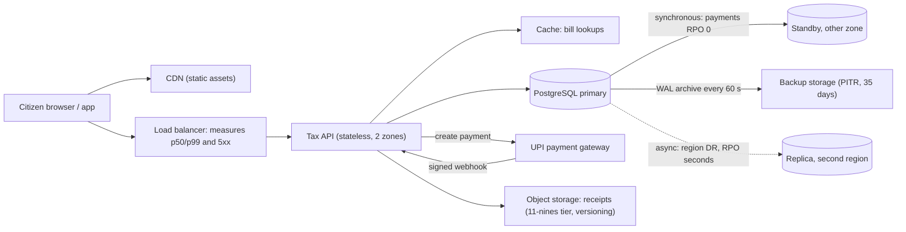
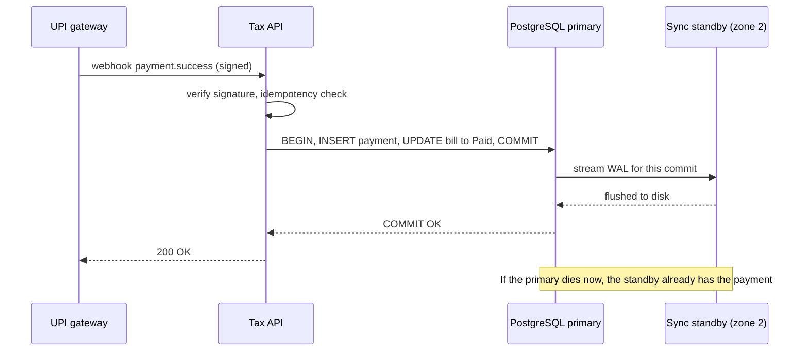

Functional requirements say *what* a system does: "a citizen pays property tax". Non-functional requirements (NFRs) say *how well* it must do it: how fast, how often available, how safe the data is, how much load it carries. NFRs decide most of the architecture, yet they usually arrive as adjectives. This lesson teaches you to turn adjectives into numbers that can be designed for, tested and monitored.

## Learning objectives

By the end of this lesson you will be able to:

1. Name the main families of non-functional requirements and the design decisions each one drives.
2. Rewrite vague requirements ("fast", "scalable", "highly available", "no data loss") as measurable targets.
3. Explain percentiles (p50, p95, p99) and why averages hide the users who suffer most.
4. Define durability, RPO and RTO, and estimate them for a backup and replication strategy with arithmetic.
5. Separate assumptions (things you believe) from constraints (things you must accept) and record both.
6. Measure latency percentiles per endpoint in ASP.NET Core and compare them with targets.

## Prerequisites

- [Clarifying requirements, users and system boundaries](#/lesson/m11-clarifying-requirements): you need the use cases before you can attach NFRs to them.
- [Functional and non-functional requirements](#/lesson/m02-requirements): the basic distinction.
- Comfort with percentages. Availability maths is covered in depth in [Availability, reliability and the nines](#/lesson/m11-availability).

## Explain it like I'm a beginner

Imagine ordering a pizza. The functional requirement is "deliver a pizza to my address". But you also care about:

- **How fast?** "Within 30 minutes" is useful. "Quickly" is not.
- **How often does it work?** If the shop is closed one evening a month, that is fine. If it is closed every other evening, you change shops.
- **Does it arrive intact?** A pizza that arrives is no good if the toppings fell off. For data, "intact and still there later" is called durability.
- **What if the oven breaks?** How much of tonight's order queue can the shop lose (that is RPO: how much recent work you may lose) and how long until it is cooking again (that is RTO: how long recovery may take)?
- **How many orders at once?** On a cricket final night, can it handle 500 orders an hour, or only 50? That is throughput.

Each of these is a *quality* of the service rather than the service itself. Software teams call them non-functional requirements, and the rule is simple: **if you cannot measure it, you cannot design for it.** "Fast" becomes "99 out of 100 bill lookups finish within 400 ms".

## First-principles explanation

### The NFR families and what they drive

| Family | Question | Typical measurable form | Design decisions it drives |
|---|---|---|---|
| **Latency** | How long does one request take? | p99 < 300 ms for `GET /bill` | Caching, data locality, synchronous vs asynchronous work |
| **Throughput** | How much work per second? | 2,000 RPS sustained, 6,000 RPS peak | Instance count, partitioning, queues |
| **Availability** | How often can users use it? | 99.9 % of valid requests succeed per 30 days | Redundancy, failover, dependency isolation |
| **Durability** | Once stored, is data still there later? | No committed payment ever lost; 11 nines for documents | Replication, backups, storage class |
| **Recoverability** | After a disaster, how much data lost and how long down? | RPO 5 min, RTO 1 h | Backup frequency, log shipping, standby databases |
| **Consistency** | Can users see stale or conflicting data? | Balance reads reflect own payment immediately | Transactions, read routing, replication mode |
| **Scalability** | How does it grow? | 10× users with roughly linear cost and same p99 | Stateless tiers, sharding keys |
| **Security and privacy** | Who can do what? What is protected? | All PII encrypted at rest; MFA for staff; audit of every refund | Identity, encryption, audit logs |
| **Compliance** | Which rules apply? | Data stored in India; logs kept 1 year | Region choice, retention |
| **Operability** | How easy is it to run and change? | Deploy in < 15 min with zero downtime; alert within 2 min | CI/CD, observability |
| **Cost** | How much may it cost? | < ₹4 lakh per month at expected load | Instance sizes, storage tiers, managed services |

You will rarely need all of them. In an interview, pick the **3–5 that matter most for the core use cases** and give each a number.

### From adjective to number

A measurable NFR has four parts: **metric, target, scope, and measurement window.**

```text
"p99 latency" (metric) "below 400 ms" (target) "for GET /bills/{propertyId},
measured at the load balancer" (scope) "over each 5-minute window at up to 100 RPS" (window and load)
```

Rewriting the usual suspects for a municipal property-tax portal:

| Vague | Measurable |
|---|---|
| "The site must be fast." | Bill lookup p99 < 400 ms and p50 < 100 ms at up to 100 RPS; payment confirmation p99 < 2 s excluding the time spent in the UPI app. |
| "It must always be up." | 99.9 % of valid requests succeed per 30 days (about 43 minutes of failure budget); 99.95 % during the rebate deadline week. |
| "We can never lose data." | Committed payments: RPO 0 (no loss). Draft applications: RPO 15 minutes. Uploaded documents: 11 nines durability. |
| "Must recover quickly." | RTO 30 minutes for a zone failure, 4 hours for a region failure. |
| "Must be scalable." | Handle the last-day peak (estimated below at about 34 lookups/s and 7 payments/s) with about 3× headroom, 100 lookups/s, at the same p99; scale out without code changes. |
| "Must be secure." | Citizen login by OTP; staff by SSO with MFA; every refund and waiver audited with who, what, when; PII encrypted at rest. |

Notice that many rewrites split one adjective into *several* targets per data type or per flow. "Never lose data" means something different for a payment and for a half-filled form, and treating them the same either wastes money or loses payments.

### Percentiles: why averages lie

Suppose 1,000 bill lookups take these times:

- 950 take 50–110 ms
- 40 take 400 ms (cache miss plus a slow query)
- 10 take 1,200 ms (a garbage-collection pause or a lock wait)

The **average** is about 104 ms. It sounds fine, but 50 people (5 %) waited four to twelve times longer than that. Percentiles describe the distribution instead:

- **p50 (median):** half the requests are faster than this. Here about 80 ms.
- **p95:** 95 % are faster. Here 110 ms.
- **p99:** 99 % are faster. Here 400 ms.
- **p99.9:** 999 in 1,000 are faster. Here 1,200 ms.

Why the tail matters:

1. **Heavy users hit it constantly.** A tax clerk who opens 200 bills a day will see the p99 twice a day.
2. **One page makes many calls.** If a page needs 10 backend calls, the chance that at least one of them is slower than its p99 is `1 − 0.99^10 ≈ 9.6 %`. The page's p90 is roughly the service's p99. [Latency numbers and latency budgets](#/lesson/m11-latency-numbers) develops this fan-out effect.
3. **Averages can improve while users suffer.** Make the fast requests faster and the average drops even if the slow ones get slower.

Write latency NFRs as percentiles, usually p50 plus p99 (or p95 for low-traffic systems where p99 is noisy). Always say **where** it is measured: in the browser, at the load balancer, or inside the service. They differ by network time.

### Availability as a percentage

Availability is the fraction of valid requests (or of time) that succeed. Each "nine" divides the allowed failure by ten:

| Target | Allowed failure per 30 days |
|---|---|
| 99 % | 7.2 hours |
| 99.9 % | 43.2 minutes |
| 99.95 % | 21.6 minutes |
| 99.99 % | 4.3 minutes |

Two practical rules: define **what counts as a failure** (5xx and responses slower than a threshold, not 4xx user errors), and set **different targets for different flows**. Paying tax during the deadline week deserves more nines than downloading a five-year-old receipt. The full maths of series and parallel components is in [Availability](#/lesson/m11-availability), and operating these targets as SLOs with error budgets is in [SLI, SLO, SLA and error budgets](#/lesson/m14-sli-slo-sla).

### Durability: is the data still there later?

Durability is the probability that data, once acknowledged as stored, is not lost. It is a different promise from availability: a database can be down (unavailable) while every byte is safe on disk (durable).

Durability is often quoted in nines per object per year. Object stores commonly advertise 11 nines (99.999999999 %) for their standard redundant tiers; check your provider's documentation for the exact figure of the tier you use. What that means in practice:

```text
10 million stored documents × (1 − 0.99999999999) = 10,000,000 × 1e-11
                                                   = 0.0001 documents expected lost per year
```

That is about one document every 10,000 years, from hardware failure alone. In practice, durability is threatened far more by **people and software** than by disks: an accidental `DELETE`, a buggy migration, ransomware, or a misconfigured lifecycle rule. That is why durability needs **backups that are separate from replication** (replication faithfully copies your mistakes) plus features like soft delete and versioning.

### RPO and RTO: how much loss, how long down

Two numbers describe recovery from a disaster such as losing a database server, a zone or a region:

- **RPO (recovery point objective):** the maximum amount of recent data, measured in time, you may lose. "RPO 15 minutes" means that after recovery, at most the last 15 minutes of changes may be missing.
- **RTO (recovery time objective):** the maximum time from the disaster until the service works again.

```text
   last good copy           disaster                    service restored
        |<------- RPO ------->|<---------- RTO ------------->|
   (data after this point     (users cannot use the system
    may be lost)               during this interval)
```

How common strategies map to RPO (worst case):

| Strategy | Worst-case RPO | Notes |
|---|---|---|
| Nightly full backup only | 24 hours | Cheap; fine for a reporting copy, not for payments |
| Nightly backup + WAL archiving (point-in-time recovery) | Minutes (archive interval, e.g. `archive_timeout = 60s`) | PostgreSQL ships write-ahead log segments continuously |
| Asynchronous streaming replica | Seconds (replication lag) | Lag can grow under load or during long transactions |
| Synchronous replica | ~0 for committed transactions | Each commit waits for the standby; adds latency |

And to RTO:

```text
RTO ≈ time to detect + time to decide + time to restore or fail over + time to verify

Restore path:  2 TB database ÷ 250 MB/s restore throughput
               = 2,097,152 MB ÷ 250 MB/s ≈ 8,400 s ≈ 2.3 hours,
               plus WAL replay and checks → about 3 hours.
Failover path: detect 1 min + promote standby 1 min + reconnect 1 min ≈ 3–5 minutes.
```

(The throughput figure is an illustrative estimate; measure your own with a restore drill.) The arithmetic explains why low RTO targets need a **standby that is already running**, not a backup that must be restored.

### Throughput: the load at which the other targets hold

Throughput is work per unit time: requests per second, messages per second, megabytes per second. An NFR such as "p99 < 300 ms" is meaningless without the load at which it must hold, because any system is fast when idle. Pair them: "p99 < 300 ms **at 2,000 RPS**". [Capacity estimation](#/lesson/m11-capacity-estimation) shows how to derive those RPS numbers.

### Assumptions versus constraints

Both are inputs you write down at the start, but they behave differently:

| | Assumption | Constraint |
|---|---|---|
| **What it is** | Something you believe to be true but have not confirmed | Something imposed on you that you must accept |
| **Examples** | "40 % of citizens pay in the last week." "A bill is about 2 KB." | "Data must stay in India." "Budget ₹4 lakh/month." "Team of four .NET developers." "Must use the state's existing PostgreSQL platform." "Go-live before 1 April." |
| **What you do with it** | Validate it, monitor it, and design so being wrong is survivable | Design within it; challenge it only with evidence and the right person |
| **Risk** | Silent: the design is right for a world that does not exist | Visible: it limits options, sometimes ruling out the "textbook" answer |

Constraints often decide more than requirements. A constraint like "on-premises data centre only, no managed cloud services" rules out a managed queue and a multi-region database, and the right answer becomes a well-run PostgreSQL pair with a self-hosted RabbitMQ. A good design names the constraint and shows it was respected.

### NFRs conflict, so rank them

- **Consistency versus latency:** a synchronous replica gives RPO 0 but adds the round trip to the standby to every commit.
- **Availability versus consistency:** during a network partition you can keep accepting writes (and reconcile later) or refuse them (and stay correct). See [CAP and PACELC](#/lesson/m13-cap-pacelc).
- **Durability and availability versus cost:** every extra nine and every extra copy costs money.

Agree an order: for property tax, *correctness of payments > availability during deadline week > latency of bill lookup > cost*. When two NFRs collide, the order decides.

### When a simpler target is enough

An internal dashboard for 30 engineers needs: p95 under 2 seconds, 99 % availability in office hours, nightly backups (RPO 24 h), RTO of one working day. Writing those numbers down is the win: it stops someone from building a multi-zone cluster for a tool nobody uses at night.

## Visual explanation

### Where each NFR is enforced in a property-tax portal



Each arrow carries an NFR. The **load balancer** is where latency percentiles and error rates are measured, because that is closest to what users experience while still under our control. The **cache** is a small optimisation for the deadline-day spike: at the estimated 34 lookups per second, indexed PostgreSQL reads alone would meet the 400 ms p99, so the cache is optional and must never be the only copy of anything. The **synchronous standby** in another zone delivers RPO 0 for committed payments and a few minutes of RTO for a zone failure. **WAL archiving** to separate backup storage gives point-in-time recovery for mistakes that replication would copy, such as an accidental `DELETE`. The **dotted asynchronous replica in a second region** covers the rare region-wide disaster with an RPO of seconds, a weaker promise we accept to avoid adding cross-region latency to every commit. **Receipts** sit in a highly durable object-storage tier with versioning, so an overwrite can be undone.

### A payment commit under RPO 0



When the UPI gateway calls back, the API verifies the signature and checks the idempotency key so a repeated webhook does not record the payment twice. The transaction inserts the payment and marks the bill paid together. With `synchronous_commit = on` and a synchronous standby configured, PostgreSQL does not acknowledge the commit until the standby has flushed the change to disk. Only then does the API return 200 to the gateway. If the primary fails one millisecond later, the standby already holds the payment, so promoting it loses nothing: that is RPO 0. The price is the extra round trip to the other zone on every commit, typically a millisecond or two within a region (an estimate; measure yours). There is a second price a reviewer will ask about: if the only synchronous standby is down, commits **wait** instead of failing over to asynchronous mode. Plan for it: run two standbys with `synchronous_standby_names = 'ANY 1 (s1, s2)'` so either can acknowledge, or use a managed service whose HA mode handles this, and alert when the standby count drops.

## Step-by-step example

**Scenario.** A municipal corporation's property-tax portal. About 1.2 million properties. Citizens look up bills, pay by UPI and download receipts. A 5 % rebate for paying before 31 May causes a huge rush in the last week of May.

### Step 1 — List the NFR families that matter

From the use cases: latency (lookups and payment confirmation), throughput (deadline rush), availability (deadline week), durability and recoverability (payments and receipts), security (citizen PII, staff waivers), constraints (data in India, existing PostgreSQL platform, budget).

### Step 2 — Get the numbers that anchor the targets

Ask or assume: 60 % of properties pay online, and 40 % of those in the last 7 days.

```text
Online payments per year: 1.2 M × 0.6               = 720,000
Last-week payments:       720,000 × 0.4             = 288,000 in 7 days ≈ 41,000/day
Bill lookups per payment (people check, compare, re-check): about 5
Last-week lookups/day:    41,000 × 5                = 205,000/day
Peak hour (assume 15 % of the day in one hour):      ≈ 31,000 lookups/hour ≈ 8.5 RPS
Last-day spike (assume 4× a normal last-week day):   ≈ 34 RPS of lookups, ≈ 7 payments/s
```

These numbers are small. That matters: the latency and throughput targets are easy to meet, so the design effort should go to **availability during the deadline** and **payment correctness**, not to scale.

### Step 3 — Write the targets

| Flow | Latency | Availability | Durability / recovery |
|---|---|---|---|
| Bill lookup | p50 < 100 ms, p99 < 400 ms at the load balancer, up to 100 RPS | 99.9 % monthly; 99.95 % in deadline week | Rebuildable from the source tables; RPO 1 h is fine |
| Payment confirmation | p99 < 2 s from webhook receipt to receipt available | 99.95 % in deadline week | RPO 0 for committed payments; RTO 15 min for zone loss |
| Receipt download | p99 < 1 s | 99.9 % | 11-nines storage tier with versioning; regenerable from payment record |
| Staff waivers | p99 < 2 s | 99.5 % office hours | RPO 5 min; every change audited |

### Step 4 — Record assumptions and constraints separately

- **Assumptions:** 40 % pay in the last week (validate against last year's data); a bill is about 2 KB; most citizens use phones on 4G.
- **Constraints:** data must stay in India; must use the state data centre's managed PostgreSQL 17; budget ₹2.5 lakh per month; team of three developers; go-live before 1 April.

### Step 5 — Derive design decisions from the numbers

- Small load → two API instances in two zones are enough; a cache is optional (we keep a small in-memory cache for the deadline spike).
- RPO 0 for payments → synchronous standby; RTO 15 min → automatic failover, tested before the deadline.
- 11 nines for receipts → object storage with versioning; receipts can also be regenerated from the payment row, so they are doubly safe.
- Payment availability depends on the UPI gateway → reconcile with the gateway's settlement file nightly, so a webhook lost during an outage is still recorded.

### Step 6 — Decide how each target will be measured

Latency and availability from load-balancer logs per route; payment durability verified by a nightly reconciliation job (payments in our database = payments in the gateway's settlement file); RPO and RTO verified by a failover drill and a restore drill two weeks before the deadline.

## Production-style C# implementation

Targets only help if they are measured. The code below models NFRs as data, records request latency per endpoint in ASP.NET Core, computes percentiles over a recent window, and serves a report that says whether each target is met. In production you would export the same measurements as OpenTelemetry histograms; the in-memory version keeps the idea visible and testable.

```text
Tax.Portal/
  Program.cs
  Nfr/NfrTargets.cs
  Nfr/Percentiles.cs
  Nfr/LatencyRecorder.cs
  Nfr/LatencyRecordingMiddleware.cs
  Nfr/RecoveryEstimate.cs
```

```csharp file=Nfr/NfrTargets.cs
namespace Tax.Portal.Nfr;

/// <summary>A latency objective: "p99 of GET /bills/{id} below 400 ms".
/// A class with setters so it binds from appsettings.json.</summary>
public sealed class LatencyTarget
{
    public string Route { get; set; } = "";
    public double Percentile { get; set; } = 99;
    public double ThresholdMs { get; set; }
}

public sealed class NfrOptions
{
    public List<LatencyTarget> Latency { get; set; } = [];
    public double AvailabilityTargetPercent { get; set; } = 99.9;
    public TimeSpan RecoveryPointObjective { get; set; } = TimeSpan.Zero;
    public TimeSpan RecoveryTimeObjective { get; set; } = TimeSpan.FromMinutes(15);
}

public sealed record LatencyVerdict(string Route, double Percentile, double ThresholdMs, double? ObservedMs, int Samples, bool Met);
```

```csharp file=Nfr/Percentiles.cs
namespace Tax.Portal.Nfr;

public static class Percentiles
{
    /// <summary>Nearest-rank percentile: the smallest sample such that at least p % of
    /// samples are less than or equal to it. Matches PostgreSQL's percentile_disc.</summary>
    public static double NearestRank(IReadOnlyList<double> samples, double percentile)
    {
        ArgumentNullException.ThrowIfNull(samples);
        if (samples.Count == 0) throw new ArgumentException("No samples.", nameof(samples));
        if (percentile is <= 0 or > 100) throw new ArgumentOutOfRangeException(nameof(percentile));

        var sorted = samples.Order().ToArray();
        int rank = (int)Math.Ceiling(percentile / 100.0 * sorted.Length); // 1-based
        return sorted[Math.Clamp(rank, 1, sorted.Length) - 1];
    }
}
```

```csharp file=Nfr/LatencyRecorder.cs
using System.Collections.Concurrent;

namespace Tax.Portal.Nfr;

/// <summary>Keeps the most recent N latencies per route (a ring buffer) so percentiles
/// reflect current behaviour. Singleton; thread-safe per route.</summary>
public sealed class LatencyRecorder(int capacityPerRoute = 10_000)
{
    private sealed class Ring(int capacity)
    {
        private readonly double[] _items = new double[capacity];
        private int _next;
        private int _count;

        public void Add(double v)
        {
            lock (_items)
            {
                _items[_next] = v;
                _next = (_next + 1) % _items.Length;
                if (_count < _items.Length) _count++;
            }
        }

        public double[] Snapshot()
        {
            lock (_items) return _items.Take(_count).ToArray();
        }
    }

    private readonly ConcurrentDictionary<string, Ring> _rings = new();

    public void Record(string route, TimeSpan elapsed) =>
        _rings.GetOrAdd(route, _ => new Ring(capacityPerRoute)).Add(elapsed.TotalMilliseconds);

    public IReadOnlyList<double> Samples(string route) =>
        _rings.TryGetValue(route, out var ring) ? ring.Snapshot() : [];

    public LatencyVerdict Evaluate(LatencyTarget target)
    {
        var samples = Samples(target.Route);
        if (samples.Count == 0)
            return new LatencyVerdict(target.Route, target.Percentile, target.ThresholdMs, null, 0, Met: true);
        double observed = Percentiles.NearestRank(samples, target.Percentile);
        return new LatencyVerdict(target.Route, target.Percentile, target.ThresholdMs, observed, samples.Count, observed <= target.ThresholdMs);
    }
}
```

```csharp file=Nfr/LatencyRecordingMiddleware.cs
using System.Diagnostics;

namespace Tax.Portal.Nfr;

/// <summary>Records latency per route template (e.g. "GET /bills/{id}"), not per raw URL,
/// so 1.2 million property ids do not become 1.2 million metric series.</summary>
public sealed class LatencyRecordingMiddleware(RequestDelegate next, LatencyRecorder recorder)
{
    public async Task InvokeAsync(HttpContext context)
    {
        long start = Stopwatch.GetTimestamp();
        try
        {
            await next(context);
        }
        finally
        {
            if (context.GetEndpoint() is RouteEndpoint endpoint)
            {
                string route = $"{context.Request.Method} /{endpoint.RoutePattern.RawText?.TrimStart('/')}";
                recorder.Record(route, Stopwatch.GetElapsedTime(start));
            }
        }
    }
}
```

```csharp file=Nfr/RecoveryEstimate.cs
namespace Tax.Portal.Nfr;

/// <summary>Back-of-the-envelope RTO for a restore-from-backup path versus a standby failover.</summary>
public static class RecoveryEstimate
{
    public static TimeSpan RestoreRto(double databaseGb, double restoreMbPerSecond, TimeSpan detect, TimeSpan replayAndVerify)
    {
        if (databaseGb < 0 || restoreMbPerSecond <= 0) throw new ArgumentOutOfRangeException(nameof(restoreMbPerSecond));
        var copy = TimeSpan.FromSeconds(databaseGb * 1024 / restoreMbPerSecond);
        return detect + copy + replayAndVerify;
    }

    public static TimeSpan FailoverRto(TimeSpan detect, TimeSpan promote, TimeSpan reconnect) => detect + promote + reconnect;
}
```

```csharp file=Program.cs
using Tax.Portal.Nfr;

var builder = WebApplication.CreateBuilder(args);

builder.Services.Configure<NfrOptions>(o =>
{
    // Usually bound from configuration: builder.Configuration.GetSection("Nfr").Bind(o)
    o.Latency.Add(new LatencyTarget { Route = "GET /bills/{propertyId}", Percentile = 99, ThresholdMs = 400 });
    o.Latency.Add(new LatencyTarget { Route = "GET /bills/{propertyId}", Percentile = 50, ThresholdMs = 100 });
    o.Latency.Add(new LatencyTarget { Route = "POST /payments/webhook", Percentile = 99, ThresholdMs = 2000 });
    o.AvailabilityTargetPercent = 99.95;
    o.RecoveryPointObjective = TimeSpan.Zero;
    o.RecoveryTimeObjective = TimeSpan.FromMinutes(15);
});
builder.Services.AddSingleton(new LatencyRecorder(capacityPerRoute: 10_000));

var app = builder.Build();

app.UseRouting();                                  // so the middleware can see the matched route template
app.UseMiddleware<LatencyRecordingMiddleware>();

app.MapGet("/bills/{propertyId}", (string propertyId) =>
    Results.Ok(new { propertyId, amountRupees = 4_850m, dueDate = "2026-05-31" }));

app.MapPost("/payments/webhook", () => Results.Ok());

// The NFR report: targets next to what we actually observe.
app.MapGet("/nfr/report", (Microsoft.Extensions.Options.IOptions<NfrOptions> options, LatencyRecorder recorder) =>
{
    var o = options.Value;
    return new
    {
        latency = o.Latency.Select(recorder.Evaluate),
        availabilityTargetPercent = o.AvailabilityTargetPercent,
        rpo = o.RecoveryPointObjective,
        rto = o.RecoveryTimeObjective,
        restoreRtoEstimate = RecoveryEstimate.RestoreRto(2048, 250, TimeSpan.FromMinutes(5), TimeSpan.FromMinutes(30)),
        failoverRtoEstimate = RecoveryEstimate.FailoverRto(TimeSpan.FromMinutes(1), TimeSpan.FromMinutes(1), TimeSpan.FromMinutes(1)),
    };
});

app.Run();
```

Decisions worth defending:

1. **Route templates, not raw paths.** Recording `/bills/PT-001`, `/bills/PT-002` … separately would create millions of series and make percentiles meaningless. Group by the route pattern.
2. **Nearest-rank percentiles** match PostgreSQL's `percentile_disc`, so the numbers in the app and in SQL reports agree.
3. **The report shows RTO estimates next to the RTO target.** A restore of 2 TB at 250 MB/s plus checks is far above 15 minutes, which tells everyone that only the failover path meets the target and that restore drills are for the *backup* scenario, not the zone-failure scenario.
4. **Targets live in configuration.** The deadline week can raise the availability target without a code change, and the numbers are reviewable in a pull request.

## Bad design vs good design

**Bad: adjectives in the contract.** The request for proposal (RFP) says "the system shall be fast, secure, scalable and highly available". The vendor delivers a portal that takes 4 seconds per page at 50 users and fails at 200. Everyone argues about whether 4 seconds is "fast". Nothing in the contract settles it.

**Bad: one number for everything.** "RPO 0 and 99.99 % for the whole system." The team pays for synchronous replication and multi-zone everything, including the nightly analytics export and the PDF generator, and still misses the deadline-week target because the UPI dependency was never considered.

**Good:**

- Each core flow has its own targets: latency percentiles at a stated load, availability per window, durability and RPO/RTO per data type.
- Each target says where and how it is measured.
- Assumptions are listed with a plan to validate them; constraints are listed with their owner.
- The NFRs are ranked so conflicts have a pre-agreed answer.
- Recovery targets are proven by drills, not by architecture diagrams.

:::callout type=mistake title="Replication is not a backup"
A replica copies every change, including `DROP TABLE` and a buggy migration, within milliseconds. Replication protects against hardware and zone failure (availability, RTO). Backups with point-in-time recovery protect against human and software error (durability). You need both, and they answer different NFRs.
:::

:::callout type=tradeoff title="RPO 0 costs latency on every write"
A synchronous standby makes every commit wait for another machine. Within one region that is usually a millisecond or two; across regions it can be tens of milliseconds and couples your write availability to the link. Use RPO 0 for the data that needs it (money, legal records) and asynchronous replication for the rest.
:::

## Practical playground

The SQL playground below contains a `request_log` table with 1,000 bill lookups and 500 payment webhooks. Start with `SELECT endpoint, avg(duration_ms) FROM request_log GROUP BY endpoint;` and then compare with `percentile_disc(0.5)`, `percentile_disc(0.95)`, `percentile_disc(0.99)` and `percentile_disc(0.999)` `WITHIN GROUP (ORDER BY duration_ms)`. Notice how far apart the average and the p99 are, and decide which number you would put in an NFR.

:::playground type=sql title="Averages versus percentiles"
```sql
CREATE TABLE request_log (
    id          serial PRIMARY KEY,
    endpoint    text    NOT NULL,
    duration_ms integer NOT NULL
);
INSERT INTO request_log (endpoint, duration_ms)
SELECT 'GET /bill',
       CASE WHEN i % 100 = 0 THEN 1200 WHEN i % 20 = 0 THEN 400 ELSE 50 + (i % 7) * 10 END
FROM generate_series(1, 1000) AS i;
INSERT INTO request_log (endpoint, duration_ms)
SELECT 'POST /pay',
       CASE WHEN i % 50 = 0 THEN 2500 ELSE 200 + (i % 5) * 20 END
FROM generate_series(1, 500) AS i;
```
:::

## Exercises

:::exercise id=m11-nfrs-ex1 difficulty=beginner kind=code title="A vague-requirement linter"
Build a linter that flags NFR sentences containing vague words and no measurable quantity, so reviews catch "the system shall be fast" before it reaches a contract.
::requirements
- `NfrLinter.VagueWords` is the list: `fast`, `quick`, `scalable`, `highly available`, `reliable`, `secure`, `real-time`, `robust`, `seamless`, `user-friendly`.
- `NfrLinter.IsMeasurable(string text)` is true if the text contains a number followed (optionally after a space) by a unit: `ms`, `s`, `%`, `rps`, `req/s`, `min`, `minutes`, `h`, `hours`, `mb`, `gb`, `tb` (case-insensitive).
- `NfrLinter.Problems(string text)` returns the vague words found (lower case, distinct, in order of first appearance) **only if** the text is not measurable; otherwise an empty list.
- Match whole words or phrases only: "breakfast" must not match "fast".
- `null` throws `ArgumentNullException`.
::acceptance
- "The portal must be fast and highly available." returns `["fast", "highly available"]`.
- "Bill lookup must be fast: p99 under 300 ms." returns an empty list.
- "Serve breakfast menus" returns an empty list.
- "Secure, robust and SECURE" returns `["secure", "robust"]`.
::hint
Regular expressions with word boundaries (`\b`) solve the "breakfast" problem.
::hint
Find each vague word's first match index, keep the ones that match, then sort by index.
::hint
For measurability, a pattern like `\d+(\.\d+)?\s*(ms|s|%|rps|req/s|min|minutes|h|hours|mb|gb|tb)\b` gets close; `%` needs care because `\b` after `%` does not behave like after a letter.
::hint
Use `(?=\W|$)` instead of a trailing `\b` so both `300 ms.` and `99.9%` match.
::hint
```csharp
var m = Regex.Match(text, $@"(?<![\w-]){Regex.Escape(word)}(?![\w-])", RegexOptions.IgnoreCase);
```
::starter
```csharp file=NfrLinter.cs
using System;
using System.Collections.Generic;
using System.Linq;
using System.Text.RegularExpressions;

public static class NfrLinter
{
    public static readonly string[] VagueWords =
    {
        "fast", "quick", "scalable", "highly available", "reliable",
        "secure", "real-time", "robust", "seamless", "user-friendly",
    };

    public static bool IsMeasurable(string text) => throw new NotImplementedException();

    public static List<string> Problems(string text) => throw new NotImplementedException();
}
```
::tests
```csharp file=NfrLinterTests.cs
using System;
using System.Collections.Generic;
using Xunit;

public class NfrLinterTests
{
    [Fact]
    public void Flags_vague_words_in_order() =>
        Assert.Equal(new List<string> { "fast", "highly available" }, NfrLinter.Problems("The portal must be fast and highly available."));

    [Fact]
    public void Measurable_text_is_fine() =>
        Assert.Empty(NfrLinter.Problems("Bill lookup must be fast: p99 under 300 ms."));

    [Theory]
    [InlineData("99.9% of requests succeed", true)]
    [InlineData("handle 2000 RPS", true)]
    [InlineData("RTO 4 hours", true)]
    [InlineData("store 5TB", true)]
    [InlineData("very fast indeed", false)]
    [InlineData("version 2 of the API", false)]
    public void Measurability(string text, bool expected) => Assert.Equal(expected, NfrLinter.IsMeasurable(text));

    [Fact]
    public void Whole_words_only() => Assert.Empty(NfrLinter.Problems("Serve breakfast menus"));

    [Fact]
    public void Distinct_and_lower_case() =>
        Assert.Equal(new List<string> { "secure", "robust" }, NfrLinter.Problems("Secure, robust and SECURE"));

    [Fact]
    public void Null_throws() => Assert.Throws<ArgumentNullException>(() => NfrLinter.Problems(null!));
}
```
::solution
```csharp file=NfrLinter.cs
using System;
using System.Collections.Generic;
using System.Linq;
using System.Text.RegularExpressions;

public static class NfrLinter
{
    public static readonly string[] VagueWords =
    {
        "fast", "quick", "scalable", "highly available", "reliable",
        "secure", "real-time", "robust", "seamless", "user-friendly",
    };

    private static readonly Regex Quantity = new(
        @"\d+(\.\d+)?\s*(ms|s|%|rps|req/s|min|minutes|h|hours|mb|gb|tb)(?=\W|$)",
        RegexOptions.IgnoreCase | RegexOptions.Compiled);

    public static bool IsMeasurable(string text)
    {
        ArgumentNullException.ThrowIfNull(text);
        return Quantity.IsMatch(text);
    }

    public static List<string> Problems(string text)
    {
        ArgumentNullException.ThrowIfNull(text);
        if (IsMeasurable(text)) return new List<string>();

        return VagueWords
            .Select(w => (Word: w, Match: Regex.Match(text, $@"(?<![\w-]){Regex.Escape(w)}(?![\w-])", RegexOptions.IgnoreCase)))
            .Where(x => x.Match.Success)
            .OrderBy(x => x.Match.Index)
            .Select(x => x.Word)
            .ToList();
    }
}
```

The lookarounds `(?<![\w-])` and `(?![\w-])` are word boundaries that also treat hyphens as part of a word, so "real-time" and "user-friendly" match as whole phrases and "breakfast" does not match "fast". The quantity pattern uses `(?=\W|$)` so that "99.9%" and "300 ms." both count.
::mistakes
- Using `text.Contains("fast")`, which flags "breakfast" and "fastener".
- Treating any digit as measurable, so "version 2 must be fast" passes.
- Returning duplicates when a word appears twice.
::extensions
Suggest a template for each vague word, for example "fast" → "p99 < ___ ms for ___ at ___ RPS".
:::

:::exercise id=m11-nfrs-ex2 difficulty=beginner kind=written title="Rewrite the RFP's NFRs"
A state transport department's request for proposal (RFP) for an online driving-licence appointment system contains these NFRs. Rewrite each as one or more measurable targets, and add the assumption or constraint you relied on.

1. "The system shall be fast."
2. "The system shall be available 24×7."
3. "No data shall ever be lost."
4. "The system shall support a large number of users."
5. "The system shall recover quickly from failures."
6. "The system shall be secure."
::acceptance
- Every rewrite has a metric, a target, a scope and (for latency and throughput) a load.
- Latency uses percentiles, not averages.
- "No data lost" is split by data type with different RPOs.
- At least two assumptions and one constraint are named.
::hint
Which flows exist? Slot search, booking, document upload, test-result entry by examiners.
::hint
"24×7" usually means "high availability during the hours people book". What does an hour of downtime at 2 a.m. cost compared with 10 a.m.?
::hint
Booking records, uploaded documents and search caches have very different loss costs.
::hint
"Large number of users" needs a number from somewhere: licences issued per year in the state is a good anchor.
::solution
1. **Fast:** slot search p50 < 150 ms and p99 < 600 ms at the load balancer at up to 300 RPS; booking confirmation p99 < 1.5 s.
2. **Available 24×7:** 99.9 % of valid requests succeed per 30 days for search and booking (about 43 min of failure budget); planned maintenance only between 01:00 and 04:00 with a banner, and not counted against the target if announced 48 hours ahead.
3. **No data lost:** confirmed bookings and test results: RPO 0 (synchronous standby). Uploaded documents: highly durable object storage with versioning, RPO 0 once the upload is acknowledged. Search caches and session data: may be lost, rebuilt on demand.
4. **Large number of users:** assumption: about 1.5 million licence applications a year in the state, 3 bookings or reschedules each: 4.5 M bookings a year ÷ 365 ≈ 12,300/day. Slots are released at 10:00 daily, and we assume 30 % of the day's bookings (≈ 3,700) happen in the first 10 minutes: 3,700 ÷ 600 s ≈ 6 bookings/s on average, with a 5× burst in the first minute ≈ 30 bookings/s, and about 10 slot searches per booking ≈ 300 searches/s. Target: 50 bookings/s and 300 search RPS during the release window with p99 < 1.5 s for booking (all estimates; check against last year's logs).
5. **Recover quickly:** RTO 15 minutes for a zone failure (automatic failover); RTO 4 hours for a region failure (restore into the second region); restore drill every quarter.
6. **Secure:** applicants log in with OTP; examiners and transport-office staff use SSO with MFA; every test result entry and booking override is audited (who, what, when, from where); Aadhaar or licence numbers are masked in logs and encrypted at rest.

**Assumptions:** 1.5 M applications a year; 30 % of daily bookings in the first 10 minutes after release, with a 5× burst in the first minute. **Constraint:** data must stay in India in the state's empanelled data centre.
::mistakes
- "p99 < 1 s" with no load, so any idle system passes.
- One RPO for everything, which either overspends on caches or under-protects bookings.
- "Secure" rewritten as "uses HTTPS", which is necessary but nowhere near sufficient.
:::

:::exercise id=m11-nfrs-ex3 difficulty=intermediate kind=sql title="Which endpoints breach their p99 target?"
The `request_log` table holds request durations and `latency_targets` holds each endpoint's p99 target. Write a query returning, for every endpoint with a target, the observed p99 (nearest-rank, i.e. `percentile_disc`), the target and whether the target is breached.
::requirements
- Columns: `endpoint`, `p99_ms`, `target_ms`, `breached` (boolean, true when `p99_ms > target_ms`).
- One row per endpoint in `latency_targets`, ordered by `endpoint`.
::acceptance
- `GET /bill` has p99 400 against a 500 target and is not breached.
- `POST /pay` has p99 2500 against an 800 target and is breached.
::setup
```sql
CREATE TABLE request_log (
    id          serial PRIMARY KEY,
    endpoint    text    NOT NULL,
    duration_ms integer NOT NULL
);
INSERT INTO request_log (endpoint, duration_ms)
SELECT 'GET /bill',
       CASE WHEN i % 100 = 0 THEN 1200 WHEN i % 20 = 0 THEN 400 ELSE 50 + (i % 7) * 10 END
FROM generate_series(1, 1000) AS i;
INSERT INTO request_log (endpoint, duration_ms)
SELECT 'POST /pay',
       CASE WHEN i % 50 = 0 THEN 2500 ELSE 200 + (i % 5) * 20 END
FROM generate_series(1, 500) AS i;
CREATE TABLE latency_targets (
    endpoint  text PRIMARY KEY,
    target_ms integer NOT NULL
);
INSERT INTO latency_targets VALUES ('GET /bill', 500), ('POST /pay', 800);
```
::hint
Percentiles are ordered-set aggregates: `percentile_disc(0.99) WITHIN GROUP (ORDER BY duration_ms)`.
::hint
Compute the p99 per endpoint in a subquery or CTE grouped by `endpoint`.
::hint
Join the result to `latency_targets` and compare the two numbers to produce `breached`.
::hint
```sql
WITH p AS (
  SELECT endpoint, percentile_disc(0.99) WITHIN GROUP (ORDER BY duration_ms) AS p99_ms
  FROM request_log GROUP BY endpoint
)
SELECT ...
```
::check
```sql
WITH p AS (
    SELECT endpoint,
           percentile_disc(0.99) WITHIN GROUP (ORDER BY duration_ms) AS p99_ms
    FROM request_log
    GROUP BY endpoint
)
SELECT t.endpoint, p.p99_ms, t.target_ms, p.p99_ms > t.target_ms AS breached
FROM latency_targets t
JOIN p ON p.endpoint = t.endpoint
ORDER BY t.endpoint;
```
::solution
```sql
WITH p AS (
    SELECT endpoint,
           percentile_disc(0.99) WITHIN GROUP (ORDER BY duration_ms) AS p99_ms
    FROM request_log
    GROUP BY endpoint
)
SELECT t.endpoint, p.p99_ms, t.target_ms, p.p99_ms > t.target_ms AS breached
FROM latency_targets t
JOIN p ON p.endpoint = t.endpoint
ORDER BY t.endpoint;
```

For `GET /bill` the 990th smallest of 1,000 values is the last of the 40 rows at 400 ms (950 fast rows come first), so p99 = 400 ms: within the 500 ms target. For `POST /pay`, 2 % of requests take 2,500 ms, so the 495th of 500 values is already in that slow group: p99 = 2,500 ms, breached. The average for `POST /pay` is only about 286 ms, which is exactly why the NFR must be written as a percentile.

`percentile_disc` returns an actual sample (nearest rank); `percentile_cont` interpolates between samples. Use the same method in SQL and in application code, or the numbers will not match.
::mistakes
- Using `avg(duration_ms)`, which reports `POST /pay` as healthy.
- Using `percentile_cont`, which gives an interpolated value and different results from the C# nearest-rank code.
- Grouping by endpoint *after* the join without aggregating, which returns one row per request.
:::

:::exercise id=m11-nfrs-ex4 difficulty=intermediate kind=code title="Does the backup plan meet RPO and RTO?"
Write a calculator that checks a recovery plan against RPO and RTO targets for two disasters: losing the primary database server, and needing a restore from backup (for example after an accidental mass delete).
::requirements
- `RecoveryPlan` is a record with: `TimeSpan FullBackupEvery`, `TimeSpan? WalArchiveEvery` (null if no log archiving), `bool SyncStandby`, `double DatabaseGb`, `double RestoreMbPerSecond`, `TimeSpan Detect`, `TimeSpan Failover`, `TimeSpan ReplayAndVerify`.
- `RecoveryMath.WorstCaseRpo(plan, Disaster d)`:
  - `Disaster.ServerLoss`: zero with a sync standby; otherwise the WAL archive interval if present, else the full backup interval.
  - `Disaster.RestoreFromBackup`: the WAL archive interval if present, else the full backup interval (a standby does not help, it has the same bad data).
- `RecoveryMath.EstimatedRto(plan, Disaster d)`:
  - `ServerLoss` with a sync standby: `Detect + Failover`.
  - Otherwise: `Detect + DatabaseGb × 1024 ÷ RestoreMbPerSecond seconds + ReplayAndVerify`.
- `RecoveryMath.Meets(plan, d, rpoTarget, rtoTarget)` is true when both estimates are within target.
- Non-positive `RestoreMbPerSecond` throws `ArgumentOutOfRangeException`.
::acceptance
- Nightly backup only: server-loss RPO is 24 hours.
- Sync standby: server-loss RPO is zero and RTO is detect + failover.
- With WAL archiving every 60 s, restore RPO is 60 s.
- 500 GB at 250 MB/s with 5 min detect and 10 min replay gives about 49.13 minutes of RTO.
::hint
Write the RPO rules first as a small `switch` on the disaster type.
::hint
For the restore copy time: `TimeSpan.FromSeconds(gb * 1024 / mbPerSecond)`.
::hint
500 × 1024 ÷ 250 = 2,048 s ≈ 34.13 min; plus 5 and 10 minutes gives 49.13.
::hint
```csharp
d == Disaster.ServerLoss && plan.SyncStandby ? TimeSpan.Zero : plan.WalArchiveEvery ?? plan.FullBackupEvery
```
::starter
```csharp file=RecoveryMath.cs
using System;

public enum Disaster { ServerLoss, RestoreFromBackup }

public sealed record RecoveryPlan(
    TimeSpan FullBackupEvery,
    TimeSpan? WalArchiveEvery,
    bool SyncStandby,
    double DatabaseGb,
    double RestoreMbPerSecond,
    TimeSpan Detect,
    TimeSpan Failover,
    TimeSpan ReplayAndVerify);

public static class RecoveryMath
{
    public static TimeSpan WorstCaseRpo(RecoveryPlan plan, Disaster d) => throw new NotImplementedException();

    public static TimeSpan EstimatedRto(RecoveryPlan plan, Disaster d) => throw new NotImplementedException();

    public static bool Meets(RecoveryPlan plan, Disaster d, TimeSpan rpoTarget, TimeSpan rtoTarget) => throw new NotImplementedException();
}
```
::tests
```csharp file=RecoveryMathTests.cs
using System;
using Xunit;

public class RecoveryMathTests
{
    private static RecoveryPlan Nightly() => new(
        FullBackupEvery: TimeSpan.FromHours(24), WalArchiveEvery: null, SyncStandby: false,
        DatabaseGb: 500, RestoreMbPerSecond: 250,
        Detect: TimeSpan.FromMinutes(5), Failover: TimeSpan.FromMinutes(2), ReplayAndVerify: TimeSpan.FromMinutes(10));

    [Fact]
    public void Nightly_only_loses_a_day() =>
        Assert.Equal(TimeSpan.FromHours(24), RecoveryMath.WorstCaseRpo(Nightly(), Disaster.ServerLoss));

    [Fact]
    public void Sync_standby_gives_zero_rpo_and_fast_rto()
    {
        var plan = Nightly() with { SyncStandby = true };
        Assert.Equal(TimeSpan.Zero, RecoveryMath.WorstCaseRpo(plan, Disaster.ServerLoss));
        Assert.Equal(TimeSpan.FromMinutes(7), RecoveryMath.EstimatedRto(plan, Disaster.ServerLoss));
    }

    [Fact]
    public void Standby_does_not_help_restore_rpo()
    {
        var plan = Nightly() with { SyncStandby = true, WalArchiveEvery = TimeSpan.FromSeconds(60) };
        Assert.Equal(TimeSpan.FromSeconds(60), RecoveryMath.WorstCaseRpo(plan, Disaster.RestoreFromBackup));
    }

    [Fact]
    public void Restore_rto_arithmetic() =>
        Assert.Equal(49.133, RecoveryMath.EstimatedRto(Nightly(), Disaster.RestoreFromBackup).TotalMinutes, 2);

    [Fact]
    public void Meets_checks_both_targets()
    {
        var plan = Nightly() with { SyncStandby = true, WalArchiveEvery = TimeSpan.FromSeconds(60) };
        Assert.True(RecoveryMath.Meets(plan, Disaster.ServerLoss, TimeSpan.Zero, TimeSpan.FromMinutes(15)));
        Assert.False(RecoveryMath.Meets(plan, Disaster.RestoreFromBackup, TimeSpan.FromMinutes(5), TimeSpan.FromMinutes(15)));
    }

    [Fact]
    public void Invalid_throughput_throws() =>
        Assert.Throws<ArgumentOutOfRangeException>(() =>
            RecoveryMath.EstimatedRto(Nightly() with { RestoreMbPerSecond = 0 }, Disaster.RestoreFromBackup));
}
```
::solution
```csharp file=RecoveryMath.cs
using System;

public enum Disaster { ServerLoss, RestoreFromBackup }

public sealed record RecoveryPlan(
    TimeSpan FullBackupEvery,
    TimeSpan? WalArchiveEvery,
    bool SyncStandby,
    double DatabaseGb,
    double RestoreMbPerSecond,
    TimeSpan Detect,
    TimeSpan Failover,
    TimeSpan ReplayAndVerify);

public static class RecoveryMath
{
    public static TimeSpan WorstCaseRpo(RecoveryPlan plan, Disaster d)
    {
        ArgumentNullException.ThrowIfNull(plan);
        if (d == Disaster.ServerLoss && plan.SyncStandby) return TimeSpan.Zero;
        return plan.WalArchiveEvery ?? plan.FullBackupEvery;
    }

    public static TimeSpan EstimatedRto(RecoveryPlan plan, Disaster d)
    {
        ArgumentNullException.ThrowIfNull(plan);
        if (d == Disaster.ServerLoss && plan.SyncStandby) return plan.Detect + plan.Failover;
        if (plan.RestoreMbPerSecond <= 0) throw new ArgumentOutOfRangeException(nameof(plan), "Restore throughput must be positive.");
        var copy = TimeSpan.FromSeconds(plan.DatabaseGb * 1024 / plan.RestoreMbPerSecond);
        return plan.Detect + copy + plan.ReplayAndVerify;
    }

    public static bool Meets(RecoveryPlan plan, Disaster d, TimeSpan rpoTarget, TimeSpan rtoTarget) =>
        WorstCaseRpo(plan, d) <= rpoTarget && EstimatedRto(plan, d) <= rtoTarget;
}
```

The two disasters produce very different answers for the same plan: a sync standby gives 0 RPO and 7 minutes RTO for server loss, but a restore after a bad `DELETE` still takes about 49 minutes and loses up to 60 seconds. Writing NFRs per disaster type stops the standby from being mistaken for a backup.
::mistakes
- Letting the standby improve the restore scenario; it replicated the bad change.
- Mixing 1,000 and 1,024 MB per GB inconsistently between estimates. Pick one and say so.
- Forgetting detection time, which in real incidents is often the biggest part of RTO.
::extensions
Add `Disaster.RegionLoss` with an asynchronous cross-region replica whose lag is a parameter, and compute RPO as that lag.
:::

:::exercise id=m11-nfrs-ex5 difficulty=advanced kind=hld title="Meet RPO 0 for payments and RTO 15 minutes"
The starter is today's property-tax portal: one API VM and one PostgreSQL VM with a nightly backup to a disk on the same VM. The new NFRs are: committed payments RPO 0 and RTO 15 minutes for a zone failure; RPO ≤ 5 minutes for accidental deletes; region failure RPO ≤ 1 minute and RTO ≤ 4 hours; receipts highly durable. Redesign it within the constraint that data stays in India.
::acceptance
- A synchronous standby in a second zone with automatic failover covers RPO 0 / RTO 15 min for zone failure.
- WAL archiving to separate storage supports point-in-time recovery with RPO ≤ 5 min.
- A second-region replica in India covers region failure; the solution states the RPO it gives and why it is asynchronous.
- Receipts move to durable object storage with versioning.
- Lost UPI webhooks are recovered by reconciliation.
::hint
Map each NFR to one mechanism: zone failure, operator error and region failure each need something different.
::hint
A backup on the same VM as the database fails with it. Where should backups live?
::hint
Cross-region synchronous replication adds tens of milliseconds to every commit and makes writes depend on the inter-region link.
::hint
Add a `read-replica` (as standby) with `multiAz`, an `object-storage` node for WAL archives and another for receipts, a second-region replica, and a `scheduler` for nightly reconciliation with the gateway's settlement file.
::starter
```json
{
  "nodes": [
    { "id": "cit", "type": "client", "label": "Citizens", "props": { "rps": 100 } },
    { "id": "api", "type": "app-server", "label": "Tax API VM", "props": { "instances": 1 } },
    { "id": "db", "type": "database", "label": "PostgreSQL VM (nightly backup to local disk)", "props": { "replicas": 0 } },
    { "id": "upi", "type": "external", "label": "UPI payment gateway" }
  ],
  "edges": [
    { "from": "cit", "to": "api", "kind": "sync" },
    { "from": "api", "to": "db", "kind": "sync" },
    { "from": "api", "to": "upi", "kind": "sync" },
    { "from": "upi", "to": "api", "kind": "async", "label": "webhook" }
  ]
}
```
::solution
```json
{
  "nodes": [
    { "id": "cit", "type": "client", "label": "Citizens", "props": { "rps": 100 } },
    { "id": "lb", "type": "load-balancer", "label": "Zone-redundant load balancer", "props": { "multiAz": true } },
    { "id": "api", "type": "app-server", "label": "Tax API", "props": { "instances": 2, "multiAz": true } },
    { "id": "db", "type": "database", "label": "PostgreSQL 17 primary (zone 1)", "props": { "multiAz": true, "replicas": 1, "region": "India Central" } },
    { "id": "sb", "type": "read-replica", "label": "Synchronous standby (zone 2), auto-failover", "props": { "region": "India Central" } },
    { "id": "wal", "type": "object-storage", "label": "WAL archive + base backups (35 days)", "props": { "region": "India Central" } },
    { "id": "dr", "type": "read-replica", "label": "Async replica (India South), promoted on region loss", "props": { "region": "India South" } },
    { "id": "rcpt", "type": "object-storage", "label": "Receipts (versioned, highly durable tier)" },
    { "id": "upi", "type": "external", "label": "UPI payment gateway" },
    { "id": "rec", "type": "scheduler", "label": "Nightly reconciliation with settlement file" },
    { "id": "mon", "type": "monitoring", "label": "Replication lag + failover alerts" }
  ],
  "edges": [
    { "from": "cit", "to": "lb", "kind": "sync" },
    { "from": "lb", "to": "api", "kind": "sync" },
    { "from": "api", "to": "db", "kind": "sync", "label": "payments, bills" },
    { "from": "db", "to": "sb", "kind": "sync", "label": "synchronous commit (RPO 0)" },
    { "from": "db", "to": "wal", "kind": "async", "label": "archive_timeout 60 s" },
    { "from": "db", "to": "dr", "kind": "async", "label": "streaming, lag seconds" },
    { "from": "api", "to": "rcpt", "kind": "sync", "label": "store receipt PDF" },
    { "from": "api", "to": "upi", "kind": "sync", "label": "create payment" },
    { "from": "upi", "to": "api", "kind": "async", "label": "signed webhook" },
    { "from": "rec", "to": "upi", "kind": "sync", "label": "download settlement file" },
    { "from": "rec", "to": "db", "kind": "sync", "label": "insert missing payments" },
    { "from": "db", "to": "mon", "kind": "async" }
  ]
}
```

**Mapping NFRs to mechanisms.**

- *Zone failure, RPO 0 / RTO 15 min:* synchronous standby in zone 2. A commit is acknowledged only after the standby flushes it. Automatic failover takes a few minutes (detect, promote, reconnect), well inside 15 minutes; a drill before the deadline week proves it.
- *Accidental delete, RPO ≤ 5 min:* WAL archived to separate storage at least every 60 s plus base backups allow point-in-time recovery to just before the bad statement. The standby cannot help: it replicated the delete.
- *Region failure, RPO ≤ 1 min, RTO ≤ 4 h:* an asynchronous replica in a second Indian region. Its lag is normally seconds; alert if it exceeds 30 s. It is asynchronous because a synchronous cross-region commit would add tens of milliseconds to every write and stop writes whenever the inter-region link fails. Promotion and DNS change are a runbook, rehearsed twice a year.
- *Receipts:* versioned object storage; receipts are also regenerable from payment rows.
- *Payment correctness:* if a webhook is lost during an outage, nightly reconciliation against the gateway's settlement file inserts the missing payment. This is what makes "no payment lost" true end to end, not just inside our database.
- *Constraint:* every node is in an Indian region.
::mistakes
- Treating the standby as the backup.
- Making the cross-region replica synchronous without accounting for latency and link failures.
- Ignoring the payment gateway: a perfectly durable database can still miss a payment whose webhook never arrived.
:::

## Automated testing

NFRs are the part of a design most often left untested. Each family has a practical test:

**1. Latency targets: load tests in CI or before release.** Run a scripted load (for example k6, JMeter or Azure Load Testing) at the stated RPS and assert the percentile, not the average. A minimal assertion over recorded samples looks like this:

```csharp
[Fact]
public void Bill_lookup_p99_within_target_at_load()
{
    var samples = LoadTestResults.Read("bill-lookup-100rps.csv");   // produced by the load tool
    Assert.True(Percentiles.NearestRank(samples, 99) <= 400, "p99 above 400 ms");
}
```

**2. Unit tests for the measurement code.** `Percentiles.NearestRank` must match PostgreSQL's `percentile_disc` exactly: test the edge cases (one sample, p100, ties, unsorted input) so dashboards and SQL reports agree.

**3. Availability: synthetic checks.** A probe that calls the bill-lookup and a test-mode payment every minute from outside your network measures availability the way citizens experience it, independent of your own logs.

**4. RPO and RTO: drills, not diagrams.** Schedule a failover drill (kill the primary in staging, then in production during a quiet window) and a restore drill (restore last night's backup plus WAL to a new server and replay to a timestamp). Record the measured times; they replace the estimates in `RecoveryEstimate`.

**5. Durability: reconciliation as a test.** A nightly job that compares payments in your database with the gateway's settlement file is a continuous test of the "no payment lost" NFR. A non-zero difference pages someone.

**6. Assumptions: monitor them.** If you assumed "40 % pay in the last week", put that ratio on a dashboard. An assumption that turns out wrong should trigger a design review, not an outage.

## Real-world application

- **Government and enterprise RFPs** in India and elsewhere increasingly specify measurable service levels (uptime percentages, response-time percentiles, RPO/RTO) instead of adjectives, because the vague versions were impossible to enforce.
- **Cloud providers** publish SLAs per service configuration and document RPO/RTO characteristics of their database high-availability and geo-replication features. Your NFRs decide which configuration to buy.
- **Payment systems** typically pair RPO 0 within a region with reconciliation against the payment network's settlement records, because the database alone cannot prove that every external payment was recorded.
- **Hospital and clinic record systems** often need only modest latency and office-hours availability for back-office screens, but very strong durability for patient records and prescriptions that must be kept for years for legal and medical reasons.
- **SRE practice** (Google's SRE book and many teams since) turns these NFRs into SLIs and SLOs with error budgets, so availability becomes a managed budget rather than an argument.

## Interview questions

:::interview
::q beginner
What is the difference between a functional and a non-functional requirement? Give an example of each for a payments app.
::a
A functional requirement describes behaviour: "a user can pay a bill by UPI and receive a receipt". A non-functional requirement describes a quality of that behaviour: "payment confirmation p99 under 2 seconds at 50 payments per second", "99.95 % availability during the deadline week", "RPO 0 for committed payments". NFRs drive most architectural choices such as replication, caching and redundancy.
::q beginner
Why use p99 latency instead of the average?
::a
The average hides the slow tail. If 2 % of requests take 2.5 seconds and the rest about 240 ms, the average looks like 286 ms while one user in fifty waits ten times longer. Heavy users and pages that make many backend calls hit the tail often. Percentiles (p50 for typical experience, p99 for the tail) describe what users actually feel, and they must be stated at a load and a measurement point.
::q intermediate
Explain RPO and RTO, and how you would achieve RPO 0 and RTO 15 minutes for a PostgreSQL database.
::a
RPO is the maximum data loss measured in time; RTO is the maximum time to restore service. For RPO 0 on server or zone loss, use a synchronous standby in another zone so each commit is on two machines before it is acknowledged. For RTO 15 minutes, use automatic failover (managed HA or Patroni-style tooling), clients that reconnect with retries, and a tested runbook. Separately, WAL archiving and base backups give point-in-time recovery for operator errors, because the standby would replicate a bad delete. I would prove both numbers with drills.
::q intermediate
What is the difference between an assumption and a constraint? Why record them separately?
::a
An assumption is something I believe but have not confirmed, such as "40 % of users pay in the last week". A constraint is imposed, such as "data must stay in India" or "the team only knows .NET". Assumptions must be validated and monitored, and the design should survive them being wrong. Constraints are designed within and only challenged with evidence through the right owner. Mixing them hides risk: an unvalidated assumption treated as fixed can silently invalidate the design.
::q advanced
Two NFRs conflict: "RPO 0 across regions" and "write p99 under 50 ms". How do you handle it?
::a
Quantify the conflict: synchronous cross-region commit adds the inter-region round trip (tens of milliseconds, often more at p99) to every write and makes writes fail when the link fails, so both targets cannot hold together. I would go back to the stakeholders with options: RPO 0 within a region plus asynchronous cross-region replication with RPO of seconds; or RPO 0 cross-region only for the small set of critical writes (payments) routed through a separate path, accepting higher latency for those; or reconciliation from an external source of truth (the payment network) to recover the last seconds after a region loss. The agreed priority order of NFRs decides, and the decision is recorded.
::q advanced
How would you verify that a system actually meets its NFRs in production, not just on paper?
::a
Measure each NFR as an SLI at the right point: latency percentiles and error rates at the load balancer per route; availability by synthetic probes and request-based success ratios; durability by reconciliation against external records and by restore drills; RPO via replication-lag monitoring and RTO via timed failover drills. Put them on SLO dashboards with burn-rate alerts. Also monitor the assumptions behind the targets (peak ratios, record sizes), and run load tests at the stated throughput before known peaks such as a tax deadline.
:::

## Summary and revision

**Key takeaways**

- NFRs describe how well a system works; they drive most architecture decisions.
- A measurable NFR has a metric, a target, a scope and a window (and a load for latency).
- Use percentiles (p50, p99) for latency; averages hide the tail.
- Availability per flow and per window; define what counts as failure.
- Durability is about data still existing later. Replication is not a backup.
- RPO = maximum data loss in time; RTO = maximum downtime. Low RTO needs a running standby; restores take hours for large databases.
- Record assumptions (validate them) separately from constraints (design within them).
- Rank NFRs so conflicts have an agreed answer. Small systems deserve small, explicit targets.

**Terminology**: non-functional requirement, quality attribute, latency, percentile, p50, p99, throughput, availability, durability, RPO, RTO, point-in-time recovery, WAL archiving, synchronous replication, assumption, constraint, SLI, SLO.

:::flashcards
Q: Four parts of a measurable NFR?
A: Metric, target, scope (which flow, measured where) and window (plus the load for latency and throughput).
Q: Why not use average latency in an NFR?
A: It hides the slow tail. A p99 shows what the slowest 1 % of users experience.
Q: What is RPO?
A: Recovery point objective: the maximum data loss allowed, measured in time before the disaster.
Q: What is RTO?
A: Recovery time objective: the maximum time from disaster until service is restored.
Q: Worst-case RPO with only nightly backups?
A: About 24 hours.
Q: How do you get RPO 0 for committed writes in PostgreSQL?
A: A synchronous standby: commits are acknowledged only after the standby has flushed them.
Q: Why is a replica not a backup?
A: It replicates mistakes (DROP, bad migration) immediately. Backups with point-in-time recovery protect against human and software error.
Q: Assumption vs constraint?
A: An assumption is believed but unconfirmed and must be validated; a constraint is imposed and must be designed within.
Q: Roughly how long to restore 2 TB at 250 MB/s?
A: About 2.3 hours of copying (2,097,152 MB ÷ 250 MB/s ≈ 8,400 s), before replay and checks.
:::

## Knowledge check

:::quiz pass=70
::q single
A requirement says "the site must be fast". Which rewrite is best?
- [ ] "Average response time under 200 ms."
- [ ] "The site must be very fast."
- [x] "Bill lookup p99 under 400 ms, measured at the load balancer, at up to 100 RPS."
- [ ] "Use a CDN and Redis."
> A good NFR names the metric (percentile), target, scope and load. An average hides the tail, and a technology is a solution, not a requirement.
::q single
2 % of payment requests take 2.5 s and the rest take about 250 ms. What does the p99 show?
- [ ] About 290 ms, the same as the average.
- [x] 2.5 s, revealing the slow tail.
- [ ] 250 ms, because most requests are fast.
- [ ] Nothing useful; p99 only matters above 1 million requests.
> With 2 % slow requests, the 99th percentile falls inside the slow group.
::q single
A team has a synchronous standby and says "we don't need backups any more". Which event proves them wrong?
- [ ] The primary's disk fails.
- [ ] The primary's zone loses power.
- [x] A developer runs a DELETE without a WHERE clause.
- [ ] Traffic doubles during the deadline week.
> The standby replicates the delete instantly. Only backups with point-in-time recovery can restore the data.
::q single
A 2 TB database must have an RTO of 15 minutes after a server failure. Which design can meet it?
- [ ] Nightly backups restored at 250 MB/s.
- [x] A running standby with automatic failover.
- [ ] Weekly full backups plus daily incrementals.
- [ ] Copying the data directory to object storage hourly.
> Restoring 2 TB at 250 MB/s takes over two hours. Only an already-running standby can take over in minutes.
::q multi
Which of these are constraints rather than assumptions? (Select all that apply.)
- [x] "All data must stay in India."
- [ ] "About 40 % of citizens pay in the last week."
- [x] "The budget is ₹2.5 lakh per month."
- [x] "We must use the state's existing PostgreSQL platform."
> Constraints are imposed. The payment ratio is a belief to validate and monitor.
::q single
Why might a team choose asynchronous cross-region replication even though it allows some data loss?
- [ ] It is required by PostgreSQL.
- [x] Synchronous cross-region commits add the inter-region round trip to every write and stop writes when the link fails.
- [ ] Asynchronous replication is always more durable.
- [ ] It reduces storage costs by half.
> It is a latency and availability trade-off against RPO. Many teams accept seconds of RPO for region loss.
::q single
Object storage advertises 11 nines of durability. You store 10 million receipts. What is the main remaining durability risk?
- [ ] Disk failures at the provider.
- [x] Human or software error, such as a bad lifecycle rule or accidental overwrite.
- [ ] Cosmic rays.
- [ ] Network latency.
> 11 nines makes hardware loss negligible (about 0.0001 objects a year). Versioning, soft delete and access control address the human risk.
:::

## Completion criteria

You have finished this lesson when you can:

- [ ] Score at least 70 % on the knowledge check.
- [ ] Rewrite any vague NFR into metric, target, scope and window without help.
- [ ] Explain RPO and RTO with a timeline and estimate both for a given backup plan.
- [ ] Complete exercises 1 and 4 with all tests passing and exercise 3 in the SQL playground.
- [ ] Complete exercise 5 in the HLD canvas and map every NFR to the mechanism that meets it.
