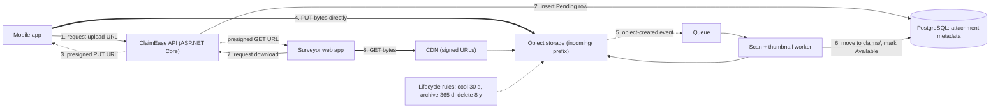
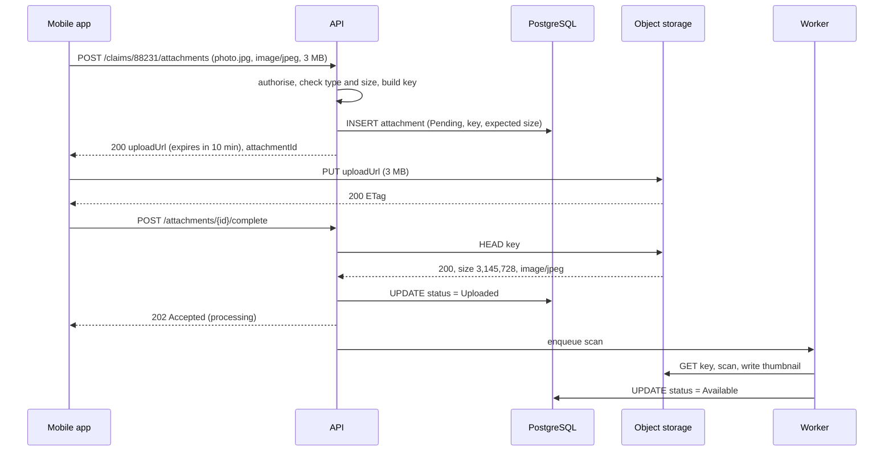

Photos, videos, PDFs, backups, exports and model files don't belong in your relational database or on your web servers' disks. They belong in object storage: a service that keeps huge numbers of files safely, cheaply and at practically unlimited scale. This lesson covers how it differs from disks and file shares, and the patterns that make it work well: direct uploads with presigned URLs, multipart uploads for large files, lifecycle tiers for cost, and a database that keeps track of it all.

## Learning objectives

By the end of this lesson you will be able to:

1. Compare block, file and object storage, and pick the right one for a workload.
2. Explain the object model: buckets, keys, metadata, versioning, durability and consistency.
3. Design direct-to-storage uploads and downloads with presigned URLs, and say what to restrict in them.
4. Plan multipart uploads for large files, including part sizes, retries and cleanup of incomplete uploads.
5. Use lifecycle rules and storage tiers to control cost, including minimum-duration and retrieval charges.
6. Keep file metadata in the database, and reconcile the database with the bucket when they drift apart.

## Prerequisites

- [HTTP fundamentals](#/lesson/m10-http-fundamentals): object storage is used over HTTP (`PUT`, `GET`, `HEAD`, range requests).
- [Capacity estimation](#/lesson/m11-capacity-estimation): storage and bandwidth maths.
- [Choosing and scaling the database tier](#/lesson/m11-database-architecture): why large files shouldn't live in the database.

## Explain it like I'm a beginner

Think of three ways to keep things at a railway station.

- **A locker you rent by the hour** (block storage). You get an empty box and arrange things however you like inside. Only you, with your key, use it. It is fast, but it is one box attached to one person. In computing this is a raw disk attached to one server.
- **A shared office filing cabinet** (file storage). Folders inside folders, and several colleagues can open the same folder and edit a file in place. Convenient, but it gets slow and complicated when thousands of people use it at once. In computing this is a network file share (NFS or SMB).
- **The parcel office** (object storage). You hand over a parcel, it gets a unique label, and you get the label back. Later you show the label and get the whole parcel. You can't open the parcel and swap one page inside; you replace the whole parcel with a new one. The parcel office is enormous, very cheap per parcel, and doesn't care whether it holds a thousand parcels or a billion.

Two more ideas complete the picture:

- A **presigned URL** is a signed collection slip. The station master (your app) writes a slip saying "the bearer may drop off one parcel labelled X before 3:15 pm". The customer takes it straight to the parcel office. The station master never carries the heavy parcel.
- **Lifecycle tiers** are like the station moving parcels nobody has collected for a month to a cheaper back room, and after a year to a warehouse in another town. Storage there is cheaper, but getting a parcel back takes longer and costs a fee.

## First-principles explanation

### Block, file and object storage

| | Block | File | Object |
|---|---|---|---|
| What you get | A raw disk volume | A shared file system (folders, files) | Buckets of objects addressed by key |
| Interface | Sectors, via the OS (a mounted disk) | NFS / SMB, POSIX-like operations | HTTP API: `PUT`, `GET`, `HEAD`, `DELETE`, `LIST` |
| Edit part of a file | Yes | Yes | No. Replace the whole object (multipart can build a new one) |
| Shared by many servers | Usually one server at a time | Yes | Yes, by anyone with permission, from anywhere |
| Latency | Lowest (sub-millisecond to a few ms) | Low to moderate | Higher per request (tens of ms is common, estimate) but high throughput |
| Scale | Size of a volume | Large, but with practical limits | Practically unlimited objects and bytes |
| Typical use | Database files, VM disks | Legacy apps that need a shared folder, home directories | User uploads, media, backups, logs, data lakes, static sites |

The rule of thumb: **databases on block storage, user files and anything large on object storage**, and file storage only when an application truly needs a shared POSIX folder.

### The object model

- **Bucket** (Amazon S3, Google Cloud Storage) or **container** (Azure Blob Storage): a top-level namespace with its own permissions, region and settings.
- **Key**: the object's name, such as `claims/2026/10/88231/7f3c….jpg`. The namespace is **flat**. The slashes only look like folders. Consoles show "folders" by grouping on prefixes.
- **Data**: the bytes, from zero bytes to multiple terabytes per object.
- **Metadata**: system metadata (size, `Content-Type`, `ETag`, last modified) and a small amount of user metadata. It is not a database: you can't query "all objects where claim = 88231" efficiently.
- **Versioning** (optional): overwriting or deleting keeps the old versions, so you can recover from mistakes. Old versions still cost storage.
- **Object lock / immutability** (optional): write once, read many (WORM). Objects can't be deleted or overwritten until a retention date. Used for regulatory records and ransomware protection.

**Durability versus availability.** Providers store each object redundantly across devices and usually across availability zones, with replication or erasure coding. They publish durability design targets with many nines (Amazon S3 states 99.999999999 %, "eleven nines", for its standard class). That is about *not losing data*. *Availability*, whether a request succeeds right now, is a separate and lower number, typically 99.9–99.99 % depending on class and region. Your design must still handle failed requests with retries.

**Consistency.** The major providers now give strong read-after-write consistency: after a successful `PUT`, a `GET` or `LIST` sees the new object. Check your provider's documentation, and remember that a CDN in front of the bucket adds its own caching (see [CDN architecture](#/lesson/m11-cdn)).

### Back-of-the-envelope: an insurance claims app

**ClaimEase** lets motor-insurance customers report a claim from their phone, with photos and a short video of the damage. Surveyors review them, and records must be kept for 8 years (estimate of a regulatory requirement; check the actual rule).

- 30,000 claims a day. Each has 12 photos × 3 MB = 36 MB and one 80 MB video: about 116 MB per claim.
- Data per day: 30,000 × 116 MB ≈ 3.5 TB/day. Per year: 3.5 × 365 ≈ **1.3 PB/year**. Over 8 years of retention: about 10 PB (estimate).
- Upload bandwidth: 3.5 TB ÷ 86,400 s ≈ 40 MB/s ≈ 320 Mbit/s on average. Claims cluster in the daytime, so assume ×3 at peak: about **1 Gbit/s**.
- Requests: 30,000 × 13 objects = 390,000 uploads/day, about 4.5/s on average. Small. Object storage cares far more about bytes than about this request rate.

Two conclusions follow straight from the numbers:

1. **1 Gbit/s of uploads must not flow through the API servers.** Each upload would hold a server connection and memory for many seconds on slow mobile networks. Clients should upload directly to object storage.
2. **10 PB is impossible to keep "hot" cheaply.** After the first month, a claim's files are rarely opened. Lifecycle rules must move them to cheaper tiers.

### Why not store files in PostgreSQL or on the app server?

- **In the database** (`bytea` or large objects): 10 PB of blobs would make backups, replicas, restores and vacuum enormous and slow, and would compete with transactional data for memory and I/O. A few small files (thumbnails under about 1 MB in a small app) are tolerable. Anything bigger belongs outside.
- **On the app server's disk**: the moment you run two instances behind a load balancer, a file uploaded to one isn't on the other. When an instance is replaced, its files vanish. Never do this beyond a prototype.

The standard design is: **bytes in object storage, metadata in the database.** The database row says which claim the photo belongs to, who uploaded it, its size, checksum, status and storage key. The bucket holds the bytes.

### Presigned URLs: uploads and downloads without your servers in the middle

A **presigned URL** (called a SAS URL, shared access signature, in Azure) is a URL that carries a signature granting one specific operation for a limited time: "PUT to this key, with this content type, until 10:15". Your API creates it using its storage credentials. The client uses it directly against the storage service. The signature is computed locally by the SDK, so creating one costs no network call.

The upload flow:

1. **Client asks the API**: "I want to upload a 3 MB JPEG for claim 88231."
2. **API authorises and validates**: is this user allowed to add files to that claim? Is the type on the allow-list? Is the size under the limit? Then it **chooses the key itself** (never from the client's file name), inserts an `attachment` row with status `Pending`, and returns a presigned `PUT` URL valid for about 10 minutes.
3. **Client uploads the bytes straight to object storage.**
4. **Client tells the API it is done** (or the storage service sends an event when the object is created).
5. **API verifies**: a `HEAD` request confirms the object exists and that its size and content type match what was requested. The row becomes `Uploaded`.
6. **A background worker** scans the file for malware, extracts EXIF data, makes thumbnails, and marks it `Available` (see [Background processing](#/lesson/m11-background-processing)).

What to restrict in an upload URL:

- **Short expiry**: minutes, not days. It is a bearer token.
- **Exact key**: generated by the server, under a prefix such as `incoming/`.
- **Content type** and, where the provider supports it (for example S3 presigned POST policies), a **size range**. If the provider can't enforce size at upload, verify it with `HEAD` afterwards and delete anything oversized.
- **A checksum** where supported, so corrupted uploads are rejected.

Downloads work the same way: the API checks permission, then returns a presigned `GET` URL valid for a few minutes, or a CDN signed URL for heavily viewed public-ish content. Set `Content-Disposition: attachment` for documents users upload, so a malicious HTML file isn't rendered in the browser under your domain. Serving user content from a separate domain adds another layer of protection.

For browsers, configure the bucket's **CORS** rules to allow `PUT` from your web app's origin only.

### Multipart uploads for large files

Uploading an 80 MB video in one `PUT` over a patchy 4G connection means one dropped connection at 95 % restarts the whole thing. **Multipart upload** splits the file into parts that are uploaded independently, possibly in parallel, and then combined.

1. **Initiate**: the API starts a multipart upload and gets an upload id.
2. **Upload parts**: the client uploads part 1, part 2, … (each with its own presigned URL). Each part returns an `ETag`. A failed part is retried on its own.
3. **Complete**: the API sends the list of part numbers and `ETag`s, and the service assembles the object.
4. **Abort** if the user gives up.

On Amazon S3 the limits are: parts of 5 MiB to 5 GiB (the last part may be smaller), at most 10,000 parts, and objects up to 5 TiB. Azure Blob Storage uses a similar idea (staging blocks, then committing a block list) with its own limits. With 8 MiB parts, an 80 MB video is 10 parts. Uploading 3 in parallel on a 10 Mbit/s uplink takes about 80 × 8 ÷ 10 = 64 s in total, and a dropped connection costs at most one 8 MiB part.

**Incomplete multipart uploads cost money.** Uploaded parts are stored (and billed) until the upload is completed or aborted. Add a lifecycle rule that aborts incomplete uploads after a few days. It is one of the most common silent cost leaks.

### Lifecycle rules and storage tiers

Providers offer storage classes (names differ):

| Tier | Storage price | Access price | Retrieval time | Fits |
|---|---|---|---|---|
| Hot / standard | Highest | Lowest | Immediate | New claims, active review |
| Cool / infrequent access | Lower | Higher per request plus a per-GB retrieval fee | Immediate | Closed claims, opened occasionally |
| Cold / archive | Lowest, often by a large factor | Highest, retrieval fee | Hours, unless you pay for expedited | Records kept for compliance |

Exact prices vary by provider and region, so treat any ratio as an estimate and check current pricing. Three rules of thumb matter more than prices:

- **Minimum storage durations.** Cool and archive tiers usually bill a minimum period (for example 30, 90 or 180 days). Moving an object to archive and deleting it a week later can cost more than leaving it hot.
- **Per-object overhead.** Archive tiers often add per-object metadata charges or minimum billable sizes. Archiving millions of 20 KB thumbnails is often a loss. Keep small objects in a warmer tier, or bundle them.
- **Retrieval is slow and paid.** If surveyors routinely reopen 6-month-old claims, archiving at 3 months will be slow and expensive. Base the rule on access patterns.

**Lifecycle rules** apply this automatically, by age, prefix or tags: for example "objects under `claims/` move to cool after 30 days and to archive after 365 days, and are deleted after 8 years unless under legal hold". Deleting from the database must line up with deleting from storage, and legal holds must win over every rule.

### Key design

- **Generate keys on the server**: `claims/{yyyy}/{mm}/{claimId}/{uuid}.jpg`. Never use the client's file name in the key. It can contain `../`, odd Unicode or personal data, and two files with the same name would collide. Store the original name in the database for display.
- **Put a date or category early in the key** so lifecycle rules, inventories and cost reports can target prefixes.
- **Don't use `LIST` as a query.** Listing a bucket with billions of objects is slow and paid per request. The database is your index.
- **Request rates per prefix.** Providers scale request capacity by key prefix. Amazon S3, for example, documents at least 3,500 writes and 5,500 reads per second per prefix and scales further with more prefixes. ClaimEase's 4.5 uploads/s are nowhere near this, but a system writing tens of thousands of small objects per second should spread keys across many prefixes.

### Keeping the database and the bucket consistent

The database and the bucket are two systems with no shared transaction. They drift in two ways:

- **Orphan objects**: bytes in the bucket with no row, or with a row stuck in `Pending` (the client uploaded but never confirmed, or the API crashed between steps). They cost money and may hold personal data you promised to delete.
- **Dangling rows**: a row says `Available` but the object is missing (someone deleted it by hand, or a lifecycle rule deleted it too early). Users see broken images.

Mitigations:

- **Row first, then bytes.** Insert the `Pending` row before handing out the upload URL, so every legitimate object has a row.
- **Delete in two phases.** Mark the row `Deleted`, then a background job deletes the object. Retrying a delete is harmless.
- **Reconcile regularly.** Compare the storage inventory (providers can produce a daily inventory file, which is cheaper than `LIST`) with the database: delete orphans older than a day, and alert on dangling rows.
- **Use storage events** (object-created notifications to a queue) to confirm uploads even when the client never calls back.

### Security checklist

- Buckets **private by default**, with account-level "block public access" settings on.
- The app's identity gets the **least privilege** it needs (for example write to `incoming/`, read from `claims/`).
- **Encryption at rest** is on by default with most providers. Use customer-managed keys if regulation demands it.
- **Scan uploads** before anyone else can download them. Keep unscanned files in a quarantine prefix.
- **Never trust the declared content type.** Check magic bytes in the scan step.

### What breaks first under load

1. **API servers that proxy uploads**: memory, connections and timeouts, long before the storage service notices anything.
2. **Egress cost** when popular files are served straight from the bucket. Put a CDN in front for anything viewed repeatedly.
3. **Request costs from tiny objects**: millions of 2 KB objects can cost more in requests than in storage. Batch them.
4. **Background processing backlogs**: thumbnailing and scanning fall behind at peak, and files stay "processing". Queue the work and scale workers on queue depth.

### Failure modes and mitigations

| Failure | Effect | Mitigation |
|---|---|---|
| Upload URL leaked | Someone uploads to your key | Short expiry, exact key and type, size check with `HEAD`, quarantine until scanned |
| Client never confirms | Orphan object, row stuck `Pending` | Storage event confirms; reconcile job cleans up |
| Network drops mid-upload | User starts again | Multipart with per-part retry; resumable state on the client |
| Incomplete multipart uploads | Silent storage cost | Lifecycle rule to abort after N days |
| Accidental delete or overwrite | Data loss | Versioning; object lock for regulated records; restricted delete permissions |
| Archive object needed urgently | Hours of delay | Keep recent and likely-needed data warmer; plan restores |
| Malicious file served from your domain | Stored XSS, malware spread | Scan; `Content-Disposition: attachment`; separate user-content domain |
| Regional outage | Files unavailable | Cross-region replication for critical data (costs storage and transfer twice) |

### Consistency trade-offs

The bucket is strongly consistent for single objects, but the *pair* of database row and object is only eventually consistent. Design screens for it: show "processing" for files that are uploaded but not scanned, and never show a download link until the row says `Available`.

### Cost drivers

- **Storage**, in GB-months, by tier. At petabyte scale, tiering is the single biggest lever.
- **Requests**: `PUT`/`LIST` usually cost more than `GET`, priced per thousand.
- **Egress** to the internet, usually the largest bill for media-heavy apps. A CDN reduces it.
- **Retrieval fees and minimum durations** for cool and archive tiers.
- **Hidden extras**: old versions, incomplete multipart parts, cross-region replication, inventory and event notifications.

### When a simpler design is enough

An internal tool that stores 500 PDF reports a month, a few MB each, can upload through the API (with a size limit) straight into a private bucket and keep a metadata row. No multipart, no lifecycle tiers, no CDN. Add presigned direct uploads when files get large or traffic grows, multipart when files exceed roughly 100 MB or networks are unreliable, and tiers when the storage bill becomes noticeable.

## Visual explanation

### Architecture: direct uploads and downloads



Reading the arrows:

- **1–3**: the app asks the API for permission. The API checks the user, validates type and size, writes a `Pending` row, and returns a short-lived presigned URL. No file bytes touch the API.
- **4 (thick)**: the heavy traffic, about 1 Gbit/s at peak, goes straight from phones to object storage.
- **5**: the storage service publishes an "object created" event to a queue, so confirmation doesn't depend on the client calling back.
- **6**: a worker scans the file, makes thumbnails, moves it from quarantine (`incoming/`) to `claims/`, and marks the row `Available`.
- **7–8**: surveyors ask the API for a download link. The API checks permission and returns a signed URL. Bytes come from the CDN, which pulls from the bucket on a miss, cutting egress cost for files viewed many times.
- **Lifecycle rules (dotted)**: the storage service moves and deletes objects by age without any application code.

### Sequence: presigned upload, confirm and verify



The API never sees the photo's bytes. It authorises the upload, records a `Pending` row with the size it expects, and hands back a URL that works for ten minutes on exactly one key. The phone uploads directly. When the phone reports completion, the API does not trust it: it asks storage for the object's real size and type with `HEAD`, and only then marks the row `Uploaded`. Scanning and thumbnailing run in the background, so the user gets a fast `202` and the file becomes `Available` a little later. If the phone never calls `complete`, the storage event (from the architecture diagram) or the reconcile job finishes the job.

## Step-by-step example

ClaimEase's first version posted photos to the API as `multipart/form-data`, and the API saved them to its local disk. With three API instances, surveyors sometimes saw "image not found", and the servers ran out of memory during a hailstorm in Bengaluru when claims spiked. Here is the redesign.

### Step 1 — move bytes to object storage

One private bucket per environment. Prefixes: `incoming/` (quarantine), `claims/` (scanned), `thumbs/`. The app's identity may write only to `incoming/`. The worker's identity may read `incoming/` and write `claims/` and `thumbs/`.

### Step 2 — design the metadata table

```sql
CREATE TABLE attachment (
    attachment_id  uuid PRIMARY KEY,
    claim_id       bigint      NOT NULL REFERENCES claim (claim_id),
    storage_key    text        NOT NULL UNIQUE,
    original_name  text        NOT NULL,
    content_type   text        NOT NULL,
    expected_bytes bigint      NOT NULL CHECK (expected_bytes > 0),
    actual_bytes   bigint,
    sha256         text,
    status         text        NOT NULL CHECK (status IN ('Pending','Uploaded','Available','Rejected','Deleted')),
    created_at     timestamptz NOT NULL DEFAULT now(),
    available_at   timestamptz
);
CREATE INDEX ON attachment (claim_id) WHERE status = 'Available';
CREATE INDEX ON attachment (status, created_at) WHERE status IN ('Pending','Uploaded');
```

The partial indexes serve the two main queries: "show this claim's files" and "find stuck uploads for the reconcile job".

### Step 3 — set limits

Photos: JPEG or PNG, at most 15 MB. Videos: MP4, at most 300 MB, uploaded with multipart in 8 MiB parts. Upload URLs expire after 10 minutes. Download URLs expire after 5 minutes.

### Step 4 — write lifecycle rules

- `incoming/`: delete after 2 days (anything still there was never confirmed or failed the scan).
- `claims/`: cool after 30 days, archive after 365 days, delete after 8 years. Objects under legal hold (a tag set by the litigation team) are exempt.
- Whole bucket: abort incomplete multipart uploads after 3 days. Delete non-current versions after 30 days.

### Step 5 — check the cost shape

At 1.3 PB/year, only the last 30 days (about 3.5 TB × 30 ≈ 105 TB) are hot. Most of the 8-year archive (about 10 PB at steady state) sits in the cheapest tier. Without lifecycle rules, all of it would be billed at the hot rate. With typical tier price ratios, that makes the difference between a manageable bill and one many times larger (estimate; model it with current prices for your provider).

## Production-style C# implementation

The storage SDK is hidden behind two interfaces: one for presigning URLs and one for object operations. Fakes make the code compile and run without a cloud account. In production, the implementations wrap the AWS SDK, Azure SDK or Google Cloud client library.

```text
ClaimEase.Api/
  Program.cs
  Storage/StorageAbstractions.cs
  Storage/InMemoryStorage.cs
  Attachments/Attachment.cs
  Attachments/AttachmentService.cs
  Attachments/StaleUploadSweeper.cs
```

For reference, real presigning with the AWS SDK looks like this (not compiled here, because the package isn't available offline):

```csharp
var url = s3.GetPreSignedURL(new GetPreSignedUrlRequest
{
    BucketName = "claimease-prod",
    Key = key,
    Verb = HttpVerb.PUT,
    ContentType = "image/jpeg",
    Expires = DateTime.UtcNow.AddMinutes(10),
});
```

```csharp file=Storage/StorageAbstractions.cs
namespace ClaimEase.Storage;

public sealed record ObjectInfo(string Key, long SizeBytes, string ContentType);

/// <summary>Creates time-limited URLs for one operation on one key. Computed locally; no network call.</summary>
public interface IUrlPresigner
{
    Uri PresignPut(string key, string contentType, TimeSpan validFor);
    Uri PresignGet(string key, string downloadFileName, TimeSpan validFor);
}

public interface IObjectStore
{
    Task<ObjectInfo?> HeadAsync(string key, CancellationToken ct);
    Task DeleteAsync(string key, CancellationToken ct);
}
```

```csharp file=Storage/InMemoryStorage.cs
using System.Collections.Concurrent;
using System.Security.Cryptography;
using System.Text;

namespace ClaimEase.Storage;

/// <summary>Fake bucket for tests and local runs. Tests "upload" by calling Put directly.</summary>
public sealed class InMemoryObjectStore : IObjectStore
{
    private readonly ConcurrentDictionary<string, ObjectInfo> _objects = new();

    public void Put(string key, long size, string contentType) => _objects[key] = new ObjectInfo(key, size, contentType);
    public bool Exists(string key) => _objects.ContainsKey(key);

    public Task<ObjectInfo?> HeadAsync(string key, CancellationToken ct) =>
        Task.FromResult(_objects.TryGetValue(key, out var o) ? o : null);

    public Task DeleteAsync(string key, CancellationToken ct)
    {
        _objects.TryRemove(key, out _);   // deleting a missing key is not an error, so retries are safe
        return Task.CompletedTask;
    }
}

/// <summary>Signs URLs the way real providers do in spirit: HMAC over verb, key, content type and expiry.</summary>
public sealed class HmacUrlPresigner(byte[] key, Uri bucketBase, TimeProvider clock) : IUrlPresigner
{
    public Uri PresignPut(string objectKey, string contentType, TimeSpan validFor) =>
        Sign("PUT", objectKey, contentType, validFor, extra: "");

    public Uri PresignGet(string objectKey, string downloadFileName, TimeSpan validFor) =>
        Sign("GET", objectKey, "", validFor,
             extra: "&response-content-disposition=" + Uri.EscapeDataString($"attachment; filename=\"{downloadFileName}\""));

    private Uri Sign(string verb, string objectKey, string contentType, TimeSpan validFor, string extra)
    {
        if (validFor <= TimeSpan.Zero || validFor > TimeSpan.FromHours(1))
            throw new ArgumentOutOfRangeException(nameof(validFor), "Presigned URLs should live minutes, not days.");
        var exp = clock.GetUtcNow().Add(validFor).ToUnixTimeSeconds();
        var sig = Convert.ToHexString(HMACSHA256.HashData(key, Encoding.UTF8.GetBytes($"{verb}\n{objectKey}\n{contentType}\n{exp}")));
        return new Uri(bucketBase, $"{objectKey}?X-Expires={exp}&X-Signature={sig.ToLowerInvariant()}{extra}");
    }
}
```

```csharp file=Attachments/Attachment.cs
using System.Collections.Concurrent;

namespace ClaimEase.Attachments;

public enum AttachmentStatus { Pending, Uploaded, Available, Rejected, Deleted }

public sealed record Attachment(
    Guid Id, long ClaimId, string StorageKey, string OriginalName, string ContentType,
    long ExpectedBytes, AttachmentStatus Status, DateTimeOffset CreatedAt);

public interface IAttachmentRepository
{
    Task AddAsync(Attachment a, CancellationToken ct);
    Task<Attachment?> GetAsync(Guid id, CancellationToken ct);
    Task UpdateAsync(Attachment a, CancellationToken ct);
    Task<IReadOnlyList<Attachment>> StuckAsync(AttachmentStatus status, DateTimeOffset createdBefore, CancellationToken ct);
}

/// <summary>Stand-in for the attachment table.</summary>
public sealed class InMemoryAttachmentRepository : IAttachmentRepository
{
    private readonly ConcurrentDictionary<Guid, Attachment> _rows = new();
    public Task AddAsync(Attachment a, CancellationToken ct) { _rows[a.Id] = a; return Task.CompletedTask; }
    public Task<Attachment?> GetAsync(Guid id, CancellationToken ct) => Task.FromResult(_rows.TryGetValue(id, out var a) ? a : null);
    public Task UpdateAsync(Attachment a, CancellationToken ct) { _rows[a.Id] = a; return Task.CompletedTask; }
    public Task<IReadOnlyList<Attachment>> StuckAsync(AttachmentStatus status, DateTimeOffset createdBefore, CancellationToken ct) =>
        Task.FromResult<IReadOnlyList<Attachment>>(_rows.Values.Where(a => a.Status == status && a.CreatedAt < createdBefore).ToList());
}
```

```csharp file=Attachments/AttachmentService.cs
using ClaimEase.Storage;

namespace ClaimEase.Attachments;

public sealed record UploadTicket(Guid AttachmentId, Uri UploadUrl, DateTimeOffset ExpiresAt);

public sealed class UploadRejectedException(string message) : Exception(message);

public sealed class AttachmentService(IAttachmentRepository repo, IObjectStore store, IUrlPresigner presigner, TimeProvider clock)
{
    private static readonly Dictionary<string, (string Ext, long MaxBytes)> Allowed = new(StringComparer.OrdinalIgnoreCase)
    {
        ["image/jpeg"] = ("jpg", 15L * 1024 * 1024),
        ["image/png"] = ("png", 15L * 1024 * 1024),
        ["video/mp4"] = ("mp4", 300L * 1024 * 1024),
    };
    private static readonly TimeSpan UploadWindow = TimeSpan.FromMinutes(10);

    public async Task<UploadTicket> RequestUploadAsync(long claimId, string originalName, string contentType, long sizeBytes, CancellationToken ct)
    {
        if (!Allowed.TryGetValue(contentType, out var rule)) throw new UploadRejectedException($"Type '{contentType}' is not allowed.");
        if (sizeBytes <= 0 || sizeBytes > rule.MaxBytes) throw new UploadRejectedException($"Size must be between 1 byte and {rule.MaxBytes} bytes.");

        var now = clock.GetUtcNow();
        var id = Guid.CreateVersion7();
        // The server chooses the key. The client's file name is stored for display only.
        var key = $"incoming/{now:yyyy}/{now:MM}/{claimId}/{id:N}.{rule.Ext}";

        await repo.AddAsync(new Attachment(id, claimId, key, originalName, contentType, sizeBytes, AttachmentStatus.Pending, now), ct);
        return new UploadTicket(id, presigner.PresignPut(key, contentType, UploadWindow), now + UploadWindow);
    }

    /// <summary>Called by the client, or by the object-created event handler. Safe to call twice.</summary>
    public async Task<AttachmentStatus> ConfirmAsync(Guid attachmentId, CancellationToken ct)
    {
        var a = await repo.GetAsync(attachmentId, ct) ?? throw new KeyNotFoundException();
        if (a.Status != AttachmentStatus.Pending) return a.Status;   // idempotent

        var info = await store.HeadAsync(a.StorageKey, ct);
        if (info is null) return AttachmentStatus.Pending;          // not there yet; the sweeper decides later

        var ok = info.SizeBytes == a.ExpectedBytes && string.Equals(info.ContentType, a.ContentType, StringComparison.OrdinalIgnoreCase);
        var next = ok ? AttachmentStatus.Uploaded : AttachmentStatus.Rejected;
        if (!ok) await store.DeleteAsync(a.StorageKey, ct);
        await repo.UpdateAsync(a with { Status = next }, ct);
        return next;   // Uploaded files are queued for scanning (see the background processing lesson)
    }

    public async Task<Uri> DownloadUrlAsync(Guid attachmentId, CancellationToken ct)
    {
        var a = await repo.GetAsync(attachmentId, ct) ?? throw new KeyNotFoundException();
        if (a.Status != AttachmentStatus.Available) throw new InvalidOperationException("File is not available yet.");
        return presigner.PresignGet(a.StorageKey, a.OriginalName, TimeSpan.FromMinutes(5));
    }
}
```

```csharp file=Attachments/StaleUploadSweeper.cs
using ClaimEase.Storage;

namespace ClaimEase.Attachments;

/// <summary>Cleans up uploads that were never confirmed: deletes any bytes, marks the row Rejected.</summary>
public sealed class StaleUploadSweeper(IAttachmentRepository repo, IObjectStore store, TimeProvider clock, ILogger<StaleUploadSweeper> log)
    : BackgroundService
{
    public static readonly TimeSpan MaxPendingAge = TimeSpan.FromHours(24);

    public async Task<int> SweepOnceAsync(CancellationToken ct)
    {
        var stale = await repo.StuckAsync(AttachmentStatus.Pending, clock.GetUtcNow() - MaxPendingAge, ct);
        foreach (var a in stale)
        {
            await store.DeleteAsync(a.StorageKey, ct);                       // bytes first: an orphan row is harmless,
            await repo.UpdateAsync(a with { Status = AttachmentStatus.Rejected }, ct);   // an orphan object costs money
        }
        if (stale.Count > 0) log.LogInformation("Swept {Count} stale uploads", stale.Count);
        return stale.Count;
    }

    protected override async Task ExecuteAsync(CancellationToken stoppingToken)
    {
        using var timer = new PeriodicTimer(TimeSpan.FromHours(1), clock);
        do
        {
            try { await SweepOnceAsync(stoppingToken); }
            catch (Exception ex) when (ex is not OperationCanceledException) { log.LogError(ex, "Sweep failed; will retry next hour"); }
        }
        while (await timer.WaitForNextTickAsync(stoppingToken));
    }
}
```

```csharp file=Program.cs
using System.Text;
using ClaimEase.Attachments;
using ClaimEase.Storage;

var builder = WebApplication.CreateBuilder(args);

builder.Services.AddSingleton(TimeProvider.System);
builder.Services.AddSingleton<InMemoryObjectStore>();
builder.Services.AddSingleton<IObjectStore>(sp => sp.GetRequiredService<InMemoryObjectStore>());
builder.Services.AddSingleton<IUrlPresigner>(sp => new HmacUrlPresigner(
    Encoding.UTF8.GetBytes(builder.Configuration["Storage:SigningKey"] ?? "dev-only-signing-key-change-me"),
    new Uri("https://claimease-dev.storage.example/"),
    sp.GetRequiredService<TimeProvider>()));
builder.Services.AddSingleton<IAttachmentRepository, InMemoryAttachmentRepository>();
builder.Services.AddSingleton<AttachmentService>();
builder.Services.AddHostedService<StaleUploadSweeper>();

var app = builder.Build();

// In production every endpoint checks that the caller may access the claim.
app.MapPost("/claims/{claimId:long}/attachments", async (long claimId, UploadRequest req, AttachmentService svc, CancellationToken ct) =>
{
    try { return Results.Ok(await svc.RequestUploadAsync(claimId, req.FileName, req.ContentType, req.SizeBytes, ct)); }
    catch (UploadRejectedException ex) { return Results.BadRequest(new { error = ex.Message }); }
});

app.MapPost("/attachments/{id:guid}/complete", async (Guid id, AttachmentService svc, CancellationToken ct) =>
    await svc.ConfirmAsync(id, ct) switch
    {
        AttachmentStatus.Uploaded => Results.Accepted(value: new { status = "processing" }),
        AttachmentStatus.Rejected => Results.UnprocessableEntity(new { error = "Uploaded file did not match the request." }),
        var s => Results.Ok(new { status = s.ToString() }),
    });

app.MapGet("/attachments/{id:guid}/download", async (Guid id, AttachmentService svc, CancellationToken ct) =>
    Results.Ok(new { url = await svc.DownloadUrlAsync(id, ct) }));

app.Run();

public sealed record UploadRequest(string FileName, string ContentType, long SizeBytes);
```

Design notes:

- **The API validates before signing**: type allow-list, size limit, permission on the claim. A presigned URL can't be taken back, so checks happen before it exists.
- **The server owns the key.** The client's file name is stored only for display and for the download's `Content-Disposition`.
- **`ConfirmAsync` trusts storage, not the client.** It checks real size and type with `HEAD`, and it is idempotent, so the client callback and the storage event can both call it safely.
- **The sweeper deletes bytes before updating the row.** If it crashes in between, the next run retries the (idempotent) delete. The opposite order could leave an orphan object that no row points to.
- **Presigned lifetimes are capped in code** at one hour, so nobody "temporarily" issues week-long links.

## Bad design vs good design

**Bad**: the API accepts uploads as form posts, buffers each one in memory, writes it to `/var/uploads` on the instance, and stores the path in the database. Downloads stream the file back through the API. The bucket migration later copies files with their original names as keys: `claims/88231/IMG_20261019_101500.jpg`.

What goes wrong: files exist on only one of three instances. A 300 MB video upload over a slow network holds a request thread and hundreds of MB of memory. A hailstorm spike exhausts memory on every instance. Two photos with the same name from one claim overwrite each other. A file named `../../config.json` is a security review finding. Every download consumes API bandwidth and egress, with no CDN.

**Good**: presigned direct uploads with server-chosen keys, `Pending` rows first, verification with `HEAD`, multipart for videos, quarantine until scanned, presigned or CDN-signed downloads, lifecycle rules, and a reconcile job.

**Is the good design always worth it?** For an internal app with a handful of small files a day, proxying uploads through the API into a private bucket is simpler and fine. Keep the key-design and metadata rules; skip the rest until the numbers call for it.

:::callout type=mistake title="Using the bucket as a database"
Listing a prefix to answer "which files belong to claim 88231?" works in development with 50 objects and becomes slow and expensive at 500 million. Keep the index in the database, and use storage inventory reports for audits.
:::

:::callout type=tradeoff title="Archive tiers: cheap to keep, expensive to touch"
Archive storage can cost a small fraction of hot storage per GB-month, but retrieval takes hours and is billed, and early deletion is charged. Archive only what you're confident will rarely be read, and tell the business how long a restore takes.
:::

## Practical playground

The SQL playground holds ClaimEase's `attachment` metadata. Use it to answer questions that drive storage design and cost:

1. How many GB are in each status? (`SUM(actual_bytes) / 1e9 GROUP BY status`)
2. How many `Pending` uploads are older than 24 hours, the reconcile job's workload?
3. Bucket data by age (0–30 days, 31–365, older) to estimate how much would sit in each lifecycle tier.
4. Which claims have more than 300 MB of files?

:::playground type=sql title="Attachment metadata and tier estimates"
```sql
CREATE TABLE attachment (
  attachment_id int PRIMARY KEY,
  claim_id      int NOT NULL,
  storage_key   text NOT NULL UNIQUE,
  content_type  text NOT NULL,
  actual_bytes  bigint,
  status        text NOT NULL,
  created_at    timestamptz NOT NULL
);
INSERT INTO attachment VALUES
  (1, 88231, 'claims/2026/10/88231/a1.jpg', 'image/jpeg', 3100000, 'Available', '2026-10-18 10:00+05:30'),
  (2, 88231, 'claims/2026/10/88231/a2.mp4', 'video/mp4', 82000000, 'Available', '2026-10-18 10:02+05:30'),
  (3, 88232, 'incoming/2026/10/88232/a3.jpg', 'image/jpeg', NULL, 'Pending', '2026-10-17 09:00+05:30'),
  (4, 71002, 'claims/2026/05/71002/a4.jpg', 'image/jpeg', 2900000, 'Available', '2026-05-02 12:00+05:30'),
  (5, 71002, 'claims/2026/05/71002/a5.mp4', 'video/mp4', 250000000, 'Available', '2026-05-02 12:05+05:30'),
  (6, 50110, 'claims/2025/03/50110/a6.pdf', 'application/pdf', 400000, 'Available', '2025-03-11 15:00+05:30'),
  (7, 88233, 'incoming/2026/10/88233/a7.mp4', 'video/mp4', 90000000, 'Uploaded', '2026-10-19 08:30+05:30'),
  (8, 50110, 'claims/2025/03/50110/a8.jpg', 'image/jpeg', 3300000, 'Deleted', '2025-03-11 15:01+05:30');
```
:::

## Exercises

:::exercise id=m11-object-storage-ex1 difficulty=beginner kind=code title="Build safe object keys"
Implement `ObjectKeys.For(long claimId, string originalFileName, DateTimeOffset uploadedAt, Guid id)` which returns a storage key, never using the client's file name except to choose an extension.
::requirements
- Format: `claims/{yyyy}/{MM}/{claimId}/{id without dashes}.{ext}`, with the year and month taken from `uploadedAt` **in UTC**.
- Extension comes from the original file name, lower-cased. Allowed: `jpg`, `jpeg` (normalised to `jpg`), `png`, `mp4`, `pdf`.
- Any other extension, or no extension, throws `ArgumentException`.
- `claimId` must be positive, otherwise `ArgumentOutOfRangeException`.
::acceptance
- `IMG_2041.JPG` → `claims/2026/10/88231/{guid:N}.jpg`.
- `scan.jpeg` → extension `jpg`.
- `../../etc/passwd` throws; `invoice.exe` throws; `noextension` throws.
- An upload at 2026-10-31 23:30 in India (+05:30) uses month `10`, and one at 2026-11-01 02:00 +05:30 uses month `10` too, because it is still 31 October in UTC.
::hint
`Path.GetExtension` returns the extension with its dot, or an empty string.
::hint
Use a dictionary from allowed extension to normalised extension.
::hint
Convert with `uploadedAt.UtcDateTime` before formatting the year and month.
::hint
```csharp
var ext = Path.GetExtension(originalFileName).TrimStart('.').ToLowerInvariant();
if (!Map.TryGetValue(ext, out var normalised)) throw new ArgumentException("Extension not allowed.", nameof(originalFileName));
var utc = uploadedAt.UtcDateTime;
return $"claims/{utc:yyyy}/{utc:MM}/{claimId}/{id:N}.{normalised}";
```
::starter
```csharp file=ObjectKeys.cs
using System;
using System.Collections.Generic;
using System.IO;

public static class ObjectKeys
{
    public static string For(long claimId, string originalFileName, DateTimeOffset uploadedAt, Guid id) =>
        throw new NotImplementedException();
}
```
::tests
```csharp file=ObjectKeysTests.cs
using System;
using Xunit;

public class ObjectKeysTests
{
    private static readonly Guid Id = Guid.Parse("7f3c2a10-1b2c-4d5e-8f90-a1b2c3d4e5f6");
    private static readonly DateTimeOffset Oct = new(2026, 10, 19, 10, 0, 0, TimeSpan.FromHours(5.5));

    [Fact] public void Builds_key_with_lowercase_ext() =>
        Assert.Equal("claims/2026/10/88231/7f3c2a101b2c4d5e8f90a1b2c3d4e5f6.jpg", ObjectKeys.For(88231, "IMG_2041.JPG", Oct, Id));

    [Fact] public void Jpeg_is_normalised() => Assert.EndsWith(".jpg", ObjectKeys.For(1, "scan.jpeg", Oct, Id));

    [Fact] public void Traversal_name_is_rejected() =>
        Assert.Throws<ArgumentException>(() => ObjectKeys.For(1, "../../etc/passwd", Oct, Id));

    [Fact] public void Executable_is_rejected() => Assert.Throws<ArgumentException>(() => ObjectKeys.For(1, "invoice.exe", Oct, Id));

    [Fact] public void Missing_extension_is_rejected() => Assert.Throws<ArgumentException>(() => ObjectKeys.For(1, "noextension", Oct, Id));

    [Fact] public void Uses_utc_month()
    {
        var earlyNovIst = new DateTimeOffset(2026, 11, 1, 2, 0, 0, TimeSpan.FromHours(5.5));
        Assert.StartsWith("claims/2026/10/", ObjectKeys.For(5, "a.png", earlyNovIst, Id));
    }

    [Fact] public void Claim_id_must_be_positive() =>
        Assert.Throws<ArgumentOutOfRangeException>(() => ObjectKeys.For(0, "a.png", Oct, Id));

    [Fact] public void Original_name_never_appears() => Assert.DoesNotContain("IMG_2041", ObjectKeys.For(1, "IMG_2041.jpg", Oct, Id));
}
```
::solution
```csharp file=ObjectKeys.cs
using System;
using System.Collections.Generic;
using System.IO;

public static class ObjectKeys
{
    private static readonly Dictionary<string, string> Map = new(StringComparer.Ordinal)
    {
        ["jpg"] = "jpg", ["jpeg"] = "jpg", ["png"] = "png", ["mp4"] = "mp4", ["pdf"] = "pdf",
    };

    public static string For(long claimId, string originalFileName, DateTimeOffset uploadedAt, Guid id)
    {
        if (claimId <= 0) throw new ArgumentOutOfRangeException(nameof(claimId));
        var ext = Path.GetExtension(originalFileName ?? "").TrimStart('.').ToLowerInvariant();
        if (!Map.TryGetValue(ext, out var normalised))
            throw new ArgumentException($"Extension '{ext}' is not allowed.", nameof(originalFileName));
        var utc = uploadedAt.UtcDateTime;
        return $"claims/{utc:yyyy}/{utc:MM}/{claimId}/{id:N}.{normalised}";
    }
}
```

`../../etc/passwd` has no extension (`Path.GetExtension` returns empty), so it is rejected by the allow-list without any special path-traversal code. That is the strength of allow-lists. Using UTC for the date prefix means lifecycle rules and cost reports agree with the provider, which works in UTC. The extension is only a hint for the browser. The real type check happens when the worker inspects the file's bytes.
::mistakes
- Building the key from the original name, which allows collisions, path tricks and personal data in keys.
- Using local time for the date prefix, so a file uploaded just after midnight lands in a different month from the provider's view.
- A block-list of "dangerous" extensions instead of an allow-list.
::extensions
Add a `thumbs/` variant that maps any image key to `thumbs/.../{id}_320.webp`.
:::

:::exercise id=m11-object-storage-ex2 difficulty=beginner kind=hld title="Get uploads off the API servers"
ClaimEase's three API servers receive all photos and videos as form uploads, store them on local disk, and stream them back to surveyors. At peak, uploads reach about 1 Gbit/s and the servers run out of memory.

Redesign the starter graph so that file bytes never pass through the API, files are scanned before surveyors can open them, and frequently viewed files are served efficiently.
::acceptance
- An `object-storage` node receives uploads directly from the client.
- The API only issues presigned URLs and stores metadata in the `database`.
- A `queue` and `worker` scan and process new files asynchronously.
- Downloads go through a `cdn` (or presigned URLs directly to storage, with a reason).
- Notes explain why the API no longer needs to scale with upload bandwidth.
::hint
Separate the *permission* to upload (small, goes through the API) from the *bytes* (large, go straight to storage).
::hint
How does the system learn that an upload finished if the phone loses signal right after it?
::hint
Object-created events to a queue, then a worker.
::hint
Edges: client → api (request URL), client → object-storage (PUT bytes), object-storage → queue (event, async), queue → worker, worker → database, surveyor → cdn → object-storage.
::starter
```json
{
  "nodes": [
    { "id": "app", "type": "client", "label": "Mobile app (claimants)", "props": { "rps": 50 } },
    { "id": "sv", "type": "client", "label": "Surveyor web app" },
    { "id": "lb", "type": "load-balancer", "label": "Load balancer" },
    { "id": "api", "type": "app-server", "label": "ClaimEase API (stores files on local disk)", "props": { "instances": 3 } },
    { "id": "db", "type": "database", "label": "PostgreSQL" }
  ],
  "edges": [
    { "from": "app", "to": "lb", "kind": "sync", "label": "form upload, ~1 Gbit/s peak" },
    { "from": "sv", "to": "lb", "kind": "sync", "label": "view files" },
    { "from": "lb", "to": "api", "kind": "sync" },
    { "from": "api", "to": "db", "kind": "sync" }
  ]
}
```
::solution
```json
{
  "nodes": [
    { "id": "app", "type": "client", "label": "Mobile app (claimants)", "props": { "rps": 50 } },
    { "id": "sv", "type": "client", "label": "Surveyor web app" },
    { "id": "lb", "type": "load-balancer", "label": "Load balancer" },
    { "id": "api", "type": "app-server", "label": "ClaimEase API (presign + metadata only)", "props": { "instances": 2 } },
    { "id": "db", "type": "database", "label": "PostgreSQL: attachment metadata", "props": { "multiAz": true } },
    { "id": "os", "type": "object-storage", "label": "Bucket: incoming/ (quarantine), claims/, thumbs/ + lifecycle" },
    { "id": "q", "type": "queue", "label": "Object-created events" },
    { "id": "w", "type": "worker", "label": "Scan + thumbnail workers", "props": { "instances": 4 } },
    { "id": "cdn", "type": "cdn", "label": "CDN with signed URLs" }
  ],
  "edges": [
    { "from": "app", "to": "lb", "kind": "sync", "label": "request upload URL" },
    { "from": "sv", "to": "lb", "kind": "sync", "label": "request download URL" },
    { "from": "lb", "to": "api", "kind": "sync" },
    { "from": "api", "to": "db", "kind": "sync", "label": "Pending rows, status" },
    { "from": "app", "to": "os", "kind": "sync", "label": "PUT bytes (presigned, multipart for video)" },
    { "from": "os", "to": "q", "kind": "async", "label": "object created" },
    { "from": "q", "to": "w", "kind": "async" },
    { "from": "w", "to": "os", "kind": "sync", "label": "read, write claims/ and thumbs/" },
    { "from": "w", "to": "db", "kind": "sync", "label": "mark Available" },
    { "from": "sv", "to": "cdn", "kind": "sync", "label": "GET via signed URL" },
    { "from": "cdn", "to": "os", "kind": "sync", "label": "cache miss" }
  ]
}
```

The API now handles only small JSON requests: at about 4.5 uploads/s on average, a few hundred requests per second at peak at most, so it no longer scales with the 1 Gbit/s of bytes. Object storage is built for that bandwidth. The queue decouples processing: if scans fall behind during a spike, files wait as "processing" instead of failing, and workers scale on queue depth. The CDN serves files that several surveyors and supervisors open, and its signed URLs keep them private.
::mistakes
- Letting the client mark files as available without the server verifying them.
- Making the bucket public "because the URLs are random".
- Scanning synchronously in the upload request, which brings back the timeouts.
::extensions
Add a second region's bucket with cross-region replication for claims under investigation, and estimate the extra cost drivers.
:::

:::exercise id=m11-object-storage-ex3 difficulty=intermediate kind=code title="Plan a resumable multipart upload"
Implement `MultipartPlanner`, which splits a file into parts that respect S3-style limits and supports resuming.
::requirements
- Constants: `MinPartSize` = 5 MiB, `MaxParts` = 10,000.
- `Plan(long totalBytes, long preferredPartSize)` returns parts as `(int Number, long Offset, long Length)`, numbered from 1.
  - The part size starts at `max(preferredPartSize, MinPartSize)`.
  - If that would need more than `MaxParts` parts, use the smallest part size that fits: `ceil(totalBytes / MaxParts)`, rounded **up** to a whole MiB.
  - Every part except the last has exactly the part size. The last part holds the remainder.
  - `totalBytes` must be positive.
- `Remaining(IReadOnlyList<Part> plan, IReadOnlySet<int> completed)` returns the parts not yet completed, in order.
::acceptance
- 80 MB (80,000,000 bytes) with 8 MiB preferred → 10 parts; the last is 80,000,000 − 9 × 8,388,608 bytes.
- A 3 MB file → one part of 3,000,000 bytes.
- A preferred size of 1 MiB is raised to 5 MiB.
- 100 GiB with 5 MiB preferred would need 20,480 parts, so the size grows to 11 MiB and there are at most 10,000 parts.
- Offsets are contiguous and lengths add up to the total.
- After parts 1–4 complete, `Remaining` returns parts 5 onwards.
::hint
Compute the part size first, then loop from offset 0 in steps of that size.
::hint
Ceiling division for positive longs: `(a + b - 1) / b`.
::hint
100 GiB ÷ 10,000 ≈ 10.24 MiB, which rounds up to 11 MiB. Check: 100 × 1,024 ÷ 11 ≈ 9,310 parts.
::hint
```csharp
var size = Math.Max(preferredPartSize, MinPartSize);
if (CeilDiv(totalBytes, size) > MaxParts)
    size = CeilDiv(CeilDiv(totalBytes, MaxParts), MiB) * MiB;
```
::starter
```csharp file=MultipartPlanner.cs
using System;
using System.Collections.Generic;
using System.Linq;

public readonly record struct Part(int Number, long Offset, long Length);

public static class MultipartPlanner
{
    public const long MiB = 1024 * 1024;
    public const long MinPartSize = 5 * MiB;
    public const int MaxParts = 10_000;

    public static IReadOnlyList<Part> Plan(long totalBytes, long preferredPartSize) => throw new NotImplementedException();

    public static IReadOnlyList<Part> Remaining(IReadOnlyList<Part> plan, IReadOnlySet<int> completed) => throw new NotImplementedException();
}
```
::tests
```csharp file=MultipartPlannerTests.cs
using System;
using System.Collections.Generic;
using System.Linq;
using Xunit;

public class MultipartPlannerTests
{
    [Fact] public void Video_in_8_mib_parts()
    {
        var plan = MultipartPlanner.Plan(80_000_000, 8 * MultipartPlanner.MiB);
        Assert.Equal(10, plan.Count);
        Assert.Equal(80_000_000 - 9 * 8_388_608L, plan[^1].Length);
        Assert.Equal(1, plan[0].Number);
    }

    [Fact] public void Small_file_is_one_part()
    {
        var plan = MultipartPlanner.Plan(3_000_000, 8 * MultipartPlanner.MiB);
        Assert.Equal(3_000_000L, Assert.Single(plan).Length);
    }

    [Fact] public void Preferred_size_is_raised_to_minimum() =>
        Assert.Equal(MultipartPlanner.MinPartSize, MultipartPlanner.Plan(50 * MultipartPlanner.MiB, MultipartPlanner.MiB)[0].Length);

    [Fact] public void Huge_file_grows_part_size()
    {
        var total = 100L * 1024 * MultipartPlanner.MiB;
        var plan = MultipartPlanner.Plan(total, MultipartPlanner.MinPartSize);
        Assert.True(plan.Count <= MultipartPlanner.MaxParts);
        Assert.Equal(11 * MultipartPlanner.MiB, plan[0].Length);
    }

    [Fact] public void Parts_are_contiguous_and_complete()
    {
        var total = 123_456_789L;
        var plan = MultipartPlanner.Plan(total, 6 * MultipartPlanner.MiB);
        long expected = 0;
        foreach (var p in plan) { Assert.Equal(expected, p.Offset); expected += p.Length; }
        Assert.Equal(total, expected);
    }

    [Fact] public void Resume_skips_completed()
    {
        var plan = MultipartPlanner.Plan(80_000_000, 8 * MultipartPlanner.MiB);
        var rest = MultipartPlanner.Remaining(plan, new HashSet<int> { 1, 2, 3, 4 });
        Assert.Equal(6, rest.Count);
        Assert.Equal(5, rest[0].Number);
    }

    [Fact] public void Zero_bytes_throws() =>
        Assert.Throws<ArgumentOutOfRangeException>(() => MultipartPlanner.Plan(0, MultipartPlanner.MinPartSize));
}
```
::solution
```csharp file=MultipartPlanner.cs
using System;
using System.Collections.Generic;
using System.Linq;

public readonly record struct Part(int Number, long Offset, long Length);

public static class MultipartPlanner
{
    public const long MiB = 1024 * 1024;
    public const long MinPartSize = 5 * MiB;
    public const int MaxParts = 10_000;

    private static long CeilDiv(long a, long b) => (a + b - 1) / b;

    public static IReadOnlyList<Part> Plan(long totalBytes, long preferredPartSize)
    {
        if (totalBytes <= 0) throw new ArgumentOutOfRangeException(nameof(totalBytes));

        var size = Math.Max(preferredPartSize, MinPartSize);
        if (CeilDiv(totalBytes, size) > MaxParts)
            size = CeilDiv(CeilDiv(totalBytes, MaxParts), MiB) * MiB;

        var parts = new List<Part>();
        long offset = 0;
        var number = 1;
        while (offset < totalBytes)
        {
            var length = Math.Min(size, totalBytes - offset);
            parts.Add(new Part(number++, offset, length));
            offset += length;
        }
        return parts;
    }

    public static IReadOnlyList<Part> Remaining(IReadOnlyList<Part> plan, IReadOnlySet<int> completed) =>
        plan.Where(p => !completed.Contains(p.Number)).ToList();
}
```

On a mobile client, persist the upload id, the plan and the set of completed part numbers (with their `ETag`s) to local storage after each part. After the app is killed or the network drops, `Remaining` gives the parts still to send, and the server completes the upload once every part is in. Bigger parts mean fewer requests but more data lost per failure. Around 8–16 MiB is a common compromise on mobile networks (estimate; measure your users).
::mistakes
- Making every part the same size including the last, which reads past the end of the file.
- Ignoring the part-count limit, so very large files fail at part 10,001.
- Restarting the whole upload after a failure instead of retrying one part.
- Never aborting abandoned uploads, so their parts are billed for ever.
::extensions
Add `EstimateSeconds(long totalBytes, double uplinkMbps, int parallel)` and compare 1, 3 and 6 parallel parts on a 10 Mbit/s uplink.
:::

:::exercise id=m11-object-storage-ex4 difficulty=intermediate kind=code title="Lifecycle decisions with tier rules"
Implement `LifecyclePlanner.Decide`, which says what the lifecycle job should do with one object. It models the rules a provider would apply, including the traps.
::requirements
- Input `ObjectFacts(string Key, long SizeBytes, Tier Tier, DateTimeOffset CreatedAt, bool LegalHold, bool IncompleteMultipart)` and `now`.
- Rules, checked **in this order**:
  1. `IncompleteMultipart` and older than 3 days → `AbortUpload`.
  2. `LegalHold` → `Keep`.
  3. Older than 8 years (2,922 days) → `Delete`.
  4. Older than 365 days, not already `Archive`, and size at least 128 KiB → `MoveToArchive`.
  5. Older than 30 days and currently `Hot` → `MoveToCool`.
  6. Otherwise → `Keep`.
- "Older than N days" means `now - CreatedAt > N days`.
::acceptance
- A 3 MB photo, 45 days old, Hot → `MoveToCool`.
- The same photo at 400 days, Cool → `MoveToArchive`.
- A 20 KiB thumbnail at 400 days, Cool → `Keep` (too small to archive profitably).
- A 9-year-old object under legal hold → `Keep`.
- A 5-day-old incomplete multipart upload → `AbortUpload`, even under legal hold.
::hint
The order of the checks is the design. Write early returns in exactly that order.
::hint
Compute `var age = now - f.CreatedAt;` once and compare with `TimeSpan.FromDays(n)`.
::hint
Rule 4 has three conditions. Rule 5 only applies to `Hot`.
::hint
```csharp
if (f.IncompleteMultipart && age > TimeSpan.FromDays(3)) return LifecycleAction.AbortUpload;
if (f.LegalHold) return LifecycleAction.Keep;
```
::starter
```csharp file=LifecyclePlanner.cs
using System;

public enum Tier { Hot, Cool, Archive }
public enum LifecycleAction { Keep, MoveToCool, MoveToArchive, Delete, AbortUpload }

public sealed record ObjectFacts(string Key, long SizeBytes, Tier Tier, DateTimeOffset CreatedAt, bool LegalHold, bool IncompleteMultipart);

public static class LifecyclePlanner
{
    public const long MinArchiveBytes = 128 * 1024;

    public static LifecycleAction Decide(ObjectFacts f, DateTimeOffset now) => throw new NotImplementedException();
}
```
::tests
```csharp file=LifecyclePlannerTests.cs
using System;
using Xunit;

public class LifecyclePlannerTests
{
    private static readonly DateTimeOffset Now = new(2026, 10, 19, 0, 0, 0, TimeSpan.Zero);
    private static ObjectFacts F(int ageDays, Tier tier, long size = 3_000_000, bool hold = false, bool incomplete = false) =>
        new("claims/x", size, tier, Now.AddDays(-ageDays), hold, incomplete);

    [Fact] public void Young_hot_is_kept() => Assert.Equal(LifecycleAction.Keep, LifecyclePlanner.Decide(F(10, Tier.Hot), Now));

    [Fact] public void Month_old_hot_moves_to_cool() => Assert.Equal(LifecycleAction.MoveToCool, LifecyclePlanner.Decide(F(45, Tier.Hot), Now));

    [Fact] public void Year_old_cool_moves_to_archive() => Assert.Equal(LifecycleAction.MoveToArchive, LifecyclePlanner.Decide(F(400, Tier.Cool), Now));

    [Fact] public void Small_objects_are_not_archived() =>
        Assert.Equal(LifecycleAction.Keep, LifecyclePlanner.Decide(F(400, Tier.Cool, size: 20 * 1024), Now));

    [Fact] public void Small_old_hot_still_goes_cool() =>
        Assert.Equal(LifecycleAction.MoveToCool, LifecyclePlanner.Decide(F(400, Tier.Hot, size: 20 * 1024), Now));

    [Fact] public void Expired_retention_is_deleted() => Assert.Equal(LifecycleAction.Delete, LifecyclePlanner.Decide(F(3_000, Tier.Archive), Now));

    [Fact] public void Legal_hold_wins_over_retention() =>
        Assert.Equal(LifecycleAction.Keep, LifecyclePlanner.Decide(F(3_300, Tier.Archive, hold: true), Now));

    [Fact] public void Stale_incomplete_upload_is_aborted_even_on_hold() =>
        Assert.Equal(LifecycleAction.AbortUpload, LifecyclePlanner.Decide(F(5, Tier.Hot, hold: true, incomplete: true), Now));

    [Fact] public void Fresh_incomplete_upload_is_left_alone() =>
        Assert.Equal(LifecycleAction.Keep, LifecyclePlanner.Decide(F(1, Tier.Hot, incomplete: true), Now));
}
```
::solution
```csharp file=LifecyclePlanner.cs
using System;

public enum Tier { Hot, Cool, Archive }
public enum LifecycleAction { Keep, MoveToCool, MoveToArchive, Delete, AbortUpload }

public sealed record ObjectFacts(string Key, long SizeBytes, Tier Tier, DateTimeOffset CreatedAt, bool LegalHold, bool IncompleteMultipart);

public static class LifecyclePlanner
{
    public const long MinArchiveBytes = 128 * 1024;

    public static LifecycleAction Decide(ObjectFacts f, DateTimeOffset now)
    {
        var age = now - f.CreatedAt;
        if (f.IncompleteMultipart && age > TimeSpan.FromDays(3)) return LifecycleAction.AbortUpload;
        if (f.LegalHold) return LifecycleAction.Keep;
        if (age > TimeSpan.FromDays(2_922)) return LifecycleAction.Delete;
        if (age > TimeSpan.FromDays(365) && f.Tier != Tier.Archive && f.SizeBytes >= MinArchiveBytes) return LifecycleAction.MoveToArchive;
        if (age > TimeSpan.FromDays(30) && f.Tier == Tier.Hot) return LifecycleAction.MoveToCool;
        return LifecycleAction.Keep;
    }
}
```

Why can an incomplete upload be aborted under legal hold? It isn't a record yet. It is a half-finished transfer whose parts no one can read as an object. Legal holds apply to completed objects. The size threshold reflects the per-object overhead many archive tiers charge. The exact number depends on your provider, so make it configuration, not a constant, in real code.
::mistakes
- Checking retention before legal hold, so data under investigation is deleted.
- Archiving tiny objects, where per-object charges exceed the savings.
- Forgetting incomplete uploads entirely, the most common silent cost.
::extensions
Add minimum storage durations: an object moved to `Cool` less than 30 days ago must not be deleted or moved again yet. Add a `TierChangedAt` field and test it.
:::

:::exercise id=m11-object-storage-ex5 difficulty=advanced kind=sql ordered=true title="Reconcile the bucket inventory with the database"
Each night the storage provider writes an inventory of every object in the bucket into `storage_inventory`. Write a query that lists every problem, as `storage_key`, `problem`, ordered by `storage_key`:

- `orphan_object`: an object in the inventory with no `attachment` row, last modified more than 24 hours before `2026-10-19 00:00:00+00`.
- `missing_object`: an `attachment` row with status `Available` whose key is not in the inventory.
- `stale_pending`: an `attachment` row with status `Pending` created more than 24 hours before the same cutoff.
- `size_mismatch`: an `Available` row whose `actual_bytes` differs from the inventory's `size_bytes`.

Objects with no row that are younger than 24 hours are uploads in progress, not problems. `Deleted` rows are ignored.
::setup
```sql
CREATE TABLE attachment (
  attachment_id int PRIMARY KEY,
  storage_key   text NOT NULL UNIQUE,
  actual_bytes  bigint,
  status        text NOT NULL,
  created_at    timestamptz NOT NULL
);
CREATE TABLE storage_inventory (
  storage_key   text PRIMARY KEY,
  size_bytes    bigint NOT NULL,
  last_modified timestamptz NOT NULL
);
INSERT INTO attachment VALUES
  (1, 'claims/2026/10/1/a.jpg',   3000000,  'Available', '2026-10-10 10:00+00'),
  (2, 'claims/2026/10/1/b.mp4',   80000000, 'Available', '2026-10-10 10:05+00'),
  (3, 'claims/2026/10/2/c.jpg',   2500000,  'Available', '2026-10-11 09:00+00'),
  (4, 'incoming/2026/10/3/d.jpg', NULL,     'Pending',   '2026-10-17 08:00+00'),
  (5, 'incoming/2026/10/4/e.jpg', NULL,     'Pending',   '2026-10-18 20:00+00'),
  (6, 'claims/2026/09/5/f.pdf',   400000,   'Deleted',   '2026-09-01 12:00+00');
INSERT INTO storage_inventory VALUES
  ('claims/2026/10/1/a.jpg',   3000000,  '2026-10-10 10:01+00'),
  ('claims/2026/10/1/b.mp4',   79000000, '2026-10-10 10:09+00'),
  ('incoming/2026/10/3/d.jpg', 2100000,  '2026-10-17 08:02+00'),
  ('incoming/2026/10/9/x.jpg', 1800000,  '2026-10-15 07:00+00'),
  ('incoming/2026/10/9/y.jpg', 1900000,  '2026-10-18 23:30+00'),
  ('claims/2026/09/5/f.pdf',   400000,   '2026-09-01 12:01+00');
```
::check
```sql
WITH cutoff AS (SELECT TIMESTAMPTZ '2026-10-19 00:00:00+00' - INTERVAL '24 hours' AS t)
SELECT i.storage_key, 'orphan_object' AS problem
FROM storage_inventory i
LEFT JOIN attachment a ON a.storage_key = i.storage_key
WHERE a.attachment_id IS NULL AND i.last_modified < (SELECT t FROM cutoff)
UNION ALL
SELECT a.storage_key, 'missing_object'
FROM attachment a
LEFT JOIN storage_inventory i ON i.storage_key = a.storage_key
WHERE a.status = 'Available' AND i.storage_key IS NULL
UNION ALL
SELECT a.storage_key, 'stale_pending'
FROM attachment a
WHERE a.status = 'Pending' AND a.created_at < (SELECT t FROM cutoff)
UNION ALL
SELECT a.storage_key, 'size_mismatch'
FROM attachment a
JOIN storage_inventory i ON i.storage_key = a.storage_key
WHERE a.status = 'Available' AND a.actual_bytes IS DISTINCT FROM i.size_bytes
ORDER BY storage_key;
```
::acceptance
- Returns exactly four rows: `claims/2026/10/1/b.mp4` (size_mismatch), `claims/2026/10/2/c.jpg` (missing_object), `incoming/2026/10/3/d.jpg` (stale_pending), `incoming/2026/10/9/x.jpg` (orphan_object).
- `incoming/2026/10/9/y.jpg` is not reported, because it is younger than 24 hours.
- The `Deleted` row for `f.pdf` is not reported as anything, even though its object still exists (the delete job will remove it).
::hint
Treat each problem as its own small query, then combine them with `UNION ALL`.
::hint
"In A but not in B" is a `LEFT JOIN` from A to B with `WHERE b.key IS NULL`.
::hint
Put the cutoff in one place, a CTE or a literal, so the 24-hour rule is the same for every branch.
::hint
For the size check, `IS DISTINCT FROM` handles `NULL` safely, unlike `<>`.
::hint
`ORDER BY` at the end of a `UNION ALL` applies to the whole result. Use the output column name `storage_key`.
::solution
```sql
WITH cutoff AS (SELECT TIMESTAMPTZ '2026-10-19 00:00:00+00' - INTERVAL '24 hours' AS t)
SELECT i.storage_key, 'orphan_object' AS problem
FROM storage_inventory i
LEFT JOIN attachment a ON a.storage_key = i.storage_key
WHERE a.attachment_id IS NULL AND i.last_modified < (SELECT t FROM cutoff)
UNION ALL
SELECT a.storage_key, 'missing_object'
FROM attachment a
LEFT JOIN storage_inventory i ON i.storage_key = a.storage_key
WHERE a.status = 'Available' AND i.storage_key IS NULL
UNION ALL
SELECT a.storage_key, 'stale_pending'
FROM attachment a
WHERE a.status = 'Pending' AND a.created_at < (SELECT t FROM cutoff)
UNION ALL
SELECT a.storage_key, 'size_mismatch'
FROM attachment a
JOIN storage_inventory i ON i.storage_key = a.storage_key
WHERE a.status = 'Available' AND a.actual_bytes IS DISTINCT FROM i.size_bytes
ORDER BY storage_key;
```

Each branch maps to an action. `orphan_object`: delete the object (bytes with no owner). `missing_object`: alert, since users will see broken files, and check versioning for a recoverable copy. `stale_pending`: the stale-upload sweeper rejects the row and deletes any bytes, here the 2.1 MB that `d.jpg` left behind. `size_mismatch`: quarantine and investigate, because the file may have been overwritten. At scale the inventory is billions of rows, so this runs in a batch job (or a warehouse) rather than on the transactional primary, and acts on results in small batches.
::mistakes
- Using `NOT IN (SELECT storage_key ...)`, which returns nothing at all if the subquery contains a `NULL`.
- Reporting every unmatched object, including uploads still in progress.
- Treating `Deleted` rows as missing or orphaned and "fixing" them back.
- Running a bucket `LIST` instead of using the inventory, which is slower and billed per request.
:::

## Automated testing

**1. Unit-test the rules.** `ObjectKeys`, the size and type checks in `AttachmentService`, `MultipartPlanner` and `LifecyclePlanner` are pure logic. Test the security-relevant edges: disallowed types, oversize files, traversal names, and that a confirm call with a mismatched size deletes the object and rejects the row.

**2. Test the flow with fakes.** With `InMemoryObjectStore` and the in-memory repository, a test can request an upload, `Put` an object of the wrong size, call `ConfirmAsync`, and assert `Rejected` and that the object is gone. Then do it with the right size and assert `Uploaded`. Calling confirm twice must return the same status.

```csharp
[Fact]
public async Task Mismatched_size_is_rejected_and_deleted()
{
    var ticket = await _svc.RequestUploadAsync(88231, "a.jpg", "image/jpeg", 3_000_000, default);
    var row = await _repo.GetAsync(ticket.AttachmentId, default);
    _store.Put(row!.StorageKey, 9_000_000, "image/jpeg");
    Assert.Equal(AttachmentStatus.Rejected, await _svc.ConfirmAsync(ticket.AttachmentId, default));
    Assert.False(_store.Exists(row.StorageKey));
}
```

**3. Test against a real (or emulated) bucket in CI.** Local emulators for the major object stores let a pipeline test real presigned URLs, CORS rules and multipart completion without touching production. Add one synthetic check in production that uploads a tiny file through the full path and deletes it.

## Real-world application

- **Photo and video apps** upload directly from devices with presigned or multipart uploads, then process media asynchronously into several sizes and formats.
- **Document-heavy systems** such as insurance claims, KYC, tender documents or construction drawings keep files in object storage, metadata and permissions in a database, and use object lock for records with legal retention.
- **Backups and database archives**: PostgreSQL base backups and WAL archives commonly go to object storage, with lifecycle rules for retention.
- **Data lakes**: analytics systems store large columnar files (such as Parquet) in object storage and query them in place.
- **Drone survey and mapping platforms** store large orthomosaics and point clouds as objects, often split into tiles served through a CDN.

## Interview questions

:::interview
::q beginner
What is the difference between block, file and object storage?
::a
Block storage is a raw disk volume attached to a server, low latency, used for databases and VM disks. File storage is a shared file system with folders that many servers can mount and edit in place (NFS/SMB). Object storage keeps whole objects in buckets, addressed by key over an HTTP API. You can't edit part of an object; you replace it. It scales to practically unlimited size cheaply and is accessible from anywhere with the right permissions, so it suits user uploads, media, backups and data lakes.
::q beginner
Why shouldn't user uploads be stored on the web server's disk?
::a
With more than one instance behind a load balancer, a file saved on one isn't on the others, so users get "not found" randomly. Instances are replaced during deploys and autoscaling, and their disks go with them. Disks fill up, backups are ad hoc, and the server's bandwidth and memory are used to stream files. Object storage solves all of these, and the database keeps the metadata.
::q intermediate
How do presigned URLs work, and what would you restrict in one?
::a
The API, which holds storage credentials, creates a URL that includes the operation, the key, an expiry and a signature over them. The storage service checks the signature and expiry, then allows exactly that operation. The client uploads or downloads directly, so the API doesn't carry the bytes. Restrict: a short expiry (minutes), a server-generated key, the content type, a size range where the provider supports it (otherwise verify with `HEAD` afterwards), and a checksum where possible. Check permissions before signing, because a signed URL can't be revoked except by expiry or rotating the key.
::q intermediate
Why use multipart uploads, and what can go wrong with them?
::a
Multipart splits a large file into parts uploaded independently and in parallel, then assembled. It's faster on good links, and on bad links a failure costs one part instead of the whole file, so uploads can resume. What goes wrong: abandoned uploads leave parts that are billed until aborted, so add a lifecycle rule; part-count and size limits (on S3, 10,000 parts, 5 MiB minimum) must shape the plan; and the client must keep track of completed parts and their ETags to resume correctly.
::q advanced
Design file storage for a system that must keep 10 PB of claim documents for 8 years, at reasonable cost, while new claims stay fast.
::a
Bytes in object storage, metadata (claim, uploader, key, size, checksum, status, retention date, legal hold) in PostgreSQL. Direct presigned uploads, multipart for video, quarantine prefix and asynchronous scanning. Lifecycle rules driven by measured access: hot for about 30 days while claims are active, cool until about a year, archive until 8 years, then delete, with legal hold exempt. Keep small objects (thumbnails) out of archive because of per-object costs. Object lock or versioning for regulated records. CDN with signed URLs for active claims to cut egress. Nightly inventory reconciliation for orphans and missing objects. Cost model: storage by tier dominates, then egress and retrieval fees; archive restores take hours, so agree that with the business. Optionally replicate critical prefixes cross-region if the recovery target requires it.
::q advanced
The database says a file is `Available`, but downloads return 404. How could that happen, and how do you prevent it?
::a
Possible causes: someone or some script deleted the object directly; a lifecycle rule deleted or archived it too early (archive objects aren't directly readable); a worker marked the row `Available` before its copy to the final key finished, or wrote to a different key; or the object is in another region or bucket than the row says. Prevention: delete only through the application (two-phase: mark the row, then delete bytes), restrict delete permissions, enable versioning so a deleted object can be restored, make workers verify the final object with `HEAD` before marking it available, align lifecycle rules with the retention policy in the database, and run a nightly inventory reconcile that alerts on `missing_object`.
:::

## Summary and revision

**Key takeaways**

- Block storage for databases and VM disks, file storage for shared folders, object storage for files at scale.
- Objects live in buckets under flat keys. Durability is very high, availability is lower, and the database, not `LIST`, is your index.
- Keep bytes in object storage and metadata in the database. Never on app server disks; large files not in the database.
- Presigned URLs let clients upload and download directly. Validate first, generate the key on the server, keep expiries short, and verify with `HEAD` afterwards.
- Multipart uploads make large files fast and resumable. Abort incomplete uploads with a lifecycle rule.
- Lifecycle tiers cut cost dramatically, but watch minimum durations, retrieval fees and per-object overheads.
- Database and bucket drift apart: insert rows first, delete in two phases, and reconcile with inventories.

**Terminology**: block / file / object storage, bucket, container, key, prefix, metadata, ETag, versioning, object lock (WORM), durability, presigned URL, SAS, CORS, multipart upload, part, lifecycle rule, hot / cool / archive tier, minimum storage duration, retrieval fee, inventory, orphan object.

:::flashcards
Q: Where do the bytes and the metadata of a user upload belong?
A: Bytes in object storage; metadata (owner, key, size, checksum, status) in the database.
Q: Why upload directly to storage with a presigned URL?
A: The API doesn't carry the bytes, so it no longer scales with upload bandwidth or holds memory and connections for slow clients.
Q: Four things to restrict in a presigned upload URL?
A: Short expiry, server-chosen key, content type, and size (enforced by the provider or verified with HEAD afterwards).
Q: S3 multipart limits?
A: Parts 5 MiB to 5 GiB (last can be smaller), at most 10,000 parts, objects up to 5 TiB.
Q: The silent cost leak in multipart uploads?
A: Incomplete uploads keep their parts, billed, until aborted. Add a lifecycle rule to abort them.
Q: Three traps of archive tiers?
A: Retrieval takes hours and is billed, minimum storage durations apply, and per-object overhead makes tiny objects unprofitable.
Q: Orphan object versus dangling row?
A: Orphan: bytes in the bucket with no database row. Dangling: a row says the file exists but the object is missing.
Q: Why not use bucket LIST to find a claim's files?
A: It's slow and billed per request at scale, and storage metadata isn't queryable. The database is the index.
:::

## Knowledge check

:::quiz pass=70
::q single
Uploads peak at about 1 Gbit/s, mostly from phones on slow networks. The API servers keep running out of memory. What is the best fix?
- [ ] Add more API instances with more memory.
- [x] Have the API issue presigned URLs so clients upload directly to object storage, and verify uploads afterwards.
- [ ] Store uploads in PostgreSQL as `bytea`.
- [ ] Compress uploads on the API server before saving.
> The API should handle permission and metadata, not bytes. Direct uploads move the bandwidth to a service built for it.
::q single
A client asks for an upload URL for `invoice.pdf`. Which key should the API use?
- [ ] `claims/88231/invoice.pdf`, using the client's name.
- [ ] Whatever key the client sends in the request.
- [x] A server-generated key such as `incoming/2026/10/88231/{uuid}.pdf`, storing `invoice.pdf` in the database for display.
- [ ] A random key in the bucket root with no prefix.
> Server-generated keys avoid collisions, path tricks and personal data in keys. A date and category prefix keeps lifecycle rules and reports simple.
::q multi
Which of these should you do with a presigned upload URL? (Select all that apply.)
- [x] Give it an expiry of a few minutes.
- [x] Check the user's permission and the file's type and size before creating it.
- [ ] Give it a 30-day expiry so users can retry later.
- [x] Verify the uploaded object's size and type with `HEAD` before marking it as uploaded.
> A presigned URL is a bearer token you can't revoke. Validate before signing, keep it short-lived, and trust storage's view of the object, not the client's claim.
::q single
A 2 GB video upload fails at 90 % on a mobile network, and the user must start again. What fixes this?
- [ ] A longer HTTP timeout.
- [x] Multipart upload with per-part retries and saved progress, so only failed parts are re-sent.
- [ ] Uploading to the API first.
- [ ] Raising the presigned URL expiry to a week.
> Multipart turns one fragile 2 GB transfer into many small, independently retried parts, which also makes resuming possible.
::q single
The storage bill keeps growing even though the number of claims is flat. Which overlooked item is the most likely culprit?
- [ ] `GET` requests from surveyors.
- [x] Incomplete multipart uploads and old object versions that no rule cleans up.
- [ ] The `Content-Type` metadata.
- [ ] The presigned URL signature computation.
> Parts of abandoned uploads and non-current versions are billed like normal storage until a lifecycle rule removes them.
::q single
You plan to move all objects older than 90 days, including 40 million 15 KB thumbnails, to the archive tier. What's the main risk?
- [ ] Thumbnails will be deleted.
- [x] Per-object overhead and minimum billable sizes in the archive tier can make tiny objects cost more there, and they'd be slow to retrieve.
- [ ] Archive tiers don't support images.
- [ ] Nothing; archive is always cheaper.
> Archive tiers are cheap per GB but often charge per object and impose minimums. Exclude small objects from archive rules, or bundle them.
::q single
A nightly job finds objects in the bucket with no database row, last modified three days ago. What are they, and what should happen?
- [ ] Dangling rows; restore the rows.
- [x] Orphan objects, usually from uploads that were never confirmed; delete them after checking they aren't in-progress uploads.
- [ ] Archived objects; ignore them.
- [ ] Corrupt uploads; re-upload them from the API.
> Bytes with no owner cost money and may contain personal data you're obliged to delete. A reconcile job with an age threshold cleans them up safely.
:::

## Completion criteria

You have finished this lesson when you can:

- [ ] Score at least 70 % on the knowledge check.
- [ ] Complete exercises 1, 3 and 4 with `dotnet test` passing on the downloaded projects.
- [ ] Complete the HLD and SQL exercises and compare with the references.
- [ ] Draw the presigned upload flow from memory, including the `Pending` row, `HEAD` verification and background scan.
- [ ] Explain, with numbers, why lifecycle tiers matter for a system that keeps petabytes for years.
