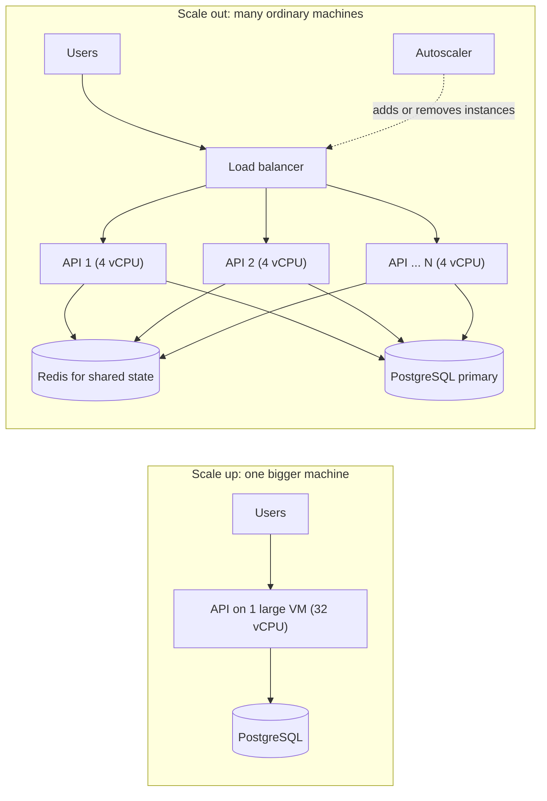
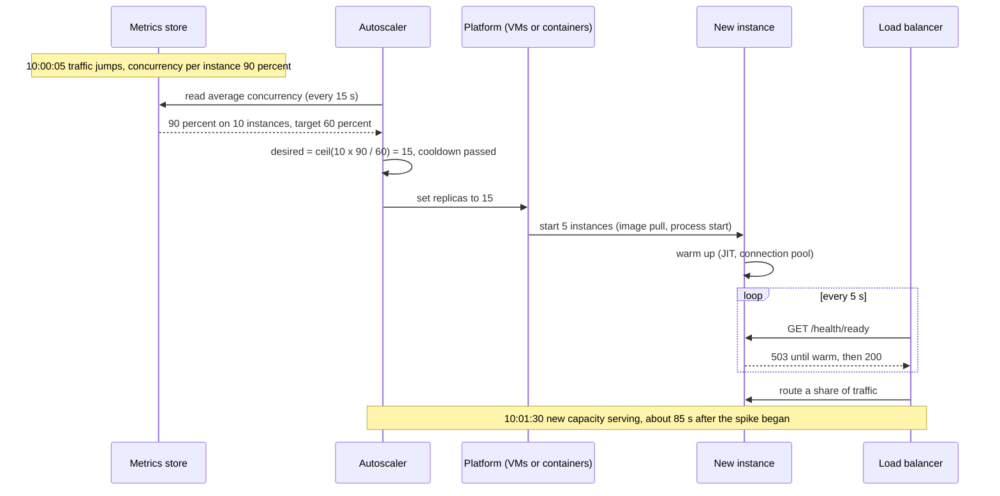

Every system that succeeds eventually receives more work than one machine can do. This lesson is about the two ways out, making the machine bigger or adding more machines, and about doing it automatically when traffic rises and falls (elasticity). You will leave with formulas you can use on a whiteboard and an ASP.NET Core autoscaling advisor you can test.

## Learning objectives

By the end of this lesson you will be able to:

1. Explain vertical scaling (scale up) and horizontal scaling (scale out) with an analogy, and list what each needs from the application.
2. Estimate how many instances a peak needs, including headroom and the loss of one availability zone.
3. Describe why neither approach scales forever: hardware ceilings for scale up, and coordination costs (Amdahl's law, the Universal Scalability Law) for scale out.
4. Compare the cost curves of the two approaches and pick the cheaper one for a given load.
5. Choose an autoscaling signal (CPU, concurrency, queue depth, latency, schedule) that matches the workload.
6. Explain cooldowns, stabilisation windows and provisioning delay, and why autoscalers arrive late to sudden spikes.
7. Implement a target-tracking scaling policy in C# and protect the service with load shedding while new capacity boots.

## Prerequisites

- [Capacity estimation](#/lesson/m11-capacity-estimation): we turn users into requests per second (RPS) before deciding how to scale.
- [Latency numbers and latency budgets](#/lesson/m11-latency-numbers): useful for knowing why some work does not parallelise.
- Helpful: [Stateless versus stateful services](#/lesson/m11-stateless), the next lesson, explains what an app must give up before it can scale out.

## Explain it like I'm a beginner

Picture a popular dosa stall near a college in Pune. One cook makes about 60 dosas an hour. At lunch, 150 students turn up in an hour. There are two ways to keep up.

**Option 1: a bigger setup.** Buy a bigger griddle and a faster batter dispenser so the same cook can make 120 an hour. That is **scaling up** (vertical scaling): the same worker, more powerful. It is simple. Nobody needs to coordinate. But there is a limit. A griddle cannot grow forever, and the cook has only two hands. Also, if the one cook falls ill, the stall closes.

**Option 2: more cooks.** Hire two more cooks with their own griddles. That is **scaling out** (horizontal scaling): more workers, each ordinary. Now you can handle 180 an hour, and if one cook is ill the other two keep going. But you need someone at the front to send each order to a free cook (a load balancer), every cook must follow the same recipe, and the orders must not depend on one cook's memory ("my usual, please" only works if any cook can look up "usual"). That last point is the idea of keeping no private memory in the worker (stateless services).

Now add one more twist. Lunch is busy, but at 4 p.m. only 20 students come. Paying three cooks all day wastes money. A smart owner calls extra cooks in at 12:30 and sends them home at 2:30. Adding and removing capacity to follow demand is **elasticity**, and doing it automatically is **autoscaling**. The catch: a cook called at 12:30 arrives at 12:50. If the rush starts at 12:30, students wait for 20 minutes. Arriving late is the central problem of autoscaling.

## First-principles explanation

### Two ways to add capacity

| | Vertical scaling (scale up) | Horizontal scaling (scale out) |
|---|---|---|
| What changes | A bigger machine: more vCPUs, RAM, faster disk | More machines of the same size |
| App changes needed | Usually none | App must tolerate many copies: no local session, no local files, idempotent jobs |
| Limit | Largest machine the provider sells, and one machine's memory bandwidth and locks | Coordination cost: shared database, locks, cache misses, network chatter |
| Failure behaviour | One machine is one failure domain | Losing one of N instances loses 1/N of capacity |
| Change speed | Often needs a restart (minutes of downtime unless you fail over) | Add an instance without touching the others |
| Typical use | Databases, legacy apps, in-memory analytics, early-stage products | Stateless web and API tiers, workers, caches with sharding |

Most real systems do both. The web tier scales out because it is easy. The PostgreSQL primary scales up because writes to one database are hard to split, and then reads are scaled out with replicas ([read replicas](#/lesson/m09-replicas)).

### Step one is always arithmetic

Before choosing, estimate the load. Say a state school board publishes Class 12 results online.

```text
Students:                 2,500,000
Viewers per student:      1.5 (student + a parent)      → 3,750,000 people
Share arriving in the first 15 minutes: 40 %             → 1,500,000 people
Requests per person:      4 (page, roll-number form, result, PDF)
Requests in 15 minutes:   1,500,000 × 4 = 6,000,000
Average RPS in window:    6,000,000 ÷ 900 s ≈ 6,700 RPS
Peak minute (× 3):        ≈ 20,000 RPS
A normal day:             ≈ 50 RPS
```

The peak is about **400 times** a normal day. That ratio, not the absolute number, decides the design. A system that needs 20,000 RPS for one hour a year should not pay for 20,000 RPS the other 8,759 hours.

Next, instances. Suppose a load test shows one API instance serves about **500 RPS** at acceptable latency (an estimate; measure your own). We never plan to run instances at 100 % because latency climbs steeply near saturation, so we target **60 % utilisation**:

```text
Instances = ceil(peak RPS ÷ (RPS per instance × target utilisation))
          = ceil(20,000 ÷ (500 × 0.6)) = ceil(66.7) = 67 instances
```

If the system must survive the loss of one of three availability zones at peak, the other two zones must hold all 67:

```text
Per zone = ceil(67 ÷ 2) = 34    →    34 × 3 = 102 instances during the peak window
```

That is the honest number, and it shows why redundancy and scaling are the same conversation.

### Why scaling up runs out

A single machine is limited by:

- **The catalogue.** Cloud providers sell VMs up to a certain size. Beyond that there is no bigger box.
- **Shared hardware inside the box.** Memory bandwidth, the number of disk I/O operations per second, and network bandwidth grow less than linearly with vCPU count on many families.
- **Software inside the box.** One lock in your code, one hot row in the database, or one single-threaded component (a JavaScript event loop, a Redis instance's main thread) caps throughput however many cores you add.
- **Downtime to resize.** Moving to a bigger VM usually means a restart. For a database that means a failover.

### Why scaling out runs out too

Adding the tenth instance rarely gives the same gain as adding the second. Two laws describe why.

**Amdahl's law** (the serial part limits you). If a fraction `p` of the work can run in parallel and `1 − p` must run one at a time:

```text
Speedup(N) = 1 ÷ ((1 − p) + p ÷ N)
```

With `p = 0.95` (only 5 % serial work, such as a shared lock or one database row everyone updates), 8 instances give `1 ÷ (0.05 + 0.11875) ≈ 5.9×`, and infinitely many instances give at most `1 ÷ 0.05 = 20×`. Five per cent of serial work caps you at twenty times one machine.

**The Universal Scalability Law** (coordination makes it worse). Neil Gunther's model adds a second penalty: instances must keep each other up to date (cache invalidation, distributed locks, chatty consensus). That cost grows with the number of *pairs* of instances, so throughput eventually goes **down** as you add nodes.

```text
X(N) = λN ÷ (1 + σ(N − 1) + κN(N − 1))

λ = throughput of one node, σ = contention (serial share), κ = coherency (cross-talk) cost
Peak at N* = √((1 − σ) ÷ κ)
```

With `σ = 0.05` and `κ = 0.001`, the peak is at `√(0.95 ÷ 0.001) ≈ 31` nodes. Node 40 makes the system slower than node 31. You fit `σ` and `κ` from a load test at a few sizes (for example 1, 2, 4 and 8 instances), which is the practical use of the law: it tells you, early, where the wall is.

What raises `σ` and `κ` in a real ASP.NET Core system?

- Every instance updating the same row (`UPDATE counters SET n = n + 1 WHERE id = 1`).
- A distributed lock held for every request.
- Each instance opening its own 100-connection pool against one PostgreSQL server ([connection pooling](#/lesson/m09-connection-pooling)). Ten instances × 100 = 1,000 connections, far beyond what PostgreSQL handles comfortably.
- In-process caches that must be invalidated across all instances on every write.

### Cost curves

Within one VM family, price usually grows roughly in proportion to size: double the vCPUs, roughly double the hourly price. So for steady load, scaling up and scaling out cost about the same per unit of capacity. The differences come from elsewhere:

```text
Illustrative only (not real prices):
  1 × 64-vCPU VM      ≈ ₹64 per hour of capacity, 1 failure domain, idle at night still costs ₹64
  16 × 4-vCPU VMs     ≈ ₹64 per hour at peak, but at night 4 VMs ≈ ₹16
```

- **Elasticity changes the bill.** Scale out lets you pay for 4 VMs at 3 a.m. and 16 at noon. A big box costs the same all day.
- **The very largest sizes and special hardware** (huge memory, local NVMe, the biggest database tiers) often carry a premium per unit.
- **Redundancy costs differently.** One big box needs a second big box as standby (100 % extra). Sixteen small ones need one or two spares (6–12 % extra) to survive one failure.
- **Licences and managed services** are sometimes priced per core or per instance, which can flip the answer.
- **People cost.** A single big server is cheap to operate. A fleet needs automation, deployment pipelines and observability. For a small team, that cost is real.

### Elasticity and autoscaling

Autoscaling is a control loop: **measure → decide → act → wait → measure again**.

#### Choosing the signal

| Signal | Good for | Watch out for |
|---|---|---|
| CPU utilisation | CPU-bound APIs (JSON, image resizing) | I/O-bound APIs sit at 15 % CPU while requests queue on the database |
| In-flight requests per instance (concurrency) | Most web APIs, including I/O-bound ones | Needs a metric from the app or the load balancer |
| Requests per second per instance | Predictable request cost | Heavy and light endpoints mixed together distort it |
| Queue depth or message age | Background workers | Scale on "backlog ÷ rate a worker can drain", not raw depth |
| Latency (p95) | A last-resort guard | Latency rises for reasons scaling cannot fix, such as a slow database; adding instances then makes it worse |
| Schedule | Known events: results day, sale at 10 a.m., month-end GST filing | Needs someone to know the calendar |

The best signal measures **the resource that saturates first**. For a typical ASP.NET Core API that awaits PostgreSQL, that is concurrency or request rate, not CPU.

#### Target tracking

The most common policy keeps a metric near a target, the way a thermostat keeps a room near 24 °C. The Kubernetes Horizontal Pod Autoscaler (HPA) uses this formula:

```text
desired = ceil(current × currentMetric ÷ targetMetric)

10 pods at 90 % CPU, target 60 %:  ceil(10 × 90 ÷ 60) = 15 pods
```

Three refinements stop it misbehaving:

- **Tolerance.** If the ratio is within ±10 %, do nothing. Otherwise small noise causes constant changes.
- **Scale-down stabilisation.** Use the *highest* recommendation of the last few minutes (HPA's default window is 5 minutes) before scaling in. Traffic often dips for a minute and comes back.
- **Rate limits per step.** For example, at most double per minute when scaling up, at most remove two instances per minute when scaling down.

Removing capacity too eagerly and then adding it back is called **flapping**. Flapping wastes money and, worse, each new instance pays a cold-start cost.

#### The timing problem: provisioning delay

An autoscaler sees a spike only after it happens. Then:

```text
Metric scrape interval        15 s
Decision (evaluation period)  15–60 s
New VM or container starts    20 s (container on an existing node) … 3–5 min (new VM)
App warm-up (JIT, caches,
  connection pools, readiness) 10–60 s
Total                         about 1 to 6 minutes before new capacity serves traffic
```

If results go live at 10:00:00 and traffic jumps 400× in 30 seconds, reactive autoscaling will be minutes late. The fixes:

1. **Scheduled scaling (pre-warming)** for known events. Scale to 102 instances at 09:40.
2. **Headroom.** A 60 % target leaves 40 % for the first minutes of a spike.
3. **Faster start.** Small container images, ReadyToRun or Native AOT where it fits, warm pools of pre-started instances.
4. **Load shedding while you wait.** Reject the excess quickly with `503` and a `Retry-After` header instead of letting every request slow down. A fast "try again in 10 s" is better than a 40-second timeout for everyone ([backpressure and load shedding](#/lesson/m13-backpressure)).
5. **Queue the work** where users can wait. Accept a PDF generation request, return `202 Accepted`, and let workers catch up.

### What breaks first under load

When you scale the web tier out, the bottleneck moves. In order of how often it appears:

1. **Database connections.** More instances × pool size exceeds `max_connections`. Use a pooler such as PgBouncer and smaller per-instance pools.
2. **The database primary's CPU or I/O.** Fix with caching, read replicas, better indexes, then partitioning.
3. **Hot keys and rows.** One popular product, one counter row, one cache key.
4. **Downstream rate limits.** A payment gateway or SMS provider that allows 200 requests per second, however many instances you run.
5. **The autoscaler itself.** Quotas (your subscription may allow only so many vCPUs per region), IP addresses in a subnet, or image pulls from a registry that throttles.

To watch the bottleneck move in a real growing system, follow [Scaling a real system from 100 to 10 million users](#/lesson/m17-scaling-journey): a grocery app runs on a single app instance until about 5,000 users, scales out to three stateless instances with a cache when database CPU hits 85 % at 100,000 users, adds read replicas at about a million users, and partitions only at the last stage. Each step happens because a measured number forced it.

### When a simpler design is enough

- An internal tool with 200 users: one VM, scale up when needed. Do not build an autoscaling fleet.
- A product with steady load that fits on two instances: run two (for availability), size them generously, and skip autoscaling until the bill or the traffic shape justifies it.
- A results portal that is busy one day a year: the cheapest design might be to **pre-generate** all results as static files behind a CDN and object storage, so the "scaling" is done by the CDN. (Check privacy rules first: anyone who guesses a roll number could see a result, so you might still need a lightweight check.)
- A database that is CPU-bound on a 4-vCPU server: scale up to 16 vCPUs before building shards. Scaling up the database is boring and that is its virtue.
- A young product: start on one well-sized VM (or two for availability) and scale up first. The [scaling journey case study](#/lesson/m17-scaling-journey) keeps one app instance until about 5,000 users (around 5 RPS at peak), because scaling out earlier would have bought complexity and no measurable benefit.

## Visual explanation

### Architecture: scale up versus scale out



On the left, users talk straight to one large VM, which talks to the database. Nothing needs to coordinate, but that VM is a single failure domain and its size is the ceiling. On the right, users go to a **load balancer**, which spreads requests over N small API instances. Because any instance may receive any request, shared state (sessions, rate-limit counters, cache) moves to **Redis**, and all instances write to the same **PostgreSQL primary**. Notice that the database arrows converge: scaling out the API tier pushes more concurrent load onto one database, which is why it often becomes the next bottleneck. The dotted arrow shows the **autoscaler** changing the pool behind the load balancer as load changes.

### Sequence: an autoscaling decision during a spike



Follow the timestamps. The spike begins at 10:00:05, but the **autoscaler** only notices on its next read of the **metrics store**. It applies the target-tracking formula and asks the **platform** for five more instances. The **new instances** must start and warm up; until their readiness check returns 200, the **load balancer** keeps them out of rotation, so users are not sent to a half-started process. Only at about 10:01:30 does new capacity help. For those 85 seconds, the original 10 instances carried the whole spike. That gap is why the lesson recommends headroom, scheduled pre-scaling and load shedding.

## Step-by-step example

**Scenario.** The board's results portal (numbers from the first-principles section) runs on Azure Container Apps today with 2 instances, scaling on CPU with a maximum of 10. Last year the site was unusable for the first 25 minutes. You are asked to fix it.

### Step 1 — Find the real bottleneck from last year

Logs show CPU at 35 % on all 10 instances while p95 latency hit 30 seconds. The API was not CPU-bound: requests were waiting for database connections. Each instance had a pool of 100, the PostgreSQL server allowed 200 connections, and 10 instances asked for 1,000. CPU-based autoscaling never saw the problem.

### Step 2 — Make the request cheap before adding instances

A result is read-only for the whole day. Load all 2.5 million results (about 1 KB each, ≈ 2.5 GB) into Redis the night before, keyed by roll number. Now a result lookup is one cache read, and PostgreSQL is not on the hot path at all. The rendered result page has no personal data in the HTML shell, so the shell, CSS and JavaScript go to the CDN.

Requests that reach the API drop from 4 per person to 2 (lookup + PDF), so peak becomes about 10,000 RPS.

### Step 3 — Size the fleet

The cheaper request now serves about 800 RPS per instance in a load test (estimate).

```text
ceil(10,000 ÷ (800 × 0.6)) = ceil(20.8) = 21 instances
Survive one of three zones:  ceil(21 ÷ 2) = 11 per zone → 33 instances
```

### Step 4 — Pre-scale, then let autoscaling handle the tail

- 09:30: a scheduled rule sets the minimum to 33.
- 10:00–11:30: target tracking on concurrency (target 60 % of a 200-request concurrency limit) can add up to 60 if traffic is higher than predicted.
- 12:00: the scheduled minimum drops back to 2. Scale-down stabilisation removes instances gradually.

### Step 5 — Protect the service during the first minute

Each instance gets a concurrency limiter of 200 in-flight requests and a queue of 100. Beyond that, it returns `503` with `Retry-After: 5`. The front-end shows "High traffic, retrying in 5 seconds" and retries with jitter. Users see a short wait instead of a dead site.

### Step 6 — Check the cost

33 small instances for about 3 hours and 2 instances for the remaining 21 hours of the day is roughly `33 × 3 + 2 × 21 = 141` instance-hours, compared with `33 × 24 = 792` if the fleet stayed at peak. Elasticity cut that day's compute by about 80 %. (Rates vary; the ratio is what matters.)

## Production-style C# implementation

The code below is a scaling advisor for an ASP.NET Core service. It measures in-flight requests (the signal), applies a target-tracking policy with tolerance, cooldown and scale-down stabilisation (the decision), and calls a replica controller (the action). In production the controller would call the Kubernetes or Azure API; here it is an interface with an in-memory implementation so it compiles and tests offline. The service also sheds load with the built-in concurrency limiter.

```text
ResultsPortal.Api/
  Program.cs
  Scaling/ScalingPolicy.cs
  Scaling/InFlightRequests.cs
  Scaling/Fleet.cs
  Scaling/ScalingAdvisor.cs
```

```csharp file=Scaling/ScalingPolicy.cs
namespace ResultsPortal.Scaling;

public sealed record ScalingPolicyOptions
{
    public int MinReplicas { get; init; } = 2;
    public int MaxReplicas { get; init; } = 60;
    /// <summary>Desired average utilisation of the scaling signal, as a fraction (0.6 = 60 %).</summary>
    public double TargetUtilisation { get; init; } = 0.6;
    /// <summary>Ignore changes when current / target is within this band (0.1 = ±10 %).</summary>
    public double Tolerance { get; init; } = 0.1;
    public TimeSpan ScaleUpCooldown { get; init; } = TimeSpan.FromSeconds(30);
    /// <summary>Scale down only to the highest recommendation seen in this window.</summary>
    public TimeSpan ScaleDownStabilisation { get; init; } = TimeSpan.FromMinutes(5);
    public double MaxScaleUpFactor { get; init; } = 2.0;
    public int MaxScaleDownStep { get; init; } = 2;
}

public sealed record ScalingDecision(int CurrentReplicas, int DesiredReplicas, string Reason)
{
    public bool IsChange => DesiredReplicas != CurrentReplicas;
}

/// <summary>Target-tracking policy in the style of the Kubernetes HPA.
/// Not thread-safe: call it from one control loop.</summary>
public sealed class TargetTrackingPolicy(ScalingPolicyOptions options, TimeProvider clock)
{
    private readonly Queue<(DateTimeOffset At, int Recommended)> _recent = new();
    private DateTimeOffset _lastScaleUp = DateTimeOffset.MinValue;

    public ScalingDecision Evaluate(int currentReplicas, double averageUtilisation)
    {
        if (currentReplicas < 1) throw new ArgumentOutOfRangeException(nameof(currentReplicas));
        if (double.IsNaN(averageUtilisation) || averageUtilisation < 0)
            throw new ArgumentOutOfRangeException(nameof(averageUtilisation));

        DateTimeOffset now = clock.GetUtcNow();
        double ratio = averageUtilisation / options.TargetUtilisation;
        int raw = Math.Abs(ratio - 1.0) <= options.Tolerance
            ? currentReplicas
            : (int)Math.Ceiling(currentReplicas * ratio);
        int recommended = Math.Clamp(raw, options.MinReplicas, options.MaxReplicas);

        _recent.Enqueue((now, recommended));
        while (_recent.Count > 0 && now - _recent.Peek().At > options.ScaleDownStabilisation)
            _recent.Dequeue();

        if (recommended > currentReplicas)
        {
            if (now - _lastScaleUp < options.ScaleUpCooldown)
                return new(currentReplicas, currentReplicas, "Scale-up wanted but cooldown is active");
            int cap = (int)Math.Ceiling(currentReplicas * options.MaxScaleUpFactor);
            int target = Math.Min(recommended, Math.Max(cap, currentReplicas + 1));
            _lastScaleUp = now;
            return new(currentReplicas, target, $"Utilisation {averageUtilisation:P0} above target {options.TargetUtilisation:P0}");
        }

        if (recommended < currentReplicas)
        {
            int highestRecent = _recent.Max(r => r.Recommended);
            int target = Math.Max(highestRecent, currentReplicas - options.MaxScaleDownStep);
            return target < currentReplicas
                ? new(currentReplicas, target, $"Utilisation {averageUtilisation:P0} below target; stepping down")
                : new(currentReplicas, currentReplicas, "Scale-down held by stabilisation window");
        }

        return new(currentReplicas, currentReplicas, "Within tolerance or at a limit");
    }
}
```

The policy is a plain class with an injected `TimeProvider`, so a test can move time forward without sleeping. Three decisions matter. The tolerance band ignores noise. Scale-up is fast but capped at doubling per step, so a bad metric cannot launch 500 instances. Scale-down is slow: it never goes below the highest recommendation of the last five minutes, which stops a one-minute dip from removing capacity that will be needed again.

```csharp file=Scaling/InFlightRequests.cs
using System.Diagnostics.Metrics;

namespace ResultsPortal.Scaling;

/// <summary>Counts requests currently being processed by this instance.
/// Concurrency is a better scaling signal than CPU for I/O-bound APIs.</summary>
public sealed class InFlightRequests : IDisposable
{
    public const string MeterName = "ResultsPortal.Scaling";
    private readonly Meter _meter = new(MeterName);
    private long _current;

    public InFlightRequests(int capacity)
    {
        if (capacity < 1) throw new ArgumentOutOfRangeException(nameof(capacity));
        Capacity = capacity;
        // Exported through OpenTelemetry in production; the platform autoscaler reads it.
        _meter.CreateObservableGauge("http.server.in_flight_utilisation", () => Utilisation);
    }

    public int Capacity { get; }
    public long Current => Interlocked.Read(ref _current);
    public double Utilisation => (double)Current / Capacity;

    public void Enter() => Interlocked.Increment(ref _current);
    public void Exit() => Interlocked.Decrement(ref _current);

    public void Dispose() => _meter.Dispose();
}

public sealed class InFlightRequestsMiddleware(RequestDelegate next, InFlightRequests gauge)
{
    public async Task InvokeAsync(HttpContext context)
    {
        if (context.Request.Path.StartsWithSegments("/health"))
        {
            await next(context);
            return;
        }

        gauge.Enter();
        try { await next(context); }
        finally { gauge.Exit(); }
    }
}
```

`InFlightRequests` publishes utilisation as an OpenTelemetry-compatible gauge using `System.Diagnostics.Metrics`, the standard .NET metrics API. Health probes are excluded because they are not user load. Capacity is the concurrency limit you measured in a load test, so utilisation 1.0 means "this instance is full".

```csharp file=Scaling/Fleet.cs
namespace ResultsPortal.Scaling;

/// <summary>Reads the fleet-wide average of the scaling signal.</summary>
public interface IFleetMetrics
{
    Task<(int Replicas, double AverageUtilisation)> ReadAsync(CancellationToken ct);
}

/// <summary>Changes the number of running instances. Production implementations call the
/// Kubernetes API (scale subresource) or the Azure Container Apps management API.</summary>
public interface IReplicaController
{
    Task SetReplicasAsync(int replicas, string reason, CancellationToken ct);
}

/// <summary>Offline stand-in used for local runs and tests: one in-memory "fleet".</summary>
public sealed class InMemoryFleet(InFlightRequests localGauge) : IFleetMetrics, IReplicaController
{
    private int _replicas = 2;
    public int Replicas => Volatile.Read(ref _replicas);
    public List<string> History { get; } = [];

    public Task<(int Replicas, double AverageUtilisation)> ReadAsync(CancellationToken ct) =>
        Task.FromResult((Replicas, localGauge.Utilisation));

    public Task SetReplicasAsync(int replicas, string reason, CancellationToken ct)
    {
        Volatile.Write(ref _replicas, replicas);
        lock (History) History.Add($"{replicas}: {reason}");
        return Task.CompletedTask;
    }
}
```

```csharp file=Scaling/ScalingAdvisor.cs
namespace ResultsPortal.Scaling;

/// <summary>The control loop: measure, decide, act, wait.</summary>
public sealed class ScalingAdvisor(
    IFleetMetrics metrics,
    IReplicaController controller,
    TargetTrackingPolicy policy,
    ILogger<ScalingAdvisor> logger) : BackgroundService
{
    private static readonly TimeSpan Interval = TimeSpan.FromSeconds(15);

    protected override async Task ExecuteAsync(CancellationToken stoppingToken)
    {
        using var timer = new PeriodicTimer(Interval);
        while (await timer.WaitForNextTickAsync(stoppingToken))
        {
            try
            {
                var (replicas, utilisation) = await metrics.ReadAsync(stoppingToken);
                ScalingDecision decision = policy.Evaluate(replicas, utilisation);
                if (decision.IsChange)
                {
                    logger.LogInformation("Scaling {From} -> {To}: {Reason}",
                        decision.CurrentReplicas, decision.DesiredReplicas, decision.Reason);
                    await controller.SetReplicasAsync(decision.DesiredReplicas, decision.Reason, stoppingToken);
                }
            }
            catch (Exception ex) when (ex is not OperationCanceledException)
            {
                // Missing metrics must never scale the fleet to zero. Log and keep the current size.
                logger.LogWarning(ex, "Scaling evaluation failed; keeping current replica count");
            }
        }
    }
}
```

The advisor's most important line is the `catch`. When metrics are missing, the safe action is to do nothing. An autoscaler that reads "0 % utilisation" from a broken metrics pipeline and scales down to the minimum during an exam-results peak would cause the outage it was built to prevent.

```csharp file=Program.cs
using System.Threading.RateLimiting;
using Microsoft.AspNetCore.RateLimiting;
using ResultsPortal.Scaling;

var builder = WebApplication.CreateBuilder(args);

const int ConcurrencyPerInstance = 200; // measured in a load test; revisit after each release

builder.Services.AddSingleton(TimeProvider.System);
builder.Services.AddSingleton(new InFlightRequests(ConcurrencyPerInstance));
builder.Services.AddSingleton(new ScalingPolicyOptions { MinReplicas = 2, MaxReplicas = 60, TargetUtilisation = 0.6 });
builder.Services.AddSingleton<TargetTrackingPolicy>();
builder.Services.AddSingleton<InMemoryFleet>();
builder.Services.AddSingleton<IFleetMetrics>(sp => sp.GetRequiredService<InMemoryFleet>());
builder.Services.AddSingleton<IReplicaController>(sp => sp.GetRequiredService<InMemoryFleet>());
builder.Services.AddHostedService<ScalingAdvisor>();
builder.Services.AddHealthChecks();

// Load shedding: while new instances boot, reject the excess fast instead of queueing forever.
builder.Services.AddRateLimiter(options =>
{
    options.RejectionStatusCode = StatusCodes.Status503ServiceUnavailable;
    options.OnRejected = (ctx, _) =>
    {
        ctx.HttpContext.Response.Headers.RetryAfter = "5";
        return ValueTask.CompletedTask;
    };
    options.AddConcurrencyLimiter("results", limiter =>
    {
        limiter.PermitLimit = ConcurrencyPerInstance;
        limiter.QueueLimit = 100;
        limiter.QueueProcessingOrder = QueueProcessingOrder.OldestFirst;
    });
});

var app = builder.Build();

app.UseMiddleware<InFlightRequestsMiddleware>();
app.UseRateLimiter();

app.MapHealthChecks("/health/ready");

app.MapGet("/results/{rollNumber}", (string rollNumber) =>
        rollNumber.Length == 10 && rollNumber.All(char.IsDigit)
            ? Results.Ok(new { rollNumber, status = "lookup from cache in the real service" })
            : Results.BadRequest("Roll number must be 10 digits."))
    .RequireRateLimiting("results");

app.MapGet("/scaling/history", (InMemoryFleet fleet) => fleet.History);

app.Run();
```

Points to defend in a review:

1. **The concurrency limit and the scaling signal use the same number.** Utilisation 0.6 means 120 of 200 permits in use, which keeps 40 % headroom for the minutes before new instances arrive.
2. **Rejections return `503` with `Retry-After`.** Well-behaved clients back off instead of hammering. Rejections are cheap, so the instance stays healthy.
3. **The in-flight middleware runs before the limiter**, so the gauge sees queued requests as load. If it ran after, a full queue would look like spare capacity.

In real deployments, the platform usually runs the control loop for you: a Kubernetes HPA (or KEDA for queue-based scaling) or Azure Container Apps scale rules read the metric and change replicas. Writing the policy yourself is still valuable: it lets you test the rules you configure, and some teams run an advisor like this in "recommend only" mode to tune targets before handing control to the platform. A Kubernetes HPA for the same rules looks like this (configuration, not compiled):

```yaml
apiVersion: autoscaling/v2
kind: HorizontalPodAutoscaler
metadata: { name: results-api }
spec:
  scaleTargetRef: { apiVersion: apps/v1, kind: Deployment, name: results-api }
  minReplicas: 2
  maxReplicas: 60
  metrics:
    - type: Pods
      pods:
        metric: { name: http_server_in_flight_utilisation }
        target: { type: AverageValue, averageValue: "600m" }   # 0.6
  behavior:
    scaleUp:   { policies: [ { type: Percent, value: 100, periodSeconds: 30 } ] }
    scaleDown: { stabilizationWindowSeconds: 300, policies: [ { type: Pods, value: 2, periodSeconds: 60 } ] }
```

## Bad design vs good design

**Bad: "the cloud scales automatically".** The team deploys the API to a platform with autoscaling on CPU, minimum 1, maximum 100, and assumes the problem is solved.

What actually happens on a launch day:

- The API is I/O-bound, so CPU stays at 30 % while requests queue. The autoscaler does nothing.
- When it finally scales (because of JSON serialisation at very high load), 100 instances each open 50 database connections. PostgreSQL rejects connections and the whole site fails, including the instances that were fine.
- User sessions are stored in memory, so users bounce between instances and are logged out.
- At night, the minimum of 1 means a single instance; one crash is a full outage.
- Scale-down has no stabilisation, so traffic dips every 2 minutes cause flapping and repeated cold starts.

**Good:**

- Scale on the signal that saturates first (concurrency or queue age), measured from the app.
- Minimum of 2 (or one per zone) for availability; maximum set from what the database and downstream services can absorb, not from hope.
- Connection pools sized so `maxReplicas × poolSize` fits within the database's limit, or a pooler in between.
- Stateless instances: sessions and caches in Redis, files in object storage ([stateless services](#/lesson/m11-stateless)).
- Scheduled pre-scaling for known events; headroom; load shedding with `Retry-After`.
- Scale-down stabilisation and step limits.

:::callout type=mistake title="Scaling the wrong tier"
Adding API instances when the database is the bottleneck makes things worse: more instances mean more concurrent queries against the same saturated database, more lock contention and more connections. Always find the saturated resource first. If it is the database, cache, reduce queries, add read replicas, or scale the database up.
:::

:::callout type=tradeoff title="Headroom is insurance you pay for every hour"
A 60 % target means 40 % of your fleet is idle on purpose. A 80 % target is cheaper but leaves less buffer for spikes and for losing a zone. Choose based on how fast traffic changes and how fast you can add capacity: slow-starting VMs need more headroom than fast-starting containers.
:::

## Practical playground

Open the autoscaling simulator below. It starts with 4 instances, a 3× spike, 90 seconds to provision a new instance and a 60-second cooldown. Try these experiments and note dropped requests each time:

1. Turn autoscaling off. How many requests are dropped during the spike?
2. Turn it on. Reduce provisioning time from 90 s to 20 s (containers instead of VMs). What changes?
3. Raise the starting instances to 8 (pre-scaling). Compare dropped requests and average utilisation (cost).
4. Lower the target utilisation from 0.7 to 0.5. Is the extra headroom worth it?
5. Set the maximum to 6. What happens when the ceiling is lower than the spike needs?

:::playground type=sim sim=scaling title="Autoscaling versus a traffic spike" instances=4 provisionSec=90 cooldownSec=60 spikeMultiplier=3 targetUtil=0.7
:::

## Exercises

:::exercise id=m11-scaling-ex1 difficulty=beginner kind=code title="Capacity planner with zone redundancy"
Turn the back-of-the-envelope arithmetic from this lesson into a small, tested calculator.
::requirements
- `CapacityPlanner.PeakRps(long dailyUsers, double requestsPerUser, double peakFactor)` returns `dailyUsers × requestsPerUser ÷ 86,400 × peakFactor`.
- `CapacityPlanner.InstancesFor(double peakRps, double rpsPerInstance, double targetUtilisation)` returns the whole number of instances needed so each runs at or below the target utilisation.
- `CapacityPlanner.WithZoneRedundancy(int needed, int zones)` returns the total number of instances, spread evenly, so that losing any one zone still leaves at least `needed`.
- Invalid inputs throw `ArgumentOutOfRangeException`: non-positive rates, utilisation outside `(0, 1]`, fewer than 2 zones, or `needed < 1`.
::acceptance
- `PeakRps(10_000_000, 20, 3)` ≈ 6,944.4.
- `InstancesFor(7_000, 500, 0.6)` = 24.
- `WithZoneRedundancy(24, 3)` = 36 and `WithZoneRedundancy(24, 2)` = 48.
- `InstancesFor(0, 500, 0.6)` returns 0 (no traffic needs no instances; the minimum fleet size is a separate decision).
::hint
Each instance can safely take `rpsPerInstance × targetUtilisation` requests per second.
::hint
"Whole number of instances" means rounding *up*. 23.3 instances is 24.
::hint
After losing one zone, `zones − 1` zones must carry the load. How many instances must each surviving zone hold?
::hint
```csharp
int perZone = (int)Math.Ceiling(needed / (double)(zones - 1));
return perZone * zones;
```
::starter
```csharp file=CapacityPlanner.cs
using System;

public static class CapacityPlanner
{
    public static double PeakRps(long dailyUsers, double requestsPerUser, double peakFactor) =>
        throw new NotImplementedException();

    public static int InstancesFor(double peakRps, double rpsPerInstance, double targetUtilisation) =>
        throw new NotImplementedException();

    public static int WithZoneRedundancy(int needed, int zones) =>
        throw new NotImplementedException();
}
```
::tests
```csharp file=CapacityPlannerTests.cs
using System;
using Xunit;

public class CapacityPlannerTests
{
    [Fact]
    public void Peak_rps_from_daily_users() =>
        Assert.Equal(6944.4, CapacityPlanner.PeakRps(10_000_000, 20, 3), 1);

    [Fact]
    public void Instances_round_up() =>
        Assert.Equal(24, CapacityPlanner.InstancesFor(7_000, 500, 0.6));

    [Fact]
    public void Exact_fit_does_not_add_an_extra_instance() =>
        Assert.Equal(10, CapacityPlanner.InstancesFor(3_000, 500, 0.6));

    [Fact]
    public void No_traffic_needs_no_instances() =>
        Assert.Equal(0, CapacityPlanner.InstancesFor(0, 500, 0.6));

    [Fact]
    public void Three_zones_survive_one_loss() =>
        Assert.Equal(36, CapacityPlanner.WithZoneRedundancy(24, 3));

    [Fact]
    public void Two_zones_double_the_fleet() =>
        Assert.Equal(48, CapacityPlanner.WithZoneRedundancy(24, 2));

    [Fact]
    public void Invalid_inputs_throw()
    {
        Assert.Throws<ArgumentOutOfRangeException>(() => CapacityPlanner.InstancesFor(100, 0, 0.6));
        Assert.Throws<ArgumentOutOfRangeException>(() => CapacityPlanner.InstancesFor(100, 500, 1.5));
        Assert.Throws<ArgumentOutOfRangeException>(() => CapacityPlanner.WithZoneRedundancy(10, 1));
        Assert.Throws<ArgumentOutOfRangeException>(() => CapacityPlanner.WithZoneRedundancy(0, 3));
        Assert.Throws<ArgumentOutOfRangeException>(() => CapacityPlanner.PeakRps(-1, 20, 3));
    }
}
```
::solution
Divide by the safe capacity per instance and round up. For zones, the surviving zones must carry everything, so size each zone for `needed ÷ (zones − 1)`.

```csharp file=CapacityPlanner.cs
using System;

public static class CapacityPlanner
{
    private const double SecondsPerDay = 86_400;

    public static double PeakRps(long dailyUsers, double requestsPerUser, double peakFactor)
    {
        if (dailyUsers < 0) throw new ArgumentOutOfRangeException(nameof(dailyUsers));
        if (requestsPerUser < 0) throw new ArgumentOutOfRangeException(nameof(requestsPerUser));
        if (peakFactor < 1) throw new ArgumentOutOfRangeException(nameof(peakFactor), "Peak is at least the average.");
        return dailyUsers * requestsPerUser / SecondsPerDay * peakFactor;
    }

    public static int InstancesFor(double peakRps, double rpsPerInstance, double targetUtilisation)
    {
        if (peakRps < 0) throw new ArgumentOutOfRangeException(nameof(peakRps));
        if (rpsPerInstance <= 0) throw new ArgumentOutOfRangeException(nameof(rpsPerInstance));
        if (targetUtilisation is <= 0 or > 1) throw new ArgumentOutOfRangeException(nameof(targetUtilisation));
        double safePerInstance = rpsPerInstance * targetUtilisation;
        // Round to 9 places first so 3000 / 300 = 10.000000000000002 does not become 11.
        return (int)Math.Ceiling(Math.Round(peakRps / safePerInstance, 9));
    }

    public static int WithZoneRedundancy(int needed, int zones)
    {
        if (needed < 1) throw new ArgumentOutOfRangeException(nameof(needed));
        if (zones < 2) throw new ArgumentOutOfRangeException(nameof(zones), "Need at least two zones to survive a zone loss.");
        int perZone = (int)Math.Ceiling(needed / (double)(zones - 1));
        return perZone * zones;
    }
}
```

The rounding guard matters: floating-point division can produce `10.000000000000002`, and `Math.Ceiling` would then buy an instance you do not need.
::mistakes
- Rounding down (`(int)(x)`), which under-provisions every time.
- Forgetting utilisation, so the plan runs every instance at 100 % and latency explodes.
- Splitting `needed` across *all* zones (24 ÷ 3 = 8 per zone). After a zone loss only 16 remain.
::extensions
Add a `MinimumFleet(int zones)` rule (at least one instance per zone) and combine it with `InstancesFor` so a quiet night still survives one instance failure.
:::

:::exercise id=m11-scaling-ex2 difficulty=beginner kind=written title="Scale up or scale out?"
For each case, say whether you would scale up, scale out, or both, and give one reason and one risk.

1. A PostgreSQL primary for an e-commerce site at 85 % CPU on 8 vCPUs. Writes are 1,500 per second.
2. A stateless ASP.NET Core product-catalogue API at 70 % CPU on 3 instances, with a big sale next week.
3. A legacy ASP.NET (.NET Framework) app that stores user sessions in memory and writes uploaded files to the local `C:\uploads` folder.
4. A nightly report job that takes 5 hours on one 4-vCPU VM and must finish in 1 hour. Each report is independent.
::acceptance
- Gives a choice and a reason for all four cases.
- Mentions at least one app change needed before scaling out case 3.
- Recognises that case 4 is embarrassingly parallel and can scale out as workers.
- Names at least one risk per case (for example, restart during resize, connection limits, cost).
::hint
Ask first: can many copies of this run at once without stepping on each other?
::hint
Writes to one database primary are hard to split. What is the cheapest first step for case 1?
::hint
For case 3, list everything the app keeps on its own machine. Each item must move somewhere shared before a second copy can run.
::hint
For case 4, 5 hours ÷ 1 hour = 5. How many workers, and what coordinates which report each one takes?
::solution
1. **Scale up first** (8 → 16 or 32 vCPUs) with a failover to a resized standby to avoid long downtime. Reason: one primary takes all writes and scaling up needs no application change. Also look for missing indexes and move read traffic to replicas. Risk: a resize means a failover or restart; and eventually there is no bigger tier, at which point you partition or shard.
2. **Scale out**, with scheduled pre-scaling before the sale plus target tracking during it. Reason: it is stateless, so more copies are trivial. Risk: the database and any downstream APIs must absorb the extra concurrency; check connection counts.
3. **Scale up now**, then fix the app before scaling out. Sessions must move to a shared store (Redis or SQL Server distributed session) and files to object storage. Until then, a second copy would log users out and lose uploads. Sticky sessions are a stop-gap, not a fix.
4. **Scale out as workers.** Put report ids on a queue and run 5–6 workers (5 for the arithmetic, one spare). Reason: each report is independent. Risk: they all hit the same database at once; give each a small connection pool and read from a replica.
::mistakes
- Saying "always scale out" for the database primary without discussing write coordination.
- Scaling out the legacy app with sticky sessions and calling it done; one instance failure still logs out its users and its local files are lost.
- Forgetting that 5 parallel workers may make the database the new bottleneck.
:::

:::exercise id=m11-scaling-ex3 difficulty=intermediate kind=code title="A replica calculator with tolerance and stabilisation"
Implement the core of a target-tracking autoscaler. Time is passed in explicitly so tests do not sleep.
::requirements
- `ReplicaCalculator.Desired(int current, double currentMetric, double targetMetric, int min, int max, double tolerance = 0.1)` applies `ceil(current × currentMetric ÷ targetMetric)`, returns `current` unchanged when the ratio is within the tolerance, and clamps to `[min, max]`.
- `ScaleDownStabiliser(TimeSpan window)` has `int Recommend(DateTimeOffset now, int current, int desired)`:
  - if `desired >= current`, return `desired` (scale up immediately);
  - otherwise return the highest `desired` seen within the last `window` (including this one), but never more than `current`.
- Invalid arguments (`current < 1`, `targetMetric <= 0`, `min > max`, `min < 0`) throw `ArgumentOutOfRangeException`.
::acceptance
- 10 replicas at 90 with target 60 → 15.
- 10 replicas at 63 with target 60 (5 % off) → 10.
- 4 replicas at 10 with target 60, min 2 → 2 (not 1).
- A dip to 5 one minute after a recommendation of 12 is held at 12 for a 5-minute window, and released after the window passes.
::hint
Compute the ratio once; compare `Math.Abs(ratio − 1)` with the tolerance.
::hint
The stabiliser needs memory of recent recommendations: a queue of `(time, desired)` pairs.
::hint
Before answering, drop entries older than `now − window`. Then take the maximum.
::hint
```csharp
_history.Enqueue((now, desired));
while (_history.Peek().At < now - _window) _history.Dequeue();
if (desired >= current) return desired;
return Math.Min(current, _history.Max(h => h.Desired));
```
::starter
```csharp file=ReplicaCalculator.cs
using System;
using System.Collections.Generic;
using System.Linq;

public static class ReplicaCalculator
{
    public static int Desired(int current, double currentMetric, double targetMetric, int min, int max, double tolerance = 0.1) =>
        throw new NotImplementedException();
}

public sealed class ScaleDownStabiliser(TimeSpan window)
{
    public int Recommend(DateTimeOffset now, int current, int desired) => throw new NotImplementedException();
}
```
::tests
```csharp file=ReplicaCalculatorTests.cs
using System;
using Xunit;

public class ReplicaCalculatorTests
{
    [Fact] public void Scales_up_proportionally() => Assert.Equal(15, ReplicaCalculator.Desired(10, 90, 60, 1, 100));
    [Fact] public void Ignores_small_deviation() => Assert.Equal(10, ReplicaCalculator.Desired(10, 63, 60, 1, 100));
    [Fact] public void Respects_minimum() => Assert.Equal(2, ReplicaCalculator.Desired(4, 10, 60, 2, 100));
    [Fact] public void Respects_maximum() => Assert.Equal(20, ReplicaCalculator.Desired(10, 300, 60, 1, 20));

    [Fact]
    public void Invalid_arguments_throw()
    {
        Assert.Throws<ArgumentOutOfRangeException>(() => ReplicaCalculator.Desired(0, 50, 60, 1, 10));
        Assert.Throws<ArgumentOutOfRangeException>(() => ReplicaCalculator.Desired(5, 50, 0, 1, 10));
        Assert.Throws<ArgumentOutOfRangeException>(() => ReplicaCalculator.Desired(5, 50, 60, 10, 5));
    }

    [Fact]
    public void Stabiliser_holds_scale_down_within_window()
    {
        var s = new ScaleDownStabiliser(TimeSpan.FromMinutes(5));
        var t0 = new DateTimeOffset(2026, 3, 15, 10, 0, 0, TimeSpan.Zero);
        Assert.Equal(12, s.Recommend(t0, 10, 12));
        Assert.Equal(12, s.Recommend(t0.AddMinutes(1), 12, 5));
        Assert.Equal(12, s.Recommend(t0.AddMinutes(4), 12, 6));
    }

    [Fact]
    public void Stabiliser_releases_after_window()
    {
        var s = new ScaleDownStabiliser(TimeSpan.FromMinutes(5));
        var t0 = new DateTimeOffset(2026, 3, 15, 10, 0, 0, TimeSpan.Zero);
        s.Recommend(t0, 10, 12);
        s.Recommend(t0.AddMinutes(1), 12, 5);
        Assert.Equal(6, s.Recommend(t0.AddMinutes(6), 12, 6));
    }

    [Fact]
    public void Stabiliser_never_exceeds_current_when_scaling_down()
    {
        var s = new ScaleDownStabiliser(TimeSpan.FromMinutes(5));
        var t0 = new DateTimeOffset(2026, 3, 15, 10, 0, 0, TimeSpan.Zero);
        s.Recommend(t0, 10, 20);
        Assert.Equal(15, s.Recommend(t0.AddMinutes(1), 15, 8));
    }
}
```
::solution
The calculator is a pure function. The stabiliser keeps a sliding window of recommendations and answers "the most capacity anyone asked for recently, capped at what we have now".

```csharp file=ReplicaCalculator.cs
using System;
using System.Collections.Generic;
using System.Linq;

public static class ReplicaCalculator
{
    public static int Desired(int current, double currentMetric, double targetMetric, int min, int max, double tolerance = 0.1)
    {
        if (current < 1) throw new ArgumentOutOfRangeException(nameof(current));
        if (targetMetric <= 0) throw new ArgumentOutOfRangeException(nameof(targetMetric));
        if (min < 0 || min > max) throw new ArgumentOutOfRangeException(nameof(min));
        if (currentMetric < 0) throw new ArgumentOutOfRangeException(nameof(currentMetric));

        double ratio = currentMetric / targetMetric;
        int raw = Math.Abs(ratio - 1.0) <= tolerance ? current : (int)Math.Ceiling(current * ratio);
        return Math.Clamp(raw, min, max);
    }
}

public sealed class ScaleDownStabiliser(TimeSpan window)
{
    private readonly Queue<(DateTimeOffset At, int Desired)> _history = new();

    public int Recommend(DateTimeOffset now, int current, int desired)
    {
        _history.Enqueue((now, desired));
        while (_history.Count > 0 && _history.Peek().At < now - window) _history.Dequeue();

        if (desired >= current) return desired;
        return Math.Min(current, _history.Max(h => h.Desired));
    }
}
```
::alternatives
Instead of a maximum over a window, some autoscalers use an exponentially weighted moving average of the metric. It smooths noise in both directions, but it also delays scale-up, which is usually the wrong trade for user-facing traffic.
::mistakes
- Applying stabilisation to scale-up as well, which makes the system late to every spike.
- Forgetting to clamp, so a metric glitch asks for 10,000 replicas.
- Comparing `ratio` to the tolerance instead of `|ratio − 1|`.
::extensions
Add a scale-up rate limit: at most double, or at most +4 replicas, per minute, whichever is larger.
:::

:::exercise id=m11-scaling-ex4 difficulty=intermediate kind=hld title="Survive results day"
The starter graph is the results portal before the redesign: 2 API instances, autoscaling on CPU to a maximum of 10, every lookup querying PostgreSQL, no CDN. Peak is about 20,000 RPS for 15 minutes, a normal day is 50 RPS. Redesign it so the site stays usable at peak and costs little on other days.
::acceptance
- Static assets and the page shell are served from a CDN.
- Result lookups do not hit PostgreSQL on the hot path (cache or pre-generated data).
- The API tier is sized with arithmetic (RPS per instance, utilisation target, zone loss) and pre-scaled before the event.
- Load shedding or a waiting room protects the service when demand exceeds capacity.
- The minimum fleet on normal days is stated and justified.
::hint
Which of the 4 requests per person actually need your API? Which can come from an edge cache?
::hint
Results never change during the day. What is the cheapest store that can answer 10,000 lookups per second?
::hint
Use the planner: `ceil(peak ÷ (rpsPerInstance × target))`, then add zone redundancy.
::hint
Add `cdn`, `cache` and `scheduler` nodes. Set API `instances` to the peak figure with `multiAz: true`, and note the pre-scale time in the scheduler's label.
::starter
```json
{
  "nodes": [
    { "id": "users", "type": "client", "label": "Students and parents", "props": { "rps": 20000 } },
    { "id": "lb", "type": "load-balancer", "label": "Load balancer" },
    { "id": "api", "type": "app-server", "label": "Results API (CPU autoscale, max 10)", "props": { "instances": 2 } },
    { "id": "db", "type": "database", "label": "PostgreSQL (results table)", "props": { "replicas": 0 } }
  ],
  "edges": [
    { "from": "users", "to": "lb", "kind": "sync" },
    { "from": "lb", "to": "api", "kind": "sync" },
    { "from": "api", "to": "db", "kind": "sync", "label": "SELECT by roll number" }
  ]
}
```
::solution
```json
{
  "nodes": [
    { "id": "users", "type": "client", "label": "Students and parents", "props": { "rps": 20000 } },
    { "id": "cdn", "type": "cdn", "label": "CDN (page shell, JS, CSS)", "props": { "ttlSeconds": 3600 } },
    { "id": "lb", "type": "load-balancer", "label": "Zone-redundant load balancer", "props": { "multiAz": true } },
    { "id": "rl", "type": "rate-limiter", "label": "Concurrency limit 200/instance, 503 + Retry-After" },
    { "id": "api", "type": "app-server", "label": "Results API (concurrency autoscale)", "props": { "instances": 33, "multiAz": true } },
    { "id": "redis", "type": "cache", "label": "Redis: 2.5 M results preloaded", "props": { "replicas": 2, "multiAz": true } },
    { "id": "db", "type": "database", "label": "PostgreSQL (source of truth, off hot path)", "props": { "replicas": 1 } },
    { "id": "pdfq", "type": "queue", "label": "PDF requests" },
    { "id": "pdfw", "type": "worker", "label": "PDF workers (queue-age autoscale)", "props": { "instances": 6 } },
    { "id": "blob", "type": "object-storage", "label": "Generated PDFs" },
    { "id": "sched", "type": "scheduler", "label": "09:30 min=33, 12:00 min=2" },
    { "id": "mon", "type": "monitoring", "label": "Concurrency, 503 rate, p95" }
  ],
  "edges": [
    { "from": "users", "to": "cdn", "kind": "sync" },
    { "from": "users", "to": "lb", "kind": "sync", "label": "lookup + PDF only" },
    { "from": "lb", "to": "rl", "kind": "sync" },
    { "from": "rl", "to": "api", "kind": "sync" },
    { "from": "api", "to": "redis", "kind": "sync", "label": "GET result:{roll}" },
    { "from": "db", "to": "redis", "kind": "async", "label": "night-before preload" },
    { "from": "api", "to": "pdfq", "kind": "async" },
    { "from": "pdfq", "to": "pdfw", "kind": "async" },
    { "from": "pdfw", "to": "blob", "kind": "sync" },
    { "from": "sched", "to": "api", "kind": "async", "label": "pre-scale" },
    { "from": "api", "to": "mon", "kind": "async" }
  ]
}
```

**Reasoning.** The CDN takes the page shell and assets, cutting API traffic from 4 to 2 requests per person (≈ 10,000 RPS). Results are preloaded into Redis the night before (≈ 2.5 GB), so PostgreSQL leaves the hot path and its connection limit stops mattering. With about 800 RPS per instance at 60 % target: `ceil(10,000 ÷ 480) = 21`; surviving one of three zones needs `11 × 3 = 33`. A scheduled rule sets the minimum to 33 at 09:30, before the 10:00 release, because reactive scaling would be minutes late. PDFs go through a queue so a slow renderer cannot block lookups; workers scale on queue age. The concurrency limiter returns `503` with `Retry-After` for anything beyond capacity. On normal days the minimum is 2 (one per zone in two zones) for availability. Peak-day compute is roughly `33 × 3 h + 2 × 21 h ≈ 141` instance-hours instead of 792 at a fixed peak size.
::mistakes
- Raising the CPU autoscale maximum and changing nothing else; the database connection limit fails first.
- Relying on reactive autoscaling for an event whose start time is printed in the newspaper.
- Forgetting zone loss, so the plan only works if nothing else goes wrong on the busiest day.
:::

:::exercise id=m11-scaling-ex5 difficulty=advanced kind=code title="Where is the scaling wall? Amdahl and the USL"
Fit-free versions of the two scaling laws are enough to answer the question "how many instances before adding more stops helping?". Implement them.
::requirements
- `ScalingLaws.AmdahlSpeedup(double parallelFraction, int n)` = `1 ÷ ((1 − p) + p ÷ n)`.
- `ScalingLaws.AmdahlLimit(double parallelFraction)` = the speedup as n → ∞, or `double.PositiveInfinity` when `p = 1`.
- `ScalingLaws.UslThroughput(int n, double singleNode, double sigma, double kappa)` = `λn ÷ (1 + σ(n − 1) + κn(n − 1))`.
- `ScalingLaws.UslPeak(double sigma, double kappa)` returns the integer `n ≥ 1` with the highest throughput, or `null` when `kappa = 0` (throughput never falls).
- Fractions outside `[0, 1]`, `n < 1` and negative coefficients throw `ArgumentOutOfRangeException`.
::acceptance
- `AmdahlSpeedup(0.95, 8)` ≈ 5.926; `AmdahlLimit(0.95)` = 20.
- `UslThroughput(1, 1000, 0.05, 0.001)` = 1000; `UslThroughput(10, 1000, 0.05, 0.001)` ≈ 6,493.5.
- `UslPeak(0.05, 0.001)` = 31.
- `UslPeak(0.05, 0)` is `null`.
::hint
Write each formula exactly as given first; the tests use simple numbers.
::hint
The continuous peak is `√((1 − σ) ÷ κ)`. The best *integer* is either the floor or the ceiling of that value.
::hint
Compare `UslThroughput(floor)` with `UslThroughput(ceiling)` (using `λ = 1`, since λ does not change where the peak is) and return the larger. Guard against a floor of 0.
::hint
```csharp
double nStar = Math.Sqrt((1 - sigma) / kappa);
int lo = Math.Max(1, (int)Math.Floor(nStar)), hi = Math.Max(1, (int)Math.Ceiling(nStar));
return UslThroughput(hi, 1, sigma, kappa) > UslThroughput(lo, 1, sigma, kappa) ? hi : lo;
```
::starter
```csharp file=ScalingLaws.cs
using System;

public static class ScalingLaws
{
    public static double AmdahlSpeedup(double parallelFraction, int n) => throw new NotImplementedException();

    public static double AmdahlLimit(double parallelFraction) => throw new NotImplementedException();

    public static double UslThroughput(int n, double singleNode, double sigma, double kappa) => throw new NotImplementedException();

    public static int? UslPeak(double sigma, double kappa) => throw new NotImplementedException();
}
```
::tests
```csharp file=ScalingLawsTests.cs
using System;
using Xunit;

public class ScalingLawsTests
{
    [Fact] public void Amdahl_eight_nodes() => Assert.Equal(5.926, ScalingLaws.AmdahlSpeedup(0.95, 8), 3);
    [Fact] public void Amdahl_one_node_is_one() => Assert.Equal(1.0, ScalingLaws.AmdahlSpeedup(0.95, 1), 9);
    [Fact] public void Amdahl_limit() => Assert.Equal(20.0, ScalingLaws.AmdahlLimit(0.95), 6);
    [Fact] public void Amdahl_limit_fully_parallel() => Assert.True(double.IsPositiveInfinity(ScalingLaws.AmdahlLimit(1.0)));

    [Fact] public void Usl_single_node() => Assert.Equal(1000.0, ScalingLaws.UslThroughput(1, 1000, 0.05, 0.001), 6);
    [Fact] public void Usl_ten_nodes() => Assert.Equal(6493.5, ScalingLaws.UslThroughput(10, 1000, 0.05, 0.001), 1);
    [Fact] public void Usl_peak() => Assert.Equal(31, ScalingLaws.UslPeak(0.05, 0.001));
    [Fact] public void Usl_no_peak_without_coherency() => Assert.Null(ScalingLaws.UslPeak(0.05, 0));

    [Fact]
    public void Usl_beyond_peak_is_slower() =>
        Assert.True(ScalingLaws.UslThroughput(60, 1000, 0.05, 0.001) < ScalingLaws.UslThroughput(31, 1000, 0.05, 0.001));

    [Fact]
    public void Invalid_inputs_throw()
    {
        Assert.Throws<ArgumentOutOfRangeException>(() => ScalingLaws.AmdahlSpeedup(1.2, 4));
        Assert.Throws<ArgumentOutOfRangeException>(() => ScalingLaws.AmdahlSpeedup(0.9, 0));
        Assert.Throws<ArgumentOutOfRangeException>(() => ScalingLaws.UslThroughput(4, 1000, -0.1, 0.001));
        Assert.Throws<ArgumentOutOfRangeException>(() => ScalingLaws.UslPeak(0.05, -1));
    }
}
```
::solution
```csharp file=ScalingLaws.cs
using System;

public static class ScalingLaws
{
    public static double AmdahlSpeedup(double parallelFraction, int n)
    {
        CheckFraction(parallelFraction, nameof(parallelFraction));
        if (n < 1) throw new ArgumentOutOfRangeException(nameof(n));
        return 1.0 / ((1.0 - parallelFraction) + parallelFraction / n);
    }

    public static double AmdahlLimit(double parallelFraction)
    {
        CheckFraction(parallelFraction, nameof(parallelFraction));
        double serial = 1.0 - parallelFraction;
        return serial == 0 ? double.PositiveInfinity : 1.0 / serial;
    }

    public static double UslThroughput(int n, double singleNode, double sigma, double kappa)
    {
        if (n < 1) throw new ArgumentOutOfRangeException(nameof(n));
        if (singleNode < 0) throw new ArgumentOutOfRangeException(nameof(singleNode));
        CheckFraction(sigma, nameof(sigma));
        if (kappa < 0) throw new ArgumentOutOfRangeException(nameof(kappa));
        return singleNode * n / (1.0 + sigma * (n - 1) + kappa * n * (n - 1));
    }

    public static int? UslPeak(double sigma, double kappa)
    {
        CheckFraction(sigma, nameof(sigma));
        if (kappa < 0) throw new ArgumentOutOfRangeException(nameof(kappa));
        if (kappa == 0) return null;

        double nStar = Math.Sqrt((1.0 - sigma) / kappa);
        int lo = Math.Max(1, (int)Math.Floor(nStar));
        int hi = Math.Max(1, (int)Math.Ceiling(nStar));
        return UslThroughput(hi, 1, sigma, kappa) > UslThroughput(lo, 1, sigma, kappa) ? hi : lo;
    }

    private static void CheckFraction(double value, string name)
    {
        if (value is < 0 or > 1 || double.IsNaN(value)) throw new ArgumentOutOfRangeException(name, value, "Must be in [0, 1].");
    }
}
```

**What the numbers mean.** With 5 % contention and a small coherency cost, the 31st node is the last useful one, and at 31 nodes the fleet delivers only about 9× a single node, not 31×. If your load test fits these coefficients, the honest options are to cut contention (remove the shared lock, shard the hot row, cache) or accept the ceiling; adding instances beyond 31 makes it worse.
::mistakes
- Rounding `nStar` instead of comparing floor and ceiling; the nearer integer is not always the better one.
- Treating Amdahl's limit as a target. It assumes zero coordination cost, so real systems peak earlier.
- Fitting σ and κ from a single load-test point. You need at least three sizes.
::extensions
Write `Fit(IReadOnlyList<(int n, double x)> samples)` that estimates σ and κ by least squares on the linearised USL, and use it on load-test data for 1, 2, 4, 8 and 16 instances.
:::

## Automated testing

Scaling behaviour is easy to get wrong and expensive to test in production. Test it at three levels.

**1. Unit-test the policy with a fake clock.** `TimeProvider` lets a test move time without sleeping. The `FakeTimeProvider` type lives in the `Microsoft.Extensions.TimeProvider.Testing` package; a tiny hand-rolled one works too:

```csharp
public sealed class ManualClock(DateTimeOffset start) : TimeProvider
{
    private DateTimeOffset _now = start;
    public override DateTimeOffset GetUtcNow() => _now;
    public void Advance(TimeSpan by) => _now += by;
}

[Fact]
public void Dip_does_not_scale_down_inside_window()
{
    var clock = new ManualClock(DateTimeOffset.UnixEpoch);
    var policy = new TargetTrackingPolicy(new ScalingPolicyOptions { MinReplicas = 2 }, clock);

    Assert.Equal(15, policy.Evaluate(10, 0.9).DesiredReplicas);   // spike
    clock.Advance(TimeSpan.FromMinutes(1));
    Assert.False(policy.Evaluate(15, 0.2).IsChange);              // dip held by stabilisation
    clock.Advance(TimeSpan.FromMinutes(6));
    Assert.Equal(13, policy.Evaluate(15, 0.2).DesiredReplicas);   // step limit: at most 2 down
}
```

**2. Test the control loop's failure path.** Give `ScalingAdvisor` an `IFleetMetrics` fake that throws, run one tick, and assert the controller was never called. This proves "missing metrics never scales down".

**3. Load-test the real thing.** Use a load generator (k6, JMeter, Azure Load Testing) against a staging environment with the same autoscale rules. Measure: time from spike start to new capacity serving traffic, dropped or `503` requests, p95 latency, and database connection count at peak. Run at 1, 2, 4 and 8 instances to fit the USL coefficients and find your wall before customers do.

## Real-world application

- **Ticketing and flash sales.** A system like a railway's Tatkal booking or a concert sale opens at a known time. Teams pre-scale, use waiting rooms (virtual queues) to admit users at a rate the backend can serve, and shed the rest politely. [Flash sale](#/lesson/m17-flash-sale) works through one in detail.
- **Kubernetes HPA and KEDA.** HPA implements target tracking on CPU, memory or custom metrics with the stabilisation behaviour shown here. KEDA adds event-driven scaling on queue depth or message age, including scale to zero for workers.
- **Azure App Service and Container Apps.** App Service scales up by changing the plan tier and out by instance count (manual, rule-based or automatic). Container Apps scales on HTTP concurrency, CPU, or KEDA scalers.
- **Databases.** Managed PostgreSQL services typically scale up by changing compute tier (with a brief failover) and scale reads out with replicas. Writes scale out only through partitioning or sharding ([partitioning and sharding](#/lesson/m09-partitioning-sharding)).
- **Month-end and festival peaks.** GST filing deadlines, salary-day UPI traffic and festival sales are predictable; scheduled scaling plus target tracking is the standard combination.

## Interview questions

:::interview
::q beginner
What is the difference between vertical and horizontal scaling?
::a
Vertical scaling (scale up) gives one machine more CPU, memory or disk. It needs no application change but has a hardware ceiling, often a restart, and leaves one failure domain. Horizontal scaling (scale out) adds more machines behind a load balancer. It has a much higher ceiling and better fault tolerance, but the application must be stateless or keep shared state outside the instances, and shared resources such as the database become the next bottleneck.
::q beginner
Why not run servers at 100 % utilisation to save money?
::a
Latency rises sharply as a server approaches saturation because requests queue. There is also no buffer for spikes, for the minutes an autoscaler needs to add capacity, or for losing an instance or zone. Teams typically target something like 50–70 % for user-facing tiers, depending on how spiky traffic is and how fast new capacity starts.
::q intermediate
Your API is autoscaled on CPU, but during a spike latency goes to 20 seconds while CPU stays at 30 %. What is happening and what do you change?
::a
The API is I/O-bound: requests are waiting on something else, most often database connections, a downstream API or a lock. CPU is the wrong signal. I would check connection-pool wait time and database metrics, switch the scaling signal to concurrency or request rate per instance, and fix the actual bottleneck (cache the hot reads, pool connections through PgBouncer, add replicas). Adding instances alone would add more pressure on the saturated dependency.
::q intermediate
How does a target-tracking autoscaler avoid flapping?
::a
It ignores small deviations (a tolerance band, such as ±10 %), applies a cooldown between scale-up actions, and stabilises scale-down by using the highest recommendation over a window (for example 5 minutes). It may also limit the step size per period. The asymmetry is deliberate: scale up quickly, scale down slowly, because being short of capacity hurts users while extra capacity only costs money for a few minutes.
::q advanced
A sale starts at exactly 12:00 and traffic jumps 20× within a minute. How do you design scaling for it?
::a
Reactive autoscaling cannot react in time because of metric delay, decision intervals and instance start-up (one to several minutes). I would pre-scale on a schedule from load-test figures, with zone-loss headroom; put a CDN and caches in front of everything cacheable; use a waiting room or admission control to admit users at the rate the checkout path can sustain; shed excess with `503` and `Retry-After`; move non-critical work (emails, analytics) to queues; and verify the database, payment gateway and inventory service can take the planned load, since they cannot be autoscaled the same way. After the sale, scale down gradually.
::q advanced
Adding instances beyond 30 makes throughput fall. Explain why and what you would do.
::a
That is the coherency penalty described by the Universal Scalability Law: as nodes are added, the cost of keeping them consistent (cross-instance cache invalidation, distributed locks, contention on a hot row, connection pressure on one database) grows with the number of node pairs, so throughput peaks and then declines. I would load-test at several sizes to fit the contention and coherency coefficients, find the shared resource (profiling, database wait events, lock metrics), and reduce it: shard the hot row, replace a global lock with partitioned work, reduce chatty invalidation, pool connections. Then set the autoscaler maximum below the peak until the fix lands.
:::

## Summary and revision

**Key takeaways**

- Scale up = bigger machine, no app change, hard ceiling, one failure domain. Scale out = more machines, needs stateless design, moves the bottleneck to shared resources.
- Start with arithmetic: `instances = ceil(peak ÷ (rps per instance × target utilisation))`, then size for the loss of one zone.
- Amdahl's law caps speedup by the serial fraction; the Universal Scalability Law shows that coordination makes throughput fall after a peak.
- Cost per unit of capacity is often similar; elasticity, redundancy overhead and operations effort decide which is cheaper.
- Scale on the resource that saturates first. For I/O-bound APIs that is concurrency, not CPU. For workers it is queue age.
- Autoscalers are late by minutes. Use scheduled pre-scaling for known events, keep headroom, and shed load with `503` + `Retry-After`.
- Scale up fast, scale down slowly: tolerance, cooldown and stabilisation stop flapping.
- When a single well-sized server or a CDN-fronted static site is enough, use it.

**Terminology**: vertical scaling, horizontal scaling, elasticity, autoscaling, target tracking, cooldown, stabilisation window, provisioning delay, headroom, load shedding, Amdahl's law, Universal Scalability Law, contention, coherency, flapping, N+1.

:::flashcards
Q: Scale up versus scale out in one line each?
A: Scale up: make one machine bigger. Scale out: add more machines behind a load balancer.
Q: Formula for instances needed at peak?
A: ceil(peak RPS ÷ (RPS per instance × target utilisation)), then add capacity to survive one zone loss.
Q: Amdahl's law limit with 5 % serial work?
A: 1 ÷ 0.05 = 20× at most, however many machines you add.
Q: What does the κ term in the Universal Scalability Law represent?
A: Coherency cost: nodes keeping each other consistent. It grows with node pairs and makes throughput fall after a peak at √((1 − σ) ÷ κ).
Q: HPA target-tracking formula?
A: desired = ceil(current × currentMetric ÷ targetMetric), with a ±10 % tolerance by default.
Q: Why scale down slowly?
A: Traffic dips are often brief. Removing capacity and re-adding it (flapping) causes cold starts and short capacity gaps.
Q: Best scaling signal for an I/O-bound ASP.NET Core API?
A: In-flight requests (concurrency) or requests per instance, not CPU.
Q: Three ways to cope with autoscaling's provisioning delay?
A: Scheduled pre-scaling, headroom (lower target utilisation), and load shedding or queueing while capacity arrives.
:::

## Knowledge check

:::quiz pass=70
::q single
An API is at 85 % CPU on 3 instances and is fully stateless. A marketing campaign will double traffic next Tuesday at 11:00. What is the best plan?
- [ ] Move to one VM with four times the vCPUs on Tuesday morning.
- [x] Pre-scale to the instance count the arithmetic gives before 11:00, keep target tracking on, and confirm the database can take the extra load.
- [ ] Rely on CPU autoscaling with no changes; it will react.
- [ ] Turn off autoscaling so the fleet size is predictable.
> A known start time calls for scheduled pre-scaling. Autoscaling still handles the unexpected, and the shared database is the usual next bottleneck.
::q single
Ten pods run at an average of 90 % of their concurrency target metric, where the target is 60 %. What does a target-tracking autoscaler request?
- [ ] 11 pods
- [ ] 12 pods
- [x] 15 pods
- [ ] 20 pods
> ceil(10 × 90 ÷ 60) = 15.
::q single
A team scales an ASP.NET Core API from 10 to 40 instances. Throughput barely changes and PostgreSQL reports "too many connections". What went wrong?
- [ ] The load balancer algorithm is round robin.
- [x] Each instance has its own connection pool, so 40 × pool size exceeds the database's connection limit; the database tier, not the API, is the bottleneck.
- [ ] The instances need more memory.
- [ ] Autoscaling should have used CPU instead of concurrency.
> Scaling out the stateless tier multiplies pressure on the shared database. Use smaller pools, a pooler such as PgBouncer, caching and replicas.
::q single
Load tests show 5 % of each request's work is serialised on a shared lock. Ignoring other costs, what is the maximum speedup from adding instances?
- [ ] 5×
- [ ] 95×
- [x] 20×
- [ ] Unlimited
> Amdahl's law: 1 ÷ (1 − 0.95) = 20.
::q multi
Which measures reduce dropped requests during the minutes before newly requested instances are ready? (Select all that apply.)
- [x] Lower target utilisation (more headroom).
- [x] Scheduled pre-scaling before a known event.
- [x] Faster-starting instances (smaller images, warm pools).
- [ ] A longer scale-down stabilisation window.
> Stabilisation affects scale-down, not how quickly capacity arrives. The other three either add capacity earlier or make it arrive sooner.
::q single
The metrics pipeline breaks and the autoscaler starts reading 0 % utilisation during peak hours. What should a well-designed scaling loop do?
- [ ] Scale to the minimum, since utilisation is zero.
- [x] Treat missing or implausible metrics as unknown and keep the current replica count, while alerting.
- [ ] Scale to the maximum.
- [ ] Restart all instances.
> Acting on bad data can cause the outage autoscaling was meant to prevent. Failing safe means holding the current size.
::q single
Which workload is the best candidate for scaling up rather than out?
- [ ] A stateless image-thumbnail API.
- [ ] Queue workers that process independent invoices.
- [x] A single PostgreSQL primary that handles all writes and is CPU-bound.
- [ ] A static marketing website.
> Writes to one primary are hard to split; scaling up the database tier (and offloading reads) is the usual first step before sharding.
:::

## Completion criteria

You have finished this lesson when you can:

- [ ] Score at least 70 % on the knowledge check.
- [ ] Size a fleet for a peak, including utilisation headroom and the loss of one zone, without looking at the formula.
- [ ] Complete exercises 1, 3 and 5 with `dotnet test` passing.
- [ ] Complete exercise 4 in the HLD canvas with the arithmetic written next to the graph.
- [ ] Run the autoscaling simulator and explain why pre-scaling beat reactive scaling in your experiment.
