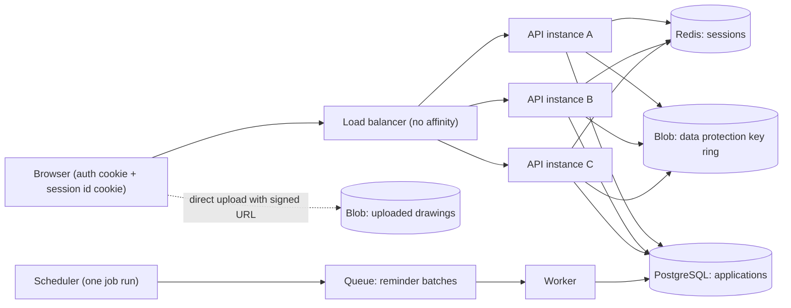
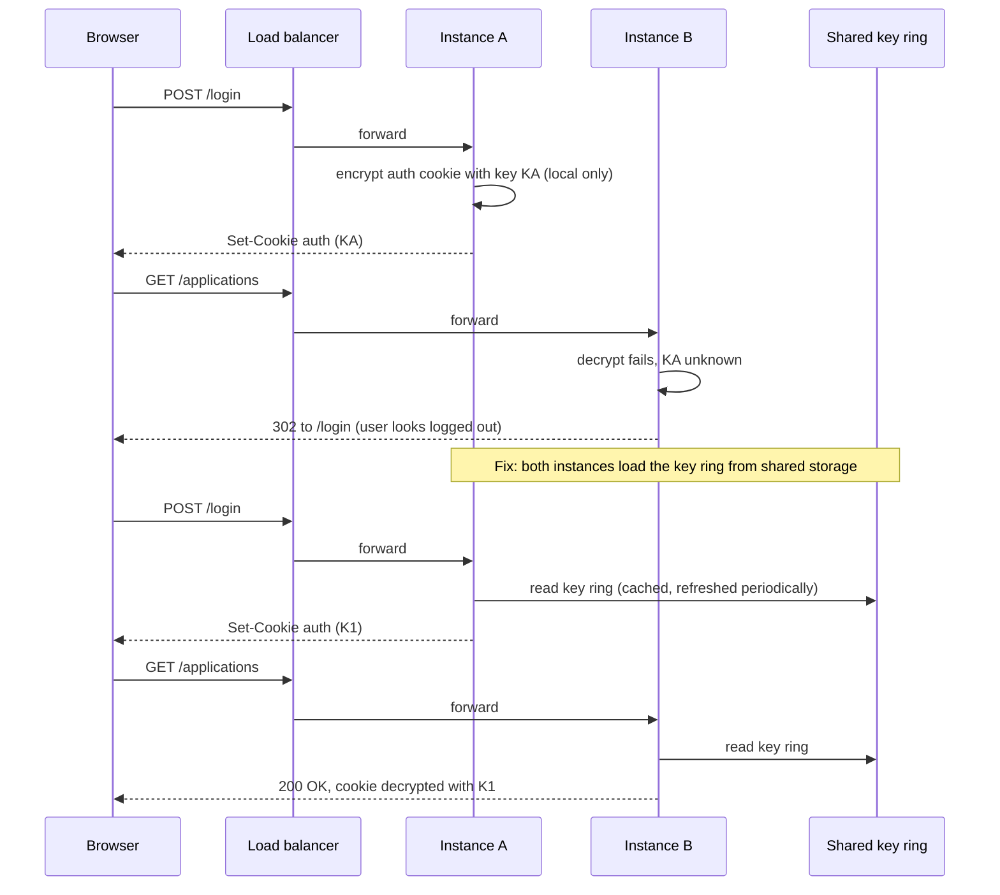

"Just add more servers" works only if any server can answer any request. That is what *stateless* means, and most applications are not stateless until someone deliberately makes them so. This lesson finds the state hiding inside a typical ASP.NET Core app, moves it out, and shows the classic bug that appears the day a second instance is added: users logged out and forms failing with "the antiforgery token could not be decrypted".

## Learning objectives

By the end of this lesson you will be able to:

1. Define stateless and stateful services and list the kinds of state a web instance tends to hold (session, cache, files, keys, jobs, connections).
2. Explain sticky sessions (session affinity), how load balancers implement them, and their costs for balance, failover and autoscaling.
3. Move session state, uploaded files and caches to shared stores, and estimate the size and request rate those stores must handle.
4. Configure ASP.NET Core Data Protection so cookies, antiforgery tokens and session cookies work across instances and deployments.
5. Keep scheduled jobs from running once per instance.
6. Recognise services that should stay stateful (databases, game servers, actors, stream processors) and how they scale by partitioning instead.
7. Decide when a single stateful server, or sticky sessions, is good enough.

## Prerequisites

- [Vertical versus horizontal scaling](#/lesson/m11-scaling): statelessness is what makes scaling out possible.
- [Authentication and authorization](#/lesson/m03-authn-authz): you should know what an authentication cookie and a JWT are.
- Helpful: [Caching in ASP.NET Core](#/lesson/m03-caching) for `IDistributedCache`.

## Explain it like I'm a beginner

Think of a bank branch with several counters. You fill in a long loan form at counter 1, and the clerk keeps the half-finished form in **her drawer**. You go for lunch. When you come back, counter 1 is closed and counter 3 calls you. The clerk at counter 3 has never seen your form. You must start again.

The problem is not counter 3. The problem is that your form lived in **one clerk's drawer** (local, in-memory state). There are two fixes:

1. **Always send you back to the same clerk** (sticky sessions, also called session affinity). It works until that clerk goes on leave, and it means some clerks get long queues while others are idle.
2. **Keep the form in a shared filing cabinet** that every clerk can open (externalised state, for example Redis or a database). Now any clerk can help you. The clerks themselves remember nothing between customers (stateless services).

A third option is to **let you carry the form yourself** in a sealed envelope that only the bank can open (client-side state, such as an encrypted cookie or a signed token). The clerk reads it, adds to it, seals it again and hands it back.

For the sealed envelope to work, every clerk needs the **same seal and the same key** to open it. If each clerk invents their own key in the morning, the envelope sealed at counter 1 cannot be opened at counter 3. In ASP.NET Core, that key is managed by the **Data Protection** system, and forgetting to share it is one of the most common scale-out bugs.

## First-principles explanation

### What "state" means here

State is anything a service remembers between requests. For scaling, the question is simple: **if this instance disappeared right now, would anything be lost or would the next request behave differently on another instance?** If yes, that thing is instance-local state.

| State | Where it often hides in ASP.NET Core | Shared home after scale-out |
|---|---|---|
| Login identity | Auth cookie (fine: travels with the client) | Stays in the cookie, but the **Data Protection keys** that encrypt it must be shared |
| Session data (wizard steps, cart) | `AddSession()` with `AddDistributedMemoryCache()` | `IDistributedCache` on Redis, SQL Server, or PostgreSQL |
| Antiforgery tokens | Encrypted with Data Protection keys | Shared key ring |
| Cached reference data | `IMemoryCache` | Can stay local if slightly stale is fine; otherwise a distributed cache or HybridCache with invalidation |
| Uploaded files | `wwwroot/uploads` or `C:\uploads` | Object storage (Azure Blob, S3) |
| Scheduled jobs | `BackgroundService` with a timer | One worker, a queue, or a lease so only one instance runs it |
| Counters and rate limits | `static int`, in-memory limiter | Redis counters, or accept per-instance limits |
| Live connections | SignalR hubs, WebSockets | Backplane (Redis) or a managed service (Azure SignalR Service) |
| In-flight work | A request that runs for 2 minutes | Make it a background job with an id; poll or push the result |

A **stateless service** keeps none of these locally. Each request carries everything needed (in its cookie, token, URL or body), or the service fetches it from a shared store. Any instance can serve any request, and instances can be added, removed or restarted freely. This is factor VI of the Twelve-Factor App: processes are stateless and share nothing.

A **stateful service** keeps data that matters in its own memory or disk. Databases, Redis, Kafka brokers, multiplayer game servers and actor systems such as Microsoft Orleans are stateful *by design*. They scale differently: by **partitioning** (each instance owns a slice of the data, and requests are routed to the owner) and by **replication** (copies for failover).

### Option 1: sticky sessions (session affinity)

The load balancer remembers which instance served a client and sends later requests to the same one.

How it is implemented:

- **Cookie affinity.** The load balancer adds a cookie naming the instance. Azure App Service calls it ARR affinity (`ARRAffinity` cookie). NGINX, HAProxy and Kubernetes ingress controllers offer cookie-based affinity.
- **Source IP hashing.** The load balancer hashes the client IP. No cookie needed, but every user behind one corporate or mobile-carrier NAT lands on one instance.

What it costs:

- **Uneven load.** Affinity outlives the load balancer's balancing decisions. A heavy user, or a whole office behind one IP, pins one instance at 90 % while others idle.
- **Failure loses sessions.** If the instance dies, everything in its memory dies with it. Users are logged out or lose their cart.
- **Autoscaling helps late.** New instances only receive *new* sessions. Existing users stay on the overloaded instances until their sessions end. With a 20-minute idle timeout, a scale-out takes about 20 minutes to rebalance.
- **Scale-in and deploys are slower.** Before removing an instance you must drain it (stop new sessions and wait for old ones), or accept losing them.

Sticky sessions are reasonable as a **temporary bridge** while a legacy app is refactored, for an internal tool where losing a session is a shrug, or for protocols that need it (SignalR's negotiate-then-connect handshake needs affinity unless you use WebSockets only with negotiation skipped, or Azure SignalR Service). They are not a substitute for moving state out.

### Option 2: externalise the state

Move each kind of state to a store that every instance can reach.

**Session data in a distributed cache.** In ASP.NET Core, session state sits on top of `IDistributedCache`. Swap the in-memory implementation for Redis (`AddStackExchangeRedisCache`) and every instance sees the same session.

Back-of-the-envelope for a state building-permit portal:

```text
Concurrent sessions at peak:     200,000
Average session size:            2 KB (draft form fields, step number)
Redis memory:                    200,000 × 2 KB = 400 MB  (+ overhead, plan ~1 GB)
API traffic:                     3,000 RPS, one session read per request
Session writes:                  ~1 in 3 requests changes the draft → 1,000 writes/s
Redis operations:                ~4,000 ops/s
```

4,000 operations per second is light work for a single Redis node (which can typically handle far more; measure yours), and 1 GB is a small instance. The real costs are elsewhere:

- **Latency.** Each request now makes a network call, typically under a millisecond inside one region. Keep sessions small: loading a 200 KB session on every request is slow and wasteful.
- **A new dependency.** If Redis is down, sessions are unavailable. Decide the behaviour: fail the request, or degrade (treat as a new session). Use a replicated Redis tier for anything important.
- **No locking.** ASP.NET Core session is non-locking: two parallel requests from the same user that both write the session will overwrite each other (last write wins). Classic ASP.NET locked sessions; ASP.NET Core does not.

**Files in object storage.** Uploads go to Blob storage or S3, ideally directly from the browser with a short-lived signed URL ([object storage](#/lesson/m11-object-storage)). The instance stores only the blob name in the database.

**Caches.** Local `IMemoryCache` is still fine for data where a few minutes of staleness is acceptable (district names, fee tables). For data that must be the same everywhere, use a distributed cache or HybridCache (an L1 in memory + L2 in Redis) with explicit invalidation ([caching layers](#/lesson/m11-caching-layers)).

### Option 3: put the state in the request

Keep the state on the client, protected so it cannot be read or forged:

- **Authentication cookies** in ASP.NET Core already work this way: the user's claims are encrypted into the cookie with Data Protection. No server-side session is needed for identity.
- **JWT bearer tokens** carry signed claims. Any instance with the signing key's public half can validate them.
- **Small encrypted cookies** for UI state (selected language, last step of a wizard).

Limits: browsers cap a cookie at about 4 KB, and the cookie is sent with **every** request to that domain. A 4 KB cookie × 3,000 RPS = 12 MB/s of extra upload traffic, much of it on mobile networks. Revoking client-held state is also harder: you cannot delete a token that is sitting on someone's phone, so you need short expiry or a server-side deny list.

### The Data Protection trap

ASP.NET Core uses the **Data Protection** API to encrypt and sign authentication cookies, session cookies, antiforgery tokens and TempData. It keeps a **key ring**: a set of keys, each valid for 90 days by default, rotated automatically.

Where are the keys by default? It depends on the host. On a developer machine they go to a user-profile folder. Azure App Service persists them to a folder shared by the app's instances. In a Linux container with no configuration, they are kept **in memory or in the container's file system**, which is lost on restart and not shared with other containers.

What happens with three containers and no shared key ring:

```text
1. User logs in on instance A. A encrypts the auth cookie with key KA.
2. Next request goes to instance B. B has only key KB. Decryption fails.
3. ASP.NET Core treats the cookie as missing → user appears logged out.
4. The login form's antiforgery token (encrypted with KB) is posted to C → 400 Bad Request,
   "The antiforgery token could not be decrypted".
5. Every deploy creates new containers → new keys → everyone logged out.
```

The fix has three parts:

1. **Persist keys to a shared location**: a network file share, Azure Blob Storage, Redis, or a database. Packages exist for Blob storage, Redis and EF Core; you can also implement `IXmlRepository` yourself.
2. **Protect the keys at rest**: encrypt them with Azure Key Vault or an X.509 certificate. Anyone who can read unprotected keys can forge your users' cookies.
3. **Set the application name** with `SetApplicationName("permits-portal")`. Apps that should share protected payloads must use the same name; apps that should be isolated must use different names. Do not rely on the default, which is derived from the app's content root path and can differ between hosts.

Remember deployment slots and blue-green deployments too: if the blue and green environments use different key rings, every swap logs everyone out.

### Background jobs: the hidden "run once"

A `BackgroundService` that sends a daily reminder email at 08:00 runs **once per instance**. Scale to 5 instances and citizens get 5 emails. Options, in order of preference:

1. **Move the job out** to a dedicated worker deployment with exactly one replica, or a platform scheduler (a Kubernetes CronJob, Azure Functions timer, Container Apps job).
2. **Make the work idempotent and queue-driven.** The scheduler puts one "send reminders for 15 March" message on a queue; competing consumers process it once.
3. **Use a lease (a distributed lock with a timeout).** Instances try to take the lease; only the holder runs the job. This needs care with expiry and fencing ([distributed locks](#/lesson/m13-distributed-locks)).

### Stateful services done right

Some services *should* be stateful because moving the state out would make every operation a network round-trip: a game server simulating a match 60 times a second, a stream processor keeping a running count, an actor holding one user's shopping basket. They scale by:

- **Partitioning**: each instance owns a subset of keys (match ids, user ids). A router or a hash ring sends each request to the owner ([consistent hashing in load balancing](#/lesson/m11-load-balancing)).
- **Replication or checkpoints**: state is copied or periodically saved so another instance can take over.
- **Rebalancing**: when instances join or leave, ownership moves, and the state must move or be rebuilt.

This is harder than stateless scaling, which is why the rule of thumb is: **keep the web and API tier stateless, and concentrate state in a few purpose-built stateful systems** (database, cache, queue, object store) that are designed to be replicated and partitioned.

### Failure modes and mitigations

| Failure | Effect | Mitigation |
|---|---|---|
| Key ring not shared | Random logouts, antiforgery 400s after scale-out or deploy | Shared, protected key storage; same application name |
| Key ring storage lost or rotated wrongly | Everyone logged out at once | Back up the key store; never delete old keys before they expire |
| Session store (Redis) down | Sessions unavailable | Replicated Redis; keep identity in the auth cookie, not in session; degrade gracefully |
| Session too large | Slow requests, high Redis bandwidth | Keep it to a few KB; store drafts in the database with an id in session |
| Instance dies with sticky sessions | Its users lose in-memory state | Externalise; drain before scale-in |
| Job runs on every instance | Duplicate emails, double charges | Single worker, queue, or lease + idempotency |
| Parallel requests overwrite session | Lost wizard steps | Avoid parallel writes; store critical data in the database with concurrency checks |

### When a simpler design is enough

- **One instance is fine** for an internal app, a prototype or a low-traffic tool. In-memory session and local files are acceptable, as long as you know a restart loses them and you have backups of anything important.
- **Sticky sessions are fine** for a legacy app you are about to retire, or one where losing a session costs the user a re-login and nothing else.
- **Two instances with a shared key ring and auth cookies only** (no server session at all) is often all a small public site needs. Many apps use session for things that belong in the database or in the URL.

## Visual explanation

### Architecture: a stateless web tier with externalised state



The **browser** carries two cookies: the authentication cookie (claims, encrypted) and a session-id cookie. The **load balancer** has affinity turned off, so each request may land on **instance A, B or C**. All three read and write session data in **Redis**, and all three load the same **Data Protection key ring** from Blob storage, so a cookie encrypted by A decrypts on C. Durable data (permit applications) lives in **PostgreSQL**. Large files never pass through the instances: the browser uploads directly to **object storage** using a short-lived signed URL. Scheduled work starts from a single **scheduler**, which puts one message on a **queue** for a **worker**, so it runs once however many API instances exist. Nothing important lives inside A, B or C, so any of them can be killed at any time.

### Sequence: the scale-out bug and its fix



The top half is the bug. Instance **A** encrypts the login cookie with a key only it knows. The next request is balanced to **B**, which cannot decrypt it, so ASP.NET Core treats the user as anonymous and redirects to the login page. Nothing crashed and no error was logged at error level, which is why this bug is often reported as "random logouts". The bottom half is the fix: both instances load the **shared key ring**, so whichever one encrypted the cookie, every other one can decrypt it. The key ring is cached in memory and refreshed periodically, so the shared store is not called on every request.

## Step-by-step example

**Scenario.** A state government's online building-permit portal runs on one Windows VM under IIS. Architects log in, fill a 6-step application with drawings (5–50 MB PDFs), pay a fee and track status. Peak is the end of each financial quarter. The VM runs at 90 % CPU and the team adds two more VMs behind a load balancer. Within an hour, support receives complaints: "logged out at step 4", "uploaded drawing disappeared", "got three reminder SMSs".

### Step 1 — Inventory the state

The team searches the code for anything kept between requests:

- `HttpContext.Session` stores the draft application (all 6 steps, about 30 KB including a base64 thumbnail).
- `AddDistributedMemoryCache()` backs the session: local memory, so not shared.
- No Data Protection configuration. On IIS each VM generated its own keys.
- Uploaded drawings saved to `D:\PermitUploads\{applicationId}`.
- `ReminderService : BackgroundService` sends SMS reminders at 09:00.
- `static ConcurrentDictionary` caching fee tables. Fine: fees change quarterly.

### Step 2 — Share the key ring first

This fixes the logouts and antiforgery errors immediately. Keys go to Blob storage, protected with Key Vault, and `SetApplicationName("permits-portal")` is set on all three VMs. Existing users are logged out once (their old cookies were encrypted with per-VM keys), and never again.

### Step 3 — Shrink and move the session

30 KB per session is too much. The draft moves to a PostgreSQL `application_drafts` table (it is valuable data that architects spend an hour on; it should survive anything). Session keeps only `{ draftId, currentStep }`, about 100 bytes, and moves to Redis. A Redis outage now costs the user a click to reopen their draft, not the draft itself.

### Step 4 — Move files to object storage

The browser asks the API for a signed upload URL valid for 15 minutes, uploads the PDF directly to Blob storage, and the API records the blob name. Uploads no longer consume API bandwidth or threads, and they survive VM rebuilds.

### Step 5 — Run the reminder job once

The `ReminderService` moves into a separate worker deployment with one replica. It processes reminders idempotently (a `reminders_sent` table keyed by application and date), so even an accidental second copy cannot send duplicates.

### Step 6 — Turn off affinity and verify

With state externalised, ARR affinity is switched off so the load balancer can spread load evenly. The team verifies with a test that logs in, then sends 20 requests while forcing each to a different instance (by instance header), and checks that the session and login survive. They also kill one VM during a test run and confirm nobody is logged out.

## Production-style C# implementation

The code below makes an ASP.NET Core app safe to run as many instances. It shares the Data Protection key ring through a custom `IXmlRepository`, keeps session small and on a distributed cache, stores draft applications in a repository rather than in memory, and tags each response with the instance name for debugging. Stores are behind interfaces with in-memory implementations so the project compiles offline; production registrations are shown in comments.

```text
Permits.Portal/
  Program.cs
  State/SharedKeyStore.cs
  State/SharedStoreXmlRepository.cs
  State/DraftRepository.cs
  State/InstanceHeaderMiddleware.cs
```

```csharp file=State/SharedKeyStore.cs
using System.Collections.Concurrent;

namespace Permits.Portal.State;

/// <summary>Somewhere every instance can read and write small named documents.
/// Production: Azure Blob Storage, Redis or a PostgreSQL table.</summary>
public interface ISharedKeyStore
{
    IReadOnlyList<string> ReadAll();
    void Write(string name, string content);
}

/// <summary>Offline stand-in. Shared only within one process, which is enough for tests
/// that simulate several "instances" as separate service providers.</summary>
public sealed class InMemorySharedKeyStore : ISharedKeyStore
{
    private readonly ConcurrentDictionary<string, string> _items = new(StringComparer.Ordinal);

    public IReadOnlyList<string> ReadAll() => _items.Values.ToList();

    public void Write(string name, string content) => _items[name] = content;
}
```

```csharp file=State/SharedStoreXmlRepository.cs
using System.Xml.Linq;
using Microsoft.AspNetCore.DataProtection.Repositories;

namespace Permits.Portal.State;

/// <summary>Plugs a shared store into ASP.NET Core Data Protection so every instance
/// uses the same key ring. Data Protection caches keys and calls this rarely.</summary>
public sealed class SharedStoreXmlRepository(ISharedKeyStore store) : IXmlRepository
{
    public IReadOnlyCollection<XElement> GetAllElements() =>
        store.ReadAll().Select(XElement.Parse).ToList();

    public void StoreElement(XElement element, string friendlyName) =>
        store.Write(friendlyName, element.ToString(SaveOptions.DisableFormatting));
}
```

Data Protection calls `StoreElement` when it creates a key (about every 90 days) and `GetAllElements` when it refreshes its cache, so the store sees a handful of calls a day per instance, not one per request. In production you would normally use a ready-made provider instead of writing this class, but implementing it once makes the mechanism clear and is useful when your shared store is something the packages do not cover.

```csharp file=State/DraftRepository.cs
using System.Collections.Concurrent;

namespace Permits.Portal.State;

public sealed record PermitDraft(Guid Id, string ArchitectId, int CurrentStep, string PlotNumber, string? DrawingBlobName);

/// <summary>Drafts are valuable (an architect may spend an hour on one), so they live in the
/// database, not in session. Production: a PostgreSQL table with a version column.</summary>
public interface IDraftRepository
{
    Task<PermitDraft?> GetAsync(Guid id, CancellationToken ct);
    Task SaveAsync(PermitDraft draft, CancellationToken ct);
}

public sealed class InMemoryDraftRepository : IDraftRepository
{
    private readonly ConcurrentDictionary<Guid, PermitDraft> _drafts = new();

    public Task<PermitDraft?> GetAsync(Guid id, CancellationToken ct) =>
        Task.FromResult(_drafts.TryGetValue(id, out var d) ? d : null);

    public Task SaveAsync(PermitDraft draft, CancellationToken ct)
    {
        _drafts[draft.Id] = draft;
        return Task.CompletedTask;
    }
}
```

```csharp file=State/InstanceHeaderMiddleware.cs
namespace Permits.Portal.State;

/// <summary>Adds the instance name to every response. When a user reports "logged out at
/// step 4", the header in their browser's network tab shows which instances were involved.</summary>
public sealed class InstanceHeaderMiddleware(RequestDelegate next)
{
    private static readonly string Instance =
        Environment.GetEnvironmentVariable("HOSTNAME") ?? Environment.MachineName;

    public Task InvokeAsync(HttpContext context)
    {
        context.Response.OnStarting(() =>
        {
            context.Response.Headers["X-Served-By"] = Instance;
            return Task.CompletedTask;
        });
        return next(context);
    }
}
```

```csharp file=Program.cs
using Microsoft.AspNetCore.Authentication.Cookies;
using Microsoft.AspNetCore.DataProtection;
using Microsoft.AspNetCore.DataProtection.KeyManagement;
using Permits.Portal.State;

var builder = WebApplication.CreateBuilder(args);

// 1. One key ring for every instance and every deployment slot.
builder.Services.AddSingleton<ISharedKeyStore, InMemorySharedKeyStore>();
builder.Services.AddDataProtection()
    .SetApplicationName("permits-portal");
builder.Services.AddOptions<KeyManagementOptions>()
    .Configure<ISharedKeyStore>((options, store) => options.XmlRepository = new SharedStoreXmlRepository(store));
// Production alternatives (packages not available offline):
//   .PersistKeysToAzureBlobStorage(blobUri, credential).ProtectKeysWithAzureKeyVault(keyUri, credential)
//   .PersistKeysToStackExchangeRedis(redis, "DataProtection-Keys")
//   .PersistKeysToDbContext<KeysDbContext>()

// 2. Small session on a distributed cache. The in-memory cache is for local runs only:
//    in production use builder.Services.AddStackExchangeRedisCache(o => o.Configuration = "...").
builder.Services.AddDistributedMemoryCache();
builder.Services.AddSession(options =>
{
    options.IdleTimeout = TimeSpan.FromMinutes(20);
    options.Cookie.HttpOnly = true;
    options.Cookie.IsEssential = true;
    options.Cookie.SecurePolicy = CookieSecurePolicy.Always;
});

// 3. Identity lives in the encrypted auth cookie, not in session.
builder.Services.AddAuthentication(CookieAuthenticationDefaults.AuthenticationScheme).AddCookie();
builder.Services.AddAuthorization();
builder.Services.AddAntiforgery();

builder.Services.AddSingleton<IDraftRepository, InMemoryDraftRepository>();

var app = builder.Build();

app.UseMiddleware<InstanceHeaderMiddleware>();
app.UseAuthentication();
app.UseAuthorization();
app.UseSession();
app.UseAntiforgery();

// Start a draft: the draft goes to the repository; session holds only its id.
app.MapPost("/drafts", async (HttpContext http, IDraftRepository drafts, CancellationToken ct) =>
{
    var draft = new PermitDraft(Guid.NewGuid(), ArchitectId: "demo-architect", CurrentStep: 1, PlotNumber: "", DrawingBlobName: null);
    await drafts.SaveAsync(draft, ct);
    http.Session.SetString("draftId", draft.Id.ToString());
    return Results.Created($"/drafts/{draft.Id}", draft);
}).DisableAntiforgery(); // demo endpoint without a form; real form posts keep antiforgery on

app.MapGet("/drafts/current", async (HttpContext http, IDraftRepository drafts, CancellationToken ct) =>
{
    await http.Session.LoadAsync(ct); // load asynchronously instead of blocking on first access
    return Guid.TryParse(http.Session.GetString("draftId"), out var id) && await drafts.GetAsync(id, ct) is { } draft
        ? Results.Ok(draft)
        : Results.NotFound();
});

app.Run();
```

Choices worth defending:

1. **The key ring is configured before anything else** because cookies, session ids and antiforgery tokens all depend on it. A missing key ring breaks all three in confusing ways.
2. **Session holds an id, not the draft.** The session can be lost (cache eviction, Redis restart, idle timeout) without losing an hour of work. It also stays tiny, so reading it on every request is cheap.
3. **`Session.LoadAsync`** is called before reading. Without it, the first access loads the session synchronously, blocking a thread on a network call to Redis.
4. **Identity is in the auth cookie.** Users stay logged in even if the session store is down.

## Bad design vs good design

**Bad: an app that works on one server and lies about it.**

```csharp
// Each instance has its own copy. Scale to 3 and drafts appear and disappear at random.
public static class DraftCache
{
    public static readonly Dictionary<string, PermitDraft> ByUser = new();
}

// Files on local disk: gone when the VM is rebuilt, invisible to other instances.
await using var file = File.Create(Path.Combine(@"D:\PermitUploads", upload.FileName));

// Runs on every instance: 3 instances, 3 SMS reminders.
public sealed class ReminderService : BackgroundService { /* timer at 09:00 */ }
```

Problems: a static dictionary is per-process and not thread-safe; local files cannot be read by other instances (and `upload.FileName` comes from the user, which invites path traversal); the job is multiplied by the instance count. Turning on sticky sessions hides the first two problems until an instance restarts.

**Good:**

- Drafts in the database, a draft id in a small session on Redis.
- Files in object storage with server-generated names.
- Jobs in a single worker, triggered through a queue, and idempotent.
- A shared, encrypted Data Protection key ring with an explicit application name.
- Affinity off, and a test that proves requests can hop between instances.

:::callout type=mistake title="Using AddDistributedMemoryCache in production with several instances"
The name says "distributed", but the implementation is local memory. It exists so that code written against `IDistributedCache` runs on one machine. With three instances, each has its own session store, which looks exactly like random logouts and lost carts.
:::

:::callout type=tradeoff title="Session versus database versus cookie"
Session is quick and temporary: it can vanish on timeout or cache eviction. The database is durable but slower and needs a schema. A cookie needs no server storage but is size-limited, sent on every request, and hard to revoke. Put each piece of state where its value and lifetime fit.
:::

## Practical playground

The graph below is the permit portal straight after the team added two VMs: three app servers, but sessions and files still local, the reminder job on every instance and affinity on. Open it in the HLD canvas and make the web tier stateless: add a `cache` for sessions, `object-storage` for drawings and the key ring, a `queue` and `worker` for reminders, and remove affinity from the load balancer label. Write next to each new node which piece of state it holds.

:::playground type=hld title="Make the permit portal stateless"
```json
{
  "nodes": [
    { "id": "arch", "type": "client", "label": "Architects (browser)", "props": { "rps": 3000 } },
    { "id": "lb", "type": "load-balancer", "label": "Load balancer (ARR affinity ON)" },
    { "id": "api", "type": "app-server", "label": "Permit portal (session + uploads + reminder job on each VM)", "props": { "instances": 3 } },
    { "id": "db", "type": "database", "label": "PostgreSQL", "props": { "replicas": 0 } },
    { "id": "sms", "type": "external", "label": "SMS gateway" }
  ],
  "edges": [
    { "from": "arch", "to": "lb", "kind": "sync" },
    { "from": "lb", "to": "api", "kind": "sync" },
    { "from": "api", "to": "db", "kind": "sync" },
    { "from": "api", "to": "sms", "kind": "sync", "label": "09:00 reminders (x3)" }
  ]
}
```
:::

## Exercises

:::exercise id=m11-stateless-ex1 difficulty=beginner kind=code title="Move a cart from memory to IDistributedCache"
A shopping cart is stored in a `static Dictionary`. Replace it with a store built on `IDistributedCache` so two instances that share the cache see the same cart.
::requirements
- `DistributedCartStore(IDistributedCache cache, TimeSpan idleTimeout)`.
- `AddAsync(string sessionId, string sku, int quantity)` adds an item or increases its quantity.
- `GetAsync(string sessionId)` returns the lines (empty list if none), ordered by SKU.
- `ClearAsync(string sessionId)` removes the cart.
- Store JSON under the key `cart:{sessionId}` with a sliding expiration equal to `idleTimeout`.
- `quantity < 1` throws `ArgumentOutOfRangeException`; blank `sessionId` or `sku` throws `ArgumentException`.
::acceptance
- A cart written through one store instance is visible through another that shares the cache.
- Adding the same SKU twice sums the quantities.
- Different session ids do not see each other's carts.
- Clearing removes the cart.
::hint
Every method is "read JSON, change it, write JSON back".
::hint
`IDistributedCache` has `GetStringAsync` and `SetStringAsync` extension methods in `Microsoft.Extensions.Caching.Distributed`.
::hint
Use `System.Text.Json.JsonSerializer` with a `List<CartLine>`. Set `DistributedCacheEntryOptions { SlidingExpiration = idleTimeout }` on every write.
::hint
```csharp
var lines = await ReadAsync(key);
var existing = lines.FindIndex(l => l.Sku == sku);
if (existing >= 0) lines[existing] = lines[existing] with { Quantity = lines[existing].Quantity + quantity };
else lines.Add(new CartLine(sku, quantity));
await cache.SetStringAsync(key, JsonSerializer.Serialize(lines), _options);
```
::starter
```csharp file=DistributedCartStore.cs
using System;
using System.Collections.Generic;
using System.Linq;
using System.Text.Json;
using System.Threading.Tasks;
using Microsoft.Extensions.Caching.Distributed;

public sealed record CartLine(string Sku, int Quantity);

public sealed class DistributedCartStore(IDistributedCache cache, TimeSpan idleTimeout)
{
    public Task AddAsync(string sessionId, string sku, int quantity) => throw new NotImplementedException();

    public Task<IReadOnlyList<CartLine>> GetAsync(string sessionId) => throw new NotImplementedException();

    public Task ClearAsync(string sessionId) => throw new NotImplementedException();
}
```
::tests
```csharp file=DistributedCartStoreTests.cs
using System;
using System.Threading.Tasks;
using Microsoft.Extensions.Caching.Distributed;
using Microsoft.Extensions.Caching.Memory;
using Microsoft.Extensions.Options;
using Xunit;

public class DistributedCartStoreTests
{
    private static IDistributedCache NewCache() =>
        new MemoryDistributedCache(Options.Create(new MemoryDistributedCacheOptions()));

    [Fact]
    public async Task Two_instances_share_a_cart()
    {
        var shared = NewCache();
        var instanceA = new DistributedCartStore(shared, TimeSpan.FromMinutes(20));
        var instanceB = new DistributedCartStore(shared, TimeSpan.FromMinutes(20));

        await instanceA.AddAsync("s1", "MILK-1L", 2);
        var lines = await instanceB.GetAsync("s1");

        Assert.Single(lines);
        Assert.Equal(new CartLine("MILK-1L", 2), lines[0]);
    }

    [Fact]
    public async Task Same_sku_sums_quantities()
    {
        var store = new DistributedCartStore(NewCache(), TimeSpan.FromMinutes(20));
        await store.AddAsync("s1", "ATTA-5KG", 1);
        await store.AddAsync("s1", "ATTA-5KG", 3);
        Assert.Equal(4, (await store.GetAsync("s1"))[0].Quantity);
    }

    [Fact]
    public async Task Lines_are_ordered_by_sku()
    {
        var store = new DistributedCartStore(NewCache(), TimeSpan.FromMinutes(20));
        await store.AddAsync("s1", "RICE", 1);
        await store.AddAsync("s1", "DAL", 1);
        var lines = await store.GetAsync("s1");
        Assert.Equal("DAL", lines[0].Sku);
        Assert.Equal("RICE", lines[1].Sku);
    }

    [Fact]
    public async Task Sessions_are_isolated()
    {
        var store = new DistributedCartStore(NewCache(), TimeSpan.FromMinutes(20));
        await store.AddAsync("s1", "MILK-1L", 1);
        Assert.Empty(await store.GetAsync("s2"));
    }

    [Fact]
    public async Task Clear_removes_cart()
    {
        var store = new DistributedCartStore(NewCache(), TimeSpan.FromMinutes(20));
        await store.AddAsync("s1", "MILK-1L", 1);
        await store.ClearAsync("s1");
        Assert.Empty(await store.GetAsync("s1"));
    }

    [Fact]
    public async Task Invalid_input_throws()
    {
        var store = new DistributedCartStore(NewCache(), TimeSpan.FromMinutes(20));
        await Assert.ThrowsAsync<ArgumentOutOfRangeException>(() => store.AddAsync("s1", "MILK-1L", 0));
        await Assert.ThrowsAsync<ArgumentException>(() => store.AddAsync(" ", "MILK-1L", 1));
        await Assert.ThrowsAsync<ArgumentException>(() => store.AddAsync("s1", "", 1));
    }
}
```
::solution
Treat the cache as the only source of truth. Every call reads the current JSON, changes it and writes it back with a sliding expiration.

```csharp file=DistributedCartStore.cs
using System;
using System.Collections.Generic;
using System.Linq;
using System.Text.Json;
using System.Threading.Tasks;
using Microsoft.Extensions.Caching.Distributed;

public sealed record CartLine(string Sku, int Quantity);

public sealed class DistributedCartStore(IDistributedCache cache, TimeSpan idleTimeout)
{
    private readonly DistributedCacheEntryOptions _options = new() { SlidingExpiration = idleTimeout };

    public async Task AddAsync(string sessionId, string sku, int quantity)
    {
        if (string.IsNullOrWhiteSpace(sessionId)) throw new ArgumentException("Session id is required.", nameof(sessionId));
        if (string.IsNullOrWhiteSpace(sku)) throw new ArgumentException("SKU is required.", nameof(sku));
        if (quantity < 1) throw new ArgumentOutOfRangeException(nameof(quantity));

        string key = Key(sessionId);
        List<CartLine> lines = await ReadAsync(key);
        int i = lines.FindIndex(l => l.Sku == sku);
        if (i >= 0) lines[i] = lines[i] with { Quantity = lines[i].Quantity + quantity };
        else lines.Add(new CartLine(sku, quantity));
        await cache.SetStringAsync(key, JsonSerializer.Serialize(lines), _options);
    }

    public async Task<IReadOnlyList<CartLine>> GetAsync(string sessionId)
    {
        if (string.IsNullOrWhiteSpace(sessionId)) throw new ArgumentException("Session id is required.", nameof(sessionId));
        return (await ReadAsync(Key(sessionId))).OrderBy(l => l.Sku, StringComparer.Ordinal).ToList();
    }

    public Task ClearAsync(string sessionId)
    {
        if (string.IsNullOrWhiteSpace(sessionId)) throw new ArgumentException("Session id is required.", nameof(sessionId));
        return cache.RemoveAsync(Key(sessionId));
    }

    private static string Key(string sessionId) => $"cart:{sessionId}";

    private async Task<List<CartLine>> ReadAsync(string key)
    {
        string? json = await cache.GetStringAsync(key);
        return json is null ? [] : JsonSerializer.Deserialize<List<CartLine>>(json) ?? [];
    }
}
```

Note the read-modify-write is not atomic: two parallel `AddAsync` calls for the same session can lose an update, exactly like ASP.NET Core session. For a cart that is usually acceptable; for money it is not. Redis offers atomic alternatives (a hash with `HINCRBY`), or keep the cart in the database with a version check.
::mistakes
- Keeping a local copy of the cart "for speed", which reintroduces per-instance state.
- Forgetting the expiration, so abandoned carts fill the cache forever.
- Storing the whole product object (name, images, price) in the cart; store the SKU and look up current prices at checkout.
::extensions
Replace the JSON blob with a Redis hash per cart (`HINCRBY cart:s1 MILK-1L 2`) behind an `ICartStore` interface, and explain why it removes the lost-update race.
:::

:::exercise id=m11-stateless-ex2 difficulty=beginner kind=written title="Find the hidden state"
An ASP.NET Core API for a city's e-challan (traffic fine) payments runs on one VM. You are asked to run it on four containers. For each item below, say whether it is a problem after scale-out, and where the state should live instead.

1. Users log in with cookie authentication; no Data Protection configuration.
2. `IMemoryCache` holds the list of traffic offences and fine amounts, refreshed every 6 hours.
3. Payment receipts are generated as PDFs into `/app/receipts`.
4. A `static int` counts payments today for a dashboard.
5. A `BackgroundService` reconciles with the bank every night at 01:00.
6. The rate limiter allows 10 payment attempts per minute per user, using the built-in in-memory limiter.
::acceptance
- Identifies the key ring (1), files (3), counter (4), job (5) and rate limit (6) as problems, with a reason each.
- Accepts local caching (2) with a note on staleness, or proposes a shared cache with justification.
- Gives a concrete shared location for each problem (key store, object storage, database or Redis, single worker, Redis-backed limiter).
- Mentions what happens to the rate limit if it stays per-instance (the effective limit becomes 4 × 10).
::hint
For each item ask: "if the next request lands on another container, does it behave differently?"
::hint
Some state is fine to duplicate. Which item changes rarely and tolerates a few hours of difference?
::hint
Count the effect of four copies: four counters, four nightly jobs, four separate rate-limit buckets.
::solution
1. **Problem.** Each container makes its own keys; users get logged out when requests hop. Persist keys to Blob/Redis/database, protect them with Key Vault or a certificate, set the application name.
2. **Usually fine.** Each container caches the same reference data. Worst case, containers disagree for up to 6 hours after a fine changes. If that matters legally, shorten the refresh, or invalidate via a message when fines are updated.
3. **Problem.** A receipt generated on container A cannot be downloaded via container B and disappears on restart. Store receipts in object storage; save the blob name in the database.
4. **Problem.** Four counters, each wrong, and reset on restart. Count from the database (`SELECT count(*) … WHERE paid_on = current_date`) or use a Redis `INCR` if exactness is not critical.
5. **Problem.** Reconciliation runs four times, possibly creating duplicate entries. Move it to one scheduled worker or job, and make it idempotent.
6. **Problem.** The built-in limiter is per process, so the real limit becomes 40 attempts per minute, and a user hopping between containers gets four buckets. Use a Redis-backed limiter, or rate limit at the gateway, or accept the looser limit consciously.
::mistakes
- Marking the cache as a problem without considering whether staleness matters; not all duplication is bad.
- Fixing the job with "only run if `Environment.MachineName == "vm1"`", which breaks as soon as names change in containers.
- Forgetting that per-instance rate limits multiply.
:::

:::exercise id=m11-stateless-ex3 difficulty=intermediate kind=code title="Share the Data Protection key ring"
Implement an `IXmlRepository` over a shared store and prove that a payload protected by one "instance" can be unprotected by another. Each instance is simulated by its own `ServiceProvider`.
::requirements
- `IKeyBlobStore` with `IReadOnlyList<string> ReadAll()` and `void Write(string name, string xml)` (given).
- `InMemoryKeyBlobStore` implementing it with a thread-safe dictionary.
- `SharedXmlRepository(IKeyBlobStore store) : IXmlRepository` that stores each key element as XML text and returns all of them.
- `KeyRingSetup.CreateProtector(IKeyBlobStore store, string applicationName, string purpose)` builds a new service provider with `AddDataProtection().SetApplicationName(applicationName)`, points `KeyManagementOptions.XmlRepository` at a `SharedXmlRepository`, and returns an `IDataProtector` for `purpose`.
::acceptance
- Two protectors built on the same store and application name can read each other's payloads.
- Two protectors on different stores cannot (a `CryptographicException` is thrown).
- Two protectors on the same store but different application names cannot.
- After the first `Protect`, the store contains exactly one key document.
::hint
`IXmlRepository` has two methods: `GetAllElements()` and `StoreElement(XElement, string)`. Convert to and from strings with `XElement.Parse` and `ToString()`.
::hint
`KeyManagementOptions` lives in `Microsoft.AspNetCore.DataProtection.KeyManagement`. Configure it with `services.Configure<KeyManagementOptions>(o => …)`.
::hint
Build a fresh `ServiceCollection` per instance, call `BuildServiceProvider()`, resolve `IDataProtectionProvider`, then `CreateProtector(purpose)`.
::hint
```csharp
var services = new ServiceCollection();
services.AddDataProtection().SetApplicationName(applicationName);
services.Configure<KeyManagementOptions>(o => o.XmlRepository = new SharedXmlRepository(store));
return services.BuildServiceProvider().GetRequiredService<IDataProtectionProvider>().CreateProtector(purpose);
```
::starter
```csharp file=KeyRing.cs
using System;
using System.Collections.Concurrent;
using System.Collections.Generic;
using System.Linq;
using System.Xml.Linq;
using Microsoft.AspNetCore.DataProtection;
using Microsoft.AspNetCore.DataProtection.KeyManagement;
using Microsoft.AspNetCore.DataProtection.Repositories;
using Microsoft.Extensions.DependencyInjection;

public interface IKeyBlobStore
{
    IReadOnlyList<string> ReadAll();
    void Write(string name, string xml);
}

public sealed class InMemoryKeyBlobStore : IKeyBlobStore
{
    public IReadOnlyList<string> ReadAll() => throw new NotImplementedException();
    public void Write(string name, string xml) => throw new NotImplementedException();
}

public sealed class SharedXmlRepository(IKeyBlobStore store) : IXmlRepository
{
    public IReadOnlyCollection<XElement> GetAllElements() => throw new NotImplementedException();
    public void StoreElement(XElement element, string friendlyName) => throw new NotImplementedException();
}

public static class KeyRingSetup
{
    public static IDataProtector CreateProtector(IKeyBlobStore store, string applicationName, string purpose) =>
        throw new NotImplementedException();
}
```
::tests
```csharp file=KeyRingTests.cs
using System;
using System.Security.Cryptography;
using Microsoft.AspNetCore.DataProtection;
using Xunit;

public class KeyRingTests
{
    [Fact]
    public void Instances_sharing_a_store_can_read_each_other()
    {
        var store = new InMemoryKeyBlobStore();
        var instanceA = KeyRingSetup.CreateProtector(store, "permits-portal", "drafts");
        var instanceB = KeyRingSetup.CreateProtector(store, "permits-portal", "drafts");

        string token = instanceA.Protect("draft-42");
        Assert.Equal("draft-42", instanceB.Unprotect(token));
    }

    [Fact]
    public void One_key_is_written_on_first_use()
    {
        var store = new InMemoryKeyBlobStore();
        KeyRingSetup.CreateProtector(store, "permits-portal", "drafts").Protect("x");
        Assert.Single(store.ReadAll());
    }

    [Fact]
    public void Separate_stores_cannot_read_each_other()
    {
        var instanceA = KeyRingSetup.CreateProtector(new InMemoryKeyBlobStore(), "permits-portal", "drafts");
        var instanceB = KeyRingSetup.CreateProtector(new InMemoryKeyBlobStore(), "permits-portal", "drafts");

        string token = instanceA.Protect("draft-42");
        Assert.ThrowsAny<CryptographicException>(() => instanceB.Unprotect(token));
    }

    [Fact]
    public void Different_application_names_are_isolated()
    {
        var store = new InMemoryKeyBlobStore();
        var portal = KeyRingSetup.CreateProtector(store, "permits-portal", "drafts");
        var other = KeyRingSetup.CreateProtector(store, "fees-admin", "drafts");

        string token = portal.Protect("draft-42");
        Assert.ThrowsAny<CryptographicException>(() => other.Unprotect(token));
    }
}
```
::solution
The repository only converts between `XElement` and text; Data Protection does the key management. The application name is mixed into the key derivation, which is why two apps sharing a store still cannot read each other's payloads.

```csharp file=KeyRing.cs
using System;
using System.Collections.Concurrent;
using System.Collections.Generic;
using System.Linq;
using System.Xml.Linq;
using Microsoft.AspNetCore.DataProtection;
using Microsoft.AspNetCore.DataProtection.KeyManagement;
using Microsoft.AspNetCore.DataProtection.Repositories;
using Microsoft.Extensions.DependencyInjection;

public interface IKeyBlobStore
{
    IReadOnlyList<string> ReadAll();
    void Write(string name, string xml);
}

public sealed class InMemoryKeyBlobStore : IKeyBlobStore
{
    private readonly ConcurrentDictionary<string, string> _blobs = new(StringComparer.Ordinal);

    public IReadOnlyList<string> ReadAll() => _blobs.Values.ToList();

    public void Write(string name, string xml) => _blobs[name] = xml;
}

public sealed class SharedXmlRepository(IKeyBlobStore store) : IXmlRepository
{
    public IReadOnlyCollection<XElement> GetAllElements() =>
        store.ReadAll().Select(XElement.Parse).ToList();

    public void StoreElement(XElement element, string friendlyName) =>
        store.Write(friendlyName, element.ToString(SaveOptions.DisableFormatting));
}

public static class KeyRingSetup
{
    public static IDataProtector CreateProtector(IKeyBlobStore store, string applicationName, string purpose)
    {
        var services = new ServiceCollection();
        services.AddDataProtection().SetApplicationName(applicationName);
        services.Configure<KeyManagementOptions>(o => o.XmlRepository = new SharedXmlRepository(store));
        return services.BuildServiceProvider()
            .GetRequiredService<IDataProtectionProvider>()
            .CreateProtector(purpose);
    }
}
```

In production, also encrypt the key XML at rest (`ProtectKeysWithAzureKeyVault` or `ProtectKeysWithCertificate`), otherwise anyone who can read the store can forge cookies.
::mistakes
- Creating one provider and reusing it in both "instances", which proves nothing.
- Writing keys under a fixed name such as `"key"`, so each new key overwrites the previous one and old cookies stop decrypting after rotation.
- Leaving keys unencrypted in a store that many people can read.
::extensions
Make the store simulate a Blob outage (throw on `ReadAll`) and observe how Data Protection behaves for an instance that already has the key ring cached versus a brand-new instance.
:::

:::exercise id=m11-stateless-ex4 difficulty=intermediate kind=hld title="Stateless e-challan payments"
The starter graph shows the e-challan API from exercise 2 on four containers with everything still local. Redesign it so any container can serve any request and the nightly reconciliation runs exactly once. Peak is 1,200 RPS on the last day before late fees apply.
::acceptance
- Data Protection keys, receipts and rate-limit counters each have a named shared home.
- Reconciliation runs once, from a scheduler or a single worker, and is idempotent.
- Load balancer affinity is off, with a reason.
- Shows the size and request rate of the shared session or rate-limit store with arithmetic.
::hint
List the six pieces of state from exercise 2 and give each a node.
::hint
Rate limiting can move to the edge (`rate-limiter` node in front of the API) or to Redis. Which is simpler?
::hint
For Redis sizing: how many keys does a per-user, per-minute rate limiter create at 1,200 RPS?
::hint
Add `cache`, `object-storage`, `scheduler`, `queue`, `worker` and `rate-limiter` nodes; label each with what it holds.
::starter
```json
{
  "nodes": [
    { "id": "citizens", "type": "client", "label": "Citizens paying fines", "props": { "rps": 1200 } },
    { "id": "lb", "type": "load-balancer", "label": "Load balancer (sticky)" },
    { "id": "api", "type": "app-server", "label": "e-challan API (local keys, files, counters, job)", "props": { "instances": 4 } },
    { "id": "db", "type": "database", "label": "PostgreSQL" },
    { "id": "bank", "type": "external", "label": "Bank payment gateway" }
  ],
  "edges": [
    { "from": "citizens", "to": "lb", "kind": "sync" },
    { "from": "lb", "to": "api", "kind": "sync" },
    { "from": "api", "to": "db", "kind": "sync" },
    { "from": "api", "to": "bank", "kind": "sync", "label": "pay + nightly reconcile (x4)" }
  ]
}
```
::solution
```json
{
  "nodes": [
    { "id": "citizens", "type": "client", "label": "Citizens paying fines", "props": { "rps": 1200 } },
    { "id": "lb", "type": "load-balancer", "label": "Load balancer (no affinity)", "props": { "multiAz": true } },
    { "id": "rl", "type": "rate-limiter", "label": "Gateway rate limit: 10 payments/min/user" },
    { "id": "api", "type": "app-server", "label": "e-challan API (stateless)", "props": { "instances": 4, "multiAz": true } },
    { "id": "redis", "type": "cache", "label": "Redis: offence list cache, dashboard counters", "props": { "replicas": 1 } },
    { "id": "keys", "type": "object-storage", "label": "Blob: Data Protection key ring (Key Vault protected)" },
    { "id": "receipts", "type": "object-storage", "label": "Blob: receipt PDFs" },
    { "id": "db", "type": "database", "label": "PostgreSQL: challans, payments, reconciliation log", "props": { "replicas": 1, "multiAz": true } },
    { "id": "bank", "type": "external", "label": "Bank payment gateway" },
    { "id": "sched", "type": "scheduler", "label": "01:00 daily: one reconcile message" },
    { "id": "q", "type": "queue", "label": "Reconciliation jobs" },
    { "id": "w", "type": "worker", "label": "Reconciler (idempotent per date)", "props": { "instances": 1 } }
  ],
  "edges": [
    { "from": "citizens", "to": "lb", "kind": "sync" },
    { "from": "lb", "to": "rl", "kind": "sync" },
    { "from": "rl", "to": "api", "kind": "sync" },
    { "from": "api", "to": "keys", "kind": "sync", "label": "key ring (cached)" },
    { "from": "api", "to": "redis", "kind": "sync" },
    { "from": "api", "to": "db", "kind": "sync" },
    { "from": "api", "to": "bank", "kind": "sync", "label": "pay" },
    { "from": "api", "to": "receipts", "kind": "sync", "label": "write PDF" },
    { "from": "sched", "to": "q", "kind": "async" },
    { "from": "q", "to": "w", "kind": "async" },
    { "from": "w", "to": "bank", "kind": "sync", "label": "settlement file" },
    { "from": "w", "to": "db", "kind": "sync" }
  ]
}
```

**Reasoning.** Identity stays in the auth cookie; the key ring moves to Blob storage, protected by Key Vault, with one application name, so cookies work on every container and across deployments. Receipts go to Blob storage. Rate limiting moves to the gateway so it is enforced once, not four times. The dashboard counter is a Redis `INCR` (approximate is fine) and the authoritative number is a database query. Reconciliation is triggered once by a scheduler message and processed by one worker that records `reconciled_on` per date, so a retry or a duplicate message does nothing.

**Sizing.** Suppose 1,200 RPS of which 20 % are payment attempts by distinct users in a minute: 240 per second × 60 = 14,400 rate-limit keys per minute, each under 100 bytes with a 60-second expiry: about 1.5 MB. Even if the API used Redis for this instead of the gateway, the store would be tiny; 1,200 operations per second is light work for Redis. Affinity is off because nothing requires it any more, and affinity would unbalance load during the last-day peak.
::mistakes
- Keeping sticky sessions "just in case", which unbalances the peak and hides any remaining local state.
- Giving the worker two replicas for availability without making reconciliation idempotent.
- Forgetting the key ring entirely because "we do not use session".
:::

:::exercise id=m11-stateless-ex5 difficulty=advanced kind=code title="A sticky-session router with draining"
Model a load balancer's cookie affinity to see its costs: imbalance after scale-out, lost sessions on instance failure, and draining before scale-in.
::requirements
- `AffinityRouter.AddInstance(string id)` adds an active instance.
- `Route(string? affinityCookie)` returns a `RouteResult(string InstanceId, string? SetCookie, bool SessionLost)`:
  - cookie names a known instance (active or draining) → route there, `SetCookie = null`;
  - no cookie → choose the **active** instance with the fewest sessions (ties broken by ordinal id), count a new session on it, `SetCookie = id`;
  - cookie names an unknown or removed instance → same as no cookie, but `SessionLost = true` and `LostSessions` increases.
- `Drain(string id)` stops new sessions to that instance; existing sticky clients still reach it.
- `Remove(string id)` deletes the instance and its session count.
- `SessionCount(string id)` returns the sessions currently pinned to an instance.
- No active instance available for a new session → `InvalidOperationException`.
::acceptance
- Six new clients on three instances get two each.
- After adding a fourth instance, the next three new clients all go to it, while old clients stay put.
- A draining instance keeps old clients but gets no new ones.
- Clients of a removed instance are re-routed with a new cookie and counted as lost sessions.
::hint
Keep two dictionaries: instance id → state (active or draining), and instance id → session count.
::hint
"Fewest sessions, ties by id" is an ordering: `OrderBy(count).ThenBy(id, StringComparer.Ordinal)`.
::hint
`Route` has three branches. Handle the "known instance" branch first, then fall through to "pick a new one", flagging `SessionLost` when a cookie was present.
::hint
```csharp
if (cookie is not null && _state.ContainsKey(cookie)) return new(cookie, null, false);
bool lost = cookie is not null;
if (lost) LostSessions++;
var chosen = _state.Where(s => s.Value == Active).Select(s => s.Key)
    .OrderBy(id => _sessions[id]).ThenBy(id => id, StringComparer.Ordinal).FirstOrDefault()
    ?? throw new InvalidOperationException("No active instance.");
_sessions[chosen]++;
return new(chosen, chosen, lost);
```
::starter
```csharp file=AffinityRouter.cs
using System;
using System.Collections.Generic;
using System.Linq;

public sealed record RouteResult(string InstanceId, string? SetCookie, bool SessionLost);

public sealed class AffinityRouter
{
    public int LostSessions { get; private set; }

    public void AddInstance(string id) => throw new NotImplementedException();
    public void Drain(string id) => throw new NotImplementedException();
    public void Remove(string id) => throw new NotImplementedException();
    public int SessionCount(string id) => throw new NotImplementedException();
    public RouteResult Route(string? affinityCookie) => throw new NotImplementedException();
}
```
::tests
```csharp file=AffinityRouterTests.cs
using System;
using System.Linq;
using Xunit;

public class AffinityRouterTests
{
    private static AffinityRouter ThreeInstances()
    {
        var r = new AffinityRouter();
        r.AddInstance("a"); r.AddInstance("b"); r.AddInstance("c");
        return r;
    }

    [Fact]
    public void New_clients_spread_evenly()
    {
        var r = ThreeInstances();
        for (int i = 0; i < 6; i++) r.Route(null);
        Assert.Equal(2, r.SessionCount("a"));
        Assert.Equal(2, r.SessionCount("b"));
        Assert.Equal(2, r.SessionCount("c"));
    }

    [Fact]
    public void Cookie_keeps_client_on_same_instance()
    {
        var r = ThreeInstances();
        var first = r.Route(null);
        Assert.Equal(first.InstanceId, first.SetCookie);
        var again = r.Route(first.SetCookie);
        Assert.Equal(first.InstanceId, again.InstanceId);
        Assert.Null(again.SetCookie);
    }

    [Fact]
    public void Scale_out_only_attracts_new_sessions()
    {
        var r = ThreeInstances();
        var cookies = Enumerable.Range(0, 9).Select(_ => r.Route(null).SetCookie).ToList();
        r.AddInstance("d");
        foreach (var c in cookies) r.Route(c);                 // old clients stay put
        Assert.Equal(0, r.SessionCount("d"));
        var next = Enumerable.Range(0, 3).Select(_ => r.Route(null).InstanceId).ToList();
        Assert.All(next, id => Assert.Equal("d", id));
    }

    [Fact]
    public void Draining_instance_keeps_old_clients_only()
    {
        var r = ThreeInstances();
        var onA = r.Route(null);                                // goes to "a"
        Assert.Equal("a", onA.InstanceId);
        r.Drain("a");
        Assert.Equal("a", r.Route(onA.SetCookie).InstanceId);
        for (int i = 0; i < 4; i++) Assert.NotEqual("a", r.Route(null).InstanceId);
    }

    [Fact]
    public void Removed_instance_loses_its_sessions()
    {
        var r = ThreeInstances();
        var onA = r.Route(null);
        r.Remove("a");
        var rerouted = r.Route(onA.SetCookie);
        Assert.True(rerouted.SessionLost);
        Assert.NotEqual("a", rerouted.InstanceId);
        Assert.Equal(rerouted.InstanceId, rerouted.SetCookie);
        Assert.Equal(1, r.LostSessions);
    }

    [Fact]
    public void No_active_instance_throws()
    {
        var r = new AffinityRouter();
        r.AddInstance("a");
        r.Drain("a");
        Assert.Throws<InvalidOperationException>(() => r.Route(null));
    }
}
```
::solution
```csharp file=AffinityRouter.cs
using System;
using System.Collections.Generic;
using System.Linq;

public sealed record RouteResult(string InstanceId, string? SetCookie, bool SessionLost);

public sealed class AffinityRouter
{
    private enum State { Active, Draining }

    private readonly Dictionary<string, State> _state = new(StringComparer.Ordinal);
    private readonly Dictionary<string, int> _sessions = new(StringComparer.Ordinal);

    public int LostSessions { get; private set; }

    public void AddInstance(string id)
    {
        if (string.IsNullOrWhiteSpace(id)) throw new ArgumentException("Instance id is required.", nameof(id));
        _state[id] = State.Active;
        _sessions.TryAdd(id, 0);
    }

    public void Drain(string id)
    {
        if (!_state.ContainsKey(id)) throw new KeyNotFoundException(id);
        _state[id] = State.Draining;
    }

    public void Remove(string id)
    {
        _state.Remove(id);
        _sessions.Remove(id);
    }

    public int SessionCount(string id) => _sessions.TryGetValue(id, out int n) ? n : 0;

    public RouteResult Route(string? affinityCookie)
    {
        if (affinityCookie is not null && _state.ContainsKey(affinityCookie))
            return new RouteResult(affinityCookie, null, false);

        bool lost = affinityCookie is not null;
        string chosen = _state
            .Where(s => s.Value == State.Active)
            .Select(s => s.Key)
            .OrderBy(id => _sessions[id])
            .ThenBy(id => id, StringComparer.Ordinal)
            .FirstOrDefault()
            ?? throw new InvalidOperationException("No active instance can accept new sessions.");

        if (lost) LostSessions++;
        _sessions[chosen]++;
        return new RouteResult(chosen, chosen, lost);
    }
}
```

**What the model shows.** After scale-out, the new instance is idle for existing users and absorbs only new ones, so an overloaded fleet stays overloaded until sessions expire. On failure, every pinned user loses whatever the instance held in memory. Draining is the polite way to remove an instance, but it takes as long as the longest session. All three costs disappear once state is externalised and affinity can be turned off.
::alternatives
Real load balancers often pick the instance for a new session with their normal algorithm (round robin, least connections) rather than "fewest sessions", and some re-pin silently on failure without telling the app. Consistent hashing on a session id is another option: it keeps most clients in place when instances change, without a cookie ([load balancing](#/lesson/m11-load-balancing)).
::mistakes
- Re-routing a draining instance's existing clients immediately, which defeats the purpose of draining.
- Counting a lost session but forgetting to set a new cookie, so the client is "lost" on every request.
- Throwing when the cookie names a removed instance instead of recovering.
::extensions
Add `EndSession(string instanceId)` and a `CanRemove(string id)` that returns true once a draining instance has zero sessions. Then simulate a 20-minute idle timeout and measure how long draining takes.
:::

## Automated testing

Statelessness is a property you can, and should, test before production finds out for you.

**1. Multi-instance integration test.** Start two `WebApplicationFactory<Program>` hosts that share the same fake stores (key ring, distributed cache, draft repository). Log in through host A, send the next request with the same cookies to host B, and assert you are still authenticated and see your draft. This catches a missing key ring or a local cache in seconds.

```csharp
// Sketch: two "instances" sharing state through singleton fakes registered in both hosts.
var sharedKeys = new InMemorySharedKeyStore();
var sharedCache = new MemoryDistributedCache(Options.Create(new MemoryDistributedCacheOptions()));

WebApplicationFactory<Program> Instance() => new WebApplicationFactory<Program>().WithWebHostBuilder(b =>
    b.ConfigureServices(s =>
    {
        s.AddSingleton<ISharedKeyStore>(sharedKeys);
        s.AddSingleton<IDistributedCache>(sharedCache);
    }));

var a = Instance().CreateClient(new() { HandleCookies = false });
var b = Instance().CreateClient(new() { HandleCookies = false });
// POST /drafts on a, copy Set-Cookie headers, GET /drafts/current on b → expect 200.
```

**2. Unit tests for stores.** Test each externalised store as in exercises 1 and 3, including "two store objects over one backing store behave as one".

**3. Architecture tests.** A simple reflection or source search in CI that fails on `static Dictionary` or `static ConcurrentDictionary` fields in web projects, and on `AddDistributedMemoryCache` outside development configuration. Crude, but effective.

**4. Chaos test in staging.** Turn affinity off, run a scripted user journey, and kill one instance in the middle. The journey must complete without a logout or lost data. Repeat during a deployment to prove the key ring survives new containers ([chaos engineering](#/lesson/m14-chaos)).

## Real-world application

- **Azure App Service** turns ARR affinity on by default for many app types; teams that have externalised state switch it off to get even load. Its Data Protection keys are stored in a folder shared by the app's instances, but not across deployment slots, so slot swaps can still log users out unless the key ring is stored elsewhere.
- **Kubernetes** treats pods as disposable: they are rescheduled, scaled and replaced during rollouts. A pod that keeps keys or sessions in memory loses them several times a day. Stateful workloads use StatefulSets with stable identity and persistent volumes.
- **SignalR** scale-out uses a Redis backplane or Azure SignalR Service so a message sent from one server reaches clients connected to another, and needs sticky sessions unless clients use WebSockets only with negotiation skipped.
- **Payment and booking apps** keep identity in short-lived tokens, carts in a store shared by all instances or the database, and long-running work (refunds, reconciliation) in queues, so the API tier can scale freely during sales.
- **Stateful by design**: Microsoft Orleans keeps each actor's state in memory on one silo and moves it when silos change; multiplayer game servers pin a match to one process. Both choose statefulness on purpose, with partitioning and recovery built in.

## Interview questions

:::interview
::q beginner
What makes a service stateless?
::a
It keeps nothing between requests that would make another instance behave differently. Each request carries what is needed (cookie, token, URL, body) or the service fetches it from a shared store such as a database or Redis. As a result any instance can serve any request, and instances can be added, removed or restarted at any time. The system as a whole still has state; it is concentrated in purpose-built stateful systems.
::q beginner
What are sticky sessions and what is their main drawback?
::a
Sticky sessions (session affinity) make the load balancer send a client back to the same instance, usually with a cookie or by hashing the client IP. They let an app with in-memory session run on several instances. The drawbacks: load becomes uneven, a failed instance loses its users' sessions, new instances only receive new sessions so autoscaling rebalances slowly, and scale-in needs draining.
::q intermediate
After scaling an ASP.NET Core MVC app from one to three containers, users are randomly logged out and form posts fail with "The antiforgery token could not be decrypted". What is wrong and how do you fix it?
::a
Each container has its own Data Protection key ring, so cookies and antiforgery tokens encrypted on one container cannot be decrypted on another. Fix it by persisting the key ring to shared storage (Blob storage, Redis, a database, or a shared file system), protecting the keys at rest with Key Vault or a certificate, and setting the same application name on every instance. Also make sure deployment slots or blue-green environments share the key ring, or swaps will log users out.
::q intermediate
When would you store state in a cookie or token instead of a server-side session?
::a
When the state is small, needed on many requests, and acceptable for the client to hold: identity claims, a language preference, a wizard step. It removes a server dependency and works on any instance. The costs are the size limit (about 4 KB per cookie), bandwidth on every request, and revocation: a token on a user's device cannot be withdrawn, so use short expiry and refresh, or a server-side deny list for critical cases. Large or valuable data belongs in the database.
::q advanced
A BackgroundService that sends invoice reminders now runs on 12 instances. How do you make it run once, reliably?
::a
Prefer moving it out of the web tier: a scheduled job (Kubernetes CronJob, Container Apps job, Functions timer) or a single-replica worker. Make the work idempotent regardless, for example a `reminders_sent (invoice_id, date)` table with a unique key, so duplicates are harmless. If it must stay in the web app, use a lease in the database or Redis with expiry, renew it while working, and check a fencing token before side effects so a paused former holder cannot also send. A queue-based design, where the scheduler emits one message and competing consumers process it once, is often the cleanest.
::q advanced
Which services should be stateful, and how do they scale?
::a
Those where moving state out would make every operation a network round-trip or lose essential locality: databases, caches, message brokers, stream processors with windows, actor systems, real-time game servers. They scale by partitioning (each node owns a key range or hash slice, and a router sends requests to the owner), by replication for read scale and failover, and by checkpointing state so another node can take over. The costs are rebalancing when nodes change, hot partitions, and more complex failover, which is why most teams keep the web tier stateless and rely on a few well-understood stateful systems.
:::

## Summary and revision

**Key takeaways**

- Stateless means any instance can serve any request. Ask "if this instance vanished, what would be lost?".
- State hides in sessions, local caches, local files, Data Protection keys, background jobs, counters, rate limiters and open connections.
- Sticky sessions are a stop-gap: they cause uneven load, lose sessions on failure, and slow down autoscaling and scale-in.
- Externalise: sessions to a real distributed cache, files to object storage, durable drafts to the database, jobs to one worker or a queue.
- ASP.NET Core Data Protection encrypts auth cookies, session cookies and antiforgery tokens. Share the key ring, protect it at rest, set the application name.
- `AddDistributedMemoryCache` is local memory, not distributed.
- Keep sessions tiny and identity in the auth cookie, so a session-store outage is an inconvenience, not a logout.
- Some services should be stateful; they scale by partitioning and replication.

**Terminology**: stateless service, stateful service, session state, sticky sessions, session affinity, ARR affinity, externalised state, distributed cache, Data Protection key ring, application name, draining, lease, partitioning, backplane.

:::flashcards
Q: Test for whether something is instance-local state?
A: If the instance vanished now, would anything be lost or would the next request behave differently elsewhere?
Q: Three drawbacks of sticky sessions?
A: Uneven load, lost sessions when an instance fails, and slow rebalancing after scale-out (plus draining before scale-in).
Q: What does ASP.NET Core Data Protection protect by default?
A: Authentication cookies, session cookies, antiforgery tokens and TempData cookies.
Q: Three parts of a correct multi-instance Data Protection setup?
A: Persist keys to shared storage, protect keys at rest (Key Vault or certificate), and set the same application name.
Q: Is AddDistributedMemoryCache shared across instances?
A: No. It is local memory behind the IDistributedCache interface, for single-instance and development use.
Q: Is ASP.NET Core session locked per request?
A: No. It is non-locking; parallel requests that write the session can overwrite each other.
Q: How should a scheduled job run on a scaled-out web tier?
A: Outside the web tier (one worker or a platform scheduler), or via a queue or lease, and always idempotent.
Q: How do stateful services such as databases scale?
A: Partitioning (each node owns a slice of keys), replication, and checkpointing for failover.
:::

## Knowledge check

:::quiz pass=70
::q single
An app stores the user's 40 KB multi-step form in ASP.NET Core session on Redis. Redis restarts during a busy afternoon. What is the best redesign?
- [ ] Turn on sticky sessions so Redis is not needed.
- [x] Save the draft in the database and keep only the draft id and current step in session.
- [ ] Increase the session idle timeout to 2 hours.
- [ ] Store the 40 KB form in a cookie instead.
> Valuable data belongs in durable storage. Session should be small and safe to lose. A 40 KB cookie exceeds browser limits and would be sent on every request.
::q single
Three containers run an ASP.NET Core app with cookie authentication and no Data Protection configuration. What will users experience?
- [ ] Nothing; cookies are signed with the TLS certificate.
- [x] Random logouts and antiforgery failures when requests move between containers, and logouts after every deploy.
- [ ] Slower logins only.
- [ ] Logouts only when a container crashes.
> Each container has its own key ring. Cookies encrypted by one cannot be decrypted by another, and new containers create new keys.
::q single
A team runs 5 instances with sticky sessions. Load spikes, and the autoscaler adds 5 more instances. Why does latency stay high for the next 20 minutes?
- [ ] New instances need 20 minutes to boot.
- [x] Existing users remain pinned to the original 5 instances until their sessions end; only new users reach the new instances.
- [ ] The load balancer ignores new instances while affinity is enabled.
- [ ] The autoscaler's cooldown is 20 minutes.
> Affinity outlives balancing decisions. With a 20-minute idle timeout, rebalancing takes about that long.
::q multi
Which of these are instance-local state that will cause problems when scaling an API from one to four instances? (Select all that apply.)
- [x] Uploaded files written to the container's file system.
- [x] A BackgroundService that sends a daily email.
- [ ] An auth cookie whose key ring is in shared Blob storage.
- [x] The built-in in-memory rate limiter enforcing 10 requests per minute per user.
> Local files and jobs multiply or disappear; per-instance rate limits become 4× looser. A cookie with a shared key ring travels with the client and works anywhere.
::q single
Which situation justifies keeping sticky sessions?
- [ ] A new public API that you are designing now.
- [x] A legacy app that will be retired in three months, where losing a session only means logging in again.
- [ ] A payment flow where losing state means a double charge.
- [ ] Any app that uses cookie authentication.
> Sticky sessions are a reasonable short-term bridge when the cost of a lost session is low and refactoring is not worth it.
::q single
You need the same Data Protection keys for the "blue" and "green" environments in a blue-green deployment. What must be true?
- [ ] Both environments must run in the same VM.
- [ ] Both must use the same TLS certificate.
- [x] Both must read the same persisted key ring and use the same application name.
- [ ] Both must disable key rotation.
> Shared key storage plus a matching application name lets either environment decrypt cookies issued by the other, so the swap does not log users out.
::q single
Why is a multiplayer game server often deliberately stateful?
- [ ] Because Redis cannot store game state.
- [x] Because simulating a match many times per second needs the state in local memory; it scales by assigning each match to one server (partitioning).
- [ ] Because stateless servers cannot use WebSockets.
- [ ] Because load balancers cannot route game traffic.
> Externalising state that changes 60 times per second would make every tick a network round-trip. Partitioning by match keeps locality.
:::

## Completion criteria

You have finished this lesson when you can:

- [ ] Score at least 70 % on the knowledge check.
- [ ] List six places state hides in an ASP.NET Core app and the shared home for each.
- [ ] Complete exercises 1, 3 and 5 with `dotnet test` passing.
- [ ] Complete exercise 4 in the HLD canvas with sizing arithmetic for the shared store.
- [ ] Explain the Data Protection scale-out bug, and its three-part fix, in under two minutes.
