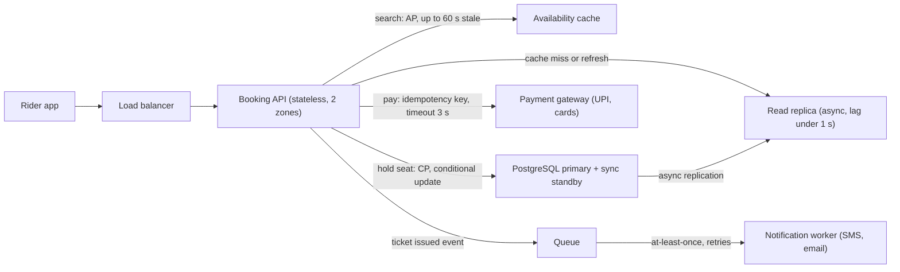
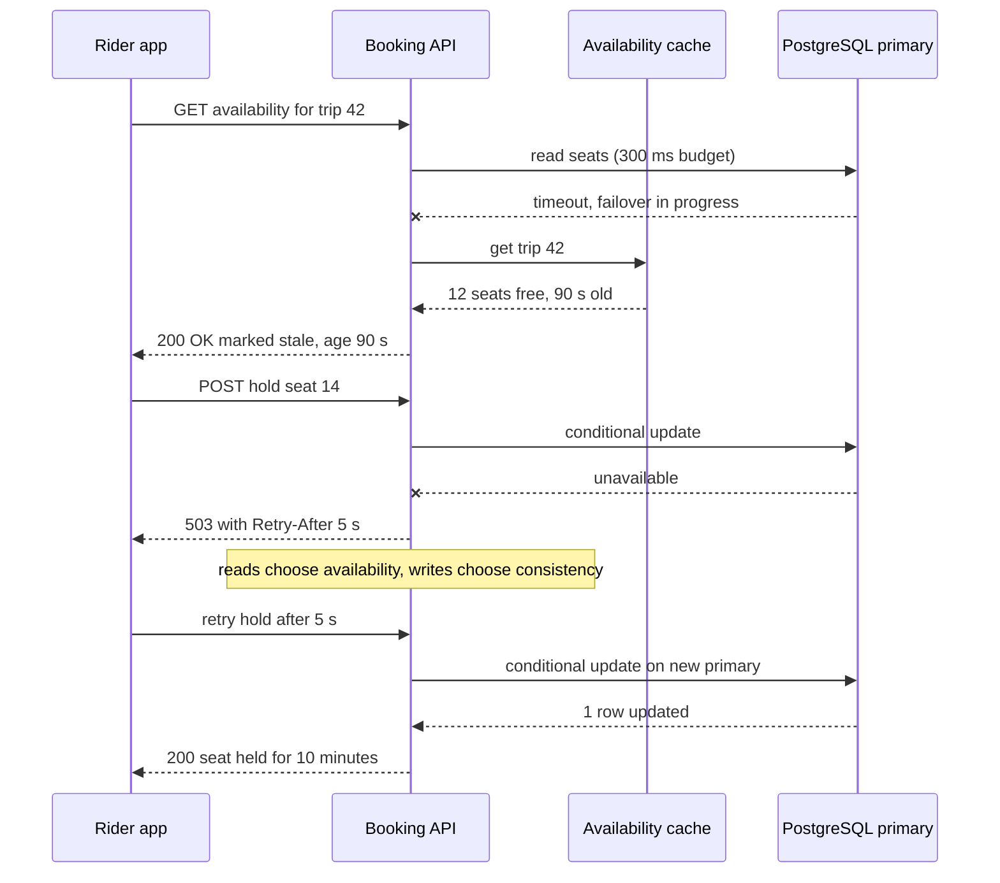

Every design decision buys something and pays for it with something else. A cache buys latency and pays with freshness. A standby database buys availability and pays with money. A microservice split buys independent deployment and pays with network calls and operational work. Senior engineers are not the ones who avoid trade-offs; they are the ones who can **name** them, **quantify** them, **choose per operation** rather than per system, and **say what would make them change their mind**. This lesson gives you the vocabulary, the tables and the habits to do that in design reviews and interviews.

## Learning objectives

By the end of this lesson you will be able to:

1. Explain the main trade-off axes in system design — consistency versus availability, latency versus consistency, latency versus cost, simplicity versus flexibility, throughput versus latency, durability versus speed — with a concrete example of each.
2. Make consistency and availability choices **per operation**, not per system, and justify each against a requirement.
3. Write a trade-off statement that names the choice, its cost, why the cost is acceptable and the trigger to revisit it.
4. Build a failure-mode table (component, failure, detection, impact, mitigation, residual risk) and rank risks with a simple severity × likelihood × detectability score.
5. Defend a design under challenge: acknowledge, quantify, mitigate, and know when to concede.
6. Implement in ASP.NET Core a read path that degrades to bounded-stale data and a write path that refuses rather than guesses.

## Prerequisites

- [The HLD framework](#/lesson/m11-hld-framework): trade-off discussion is the "refine" step of every design.
- [Non-functional requirements](#/lesson/m11-nfrs): trade-offs are only decidable against measurable targets.
- [Availability](#/lesson/m11-availability): the nines, serial and parallel availability.
- [Cost estimation](#/lesson/m11-cost-estimation): many trade-offs have a price tag.
- Helpful but not required: [CAP and PACELC](#/lesson/m13-cap-pacelc) and [Quorums](#/lesson/m13-quorums), which go deeper into the theory used here.

## Explain it like I'm a beginner

Picture a railway reservation counter in a small town in the days before everything was online. The counter clerk sells seats by phoning the central office, which keeps the master seat chart. One morning the phone line goes dead. The clerk has two choices:

- **Refuse to sell tickets** until the line is back. Nobody gets a seat that someone else also bought, but the queue goes home angry. (This is choosing **consistency**.)
- **Keep selling** from a small block of seats the town was given earlier, and sort out any clashes when the line returns. The queue is happy, but a few passengers might later be told their seat was double-booked. (This is choosing **availability**.)

Neither choice is "correct". It depends on what is worse for this business: an angry queue or a double-booked seat. And it can be different for different things: the clerk could keep **answering questions** ("Is there a train to Jaipur tomorrow?") from the printed timetable while **refusing to sell** seats until the line returns.

That is the core of this lesson: decide in advance, operation by operation, what to give up, and explain why with numbers.

## First-principles explanation

### What a trade-off is

A trade-off exists when improving one quality attribute makes another worse, **for the same cost and effort**. If you could get both by being smarter, it was not a trade-off, it was a mistake. The qualities that trade against each other are the non-functional requirements: latency, availability, consistency, durability, cost, simplicity, security, flexibility, time to market.

Two rules make trade-off discussions productive:

1. **Trade-offs are only decidable against requirements.** "Strong consistency is better" is meaningless. "A seat must never be sold twice; search results may be up to 60 seconds stale" makes the choice obvious.
2. **Trade-offs are per operation, not per system.** One system can be strongly consistent for payments and eventually consistent for the "recently viewed" list. Saying "our system is AP" in an interview is usually a sign of shallow thinking.

### The trade-off statement

Use the same five-part sentence for every significant decision:

```text
For <operation>, we chose <option> over <alternative>
because <requirement, with a number>.
It costs us <downside, with a number>.
We accept that because <reason tied to the business>.
We would revisit if <measurable trigger>.
```

Example: "For **trip search**, we chose to **serve cached availability up to 60 seconds old** over **reading the primary database on every search**, because search is 95 % of traffic (about 4,000 RPS at peak) and must answer in under 200 ms at p95. It costs us occasionally showing a seat as free that was taken in the last minute, which we estimate at under 1 % of seat-map views. We accept that because the hold step re-checks the seat against the primary, so no one can buy a taken seat. We would revisit if 'seat no longer available' errors at hold time exceed 3 % of attempts."

This sentence is hard to argue with, because every part can be checked, and it tells the listener exactly what evidence would change the decision.

### Consistency versus availability (CAP, properly)

The CAP theorem says that when a **network partition** happens (some nodes cannot reach others), a system that replicates data must choose, for each request, between:

- **Consistency (C)**: every read sees the latest successful write, or the request fails.
- **Availability (A)**: every request to a working node gets an answer, even if it may be stale or may later conflict.

Three common misreadings to avoid:

- CAP is **not** "pick two of three" at all times. Without a partition you can have both consistency and availability. The choice is only forced *during* a partition.
- The "C" in CAP means linearizability (a strict, single-copy illusion), not the "C" in ACID.
- Real systems are not simply "CP" or "AP". They choose per operation and often offer tunable consistency (see [Quorums](#/lesson/m13-quorums)).

### Latency versus consistency (PACELC)

Partitions are rare. What you pay **every day** is latency. PACELC extends CAP: if there is a **P**artition, choose **A** or **C**; **E**lse (normal operation), choose **L**atency or **C**onsistency. Keeping replicas in sync before acknowledging a write (synchronous replication) costs a network round-trip on every write; reading only from the leader costs latency for distant users. Async replication and follower reads are faster but may return stale data.

Concrete numbers (typical orders of magnitude, measure your own): a synchronous commit to a standby in another availability zone adds roughly 1–2 ms per write; to another region several hundred to a couple of thousand kilometres away, tens of milliseconds. For a bank transfer that is cheap insurance. For a "like" counter it is waste.

### Latency versus cost

Lower latency usually costs money:

- **More instances at lower utilisation** reduce queueing delay. Running at 40 % CPU instead of 70 % cuts tail latency but needs about 1.75× the instances.
- **Caches and replicas closer to users** (CDNs, regional read replicas) cut round-trips and add infrastructure and invalidation complexity.
- **Hedged requests** (send a second copy of a slow request to another replica) cut p99 latency and increase load, often by a few percent when the hedge fires only after the p95 delay.

The useful question is: what is a millisecond worth here? Shaving 50 ms off checkout may lift conversion; shaving 50 ms off a nightly report is worth nothing.

### Simplicity versus flexibility

Flexibility (plugins, configuration-driven rules, generic engines, microservices, multi-cloud abstraction) lets you change things later without code changes. It costs **now**: more code paths, more configuration to get wrong, more services to deploy and monitor, and more for every new team member to learn. The principle "You Aren't Gonna Need It" (YAGNI) is a reminder that most predicted flexibility is never used, while its cost is paid every day.

A good rule: build the simplest design that meets today's requirements and **keeps tomorrow's likely change cheap** (clean module boundaries, interfaces at the seams that are known to vary), rather than building the flexible version now. A [modular monolith](#/lesson/m02-modular-monolith) is often the right balance before [microservices](#/lesson/m02-microservices).

### Other trade-off axes worth naming

| Axis | Gain | Pay | Typical example |
|---|---|---|---|
| Throughput vs latency | Batching 500 rows per insert multiplies throughput | Each row waits for the batch (up to the flush interval) | Telemetry ingestion |
| Durability vs write latency | Synchronous commit to a standby: no acknowledged write is lost on failover | Extra round-trip on every write | Payments ledger |
| Freshness vs load | Longer cache TTL raises hit ratio and cuts database load | Users see older data | Product catalogue, trip search |
| Normalisation vs read speed | Normalised schema keeps one source of truth | Joins on every read; denormalised read models need sync | Order history page |

### Failure modes: how things actually break

A design discussion is incomplete until you have said what happens when each part fails. Failure types to walk through:

- **Crash (fail-stop)**: a process or machine dies. Easiest to detect (health checks fail) and to handle (restart, failover).
- **Slow (grey failure)**: a dependency answers, but in 5 seconds instead of 50 ms. Often **worse than a crash**, because callers wait, thread pools and connection pools fill up, and the slowness spreads upstream. Timeouts, bulkheads and circuit breakers exist for this.
- **Wrong answers**: corrupted data, a bad deployment returning errors as 200 OK, clock skew breaking token validation.
- **Overload**: more traffic than capacity, often triggered by a retry storm after a brief blip.
- **Dependency outage**: payment gateway, SMS provider, identity provider, DNS.
- **Network partition**: zones or regions cannot reach each other while both still run.
- **Data loss and human error**: an accidental `DELETE`, a bad migration, an expired certificate, a mistaken configuration change. Backups and point-in-time recovery are the only defence against the first two.
- **Zone or region outage**: power, networking or provider-level incidents.

For each, ask four questions: **How do we detect it? Who is affected (the blast radius)? What happens automatically? What remains broken (residual risk), and for how long?**

### The failure-mode table

Write the answers as a table. This is a lightweight form of Failure Mode and Effects Analysis (FMEA), a technique from reliability engineering.

| Component | Failure | Detection | User impact | Mitigation | Residual risk |
|---|---|---|---|---|---|
| API instance | Crash | LB health check fails within 10 s | Requests on that instance fail once, retried | N+1 instances across 2 zones, LB removes the instance | None noticeable |
| Primary database | Node failure | Managed failover monitor | Writes fail for about 30–60 s during failover (an estimate; managed services typically quote 30–120 s, so measure yours in a drill) | Standby in another zone, clients retry with backoff | 30–60 s of failed holds |
| Payment gateway | Slow (p99 8 s) | Latency SLO alert, circuit breaker | Checkout stalls | 3 s timeout, circuit breaker, "pending payment" state, reconcile later | Some users retry or abandon |
| Cache cluster | Total loss | Error rate on cache calls | Search slower, DB load jumps 10× | DB sized for cache-down load at reduced rate, request coalescing, rate limit search | Search p95 rises from 80 ms to 400 ms |
| Region | Full outage | Provider status, synthetic probes | Total outage | Backups in another region, documented restore | RTO 4 h, RPO 15 min (chosen for cost) |

To prioritise, give each row a **severity** (1–10, how bad for users), **likelihood** (1–10, how often) and **detectability** (1–10, where 10 means hard to detect) and multiply them into a **risk priority number** (RPN). Rank by RPN, but treat any severity of 9–10 as needing a plan regardless of its score: a rare region outage still needs a written recovery procedure.

### Blast radius and graceful degradation

Two ideas make failures smaller:

- **Limit the blast radius.** Isolate tenants, regions or features (cells, bulkheads, separate pools) so one failure affects a fraction of users. A bad deployment rolled out to 5 % of traffic first (canary) has a 5 % blast radius.
- **Degrade gracefully.** Decide in advance which features can be turned off or served stale. If recommendations fail, show bestsellers. If the seat cache fails, show "availability updating" rather than an error page. If SMS fails, queue the ticket notification and show it in the app.

### Defending a design

In a review or interview, someone will challenge your design: "What if Redis goes down?", "Why not microservices?", "What if traffic grows 10×?". A good response has four steps:

1. **Acknowledge** the risk honestly. "Yes, if the cache is lost, all search traffic hits PostgreSQL."
2. **Quantify** it. "That is about 4,000 RPS against a read replica sized for about 1,500."
3. **Mitigate** or **accept with reason**. "We rate-limit search to 1,500 RPS, serve the most popular routes from an in-process cache and show cached seat maps where we have them. The remaining risk is slower search for the few minutes a cache node takes to replace."
4. **Name the trigger** that would change the design. "If cache incidents happen more than once a quarter, we will move to a replicated cache with automatic failover."

Two anti-patterns: **defending everything** (no design is perfect, and refusing to admit a weakness destroys trust) and **flip-flopping** (abandoning a sound decision at the first question). If the challenger has found a real flaw, say so, thank them and adjust. That is a strength, not a weakness.

### When a simpler design is enough

Many trade-off debates disappear when you look at the numbers. An internal approvals app with 300 users does not need to choose between CP and AP across regions: one region, one database with a standby, and a tested backup are enough. The most valuable trade-off sentence in many reviews is: "We considered X; at our scale it adds cost and complexity without changing any requirement we have; we will revisit at Y."

## Visual explanation

### Per-operation choices in a bus seat-booking system



Each arrow carries its own trade-off. **Search** goes to the **availability cache** and, on a miss, the **read replica**: it chooses availability and low latency, accepting data up to 60 seconds old. **Holding a seat** goes only to the **primary** with a conditional update ("set held where status is free"), choosing consistency: if the primary is unreachable, the hold fails rather than risking a double sale. The primary replicates **synchronously** to a standby so no acknowledged hold is lost in a failover (durability over write latency), and **asynchronously** to the read replica (latency over freshness). **Payment** calls an external gateway with a short timeout and an idempotency key, so a retry cannot charge twice. **Notifications** go through a **queue**, decoupling the ticket from SMS provider outages at the cost of a short delay and possible duplicate messages.

### What happens during a primary failover



This is the same system during the 30–60 seconds of a database failover. The **availability read** times out against the primary, so the API falls back to the **cache** and returns the data with a "stale, 90 seconds old" marker: the rider can keep browsing. The **hold** also fails, but here the API does **not** fall back to anything: guessing could sell seat 14 twice. It returns **503 with Retry-After**, the app waits and retries, and by then the standby has been promoted and the conditional update succeeds. One failure, two deliberate behaviours, both chosen in advance.

## Step-by-step example

**Scenario.** An intercity bus-booking platform, similar to those used across India, sells seats for 3,000 operators. Assumed numbers (all estimates): 2 million searches and 150,000 bookings on a normal day. Festival days (Diwali, Chhath) bring about 25 million searches and 360,000 bookings. If 20 % of a festival day's traffic arrives in the busiest hour, searches average 25 M × 0.2 ÷ 3,600 ≈ 1,400 per second in that hour, with minute-level bursts about 3× higher: **about 4,000 searches per second**. Bookings in the same hour: 360,000 × 0.2 ÷ 3,600 = 20 holds per second, bursting to **about 60 holds per second**. A seat hold lasts 10 minutes while the rider pays by UPI or card.

### Step 1 — Write the requirements that decide the trade-offs

- A seat must never be sold to two riders. (Correctness, non-negotiable.)
- Search p95 under 200 ms; search may show availability up to 60 seconds old.
- Booking availability 99.95 % monthly (about 22 minutes of downtime allowed).
- No confirmed booking may be lost (RPO zero for bookings).
- Ticket SMS within 2 minutes in 99 % of cases.
- Infrastructure budget about $6,000 a month (illustrative).

### Step 2 — Decide per operation

| Operation | Choice | Trade-off statement (short) |
|---|---|---|
| Search trips | Cache + read replica, 60 s staleness allowed (AP, low latency) | 95 % of traffic; stale seat counts are corrected at hold time |
| Seat map | Cache with 15 s TTL, invalidated on hold | Fresher than search because riders pick a specific seat |
| Hold seat | Primary only, conditional update (CP) | Correctness beats availability: a refused hold is retried, a double sale is a refund and an angry rider |
| Payment | External gateway, 3 s timeout, idempotency key, pending state | Favour safety: never charge twice, reconcile unknown outcomes |
| Booking write | Synchronous replication to a standby | 1–2 ms extra per write buys RPO zero |
| Ticket notification | Queue + worker, at-least-once | Decouples from SMS outages, may send a duplicate SMS |

### Step 3 — Write the key trade-off statements in full

**Hold seat.** "For seat holds, we chose a conditional update on the primary over allowing holds from replicas or caches, because a seat must never be sold twice. It costs us failed holds during a primary failover (30–60 seconds, perhaps a few times a year), when about 60 holds per second would get 503 and retry. We accept that because the app retries automatically and a delay of seconds is far better than a double booking. We would revisit if failovers became frequent enough to break the 99.95 % target, for example by sharding inventory by operator so a failover affects only part of the inventory."

**Latency versus cost.** "We chose one region with two zones over two regions active-active. Multi-region would roughly double infrastructure cost (to about $12,000 a month, estimated) and add cross-region consistency problems for holds. It costs us a regional outage risk with a 4-hour recovery time from cross-region backups. We accept that because regional outages are rare and the business agreed to that recovery time. We would revisit if the business sets a recovery target under one hour."

### Step 4 — Build the failure-mode table and rank it

| # | Component | Failure | S | L | D | RPN | Mitigation |
|---|---|---|---|---|---|---|---|
| 1 | Payment gateway | Slow or timing out at festival peak | 7 | 6 | 3 | 126 | 3 s timeout, circuit breaker, pending state, reconciliation job, second gateway as fallback |
| 2 | Notification worker | SMS provider down | 4 | 5 | 6 | 120 | Queue retries with backoff, in-app ticket, alert on queue age |
| 3 | Availability cache | Stale data after a missed invalidation | 3 | 7 | 4 | 84 | Short TTL, hold re-checks the primary, monitor hold conflicts |
| 4 | Primary database | Failover takes 60 s | 8 | 3 | 2 | 48 | Sync standby, retries with backoff and jitter, idempotent holds |
| 5 | Region | Full outage | 10 | 1 | 2 | 20 | Cross-region backups, tested restore runbook (severity 10, so planned despite a low RPN) |

The ranking says: spend effort on the payment gateway path first, then the notification queue. It also shows that a dramatic failure (region loss) is not the top risk by score but still needs a plan because of its severity.

### Step 5 — Rehearse the challenges

Before the review, answer the obvious challenges out loud with numbers. *"What if the cache dies at the Diwali peak?"* All 4,000 searches per second would hit a read replica sized for about 1,500, so search is rate-limited to 1,500 per second, the most popular routes are served from an in-process cache, and the rest show "availability updating". Search degrades; booking is untouched because it never depended on the cache. Exercise 6 practises this skill in full.

## Production-style C# implementation

The code below implements the two behaviours from the sequence diagram: **availability reads** that fall back to bounded-stale cached data when the primary is slow or down, and **seat holds** that fail fast instead of guessing. The trade-offs are visible as configuration (`ReadPolicy`) and as return types (`Freshness`, `HoldOutcome`), not hidden inside catch blocks. In-memory fakes stand in for PostgreSQL and Redis, and support fault injection so the behaviour can be demonstrated and tested.

```text
TradeOffs.Booking/
  Program.cs
  Booking/Contracts.cs
  Booking/AvailabilityReader.cs
  Booking/BookingService.cs
  Booking/InMemoryInfrastructure.cs
```

```csharp file=Booking/Contracts.cs
namespace TradeOffs.Booking;

public sealed record SeatAvailability(string TripId, int SeatsFree, DateTimeOffset AsOf);

public enum Freshness { Fresh, Stale }

/// <summary>What the caller gets: the data plus an honest statement of how fresh it is.</summary>
public sealed record AvailabilityView(SeatAvailability Data, Freshness Freshness, TimeSpan Age);

public enum HoldOutcome { Held, SeatTaken, TryAgainLater }

/// <summary>The primary database (PostgreSQL in production). Holds use a conditional update.</summary>
public interface ISeatStore
{
    Task<SeatAvailability> GetAvailabilityAsync(string tripId, CancellationToken ct);

    /// <summary>Returns false if the seat is already held or sold. Throws StoreUnavailableException if the store cannot be reached.</summary>
    Task<bool> TryHoldAsync(string tripId, string seatNo, string customerId, CancellationToken ct);
}

/// <summary>A cache of recent availability (Redis or HybridCache in production).</summary>
public interface IAvailabilityCache
{
    void Put(SeatAvailability value);
    SeatAvailability? Get(string tripId);
}

public sealed class StoreUnavailableException(string message, Exception? inner = null) : Exception(message, inner);

/// <summary>The trade-off for reads, as configuration that a reviewer can see and challenge.</summary>
public sealed class ReadPolicy
{
    /// <summary>How long a read may wait for the primary before falling back (latency budget).</summary>
    public TimeSpan PrimaryBudget { get; set; } = TimeSpan.FromMilliseconds(300);

    /// <summary>The oldest cached data we are willing to show (agreed with the product owner).</summary>
    public TimeSpan MaxStaleness { get; set; } = TimeSpan.FromSeconds(60);
}
```

```csharp file=Booking/AvailabilityReader.cs
using Microsoft.Extensions.Logging;
using Microsoft.Extensions.Options;

namespace TradeOffs.Booking;

/// <summary>
/// Availability reads choose AVAILABILITY: try the primary within a latency budget, and if it is slow
/// or down, serve cached data no older than MaxStaleness, clearly marked as stale.
/// </summary>
public sealed class AvailabilityReader(
    ISeatStore store,
    IAvailabilityCache cache,
    IOptions<ReadPolicy> policy,
    TimeProvider clock,
    ILogger<AvailabilityReader> logger)
{
    private readonly ReadPolicy _policy = policy.Value;

    /// <returns>The view, or null when neither fresh nor acceptably stale data exists.</returns>
    public async Task<AvailabilityView?> GetAsync(string tripId, CancellationToken ct)
    {
        using var budget = CancellationTokenSource.CreateLinkedTokenSource(ct);
        budget.CancelAfter(_policy.PrimaryBudget);
        try
        {
            var fresh = await store.GetAvailabilityAsync(tripId, budget.Token);
            cache.Put(fresh);
            return new AvailabilityView(fresh, Freshness.Fresh, TimeSpan.Zero);
        }
        catch (Exception ex) when ((ex is StoreUnavailableException || ex is OperationCanceledException) && !ct.IsCancellationRequested)
        {
            var cached = cache.Get(tripId);
            if (cached is null)
            {
                logger.LogWarning(ex, "Primary unavailable and no cached availability for {TripId}", tripId);
                return null;
            }

            var age = clock.GetUtcNow() - cached.AsOf;
            if (age > _policy.MaxStaleness)
            {
                logger.LogWarning("Cached availability for {TripId} is {AgeSeconds:0} s old, beyond the {MaxSeconds:0} s limit",
                    tripId, age.TotalSeconds, _policy.MaxStaleness.TotalSeconds);
                return null;
            }

            logger.LogInformation("Serving stale availability for {TripId}, age {AgeSeconds:0} s", tripId, age.TotalSeconds);
            return new AvailabilityView(cached, Freshness.Stale, age);
        }
    }
}
```

```csharp file=Booking/BookingService.cs
using Microsoft.Extensions.Logging;

namespace TradeOffs.Booking;

/// <summary>
/// Seat holds choose CONSISTENCY: only the primary decides, with a conditional update.
/// If the primary cannot be reached, the hold is refused (TryAgainLater), never guessed from a cache.
/// </summary>
public sealed class BookingService(ISeatStore store, IAvailabilityCache cache, TimeProvider clock, ILogger<BookingService> logger)
{
    public async Task<HoldOutcome> HoldAsync(string tripId, string seatNo, string customerId, CancellationToken ct)
    {
        try
        {
            bool held = await store.TryHoldAsync(tripId, seatNo, customerId, ct);
            if (held)
            {
                // Refresh the cache best-effort so search sees the change sooner. Failure here is harmless.
                try { cache.Put(await store.GetAvailabilityAsync(tripId, ct)); }
                catch (StoreUnavailableException) { }
            }
            return held ? HoldOutcome.Held : HoldOutcome.SeatTaken;
        }
        catch (StoreUnavailableException ex)
        {
            logger.LogWarning(ex, "Hold refused for {TripId}/{SeatNo} at {Time}: primary unavailable", tripId, seatNo, clock.GetUtcNow());
            return HoldOutcome.TryAgainLater;
        }
    }
}
```

```csharp file=Booking/InMemoryInfrastructure.cs
using System.Collections.Concurrent;

namespace TradeOffs.Booking;

/// <summary>Stand-in for PostgreSQL with fault injection. The lock plays the role of a conditional UPDATE.</summary>
public sealed class InMemorySeatStore(TimeProvider clock, int seatsPerTrip = 40) : ISeatStore
{
    private readonly Dictionary<string, Dictionary<string, string>> _holds = new();
    private readonly object _gate = new();

    public bool Down { get; set; }
    public TimeSpan Delay { get; set; } = TimeSpan.Zero;

    public async Task<SeatAvailability> GetAvailabilityAsync(string tripId, CancellationToken ct)
    {
        await SimulateAsync(ct);
        lock (_gate)
        {
            int held = _holds.TryGetValue(tripId, out var seats) ? seats.Count : 0;
            return new SeatAvailability(tripId, seatsPerTrip - held, clock.GetUtcNow());
        }
    }

    public async Task<bool> TryHoldAsync(string tripId, string seatNo, string customerId, CancellationToken ct)
    {
        await SimulateAsync(ct);
        lock (_gate)
        {
            if (!_holds.TryGetValue(tripId, out var seats)) _holds[tripId] = seats = new Dictionary<string, string>();
            // Idempotent for the same customer: a retry after a lost response must not report "taken".
            // like: UPDATE seats SET held_by = @c WHERE trip = @t AND seat = @s AND (held_by IS NULL OR held_by = @c)
            if (seats.TryGetValue(seatNo, out var holder)) return holder == customerId;
            seats[seatNo] = customerId;
            return true;
        }
    }

    private async Task SimulateAsync(CancellationToken ct)
    {
        if (Delay > TimeSpan.Zero) await Task.Delay(Delay, ct);
        if (Down) throw new StoreUnavailableException("Primary database unreachable (simulated).");
    }
}

public sealed class InMemoryAvailabilityCache : IAvailabilityCache
{
    private readonly ConcurrentDictionary<string, SeatAvailability> _items = new();
    public void Put(SeatAvailability value) => _items[value.TripId] = value;
    public SeatAvailability? Get(string tripId) => _items.TryGetValue(tripId, out var v) ? v : null;
}
```

```csharp file=Program.cs
using TradeOffs.Booking;

var builder = WebApplication.CreateBuilder(args);

builder.Services.AddSingleton(TimeProvider.System);
builder.Services.AddOptions<ReadPolicy>().BindConfiguration("ReadPolicy");
builder.Services.AddSingleton<InMemorySeatStore>(sp => new InMemorySeatStore(sp.GetRequiredService<TimeProvider>()));
builder.Services.AddSingleton<ISeatStore>(sp => sp.GetRequiredService<InMemorySeatStore>());
builder.Services.AddSingleton<IAvailabilityCache, InMemoryAvailabilityCache>();
builder.Services.AddSingleton<AvailabilityReader>();
builder.Services.AddSingleton<BookingService>();

var app = builder.Build();

// Reads degrade: 200 with a freshness header, or 503 only when nothing acceptable exists.
app.MapGet("/trips/{tripId}/availability", async (string tripId, AvailabilityReader reader, HttpContext http, CancellationToken ct) =>
{
    var view = await reader.GetAsync(tripId, ct);
    if (view is null) return Results.Problem("Availability is temporarily unavailable.", statusCode: 503);
    http.Response.Headers["X-Data-Freshness"] = view.Freshness == Freshness.Fresh ? "fresh" : $"stale; age={view.Age.TotalSeconds:0}";
    return Results.Ok(view.Data);
});

// Writes refuse: 200 held, 409 taken, 503 + Retry-After when the primary cannot decide.
app.MapPost("/trips/{tripId}/seats/{seatNo}/hold", async (string tripId, string seatNo, string customerId, BookingService booking, HttpContext http, CancellationToken ct) =>
{
    var outcome = await booking.HoldAsync(tripId, seatNo, customerId, ct);
    switch (outcome)
    {
        case HoldOutcome.Held:
            return Results.Ok(new { tripId, seatNo, heldForMinutes = 10 });
        case HoldOutcome.SeatTaken:
            return Results.Conflict(new { tripId, seatNo, message = "Seat already taken." });
        default:
            http.Response.Headers.RetryAfter = "5";
            return Results.Problem("Booking is briefly unavailable. Please retry.", statusCode: 503);
    }
});

// Demo-only fault injection, to show both behaviours. Never expose this in production.
if (app.Environment.IsDevelopment())
{
    app.MapPost("/dev/faults", (bool down, int delayMs, InMemorySeatStore store) =>
    {
        store.Down = down;
        store.Delay = TimeSpan.FromMilliseconds(delayMs);
        return Results.Ok(new { store.Down, delayMs });
    });
}

app.Run();
```

Design notes:

1. **The trade-off is explicit and reviewable.** `ReadPolicy.MaxStaleness` is the "up to 60 seconds old" sentence from the requirements, in configuration. Changing it is a product decision, visible in a pull request.
2. **Honesty in the response.** Stale data is returned with `X-Data-Freshness: stale; age=90`, so the app can show "updated 1 minute ago" instead of pretending.
3. **Different failure behaviour per operation.** The read path catches failures and degrades; the write path catches failures and **refuses**. Both are deliberate, and both are tested.
4. **The latency budget protects the caller.** A slow primary (grey failure) cannot hold a search request for seconds: after 300 ms the reader gives up and uses the cache.
## Bad design vs good design

**Bad: one global label.** "Our system is AP, so everything is eventually consistent." Seat holds now succeed on replicas during failover, two riders get seat 14, and customer support issues refunds every festival.

**Bad: hidden fallbacks.** A `catch { return cache.Get(id); }` buried in a repository serves 3-hour-old data with no marker and no limit. Nobody decided that, and nobody knows it happens until a rider complains.

**Bad: the failure-free design.** A design presentation with no failure section. The first question ("what if the payment gateway is slow?") reveals that checkout threads would wait 30 seconds each and exhaust the pool.

**Good:**

- Requirements with numbers decide each trade-off.
- Each significant decision has a five-part trade-off statement.
- Consistency and availability are chosen per operation, and the code shows it (return types, configuration, status codes).
- A ranked failure-mode table with detection, mitigation, owner and residual risk.
- Degraded modes are designed, tested and visible to users.
- The design says where a simpler option was considered and why it was or was not enough.

:::callout type=tradeoff title="Bounded staleness is a product decision"
Engineers often pick a TTL by feel. The right owner of "how stale may search be?" is the product owner, informed by numbers: hit ratio and database load at 15 s, 60 s and 300 s, and how often each causes a "seat no longer available" error. Present the curve; let them choose the point.
:::

:::callout type=mistake title="Retrying writes without idempotency"
"The client retries on 503" is only safe if the write is idempotent. A seat hold keyed by trip, seat and customer can be made naturally idempotent (the conditional update also succeeds when the seat is already held *by the same customer*, as `InMemorySeatStore` does); a payment capture is not, unless it carries an idempotency key. See [Idempotency keys](#/lesson/m10-idempotency).
:::

## Practical playground

The simulator models two regions that lose contact for a period. In **CP** mode, the minority side refuses requests it cannot confirm; in **AP** mode, both sides keep answering and reconcile afterwards with last-writer-wins. Start with the settings below, which resemble seat inventory (few hot keys, a meaningful share of writes), and compare availability, stale reads, conflicting keys and lost writes. Then raise the number of distinct keys to 1,000 and lower the write share to 5 % (closer to a product catalogue) and see how the cost of AP shrinks.

:::playground type=sim sim=partition title="Consistency versus availability during a partition" mode=CP partitionSec=30 requestsPerSec=40 writeShare=0.2 keys=50
Write down, for each setting, the trade-off statement you would make: which mode, at what cost, and why it is acceptable for that kind of data.
:::

## Exercises

:::exercise id=m11-trade-offs-ex1 difficulty=beginner kind=written title="Write three trade-off statements"
A city's e-ticketing system for metro and buses has these decisions already made. Write a full five-part trade-off statement for each (operation, choice over alternative, requirement with a number, cost with a number, why acceptable, revisit trigger).

1. Card balance shown in the app is read from a replica that can lag up to 5 seconds.
2. Fare deduction at the turnstile is recorded locally on the gate and uploaded every 30 seconds, so gates keep working if the network drops.
3. The system is one deployable service (modular monolith) instead of separate services for fares, cards and reporting.
::acceptance
- Each statement has all five parts.
- Each contains at least one number (latency, staleness, rate, cost or team size).
- Each names a measurable revisit trigger.
- Statement 2 recognises the risk it accepts (for example a card with insufficient balance passing a gate offline) and how it is bounded.
::hint
Start from the requirement each decision protects: app responsiveness, gates never blocking commuters, team productivity.
::hint
For the cost, ask "what does the user or the business lose?" Stale balance shown, a few unpaid rides, coupled deployments.
::hint
Bound the risk in statement 2: an offline gate could refuse cards below a minimum balance, or cap offline rides per card.
::hint
Triggers are measurable: complaints about balance per 10,000 users, offline revenue loss per month, deployment conflicts per sprint.
::solution
1. **Balance read.** "For showing card balance in the app, we read from a replica with up to 5 seconds of lag rather than from the primary, because balance views are about 80 % of app traffic and must load in under 300 ms at p95 at peak commute. It costs us occasionally showing a balance from a few seconds ago, typically right after a top-up or a ride. We accept that because the app shows 'updated a few seconds ago' and fare deduction itself never reads this value. We would revisit if balance-related support tickets exceed 1 per 10,000 active users a month, by reading from the primary for the 60 seconds after a top-up."
2. **Offline gates.** "For fare deduction, we record taps locally and upload every 30 seconds rather than calling the central system per tap, because gates must let a commuter through in under 500 ms even when the network drops, and peak flow is about 40 people per minute per gate. It costs us that a card with too little balance can pass during an outage, and that balances in the app lag by up to 30 seconds. We bound that by keeping a recent copy of blocked and low-balance cards on each gate and allowing at most 2 offline rides per card before requiring a top-up. We accept that because blocking a crowded station costs far more than a handful of unpaid rides. We would revisit if offline revenue loss exceeds 0.1 % of monthly fare revenue."
3. **Modular monolith.** "For the application structure, we chose one deployable service with clear modules over separate services, because one team of 6 engineers owns everything and peak load (about 1,500 RPS) fits one tier. It costs us that a reporting change redeploys fare processing. We accept that because automated tests and rolling deployments make this low-risk and microservices would add network failure modes and operational work for no requirement we have. We would revisit if a second team takes over reporting or if reporting load starts to affect fare latency."
::mistakes
- Writing "it's faster" or "it's more scalable" without a number.
- Forgetting to bound the accepted risk in the offline-gate decision.
- Revisit triggers that cannot be measured ("if it becomes a problem").
:::

:::exercise id=m11-trade-offs-ex2 difficulty=beginner kind=code title="Rank a failure-mode register"
Implement a small failure-mode register that scores and ranks failure modes so a team can decide where to spend effort first.
::requirements
- `FailureMode(string component, string failure, int severity, int likelihood, int detectability)`: each score must be from 1 to 10, otherwise `ArgumentOutOfRangeException`. Empty component or failure throws `ArgumentException`.
- `RiskPriority` = severity × likelihood × detectability.
- `FailureModeRegister.Rank(IEnumerable<FailureMode>)` sorts by `RiskPriority` descending, then `Severity` descending, then `Component` ascending (ordinal).
- `FailureModeRegister.NeedingMitigation(IEnumerable<FailureMode>, int threshold, int severityAlwaysAt = 9)` returns, in ranked order, every mode with `RiskPriority >= threshold` **or** `Severity >= severityAlwaysAt`.
::acceptance
- The five bus-booking failure modes from this lesson rank as payment gateway (126), notification worker (120), cache (84), database (48), region (20).
- With threshold 100, payment gateway, notification worker and region (severity 10) need mitigation.
- Ties on RPN are broken by severity, then component name.
::hint
`RiskPriority` is a computed property. Validation belongs in the constructor so no invalid mode can exist.
::hint
LINQ: `OrderByDescending(...).ThenByDescending(...).ThenBy(..., StringComparer.Ordinal)`.
::hint
`NeedingMitigation` = `Rank(modes).Where(m => m.RiskPriority >= threshold || m.Severity >= severityAlwaysAt)`.
::hint
```csharp
private static int Score(int value, string name) =>
    value is >= 1 and <= 10 ? value : throw new ArgumentOutOfRangeException(name, value, "Scores are 1 to 10.");
```
::starter
```csharp file=FailureModeRegister.cs
using System;
using System.Collections.Generic;
using System.Linq;

public sealed class FailureMode
{
    public FailureMode(string component, string failure, int severity, int likelihood, int detectability)
        => throw new NotImplementedException();

    public string Component { get; }
    public string Failure { get; }
    public int Severity { get; }
    public int Likelihood { get; }
    public int Detectability { get; }
    public int RiskPriority => throw new NotImplementedException();
}

public static class FailureModeRegister
{
    public static IReadOnlyList<FailureMode> Rank(IEnumerable<FailureMode> modes) => throw new NotImplementedException();

    public static IReadOnlyList<FailureMode> NeedingMitigation(IEnumerable<FailureMode> modes, int threshold, int severityAlwaysAt = 9)
        => throw new NotImplementedException();
}
```
::tests
```csharp file=FailureModeRegisterTests.cs
using System;
using System.Linq;
using Xunit;

public class FailureModeRegisterTests
{
    private static FailureMode[] BusBooking() => new[]
    {
        new FailureMode("Primary DB", "failover takes 60 s", 8, 3, 2),
        new FailureMode("Payment gateway", "timeouts at festival peak", 7, 6, 3),
        new FailureMode("Region", "full regional outage", 10, 1, 2),
        new FailureMode("Seat cache", "stale availability", 3, 7, 4),
        new FailureMode("Notification worker", "SMS provider down", 4, 5, 6),
    };

    [Fact]
    public void Risk_priority_multiplies_scores() => Assert.Equal(126, new FailureMode("X", "y", 7, 6, 3).RiskPriority);

    [Fact]
    public void Ranks_by_risk_priority()
    {
        var ranked = FailureModeRegister.Rank(BusBooking()).Select(m => m.Component).ToArray();
        Assert.Equal(new[] { "Payment gateway", "Notification worker", "Seat cache", "Primary DB", "Region" }, ranked);
    }

    [Fact]
    public void Severe_modes_always_need_mitigation()
    {
        var needed = FailureModeRegister.NeedingMitigation(BusBooking(), threshold: 100).Select(m => m.Component).ToArray();
        Assert.Equal(new[] { "Payment gateway", "Notification worker", "Region" }, needed);
    }

    [Fact]
    public void Ties_break_by_severity_then_name()
    {
        var modes = new[]
        {
            new FailureMode("C", "f", 4, 5, 2),
            new FailureMode("B", "f", 5, 4, 2),
            new FailureMode("A", "f", 4, 5, 2),
        };
        Assert.Equal(new[] { "B", "A", "C" }, FailureModeRegister.Rank(modes).Select(m => m.Component).ToArray());
    }

    [Fact]
    public void Invalid_scores_throw()
    {
        Assert.Throws<ArgumentOutOfRangeException>(() => new FailureMode("X", "y", 0, 5, 5));
        Assert.Throws<ArgumentOutOfRangeException>(() => new FailureMode("X", "y", 5, 11, 5));
        Assert.Throws<ArgumentException>(() => new FailureMode("", "y", 5, 5, 5));
    }
}
```
::solution
```csharp file=FailureModeRegister.cs
using System;
using System.Collections.Generic;
using System.Linq;

public sealed class FailureMode
{
    public FailureMode(string component, string failure, int severity, int likelihood, int detectability)
    {
        if (string.IsNullOrWhiteSpace(component)) throw new ArgumentException("Component is required.", nameof(component));
        if (string.IsNullOrWhiteSpace(failure)) throw new ArgumentException("Failure is required.", nameof(failure));
        Component = component;
        Failure = failure;
        Severity = Score(severity, nameof(severity));
        Likelihood = Score(likelihood, nameof(likelihood));
        Detectability = Score(detectability, nameof(detectability));
    }

    public string Component { get; }
    public string Failure { get; }
    public int Severity { get; }
    public int Likelihood { get; }
    public int Detectability { get; }
    public int RiskPriority => Severity * Likelihood * Detectability;

    private static int Score(int value, string name) =>
        value is >= 1 and <= 10 ? value : throw new ArgumentOutOfRangeException(name, value, "Scores are 1 to 10.");
}

public static class FailureModeRegister
{
    public static IReadOnlyList<FailureMode> Rank(IEnumerable<FailureMode> modes)
    {
        ArgumentNullException.ThrowIfNull(modes);
        return modes
            .OrderByDescending(m => m.RiskPriority)
            .ThenByDescending(m => m.Severity)
            .ThenBy(m => m.Component, StringComparer.Ordinal)
            .ToList();
    }

    public static IReadOnlyList<FailureMode> NeedingMitigation(IEnumerable<FailureMode> modes, int threshold, int severityAlwaysAt = 9) =>
        Rank(modes).Where(m => m.RiskPriority >= threshold || m.Severity >= severityAlwaysAt).ToList();
}
```

The severity override matters: the region outage has the lowest score (10 × 1 × 2 = 20) but the highest severity. A purely score-based list would leave it unplanned, which is how teams end up without a tested restore procedure.
::mistakes
- Allowing scores of 0, which zero out the RPN and hide a failure mode completely.
- Ranking by severity only, which ignores that a frequent moderate failure can hurt more than a rare severe one.
- Treating the RPN as precise: it is a ranking aid, and a team discussion should overrule it when it looks wrong.
:::

:::exercise id=m11-trade-offs-ex3 difficulty=intermediate kind=code title="A reader that serves bounded-stale data"
Implement the core of the lesson's `AvailabilityReader` as a small generic class: call the primary source; on success remember the value and when it was read; on failure return the remembered value if it is no older than a limit, otherwise fail.
::requirements
- `StaleFallbackReader<T>(Func<string, T> primary, TimeProvider clock, TimeSpan maxStaleness)`; null `primary` or `clock` throws `ArgumentNullException`; negative `maxStaleness` throws `ArgumentOutOfRangeException`.
- `Read(string key)` returns `ReadResult<T>(T Value, bool IsStale, TimeSpan Age)`.
  - If `primary(key)` succeeds: remember `(value, clock.GetUtcNow())` for that key and return it with `IsStale = false`, `Age = TimeSpan.Zero`.
  - If it throws: if a remembered value exists and `now − readAt <= maxStaleness`, return it with `IsStale = true` and the age.
  - Otherwise throw `DataUnavailableException` whose `InnerException` is the primary's exception.
- Values are remembered per key.
::acceptance
- A successful read is fresh.
- A failure 2 minutes after a success (limit 5 minutes) returns the old value, stale, age 2 minutes.
- A failure 6 minutes after the last success throws `DataUnavailableException` wrapping the original error.
- A later success refreshes the remembered value and its timestamp.
::hint
Store `(T Value, DateTimeOffset ReadAt)` in a `Dictionary<string, ...>` keyed by the key.
::hint
Use a `try`/`catch (Exception ex)` around the primary call. Do not catch your own `DataUnavailableException` by accident.
::hint
For tests, `TimeProvider` is an abstract class in the BCL. A subclass that overrides `GetUtcNow()` gives you a controllable clock.
::hint
```csharp
catch (Exception ex)
{
    if (_last.TryGetValue(key, out var entry))
    {
        var age = _clock.GetUtcNow() - entry.ReadAt;
        if (age <= _maxStaleness) return new ReadResult<T>(entry.Value, true, age);
    }
    throw new DataUnavailableException($"No acceptable data for '{key}'.", ex);
}
```
::starter
```csharp file=StaleFallbackReader.cs
using System;
using System.Collections.Generic;

public sealed record ReadResult<T>(T Value, bool IsStale, TimeSpan Age);

public sealed class DataUnavailableException : Exception
{
    public DataUnavailableException(string message, Exception inner) : base(message, inner) { }
}

public sealed class StaleFallbackReader<T>
{
    public StaleFallbackReader(Func<string, T> primary, TimeProvider clock, TimeSpan maxStaleness)
        => throw new NotImplementedException();

    public ReadResult<T> Read(string key) => throw new NotImplementedException();
}
```
::tests
```csharp file=StaleFallbackReaderTests.cs
using System;
using Xunit;

public class StaleFallbackReaderTests
{
    private sealed class ManualClock : TimeProvider
    {
        public DateTimeOffset Now { get; set; } = new DateTimeOffset(2026, 10, 20, 9, 0, 0, TimeSpan.Zero);
        public override DateTimeOffset GetUtcNow() => Now;
        public void Advance(TimeSpan by) => Now += by;
    }

    private sealed class FlakySource
    {
        public bool Fail { get; set; }
        public int Version { get; set; } = 1;
        public string Get(string key) => Fail ? throw new TimeoutException("primary timed out") : $"{key}:v{Version}";
    }

    private static (StaleFallbackReader<string> Reader, FlakySource Source, ManualClock Clock) Create()
    {
        var source = new FlakySource();
        var clock = new ManualClock();
        return (new StaleFallbackReader<string>(source.Get, clock, TimeSpan.FromMinutes(5)), source, clock);
    }

    [Fact]
    public void Successful_read_is_fresh()
    {
        var (reader, _, _) = Create();
        var r = reader.Read("trip-42");
        Assert.Equal("trip-42:v1", r.Value);
        Assert.False(r.IsStale);
        Assert.Equal(TimeSpan.Zero, r.Age);
    }

    [Fact]
    public void Failure_within_limit_serves_stale()
    {
        var (reader, source, clock) = Create();
        reader.Read("trip-42");
        clock.Advance(TimeSpan.FromMinutes(2));
        source.Fail = true;
        var r = reader.Read("trip-42");
        Assert.True(r.IsStale);
        Assert.Equal("trip-42:v1", r.Value);
        Assert.Equal(TimeSpan.FromMinutes(2), r.Age);
    }

    [Fact]
    public void Failure_beyond_limit_throws_with_inner()
    {
        var (reader, source, clock) = Create();
        reader.Read("trip-42");
        clock.Advance(TimeSpan.FromMinutes(6));
        source.Fail = true;
        var ex = Assert.Throws<DataUnavailableException>(() => reader.Read("trip-42"));
        Assert.IsType<TimeoutException>(ex.InnerException);
    }

    [Fact]
    public void Failure_with_nothing_cached_throws()
    {
        var (reader, source, _) = Create();
        source.Fail = true;
        Assert.Throws<DataUnavailableException>(() => reader.Read("trip-7"));
    }

    [Fact]
    public void Recovery_refreshes_the_remembered_value()
    {
        var (reader, source, clock) = Create();
        reader.Read("trip-42");
        clock.Advance(TimeSpan.FromMinutes(4));
        source.Fail = true;
        Assert.True(reader.Read("trip-42").IsStale);

        clock.Advance(TimeSpan.FromSeconds(30));
        source.Fail = false;
        source.Version = 2;
        Assert.False(reader.Read("trip-42").IsStale);

        clock.Advance(TimeSpan.FromMinutes(3.5));
        source.Fail = true;
        var r = reader.Read("trip-42");
        Assert.Equal("trip-42:v2", r.Value);
        Assert.Equal(TimeSpan.FromMinutes(3.5), r.Age);
    }

    [Fact]
    public void Keys_are_independent()
    {
        var (reader, source, _) = Create();
        reader.Read("trip-1");
        source.Fail = true;
        Assert.True(reader.Read("trip-1").IsStale);
        Assert.Throws<DataUnavailableException>(() => reader.Read("trip-2"));
    }

    [Fact]
    public void Invalid_arguments_throw()
    {
        var clock = new ManualClock();
        Assert.Throws<ArgumentNullException>(() => new StaleFallbackReader<string>(null!, clock, TimeSpan.FromMinutes(1)));
        Assert.Throws<ArgumentOutOfRangeException>(() => new StaleFallbackReader<string>(k => k, clock, TimeSpan.FromMinutes(-1)));
    }
}
```
::solution
```csharp file=StaleFallbackReader.cs
using System;
using System.Collections.Generic;

public sealed record ReadResult<T>(T Value, bool IsStale, TimeSpan Age);

public sealed class DataUnavailableException : Exception
{
    public DataUnavailableException(string message, Exception inner) : base(message, inner) { }
}

public sealed class StaleFallbackReader<T>
{
    private readonly Func<string, T> _primary;
    private readonly TimeProvider _clock;
    private readonly TimeSpan _maxStaleness;
    private readonly Dictionary<string, (T Value, DateTimeOffset ReadAt)> _last = new();
    private readonly object _gate = new();

    public StaleFallbackReader(Func<string, T> primary, TimeProvider clock, TimeSpan maxStaleness)
    {
        _primary = primary ?? throw new ArgumentNullException(nameof(primary));
        _clock = clock ?? throw new ArgumentNullException(nameof(clock));
        if (maxStaleness < TimeSpan.Zero) throw new ArgumentOutOfRangeException(nameof(maxStaleness));
        _maxStaleness = maxStaleness;
    }

    public ReadResult<T> Read(string key)
    {
        T value;
        try
        {
            value = _primary(key);
        }
        catch (Exception ex)
        {
            lock (_gate)
            {
                if (_last.TryGetValue(key, out var entry))
                {
                    var age = _clock.GetUtcNow() - entry.ReadAt;
                    if (age <= _maxStaleness) return new ReadResult<T>(entry.Value, true, age);
                }
            }
            throw new DataUnavailableException($"No fresh or acceptably stale data for '{key}'.", ex);
        }

        lock (_gate) _last[key] = (value, _clock.GetUtcNow());
        return new ReadResult<T>(value, false, TimeSpan.Zero);
    }
}
```

The primary call sits alone inside the `try`, so a bug in our own bookkeeping cannot be mistaken for a primary failure. `maxStaleness` is the trade-off made explicit: zero means "consistency, no fallback", larger values move the reader towards availability.
:::

:::exercise id=m11-trade-offs-ex4 difficulty=intermediate kind=hld title="Choose per-path trade-offs for bus booking"
The graph below is a first design for the bus-booking platform in this lesson: every request, search and hold alike, goes to one PostgreSQL database in one zone, and notifications are sent synchronously during booking.

Redesign it so that each path makes an explicit trade-off. Label the edges with the choice (for example "AP, 60 s stale" or "CP, conditional update"), and include a short failure-mode table for your design.
::acceptance
- Search and booking take different paths with different consistency choices.
- Seat holds go only to a primary with a conditional update, and the primary has a standby in another zone.
- Notifications are asynchronous, so an SMS outage cannot fail a booking.
- Payment has a timeout and an idempotency key.
- The failure-mode table has at least five rows with detection, impact and mitigation.
- At least one decision explicitly states where a simpler option was kept.
::hint
Which path carries 95 % of traffic and tolerates staleness? Which path must never be wrong?
::hint
What does the user see during a 60-second primary failover on each path?
::hint
Add `cache`, `read-replica`, `queue`, `worker` and an `external` payment node. Mark the database `multiAz`.
::hint
For "simpler option kept", look at regions and service boundaries.
::starter
```json
{
  "nodes": [
    { "id": "app", "type": "client", "label": "Rider app", "props": { "rps": 4000 } },
    { "id": "lb", "type": "load-balancer", "label": "Load balancer" },
    { "id": "api", "type": "app-server", "label": "Booking API", "props": { "instances": 4 } },
    { "id": "db", "type": "database", "label": "PostgreSQL (one zone)", "props": { "replicas": 0 } },
    { "id": "sms", "type": "external", "label": "SMS provider" },
    { "id": "pay", "type": "external", "label": "Payment gateway" }
  ],
  "edges": [
    { "from": "app", "to": "lb", "kind": "sync" },
    { "from": "lb", "to": "api", "kind": "sync" },
    { "from": "api", "to": "db", "kind": "sync", "label": "search + holds" },
    { "from": "api", "to": "pay", "kind": "sync" },
    { "from": "api", "to": "sms", "kind": "sync", "label": "inside the booking request" }
  ]
}
```
::solution
```json
{
  "nodes": [
    { "id": "app", "type": "client", "label": "Rider app", "props": { "rps": 4000 } },
    { "id": "lb", "type": "load-balancer", "label": "Load balancer", "props": { "multiAz": true } },
    { "id": "api", "type": "app-server", "label": "Booking API (modular monolith)", "props": { "instances": 10, "multiAz": true } },
    { "id": "cache", "type": "cache", "label": "Availability cache", "props": { "ttlSeconds": 60 } },
    { "id": "rr", "type": "read-replica", "label": "Read replica (async)" },
    { "id": "db", "type": "database", "label": "PostgreSQL primary + sync standby", "props": { "replicas": 1, "multiAz": true } },
    { "id": "pay", "type": "external", "label": "Payment gateway" },
    { "id": "q", "type": "queue", "label": "Ticket events" },
    { "id": "w", "type": "worker", "label": "Notification worker", "props": { "instances": 2 } },
    { "id": "sms", "type": "external", "label": "SMS provider" },
    { "id": "mon", "type": "monitoring", "label": "Hold conflicts, queue age, payment latency" }
  ],
  "edges": [
    { "from": "app", "to": "lb", "kind": "sync" },
    { "from": "lb", "to": "api", "kind": "sync" },
    { "from": "api", "to": "cache", "kind": "sync", "label": "search: AP, up to 60 s stale" },
    { "from": "api", "to": "rr", "kind": "sync", "label": "cache miss: lag under 1 s" },
    { "from": "api", "to": "db", "kind": "sync", "label": "hold: CP, conditional update" },
    { "from": "db", "to": "rr", "kind": "async", "label": "async replication" },
    { "from": "api", "to": "pay", "kind": "sync", "label": "3 s timeout, idempotency key" },
    { "from": "api", "to": "q", "kind": "async", "label": "ticket issued" },
    { "from": "q", "to": "w", "kind": "async", "label": "at-least-once" },
    { "from": "w", "to": "sms", "kind": "sync", "label": "retry with backoff" },
    { "from": "api", "to": "mon", "kind": "async" }
  ]
}
```

**Per-path choices.** As in the lesson's first diagram: search is AP with bounded staleness, holds are CP on the primary, the standby is synchronous, payments are idempotent with a short timeout, and notifications are queued (possible duplicate SMS, never a failed booking).

**Failure-mode table.**

| Component | Failure | Detection | Impact | Mitigation |
|---|---|---|---|---|
| API instance | Crash | LB health check | One request retried | 10 instances over 2 zones |
| Primary DB | Failover (30–60 s) | Managed monitor, hold error rate | Holds return 503, search unaffected | Sync standby, client retry with jitter |
| Cache | Lost | Cache error rate | Search slower, replica load up | Replica sized for 1,500 RPS, search rate limit, in-process cache for top routes |
| Payment gateway | Slow | p99 alert, breaker | Checkout delays | 3 s timeout, breaker, pending state, reconciliation |
| SMS provider | Down | Queue age alert | Late SMS | Retries, in-app ticket |
| Region | Outage | Probes | Full outage | Cross-region backups, 4 h RTO runbook |

**Simpler options kept.** One region (multi-region would roughly double cost and complicate holds; recovery from backups is accepted). One modular monolith instead of separate search and booking services, revisited if a separate team owns search.
::mistakes
- Putting holds behind the cache "for speed".
- Making the notification call part of the booking transaction, so an SMS outage blocks revenue.
- A failure table with "add redundancy" as every mitigation and no detection column.
:::

:::exercise id=m11-trade-offs-ex5 difficulty=advanced kind=code title="Choose read and write quorums"
In a replicated store with `n` copies, a read waits for `R` replicas and a write for `W`. If `R + W > n`, every read overlaps the latest write (strong consistency for single-key reads). A read can tolerate `n − R` failed replicas and a write `n − W`. Larger quorums are slower because you wait for more replicas. Write an advisor that lists valid `(R, W)` pairs for a set of requirements and chooses the cheapest.
::requirements
- `QuorumAdvisor.Valid(int n, bool requireStrong, int readFailuresTolerated, int writeFailuresTolerated)` returns every `QuorumChoice(int ReadQuorum, int WriteQuorum)` with `1 <= R, W <= n`, `n − R >= readFailuresTolerated`, `n − W >= writeFailuresTolerated`, and `R + W > n` when `requireStrong`. Order by `R`, then `W`.
- `QuorumAdvisor.Choose(..., double readWeight)` returns the valid pair with the lowest latency cost `readWeight × R + (1 − readWeight) × W`, or `null` if none is valid. On a cost tie (within 1e-9), prefer the larger `W` (more durable writes).
- `n < 1`, negative tolerances or `readWeight` outside `[0, 1]` throw `ArgumentOutOfRangeException`.
::acceptance
- `n = 3`, strong, tolerate 1 read and 1 write failure: only `(2, 2)`.
- `n = 5`, strong, tolerate 1 read and 2 write failures: valid pairs `(3, 3)`, `(4, 2)`, `(4, 3)`; a read-heavy weight of 0.9 chooses `(3, 3)`, a write-heavy weight of 0.1 chooses `(4, 2)`.
- `n = 3`, strong, tolerate 2 and 2: impossible, `null`.
- `n = 4`, strong, tolerate 1 and 1, weight 0.5: `(2, 3)` and `(3, 2)` tie, choose `(2, 3)`.
::hint
Two nested loops over R and W from 1 to n, filtering by the three conditions.
::hint
Tolerating `f` read failures means `R <= n − f`.
::hint
`Choose` = minimise over `Valid(...)`. Track the best pair and replace it when the cost is lower by more than 1e-9, or equal within 1e-9 with a larger W.
::hint
Check the n = 5 case by hand: W <= 3 (tolerate 2), R <= 4 (tolerate 1), R + W >= 6. Pairs: (3,3), (4,2), (4,3).
::hint
```csharp
foreach (var c in Valid(n, strong, rf, wf))
{
    double cost = readWeight * c.ReadQuorum + (1 - readWeight) * c.WriteQuorum;
    bool better = best is null || cost < bestCost - 1e-9 ||
                  (Math.Abs(cost - bestCost) <= 1e-9 && c.WriteQuorum > best.WriteQuorum);
    if (better) { best = c; bestCost = cost; }
}
```
::starter
```csharp file=QuorumAdvisor.cs
using System;
using System.Collections.Generic;

public sealed record QuorumChoice(int ReadQuorum, int WriteQuorum)
{
    public bool IsStrong(int n) => ReadQuorum + WriteQuorum > n;
}

public static class QuorumAdvisor
{
    public static IReadOnlyList<QuorumChoice> Valid(int n, bool requireStrong, int readFailuresTolerated, int writeFailuresTolerated)
        => throw new NotImplementedException();

    public static QuorumChoice? Choose(int n, bool requireStrong, int readFailuresTolerated, int writeFailuresTolerated, double readWeight)
        => throw new NotImplementedException();
}
```
::tests
```csharp file=QuorumAdvisorTests.cs
using System;
using System.Linq;
using Xunit;

public class QuorumAdvisorTests
{
    [Fact]
    public void Three_replicas_strong_tolerating_one_each()
    {
        var valid = QuorumAdvisor.Valid(3, true, 1, 1);
        Assert.Single(valid);
        Assert.Equal(new QuorumChoice(2, 2), valid[0]);
    }

    [Fact]
    public void Five_replicas_lists_all_valid_pairs_in_order()
    {
        var valid = QuorumAdvisor.Valid(5, true, 1, 2);
        Assert.Equal(new[] { new QuorumChoice(3, 3), new QuorumChoice(4, 2), new QuorumChoice(4, 3) }, valid.ToArray());
    }

    [Fact]
    public void Read_heavy_and_write_heavy_choose_differently()
    {
        Assert.Equal(new QuorumChoice(3, 3), QuorumAdvisor.Choose(5, true, 1, 2, readWeight: 0.9));
        Assert.Equal(new QuorumChoice(4, 2), QuorumAdvisor.Choose(5, true, 1, 2, readWeight: 0.1));
    }

    [Fact]
    public void Eventual_consistency_allows_single_replica_quorums() =>
        Assert.Equal(new QuorumChoice(1, 1), QuorumAdvisor.Choose(3, false, 2, 2, readWeight: 0.5));

    [Fact]
    public void Impossible_requirements_return_null()
    {
        Assert.Null(QuorumAdvisor.Choose(3, true, 2, 2, readWeight: 0.5));
        Assert.Empty(QuorumAdvisor.Valid(3, true, 2, 2));
    }

    [Fact]
    public void Ties_prefer_more_durable_writes() =>
        Assert.Equal(new QuorumChoice(2, 3), QuorumAdvisor.Choose(4, true, 1, 1, readWeight: 0.5));

    [Fact]
    public void Invalid_inputs_throw()
    {
        Assert.Throws<ArgumentOutOfRangeException>(() => QuorumAdvisor.Valid(0, true, 0, 0));
        Assert.Throws<ArgumentOutOfRangeException>(() => QuorumAdvisor.Valid(3, true, -1, 0));
        Assert.Throws<ArgumentOutOfRangeException>(() => QuorumAdvisor.Choose(3, true, 1, 1, readWeight: 1.5));
    }
}
```
::solution
```csharp file=QuorumAdvisor.cs
using System;
using System.Collections.Generic;

public sealed record QuorumChoice(int ReadQuorum, int WriteQuorum)
{
    public bool IsStrong(int n) => ReadQuorum + WriteQuorum > n;
}

public static class QuorumAdvisor
{
    public static IReadOnlyList<QuorumChoice> Valid(int n, bool requireStrong, int readFailuresTolerated, int writeFailuresTolerated)
    {
        if (n < 1) throw new ArgumentOutOfRangeException(nameof(n));
        if (readFailuresTolerated < 0) throw new ArgumentOutOfRangeException(nameof(readFailuresTolerated));
        if (writeFailuresTolerated < 0) throw new ArgumentOutOfRangeException(nameof(writeFailuresTolerated));

        var result = new List<QuorumChoice>();
        for (int r = 1; r <= n; r++)
        {
            if (n - r < readFailuresTolerated) continue;
            for (int w = 1; w <= n; w++)
            {
                if (n - w < writeFailuresTolerated) continue;
                if (requireStrong && r + w <= n) continue;
                result.Add(new QuorumChoice(r, w));
            }
        }
        return result;
    }

    public static QuorumChoice? Choose(int n, bool requireStrong, int readFailuresTolerated, int writeFailuresTolerated, double readWeight)
    {
        if (readWeight is < 0 or > 1) throw new ArgumentOutOfRangeException(nameof(readWeight));

        QuorumChoice? best = null;
        double bestCost = double.MaxValue;
        foreach (var c in Valid(n, requireStrong, readFailuresTolerated, writeFailuresTolerated))
        {
            double cost = readWeight * c.ReadQuorum + (1 - readWeight) * c.WriteQuorum;
            bool better = best is null
                || cost < bestCost - 1e-9
                || (Math.Abs(cost - bestCost) <= 1e-9 && c.WriteQuorum > best.WriteQuorum);
            if (better)
            {
                best = c;
                bestCost = cost;
            }
        }
        return best;
    }
}
```

**What the advisor teaches.** With 3 replicas you cannot have strong consistency *and* tolerate 2 failures on both reads and writes: `R ≤ 1` and `W ≤ 1` make `R + W = 2`, not more than 3. That is the CAP trade-off in arithmetic form. With 5 replicas, a read-heavy workload chooses `(3, 3)` and a write-heavy one `(4, 2)`: the same consistency guarantee, with latency moved to whichever operation is rarer. Note `(4, 2)` makes writes fast but each write is on only 2 replicas until repair, so the tie rule's preference for larger `W` reflects a real durability concern.

This is a simplified model; see [Quorums](#/lesson/m13-quorums) for sloppy quorums, read repair and why `R + W > n` alone is not linearizability.
::mistakes
- Treating `R + W > n` as "strong consistency for everything", including multi-key transactions.
- Forgetting that the tolerance for reads and for writes can differ.
- Choosing by latency alone and ignoring how many copies hold a write when it is acknowledged.
:::

:::exercise id=m11-trade-offs-ex6 difficulty=advanced kind=written title="Defend a design under pushback"
You presented this design for a hospital outpatient (OPD) appointment system for a group of 25 hospitals: one region, two zones; a modular monolith on 6 instances; PostgreSQL primary with a synchronous standby; Redis cache for doctor schedules with a 30-second TTL; appointment confirmations via a queue to SMS and WhatsApp; slot booking as a conditional update on the primary.

Answer each challenge using acknowledge, quantify, mitigate (or accept with reason) and revisit trigger. Assume about 300 bookings per minute at the 8 a.m. peak and 20 schedule views per booking.

1. "Your cache shows slots that are already booked. Patients will be annoyed."
2. "Why not use microservices? Every modern hospital system does."
3. "A synchronous standby slows every write. Use asynchronous replication."
4. "If your region goes down, no hospital can book. That's unacceptable."
::acceptance
- Each answer has all four steps.
- Each answer includes at least one number derived from the scenario.
- At least one answer concedes part of the challenge and changes something.
- No answer simply dismisses the challenger.
::hint
Compute the traffic first: 300 bookings a minute is 5 per second; 20 views each is 100 schedule views per second.
::hint
For the cache, what fraction of views could show a slot taken in the last 30 seconds? What happens at booking time?
::hint
For replication, what does async cost on failover, in terms of confirmed appointments?
::hint
For the region, what do hospitals do today when the system is down, and what recovery time did the business agree?
::solution
**Traffic.** 300 bookings a minute = 5 bookings per second; × 20 views = 100 schedule views per second at peak.

1. **Stale slots.** *Acknowledge:* yes, with a 30-second TTL a patient can see a slot booked in the last 30 seconds. *Quantify:* at 5 bookings per second across 25 hospitals and perhaps 500 doctors, a given doctor's schedule changes about every 100 seconds at peak, so roughly a quarter of views of a busy doctor could be up to one booking out of date. *Mitigate:* the booking itself is a conditional update on the primary, so a double booking is impossible; the patient sees "slot just taken, here are the next three". Because this is more frequent than I would like, I will **concede and change** it: invalidate the doctor's cached schedule on every booking (one cache delete per booking, 5 per second, trivial), which leaves only a sub-second window. *Revisit:* if "slot just taken" exceeds 2 % of booking attempts.
2. **Microservices.** *Acknowledge:* microservices would let modules deploy and scale independently. *Quantify:* total load is about 100 reads and 5 writes per second; one team of perhaps 8 engineers owns it all. Splitting would add network calls, distributed failure modes and several pipelines for no requirement we have. *Accept with reason:* the modular monolith keeps clear module boundaries (scheduling, patients, notifications) with internal interfaces, so extraction later is cheap. *Revisit:* when a second team owns a module, or a module needs a different scaling or release cadence.
3. **Synchronous standby.** *Acknowledge:* every booking waits for the standby, typically adding 1–2 ms within a region. *Quantify:* at 5 writes per second that is negligible against a 200 ms booking budget. With async replication, a failover could lose the last seconds of confirmed bookings: at 5 per second, a 2-second lag loses about 10 appointments that patients have already been told about by SMS. *Accept:* durability wins; double-booked or vanished appointments at a hospital are far worse than 2 ms. *Revisit:* only if write latency measurably threatens the budget, which at this volume is unlikely.
4. **Region outage.** *Acknowledge:* correct, a regional outage stops online booking. *Quantify:* multi-region active-active would roughly double infrastructure cost and require solving cross-region slot consistency; regional outages are rare (perhaps hours per year at worst). *Mitigate:* cross-region backups with a tested restore (RTO 4 hours, RPO 15 minutes), a printable daily schedule per doctor for walk-in fallback, and status messaging. I will **partially concede**: confirmations already sent are in patients' phones, and I will add a nightly export of the next day's appointments to each hospital so OPD desks can operate from it. *Revisit:* if the hospitals' agreed recovery target drops below 1 hour, move to a warm standby region.
::mistakes
- Answering "Redis is reliable" or "microservices are overkill" without numbers.
- Conceding everything, which leaves no coherent design.
- Ignoring the business context (patients, OPD desks) and arguing only technology.
:::

## Automated testing

Trade-offs that are not tested are wishes. Test the deliberate behaviours, and test failures on purpose.

**1. Unit-test degraded paths with fakes and a controllable clock.** The read path's promise ("stale data no older than 60 seconds, marked as stale") and the write path's promise ("refuse when the primary is down") are both testable without infrastructure:

```csharp
[Fact]
public async Task Hold_is_refused_not_guessed_when_primary_is_down()
{
    var clock = TimeProvider.System;
    var store = new InMemorySeatStore(clock) { Down = true };
    var cache = new InMemoryAvailabilityCache();
    cache.Put(new SeatAvailability("trip-42", 12, clock.GetUtcNow())); // the cache says seats are free
    var service = new BookingService(store, cache, clock, NullLogger<BookingService>.Instance);

    var outcome = await service.HoldAsync("trip-42", "14", "rider-1", CancellationToken.None);

    Assert.Equal(HoldOutcome.TryAgainLater, outcome); // never Held based on cached data
}
```

**2. Turn the failure-mode table into a test list.** Every row with a mitigation should have a test or a drill: "primary down → holds return 503", "cache down → search still answers within 400 ms at 1,500 RPS", "SMS provider down → bookings succeed and queue age alert fires".

**3. Inject faults in integration environments.** Add latency and errors to dependencies (a fault-injecting `DelegatingHandler` for `HttpClient`, toxiproxy-style network faults, or the provider's chaos tooling) and assert the system degrades as designed. Slow is more important to test than down.

**4. Run game days and alert on the triggers.** Periodically fail a database over or block the payment gateway in staging while the team watches dashboards, and compare the real recovery time with the residual-risk column. Turn each revisit trigger (hold-conflict rate above 3 %, queue age above 2 minutes) into an alert.

## Real-world application

- **Shopping carts and availability.** Amazon's Dynamo paper (2007) describes a store designed to keep accepting cart writes during failures, reconciling divergent versions later, because rejecting "add to cart" was judged worse than occasionally resurrecting a deleted item. It is a public, well-argued AP trade-off for one specific operation.
- **Design reviews and architecture decision records.** Many engineering organisations require each significant decision to be written down with context, options, decision and consequences (see [ADRs](#/lesson/m02-adr)). The trade-off statement in this lesson is a compact form of the same idea. Microsoft's Well-Architected reliability guidance similarly recommends a failure mode analysis for every component and dependency.

## Interview questions

:::interview
::q beginner
What is a trade-off in system design? Give an example.
::a
A trade-off is when improving one quality makes another worse for the same cost. For example, caching product pages for 5 minutes cuts database load and page latency (good) but means users may see a price up to 5 minutes old (bad). Whether it is worth it depends on the requirements: for a catalogue it usually is; for a stock-trading price it is not. I always state trade-offs with numbers and tie them to a requirement.
::q beginner
What does the CAP theorem actually say?
::a
For a system that replicates data, when a network partition stops some nodes from talking to others, each request must either be refused or delayed to preserve consistency (every read sees the latest write) or answered with possibly stale or conflicting data to preserve availability. It does not mean you permanently "pick two of three": without a partition you can have both. In practice the choice is made per operation, for example consistent seat holds but available search.
::q intermediate
How would you decide between strong and eventual consistency for a feature?
::a
I ask what goes wrong if a user sees stale data or two conflicting writes happen, and how much that costs compared with the latency and availability cost of strong consistency. Money movement, inventory decrements and unique allocations (seats, usernames) usually need strong consistency on the write. Feeds, counters, search results and recommendations usually tolerate seconds of staleness. Then I bound the staleness with a number agreed with the product owner, make the read path show it honestly, and make the write path re-check against the source of truth.
::q intermediate
What is a failure-mode table and what columns would you include?
::a
It is a list of how each component and dependency can fail and what happens. Columns: component, failure type (crash, slow, wrong, overload, partition), how we detect it, user impact and blast radius, automatic and manual mitigation, and residual risk with expected duration. To prioritise I score severity, likelihood and detectability and multiply them, but anything catastrophic gets a plan regardless of score. Each mitigation should have a test or drill and an owner.
::q advanced
Why can a slow dependency be worse than a dead one, and how do you design for it?
::a
A dead dependency fails fast: connections are refused, callers get errors immediately, health checks remove it. A slow one holds every caller's thread, connection and memory while it waits, so pools fill, queues grow, and the caller itself becomes slow or unresponsive, spreading the failure upstream. I design for it with strict timeouts derived from a latency budget, bulkheads (separate pools per dependency so one cannot starve others), circuit breakers that fail fast after repeated timeouts, load shedding when queues grow, and fallbacks such as stale data or a degraded feature. And I test it with injected latency, not just injected errors.
::q advanced
An interviewer says your design is too complex. How do you respond?
::a
I take it seriously, because they may be right. I list each component and the requirement it serves, with numbers: "the queue exists because SMS provider outages must not fail bookings", "the read replica exists because search is 4,000 RPS". If a component does not map to a stated requirement or a failure mode we care about, I remove it and say so. If it does, I explain the cost of removing it with the failure it would reintroduce. I also point out where I already chose the simpler option (one region, a modular monolith) and the trigger for revisiting. The goal is a design where every piece earns its place.
:::

## Summary and revision

**Key takeaways**

- A trade-off is gaining one quality at the expense of another for the same cost. Decide them against requirements with numbers.
- Choose per operation, not per system: consistent holds and payments, available and fast search and feeds.
- CAP forces a choice only during partitions; PACELC reminds you that latency versus consistency is the everyday trade-off.
- Latency usually costs money; flexibility usually costs simplicity now. Build what today needs and keep likely changes cheap.
- Use the five-part trade-off statement: choice over alternative, because requirement, costs downside, accepted because reason, revisit if trigger.
- Walk every component and dependency through crash, slow, wrong, overload and partition. Slow is often worse than down.
- A failure-mode table has detection, impact, mitigation and residual risk. Rank by severity × likelihood × detectability, but plan for anything catastrophic.
- Defend designs with acknowledge, quantify, mitigate, revisit. Concede real flaws.
- Test degraded behaviour on purpose: unit tests with fakes and fake clocks, fault injection, game days.

**Terminology**: trade-off, CAP, partition, linearizability, PACELC, eventual consistency, bounded staleness, quorum, grey failure, blast radius, graceful degradation, FMEA, risk priority number, residual risk, RTO, RPO, game day, YAGNI.

:::flashcards
Q: When does CAP force a choice between consistency and availability?
A: Only during a network partition. Without a partition a system can be both consistent and available.
Q: What does PACELC add to CAP?
A: Else (no partition), you still trade latency against consistency, which is the everyday cost.
Q: The five parts of a trade-off statement?
A: Choice over alternative, because requirement (number), costs downside (number), accepted because reason, revisit if measurable trigger.
Q: Why is "our system is AP" usually a weak answer?
A: Consistency and availability should be chosen per operation; most systems need both strong writes for some operations and available reads for others.
Q: What is a grey failure?
A: A component that is slow or partly wrong rather than dead. It often causes more damage than a crash because callers wait and resources pile up.
Q: Columns of a failure-mode table?
A: Component, failure, detection, user impact (blast radius), mitigation, residual risk.
Q: How is a risk priority number computed?
A: Severity × likelihood × detectability, each scored 1–10. Catastrophic severities need a plan regardless of the score.
Q: Four steps to answer a design challenge?
A: Acknowledge, quantify, mitigate or accept with reason, name the revisit trigger.
:::

## Knowledge check

:::quiz pass=70
::q single
A bus-booking platform's primary database is failing over for 45 seconds. What should seat search and seat holds do?
- [ ] Both should fail until the failover completes.
- [ ] Both should use cached data.
- [x] Search should serve bounded-stale cached data marked as stale, holds should return 503 with Retry-After.
- [ ] Holds should succeed on the read replica and be reconciled later.
> Choose per operation: stale search is harmless because holds re-check the primary; a hold based on stale data could sell a seat twice.
::q single
Which statement about CAP is correct?
- [ ] Every system must permanently give up one of C, A or P.
- [x] The choice between consistency and availability is forced during a network partition.
- [ ] CAP's "C" is the same as ACID's "C".
- [ ] A single-node database is "AP".
> CAP is about behaviour during partitions in replicated systems. Its C is linearizability, not ACID's constraint consistency.
::q single
Which trade-off statement is the strongest?
- [ ] "We use caching because it is faster."
- [ ] "Caching may cause staleness but should be fine."
- [x] "We cache search for up to 60 s because search is 95 % of 4,000 RPS with a 200 ms p95 target; stale counts are corrected at hold time; revisit if hold conflicts exceed 3 %."
- [ ] "We cache everything for 24 hours to minimise cost."
> It names the choice, the requirement with numbers, the cost, why it is acceptable, and a measurable trigger.
::q single
A payment gateway's p99 latency rises from 400 ms to 8 s at peak. Without mitigation, what usually happens to the calling API?
- [ ] Nothing, because the gateway is still answering.
- [x] Request threads and connections are held for seconds, pools fill up and the API itself becomes slow or unavailable.
- [ ] The load balancer automatically retries with another gateway.
- [ ] The API's CPU usage spikes to 100 %.
> A slow dependency ties up the caller's resources. Timeouts, bulkheads and circuit breakers stop the slowness spreading.
::q single
A failure mode has severity 10, likelihood 1 and detectability 2 (RPN 20). Your mitigation threshold is 100. What should you do?
- [ ] Ignore it, because its RPN is below the threshold.
- [x] Plan for it anyway, because catastrophic severity needs a mitigation or a documented recovery procedure regardless of score.
- [ ] Multiply the likelihood by 10 to push it over the threshold.
- [ ] Remove the component.
> The RPN is a ranking aid. Rare but catastrophic events (region loss, data deletion) still need a tested plan.
::q multi
Which of these are signs of a well-defended design? (Select all that apply.)
- [x] Each significant decision has a trade-off statement with numbers.
- [x] The design states where a simpler option was kept and why.
- [x] Real flaws raised in review are acknowledged and fixed.
- [ ] Every challenge is answered by adding another component.
> Defending a design means explaining it honestly, not making it bigger.
::q single
A replicated store has n = 3. You need strong consistency for single-key reads and want writes to survive 1 replica failure. Which (R, W) works?
- [ ] (1, 1)
- [ ] (1, 2)
- [x] (2, 2)
- [ ] (3, 3)
> R + W must exceed 3 and W must be at most 2 to tolerate one failure. (2, 2) gives 4 > 3 and tolerates one failure on both reads and writes. (3, 3) is strongly consistent but tolerates no failures.
:::

## Completion criteria

You have finished this lesson when you can:

- [ ] Score at least 70 % on the knowledge check.
- [ ] Write a five-part trade-off statement with numbers for any decision in a design you know.
- [ ] Choose consistency and availability per operation for a new system and explain each choice.
- [ ] Produce and rank a failure-mode table with at least five rows.
- [ ] Complete exercises 2, 3 and 5 with all tests passing, and exercise 4 in the HLD canvas.
- [ ] Answer the four challenges in exercise 6 aloud in under two minutes each.
