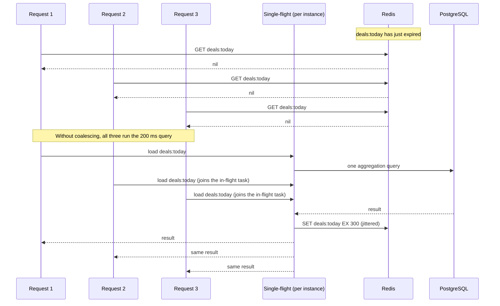
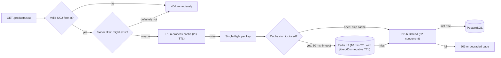
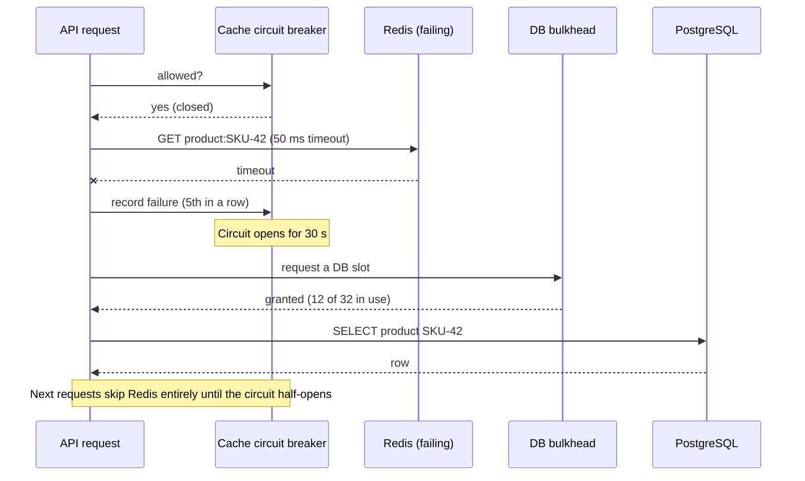

A cache hides the true load on your database. At a 95 % hit ratio, the database sees one request in twenty. That is wonderful until something makes the cache stop absorbing traffic — then the database suddenly sees twenty times what it is used to, usually at the worst possible moment. This lesson is about those moments and how to survive them.

## Learning objectives

By the end of this lesson you will be able to:

1. Recognise the five cache failure modes — **stampede, penetration, hot keys, avalanche and cache outage** — from symptoms and metrics.
2. Prevent stampedes with request coalescing, locks, stale-while-revalidate and probabilistic early expiration, and choose between them.
3. Stop penetration with input validation, negative caching and a Bloom filter, and size a Bloom filter for a target false-positive rate.
4. Handle hot keys with local caches, key replication and read replicas.
5. Prevent avalanches with TTL jitter and staggered warm-up.
6. Design and implement a safe fallback when the cache is down: timeouts, a circuit breaker and a bulkhead in front of the database.

## Prerequisites

- [Cache patterns](#/lesson/m12-cache-patterns): cache-aside and read-through.
- [Invalidation, TTL and eviction](#/lesson/m12-invalidation-ttl): TTL arithmetic and jitter.
- [Redis](#/lesson/m12-redis): single-threaded model and cluster slots (for hot keys).

## Explain it like I'm a beginner

Imagine a famous sweet shop in Kolkata on Diwali morning. Sweets are kept on a **display counter** (the cache); the **kitchen** at the back (the database) can only make so much per hour.

- **Stampede.** The rasgulla tray on the counter runs out. Fifty customers notice at the same instant and all shout their order straight to the kitchen. The kitchen makes fifty separate batches of the same sweet. One batch would have served everybody.
- **Penetration.** A prankster keeps asking for "chocolate samosa". The counter never has it, so every time the shopkeeper walks to the kitchen to check. The kitchen never has it either. The walk is wasted, again and again.
- **Hot key.** Everyone wants the one famous item, and they all crowd the *one* tray that holds it. The rest of the counter is empty of customers, but that tray has a queue around the block.
- **Avalanche.** All the trays were filled at 7 am and every sweet "expires" at noon at the same moment. At noon, the whole counter is empty at once and every customer goes to the kitchen.
- **Cache down.** The display counter collapses. Everyone walks into the kitchen.

The fixes are just as everyday: one person takes the order to the kitchen while the others wait (**coalescing**); a board saying "we do not make chocolate samosa" (**negative caching**, **Bloom filter**); more trays of the famous item (**hot-key replication**); refill trays at different times (**jitter**); and a doorman who lets only as many people into the kitchen as it can handle (**bulkhead**).

## First-principles explanation

### Why caches fail loudly

Recall from [Why caching works](#/lesson/m12-why-caching): database load = total RPS × (1 − hit ratio). A system at 10,000 RPS with 95 % hits sends 500 RPS to the database. Teams often size the database for what it *sees* — say, 1,500 RPS capacity. Then:

- Hit ratio drops to 80 % → 2,000 RPS → over capacity.
- Cache disappears → 10,000 RPS → **6.7×** over capacity.

Every failure mode in this lesson is a way the miss ratio jumps suddenly, either for one key or for all of them. The database is then the bottleneck, it slows down, requests pile up, timeouts trigger retries, and the retries make it worse.

### 1. Cache stampede (thundering herd, dog-piling)

**What happens.** A hot key expires (or is invalidated). Every request that arrives before the new value is cached sees a miss and runs the same expensive query.

**Numbers.** A home-page "deals of the day" key is read 5,000 times per second. Rebuilding it takes 200 ms (a heavy aggregation). In the 200 ms after expiry, 5,000 × 0.2 = **1,000 requests** miss and run the same 200 ms query concurrently. The database, which normally runs this query once per TTL, now runs it 1,000 times at once — and each copy runs slower because of the others, which widens the window and adds more copies.

**Defences.**

1. **Request coalescing (single-flight).** Within one process, the first miss for a key starts the load; later misses for the same key **wait for that same task** instead of starting their own. With 20 API instances, the worst case drops from 1,000 queries to 20 (one per instance). `HybridCache.GetOrCreateAsync` (.NET 9+, `Microsoft.Extensions.Caching.Hybrid`) does this for you; the implementation below builds it by hand. Note that HybridCache's stampede protection is **per process**: it does not coordinate across instances, so the worst case is still one load per instance.
2. **Distributed lock on rebuild.** Before loading, try `SET rebuild:deals <id> NX PX 5000`. Only the instance that wins runs the query; the others wait briefly and re-read the cache, or serve the stale value. This takes the worst case from 20 to 1, at the cost of extra round trips and lock edge cases (the lock expiring mid-rebuild, the holder crashing). Use it when even one query per instance is too many.
3. **Stale-while-revalidate (soft and hard TTL).** Store the value with a *soft* expiry (say 5 minutes) and a *hard* expiry (say 1 hour). After the soft expiry, keep serving the old value while **one** background refresh runs. Readers never wait and never stampede. Requires that slightly stale data is acceptable — which it was, or you would not cache it.
4. **Probabilistic early expiration (XFetch).** Instead of all readers seeing the expiry at the same instant, each reader *independently* decides to refresh slightly early, with a probability that rises as expiry approaches. Vattani, Chierichetti and Lowenstein (VLDB 2015) proved this rule is optimal under their model:

   > refresh now if **now − Δ × β × ln(u) ≥ expiry**, where u is uniform in (0, 1]

   Δ is how long the last recompute took, β (beta) tunes eagerness (1.0 is the default; > 1 refreshes earlier). Because −ln(u) is usually small and only occasionally large, most readers do nothing, and one reader "volunteers" a little before expiry. Expensive keys (large Δ) start volunteering earlier. No locks, no coordination. Exercise 5 implements it.
5. **Refresh-ahead** for a small known set of hot keys ([cache patterns](#/lesson/m12-cache-patterns)): the problem never arises because a background job refreshes them before expiry.

**Which to choose.** Start with coalescing — it is cheap and nearly always right. Add stale-while-revalidate for expensive, hot keys. Use XFetch when you cannot run background refreshes and keys are many. Reach for distributed locks only when one load per instance is still too many.

### 2. Cache penetration

**What happens.** Requests ask for keys that **do not exist** in the database. Cache-aside never caches "nothing", so every such request misses the cache *and* runs a database query that finds nothing.

**Where it comes from.** Bots enumerating ids (`/products/1`, `/products/2`, …), scrapers, broken links, client bugs, and deliberate attacks using random ids to bypass the cache. At 3,000 RPS of random ids, the database does 3,000 pointless lookups per second, regardless of hit ratio.

**Defences, cheapest first.**

1. **Validate input.** If SKUs look like `SKU-` plus 1–7 digits, reject anything else before touching the cache. Free, and it stops lazy attacks.
2. **Negative caching.** Cache "not found" too, with a **short** TTL (30–60 s), so the same missing key costs one query per TTL. Two cautions: random-key attacks fill memory with negative entries (cap them, or give them a tiny size budget), and a newly created item is invisible for up to the negative TTL unless the create path deletes the negative entry.
3. **Bloom filter of existing keys.** A compact probabilistic set that answers "**definitely not present**" or "**maybe present**". Check it before the cache; "definitely not" returns 404 immediately, with no cache or database access.
4. **Rate limiting** per client or IP for 404-heavy traffic ([rate limiting](#/lesson/m10-rate-limiting)).

### Bloom filters from first principles

A Bloom filter is an array of **m** bits, all 0 at first, and **k** hash functions.

- **Add(x):** compute k hash positions for x and set those bits to 1.
- **MightContain(x):** compute the same k positions. If **any** bit is 0, x was **never** added — a definite no. If all are 1, x was *probably* added; it might be a coincidence of other items' bits (a **false positive**).

It never gives false negatives, which is exactly the safety property you need: real products are never rejected.

**Sizing.** With n items, the false-positive rate is approximately

> p ≈ (1 − e^(−k·n/m))^k

and the best number of hash functions is k = (m/n) × ln 2. Solving for m given a target p:

> m = −n × ln(p) ÷ (ln 2)²

Worked example: 10 million SKUs, target p = 1 %.

- m = −10,000,000 × ln(0.01) ÷ 0.4805 = 10,000,000 × 4.605 ÷ 0.4805 ≈ **95.85 million bits ≈ 12 MB**.
- k = 9.585 × 0.693 ≈ 6.6 → **7 hash functions**.

So about 9.6 bits per item for 1 % false positives; each extra 4.8 bits per item cuts the rate by another 10× (p = 0.1 % needs about 14.4 bits per item). 12 MB fits in every API instance's memory, or in Redis (Redis 8 ships Bloom filters as `BF.*` commands; Valkey, the open-source fork created after Redis's 2024 licence change, offers them through its `valkey-bloom` module; a plain bitmap with `SETBIT`/`GETBIT` works on either).

**Limits.**

- **No deletion.** Clearing a bit could erase other items. Deleted products stay "maybe present" (harmless: they fall through to a negative-cached 404). Rebuild the filter periodically, or use a counting Bloom filter or a cuckoo filter if deletes matter.
- **Must be complete before use.** A filter that has not yet loaded all ids would reject real products. Until it is fully built, skip the check.
- **Grows stale if new items are not added.** The create path must `Add` new ids; if the filter is per instance, broadcast creations or rebuild often.
- **Over-capacity degrades.** Put 20 million items in a filter sized for 10 million and p rises to about 16 % (from the formula). Size for growth.

The trick to computing k positions cheaply: compute two hashes h₁ and h₂ once and use positions h₁ + i·h₂ for i = 0…k−1 (the Kirsch–Mitzenmacher technique). The C# below does exactly that.

### 3. Hot keys

**What happens.** One key receives a huge share of traffic: a flash-sale product, a celebrity's post, a live cricket score, a viral reel. In Redis, that key lives on **one node** (one cluster slot). Its CPU, its single command thread, or its network card saturates, while the rest of the cluster idles.

**Numbers.** A flash sale drives 300,000 reads per second to `product:iphone-sale`, a 2 KB value. Network out from that one node: 300,000 × 2 KB = 600 MB/s ≈ **4.8 Gbit/s**, more than many cache nodes' network allowance — before counting CPU. Adding shards does not help: the key is still in one slot ([Redis lesson](#/lesson/m12-redis)).

**Defences.**

1. **Local (L1) cache in each app instance** with a short TTL (1–5 s). With 40 instances and a 2-second TTL, Redis sees at most 40 ÷ 2 = **20 reads per second** for that key instead of 300,000. The price is up to 2 seconds of extra staleness — almost always fine for a product page, and checkout re-reads the source of truth anyway.
2. **Key replication (splitting).** Store N copies: `product:iphone-sale#0` … `#7`, which hash to different slots. Readers pick a random suffix; writers update (or delete) all N. Spreads one key's load over N nodes.
3. **Read replicas.** Route reads of hot keys to replicas (accepting replication lag).
4. **Detect them.** Hot keys are often discovered in an incident. Sample keys in the client and publish per-key counters, or use Redis's `--hotkeys` scan (requires an LFU eviction policy). Pre-warm L1 for known events (a sale starting at 12:00).

### 4. Cache avalanche

**What happens.** Many keys miss at the same time — not one hot key, but thousands.

**Causes.**

- **Synchronised TTLs.** A deploy or nightly job writes 200,000 entries in two minutes, all with TTL = 3,600 s. One hour later, they all expire within the same two minutes: about 1,700 expiries per second, each followed by a miss.
- **Cache restart or failover** with no persistence: everything is cold at once.
- **Mass invalidation** (a namespace version bump, a `FLUSHALL`).

**Defences.**

- **TTL jitter.** ±10 % turns a 2-minute expiry cliff into a 12-minute slope (3,240–3,960 s): 200,000 ÷ 720 s ≈ 280 expiries per second instead of 1,700.
- **Staggered warm-up.** After a restart or a version bump, warm the most popular keys first, at a controlled rate, before shifting full traffic.
- **Persistence or replicas** for a cache whose cold start the database cannot survive — RDB to restart warm, or a replica to fail over to.
- **Everything from the stampede list**, because an avalanche is many stampedes at once.

### 5. The cache is down (or slow)

**What happens.** Redis crashes, fails over, is partitioned from some app instances, or simply becomes slow (a big-key command, memory swapping, a noisy neighbour). A *slow* cache is often worse than a dead one: every request waits for the cache timeout *and then* goes to the database.

**Defences.**

1. **Short cache timeouts.** If Redis normally answers in 1 ms, a 50 ms timeout is generous. A 5-second default timeout means each request can hang for 5 seconds before even trying the database. Set connect and operation timeouts explicitly.
2. **Circuit breaker around the cache.** After, say, 5 consecutive cache failures, stop calling the cache for 30 seconds and go straight to the fallback. This prevents paying the timeout on every request ([circuit breaker](#/lesson/m10-circuit-breaker)).
3. **Bulkhead in front of the database.** Limit concurrent database loads per instance (e.g. 32). Requests beyond that wait briefly, then fail fast with 503 or a degraded response. This keeps the database alive for the requests it *can* serve, instead of everyone timing out ([bulkheads](#/lesson/m10-bulkhead), [load shedding](#/lesson/m13-backpressure)).
4. **Serve stale from L1.** An in-process cache with slightly longer life (or a stale copy kept for emergencies) can absorb hot keys while Redis is away.
5. **Degrade non-essential features.** Hide "recommended for you" and "people also bought" when the cache is down; keep product details and checkout.
6. **Treat cache errors as misses, never as request failures** (as `DistributedAppCache` did in [cache patterns](#/lesson/m12-cache-patterns)) — but combined with the bulkhead, because "treat as miss" alone sends 100 % of traffic to the database.

**Numbers.** 10,000 RPS, 95 % hits, database capacity 2,000 RPS. Cache down: 10,000 RPS would reach the database. With a 2-second L1 on 20 instances absorbing, say, 60 % of requests (hot keys — an estimate that depends on skew), 4,000 RPS remain. The bulkhead admits about 2,000 and sheds the other 2,000 with a fast 503 or a "try again" page. Half the users get degraded service; nobody gets a 30-second hang, and the database stays up for when Redis returns.

### Putting it together: defence in depth

| Failure | Symptom in metrics | First defence | Stronger defence |
|---|---|---|---|
| Stampede | DB query spikes aligned with one key's TTL | Request coalescing | Stale-while-revalidate, XFetch, rebuild lock |
| Penetration | High miss ratio, high DB "not found" rate | Input validation, negative caching | Bloom filter, rate limits |
| Hot key | One cache node at 100 % CPU or network | L1 cache with short TTL | Key replication, read replicas |
| Avalanche | Miss spikes across many keys at regular intervals or after deploys | TTL jitter | Staggered warm-up, persistence |
| Cache down | Cache errors or timeouts, DB load jumps to ~100 % of traffic | Short timeouts, treat as miss | Circuit breaker + bulkhead + degrade |

### When a simpler design is enough

- If your database can comfortably serve **100 % of traffic** (with headroom), most of this lesson is insurance you may not need. That is a perfectly good design for many internal systems — and it is the best defence of all.
- If you use `HybridCache`, you already have per-instance coalescing and an L1; add jitter and a bulkhead and you have covered most risks.
- A Bloom filter is worth it only for real penetration traffic. Start with validation and negative caching; add the filter when metrics show many "not found" lookups.

## Visual explanation

### Sequence: a stampede, and the same moment with coalescing



All three requests miss because the key has just expired. Without protection, each would run the 200 ms aggregation, and at 5,000 RPS that becomes about a thousand copies. With a single-flight coalescer, request 1 starts the load; requests 2 and 3 find a load already in flight for that key and await the same task. The database runs the query once, the result is written back with a jittered TTL, and all three requests get the same answer.

### Architecture: layers of defence on the read path



Each layer removes one failure mode. Format validation and the Bloom filter stop penetration before any I/O. The L1 cache absorbs hot keys inside each instance. The single-flight step collapses concurrent misses for one key into one load (stampede). The circuit breaker skips a failing Redis instead of paying a timeout on every request (cache down). Redis entries carry jittered TTLs (avalanche) and short negative TTLs (penetration that slipped past the filter as a false positive). Finally, the bulkhead caps concurrent database work, so a cache outage produces some fast 503s instead of a database collapse.

### Sequence: Redis goes down



The request asks the breaker whether the cache may be used; it may, so it calls Redis with a short 50 ms timeout. Redis does not answer. This is the fifth consecutive failure, so the breaker opens for 30 seconds. The request still succeeds: it takes a bulkhead slot and reads PostgreSQL directly. For the next 30 seconds, requests do not even try Redis — they save the 50 ms and go straight to the bulkhead, which admits only as many as the database can handle.

## Step-by-step example

**Scenario.** An exam-results portal for a state school board. Results for 1.4 million students go live at 10:00 on one day a year. Each lookup is by roll number. Past years (estimates from logs): 120,000 RPS in the first five minutes, falling to 15,000 RPS after an hour; 30 % of requests are mistyped or bot-generated roll numbers.

### Step 1 — Find the failure modes before they find you

- **Avalanche at 10:00:** the cache starts empty — every first request is a miss.
- **Penetration:** 30 % of 120,000 = 36,000 RPS of non-existent roll numbers.
- **Hot keys:** none per student (each roll number is looked up by a few people), but the **"results announced" page** and the **school-wise summary** pages are hot.
- **Stampede:** the school summary pages are expensive aggregations, read thousands of times per second.
- **Cache down:** Redis failure at 10:02 would send everything to the database.

### Step 2 — Remove the cold start entirely

Results are known the night before. Pre-compute each student's result page as JSON and **warm** Redis by 09:30: 1.4 million × ~1.5 KB ≈ 2.1 GB (estimate). Use TTLs of 24 hours ± 2 hours so they do not expire together. Pre-compute the school summaries too. Now 10:00 is a "hot cache" event, not a cold one.

### Step 3 — Kill penetration cheaply

Roll numbers are 9 digits with a check digit: validate format and checksum first, rejecting most typos without any I/O. Then a Bloom filter of the 1.4 million valid roll numbers at p = 0.1 %: m = 1.4 M × 14.4 bits ≈ 20 Mbit ≈ 2.5 MB, in every instance. Remaining false positives (0.1 % of the invalid traffic, about 36 RPS) hit a negative cache with a 5-minute TTL.

### Step 4 — Protect the hot pages

"Results announced" and school summaries go into each instance's L1 cache for 5 seconds. With 60 instances: 60 ÷ 5 = 12 Redis reads per second per hot key, regardless of the 120,000 RPS. Static assets and the announcement page go to the CDN.

### Step 5 — Plan for Redis failing at 10:02

- Redis runs with a replica (failover in seconds) and RDB persistence (a restart comes back warm).
- Cache calls time out after 30 ms; a circuit breaker opens after 5 failures.
- The database bulkhead admits 40 concurrent queries per instance (2,400 total across 60 instances — sized from load tests); everything beyond gets a friendly "high traffic, retrying in 10 seconds" page with automatic retry and **jitter** (so retries do not arrive in sync).

### Step 6 — Rehearse

Run a load test at 150,000 RPS with 30 % invalid roll numbers, then kill Redis mid-test. Measure: database peak RPS, share of 503s, recovery time after Redis returns. Adjust bulkhead sizes from what you see, not from guesses.

## Production-style C# implementation

A product-lookup service with every defence from the diagram: format validation, a Bloom filter (built at startup by a hosted service), an L1 `IMemoryCache`, single-flight coalescing, an `IDistributedCache` L2 with jittered and negative TTLs, a circuit breaker for the cache, and a bulkhead for the database. A switchable `FlakyDistributedCache` decorator lets you simulate a Redis outage.

```text
Products.Api/
  Program.cs
  Products/Catalogue.cs
  Resilience/BloomFilter.cs
  Resilience/SingleFlight.cs
  Resilience/CacheCircuitBreaker.cs
  Resilience/DbBulkhead.cs
  Resilience/FlakyDistributedCache.cs
  Products/ProductLookupService.cs
  Products/KnownSkuFilter.cs
```

### Catalogue and fake database

```csharp file=Products/Catalogue.cs
using System.Collections.Concurrent;

namespace Products;

public sealed record Product(string Sku, string Name, decimal PriceInr);

public interface IProductCatalogue
{
    Task<Product?> FindAsync(string sku, CancellationToken ct);
    IAsyncEnumerable<string> AllSkusAsync(CancellationToken ct);
}

/// <summary>Stands in for PostgreSQL: 50,000 products, 20 ms per lookup, counts queries.</summary>
public sealed class InMemoryCatalogue : IProductCatalogue
{
    private readonly ConcurrentDictionary<string, Product> _rows = new(StringComparer.Ordinal);
    private long _queries;

    public InMemoryCatalogue()
    {
        for (var i = 1; i <= 50_000; i++) _rows[$"SKU-{i}"] = new Product($"SKU-{i}", $"Product {i}", 99m + i % 900);
    }

    public long Queries => Interlocked.Read(ref _queries);

    public async Task<Product?> FindAsync(string sku, CancellationToken ct)
    {
        Interlocked.Increment(ref _queries);
        await Task.Delay(20, ct);
        return _rows.GetValueOrDefault(sku);
    }

    public async IAsyncEnumerable<string> AllSkusAsync([System.Runtime.CompilerServices.EnumeratorCancellation] CancellationToken ct)
    {
        foreach (var sku in _rows.Keys)
        {
            ct.ThrowIfCancellationRequested();
            yield return sku;
        }
        await Task.CompletedTask;
    }
}
```

### Bloom filter

```csharp file=Resilience/BloomFilter.cs
using System.Text;

namespace Products.Resilience;

/// <summary>A thread-safe Bloom filter: "definitely not present" or "maybe present".
/// Positions use double hashing (h1 + i*h2) from one 64-bit FNV-1a hash.</summary>
public sealed class BloomFilter
{
    private readonly long[] _words;

    public BloomFilter(long expectedItems, double falsePositiveRate)
    {
        (BitCount, HashCount) = OptimalSize(expectedItems, falsePositiveRate);
        _words = new long[(BitCount + 63) / 64];
    }

    public long BitCount { get; }
    public int HashCount { get; }
    public long SizeInBytes => _words.LongLength * sizeof(long);

    /// <summary>m = -n ln p / (ln 2)^2 bits and k = (m / n) ln 2 hash functions.</summary>
    public static (long Bits, int Hashes) OptimalSize(long expectedItems, double falsePositiveRate)
    {
        ArgumentOutOfRangeException.ThrowIfNegativeOrZero(expectedItems);
        if (falsePositiveRate is <= 0 or >= 1) throw new ArgumentOutOfRangeException(nameof(falsePositiveRate));
        var ln2 = Math.Log(2);
        var bits = (long)Math.Ceiling(-expectedItems * Math.Log(falsePositiveRate) / (ln2 * ln2));
        var hashes = Math.Max(1, (int)Math.Round((double)bits / expectedItems * ln2));
        return (bits, hashes);
    }

    /// <summary>p ≈ (1 - e^(-k n / m))^k for n inserted items.</summary>
    public static double ExpectedFalsePositiveRate(long bits, int hashes, long insertedItems) =>
        Math.Pow(1 - Math.Exp(-(double)hashes * insertedItems / bits), hashes);

    public void Add(string item)
    {
        var (h1, h2) = Hashes(item);
        for (var i = 0; i < HashCount; i++)
        {
            var bit = Position(h1, h2, i);
            Interlocked.Or(ref _words[bit >> 6], 1L << (int)(bit & 63));
        }
    }

    public bool MightContain(string item)
    {
        var (h1, h2) = Hashes(item);
        for (var i = 0; i < HashCount; i++)
        {
            var bit = Position(h1, h2, i);
            if ((Volatile.Read(ref _words[bit >> 6]) & (1L << (int)(bit & 63))) == 0) return false;   // definitely absent
        }
        return true;   // maybe present
    }

    private long Position(ulong h1, ulong h2, int i) => (long)((h1 + (ulong)i * h2) % (ulong)BitCount);

    private static (ulong H1, ulong H2) Hashes(string item)
    {
        const ulong offset = 14695981039346656037UL, prime = 1099511628211UL;
        var hash = offset;
        foreach (var b in Encoding.UTF8.GetBytes(item)) { hash ^= b; hash *= prime; }
        // Derive a second, independent-looking hash with a 64-bit finaliser (from MurmurHash3).
        var h2 = hash;
        h2 ^= h2 >> 33; h2 *= 0xff51afd7ed558ccdUL; h2 ^= h2 >> 33; h2 *= 0xc4ceb9fe1a85ec53UL; h2 ^= h2 >> 33;
        return (hash, h2 | 1);   // odd step so positions cycle through the whole array
    }
}
```

### Single-flight request coalescing

```csharp file=Resilience/SingleFlight.cs
using System.Collections.Concurrent;

namespace Products.Resilience;

/// <summary>Collapses concurrent calls for the same key into one execution; every caller gets its result.</summary>
public sealed class SingleFlight<TKey, TValue> where TKey : notnull
{
    private readonly ConcurrentDictionary<TKey, Lazy<Task<TValue>>> _inFlight = new();
    private long _executions;

    public long Executions => Interlocked.Read(ref _executions);

    public Task<TValue> RunAsync(TKey key, Func<Task<TValue>> work)
    {
        // Lazy (ExecutionAndPublication) guarantees the factory runs once even if GetOrAdd races.
        var call = _inFlight.GetOrAdd(key, k => new Lazy<Task<TValue>>(() => ExecuteAsync(k, work)));
        return call.Value;
    }

    private async Task<TValue> ExecuteAsync(TKey key, Func<Task<TValue>> work)
    {
        try
        {
            Interlocked.Increment(ref _executions);
            return await work();
        }
        finally
        {
            // Remove when done, success or failure, so the next miss starts a fresh load
            // and a failure is not cached.
            _inFlight.TryRemove(key, out _);
        }
    }
}
```

### Circuit breaker for the cache

```csharp file=Resilience/CacheCircuitBreaker.cs
namespace Products.Resilience;

/// <summary>Opens after N consecutive failures; while open, callers skip the cache.
/// After the open period, one call is let through (half-open); success closes, failure re-opens.</summary>
public sealed class CacheCircuitBreaker(TimeProvider clock, int failureThreshold = 5, double openSeconds = 30)
{
    private readonly Lock _gate = new();
    private int _consecutiveFailures;
    private DateTimeOffset _openUntil = DateTimeOffset.MinValue;
    private bool _halfOpenProbeInFlight;

    public bool IsOpen { get { lock (_gate) return clock.GetUtcNow() < _openUntil; } }

    public bool TryAcquire()
    {
        lock (_gate)
        {
            var now = clock.GetUtcNow();
            if (now < _openUntil) return false;                          // open: skip the cache
            if (_openUntil != DateTimeOffset.MinValue)                    // half-open: allow one probe
            {
                if (_halfOpenProbeInFlight) return false;
                _halfOpenProbeInFlight = true;
            }
            return true;
        }
    }

    public void RecordSuccess()
    {
        lock (_gate)
        {
            _consecutiveFailures = 0;
            _openUntil = DateTimeOffset.MinValue;
            _halfOpenProbeInFlight = false;
        }
    }

    public void RecordFailure()
    {
        lock (_gate)
        {
            _halfOpenProbeInFlight = false;
            if (++_consecutiveFailures >= failureThreshold || _openUntil != DateTimeOffset.MinValue)
            {
                _openUntil = clock.GetUtcNow().AddSeconds(openSeconds);
                _consecutiveFailures = 0;
            }
        }
    }
}
```

### Bulkhead for the database

```csharp file=Resilience/DbBulkhead.cs
namespace Products.Resilience;

public sealed class BulkheadRejectedException() : Exception("Database bulkhead is full");

/// <summary>Caps concurrent database work per instance. Excess callers wait briefly, then are rejected fast.</summary>
public sealed class DbBulkhead(int maxConcurrent, TimeSpan maxQueueWait)
{
    private readonly SemaphoreSlim _slots = new(maxConcurrent, maxConcurrent);
    private long _rejected;

    public int Available => _slots.CurrentCount;
    public long Rejected => Interlocked.Read(ref _rejected);

    public async Task<T> RunAsync<T>(Func<Task<T>> work, CancellationToken ct)
    {
        if (!await _slots.WaitAsync(maxQueueWait, ct))
        {
            Interlocked.Increment(ref _rejected);
            throw new BulkheadRejectedException();
        }
        try
        {
            return await work();
        }
        finally
        {
            _slots.Release();
        }
    }
}
```

### A switchable failing cache (for drills)

```csharp file=Resilience/FlakyDistributedCache.cs
using Microsoft.Extensions.Caching.Distributed;

namespace Products.Resilience;

/// <summary>Decorates a real IDistributedCache; when Down is true every call throws, like an unreachable Redis.</summary>
public sealed class FlakyDistributedCache(IDistributedCache inner) : IDistributedCache
{
    public bool Down { get; set; }

    private void ThrowIfDown()
    {
        if (Down) throw new TimeoutException("Simulated cache outage");
    }

    public byte[]? Get(string key) { ThrowIfDown(); return inner.Get(key); }
    public Task<byte[]?> GetAsync(string key, CancellationToken token = default) { ThrowIfDown(); return inner.GetAsync(key, token); }
    public void Set(string key, byte[] value, DistributedCacheEntryOptions options) { ThrowIfDown(); inner.Set(key, value, options); }
    public Task SetAsync(string key, byte[] value, DistributedCacheEntryOptions options, CancellationToken token = default)
    { ThrowIfDown(); return inner.SetAsync(key, value, options, token); }
    public void Refresh(string key) { ThrowIfDown(); inner.Refresh(key); }
    public Task RefreshAsync(string key, CancellationToken token = default) { ThrowIfDown(); return inner.RefreshAsync(key, token); }
    public void Remove(string key) { ThrowIfDown(); inner.Remove(key); }
    public Task RemoveAsync(string key, CancellationToken token = default) { ThrowIfDown(); return inner.RemoveAsync(key, token); }
}
```

### The known-SKU filter and its loader

```csharp file=Products/KnownSkuFilter.cs
using Microsoft.Extensions.Hosting;
using Microsoft.Extensions.Logging;
using Products.Resilience;

namespace Products;

/// <summary>Wraps the Bloom filter with a readiness flag: until fully loaded it must not reject anything.</summary>
public sealed class KnownSkuFilter
{
    private readonly BloomFilter _filter = new(expectedItems: 200_000, falsePositiveRate: 0.001);
    private volatile bool _ready;

    public bool IsReady => _ready;
    public long SizeInBytes => _filter.SizeInBytes;

    public bool MightExist(string sku) => !_ready || _filter.MightContain(sku);
    public void Add(string sku) => _filter.Add(sku);
    public void MarkReady() => _ready = true;
}

/// <summary>Builds the filter from the database at startup. A periodic rebuild (not shown) handles deletes.</summary>
public sealed class KnownSkuLoader(IProductCatalogue catalogue, KnownSkuFilter filter, ILogger<KnownSkuLoader> logger) : BackgroundService
{
    protected override async Task ExecuteAsync(CancellationToken stoppingToken)
    {
        var count = 0;
        await foreach (var sku in catalogue.AllSkusAsync(stoppingToken))
        {
            filter.Add(sku);
            count++;
        }
        filter.MarkReady();
        logger.LogInformation("Bloom filter ready with {Count} SKUs ({Bytes} bytes)", count, filter.SizeInBytes);
    }
}
```

### The lookup service: every defence in order

```csharp file=Products/ProductLookupService.cs
using System.Text.Json;
using System.Text.RegularExpressions;
using Microsoft.Extensions.Caching.Distributed;
using Microsoft.Extensions.Caching.Memory;
using Microsoft.Extensions.Logging;
using Products.Resilience;

namespace Products;

public enum LookupStatus { Found, NotFound, Unavailable }

public sealed record LookupResult(LookupStatus Status, Product? Product = null);

/// <summary>What is cached in L1 and L2: either a product or an explicit "not found".</summary>
public sealed record CacheEnvelope(bool Exists, Product? Product);

public sealed partial class ProductLookupService(
    IProductCatalogue catalogue,
    IMemoryCache l1,
    IDistributedCache l2,
    KnownSkuFilter knownSkus,
    SingleFlight<string, CacheEnvelope> flights,
    CacheCircuitBreaker cacheBreaker,
    DbBulkhead bulkhead,
    ILogger<ProductLookupService> logger)
{
    public static readonly TimeSpan L1Ttl = TimeSpan.FromSeconds(2);          // hot keys
    public static readonly TimeSpan L2Ttl = TimeSpan.FromMinutes(10);         // with ±10 % jitter
    public static readonly TimeSpan NegativeTtl = TimeSpan.FromSeconds(60);   // penetration
    public static readonly TimeSpan CacheTimeout = TimeSpan.FromMilliseconds(50);
    private static readonly JsonSerializerOptions Json = new(JsonSerializerDefaults.Web);

    [GeneratedRegex(@"^SKU-\d{1,7}$")]
    private static partial Regex SkuFormat();

    public static string Key(string sku) => $"product:v1:{sku}";

    public async Task<LookupResult> GetAsync(string rawSku, CancellationToken ct)
    {
        var sku = rawSku.Trim().ToUpperInvariant();

        if (!SkuFormat().IsMatch(sku)) return new(LookupStatus.NotFound);        // 1. validation
        if (!knownSkus.MightExist(sku)) return new(LookupStatus.NotFound);       // 2. Bloom filter

        if (l1.TryGetValue(Key(sku), out CacheEnvelope? hot) && hot is not null) // 3. L1 (hot keys)
            return ToResult(hot);

        try
        {
            // 4. Single-flight: one load per key per instance. The shared load ignores any
            //    single caller's cancellation; each caller stops waiting on its own token.
            var envelope = await flights.RunAsync(Key(sku), () => LoadAsync(sku)).WaitAsync(ct);
            return ToResult(envelope);
        }
        catch (BulkheadRejectedException)
        {
            return new(LookupStatus.Unavailable);                                // 7. shed load
        }
    }

    private async Task<CacheEnvelope> LoadAsync(string sku)
    {
        var key = Key(sku);

        var cached = await TryReadL2Async(key);                                  // 5. L2 behind a breaker
        if (cached is not null)
        {
            l1.Set(key, cached, L1Ttl);
            return cached;
        }

        var product = await bulkhead.RunAsync(                                  // 6. bulkhead in front of the DB
            () => catalogue.FindAsync(sku, CancellationToken.None), CancellationToken.None);

        var envelope = new CacheEnvelope(product is not null, product);
        var ttl = product is null ? NegativeTtl : Jitter(L2Ttl, 0.10);
        await TryWriteL2Async(key, envelope, ttl);
        l1.Set(key, envelope, L1Ttl);
        return envelope;
    }

    private async Task<CacheEnvelope?> TryReadL2Async(string key)
    {
        if (!cacheBreaker.TryAcquire()) return null;
        try
        {
            using var timeout = new CancellationTokenSource(CacheTimeout);
            var bytes = await l2.GetAsync(key, timeout.Token);
            cacheBreaker.RecordSuccess();
            return bytes is null ? null : JsonSerializer.Deserialize<CacheEnvelope>(bytes, Json);
        }
        catch (Exception ex)
        {
            cacheBreaker.RecordFailure();
            logger.LogWarning(ex, "L2 read failed for {Key}; falling back to the database", key);
            return null;
        }
    }

    private async Task TryWriteL2Async(string key, CacheEnvelope envelope, TimeSpan ttl)
    {
        if (!cacheBreaker.TryAcquire()) return;
        try
        {
            using var timeout = new CancellationTokenSource(CacheTimeout);
            await l2.SetAsync(key, JsonSerializer.SerializeToUtf8Bytes(envelope, Json),
                new DistributedCacheEntryOptions { AbsoluteExpirationRelativeToNow = ttl }, timeout.Token);
            cacheBreaker.RecordSuccess();
        }
        catch (Exception ex)
        {
            cacheBreaker.RecordFailure();
            logger.LogWarning(ex, "L2 write failed for {Key}", key);
        }
    }

    /// <summary>ttl × (1 ± fraction), so entries written together expire apart (avalanche).</summary>
    public static TimeSpan Jitter(TimeSpan ttl, double fraction) =>
        TimeSpan.FromMilliseconds(ttl.TotalMilliseconds * (1 + (Random.Shared.NextDouble() * 2 - 1) * fraction));

    private static LookupResult ToResult(CacheEnvelope e) =>
        e.Exists ? new(LookupStatus.Found, e.Product) : new(LookupStatus.NotFound);
}
```

### Wiring and a failure drill endpoint

```csharp file=Program.cs
using Microsoft.Extensions.Caching.Distributed;
using Microsoft.Extensions.Caching.Memory;
using Microsoft.Extensions.Options;
using Products;
using Products.Resilience;

var builder = WebApplication.CreateBuilder(args);

builder.Services.AddSingleton(TimeProvider.System);
builder.Services.AddMemoryCache();                                            // L1
// L2: in-memory stand-in for Redis, wrapped so drills can switch it off.
builder.Services.AddSingleton(_ => new FlakyDistributedCache(
    new MemoryDistributedCache(Options.Create(new MemoryDistributedCacheOptions()))));
builder.Services.AddSingleton<IDistributedCache>(sp => sp.GetRequiredService<FlakyDistributedCache>());

builder.Services.AddSingleton<InMemoryCatalogue>();
builder.Services.AddSingleton<IProductCatalogue>(sp => sp.GetRequiredService<InMemoryCatalogue>());
builder.Services.AddSingleton<KnownSkuFilter>();
builder.Services.AddHostedService<KnownSkuLoader>();
builder.Services.AddSingleton<SingleFlight<string, CacheEnvelope>>();
builder.Services.AddSingleton(sp => new CacheCircuitBreaker(sp.GetRequiredService<TimeProvider>(), failureThreshold: 5, openSeconds: 30));
builder.Services.AddSingleton(new DbBulkhead(maxConcurrent: 32, maxQueueWait: TimeSpan.FromMilliseconds(200)));
builder.Services.AddSingleton<ProductLookupService>();

var app = builder.Build();

app.MapGet("/products/{sku}", async (string sku, ProductLookupService lookup, CancellationToken ct) =>
{
    var result = await lookup.GetAsync(sku, ct);
    return result.Status switch
    {
        LookupStatus.Found => Results.Ok(result.Product),
        LookupStatus.NotFound => Results.NotFound(),
        _ => Results.Problem("High load, please retry shortly", statusCode: StatusCodes.Status503ServiceUnavailable),
    };
});

// Failure drill: POST /drills/cache-down?down=true, then watch /debug/resilience.
app.MapPost("/drills/cache-down", (bool down, FlakyDistributedCache cache) =>
{
    cache.Down = down;
    return Results.Ok(new { cacheDown = down });
});

app.MapGet("/debug/resilience", (InMemoryCatalogue db, SingleFlight<string, CacheEnvelope> flights,
    CacheCircuitBreaker breaker, DbBulkhead bulkhead, KnownSkuFilter filter) => Results.Ok(new
{
    DatabaseQueries = db.Queries,
    CoalescedLoads = flights.Executions,
    CacheCircuitOpen = breaker.IsOpen,
    BulkheadAvailable = bulkhead.Available,
    BulkheadRejected = bulkhead.Rejected,
    BloomReady = filter.IsReady,
    BloomBytes = filter.SizeInBytes,
}));

app.Run();
```

Design notes:

- **Order matters.** Cheap checks (format, Bloom filter, L1) run before anything that does I/O or takes a slot. The bulkhead wraps only the database, so cache hits are never throttled.
- **Coalesce around the whole load**, including the L2 read. One in-flight task per key covers both "L2 miss" and "L2 down".
- **Negative entries go to L1 and L2** with a short TTL; the create-product path (not shown) must also call `KnownSkuFilter.Add` and delete `product:v1:{sku}`.
- **The breaker protects latency, not correctness.** When it is open, the service still works — through the bulkhead.
- **For production**, `HybridCache` gives you L1 + L2 + coalescing in one call; keep the Bloom filter, the bulkhead and the breaker (or the timeout settings of your Redis client) around it.

## Bad design vs good design

**Bad: "the cache will always be there".**

```csharp
// Anti-example: no coalescing, no negative caching, same TTL for all, default timeouts, unbounded DB fallback.
public async Task<Product?> GetAsync(string sku)
{
    var json = await _redis.StringGetAsync($"product:{sku}");            // default timeout: seconds
    if (json.HasValue) return JsonSerializer.Deserialize<Product>(json!);

    var p = await _db.FindAsync(sku);                                    // every concurrent miss runs this
    if (p != null)
        await _redis.StringSetAsync($"product:{sku}", JsonSerializer.Serialize(p), TimeSpan.FromHours(1));
    return p;                                                            // "not found" is never cached
}
```

What goes wrong, mode by mode:

- **Stampede:** every concurrent miss of a hot key runs its own query.
- **Penetration:** non-existent SKUs are never cached; a bot with random SKUs goes straight to PostgreSQL.
- **Avalanche:** a bulk warm-up writes every key with exactly one hour, so they all expire together.
- **Cache down:** each request waits for Redis's timeout, then hits the database with no limit; thread-pool and connection-pool exhaustion follow.
- **Hot key:** all instances read the flash-sale key from one Redis node on every request.

**Good:** the `ProductLookupService` above — or `HybridCache` plus a Bloom filter, jitter, explicit timeouts and a bulkhead.

:::callout type=mistake title="Retries make cache outages worse"
When the cache fails and the database slows down, clients and gateways retry. A 3-retry policy can quadruple the load on an already overloaded database. Combine fallbacks with retry budgets and jittered backoff ([timeouts and retries](#/lesson/m10-timeouts-retries)), and return 503 with `Retry-After` from the bulkhead instead of letting requests time out.
:::

## Practical playground

The simulator starts with a healthy-looking system: 95 % cacheable hit ratio, 2,000 RPS, and a database that handles 600 RPS — which is only safe while the cache works.

1. Run it as is. Database load is about 100–150 RPS. Everything looks fine — this is how such systems pass review.
2. Turn on **cache goes down**. Watch database load jump to the full 2,000 RPS, more than three times its capacity, and latency explode. That gap is what the bulkhead and degradation plan must cover.
3. Lower the TTL to 5 seconds with the cache up. Expiry-driven misses rise — a mild, continuous version of the avalanche.
4. Write down: at what hit ratio does this database fall over? (Hint: 600 ÷ 2,000.) How much load would you have to shed during the outage to keep the database at 80 % of capacity?

:::playground type=sim sim=cache title="When the cache stops absorbing traffic" hitRatio=0.95 rps=2000 dbCapacityRps=600 dbLatencyMs=30 cacheLatencyMs=1 ttlSeconds=300 hotKeys=5000
Toggle the outage and the TTL, and compare database load with database capacity.
:::

## Exercises

:::exercise id=m12-cache-failures-ex1 difficulty=beginner kind=code title="Flatten an avalanche with TTL jitter"
A nightly job writes 10,000 cache entries at the same moment. Implement `ExpiryPlanner` to add jitter to TTLs and to show how jitter spreads expiries over time.
::requirements
- `Jitter(ttl, fraction, random)` returns a TTL uniformly within `ttl × (1 − fraction)` and `ttl × (1 + fraction)`. `fraction` must be in [0, 1); otherwise throw `ArgumentOutOfRangeException`.
- `ExpiriesPerSecond(keys, ttl, fraction, seed, horizonSeconds)` simulates `keys` entries written at time 0 with jittered TTLs (using `new Random(seed)`), and returns an array of length `horizonSeconds` where element `s` counts entries expiring during second `s` (floor of the expiry time in seconds). Expiries at or beyond the horizon are ignored.
- `Peak(histogram)` returns the largest count.
::acceptance
- With `fraction = 0`, all 10,000 entries with TTL 600 s expire in second 600.
- With `fraction = 0.1`, the peak is below 250 per second and the counts still add up to 10,000.
- Every jittered TTL is within the bounds.
::hint
`random.NextDouble()` is in [0, 1). Map it to [−1, 1) with `x * 2 − 1`, then multiply by `fraction`.
::hint
For the histogram, compute each entry's TTL in seconds, take `(int)Math.Floor(...)`, and increment that bucket if it is inside the array.
::hint
```csharp
var factor = 1 + (random.NextDouble() * 2 - 1) * fraction;
return TimeSpan.FromMilliseconds(ttl.TotalMilliseconds * factor);
```
::starter
```csharp file=ExpiryPlanner.cs
using System;
using System.Linq;

public static class ExpiryPlanner
{
    public static TimeSpan Jitter(TimeSpan ttl, double fraction, Random random) => throw new NotImplementedException();

    public static int[] ExpiriesPerSecond(int keys, TimeSpan ttl, double fraction, int seed, int horizonSeconds) =>
        throw new NotImplementedException();

    public static int Peak(int[] histogram) => throw new NotImplementedException();
}
```
::tests
```csharp file=ExpiryPlannerTests.cs
using System;
using System.Linq;
using Xunit;

public class ExpiryPlannerTests
{
    [Fact]
    public void No_jitter_means_one_cliff()
    {
        var h = ExpiryPlanner.ExpiriesPerSecond(10_000, TimeSpan.FromSeconds(600), 0, seed: 1, horizonSeconds: 700);
        Assert.Equal(10_000, h[600]);
        Assert.Equal(10_000, ExpiryPlanner.Peak(h));
    }

    [Fact]
    public void Ten_percent_jitter_flattens_the_peak()
    {
        var h = ExpiryPlanner.ExpiriesPerSecond(10_000, TimeSpan.FromSeconds(600), 0.1, seed: 7, horizonSeconds: 700);
        Assert.True(ExpiryPlanner.Peak(h) < 250, $"peak was {ExpiryPlanner.Peak(h)}");
        Assert.Equal(10_000, h.Sum());
        Assert.Equal(0, h.Take(540).Sum());
    }

    [Fact]
    public void Jitter_stays_in_bounds()
    {
        var r = new Random(3);
        for (var i = 0; i < 1000; i++)
            Assert.InRange(ExpiryPlanner.Jitter(TimeSpan.FromSeconds(100), 0.2, r).TotalSeconds, 80.0, 120.0);
    }

    [Fact]
    public void Invalid_fraction_throws() =>
        Assert.Throws<ArgumentOutOfRangeException>(() => ExpiryPlanner.Jitter(TimeSpan.FromSeconds(1), 1.0, new Random(1)));

    [Fact]
    public void Expiries_beyond_horizon_are_ignored() =>
        Assert.Equal(0, ExpiryPlanner.ExpiriesPerSecond(100, TimeSpan.FromSeconds(600), 0, 1, 100).Sum());
}
```
::solution
Jitter is one multiplication; the histogram makes its effect visible.

```csharp file=ExpiryPlanner.cs
using System;
using System.Linq;

public static class ExpiryPlanner
{
    public static TimeSpan Jitter(TimeSpan ttl, double fraction, Random random)
    {
        if (fraction < 0 || fraction >= 1) throw new ArgumentOutOfRangeException(nameof(fraction));
        var factor = 1 + (random.NextDouble() * 2 - 1) * fraction;
        return TimeSpan.FromMilliseconds(ttl.TotalMilliseconds * factor);
    }

    public static int[] ExpiriesPerSecond(int keys, TimeSpan ttl, double fraction, int seed, int horizonSeconds)
    {
        var random = new Random(seed);
        var histogram = new int[horizonSeconds];
        for (var i = 0; i < keys; i++)
        {
            var second = (int)Math.Floor(Jitter(ttl, fraction, random).TotalSeconds);
            if (second >= 0 && second < horizonSeconds) histogram[second]++;
        }
        return histogram;
    }

    public static int Peak(int[] histogram) => histogram.Length == 0 ? 0 : histogram.Max();
}
```

With ±10 % on 600 s, expiries spread over 540–660 s: 10,000 ÷ 120 ≈ 83 per second on average instead of 10,000 in one second — a reduction of more than 100× at the peak.
::mistakes
- Jitter only upwards (`ttl × (1 + u × fraction)`): it works, but every entry lives longer than intended, so staleness grows.
- Creating a new `Random()` per call: in tight loops it can repeat values, and tests become non-deterministic.
- Adding jitter to the *refresh* time but not to the TTL itself after a restart, which re-synchronises everything.
::extensions
Model a cache restart: entries are re-written as they are requested (Zipf traffic), not all at once. Does the avalanche come back after one TTL? What does jitter do to it?
:::

:::exercise id=m12-cache-failures-ex2 difficulty=beginner kind=written title="Name the failure"
For each incident, name the failure mode (stampede, penetration, hot key, avalanche, cache down) and propose the first and second defences.

1. Every day at about 03:00 and again at 04:00, database CPU spikes for two minutes. A cache warm-up job runs at 02:00 and sets a 1-hour TTL.
2. Database CPU is high; the cache hit ratio is 60 %; 35 % of database queries return zero rows; most come from a few IP ranges.
3. During an IPL final, one Redis node is at 100 % network while the other five are at 20 %.
4. The home-page "today's deals" query is visible in the slow-query log in bursts of 300 identical queries every 10 minutes.
5. A Redis failover takes 40 seconds. During that time the API's p99 rises to 30 seconds and the database stops accepting connections.
::acceptance
- Each incident has a correct failure mode.
- Each has two defences, with the cheaper one first.
- Incident 5 includes both a timeout and a limit on database concurrency.
::hint
Look at the shape of the evidence: regular intervals, empty results, one node, identical queries, outage duration.
::hint
Identical queries at TTL intervals point at one key; spikes at regular intervals across many keys point at synchronised expiries.
::hint
For each defence, ask what it costs: jitter and coalescing are a few lines of code; Bloom filters, key replication and bulkheads need more design. Put the cheap one first.
::solution
1. **Avalanche** (synchronised TTLs from the warm-up job). First: TTL jitter (e.g. ±15 %). Second: stagger the warm-up, or refresh-ahead the most popular keys so they never all expire together. (The 04:00 spike is the entries re-cached at 03:00 with the same 1-hour TTL.)
2. **Penetration** from bots. First: validate ids and cache "not found" for 30–60 s with a cap on negative entries; rate-limit the offending IP ranges. Second: a Bloom filter of existing ids.
3. **Hot key** (the match score or match page). First: an L1 in-process cache with a 1–2 s TTL on every API instance. Second: replicate the key (`score:final#0..7`) across slots, or push score updates to clients over WebSockets/SSE instead of polling.
4. **Stampede** on one expensive key. First: request coalescing (`HybridCache` or single-flight). Second: stale-while-revalidate or refresh-ahead every few minutes, so readers never wait for this query.
5. **Cache down** without protection. First: short Redis timeouts (tens of milliseconds) and a circuit breaker so requests skip Redis quickly. Second: a bulkhead limiting concurrent database work per instance, with fast 503s and degraded pages for the excess; plus an L1 cache for hot keys during the outage.
::mistakes
- Fixing incident 2 with a longer TTL — the keys do not exist, so TTL is irrelevant.
- Adding shards for incident 3 — a single key stays on one node.
- Answering incident 5 with "make Redis highly available" only: failovers still take seconds, and the application must survive them.
:::

:::exercise id=m12-cache-failures-ex3 difficulty=intermediate kind=code title="Negative caching with a memory cap"
Implement `NegativeCachingLookup`, a cache-aside lookup that also caches "not found" — briefly, and with a cap so that a random-id attack cannot fill memory.
::requirements
- Found customers are cached for 10 minutes; "not found" results for 30 seconds.
- At most `maxNegativeEntries` **live** (unexpired) negative entries. When the cap is reached, further "not found" results are returned but not cached.
- Expired entries are treated as missing.
- `Invalidate(id)` removes any cached entry for the id (call it when a customer is created).
- Time comes from the injected `TimeProvider`.
::acceptance
- A missing id queried twice within 30 s reaches the store once; after 31 s it reaches the store again.
- A found customer is cached for 10 minutes.
- With a cap of 2, the third distinct missing id is not cached.
- Expired negative entries free their space in the cap.
- After `Invalidate`, a newly created customer is visible immediately.
::hint
One dictionary can hold both kinds: value `(Customer? Customer, DateTimeOffset ExpiresAt)`, where a null customer means "known missing".
::hint
Before adding a negative entry, count live negative entries (or purge expired ones first).
::hint
`Invalidate` is just `Remove`. The interesting part is *who* calls it: the create path, so the negative entry does not hide the new customer for 30 seconds.
::hint
```csharp
if (_entries.TryGetValue(id, out var e) && e.ExpiresAt > now) return e.Customer;   // hit (positive or negative)
var found = await _store.FindAsync(id);
```
::starter
```csharp file=NegativeCachingLookup.cs
using System;
using System.Collections.Generic;
using System.Linq;
using System.Threading.Tasks;

public sealed record Customer(string Id, string Name);

public interface ICustomerStore
{
    Task<Customer?> FindAsync(string id);
}

public sealed class NegativeCachingLookup
{
    public static readonly TimeSpan FoundTtl = TimeSpan.FromMinutes(10);
    public static readonly TimeSpan NotFoundTtl = TimeSpan.FromSeconds(30);

    public NegativeCachingLookup(ICustomerStore store, TimeProvider clock, int maxNegativeEntries) =>
        throw new NotImplementedException();

    public int LiveNegativeEntries => throw new NotImplementedException();

    public Task<Customer?> GetAsync(string id) => throw new NotImplementedException();

    public void Invalidate(string id) => throw new NotImplementedException();
}
```
::tests
```csharp file=NegativeCachingLookupTests.cs
using System;
using System.Collections.Generic;
using System.Threading.Tasks;
using Xunit;

public sealed class StepClock : TimeProvider
{
    public DateTimeOffset Now = new(2026, 10, 19, 10, 0, 0, TimeSpan.Zero);
    public override DateTimeOffset GetUtcNow() => Now;
}

public sealed class CountingStore : ICustomerStore
{
    public readonly Dictionary<string, Customer> Rows = new() { ["C-1"] = new Customer("C-1", "Asha") };
    public readonly Dictionary<string, int> Calls = new();
    public Task<Customer?> FindAsync(string id)
    {
        Calls[id] = Calls.GetValueOrDefault(id) + 1;
        return Task.FromResult(Rows.GetValueOrDefault(id));
    }
}

public class NegativeCachingLookupTests
{
    [Fact]
    public async Task Missing_id_is_cached_briefly()
    {
        var store = new CountingStore(); var clock = new StepClock();
        var lookup = new NegativeCachingLookup(store, clock, 100);
        Assert.Null(await lookup.GetAsync("C-404"));
        clock.Now += TimeSpan.FromSeconds(20);
        Assert.Null(await lookup.GetAsync("C-404"));
        Assert.Equal(1, store.Calls["C-404"]);
        clock.Now += TimeSpan.FromSeconds(11);
        Assert.Null(await lookup.GetAsync("C-404"));
        Assert.Equal(2, store.Calls["C-404"]);
    }

    [Fact]
    public async Task Found_customer_is_cached_for_ten_minutes()
    {
        var store = new CountingStore(); var clock = new StepClock();
        var lookup = new NegativeCachingLookup(store, clock, 100);
        Assert.Equal("Asha", (await lookup.GetAsync("C-1"))!.Name);
        clock.Now += TimeSpan.FromMinutes(9);
        await lookup.GetAsync("C-1");
        Assert.Equal(1, store.Calls["C-1"]);
        clock.Now += TimeSpan.FromMinutes(2);
        await lookup.GetAsync("C-1");
        Assert.Equal(2, store.Calls["C-1"]);
    }

    [Fact]
    public async Task Cap_limits_negative_entries()
    {
        var store = new CountingStore(); var clock = new StepClock();
        var lookup = new NegativeCachingLookup(store, clock, maxNegativeEntries: 2);
        await lookup.GetAsync("X-1"); await lookup.GetAsync("X-2"); await lookup.GetAsync("X-3");
        Assert.Equal(2, lookup.LiveNegativeEntries);
        await lookup.GetAsync("X-3");
        Assert.Equal(2, store.Calls["X-3"]);
    }

    [Fact]
    public async Task Expired_negatives_free_the_cap()
    {
        var store = new CountingStore(); var clock = new StepClock();
        var lookup = new NegativeCachingLookup(store, clock, maxNegativeEntries: 1);
        await lookup.GetAsync("X-1");
        clock.Now += TimeSpan.FromSeconds(31);
        Assert.Equal(0, lookup.LiveNegativeEntries);
        await lookup.GetAsync("X-2");
        await lookup.GetAsync("X-2");
        Assert.Equal(1, store.Calls["X-2"]);
    }

    [Fact]
    public async Task Invalidate_reveals_newly_created_customer()
    {
        var store = new CountingStore(); var clock = new StepClock();
        var lookup = new NegativeCachingLookup(store, clock, 100);
        Assert.Null(await lookup.GetAsync("C-2"));
        store.Rows["C-2"] = new Customer("C-2", "Ravi");
        lookup.Invalidate("C-2");
        Assert.Equal("Ravi", (await lookup.GetAsync("C-2"))!.Name);
    }
}
```
::solution
One map, two TTLs, and a cap that only applies to the negative side.

```csharp file=NegativeCachingLookup.cs
using System;
using System.Collections.Generic;
using System.Linq;
using System.Threading.Tasks;

public sealed record Customer(string Id, string Name);

public interface ICustomerStore
{
    Task<Customer?> FindAsync(string id);
}

public sealed class NegativeCachingLookup
{
    public static readonly TimeSpan FoundTtl = TimeSpan.FromMinutes(10);
    public static readonly TimeSpan NotFoundTtl = TimeSpan.FromSeconds(30);

    private readonly ICustomerStore _store;
    private readonly TimeProvider _clock;
    private readonly int _maxNegative;
    private readonly Dictionary<string, (Customer? Customer, DateTimeOffset ExpiresAt)> _entries = new();

    public NegativeCachingLookup(ICustomerStore store, TimeProvider clock, int maxNegativeEntries)
    {
        if (maxNegativeEntries < 0) throw new ArgumentOutOfRangeException(nameof(maxNegativeEntries));
        _store = store;
        _clock = clock;
        _maxNegative = maxNegativeEntries;
    }

    public int LiveNegativeEntries
    {
        get
        {
            var now = _clock.GetUtcNow();
            return _entries.Values.Count(e => e.Customer is null && e.ExpiresAt > now);
        }
    }

    public async Task<Customer?> GetAsync(string id)
    {
        var now = _clock.GetUtcNow();
        if (_entries.TryGetValue(id, out var e) && e.ExpiresAt > now) return e.Customer;

        var found = await _store.FindAsync(id);
        if (found is not null)
        {
            _entries[id] = (found, now + FoundTtl);
        }
        else
        {
            PurgeExpired(now);
            if (LiveNegativeEntries < _maxNegative) _entries[id] = (null, now + NotFoundTtl);
            else _entries.Remove(id);   // over the cap: do not cache, and drop any expired leftover
        }
        return found;
    }

    public void Invalidate(string id) => _entries.Remove(id);

    private void PurgeExpired(DateTimeOffset now)
    {
        foreach (var key in _entries.Where(kv => kv.Value.ExpiresAt <= now).Select(kv => kv.Key).ToList())
            _entries.Remove(key);
    }
}
```

The cap is a blunt but effective guard: an attacker with random ids can occupy at most `maxNegativeEntries` slots, and beyond that the requests simply pass through to the store — where a Bloom filter or rate limiter should catch them. In Redis, the equivalent is a separate, small key prefix for negatives with a short TTL, and an eviction policy that removes them first (for example `volatile-ttl`, since they have the shortest TTLs).
::mistakes
- Caching "not found" for as long as "found" — new customers stay invisible for minutes.
- No cap on negatives — random-id traffic fills memory and evicts real entries.
- Forgetting to invalidate on create, so the person who just registered gets "not found".
::extensions
Purging on every miss is O(n). Replace it with a queue of negative entries ordered by expiry so that purging is O(expired). Then make the class thread-safe.
:::

:::exercise id=m12-cache-failures-ex4 difficulty=intermediate kind=hld title="Survive a flash sale"
An electronics store runs a flash sale at 12:00 for one phone. Estimates: 300,000 RPS for the product page during the first minute (2 KB JSON), 40 API instances, a 6-node Redis cluster, PostgreSQL that handles 3,000 RPS. Stock (5,000 units) must never be oversold. Random bots also request non-existent product ids at 20,000 RPS.

Design the read path and the stock check. Show the arithmetic for Redis load on the hot key, and explain what happens if Redis fails at 12:00:30.
::acceptance
- Redis load for the hot key is computed with and without an L1 cache.
- The stock decrement is atomic and does not depend on a cached value.
- Penetration traffic is stopped before Redis and PostgreSQL.
- The cache-down plan includes a bulkhead or load shedding with numbers.
- The graph includes `cache`, `rate-limiter` or `cdn`, and `database` nodes.
::hint
300,000 RPS × 2 KB on one node: how many Gbit/s? What does a 1-second L1 TTL on 40 instances do to that?
::hint
The page can be stale by a second; the stock count cannot. Where is the source of truth for stock, and which operation is atomic?
::hint
Could the static part of the page be served by the CDN, leaving only "in stock / sold out" dynamic?
::hint
For stock, compare an atomic `UPDATE ... SET stock = stock - 1 WHERE stock > 0` in PostgreSQL with `DECR` in Redis plus reconciliation. What is the database's limit, and does every page view need it?
::starter
```json
{
  "nodes": [
    { "id": "users", "type": "client", "label": "Shoppers", "props": { "rps": 300000 } },
    { "id": "lb", "type": "load-balancer", "label": "Load balancer" },
    { "id": "api", "type": "app-server", "label": "Store API", "props": { "instances": 40 } },
    { "id": "redis", "type": "cache", "label": "Redis cluster (6 primaries)", "props": { "ttlSeconds": 600 } },
    { "id": "db", "type": "database", "label": "PostgreSQL", "props": { "replicas": 1 } }
  ],
  "edges": [
    { "from": "users", "to": "lb", "kind": "sync" },
    { "from": "lb", "to": "api", "kind": "sync" },
    { "from": "api", "to": "redis", "kind": "sync" },
    { "from": "api", "to": "db", "kind": "sync" }
  ]
}
```
::solution
**Hot key arithmetic.** Without L1: 300,000 reads/s × 2 KB = 600 MB/s ≈ 4.8 Gbit/s from **one** Redis node (one slot) — likely beyond its network allowance and CPU. With L1 (TTL 1 s) on 40 instances: at most 40 reads/s to Redis for that key. Better still, serve the static product page (images, description, specs) from the **CDN** with a 60 s TTL, and keep only a tiny `{"inStock": true}` status dynamic.

**Stock.** PostgreSQL is the source of truth: `UPDATE stock SET available = available - 1 WHERE product_id = $1 AND available > 0 RETURNING available` — atomic, never oversells. Only *purchase attempts* hit it, not page views. If purchase attempts exceed what PostgreSQL can absorb (3,000/s), put a **queue** or a Redis `DECR` "ticket" gate in front: Redis hands out at most 5,000 tickets (atomic `DECR` on `sale:tickets`; a negative result means sold out), and only ticket holders reach the PostgreSQL decrement. The "in stock" badge is then refreshed from Redis every second into L1 — it may be one second stale; checkout is not.

**Penetration.** 20,000 RPS of bad ids: validate the id format at the edge; a Bloom filter of real product ids in each instance; rate-limit IPs with many 404s at the gateway.

**Redis fails at 12:00:30.** The CDN keeps serving the static page. L1 keeps serving the hot status for its 1-second TTL; after 5 failures the circuit breaker makes instances skip Redis for 30 s. Status reads then fall back to PostgreSQL through a bulkhead sized with Little's law: 3,000 queries/s × about 40 ms per query under load ≈ **120 concurrent queries**, so 3 per instance across 40 instances (confirm with a load test). Everything beyond that gets a cached "status unavailable — you can still try to buy" response instead of a timeout. Without Redis there is no ticket gate, so purchase attempts go to PostgreSQL's atomic decrement through the same tight bulkhead: the sale slows down, but never oversells.

```json
{
  "nodes": [
    { "id": "users", "type": "client", "label": "Shoppers", "props": { "rps": 300000 } },
    { "id": "cdn", "type": "cdn", "label": "CDN: static product page (60 s)" },
    { "id": "rl", "type": "rate-limiter", "label": "Gateway: id validation, 404 rate limits" },
    { "id": "lb", "type": "load-balancer", "label": "Load balancer" },
    { "id": "api", "type": "app-server", "label": "Store API: Bloom filter, L1 1 s, breaker, bulkhead", "props": { "instances": 40 } },
    { "id": "redis", "type": "cache", "label": "Redis: stock badge, ticket counter", "props": { "ttlSeconds": 5, "replicas": 1 } },
    { "id": "db", "type": "database", "label": "PostgreSQL: atomic stock decrement", "props": { "replicas": 1 } },
    { "id": "mon", "type": "monitoring", "label": "Hot keys, breaker state, bulkhead rejections" }
  ],
  "edges": [
    { "from": "users", "to": "cdn", "kind": "sync", "label": "static page" },
    { "from": "users", "to": "rl", "kind": "sync", "label": "status and buy calls" },
    { "from": "rl", "to": "lb", "kind": "sync" },
    { "from": "lb", "to": "api", "kind": "sync" },
    { "from": "api", "to": "redis", "kind": "sync", "label": "about 40 reads/s for the hot key; DECR tickets" },
    { "from": "api", "to": "db", "kind": "sync", "label": "ticket holders only; fallback via bulkhead" },
    { "from": "api", "to": "mon", "kind": "async", "label": "metrics" }
  ]
}
```
::mistakes
- Reading stock from a cache to decide whether a purchase succeeds — overselling.
- Adding Redis shards for a single hot key.
- Letting every API instance fall back to PostgreSQL without a concurrency limit when Redis fails.
- Forgetting the bots: 20,000 RPS of misses is a penetration attack during the busiest minute of the year.
:::

:::exercise id=m12-cache-failures-ex5 difficulty=advanced kind=code title="Probabilistic early expiration (XFetch)"
Implement the XFetch rule from Vattani et al. and a small cache that uses it. Each entry stores its value, its expiry time and **Δ**, the time its last recomputation took. A read recomputes early when `now − Δ × β × ln(u) ≥ expiry`, with u uniform in (0, 1].
::requirements
- `XFetch.ShouldRecompute(now, expiry, delta, beta, u)` implements the rule. `u` must be in (0, 1] and `beta` ≥ 0; otherwise throw `ArgumentOutOfRangeException`.
- `XFetchCache<T>(loader, ttl, beta, clock, random)`:
  - `GetAsync(key)` loads when the key is missing, expired, or `ShouldRecompute` says so (calling `random()` once per read of an existing entry);
  - it measures Δ as the clock time elapsed during the load, and stores `expiry = time after load + ttl`;
  - `Loads` counts loader calls.
- `random()` returns values in (0, 1]; production code would pass `() => 1 - Random.Shared.NextDouble()`.
::acceptance
- With u = 1, recompute happens only at or after expiry.
- With u = e⁻¹ (so −ln u = 1), Δ = 2 s and β = 1, recompute starts exactly 2 s before expiry.
- A larger β recomputes earlier for the same u.
- Over 1,000 readers 5 s before expiry with Δ = 1 s and uniform u, fewer than 5 % would recompute.
- The cache measures Δ from the loader's duration and uses it on later reads.
::hint
Rearrange the rule: recompute when `expiry − now ≤ Δ × β × (−ln u)`. The right-hand side is a random "early window".
::hint
`Math.Log(u)` is ≤ 0 for u in (0, 1], so `−Δ × β × ln(u)` is ≥ 0. Work in seconds (`TotalSeconds`) to avoid `TimeSpan` overflow when u is tiny.
::hint
In the cache, read the clock before and after `await loader(key)`; the difference is Δ.
::hint
```csharp
var early = delta.TotalSeconds * beta * -Math.Log(u);
return (expiry - now).TotalSeconds <= early;
```
::starter
```csharp file=XFetch.cs
using System;
using System.Collections.Generic;
using System.Threading.Tasks;

public static class XFetch
{
    public static bool ShouldRecompute(DateTimeOffset now, DateTimeOffset expiry, TimeSpan delta, double beta, double u) =>
        throw new NotImplementedException();
}

public sealed class XFetchCache<T>
{
    public XFetchCache(Func<string, Task<T>> loader, TimeSpan ttl, double beta, TimeProvider clock, Func<double> random) =>
        throw new NotImplementedException();

    public int Loads => throw new NotImplementedException();

    public Task<T> GetAsync(string key) => throw new NotImplementedException();
}
```
::tests
```csharp file=XFetchTests.cs
using System;
using System.Threading.Tasks;
using Xunit;

public sealed class SimClock : TimeProvider
{
    public DateTimeOffset Now = new(2026, 10, 19, 12, 0, 0, TimeSpan.Zero);
    public override DateTimeOffset GetUtcNow() => Now;
}

public class XFetchTests
{
    private static readonly DateTimeOffset Expiry = new(2026, 10, 19, 12, 10, 0, TimeSpan.Zero);

    [Fact]
    public void U_of_one_means_only_at_expiry()
    {
        Assert.False(XFetch.ShouldRecompute(Expiry.AddMilliseconds(-1), Expiry, TimeSpan.FromSeconds(5), 1, 1.0));
        Assert.True(XFetch.ShouldRecompute(Expiry, Expiry, TimeSpan.FromSeconds(5), 1, 1.0));
    }

    [Fact]
    public void Early_window_equals_delta_times_beta_when_minus_ln_u_is_one()
    {
        var u = Math.Exp(-1);
        Assert.False(XFetch.ShouldRecompute(Expiry.AddSeconds(-2.1), Expiry, TimeSpan.FromSeconds(2), 1, u));
        Assert.True(XFetch.ShouldRecompute(Expiry.AddSeconds(-1.9), Expiry, TimeSpan.FromSeconds(2), 1, u));
    }

    [Fact]
    public void Larger_beta_recomputes_earlier()
    {
        var now = Expiry.AddSeconds(-3);
        Assert.False(XFetch.ShouldRecompute(now, Expiry, TimeSpan.FromSeconds(2), 1, Math.Exp(-1)));
        Assert.True(XFetch.ShouldRecompute(now, Expiry, TimeSpan.FromSeconds(2), 2, Math.Exp(-1)));
    }

    [Fact]
    public void Few_readers_volunteer_far_from_expiry()
    {
        var r = new Random(42);
        var count = 0;
        for (var i = 0; i < 1000; i++)
            if (XFetch.ShouldRecompute(Expiry.AddSeconds(-5), Expiry, TimeSpan.FromSeconds(1), 1, 1 - r.NextDouble())) count++;
        Assert.True(count < 50, $"{count} readers recomputed");
    }

    [Fact]
    public void Invalid_inputs_throw()
    {
        Assert.Throws<ArgumentOutOfRangeException>(() => XFetch.ShouldRecompute(Expiry, Expiry, TimeSpan.Zero, 1, 0));
        Assert.Throws<ArgumentOutOfRangeException>(() => XFetch.ShouldRecompute(Expiry, Expiry, TimeSpan.Zero, -1, 0.5));
    }

    [Fact]
    public async Task Cache_measures_delta_and_recomputes_early()
    {
        var clock = new SimClock();
        var u = 0.5;   // -ln(0.5) ≈ 0.693, so the early window is 2 s × 1 × 0.693 ≈ 1.39 s
        var cache = new XFetchCache<int>(async k => { clock.Now += TimeSpan.FromSeconds(2); await Task.Yield(); return 1; },
            TimeSpan.FromSeconds(60), beta: 1, clock, () => u);

        await cache.GetAsync("deals");                       // load takes 2 s; expiry = now + 60 s
        Assert.Equal(1, cache.Loads);
        clock.Now += TimeSpan.FromSeconds(30);
        await cache.GetAsync("deals");                       // 30 s before expiry: no
        Assert.Equal(1, cache.Loads);
        clock.Now += TimeSpan.FromSeconds(29);               // 1 s before expiry: inside the 1.39 s window
        await cache.GetAsync("deals");
        Assert.Equal(2, cache.Loads);
    }

    [Fact]
    public async Task Missing_and_expired_keys_load()
    {
        var clock = new SimClock();
        var cache = new XFetchCache<string>(k => Task.FromResult(k.ToUpperInvariant()), TimeSpan.FromSeconds(10), 1, clock, () => 1.0);
        Assert.Equal("A", await cache.GetAsync("a"));
        clock.Now += TimeSpan.FromSeconds(11);
        await cache.GetAsync("a");
        Assert.Equal(2, cache.Loads);
    }
}
```
::solution
The rule in one line, and a cache that records how long each load took.

```csharp file=XFetch.cs
using System;
using System.Collections.Generic;
using System.Threading.Tasks;

public static class XFetch
{
    public static bool ShouldRecompute(DateTimeOffset now, DateTimeOffset expiry, TimeSpan delta, double beta, double u)
    {
        if (u <= 0 || u > 1) throw new ArgumentOutOfRangeException(nameof(u), "u must be in (0, 1].");
        if (beta < 0) throw new ArgumentOutOfRangeException(nameof(beta));
        var earlyWindowSeconds = delta.TotalSeconds * beta * -Math.Log(u);   // ≥ 0, occasionally large
        return (expiry - now).TotalSeconds <= earlyWindowSeconds;
    }
}

public sealed class XFetchCache<T>
{
    private sealed record Entry(T Value, TimeSpan Delta, DateTimeOffset Expiry);

    private readonly Dictionary<string, Entry> _entries = new();
    private readonly Func<string, Task<T>> _loader;
    private readonly TimeSpan _ttl;
    private readonly double _beta;
    private readonly TimeProvider _clock;
    private readonly Func<double> _random;
    private int _loads;

    public XFetchCache(Func<string, Task<T>> loader, TimeSpan ttl, double beta, TimeProvider clock, Func<double> random)
    {
        if (beta < 0) throw new ArgumentOutOfRangeException(nameof(beta));
        _loader = loader;
        _ttl = ttl;
        _beta = beta;
        _clock = clock;
        _random = random;
    }

    public int Loads => _loads;

    public async Task<T> GetAsync(string key)
    {
        var now = _clock.GetUtcNow();
        if (_entries.TryGetValue(key, out var e) &&
            !XFetch.ShouldRecompute(now, e.Expiry, e.Delta, _beta, _random()))
            return e.Value;   // still fresh, and this reader did not volunteer

        var started = _clock.GetUtcNow();
        var value = await _loader(key);
        _loads++;
        var finished = _clock.GetUtcNow();
        _entries[key] = new Entry(value, finished - started, finished + _ttl);
        return value;
    }
}
```

Note that an expired entry always recomputes: once `now ≥ expiry`, the left side is ≤ 0 and the early window is ≥ 0. In a distributed cache, store Δ and the expiry alongside the value (for example in a small JSON envelope or a Redis hash), so every instance applies the same rule. XFetch reduces stampedes without coordination; combine it with per-instance coalescing for keys so hot that even a few simultaneous volunteers matter.
::alternatives
- **Stale-while-revalidate** with a single background refresh is simpler when you control a background worker, and readers never wait at all.
- **A rebuild lock** (`SET NX PX`) guarantees one recomputation cluster-wide, at the cost of coordination and lock-expiry edge cases.
::mistakes
- Using `u` in [0, 1): `ln(0)` is −∞, which makes `TimeSpan` arithmetic overflow; use `1 − NextDouble()`.
- Using a fixed Δ instead of measuring it: cheap keys refresh too early, expensive ones too late.
- Forgetting that early recompute still needs a TTL; XFetch only spreads refreshes, it does not replace expiry.
::extensions
Simulate 5,000 readers per second against one key with Δ = 200 ms and a 60 s TTL, with and without XFetch (β = 1). Count how many loads start in the 200 ms after expiry in each case.
:::

## Automated testing

**Stampede protection.** Release 100 concurrent requests for the same key against a slow fake database and assert one query:

```csharp
[Fact]
public async Task Hundred_concurrent_misses_cause_one_load()
{
    var flights = new SingleFlight<string, int>();
    var gate = new TaskCompletionSource();
    var calls = 0;
    var tasks = Enumerable.Range(0, 100)
        .Select(_ => flights.RunAsync("deals:today", async () => { Interlocked.Increment(ref calls); await gate.Task; return 42; }))
        .ToArray();
    gate.SetResult();
    var results = await Task.WhenAll(tasks);
    Assert.Equal(1, calls);
    Assert.All(results, r => Assert.Equal(42, r));
    Assert.Equal(1L, flights.Executions);
}
```

Add a second test where the work throws: every waiter gets the exception, and the *next* call starts a fresh execution (failures are not cached).

**Bloom filter properties.** Insert 100,000 ids into a filter sized for 100,000 at p = 1 %; assert **zero** false negatives for all inserted ids, and a measured false-positive rate below ~1.5 % on 100,000 ids that were not inserted. Assert `OptimalSize(10_000_000, 0.01)` gives about 95.9 million bits and 7 hashes.

**Breaker and bulkhead.** Drive `CacheCircuitBreaker` with a fake `TimeProvider`: five failures open it, `TryAcquire` returns false until 30 s pass, one probe is allowed, success closes it. For `DbBulkhead`, start `maxConcurrent` blocked tasks, then assert the next call throws `BulkheadRejectedException` after `maxQueueWait`.

**End-to-end drill.** In an integration test (or staging), run steady load, flip `/drills/cache-down?down=true`, and assert: no request takes longer than the bulkhead wait plus one database query; database concurrency never exceeds instances × bulkhead size; responses are 200 or fast 503, never timeouts; and after flipping back, the breaker closes within its open period.

**Chaos in production-like environments.** Periodically fail over Redis on purpose (game days). The first time is always educational.

## Real-world application

- **Exam results, ticket sales, and government scheme launches** in India regularly face 50–100× normal traffic in minutes. Pre-warming, Bloom filters for id validation, CDN offload and load shedding with a friendly retry page are the standard toolkit.
- **News and sports sites** handle hot keys (a breaking story, a live score) with very short L1 TTLs and CDN micro-caching (1–5 s).
- **E-commerce flash sales** separate "show the page" (cacheable, can be a second stale) from "take the stock" (atomic, source of truth), exactly as in exercise 4.
- **Libraries** have absorbed many of these defences: .NET's `HybridCache` coalesces per key; CDNs offer request collapsing and stale-while-revalidate (`Cache-Control: stale-while-revalidate`); Redis 8 and Valkey (via a module) provide Bloom filters.
- **SaaS team dashboards** often trigger stampedes: a whole sales team opens the same "this week's revenue" dashboard when the Monday 10:00 stand-up starts. Coalescing and a 1-minute cache on the aggregate turn thirty heavy queries into one.

## Interview questions

:::interview
::q beginner
What is a cache stampede, and how do you prevent it?
::a
When a popular key expires, many concurrent requests miss at the same time and all run the same expensive query, overloading the database. Prevent it with request coalescing (one load per key, others wait for its result — `HybridCache` does this per instance), stale-while-revalidate (serve the old value while one background refresh runs), probabilistic early expiration (XFetch), refresh-ahead for known hot keys, or a rebuild lock when only one load cluster-wide is acceptable.
::q beginner
What is cache penetration? Give two defences.
::a
Requests for keys that do not exist bypass the cache every time (nothing is cached) and hit the database, often from bots or attacks with random ids. Defences: validate input formats; cache "not found" with a short TTL and a cap; a Bloom filter of existing ids that rejects definite misses before any I/O; rate-limit clients that generate many 404s.
::q intermediate
How does a Bloom filter work, and how big is one for 10 million items at 1 % false positives?
::a
It is a bit array of size m with k hash functions. Adding sets k bits; checking tests the same k bits — any 0 means definitely absent, all 1s means probably present. No false negatives, tunable false positives, no deletion. Optimal m = −n ln p / (ln 2)² ≈ 9.6 bits per item at 1 %, so about 96 million bits ≈ 12 MB, with k = (m/n) ln 2 ≈ 7. Each further 4.8 bits per item reduces p by 10×.
::q intermediate
Your Redis cluster goes down for 60 seconds at peak. Walk through what should happen in the application.
::a
Cache calls fail fast because timeouts are short (tens of milliseconds), and after a few failures a circuit breaker skips Redis entirely. Reads fall back to the database through a bulkhead that caps concurrent queries per instance at what the database can sustain; excess requests get fast 503s with Retry-After or degraded pages (non-essential widgets hidden). Hot keys keep being served from in-process L1 caches. Retries use budgets and jitter. When Redis returns, the breaker half-opens, the cache refills gradually through coalesced loads with jittered TTLs, and alerts track recovery. The database is never exposed to 100 % of traffic unprotected.
::q advanced
A single key receives 300,000 reads per second. Adding Redis shards did not help. Why, and what do you do?
::a
A key maps to one hash slot on one node, so its traffic cannot be spread by adding nodes; that node's CPU, single command thread or network saturates (300,000 × 2 KB ≈ 4.8 Gbit/s). Fixes: an in-process L1 cache with a 1–2 s TTL on every app instance (Redis then sees roughly instances ÷ TTL reads per second); serve static parts from a CDN; replicate the key into N suffixed copies on different slots and read a random one (writes update all); read from replicas. Detect hot keys proactively with client-side sampling or Redis's hotkeys tooling, and pre-warm L1 before known events.
::q advanced
Explain probabilistic early expiration and why it beats a fixed "refresh 10 seconds early" rule.
::a
Each reader recomputes early if now − Δ·β·ln(u) ≥ expiry, with u uniform in (0, 1], Δ the last recompute time and β a tuning factor. Because −ln(u) is usually small and occasionally large, readers independently and rarely volunteer to refresh, more often as expiry nears, and earlier for expensive keys (larger Δ). A fixed "refresh 10 s early" rule just moves the stampede 10 seconds earlier: every reader in that window sees the same condition and refreshes together. XFetch spreads the decision randomly so typically one reader refreshes, without any locks or coordination; Vattani et al. showed it is optimal under their model.
:::

## Summary and revision

**Key takeaways**

- Caches hide load; failures expose it suddenly. Size and protect the database for the miss ratio you get on a bad day, not a good one.
- **Stampede**: one hot key expires → many identical loads. Coalesce; add stale-while-revalidate, XFetch or refresh-ahead for expensive keys.
- **Penetration**: non-existent keys always miss. Validate, negative-cache briefly with a cap, Bloom filter (≈ 9.6 bits per item at 1 %).
- **Hot keys**: one key, one node. L1 with a short TTL, CDN, key replication, replicas.
- **Avalanche**: many keys expire together or the cache restarts. TTL jitter, staggered warm-up, persistence or replicas.
- **Cache down**: short timeouts, circuit breaker, bulkhead in front of the database, L1 stale serving, graceful degradation.

**Terminology**: cache stampede, thundering herd, dog-piling, request coalescing, single-flight, stale-while-revalidate, soft and hard TTL, probabilistic early expiration (XFetch), cache penetration, negative caching, Bloom filter, false positive, hot key, key replication, cache avalanche, TTL jitter, circuit breaker, bulkhead, load shedding.

:::flashcards
Q: What is a cache stampede?
A: Many concurrent misses on the same (usually hot) key after it expires, all running the same expensive load at once.
Q: What does request coalescing (single-flight) do?
A: Runs one load per key at a time; concurrent callers await the same task and share its result.
Q: XFetch recompute rule?
A: Recompute if now − Δ × β × ln(u) ≥ expiry, with u uniform in (0, 1], Δ the last recompute time, β ≥ 0 (default 1).
Q: What is cache penetration?
A: Lookups for keys that don't exist, which always miss the cache and hit the database.
Q: What can a Bloom filter answer, and what can't it do?
A: "Definitely not present" or "maybe present"; no false negatives, but it cannot delete items and has tunable false positives.
Q: Bloom filter bits per item for 1 % false positives?
A: About 9.6 bits per item, with 7 hash functions.
Q: Best first defence for a hot key?
A: An in-process L1 cache with a 1–2 s TTL on every app instance.
Q: What is a cache avalanche and its first defence?
A: Many keys expiring (or the cache restarting) at once; add TTL jitter so expiries spread out.
Q: Three defences when the cache is down?
A: Short timeouts plus a circuit breaker, a bulkhead limiting database concurrency, and graceful degradation or stale L1 data.
:::

## Knowledge check

:::quiz pass=70
::q single
A "deals" key is read 4,000 times per second and takes 250 ms to rebuild. Without protection, roughly how many concurrent rebuilds start right after it expires?
- [ ] 1
- [ ] 16
- [x] About 1,000
- [ ] 4,000
> Every request in the rebuild window misses: 4,000 RPS × 0.25 s ≈ 1,000 concurrent identical queries.
::q single
With per-instance request coalescing on 25 API instances, what is the worst-case number of concurrent rebuilds for that key?
- [ ] 1
- [x] 25
- [ ] 250
- [ ] 1,000
> Coalescing collapses misses within one process. Each instance can still run one load. A distributed lock would be needed to get to one cluster-wide.
::q single
A Bloom filter of existing user ids says "maybe present" for id 99999999, which does not exist. What happens next in a well-designed lookup?
- [ ] The request is rejected, because Bloom filters are exact.
- [x] The request continues to the cache and database, which return "not found" and cache it briefly.
- [ ] The Bloom filter is rebuilt immediately.
- [ ] The id is added to the Bloom filter.
> That is a false positive. Bloom filters only guarantee "definitely not"; "maybe" falls through to the normal path, where negative caching limits repeat cost.
::q multi
Which defences help against a hot key during a flash sale? (Select all that apply.)
- [x] A 1-second in-process L1 cache on every API instance.
- [ ] Adding more Redis shards.
- [x] Serving the static product page from a CDN.
- [x] Replicating the key into several suffixed copies on different slots.
> A single key lives on one shard, so more shards do not spread its load. Local caches, CDN offload and key replication do.
::q single
200,000 cache entries are written between 02:00 and 02:02 with a TTL of exactly 1 hour. What happens at about 03:00, and what is the simplest fix?
- [ ] Nothing; TTLs are independent.
- [x] An avalanche of misses over about two minutes; add TTL jitter (for example ±10 %).
- [ ] A stampede on one key; add a Bloom filter.
- [ ] Penetration; add negative caching.
> Synchronised TTLs make many keys expire together. Jitter spreads the expiries over a wider window.
::q single
During a Redis outage, each API request waits 5 seconds for the Redis timeout before querying PostgreSQL, and thread pools are exhausted. Which change helps most immediately?
- [ ] Increase the Redis timeout to 10 seconds.
- [x] Short cache timeouts plus a circuit breaker that skips Redis after repeated failures.
- [ ] Disable the database fallback.
- [ ] Add more Redis replicas.
> A slow failing dependency ties up threads. Failing fast and skipping the cache while it is down keeps requests moving — combined with a bulkhead to protect the database.
::q single
Which statement about the XFetch rule is correct?
- [ ] Every reader recomputes a fixed time before expiry.
- [ ] It requires a distributed lock.
- [x] Each reader independently recomputes early with a probability that rises near expiry and with the cost of recomputation.
- [ ] It removes the need for a TTL.
> The random term −ln(u) makes early recomputation rare and spread out; larger Δ (expensive loads) starts earlier. No coordination is needed, and the TTL still applies.
::q single
Negative caching is added with a 10-minute TTL. Users complain that new accounts "do not exist" for several minutes after sign-up. What is the best fix?
- [ ] Remove negative caching entirely.
- [x] Use a short negative TTL (30–60 s) and delete the negative entry in the account-creation path.
- [ ] Increase the positive TTL.
- [ ] Add a Bloom filter instead.
> Negative entries should be short-lived, and the write path that creates the item must invalidate them.
:::

## Completion criteria

You have finished this lesson when you can:

- [ ] Score at least 70 % on the knowledge check.
- [ ] Complete exercises 1 and 3 with all tests passing, and exercise 5 for the advanced level.
- [ ] Diagnose each of the five failure modes from metrics and propose a first and second defence.
- [ ] Size a Bloom filter for a given item count and false-positive rate.
- [ ] Draw the defence-in-depth read path and explain what each layer protects against.
- [ ] Describe, with numbers, how your system behaves for 60 seconds without its cache.
