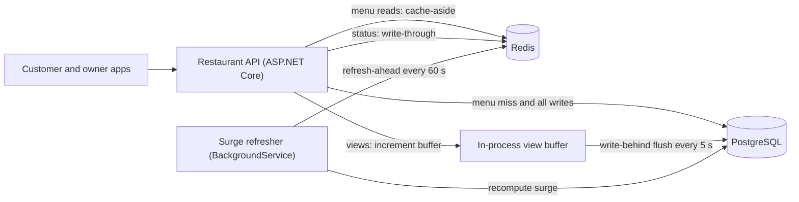
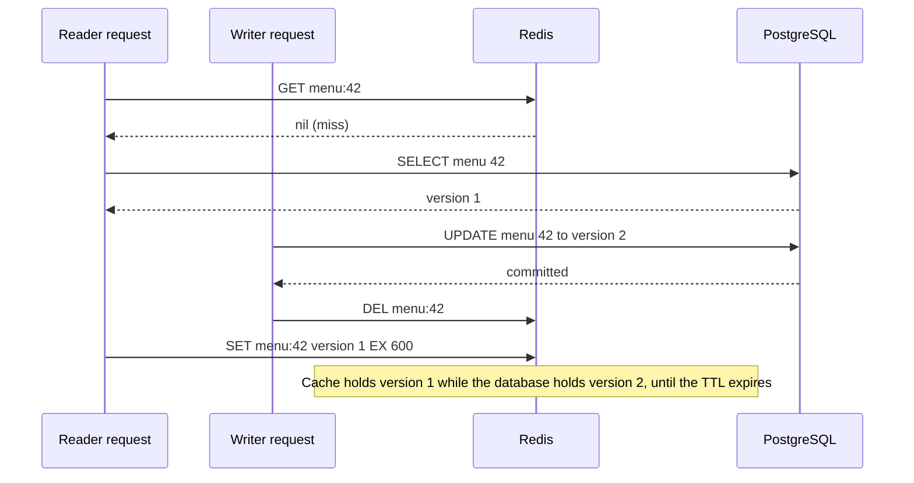
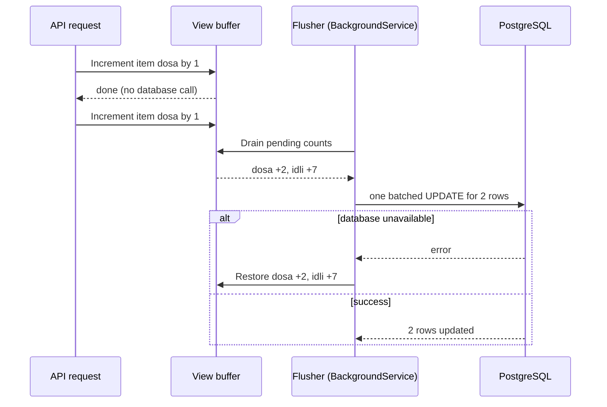

[Why caching works](#/lesson/m12-why-caching) showed that a cache pays off when traffic repeats. This lesson answers the next question: **who** puts data into the cache, **who** takes it out, and **what happens to writes**? There are five standard answers. Each one moves the trade-off between speed, freshness and safety to a different place.

## Learning objectives

By the end of this lesson you will be able to:

1. Draw the read and write flow of cache-aside, read-through, write-through, write-behind and refresh-ahead.
2. Explain why cache-aside deletes the cache entry on update instead of overwriting it, and describe the race that still remains.
3. Predict what each pattern does when the cache is down, when the database is down, and when the process crashes between two steps.
4. Implement each pattern in ASP.NET Core behind an `IDistributedCache`-backed abstraction, with a `BackgroundService` for write-behind and refresh-ahead.
5. Choose a pattern for a given kind of data (menus, counters, settings, prices) and justify it with numbers.
6. Explain where `HybridCache` fits and when it replaces hand-written cache-aside code.

## Prerequisites

- [Why caching works](#/lesson/m12-why-caching): hit ratio, miss ratio and the `c + (1 − h) × d` formula.
- [Caching in ASP.NET Core](#/lesson/m03-caching): `IMemoryCache`, `IDistributedCache` and `HybridCache` at the API level.
- [Background services](#/lesson/m03-background-services): write-behind and refresh-ahead run as `BackgroundService` workers.

## Explain it like I'm a beginner

Think of a busy restaurant kitchen and its whiteboard.

The **storeroom ledger** is the database. It is the official record of what stock exists. The **whiteboard** by the pass is the cache: quick to read, but only a copy.

There are five ways the staff can keep that whiteboard useful:

1. **The waiter checks the board himself (cache-aside).** If the dish is on the board, he answers the customer. If not, he walks to the storeroom, checks the ledger, and writes the answer on the board for the next waiter. When the chef changes the ledger, he simply **wipes** that line off the board.
2. **A board-keeper does it for him (read-through).** The waiter only ever asks the board-keeper. The board-keeper walks to the storeroom when needed. The waiter never sees the ledger.
3. **Every change goes to both, right now (write-through).** When stock changes, the chef updates the ledger *and* the board before he moves on. Slower for the chef, but the board is always up to date.
4. **Write on the board now, update the ledger later (write-behind).** During the lunch rush, the chef only updates the board. Every 15 minutes a helper copies the board's changes into the ledger in one go. Very fast for the chef, but if someone wipes the board before the helper copies it, those changes are lost.
5. **Refresh the popular lines before they fade (refresh-ahead).** The specials of the day are rewritten every half hour, even if nobody asked, so a waiter never finds a blank line at the busiest moment.

Each of these is a **caching pattern**. None is "best". The right one depends on how much you read, how much you write, and how bad it is if the board is wrong or lost.

## First-principles explanation

### The cast

Every pattern involves the same three parties:

- **The application** (your ASP.NET Core service).
- **The cache** (in-process memory, Redis, or both).
- **The source of truth** (usually PostgreSQL).

Each pattern answers two questions: *on a read miss, who loads from the database?* and *on a write, which store is updated first, and does the caller wait for both?*

| Pattern | Read miss loaded by | Write goes to | Caller waits for |
|---|---|---|---|
| Cache-aside | Application | Database, then cache entry **deleted** | Database |
| Read-through | Cache layer (via a loader) | Usually as cache-aside | Database |
| Write-through | Cache layer or application | Database **and** cache, synchronously | Both |
| Write-behind (write-back) | Cache layer | Cache only; database later, in batches | Cache only |
| Refresh-ahead | Background refresher, before expiry | Unchanged (combine with another pattern) | Nothing extra |

Read patterns (cache-aside, read-through, refresh-ahead) and write patterns (write-through, write-behind, write-around) combine. "Cache-aside reads + delete on write" is the most common combination on the internet. "Write-around" just means *writes skip the cache entirely* — the next read misses and reloads — which is what cache-aside does on a write.

### 1. Cache-aside (lazy loading)

The application owns all the logic.

**Read:** look in the cache. On a hit, return. On a miss, read the database, store the result in the cache with a TTL (time to live, an expiry timer), and return.

**Write:** update the database, then **delete** the cache key. The next read misses and loads the fresh row.

Why delete instead of writing the new value into the cache? Three reasons:

1. **Concurrent writers.** If two requests update the same menu at nearly the same time, their "set cache" calls can arrive in the opposite order to their database commits. The cache then holds the older value indefinitely (until TTL). Deleting is order-independent: whichever delete arrives last, the result is "empty", and the next read loads whatever the database has.
2. **The cached shape is often not the written shape.** A restaurant page may combine the menu, ratings and opening hours. A write to one table should not need to know how to rebuild the whole page.
3. **Lazy cost.** If nobody reads the item in the next ten minutes, building and storing it was wasted work.

**The race that remains.** Deleting does not close every gap. Consider this order of events:

1. Reader R misses and reads the menu from the database (version 1).
2. Writer W updates the database to version 2 and deletes the cache key.
3. Reader R, slightly delayed (a GC pause, a slow network), writes version 1 into the cache.

The cache now serves version 1 until the TTL expires. This is rare — the reader's database read must start before the write and its cache write must land after the delete — but at 10,000 requests per second, rare things happen daily. The defences, in order of cost:

- **Always set a TTL.** It turns "stale forever" into "stale for at most N minutes". This is non-negotiable.
- **Versioned values or keys.** Store a version number with the row; only overwrite the cache if the new value's version is higher (a compare-and-set, done in Redis with a small Lua script). Covered in [Cache invalidation, TTL and eviction](#/lesson/m12-invalidation-ttl).
- **Delayed second delete.** Delete again ~1 second after the write. Cheap, crude and surprisingly effective.

**Failure behaviour.**

- *Cache down:* reads fall through to the database. Correctness is fine, but the database suddenly receives 100 % of traffic instead of the miss ratio. At 8,000 RPS with 95 % hits, the database goes from 400 RPS to 8,000 RPS — a 20× jump. See [cache failures](#/lesson/m12-cache-failures).
- *Delete fails after the database write:* stale data until TTL. Log it, retry once, and keep TTLs short enough to live with.
- *Database down:* hits keep working; misses fail. A cache-aside system degrades gracefully for hot data.

**When to use:** the default for read-heavy data. It is simple, works with any cache, and the cache only holds what is actually read.

### 2. Read-through

Read-through moves the "on a miss, load from the database" logic **into the cache layer**. The application asks the cache for a key and gives it (once, at configuration time, or per call) a **loader** function. Callers never touch the database for reads.

The flow is the same as cache-aside. The difference is *where the code lives*, and that difference matters:

- **One place for the miss logic.** Serialisation, TTL, metrics and error handling are written once, not repeated in 40 services.
- **Request coalescing becomes easy.** If 500 requests miss the same key at the same moment, a read-through layer can run the loader once and hand the result to all 500. Hand-written cache-aside code usually forgets this and stampedes the database ([cache failures](#/lesson/m12-cache-failures)).
- **Coupling.** The cache layer must know how to load data. With a remote cache like Redis, that logic still runs in your application process — Redis does not call PostgreSQL. "Read-through" in .NET almost always means a library in your process, such as `HybridCache.GetOrCreateAsync`.

**Failure behaviour:** the same as cache-aside, plus one subtlety: if the loader throws, every coalesced caller receives the exception. Do not cache exceptions as values.

### 3. Write-through

**Write:** the application writes to the database and then to the cache, **in the same request**, and only reports success when both have finished. (Some products, such as caching appliances in front of a database, do this as one operation; in a typical ASP.NET Core + Redis system the application performs both steps.)

**Read:** a hit is likely, because every write refreshed the cache. Misses (after eviction or a restart) are loaded as in cache-aside.

Benefits:

- **Fresh reads right after writes.** A restaurant owner taps "close for the day"; the very next customer read sees "closed". With cache-aside the next read would *also* see it (the key was deleted), but it pays a miss; with write-through it is a hit.
- **Warm cache for recently written data**, which is often the data about to be read.

Costs:

- **Slower writes.** Write latency = database + cache. With PostgreSQL at 8 ms and Redis at 1 ms (estimates), writes take about 9 ms instead of 8 ms. Small, but it is on every write.
- **Cache fills with data nobody reads.** Write a million rows in a nightly import and you push the hot set out of the cache. Always set a TTL, and skip write-through for bulk imports.
- **The same ordering race as "set on write".** Two concurrent writers can leave the older value in the cache. Mitigate with a version check, or by funnelling writes for one key through one place (for example, a single owner service).

**Failure behaviour.** Always write the **database first**. If the database write fails, nothing changed and the cache is untouched. If the database succeeds but the cache write fails, try to delete the key (turning it into a cache-aside miss); if that also fails, the TTL bounds the staleness. Never write the cache first: if the database write then fails, readers see a value that never existed.

**When to use:** small, read-after-write-sensitive data where writes are rare compared to reads — user settings, feature flags, restaurant open/closed status, a project's current approval stage.

### 4. Write-behind (write-back)

**Write:** the application updates the cache (or an in-memory buffer) and returns immediately. A background worker later writes the accumulated changes to the database, usually in **batches**, often **coalescing** many changes to the same key into one.

This is the only pattern that makes *writes* dramatically cheaper. Concrete example, with estimated numbers: a food app records "menu item viewed" events.

- Peak: 5,000 views per second, spread over about 3,000 distinct items in any 5-second window.
- Writing each view directly: 5,000 `UPDATE` statements per second on a hot table — enough to cause lock contention on popular rows.
- Write-behind, flushing every 5 seconds: 5,000 × 5 = 25,000 increments collapse into at most 3,000 rows per flush, sent as one batched statement. That is about 600 row updates per second in a single round trip every 5 seconds — roughly an 8× reduction in rows written and a ~25,000× reduction in round trips.

The price is **durability**. Between the acknowledgement and the flush, the change exists only in the cache or buffer.

- If the buffer is in process memory, a crash or a forced kill loses up to one flush interval of data (5 seconds here).
- If the buffer is Redis with persistence (AOF), a Redis crash loses less, but a failover to a replica that had not received the latest writes can still lose some ([Redis lesson](#/lesson/m12-redis)).
- The database is temporarily *behind* the cache. Anything that reads the database directly (reports, other services, SQL queries) sees old numbers.
- Ordering across keys is lost. If item A's change must be stored before item B's, write-behind is the wrong tool.

**Failure behaviour.** If the flush fails, the batch must be **put back** (merged into the buffer), not dropped, and retried with backoff. If the database is down for a long time, the buffer grows; cap it and decide what to drop or when to refuse writes. On graceful shutdown, flush one last time.

**When to use:** high-volume, loss-tolerant, mergeable data — view counts, "last seen" timestamps, analytics, rate-limit counters, GPS pings where only the latest position matters. **Never** for payments, orders, stock decrements or anything a customer was told is "saved". For those, write to the database (or a durable queue) first; see [Transactional outbox](#/lesson/m12-outbox).

### 5. Refresh-ahead

**Idea:** reload an entry **before** it expires, so readers never wait for a miss on hot keys.

There are two flavours:

- **Scheduled refresh:** a background worker reloads a known, small set of keys on a timer. Example: surge multipliers for 120 delivery zones in a city, recomputed every 60 seconds and cached with a 180-second TTL. The TTL is three times the refresh interval, so one or two failed refreshes do not empty the cache.
- **Access-triggered refresh:** when a read finds an entry older than, say, 80 % of its TTL, it returns the current value immediately and starts one background reload. Only keys that are actually read get refreshed.

Benefits: misses disappear for hot keys, so p99 latency stops spiking every TTL period. Costs: wasted loads for keys nobody will read (scheduled flavour), extra complexity, and readers still see data up to one refresh interval old.

**Failure behaviour.** If a refresh fails, keep serving the old value until the hard TTL, and log. Never let a failing refresh delete good data.

**When to use:** a small, predictable hot set with expensive loads — exchange rates, fuel prices, tax slabs, a home-page "top 50" list, configuration.

### Comparing them

| | Cache-aside | Read-through | Write-through | Write-behind | Refresh-ahead |
|---|---|---|---|---|---|
| Read latency on hot data | Fast; miss every TTL | Fast; miss every TTL | Fast; fewer misses | Fast | Fast; almost no misses |
| Write latency | Database | Database | Database + cache | Cache only | Unchanged |
| Staleness | Up to TTL (race) | Up to TTL (race) | Low (ordering race) | Database lags cache | Up to refresh interval |
| Data-loss risk | None | None | None | **Yes**, up to flush interval | None |
| Complexity | Low | Low with a library | Medium | High | Medium |
| Best for | Most read-heavy data | Many services sharing logic | Read-after-write data | Counters, telemetry | Small, hot, expensive keys |

### Where HybridCache fits

ASP.NET Core's `HybridCache` (in the `Microsoft.Extensions.Caching.Hybrid` package) gives you a read-through API over two levels: a fast in-process cache (L1) and an optional distributed cache such as Redis (L2). Its `GetOrCreateAsync` runs your loader once per key even when many requests miss together, and it supports tag-based removal. For most read paths, it replaces hand-written cache-aside code:

```csharp
// Not compiled in this lesson: HybridCache lives in a NuGet package.
builder.Services.AddHybridCache(options =>
{
    options.DefaultEntryOptions = new HybridCacheEntryOptions
    {
        Expiration = TimeSpan.FromMinutes(10),            // L2 (Redis) lifetime
        LocalCacheExpiration = TimeSpan.FromMinutes(1),   // L1 (in-process) lifetime
    };
});

// Read-through: the loader runs only on a miss, once per key even under concurrency.
var menu = await hybridCache.GetOrCreateAsync(
    $"menu:{restaurantId}",
    async ct => await menuRepository.GetAsync(restaurantId, ct),
    tags: [$"restaurant:{restaurantId}"],
    cancellationToken: ct);

// Write path stays cache-aside: database first, then remove.
await menuRepository.SaveAsync(updatedMenu, ct);
await hybridCache.RemoveAsync($"menu:{restaurantId}", ct);
```

Note the short L1 lifetime: other instances' in-process copies are not removed by your `RemoveAsync` call unless you add a broadcast mechanism, so L1 staleness is bounded by `LocalCacheExpiration`. This is the multi-level trade-off explored in [multi-level caching](#/lesson/m16-multi-level-caching).

Write-through and write-behind are not built into `HybridCache`. You compose them yourself, as the implementation below shows.

### When a simpler design is enough

- If the whole data set is a few MB and changes rarely, cache it in each instance with `IMemoryCache` and a short TTL. No Redis, no invalidation messages.
- If writes are rare and a few minutes of staleness is fine, plain cache-aside with a TTL is enough. Do not add write-through "just in case".
- If you are considering write-behind for business data, you probably want a durable queue or the outbox pattern instead.

## Visual explanation

### Architecture: one service, four patterns



The customer and owner apps talk to one Restaurant API. For **menus**, the API checks Redis and, on a miss, reads PostgreSQL and fills Redis (cache-aside); writes go to PostgreSQL and then delete the Redis key. For **open/closed status**, the API writes PostgreSQL and then sets Redis in the same request (write-through), so the arrow to Redis carries writes too. **View counts** never go straight to the database: the API increments an in-process buffer, and the buffer is flushed to PostgreSQL every 5 seconds (write-behind). The **surge refresher** worker recomputes surge multipliers from PostgreSQL and writes them into Redis every 60 seconds, before their 180-second TTL expires (refresh-ahead). One service, four patterns, each chosen for its data.

### Sequence: cache-aside read, update, and the remaining race



The reader misses and reads version 1 from PostgreSQL. Before it writes to Redis, a writer commits version 2 and deletes the key — the correct cache-aside write. Then the slow reader's `SET` lands and puts the old version 1 back. The note shows the consequence: stale data for up to the 600-second TTL. This is why every cache-aside entry needs a TTL, and why high-stakes data uses version checks.

### Sequence: write-behind with a failed flush



Each API request only touches the in-memory buffer and returns at memory speed. The flusher wakes up, drains everything that accumulated (two dosa views became a single "+2"), and sends one batched statement. If PostgreSQL is unavailable, the flusher puts the counts back so they are retried on the next tick instead of disappearing. What the diagram cannot protect against is the process dying while counts sit in the buffer — that is the durability price of write-behind.

## Step-by-step example

**Scenario.** A municipal property-tax portal for a city of 4 million people. Citizens look up their property's dues and pay online. Officials update assessments. Before the due date on 30 September, traffic peaks.

### Step 1 — List the data and its access pattern

| Data | Reads | Writes | Staleness tolerated |
|---|---|---|---|
| Ward and tax-rate tables (250 rows) | Every lookup | A few times a year | Hours |
| Property assessment (1.2 million properties) | 1.5 lookups per property in the peak week | Rare (officials) | Minutes, but a citizen must see a correction soon |
| "Paid" status after payment | Read right after payment | Once per payment | Seconds (citizen is watching) |
| Page-view analytics per ward | Dashboards only | Every lookup | Minutes |

### Step 2 — Estimate the load

Assume 600,000 lookups on the last day, 60 % of them in a 6-hour evening window: 360,000 ÷ 21,600 s ≈ 17 lookups per second on average in that window. Take ×5 for bursts: about **85 RPS**. Each lookup reads the tax-rate table, one assessment and the payment status: 3 reads, so about 255 database reads per second at peak, plus 85 analytics writes per second.

That is modest. A single well-indexed PostgreSQL instance could probably handle it uncached (an estimate; load-test it). So the first honest answer is **"we may not need Redis at all"**.

### Step 3 — Apply the cheapest patterns first

- **Tax-rate tables:** 250 rows ≈ 50 KB. Cache in-process (`IMemoryCache`) with a 1-hour TTL, refreshed ahead by a background job. Removes one-third of the reads with zero infrastructure.
- **Analytics counters:** write-behind into an in-process buffer, flushed every 10 seconds. Losing 10 seconds of page-view counts in a crash is acceptable. This turns 85 small writes per second into one batch of ~200 ward rows every 10 seconds.

### Step 4 — Decide on assessments

1.2 million properties × 1.5 lookups means most properties are looked up once or twice in the peak week. Low reuse: the hit ratio would be poor. Keep reading assessments from PostgreSQL with a good index. If load tests show trouble, add **cache-aside** with a 5-minute TTL — misses cost nothing extra in correctness, and an official's correction appears within 5 minutes, or immediately if the update path deletes the key.

### Step 5 — Payment status

After paying, the citizen is redirected to a receipt page that must show "Paid". Read it from PostgreSQL, the source of truth. If this page ever gets heavy traffic, **write-through** is the right pattern: the payment callback writes PostgreSQL, then sets the cache, so the redirect's read hits fresh data. Never use write-behind here.

### Step 6 — Check failure behaviour

- Process restarts: in-process tax tables reload in milliseconds; at most 10 seconds of analytics are lost.
- Database slow: tax tables still served from memory; assessment lookups slow down — add a timeout and a friendly error.

Result: two patterns, no new infrastructure, and a clear trigger ("load test shows > X ms") for adding a shared cache later.

## Production-style C# implementation

The sample is a restaurant service that uses all four patterns. Everything runs offline: `AddDistributedMemoryCache()` stands in for Redis behind `IDistributedCache`, and in-memory repositories stand in for PostgreSQL. In production you would swap in `AddStackExchangeRedisCache(...)` and real repositories without touching the pattern classes.

```text
Restaurants.Api/
  Program.cs
  Restaurants/Models.cs
  Restaurants/InMemoryStores.cs
  Caching/AppCache.cs
  Patterns/MenuService.cs              cache-aside
  Patterns/ReadThroughCache.cs         read-through with request coalescing
  Patterns/RestaurantStatusStore.cs    write-through
  Patterns/ViewCountWriteBehind.cs     write-behind buffer + flusher
  Patterns/SurgeRefreshAhead.cs        scheduled refresh-ahead
```

### Models and repository contracts

```csharp file=Restaurants/Models.cs
namespace Restaurants;

public sealed record MenuItem(string Id, string Name, decimal PriceInr, bool Available);

public sealed record Menu(int RestaurantId, string RestaurantName, IReadOnlyList<MenuItem> Items, long Version);

public sealed record RestaurantStatus(int RestaurantId, bool IsOpen, string? Reason, DateTimeOffset UpdatedAt);

public sealed record SurgeQuote(string Zone, decimal Multiplier, DateTimeOffset ComputedAt);

public interface IMenuRepository
{
    Task<Menu?> GetAsync(int restaurantId, CancellationToken ct);
    Task SaveAsync(Menu menu, CancellationToken ct);
}

public interface IRestaurantStatusRepository
{
    Task<RestaurantStatus?> GetAsync(int restaurantId, CancellationToken ct);
    Task SaveAsync(RestaurantStatus status, CancellationToken ct);
}

public interface IViewCountRepository
{
    /// <summary>Adds every delta to its stored total in one round trip
    /// (in PostgreSQL: one UPDATE ... FROM unnest(@ids, @deltas)).</summary>
    Task AddAsync(IReadOnlyDictionary<string, long> deltas, CancellationToken ct);
}

public interface ISurgeCalculator
{
    Task<SurgeQuote> ComputeAsync(string zone, CancellationToken ct);
}
```

### In-memory stand-ins for PostgreSQL

```csharp file=Restaurants/InMemoryStores.cs
using System.Collections.Concurrent;

namespace Restaurants;

public sealed class InMemoryMenuRepository : IMenuRepository
{
    private readonly ConcurrentDictionary<int, Menu> _rows = new();
    private long _reads;

    public InMemoryMenuRepository()
    {
        _rows[42] = new Menu(42, "Udupi Corner, Indiranagar",
            [new MenuItem("idli", "Idli (2 pcs)", 60m, true), new MenuItem("dosa", "Masala dosa", 110m, true)], 1);
    }

    public long Reads => Interlocked.Read(ref _reads);

    public async Task<Menu?> GetAsync(int restaurantId, CancellationToken ct)
    {
        Interlocked.Increment(ref _reads);
        await Task.Delay(15, ct); // pretend this is a 15 ms query
        return _rows.GetValueOrDefault(restaurantId);
    }

    public Task SaveAsync(Menu menu, CancellationToken ct)
    {
        _rows[menu.RestaurantId] = menu;
        return Task.CompletedTask;
    }
}

public sealed class InMemoryStatusRepository : IRestaurantStatusRepository
{
    private readonly ConcurrentDictionary<int, RestaurantStatus> _rows = new();

    public Task<RestaurantStatus?> GetAsync(int restaurantId, CancellationToken ct) =>
        Task.FromResult(_rows.GetValueOrDefault(restaurantId));

    public Task SaveAsync(RestaurantStatus status, CancellationToken ct)
    {
        _rows[status.RestaurantId] = status;
        return Task.CompletedTask;
    }
}

public sealed class InMemoryViewCountRepository : IViewCountRepository
{
    private readonly ConcurrentDictionary<string, long> _totals = new();
    private long _batches;

    public long Batches => Interlocked.Read(ref _batches);
    public long TotalFor(string itemId) => _totals.GetValueOrDefault(itemId);

    public Task AddAsync(IReadOnlyDictionary<string, long> deltas, CancellationToken ct)
    {
        Interlocked.Increment(ref _batches);
        foreach (var (id, delta) in deltas) _totals.AddOrUpdate(id, delta, (_, old) => old + delta);
        return Task.CompletedTask;
    }
}

public sealed class FakeSurgeCalculator(TimeProvider clock) : ISurgeCalculator
{
    public Task<SurgeQuote> ComputeAsync(string zone, CancellationToken ct)
    {
        // A real implementation would aggregate open orders and free riders per zone.
        var multiplier = 1.0m + (Math.Abs(zone.GetHashCode()) % 5) / 10m;
        return Task.FromResult(new SurgeQuote(zone, multiplier, clock.GetUtcNow()));
    }
}
```

### The cache abstraction

The patterns depend on a tiny interface rather than on Redis directly. The implementation wraps `IDistributedCache`, serialises with `System.Text.Json`, and — crucially — **treats a broken cache as a miss**, not as an outage. The `bool` results let the write-through code react to a failed cache write.

```csharp file=Caching/AppCache.cs
using System.Text.Json;
using Microsoft.Extensions.Caching.Distributed;
using Microsoft.Extensions.Logging;

namespace Restaurants.Caching;

/// <summary>A HybridCache-shaped seam over whatever cache is configured.</summary>
public interface IAppCache
{
    Task<T?> GetAsync<T>(string key, CancellationToken ct);
    Task<bool> SetAsync<T>(string key, T value, TimeSpan ttl, CancellationToken ct);
    Task<bool> RemoveAsync(string key, CancellationToken ct);
}

public sealed class DistributedAppCache(IDistributedCache inner, ILogger<DistributedAppCache> logger) : IAppCache
{
    private static readonly JsonSerializerOptions Json = new(JsonSerializerDefaults.Web);

    public async Task<T?> GetAsync<T>(string key, CancellationToken ct)
    {
        try
        {
            var bytes = await inner.GetAsync(key, ct);
            return bytes is null ? default : JsonSerializer.Deserialize<T>(bytes, Json);
        }
        catch (Exception ex) when (ex is not OperationCanceledException)
        {
            logger.LogWarning(ex, "Cache read failed for {Key}; treating it as a miss", key);
            return default;
        }
    }

    public async Task<bool> SetAsync<T>(string key, T value, TimeSpan ttl, CancellationToken ct)
    {
        try
        {
            var bytes = JsonSerializer.SerializeToUtf8Bytes(value, Json);
            await inner.SetAsync(key, bytes, new DistributedCacheEntryOptions { AbsoluteExpirationRelativeToNow = ttl }, ct);
            return true;
        }
        catch (Exception ex) when (ex is not OperationCanceledException)
        {
            logger.LogWarning(ex, "Cache write failed for {Key}", key);
            return false;
        }
    }

    public async Task<bool> RemoveAsync(string key, CancellationToken ct)
    {
        try
        {
            await inner.RemoveAsync(key, ct);
            return true;
        }
        catch (Exception ex) when (ex is not OperationCanceledException)
        {
            // A failed delete means stale data until the TTL expires. Make it loud.
            logger.LogError(ex, "Cache invalidation failed for {Key}", key);
            return false;
        }
    }
}
```

### Cache-aside: menus

```csharp file=Patterns/MenuService.cs
using Restaurants.Caching;

namespace Restaurants.Patterns;

/// <summary>Cache-aside: the service reads the cache, loads on a miss, and deletes on write.</summary>
public sealed class MenuService(IMenuRepository repository, IAppCache cache)
{
    public static readonly TimeSpan Ttl = TimeSpan.FromMinutes(10);

    // The "v1" segment lets a deploy that changes the Menu shape start from fresh keys.
    public static string Key(int restaurantId) => $"menu:v1:{restaurantId}";

    public async Task<Menu?> GetAsync(int restaurantId, CancellationToken ct)
    {
        var cached = await cache.GetAsync<Menu>(Key(restaurantId), ct);
        if (cached is not null) return cached;

        var menu = await repository.GetAsync(restaurantId, ct);
        if (menu is not null) await cache.SetAsync(Key(restaurantId), menu, Ttl, ct);
        return menu;
    }

    public async Task UpdateAsync(Menu menu, CancellationToken ct)
    {
        await repository.SaveAsync(menu, ct);                       // 1. source of truth first
        if (!await cache.RemoveAsync(Key(menu.RestaurantId), ct))   // 2. then delete, never set
        {
            await Task.Delay(50, ct);                               // one quick retry
            await cache.RemoveAsync(Key(menu.RestaurantId), ct);
        }
    }
}
```

### Read-through: a reusable loader-owning cache

```csharp file=Patterns/ReadThroughCache.cs
using System.Collections.Concurrent;
using Restaurants.Caching;

namespace Restaurants.Patterns;

/// <summary>Read-through: callers only call GetAsync. The cache owns the loader, the TTL and the key
/// format, and runs at most one load per key at a time in this process (request coalescing).</summary>
public sealed class ReadThroughCache<TKey, TValue>(
    IAppCache cache,
    Func<TKey, CancellationToken, Task<TValue?>> loader,
    string keyPrefix,
    TimeSpan ttl)
    where TKey : notnull
    where TValue : class
{
    private readonly ConcurrentDictionary<string, Lazy<Task<TValue?>>> _inFlight = new();

    public async Task<TValue?> GetAsync(TKey key, CancellationToken ct)
    {
        var cacheKey = $"{keyPrefix}:{key}";
        var hit = await cache.GetAsync<TValue>(cacheKey, ct);
        if (hit is not null) return hit;

        var load = _inFlight.GetOrAdd(cacheKey, _ => new Lazy<Task<TValue?>>(() => LoadAsync(key, cacheKey)));
        try
        {
            // WaitAsync lets one caller give up without cancelling the shared load for everyone else.
            return await load.Value.WaitAsync(ct);
        }
        finally
        {
            _inFlight.TryRemove(new KeyValuePair<string, Lazy<Task<TValue?>>>(cacheKey, load));
        }
    }

    private async Task<TValue?> LoadAsync(TKey key, string cacheKey)
    {
        var value = await loader(key, CancellationToken.None);
        if (value is not null) await cache.SetAsync(cacheKey, value, ttl, CancellationToken.None);
        return value;
    }
}
```

### Write-through: open/closed status

```csharp file=Patterns/RestaurantStatusStore.cs
using Microsoft.Extensions.Logging;
using Restaurants.Caching;

namespace Restaurants.Patterns;

/// <summary>Write-through: every write updates the database and then the cache before returning.</summary>
public sealed class RestaurantStatusStore(
    IRestaurantStatusRepository repository,
    IAppCache cache,
    TimeProvider clock,
    ILogger<RestaurantStatusStore> logger)
{
    public static readonly TimeSpan Ttl = TimeSpan.FromHours(1);
    public static string Key(int restaurantId) => $"status:v1:{restaurantId}";

    public async Task<RestaurantStatus> SetAsync(int restaurantId, bool isOpen, string? reason, CancellationToken ct)
    {
        var status = new RestaurantStatus(restaurantId, isOpen, reason, clock.GetUtcNow());

        await repository.SaveAsync(status, ct);                    // 1. durable write first

        if (!await cache.SetAsync(Key(restaurantId), status, Ttl, ct))  // 2. refresh the cache in the same request
        {
            // Fall back to invalidation so readers reload from the database instead of seeing the old value.
            var removed = await cache.RemoveAsync(Key(restaurantId), ct);
            logger.LogWarning("Write-through cache update failed for {Id}; removed={Removed}", restaurantId, removed);
        }
        return status;
    }

    public async Task<RestaurantStatus?> GetAsync(int restaurantId, CancellationToken ct)
    {
        var cached = await cache.GetAsync<RestaurantStatus>(Key(restaurantId), ct);
        if (cached is not null) return cached;

        var fromDb = await repository.GetAsync(restaurantId, ct);   // miss after eviction or restart
        if (fromDb is not null) await cache.SetAsync(Key(restaurantId), fromDb, Ttl, ct);
        return fromDb;
    }
}
```

### Write-behind: view counters

```csharp file=Patterns/ViewCountWriteBehind.cs
using System.Collections.Concurrent;
using Microsoft.Extensions.Hosting;
using Microsoft.Extensions.Logging;

namespace Restaurants.Patterns;

/// <summary>Collects increments in memory. Thread-safe; increments to the same item are merged.</summary>
public sealed class ViewCountBuffer
{
    private readonly ConcurrentDictionary<string, long> _pending = new();

    public int PendingItems => _pending.Count;

    public void Increment(string itemId, long by = 1) =>
        _pending.AddOrUpdate(itemId, by, (_, current) => current + by);

    /// <summary>Removes and returns everything pending. An increment that races with the drain is
    /// never lost: it either makes it into this batch or stays for the next one.</summary>
    public Dictionary<string, long> Drain()
    {
        var batch = new Dictionary<string, long>();
        foreach (var key in _pending.Keys)
            if (_pending.TryRemove(key, out var value)) batch[key] = value;
        return batch;
    }

    /// <summary>Puts a failed batch back, merging with anything that arrived meanwhile.</summary>
    public void Restore(IReadOnlyDictionary<string, long> batch)
    {
        foreach (var (key, value) in batch) Increment(key, value);
    }
}

/// <summary>Write-behind flusher: drains the buffer on a timer and writes one batch per tick.</summary>
public sealed class ViewCountFlusher(
    ViewCountBuffer buffer,
    IViewCountRepository repository,
    TimeProvider clock,
    ILogger<ViewCountFlusher> logger) : BackgroundService
{
    public static readonly TimeSpan Interval = TimeSpan.FromSeconds(5);

    protected override async Task ExecuteAsync(CancellationToken stoppingToken)
    {
        using var timer = new PeriodicTimer(Interval, clock);
        try
        {
            while (await timer.WaitForNextTickAsync(stoppingToken))
                await FlushOnceAsync(stoppingToken);
        }
        catch (OperationCanceledException)
        {
            // Shutting down.
        }
        // Final flush on graceful shutdown, so a deploy does not drop the last interval's counts.
        await FlushOnceAsync(CancellationToken.None);
    }

    public async Task<int> FlushOnceAsync(CancellationToken ct)
    {
        var batch = buffer.Drain();
        if (batch.Count == 0) return 0;
        try
        {
            await repository.AddAsync(batch, ct);
            return batch.Count;
        }
        catch (Exception ex) when (ex is not OperationCanceledException)
        {
            buffer.Restore(batch);
            logger.LogWarning(ex, "View count flush failed; {Items} items re-queued", batch.Count);
            return 0;
        }
    }
}
```

### Refresh-ahead: surge multipliers

```csharp file=Patterns/SurgeRefreshAhead.cs
using Microsoft.Extensions.Hosting;
using Microsoft.Extensions.Logging;
using Restaurants.Caching;

namespace Restaurants.Patterns;

public sealed class SurgeOptions
{
    public string[] Zones { get; set; } = ["koramangala", "indiranagar", "hsr-layout", "whitefield"];
    public TimeSpan RefreshInterval { get; set; } = TimeSpan.FromSeconds(60);
    /// <summary>Three refresh intervals: one or two failed refreshes do not empty the cache.</summary>
    public TimeSpan Ttl { get; set; } = TimeSpan.FromSeconds(180);
}

public sealed class SurgeReader(IAppCache cache, ISurgeCalculator calculator)
{
    public static string Key(string zone) => $"surge:v1:{zone}";

    public async Task<SurgeQuote> GetAsync(string zone, CancellationToken ct) =>
        await cache.GetAsync<SurgeQuote>(Key(zone), ct)
        ?? await calculator.ComputeAsync(zone, ct);   // rare: refresher has not run yet, or the cache is down
}

/// <summary>Scheduled refresh-ahead: reloads a known, small key set before it expires.</summary>
public sealed class SurgeRefresher(
    IAppCache cache,
    ISurgeCalculator calculator,
    Microsoft.Extensions.Options.IOptions<SurgeOptions> options,
    TimeProvider clock,
    ILogger<SurgeRefresher> logger) : BackgroundService
{
    private readonly SurgeOptions _o = options.Value;

    protected override async Task ExecuteAsync(CancellationToken stoppingToken)
    {
        await RefreshAllAsync(stoppingToken); // warm the cache at startup
        using var timer = new PeriodicTimer(_o.RefreshInterval, clock);
        try
        {
            while (await timer.WaitForNextTickAsync(stoppingToken))
                await RefreshAllAsync(stoppingToken);
        }
        catch (OperationCanceledException)
        {
            // Shutting down.
        }
    }

    public async Task RefreshAllAsync(CancellationToken ct)
    {
        foreach (var zone in _o.Zones)
        {
            try
            {
                var quote = await calculator.ComputeAsync(zone, ct);
                await cache.SetAsync(SurgeReader.Key(zone), quote, _o.Ttl, ct);
            }
            catch (Exception ex) when (ex is not OperationCanceledException)
            {
                // Keep the previous value; it stays valid until its TTL.
                logger.LogWarning(ex, "Surge refresh failed for {Zone}", zone);
            }
        }
    }
}
```

### Wiring it up

```csharp file=Program.cs
using Restaurants;
using Restaurants.Caching;
using Restaurants.Patterns;

var builder = WebApplication.CreateBuilder(args);

// Offline stand-in for Redis. In production:
// builder.Services.AddStackExchangeRedisCache(o => o.Configuration = builder.Configuration.GetConnectionString("Redis"));
builder.Services.AddDistributedMemoryCache();
builder.Services.AddSingleton(TimeProvider.System);
builder.Services.AddSingleton<IAppCache, DistributedAppCache>();

builder.Services.AddSingleton<IMenuRepository, InMemoryMenuRepository>();
builder.Services.AddSingleton<IRestaurantStatusRepository, InMemoryStatusRepository>();
builder.Services.AddSingleton<IViewCountRepository, InMemoryViewCountRepository>();
builder.Services.AddSingleton<ISurgeCalculator, FakeSurgeCalculator>();

builder.Services.AddSingleton<MenuService>();                      // cache-aside
builder.Services.AddSingleton<RestaurantStatusStore>();            // write-through
builder.Services.AddSingleton<ViewCountBuffer>();                  // write-behind buffer
builder.Services.AddHostedService<ViewCountFlusher>();             // write-behind flusher
builder.Services.Configure<SurgeOptions>(builder.Configuration.GetSection("Surge"));
builder.Services.AddSingleton<SurgeReader>();
builder.Services.AddHostedService<SurgeRefresher>();               // refresh-ahead

// Read-through: the loader is configured once; callers never see the repository.
builder.Services.AddSingleton(sp =>
{
    var repo = sp.GetRequiredService<IMenuRepository>();
    return new ReadThroughCache<int, Menu>(sp.GetRequiredService<IAppCache>(),
        (id, ct) => repo.GetAsync(id, ct), "menu-rt:v1", TimeSpan.FromMinutes(10));
});

var app = builder.Build();

app.MapGet("/restaurants/{id:int}/menu", async (int id, MenuService menus, ViewCountBuffer views, CancellationToken ct) =>
{
    var menu = await menus.GetAsync(id, ct);
    if (menu is null) return Results.NotFound();
    views.Increment($"restaurant:{id}");
    return Results.Ok(menu);
});

app.MapPut("/restaurants/{id:int}/menu", async (int id, Menu menu, MenuService menus, CancellationToken ct) =>
{
    if (menu.RestaurantId != id) return Results.BadRequest();
    await menus.UpdateAsync(menu, ct);
    return Results.NoContent();
});

app.MapPut("/restaurants/{id:int}/status", async (int id, bool isOpen, string? reason, RestaurantStatusStore store, CancellationToken ct) =>
    Results.Ok(await store.SetAsync(id, isOpen, reason, ct)));

app.MapGet("/restaurants/{id:int}/status", async (int id, RestaurantStatusStore store, CancellationToken ct) =>
    await store.GetAsync(id, ct) is { } s ? Results.Ok(s) : Results.NotFound());

app.MapGet("/zones/{zone}/surge", async (string zone, SurgeReader surge, CancellationToken ct) =>
    Results.Ok(await surge.GetAsync(zone, ct)));

app.Run();
```

Design notes:

- **Every pattern sets a TTL**, even write-through and refresh-ahead. A TTL is the safety net for every bug and race described above.
- **The cache never causes an outage.** `DistributedAppCache` turns cache exceptions into misses or `false`. The database must still be sized for a cold cache, at least in a degraded mode.
- **Write-behind lives in one process.** Each API instance has its own buffer and flusher. Six instances mean six small batches every 5 seconds — fine. If you need a shared buffer, use Redis `INCRBY` plus one flusher, and accept Redis's durability rules.
- **`TimeProvider` everywhere.** The flusher and refresher take a `TimeProvider`, so tests can advance time instead of sleeping.
- **What is missing on purpose:** stampede protection for `MenuService` (the read-through cache has it), negative caching and jittered TTLs. Those are the subject of [cache failures](#/lesson/m12-cache-failures).

## Bad design vs good design

**Bad: write the cache first, then the database, and update rather than delete.**

```csharp
// Anti-example: cache-first write with "set" instead of delete.
public async Task UpdatePriceAsync(string itemId, decimal price)
{
    await _redis.StringSetAsync($"price:{itemId}", price.ToString());   // 1. cache first
    await _db.ExecuteAsync("UPDATE items SET price = @p WHERE id = @id", new { p = price, id = itemId });  // 2. may fail
}
```

What goes wrong:

- If the `UPDATE` fails (constraint violation, timeout, deadlock), the cache shows a price that **never existed** in the database. Customers see ₹99, checkout charges ₹129.
- Two concurrent updates can interleave so that the cache holds one price and the database another, with no TTL to end it.
- No TTL at all, so any inconsistency is permanent until someone flushes Redis.

**Good:** `MenuService.UpdateAsync` above — database first, delete second, TTL always — or `RestaurantStatusStore.SetAsync` when read-after-write freshness justifies write-through.

**Bad: write-behind for orders.**

A team buffers "order placed" events in memory and flushes them every 2 seconds to cut database writes. A pod is killed by the orchestrator during a deploy before its final flush. Customers have UPI confirmations for orders the restaurant never receives. The fix is not a shorter interval; it is to write orders durably (database, or a durable queue via the [outbox](#/lesson/m12-outbox)) before acknowledging.

:::callout type=tradeoff title="Delete versus update on write"
Deleting is safer under concurrency and simpler to reason about, but the next reader pays a miss. Updating (write-through) keeps the cache warm but needs ordering protection. If you cannot explain how your write-through code handles two concurrent writers, use delete.
:::

## Practical playground

The canvas below starts with a restaurant API talking straight to PostgreSQL. Add the patterns from this lesson:

1. Add a `cache` node (Redis) for menus with `ttlSeconds` 600, and label the API→cache edge "cache-aside".
2. Add a `worker` node for the view-count flusher, with an `async` edge to the database labelled "write-behind batch every 5 s".
3. Add a `scheduler` or `worker` node that refreshes surge multipliers into the cache every 60 s.
4. Ask yourself for each edge: what happens if this arrow fails? Write the answer on the edge label.

:::playground type=hld title="Add caching patterns to the restaurant API"
```json
{
  "nodes": [
    { "id": "apps", "type": "client", "label": "Customer and owner apps", "props": { "rps": 6000 } },
    { "id": "lb", "type": "load-balancer", "label": "Load balancer" },
    { "id": "api", "type": "app-server", "label": "Restaurant API", "props": { "instances": 4 } },
    { "id": "db", "type": "database", "label": "PostgreSQL primary", "props": { "replicas": 1 } }
  ],
  "edges": [
    { "from": "apps", "to": "lb", "kind": "sync" },
    { "from": "lb", "to": "api", "kind": "sync" },
    { "from": "api", "to": "db", "kind": "sync", "label": "all reads and writes" }
  ]
}
```
:::

## Exercises

:::exercise id=m12-cache-patterns-ex1 difficulty=beginner kind=code title="Cache-aside fare lookup"
A city-bus app shows the fare between two stops. Fares live in the database and change a few times a year. Implement `FareService` using cache-aside over the provided `IKeyValueCache`.
::requirements
- `GetFareAsync(from, to)` checks the cache first; on a miss it loads from `IFareStore`, caches the result with a 30-minute TTL, and returns it.
- Stop codes are case-insensitive: `"MG-ROAD"` and `"mg-road"` must share one cache key.
- A missing fare (`null`) is returned but not cached.
- `UpdateFareAsync` writes the store first, then **removes** the cache key.
::acceptance
- Two reads of the same route call the store once.
- Reads with different casing share the cached value.
- After an update, the next read returns the new fare.
- `UpdateFareAsync` never puts a value into the cache.
::hint
The cache-aside read has three steps: look, load on miss, store. Which one should be skipped when the store returns `null`?
::hint
Build the key in one helper method, for example `fare:{FROM}:{TO}` with both codes upper-cased and trimmed.
::hint
For the update, the order matters: what does a reader see if you remove the key first and the store write is slow?
::hint
```csharp
var key = Key(from, to);
var cached = await _cache.GetAsync(key);
if (cached is not null) return cached;
var fare = await _store.GetAsync(from, to);
if (fare is not null) await _cache.SetAsync(key, fare.Value, Ttl);
return fare;
```
::starter
```csharp file=FareService.cs
using System;
using System.Collections.Generic;
using System.Threading.Tasks;

public interface IKeyValueCache
{
    Task<decimal?> GetAsync(string key);
    Task SetAsync(string key, decimal value, TimeSpan ttl);
    Task RemoveAsync(string key);
}

public interface IFareStore
{
    Task<decimal?> GetAsync(string fromStop, string toStop);
    Task SaveAsync(string fromStop, string toStop, decimal fareInr);
}

public sealed class FareService
{
    public static readonly TimeSpan Ttl = TimeSpan.FromMinutes(30);

    public FareService(IFareStore store, IKeyValueCache cache) => throw new NotImplementedException();

    public static string Key(string fromStop, string toStop) => throw new NotImplementedException();

    public Task<decimal?> GetFareAsync(string fromStop, string toStop) => throw new NotImplementedException();

    public Task UpdateFareAsync(string fromStop, string toStop, decimal fareInr) => throw new NotImplementedException();
}
```
::tests
```csharp file=FareServiceTests.cs
using System;
using System.Collections.Generic;
using System.Threading.Tasks;
using Xunit;

public class FakeCache : IKeyValueCache
{
    public readonly Dictionary<string, decimal> Data = new();
    public int Sets;
    public Task<decimal?> GetAsync(string key) => Task.FromResult(Data.TryGetValue(key, out var v) ? v : (decimal?)null);
    public Task SetAsync(string key, decimal value, TimeSpan ttl) { Sets++; Data[key] = value; return Task.CompletedTask; }
    public Task RemoveAsync(string key) { Data.Remove(key); return Task.CompletedTask; }
}

public class FakeFareStore : IFareStore
{
    public readonly Dictionary<string, decimal> Rows = new() { ["MG-ROAD|SILK-BOARD"] = 35m };
    public int Reads;
    public Task<decimal?> GetAsync(string f, string t)
    {
        Reads++;
        return Task.FromResult(Rows.TryGetValue($"{f.ToUpperInvariant()}|{t.ToUpperInvariant()}", out var v) ? v : (decimal?)null);
    }
    public Task SaveAsync(string f, string t, decimal fare) { Rows[$"{f.ToUpperInvariant()}|{t.ToUpperInvariant()}"] = fare; return Task.CompletedTask; }
}

public class FareServiceTests
{
    [Fact]
    public async Task Second_read_is_served_from_cache()
    {
        var store = new FakeFareStore();
        var svc = new FareService(store, new FakeCache());
        Assert.Equal(35m, await svc.GetFareAsync("MG-ROAD", "SILK-BOARD"));
        Assert.Equal(35m, await svc.GetFareAsync("MG-ROAD", "SILK-BOARD"));
        Assert.Equal(1, store.Reads);
    }

    [Fact]
    public async Task Key_is_case_insensitive()
    {
        var store = new FakeFareStore();
        var svc = new FareService(store, new FakeCache());
        await svc.GetFareAsync("MG-ROAD", "SILK-BOARD");
        await svc.GetFareAsync(" mg-road", "silk-board ");
        Assert.Equal(1, store.Reads);
        Assert.Equal(FareService.Key("mg-road", "silk-board"), FareService.Key("MG-ROAD", "SILK-BOARD"));
    }

    [Fact]
    public async Task Missing_fare_is_not_cached()
    {
        var store = new FakeFareStore();
        var cache = new FakeCache();
        var svc = new FareService(store, cache);
        Assert.Null(await svc.GetFareAsync("X", "Y"));
        Assert.Null(await svc.GetFareAsync("X", "Y"));
        Assert.Equal(2, store.Reads);
        Assert.Equal(0, cache.Sets);
    }

    [Fact]
    public async Task Update_invalidates_instead_of_setting()
    {
        var store = new FakeFareStore();
        var cache = new FakeCache();
        var svc = new FareService(store, cache);
        await svc.GetFareAsync("MG-ROAD", "SILK-BOARD");
        var setsBefore = cache.Sets;
        await svc.UpdateFareAsync("MG-ROAD", "SILK-BOARD", 40m);
        Assert.Equal(setsBefore, cache.Sets);
        Assert.Empty(cache.Data);
        Assert.Equal(40m, await svc.GetFareAsync("MG-ROAD", "SILK-BOARD"));
    }
}
```
::solution
Normalise the key once, skip caching `null`, and on update write the store before removing the key.

```csharp file=FareService.cs
using System;
using System.Collections.Generic;
using System.Threading.Tasks;

public interface IKeyValueCache
{
    Task<decimal?> GetAsync(string key);
    Task SetAsync(string key, decimal value, TimeSpan ttl);
    Task RemoveAsync(string key);
}

public interface IFareStore
{
    Task<decimal?> GetAsync(string fromStop, string toStop);
    Task SaveAsync(string fromStop, string toStop, decimal fareInr);
}

public sealed class FareService
{
    public static readonly TimeSpan Ttl = TimeSpan.FromMinutes(30);
    private readonly IFareStore _store;
    private readonly IKeyValueCache _cache;

    public FareService(IFareStore store, IKeyValueCache cache)
    {
        _store = store;
        _cache = cache;
    }

    public static string Key(string fromStop, string toStop) =>
        $"fare:{fromStop.Trim().ToUpperInvariant()}:{toStop.Trim().ToUpperInvariant()}";

    public async Task<decimal?> GetFareAsync(string fromStop, string toStop)
    {
        var key = Key(fromStop, toStop);
        var cached = await _cache.GetAsync(key);
        if (cached is not null) return cached;

        var fare = await _store.GetAsync(fromStop.Trim(), toStop.Trim());
        if (fare is not null) await _cache.SetAsync(key, fare.Value, Ttl);
        return fare;
    }

    public async Task UpdateFareAsync(string fromStop, string toStop, decimal fareInr)
    {
        await _store.SaveAsync(fromStop.Trim(), toStop.Trim(), fareInr);   // source of truth first
        await _cache.RemoveAsync(Key(fromStop, toStop));                   // then invalidate
    }
}
```

Why not cache `null`? Here a missing fare usually means a typo, and caching it would hide a newly added route for 30 minutes. In a system attacked with random keys you *would* cache "not found" briefly; see [cache failures](#/lesson/m12-cache-failures).
::mistakes
- Removing the cache key **before** writing the store: a reader in between reloads the old fare and re-caches it.
- Calling `SetAsync` with the new fare on update — fine for one writer, wrong under concurrency.
- Normalising the key in `GetFareAsync` but not in `UpdateFareAsync`, so the update removes a different key.
::extensions
Add a `Version` to the fare and make the cache write conditional ("only set if the cached version is lower"). Which race from the lesson does that close?
:::

:::exercise id=m12-cache-patterns-ex2 difficulty=beginner kind=written title="Pick the pattern"
For each item, choose a read pattern and a write pattern (cache-aside, read-through, write-through, write-behind, refresh-ahead, or "no cache"), and give one sentence of justification and one failure you would watch for.

1. Live "people currently viewing this hotel" counter on a booking site.
2. A user's notification settings (read on every push, changed a few times a year, users expect a change to apply at once).
3. Today's petrol and diesel prices for 90 cities, recomputed once each morning.
4. A UPI payment's final status.
5. Product detail pages for 400,000 products, edited by sellers a few times a week.
::acceptance
- Every item has a read and a write choice.
- Write-behind is used only where losing a few seconds of data is acceptable.
- At least one item says "read from the source of truth" for correctness.
- Each answer names one concrete failure mode.
::hint
Ask: is the data mergeable and loss-tolerant? Is a read right after a write expected to be fresh? Is the key set small and known?
::hint
A small, known key set that is expensive to compute is the classic refresh-ahead case.
::hint
Money and "final status" values should never depend on a buffer that can be lost.
::solution
1. **Write-behind** for the counter (increments buffered or `INCR` in Redis, flushed periodically); reads straight from the cache. Failure: a node crash loses a few seconds of increments — acceptable for a "currently viewing" badge.
2. **Write-through** with cache-aside reads on miss. The user expects the change immediately, writes are rare, the data is tiny. Failure: cache write fails after the database write — remove the key, rely on TTL.
3. **Refresh-ahead** (scheduled): 90 keys, recomputed each morning, TTL longer than the refresh interval. Failure: the morning job fails — the TTL must be long enough to keep serving yesterday's prices, with an alert.
4. **No cache for decisions.** Read the status from the payment database (or the provider) for anything that moves money; a write-through cache for the *display* page is acceptable. Failure: a stale "pending" shown after success leads to duplicate payments if the user retries.
5. **Cache-aside** (or read-through via `HybridCache`) with delete on seller edit and a 10-minute TTL. Failure: the read/delete race leaves an old page for up to the TTL; and a cache outage sends all reads to PostgreSQL.
::mistakes
- Using write-behind for anything a user was told is "saved" or "paid".
- Choosing write-through for product pages, which fills the cache with every seller edit whether or not anyone reads it.
- Refresh-ahead with a TTL equal to the refresh interval, so one failed refresh empties the cache.
:::

:::exercise id=m12-cache-patterns-ex3 difficulty=intermediate kind=code title="Write-behind for rider locations"
A delivery app receives GPS pings from riders every 2 seconds. Only each rider's **latest** position matters for the database, which is used by support staff. Build `LatestValueWriteBehind`, which buffers the newest ping per rider and flushes in batches.
::requirements
- `Record(riderId, ping)` stores the ping, keeping only the one with the highest `Sequence` per rider (pings can arrive out of order).
- `FlushAsync()` drains pending pings and sends them to `IPingSink.WriteBatchAsync` in batches of at most `maxBatchSize`. It returns the number of pings written.
- If a batch fails, its pings go back into the buffer — but a newer ping that arrived during the flush must **not** be overwritten by the older one being restored.
- `Pending` returns the number of riders with unflushed pings.
::acceptance
- 3 pings for one rider produce one write with the highest sequence.
- An older ping recorded after a newer one is ignored.
- 25 riders with `maxBatchSize` 10 produce 3 batches.
- After a failed flush, the pings are pending again and a newer ping recorded mid-flush survives.
::hint
A `ConcurrentDictionary<string, Ping>` with `AddOrUpdate` can keep "the newer of the two" in its update function.
::hint
Use the same "keep newer" merge for both `Record` and the restore after failure. Then a restore can never overwrite a newer ping.
::hint
Drain with `TryRemove` per key, collect into a list, then send `list.Chunk(maxBatchSize)`.
::hint
If one batch fails, which pings must you restore — only that batch, or that batch and every batch not yet sent?
::hint
```csharp
private static Ping Newer(Ping a, Ping b) => a.Sequence >= b.Sequence ? a : b;
_pending.AddOrUpdate(id, ping, (_, existing) => Newer(existing, ping));
```
::starter
```csharp file=LatestValueWriteBehind.cs
using System;
using System.Collections.Concurrent;
using System.Collections.Generic;
using System.Linq;
using System.Threading.Tasks;

public sealed record Ping(string RiderId, double Lat, double Lon, long Sequence);

public interface IPingSink
{
    Task WriteBatchAsync(IReadOnlyList<Ping> batch);
}

public sealed class LatestValueWriteBehind
{
    public LatestValueWriteBehind(IPingSink sink, int maxBatchSize) => throw new NotImplementedException();

    public int Pending => throw new NotImplementedException();

    public void Record(Ping ping) => throw new NotImplementedException();

    public Task<int> FlushAsync() => throw new NotImplementedException();
}
```
::tests
```csharp file=LatestValueWriteBehindTests.cs
using System;
using System.Collections.Generic;
using System.Linq;
using System.Threading.Tasks;
using Xunit;

public class RecordingSink : IPingSink
{
    public readonly List<IReadOnlyList<Ping>> Batches = new();
    public bool Fail;
    public Action? DuringWrite;
    public Task WriteBatchAsync(IReadOnlyList<Ping> batch)
    {
        DuringWrite?.Invoke();
        if (Fail) throw new InvalidOperationException("database down");
        Batches.Add(batch.ToList());
        return Task.CompletedTask;
    }
}

public class LatestValueWriteBehindTests
{
    [Fact]
    public async Task Keeps_only_latest_per_rider()
    {
        var sink = new RecordingSink();
        var wb = new LatestValueWriteBehind(sink, 10);
        wb.Record(new Ping("r1", 12.97, 77.59, 1));
        wb.Record(new Ping("r1", 12.98, 77.60, 3));
        wb.Record(new Ping("r1", 12.99, 77.61, 2));
        Assert.Equal(1, wb.Pending);
        Assert.Equal(1, await wb.FlushAsync());
        Assert.Equal(3L, Assert.Single(Assert.Single(sink.Batches)).Sequence);
        Assert.Equal(0, wb.Pending);
    }

    [Fact]
    public async Task Splits_into_batches()
    {
        var sink = new RecordingSink();
        var wb = new LatestValueWriteBehind(sink, 10);
        for (var i = 0; i < 25; i++) wb.Record(new Ping($"r{i}", 0, 0, 1));
        Assert.Equal(25, await wb.FlushAsync());
        Assert.Equal(3, sink.Batches.Count);
        Assert.True(sink.Batches.All(b => b.Count <= 10));
    }

    [Fact]
    public async Task Failed_flush_restores_pings()
    {
        var sink = new RecordingSink { Fail = true };
        var wb = new LatestValueWriteBehind(sink, 10);
        wb.Record(new Ping("r1", 0, 0, 5));
        wb.Record(new Ping("r2", 0, 0, 1));
        Assert.Equal(0, await wb.FlushAsync());
        Assert.Equal(2, wb.Pending);
        sink.Fail = false;
        Assert.Equal(2, await wb.FlushAsync());
    }

    [Fact]
    public async Task Restore_does_not_overwrite_newer_ping()
    {
        var sink = new RecordingSink { Fail = true };
        var wb = new LatestValueWriteBehind(sink, 10);
        wb.Record(new Ping("r1", 0, 0, 5));
        sink.DuringWrite = () => wb.Record(new Ping("r1", 1, 1, 9));
        await wb.FlushAsync();
        sink.Fail = false;
        sink.DuringWrite = null;
        await wb.FlushAsync();
        Assert.Equal(9L, sink.Batches.Single().Single().Sequence);
    }

    [Fact]
    public async Task Empty_flush_writes_nothing()
    {
        var sink = new RecordingSink();
        var wb = new LatestValueWriteBehind(sink, 10);
        Assert.Equal(0, await wb.FlushAsync());
        Assert.Empty(sink.Batches);
    }
}
```
::solution
One merge rule ("keep the higher sequence") is used for recording and for restoring, which makes the restore safe against newer pings.

```csharp file=LatestValueWriteBehind.cs
using System;
using System.Collections.Concurrent;
using System.Collections.Generic;
using System.Linq;
using System.Threading.Tasks;

public sealed record Ping(string RiderId, double Lat, double Lon, long Sequence);

public interface IPingSink
{
    Task WriteBatchAsync(IReadOnlyList<Ping> batch);
}

public sealed class LatestValueWriteBehind
{
    private readonly ConcurrentDictionary<string, Ping> _pending = new();
    private readonly IPingSink _sink;
    private readonly int _maxBatchSize;

    public LatestValueWriteBehind(IPingSink sink, int maxBatchSize)
    {
        if (maxBatchSize <= 0) throw new ArgumentOutOfRangeException(nameof(maxBatchSize));
        _sink = sink;
        _maxBatchSize = maxBatchSize;
    }

    public int Pending => _pending.Count;

    public void Record(Ping ping) => Merge(ping);

    public async Task<int> FlushAsync()
    {
        var drained = new List<Ping>();
        foreach (var key in _pending.Keys)
            if (_pending.TryRemove(key, out var p)) drained.Add(p);
        if (drained.Count == 0) return 0;

        var batches = drained.Chunk(_maxBatchSize).ToList();
        var written = 0;
        for (var i = 0; i < batches.Count; i++)
        {
            try
            {
                await _sink.WriteBatchAsync(batches[i]);
                written += batches[i].Length;
            }
            catch (Exception)
            {
                // Restore this batch and every batch not yet attempted.
                foreach (var rest in batches.Skip(i))
                    foreach (var p in rest) Merge(p);
                break;
            }
        }
        return written;
    }

    private void Merge(Ping ping) =>
        _pending.AddOrUpdate(ping.RiderId, ping, (_, existing) => existing.Sequence >= ping.Sequence ? existing : ping);
}
```

The batch loop stops at the first failure: the database is probably down, so hammering it with the remaining batches only adds load. A production version would run `FlushAsync` from a `BackgroundService` every 5 seconds, as `ViewCountFlusher` does, and cap `Pending` so a long outage cannot exhaust memory.
::alternatives
Keep pings in Redis (`HSET rider:{id}` with the newest values, or a Redis stream) so all API instances share one buffer and a pod restart loses nothing. That costs a network hop per ping and a Redis dependency.
::mistakes
- Restoring with a plain `_pending[key] = old`, which overwrites a newer ping that arrived during the flush.
- Dropping the remaining batches after a failure, which silently loses data.
- Swapping the whole dictionary with `Interlocked.Exchange` while other threads are still writing into the old one.
::extensions
Add a `maxPending` limit. When it is reached, what should `Record` do for a rider already in the buffer versus a new rider?
:::

:::exercise id=m12-cache-patterns-ex4 difficulty=intermediate kind=hld title="Caching patterns for a hotel booking platform"
A hotel booking site has these read and write paths at peak (estimates):

- Hotel detail pages: 12,000 RPS reads, 50,000 hotels, edited by owners about 2,000 times per day.
- Room availability: 3,000 RPS reads, changes on every booking (about 40 bookings per second).
- "Booked 12 times today" badges: one increment per booking, read on every detail page.
- City-level average prices for 300 cities: expensive aggregation, shown on the home page.

Starting from the graph, add caches and workers so that PostgreSQL stays under 1,500 reads per second. For each data type, name the read and write pattern and its TTL, and explain one failure scenario.
::acceptance
- Each of the four data types has a named pattern and TTL (or "no cache" with a reason).
- The arithmetic shows PostgreSQL reads below 1,500 RPS.
- Availability used to *confirm* a booking is read from PostgreSQL, not the cache.
- The graph includes at least one `cache` and one `worker` or `scheduler` node.
::hint
Start with the biggest number: 12,000 RPS of hotel pages. What hit ratio keeps them under, say, 600 database RPS?
::hint
Availability changes 40 times per second across many hotels. A short-TTL cache is fine for *display*; what about the "Book now" step?
::hint
The badges are counters: mergeable and loss-tolerant. Which write pattern fits?
::hint
300 city prices, expensive to compute, shown on every home-page view: a small, known key set.
::starter
```json
{
  "nodes": [
    { "id": "users", "type": "client", "label": "Travellers", "props": { "rps": 15000 } },
    { "id": "lb", "type": "load-balancer", "label": "Load balancer" },
    { "id": "api", "type": "app-server", "label": "Booking API", "props": { "instances": 8 } },
    { "id": "db", "type": "database", "label": "PostgreSQL primary", "props": { "replicas": 1 } }
  ],
  "edges": [
    { "from": "users", "to": "lb", "kind": "sync" },
    { "from": "lb", "to": "api", "kind": "sync" },
    { "from": "api", "to": "db", "kind": "sync", "label": "all reads and writes" }
  ]
}
```
::solution
**Patterns per data type.**

| Data | Read | Write | TTL |
|---|---|---|---|
| Hotel details | Cache-aside / read-through (`HybridCache`, L1 30 s + Redis) | Delete on owner edit | 10 min |
| Availability (display) | Cache-aside | Delete on booking | 5 s |
| Availability (booking) | **Database**, inside the booking transaction | — | — |
| Booking badges | Read from Redis | Write-behind: `INCR` in Redis, worker flushes to PostgreSQL every 30 s | 48 h |
| City average prices | Refresh-ahead: scheduler recomputes every 10 min | — | 30 min |

**Arithmetic.** Hotel pages: 50,000 hotels, the hot set fits easily; with ~2,000 edits/day, misses are dominated by TTL expiry. Upper bound: 50,000 keys / 600 s ≈ 83 misses/s per shared Redis, plus L1 misses that hit Redis rather than the database. Call it ≤ 150 RPS. Availability display: 3,000 RPS; with a 5-second TTL and, say, 5,000 hotels actively viewed, at most 5,000 / 5 = 1,000 RPS of misses; realistic is lower because traffic concentrates. Booking-time reads: 40/s. City prices: 300 keys / 600 s = 0.5 recomputes/s. Total ≈ 150 + 1,000 + 40 + 1 ≈ **1,200 RPS**, under 1,500. If that is too close, raise the availability TTL to 10 s for display, or add a read replica for display reads.

```json
{
  "nodes": [
    { "id": "users", "type": "client", "label": "Travellers", "props": { "rps": 15000 } },
    { "id": "lb", "type": "load-balancer", "label": "Load balancer" },
    { "id": "api", "type": "app-server", "label": "Booking API (HybridCache L1 30 s)", "props": { "instances": 8 } },
    { "id": "redis", "type": "cache", "label": "Redis: hotel pages, availability, badges, city prices", "props": { "ttlSeconds": 600 } },
    { "id": "flush", "type": "worker", "label": "Badge flusher (write-behind, 30 s)" },
    { "id": "prices", "type": "scheduler", "label": "City price refresher (refresh-ahead, 10 min)" },
    { "id": "db", "type": "database", "label": "PostgreSQL primary", "props": { "replicas": 1 } },
    { "id": "mon", "type": "monitoring", "label": "Hit ratio, DB RPS, flush lag" }
  ],
  "edges": [
    { "from": "users", "to": "lb", "kind": "sync" },
    { "from": "lb", "to": "api", "kind": "sync" },
    { "from": "api", "to": "redis", "kind": "sync", "label": "cache-aside reads, badge INCR" },
    { "from": "api", "to": "db", "kind": "sync", "label": "misses, edits, booking transaction" },
    { "from": "flush", "to": "redis", "kind": "sync", "label": "read and reset counters" },
    { "from": "flush", "to": "db", "kind": "async", "label": "batched UPDATE" },
    { "from": "prices", "to": "db", "kind": "sync", "label": "aggregate query" },
    { "from": "prices", "to": "redis", "kind": "sync", "label": "SET with 30 min TTL" },
    { "from": "api", "to": "mon", "kind": "async", "label": "metrics" }
  ]
}
```

**Failure scenario.** Redis fails over and the badge counters on the old primary that were not yet replicated are lost: some "booked today" badges undercount by a few. Acceptable. The same failover drops hotel pages from the cache: 12,000 RPS would hit PostgreSQL. Mitigations: the L1 in-process cache absorbs the hottest hotels for 30 seconds, request coalescing limits one load per key per instance, and the API sheds or degrades (e.g. hides badges) when database latency rises.
::mistakes
- Using cached availability to confirm a booking — this double-books rooms.
- Write-through for hotel pages: every owner edit fills the cache whether or not travellers read it.
- Refresh-ahead TTL equal to the refresh interval.
- Forgetting the cold-cache case when sizing the database.
:::

:::exercise id=m12-cache-patterns-ex5 difficulty=advanced kind=code title="Access-triggered refresh-ahead cache"
Build `RefreshAheadCache<T>`: when a read finds an entry older than `refreshAfter`, it returns the current value immediately and starts **one** background reload. Entries older than `ttl` are treated as missing and loaded synchronously. Time comes from an injected `TimeProvider` so tests can control it.
::requirements
- `GetAsync(key)`:
  - no entry, or age ≥ `ttl` → await the loader, store, return the new value;
  - age ≥ `refreshAfter` and < `ttl` → return the cached value now, and start a background refresh if one is not already running for that key;
  - otherwise → return the cached value.
- At most one background refresh per key at a time, even if many reads race.
- A failed background refresh keeps the old value (until `ttl`) and does not throw to readers.
- `WhenIdleAsync()` returns a task that completes when all running background refreshes have finished (used by tests).
- Constructor throws `ArgumentOutOfRangeException` unless `0 < refreshAfter < ttl`.
::acceptance
- First read calls the loader once and waits for it.
- A read at 50 % of TTL does not call the loader.
- A read at 85 % of TTL returns the old value and triggers exactly one reload; after `WhenIdleAsync`, the new value is served.
- Ten concurrent stale reads trigger one reload.
- After the TTL, the read waits for a fresh load.
- A failing refresh leaves the old value in place.
::hint
Store `(Value, LoadedAt)` per key. Age = `clock.GetUtcNow() - LoadedAt`.
::hint
For "one refresh per key", keep a `ConcurrentDictionary<string, Task>` of running refreshes and only start one if `TryAdd` succeeds.
::hint
`TryAdd` with a `TaskCompletionSource().Task` as a placeholder lets you claim the slot *before* starting work, so two threads can never both start.
::hint
In the refresh, wrap the loader in `try/catch`, and in `finally` remove the key from the running set and complete the placeholder.
::hint
`WhenIdleAsync` can be `Task.WhenAll(_running.Values)` — the snapshot of currently running refreshes.
::hint
```csharp
var tcs = new TaskCompletionSource(TaskCreationOptions.RunContinuationsAsynchronously);
if (_running.TryAdd(key, tcs.Task))
    _ = Task.Run(async () =>
    {
        try { await LoadAndStoreAsync(key); }
        catch { /* keep old value */ }
        finally { _running.TryRemove(key, out _); tcs.SetResult(); }
    });
```
::starter
```csharp file=RefreshAheadCache.cs
using System;
using System.Collections.Concurrent;
using System.Linq;
using System.Threading.Tasks;

public sealed class RefreshAheadCache<T>
{
    public RefreshAheadCache(Func<string, Task<T>> loader, TimeSpan refreshAfter, TimeSpan ttl, TimeProvider clock)
        => throw new NotImplementedException();

    public Task<T> GetAsync(string key) => throw new NotImplementedException();

    public Task WhenIdleAsync() => throw new NotImplementedException();
}
```
::tests
```csharp file=RefreshAheadCacheTests.cs
using System;
using System.Linq;
using System.Threading;
using System.Threading.Tasks;
using Xunit;

public sealed class ManualClock : TimeProvider
{
    private DateTimeOffset _now = new(2026, 10, 1, 9, 0, 0, TimeSpan.Zero);
    public override DateTimeOffset GetUtcNow() => _now;
    public void Advance(TimeSpan by) => _now += by;
}

public class RefreshAheadCacheTests
{
    private static readonly TimeSpan Ttl = TimeSpan.FromSeconds(100);
    private static readonly TimeSpan RefreshAfter = TimeSpan.FromSeconds(80);

    [Fact]
    public async Task First_read_loads()
    {
        var calls = 0;
        var c = new RefreshAheadCache<int>(k => Task.FromResult(Interlocked.Increment(ref calls)), RefreshAfter, Ttl, new ManualClock());
        Assert.Equal(1, await c.GetAsync("usd-inr"));
        Assert.Equal(1, calls);
    }

    [Fact]
    public async Task Fresh_entry_does_not_reload()
    {
        var calls = 0;
        var clock = new ManualClock();
        var c = new RefreshAheadCache<int>(k => Task.FromResult(Interlocked.Increment(ref calls)), RefreshAfter, Ttl, clock);
        await c.GetAsync("k");
        clock.Advance(TimeSpan.FromSeconds(50));
        Assert.Equal(1, await c.GetAsync("k"));
        await c.WhenIdleAsync();
        Assert.Equal(1, calls);
    }

    [Fact]
    public async Task Stale_read_returns_old_value_and_refreshes_in_background()
    {
        var calls = 0;
        var clock = new ManualClock();
        var c = new RefreshAheadCache<int>(k => Task.FromResult(Interlocked.Increment(ref calls)), RefreshAfter, Ttl, clock);
        await c.GetAsync("k");
        clock.Advance(TimeSpan.FromSeconds(85));
        Assert.Equal(1, await c.GetAsync("k"));
        await c.WhenIdleAsync();
        Assert.Equal(2, calls);
        Assert.Equal(2, await c.GetAsync("k"));
    }

    [Fact]
    public async Task Concurrent_stale_reads_trigger_one_refresh()
    {
        var calls = 0;
        var gate = new TaskCompletionSource();
        var clock = new ManualClock();
        var c = new RefreshAheadCache<int>(async k =>
        {
            var n = Interlocked.Increment(ref calls);
            if (n > 1) await gate.Task;
            return n;
        }, RefreshAfter, Ttl, clock);
        await c.GetAsync("k");
        clock.Advance(TimeSpan.FromSeconds(90));
        var reads = Enumerable.Range(0, 10).Select(_ => c.GetAsync("k")).ToArray();
        var values = await Task.WhenAll(reads);
        Assert.True(values.All(v => v == 1));
        gate.SetResult();
        await c.WhenIdleAsync();
        Assert.Equal(2, calls);
    }

    [Fact]
    public async Task Expired_entry_is_loaded_synchronously()
    {
        var calls = 0;
        var clock = new ManualClock();
        var c = new RefreshAheadCache<int>(k => Task.FromResult(Interlocked.Increment(ref calls)), RefreshAfter, Ttl, clock);
        await c.GetAsync("k");
        clock.Advance(TimeSpan.FromSeconds(150));
        Assert.Equal(2, await c.GetAsync("k"));
    }

    [Fact]
    public async Task Failed_refresh_keeps_old_value()
    {
        var calls = 0;
        var clock = new ManualClock();
        var c = new RefreshAheadCache<int>(k =>
        {
            var n = Interlocked.Increment(ref calls);
            return n == 1 ? Task.FromResult(42) : Task.FromException<int>(new InvalidOperationException("source down"));
        }, RefreshAfter, Ttl, clock);
        await c.GetAsync("k");
        clock.Advance(TimeSpan.FromSeconds(85));
        Assert.Equal(42, await c.GetAsync("k"));
        await c.WhenIdleAsync();
        Assert.Equal(42, await c.GetAsync("k"));
    }

    [Fact]
    public void Invalid_windows_throw() =>
        Assert.Throws<ArgumentOutOfRangeException>(() =>
            new RefreshAheadCache<int>(k => Task.FromResult(1), TimeSpan.FromSeconds(100), TimeSpan.FromSeconds(100), new ManualClock()));
}
```
::solution
The key ideas: a soft deadline (`refreshAfter`) and a hard deadline (`ttl`); a placeholder task claimed with `TryAdd` so only one refresh runs per key; and a refresh that can fail without touching the stored value.

```csharp file=RefreshAheadCache.cs
using System;
using System.Collections.Concurrent;
using System.Linq;
using System.Threading.Tasks;

public sealed class RefreshAheadCache<T>
{
    private sealed record Entry(T Value, DateTimeOffset LoadedAt);

    private readonly ConcurrentDictionary<string, Entry> _entries = new();
    private readonly ConcurrentDictionary<string, Task> _running = new();
    private readonly Func<string, Task<T>> _loader;
    private readonly TimeSpan _refreshAfter;
    private readonly TimeSpan _ttl;
    private readonly TimeProvider _clock;

    public RefreshAheadCache(Func<string, Task<T>> loader, TimeSpan refreshAfter, TimeSpan ttl, TimeProvider clock)
    {
        if (refreshAfter <= TimeSpan.Zero || refreshAfter >= ttl)
            throw new ArgumentOutOfRangeException(nameof(refreshAfter), "Need 0 < refreshAfter < ttl.");
        _loader = loader;
        _refreshAfter = refreshAfter;
        _ttl = ttl;
        _clock = clock;
    }

    public async Task<T> GetAsync(string key)
    {
        if (_entries.TryGetValue(key, out var entry))
        {
            var age = _clock.GetUtcNow() - entry.LoadedAt;
            if (age < _ttl)
            {
                if (age >= _refreshAfter) StartRefresh(key);
                return entry.Value;
            }
        }
        return await LoadAndStoreAsync(key);   // hard miss: the caller waits
    }

    public Task WhenIdleAsync() => Task.WhenAll(_running.Values.ToArray());

    private void StartRefresh(string key)
    {
        var done = new TaskCompletionSource(TaskCreationOptions.RunContinuationsAsynchronously);
        if (!_running.TryAdd(key, done.Task)) return;   // someone else is already refreshing

        _ = Task.Run(async () =>
        {
            try
            {
                await LoadAndStoreAsync(key);
            }
            catch (Exception)
            {
                // Keep serving the old value until the hard TTL. Log in production.
            }
            finally
            {
                _running.TryRemove(key, out _);
                done.SetResult();
            }
        });
    }

    private async Task<T> LoadAndStoreAsync(string key)
    {
        var value = await _loader(key);
        _entries[key] = new Entry(value, _clock.GetUtcNow());
        return value;
    }
}
```

Why `Task.Run`? The reader must return *now*; running the loader inline would make the stale read wait for it, defeating the purpose. The placeholder is claimed before `Task.Run`, so even if two readers call `StartRefresh` at the same instant, only one wins `TryAdd`.
::alternatives
- **Scheduled refresh** (the `SurgeRefresher` in the lesson) is simpler when the key set is small and known.
- **Probabilistic early expiry** spreads refreshes randomly instead of at a fixed 80 % mark; see [cache failures](#/lesson/m12-cache-failures).
::mistakes
- Using `GetOrAdd(key, _ => Task.Run(...))`: the factory can run more than once under contention, starting duplicate refreshes.
- Removing the entry when the refresh fails, which turns a source outage into a cache outage.
- Comparing ages with `DateTime.Now` instead of the injected clock, which makes tests sleep and flake.
::extensions
Add a hard miss coalescer: if 100 readers find a key missing at the same time, only one should run the loader.
:::

## Automated testing

Each pattern has a property you can test cheaply with in-memory fakes and a controllable clock.

**Cache-aside: the second read does not touch the database, and an update invalidates.**

```csharp
[Fact]
public async Task Update_then_read_returns_new_menu()
{
    var repo = new InMemoryMenuRepository();
    var cache = new DistributedAppCache(
        new MemoryDistributedCache(Options.Create(new MemoryDistributedCacheOptions())),
        NullLogger<DistributedAppCache>.Instance);
    var service = new MenuService(repo, cache);

    var v1 = await service.GetAsync(42, CancellationToken.None);
    await service.UpdateAsync(v1! with { Version = 2 }, CancellationToken.None);
    var v2 = await service.GetAsync(42, CancellationToken.None);

    Assert.Equal(2, v2!.Version);
    Assert.Equal(2, repo.Reads);   // one load before the update, one after
}
```

**Write-through: a failing cache does not fail the write.** Use a fake `IAppCache` whose `SetAsync` returns `false`, and assert that `RestaurantStatusStore.SetAsync` still saves to the repository and calls `RemoveAsync`.

**Write-behind: no lost increments.** Run `Parallel.For` with 8 threads × 10,000 increments while another task calls `FlushOnceAsync` in a loop, then flush once more and assert the repository total is exactly 80,000. Add a repository fake that throws on every second call to prove `Restore` works.

**Refresh-ahead: control time, do not sleep.** Subclass `TimeProvider` (as in exercise 5) and advance it. For the `SurgeRefresher`, call `RefreshAllAsync` directly in the test instead of waiting for the timer.

**Integration test against real Redis.** Run Redis in a container in CI and point `AddStackExchangeRedisCache` at it. Test the behaviours a fake cannot show: TTLs actually expire, serialisation round-trips your records, and the app keeps serving (from the database) when you stop the Redis container mid-test.

## Real-world application

- **Product and content pages** on e-commerce and news sites are the textbook cache-aside case: huge read volume, edits rare, a few minutes of staleness fine.
- **User sessions and settings** often use write-through so the next request on any server sees the change.
- **Counters** (likes, views, "people viewing now", API usage for billing previews) commonly use write-behind: increments in Redis, a periodic job writes totals to the database. Billing itself is then computed from durable data, not from the counters.
- **Exchange rates, fuel prices, tax tables, feature flags** suit refresh-ahead: a few hundred keys, expensive or rate-limited to fetch, read constantly.
- **Infrastructure dashboards.** A highway project's chainage-wise progress, aggregated from thousands of daily entries, is a good refresh-ahead candidate: recompute every few minutes in a background job instead of on each dashboard load.
- **Libraries.** `HybridCache` in .NET, and similar libraries in other ecosystems, package read-through with request coalescing and two cache levels.

## Interview questions

:::interview
::q beginner
What is cache-aside, and why is it the default choice?
::a
The application checks the cache; on a miss it reads the database, stores the result with a TTL and returns it; on a write it updates the database and deletes the cache key. It is the default because it is simple, works with any cache, only caches what is actually read, and degrades gracefully: if the cache is down, reads still work from the database (as long as the database can take the load).
::q beginner
What is the difference between write-through and write-behind?
::a
Write-through writes the database and the cache synchronously and only reports success when both are done, so no data is lost and the cache is fresh, at the cost of slower writes. Write-behind writes only the cache (or a buffer) and acknowledges immediately; a background worker persists changes to the database later, often batched. Writes become much cheaper, but data can be lost if the cache or process fails before the flush, and the database lags behind.
::q intermediate
On an update, why do most teams delete the cache entry instead of writing the new value?
::a
Because deletion is order-independent. Two concurrent writers can have their "set cache" calls arrive in the opposite order to their database commits, leaving the older value cached. Deletes always converge to "empty", and the next read loads the current row. Deleting also avoids rebuilding complex cached objects on every write and wastes no effort on keys nobody reads. A TTL is still needed because a slow reader can re-insert an old value after the delete.
::q intermediate
Your cache-aside service occasionally shows a menu that is ten minutes out of date, even though updates delete the key. Explain the cause and the fixes.
::a
A reader missed, read the old row from the database, and was delayed; meanwhile a writer committed and deleted the key; then the reader's SET put the old value back, which lives until the 10-minute TTL. Fixes, in order of cost: shorter TTL; a delayed second delete about a second after the write; storing a version with each value and only setting if the version is newer (Redis Lua compare-and-set); or event-driven invalidation from the database change stream. Pick based on how costly staleness is.
::q advanced
Design a view-counter system for 50,000 increments per second using write-behind. What can go wrong and how do you limit it?
::a
Increment in Redis with INCRBY on per-item keys (or in per-instance memory buffers), and have a worker periodically read-and-reset the counters (GETDEL, or a Lua script) and write one batched UPDATE to PostgreSQL. Coalescing turns 50,000 increments/s into one row update per active item per interval. Risks: losing increments in a Redis failover or process crash (accept for views; never for money); double-counting if the worker writes the database and crashes before resetting Redis (make the flush idempotent with a batch id, or accept small overcounts); unbounded growth if PostgreSQL is down (cap and alert); and the database lagging the cache, so reports must say "as of last flush". Monitor flush lag and failure counts.
::q advanced
When would you choose refresh-ahead over cache-aside, and what are the risks?
::a
When a small, predictable set of hot keys is expensive to load and miss latency is visible — exchange rates, configuration, top-N lists, a home page aggregate. Refresh-ahead reloads before expiry, so readers almost never miss and p99 stops spiking each TTL period. Risks: wasted work refreshing keys nobody reads; a stampede on the source if many keys refresh at the same moment (spread them with jitter); and a failing refresh that deletes or blanks values (it should keep serving the old value until a hard TTL, with an alert). Set the TTL to several refresh intervals.
:::

## Summary and revision

**Key takeaways**

- **Cache-aside**: app reads cache, loads on miss, deletes on write. The default. Always add a TTL.
- **Read-through**: same flow, but the cache layer owns the loader — one place for logic and request coalescing. `HybridCache.GetOrCreateAsync` is the .NET way.
- **Write-through**: database then cache, synchronously. Fresh reads after writes, slower writes, beware concurrent writers.
- **Write-behind**: cache now, database later in batches. Huge write savings; accept possible data loss. Only for mergeable, loss-tolerant data.
- **Refresh-ahead**: reload hot keys before expiry. Removes miss spikes for small, known key sets.
- Write the database **first**. Treat a broken cache as a miss, not an outage. Size the database for a cold cache.

**Terminology**: cache-aside (lazy loading), read-through, write-through, write-behind (write-back), write-around, refresh-ahead, loader, request coalescing, TTL, coalesced write, flush interval.

:::flashcards
Q: Cache-aside write path?
A: Update the database first, then delete the cache key. The next read reloads the fresh value.
Q: Why delete rather than update the cache on write?
A: Deletes are order-independent under concurrent writers; sets can leave the older value cached.
Q: What race remains in cache-aside even with delete-on-write?
A: A slow reader that read the old row before the write can SET it after the delete. A TTL bounds the damage; versions close it.
Q: Difference between cache-aside and read-through?
A: Same flow; in read-through the cache layer owns the loader, so miss handling and request coalescing live in one place.
Q: Main cost of write-through?
A: Every write pays for the database and the cache, and the cache fills with written-but-unread data.
Q: Main risk of write-behind?
A: Data loss for anything not yet flushed when the cache or process fails, and a database that lags the cache.
Q: Good candidates for write-behind?
A: Counters, view and like counts, last-seen timestamps, telemetry — mergeable and loss-tolerant data.
Q: Refresh-ahead TTL rule of thumb?
A: Several refresh intervals (e.g. refresh every 60 s, TTL 180 s), so a failed refresh does not empty the cache.
Q: In write-through, which store is written first and why?
A: The database. If it fails, nothing changed; writing the cache first can expose a value that never existed.
:::

## Knowledge check

:::quiz pass=70
::q single
A service updates a product price with "SET cache, then UPDATE database". The UPDATE fails with a constraint error. What do customers see?
- [ ] The old price, because the cache write is rolled back.
- [x] The new price, which never existed in the database, until the TTL expires or someone fixes the cache.
- [ ] An error, because the cache detects the failure.
- [ ] Nothing changes, because Redis writes are transactional with PostgreSQL.
> The cache and the database are separate systems with no shared transaction. Writing the cache first exposes uncommitted values. Always write the database first.
::q single
Which pattern makes 25,000 increments per 5 seconds turn into about 3,000 row updates per flush?
- [ ] Write-through
- [ ] Read-through
- [x] Write-behind with coalescing
- [ ] Refresh-ahead
> Write-behind buffers changes and merges increments to the same key, so the database sees one update per distinct key per flush.
::q single
A user changes their notification settings and expects the next push, a second later from any server, to respect it. Writes are rare. Which pattern fits best?
- [ ] Write-behind with a 10-second flush
- [x] Write-through (database, then cache) with a TTL
- [ ] Refresh-ahead every 5 minutes
- [ ] No cache, ever
> Write-through gives fresh reads immediately after a rare write. Write-behind risks loss and lag; refresh-ahead would serve the old value for minutes. "No cache" also works if the load is low — but the question asks for the best fit given read-heavy access.
::q multi
Which of these are correct about cache-aside when Redis becomes unavailable? (Select all that apply.)
- [x] Reads still succeed if the application treats cache errors as misses.
- [x] Database load jumps from the miss ratio to 100 % of reads.
- [ ] Writes start failing because the delete step cannot complete.
- [x] Data may be stale after Redis returns if deletes failed during the outage.
> Cache-aside degrades to "database only". Writes should not fail because a delete failed; log it and rely on the TTL. After recovery, entries whose deletes were lost may be stale until they expire.
::q single
Refresh-ahead reloads 120 surge-pricing keys every 60 seconds. Which TTL is the most sensible?
- [ ] 30 seconds
- [ ] 60 seconds
- [x] 180 seconds
- [ ] No TTL
> A TTL of several refresh intervals means one or two failed refreshes still leave a value to serve. A TTL shorter than or equal to the interval creates gaps; no TTL means a stuck refresher serves stale prices forever.
::q single
Where does `HybridCache.GetOrCreateAsync` sit among the patterns?
- [ ] Write-behind, because it writes to Redis in the background.
- [x] Read-through, because the library runs your loader on a miss and coalesces concurrent misses.
- [ ] Write-through, because it updates the database.
- [ ] Refresh-ahead, because it reloads before expiry.
> HybridCache owns the miss handling (loader, serialisation, L1/L2, coalescing). It does not write to your database; write paths stay cache-aside (remove on update).
::q single
A team wants write-behind for "order placed" events to cut database writes by 80 %. What is the best response?
- [ ] Approve it with a 1-second flush interval.
- [ ] Approve it if Redis has AOF enabled.
- [x] Reject it: orders must be durable before acknowledging; use the database or a durable queue (outbox) instead.
- [ ] Approve it but add more API instances.
> Any buffer can be lost before it flushes. Business-critical writes need durable storage before the customer sees "order placed".
:::

## Completion criteria

You have finished this lesson when you can:

- [ ] Score at least 70 % on the knowledge check.
- [ ] Complete exercises 1 and 3 with all tests passing, and exercise 5 if you are aiming for advanced level.
- [ ] Draw the cache-aside race on a whiteboard and name two defences.
- [ ] For any data type, choose a read and write pattern and state its failure behaviour in one sentence.
- [ ] Explain when `HybridCache` replaces hand-written cache-aside code, and what it does not do.
