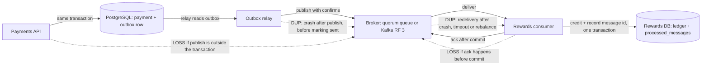
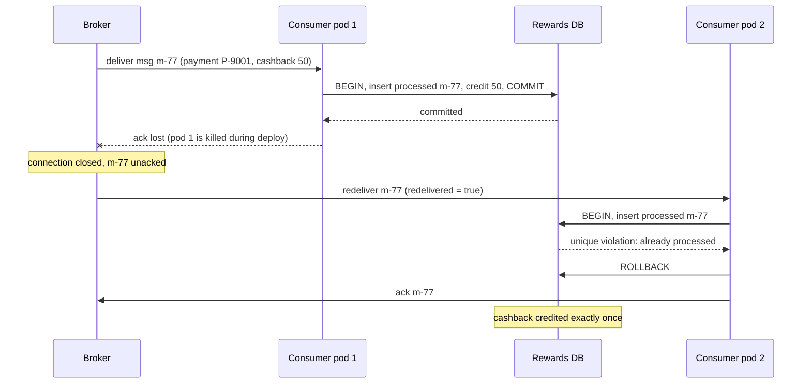

A customer pays ₹1,200 at a pharmacy using UPI. The payments service publishes "payment succeeded", and a rewards service credits ₹50 cashback. Two things can go wrong. If the message is **lost**, the customer never gets the cashback and calls support. If the message is **duplicated**, the customer gets ₹100, and across a few lakh payments a day that becomes real money. No broker setting makes both problems disappear, because the network between machines can always fail at the worst moment. This lesson shows exactly where messages are lost or duplicated, why "exactly-once delivery" is not something you can buy, and how real systems still get exactly-once *results*.

## Learning objectives

By the end of this lesson you will be able to:

1. Define at-most-once, at-least-once and exactly-once delivery, and explain why the first two are a choice of failure mode.
2. Explain, using the "lost acknowledgement" problem, why exactly-once delivery over an unreliable network is impossible in general.
3. Trace a message from producer to side effect and name every point where it can be lost or duplicated, with the fix for each.
4. Demonstrate duplicate delivery with a crash between processing and acknowledgement, and loss with a crash between acknowledgement and processing.
5. Explain "effectively-once" processing: at-least-once delivery plus idempotent, transactional handling.
6. Explain what Kafka's idempotent producer and transactions do guarantee, and where their guarantee ends.
7. Choose the right guarantee for a given workload and justify it with the cost of loss versus the cost of duplication.

## Prerequisites

- [Message queues](#/lesson/m12-message-queues): acks and redelivery.
- [RabbitMQ exchanges and routing](#/lesson/m12-rabbitmq): publisher confirms, manual acks.
- [Kafka topics, partitions and consumer groups](#/lesson/m12-kafka): offsets and commits.

## Explain it like I'm a beginner

You send your friend in Chennai an important courier. You want to be sure it arrived, so you ask them to text "got it".

Two days pass. No text. What happened?

- Maybe the courier was lost. You should send another one.
- Maybe the courier arrived, but your friend's text did not come through (their phone was off, the network dropped it). If you send another one, they get two.

From where you sit, **these two situations look exactly the same**: no text. You have to choose:

- **Never resend.** Your friend gets the courier zero or one times. That is **at-most-once**: no duplicates, but things can be lost.
- **Resend until you get the text.** Your friend gets it one or more times. That is **at-least-once**: nothing is lost, but there may be duplicates.

There is no third option where you can always be sure they got it exactly once, because you can never tell "lost courier" from "lost text".

But your friend can help. If every courier has a number written on it ("parcel #4471"), and your friend keeps a list of numbers already received, a second copy of #4471 goes straight into the bin. You resend as often as you like; your friend acts on it once. That is **effectively-once**: at-least-once delivery, plus a receiver that ignores duplicates. Almost every reliable system in the world works this way.

## First-principles explanation

### The three guarantees

| Guarantee | Each message is processed | Failure you accept | How it is built |
|---|---|---|---|
| **At-most-once** | 0 or 1 times | Loss | Acknowledge (or commit) before processing; never retry publishing |
| **At-least-once** | 1 or more times | Duplicates | Retry publishing until confirmed; acknowledge after processing |
| **Exactly-once** (effect) | Effect happens once | Neither, at the cost of complexity | At-least-once plus deduplication or idempotent processing, in the same transaction as the effect |

These describe what the *business logic* experiences, end to end. A system is only as strong as its weakest hop: a perfectly replicated broker does not help if the consumer auto-acks.

### Why exactly-once delivery is impossible in general

Look at one hop: a sender sends a message and waits for an acknowledgement. Three things can happen:

1. The message is lost. No ack arrives.
2. The message arrives and is processed, but the ack is lost. No ack arrives.
3. The message and the ack both arrive.

In cases 1 and 2 the sender sees the same thing: a timeout. If it does not resend, case 1 loses the message (at-most-once). If it resends, case 2 duplicates it (at-least-once). No protocol fixes this from the sender's side alone, because no number of extra acknowledgements removes the uncertainty about the last one. This is a form of the **two generals problem**, and it is why "exactly-once delivery" claims always come with conditions.

What *is* possible is **exactly-once processing**: the receiver remembers what it has already done and makes duplicates harmless. That moves the problem from the network (which you cannot fix) to your data (which you can).

### At-most-once: when it is the right choice

At-most-once is not a bug when losing a message is cheap:

- Metrics and telemetry: losing one CPU sample out of millions changes nothing.
- Live location updates: a newer position arrives in 10 seconds anyway.
- Cache invalidation hints with a short TTL as a backstop.

It is simpler and faster: no retries, no deduplication, no waiting for confirms. Kafka producers with `acks = 0`, RabbitMQ consumers with `autoAck: true`, and UDP-based telemetry are all at-most-once.

### At-least-once: the default for business data

For orders, payments, invoices and notifications that matter, losing a message is worse than processing it twice, *provided* you can make the second time harmless. So nearly every business system uses at-least-once:

- The producer retries until the broker confirms (publisher confirms in RabbitMQ, `acks = all` in Kafka).
- The broker replicates and persists messages.
- The consumer acknowledges or commits only after the effect is durable.

The consequence is unavoidable: **duplicates will happen**, so consumers must be idempotent. The next lesson, [idempotent consumers and inbox deduplication](#/lesson/m12-idempotent-consumers), is entirely about that.

### Where messages are lost

Walk the path of the cashback event. Each hop has its own failure.

**1. Producer → broker**

- *Fire-and-forget publishing.* No publisher confirms (RabbitMQ) or `acks = 0` (Kafka). A broker crash or network drop loses the message silently. **Fix:** confirms or `acks = all`, and retry on doubt.
- *The dual write.* The payments service commits the payment to PostgreSQL, then publishes. If the process dies between the two, the payment exists but no event is ever sent. Reversing the order is worse: an event for a payment that rolled back. **Fix:** the [transactional outbox](#/lesson/m12-outbox): write the event to an outbox table in the same transaction, and relay it afterwards.
- *Unroutable messages.* RabbitMQ drops messages that match no binding. **Fix:** `mandatory` and an alternate exchange.

**2. Inside the broker**

- *Non-persistent messages or non-durable queues* lost on restart.
- *No replication.* A single-node classic queue, or Kafka with replication factor 1, loses data with the disk. Kafka with `acks = 1` loses records acknowledged by a leader that died before followers copied them.
- *Expiry and limits.* Message TTLs, queue length limits with `drop-head`, and Kafka retention all delete messages that nobody has processed yet.
- **Fix:** quorum queues or Kafka with replication factor 3, `min.insync.replicas = 2`, persistent messages; monitor queue age and consumer lag against TTLs and retention.

**3. Broker → consumer**

- *Ack or commit before processing* (auto-ack, or Kafka auto-commit with asynchronous processing). A crash after the ack loses the message.
- *Catch-log-ack.* `catch (Exception) { log; ack; }` throws away every failure.
- *Offset reset to latest.* A new consumer group, or one whose offsets expired, with `auto.offset.reset = latest`, skips everything already in the topic.
- **Fix:** manual ack or commit after the effect; failures go to retries and a [dead-letter queue](#/lesson/m12-retries-dlq), never into the bin.

**4. Consumer → side effect**

- *Fire-and-forget calls.* The consumer calls the wallet service without waiting for a reliable answer, acks, and the call fails.
- **Fix:** ack only after the side effect is confirmed; use an idempotency key on the external call so retries are safe.

### Where messages are duplicated

**1. Producer retries.** The broker stored the message, but the confirm was lost or timed out. The producer resends. Kafka's idempotent producer removes this particular duplicate (see below); RabbitMQ does not, so the consumer must.

**2. Outbox relay crashes.** The relay publishes the event, then crashes before marking the outbox row as sent. On restart it publishes again.

**3. Consumer crash between effect and ack.** The cashback was credited, then the process died before the ack. The broker redelivers. This is the most common duplicate, and the one the demonstration below reproduces.

**4. Lease or session expiry.** The handler took longer than the visibility timeout (SQS), lock duration (Service Bus) or `max.poll.interval.ms` (Kafka). The broker gives the message to another consumer while the first is still working: two concurrent copies.

**5. Rebalances.** A Kafka partition moves to another consumer; records processed but not yet committed are processed again by the new owner.

**6. Replays.** Someone replays the DLQ, or resets a group's offsets to reprocess a day after a bug fix. Every replay is a planned duplicate.

**7. Upstream duplicates.** The user double-taps "Pay"; a webhook provider retries a callback. The same business event arrives as two messages with *different* message ids. Only a business key (the payment id) can catch these.

### Effectively-once: exactly-once effect

The practical recipe for exactly-once results is:

1. **At-least-once delivery** everywhere, so nothing is lost.
2. A **stable identity** for each event: a message id set by the producer (not the broker's delivery tag), and ideally a business key such as `paymentId`.
3. **Idempotent processing**: before applying the effect, check whether this id has been applied; record the id **in the same database transaction** as the effect.
4. **Ack after commit.**

If the consumer crashes after the commit but before the ack, the redelivered message finds its id already recorded and is acknowledged without effect. If it crashes before the commit, neither the effect nor the id was saved, so the redelivery does the work for the first time. The atomic transaction is what removes the gap. Doing the check and the effect in *separate* transactions reintroduces the race.

Some operations are **naturally idempotent** and need no table: `UPDATE ... SET status = 'paid'`, an upsert by key, "set latest position if newer". Others, such as "add ₹50 to balance", are not, and need the dedupe record.

### What Kafka's "exactly-once" means

Kafka offers two features that are often described as exactly-once. Both are real and useful, and both have boundaries.

**The idempotent producer** (`enable.idempotence = true`, default since Kafka 3.0). Each producer session gets a producer id, and numbers its records per partition (0, 1, 2, ...). The partition leader remembers the last sequence number per producer and **discards a retry it has already written**, and rejects gaps. This removes duplicates caused by producer retries *within one producer session*. It does not help if your application restarts and resends the same business event as a new record, and it does nothing for consumer-side duplicates.

**Transactions** (`transactional.id`, `isolation.level = read_committed`). A "consume-transform-produce" application can, in one atomic Kafka transaction, write output records to other topics **and** commit its input offsets. Consumers reading with `read_committed` see the outputs only if the transaction committed. If the application crashes mid-way, the transaction aborts, offsets are not committed, and the input is reprocessed, but the aborted outputs are invisible. Kafka Streams uses this for `processing.guarantee = exactly_once_v2`. A stable `transactional.id` also **fences zombies**: when a restarted instance calls `InitTransactions`, the broker bumps the producer epoch, and any write from the old, half-dead instance with the same id is rejected (Kafka 4.0 tightened this further with server-side transaction checks, KIP-890).

The boundary: this is exactly-once **inside Kafka**, from Kafka topics to Kafka topics. The moment your handler writes to PostgreSQL, calls a wallet API or sends an SMS, that side effect is outside the transaction and can still happen twice. For those, you are back to idempotent consumers, or to storing the consumed offset in the same database transaction as the effect (exercise 5).

### Choosing a guarantee: cost of loss versus cost of duplication

| Workload | Cost of loss | Cost of duplicate | Choice |
|---|---|---|---|
| Page-view analytics | Tiny | Slightly inflated counts | At-most-once or at-least-once without dedupe |
| Live GPS position | None (next ping in 10 s) | None (latest wins) | At-most-once is fine |
| Order confirmation SMS | Annoyed customer | Annoyed customer, small SMS cost | At-least-once with best-effort dedupe |
| Cashback credit, wallet top-up, payout | Money and trust | Money | Effectively-once: dedupe in the same transaction |
| Inventory reservation | Overselling | Underselling | Effectively-once with business keys |

A useful habit: for every consumer, write down "what happens if this runs twice?" and "what happens if this never runs?" before choosing.

### Worked numbers: how many duplicates should you expect?

Estimates for a rewards consumer:

- 5,00,000 payment events per day.
- Consumer pods restart about 4 times a day (deploys, autoscaling, node maintenance).
- Each pod holds up to 20 unacked messages (prefetch 20) at any moment, and on average about 10 are mid-processing.

Each restart that is not graceful can redeliver around 10 messages, some already processed. If half the restarts are ungraceful: 2 × 10 = **about 20 duplicates per day**, plus a few from network blips and rebalances. That is 0.004 % of traffic, which sounds negligible until each one is ₹50: about ₹1,000 a day, ₹3.6 lakh a year, and an auditor asking why. Rare does not mean never; duplicates are a certainty at scale, so design for them.

### When a weaker guarantee is enough

Not every consumer needs a dedupe table. If the effect is naturally idempotent (upsert latest status), or duplicates are cheap and visible (a second "your order is packed" notification), at-least-once with no extra machinery is the simpler and better design. Spend the complexity where money, inventory or legal records are involved.

### Trade-offs

| You gain | You pay |
|---|---|
| At-most-once: simplest, fastest, no duplicates | Silent loss on every crash |
| At-least-once: nothing lost | Duplicates; consumers must tolerate them |
| Effectively-once via dedupe | A dedupe store, a transaction per message, retention and cleanup of ids |
| Kafka transactions: atomic Kafka-to-Kafka pipelines | Extra latency, transactional producer management, and no help for external side effects |

## Visual explanation

### Architecture: where loss and duplication happen



Solid arrows are the safe path. The payments API writes the payment and an outbox row in one PostgreSQL transaction, so an event can never be lost between the commit and the publish. The relay publishes with confirms to a replicated broker. The rewards consumer credits the cashback and records the message id in **one** transaction, then acks. Dotted arrows label the classic failures: publishing outside the transaction loses events; a relay crash duplicates them; broker redelivery duplicates them; acking before commit loses them. Each duplicate arrow ends at a component that can absorb it (the consumer's dedupe), and each loss arrow is removed by ordering the steps correctly.

### Sequence: a lost ack creates a duplicate, and dedupe absorbs it



Pod 1 does everything right: it records the message id and credits the cashback in one transaction, and the commit succeeds. Then it is killed before its ack reaches the broker. The broker cannot know the work was done, so it redelivers `m-77` to pod 2. Pod 2 tries to record `m-77`, hits the unique constraint, rolls back (so no second credit), and acks. Delivery was at-least-once (twice, in fact); the effect was exactly once.

## Step-by-step example

We will reproduce loss and duplication on purpose, then remove them.

### Step 1: a consumer that acks first

```csharp
var d = queue.TryReceive()!;
queue.Ack(d.Tag);                  // step 1
store.Credit(d.Body);              // step 2: a crash before this line loses the cashback
```

Run 1,000 events with a 2 % chance of crashing between the two steps. Expect about 20 customers with no cashback and zero duplicates. That is at-most-once.

### Step 2: swap the order

```csharp
store.Credit(d.Body);              // step 1
queue.Ack(d.Tag);                  // step 2: a crash before this line causes a redelivery
```

Same run: zero lost, about 20 customers credited twice. That is at-least-once.

### Step 3: deduplicate in the same "transaction"

```csharp
store.Credit(d.Body, deduplicateBy: d.Body.MessageId);   // atomic: check id, record id, credit
queue.Ack(d.Tag);
```

Same run: zero lost, zero duplicates, even though the broker still redelivered about 20 messages. That is effectively-once.

### Step 4: crash at other points

A crash right after receiving (before either step) is harmless in all three designs: the message was not acked, so it is redelivered and processed once. The dangerous moment is always *between* the two steps. Experiments with the code below let you move the crash point and watch which numbers change.

## Production-style C# implementation

The code below is a small, deterministic laboratory for delivery guarantees. A `RedeliveringQueue<T>` behaves like a broker: unacked messages return to the head of the queue when the consumer crashes. A seeded `ICrashInjector` crashes the consumer at a chosen point. The `CashbackConsumer` implements the three modes, and `DeliveryExperiment` counts lost and duplicated cashbacks. An endpoint runs the experiment so you can compare modes.

```text
Rewards.Api/
  Program.cs
  Delivery/RedeliveringQueue.cs
  Delivery/Faults.cs
  Delivery/RewardsStore.cs
  Delivery/CashbackConsumer.cs
  Delivery/DeliveryExperiment.cs
```

```csharp file=Delivery/RedeliveringQueue.cs
namespace Rewards.Delivery;

public sealed record Received<T>(long Tag, T Body, int DeliveryCount);

/// <summary>Single-consumer broker model: unacked messages go back to the head when the consumer crashes,
/// which is what RabbitMQ does when a channel closes and what Kafka does when uncommitted offsets are re-read.</summary>
public sealed class RedeliveringQueue<T>
{
    private readonly LinkedList<(T Body, int DeliveryCount)> _ready = new();
    private readonly SortedDictionary<long, (T Body, int DeliveryCount)> _unacked = new();
    private long _lastTag;

    public int Redeliveries { get; private set; }
    public bool IsDrained => _ready.Count == 0 && _unacked.Count == 0;

    public void Enqueue(T body) => _ready.AddLast((body, 0));

    public Received<T>? TryReceive()
    {
        if (_ready.First is null) return null;
        var (body, count) = _ready.First.Value;
        _ready.RemoveFirst();
        var tag = ++_lastTag;
        _unacked[tag] = (body, count + 1);
        if (count > 0) Redeliveries++;
        return new Received<T>(tag, body, count + 1);
    }

    public void Ack(long tag) => _unacked.Remove(tag);

    /// <summary>The consumer died: everything it had not acked becomes deliverable again, in original order.</summary>
    public void ConsumerCrashed()
    {
        foreach (var entry in _unacked.Values.Reverse()) _ready.AddFirst(entry);
        _unacked.Clear();
    }
}
```

```csharp file=Delivery/Faults.cs
namespace Rewards.Delivery;

public enum CrashPoint { None, AfterReceive, BetweenSteps }

public enum DeliveryMode { AtMostOnce, AtLeastOnce, EffectivelyOnce }

public sealed class SimulatedCrashException() : Exception("Consumer process crashed (simulated).");

public interface ICrashInjector
{
    bool ShouldCrash(CrashPoint point, int deliveryCount);
}

/// <summary>Crashes at one chosen point, with a given probability, on first deliveries only (so runs terminate).
/// Seeded so that every mode sees the same crash pattern and results are comparable.</summary>
public sealed class SeededCrashInjector(CrashPoint point, double rate, int seed) : ICrashInjector
{
    private readonly Random _random = new(seed);

    public bool ShouldCrash(CrashPoint at, int deliveryCount) =>
        at == point && deliveryCount == 1 && _random.NextDouble() < rate;
}

public sealed class NoCrashes : ICrashInjector
{
    public bool ShouldCrash(CrashPoint point, int deliveryCount) => false;
}
```

```csharp file=Delivery/RewardsStore.cs
namespace Rewards.Delivery;

public sealed record PaymentSucceeded(Guid MessageId, string PaymentId, string Vpa, decimal CashbackAmount);

public interface IRewardsStore
{
    /// <summary>Credits cashback. When deduplicate is true, the message id is recorded atomically with the credit,
    /// and a second call with the same id returns false without crediting.</summary>
    bool Credit(PaymentSucceeded payment, bool deduplicate);

    int CreditsFor(string paymentId);
}

/// <summary>Stands in for a database. The lock plays the role of one transaction:
/// the id check, the id insert and the credit commit together or not at all.</summary>
public sealed class InMemoryRewardsStore : IRewardsStore
{
    private readonly Lock _tx = new();
    private readonly Dictionary<string, int> _credits = new(StringComparer.Ordinal);
    private readonly HashSet<Guid> _processed = new();

    public bool Credit(PaymentSucceeded payment, bool deduplicate)
    {
        lock (_tx)
        {
            if (deduplicate && !_processed.Add(payment.MessageId)) return false;   // already applied
            _credits[payment.PaymentId] = _credits.GetValueOrDefault(payment.PaymentId) + 1;
            return true;
        }
    }

    public int CreditsFor(string paymentId)
    {
        lock (_tx) return _credits.GetValueOrDefault(paymentId);
    }
}
```

```csharp file=Delivery/CashbackConsumer.cs
namespace Rewards.Delivery;

public sealed class CashbackConsumer(
    RedeliveringQueue<PaymentSucceeded> queue,
    IRewardsStore store,
    ICrashInjector crashes,
    DeliveryMode mode)
{
    public int Crashes { get; private set; }
    public int DuplicatesAbsorbed { get; private set; }

    /// <summary>Runs until every message is acked. Each simulated crash requeues unacked messages,
    /// exactly as a broker does when a consumer's connection drops.</summary>
    public void RunUntilDrained(int maxDeliveries = 1_000_000)
    {
        for (var i = 0; i < maxDeliveries && !queue.IsDrained; i++)
        {
            var delivery = queue.TryReceive();
            if (delivery is null) { queue.ConsumerCrashed(); continue; }
            try
            {
                Handle(delivery);
            }
            catch (SimulatedCrashException)
            {
                Crashes++;
                queue.ConsumerCrashed();
            }
        }
    }

    private void Handle(Received<PaymentSucceeded> d)
    {
        CrashIf(CrashPoint.AfterReceive, d);

        switch (mode)
        {
            case DeliveryMode.AtMostOnce:
                queue.Ack(d.Tag);                        // 1. forget the message
                CrashIf(CrashPoint.BetweenSteps, d);     //    a crash here LOSES it
                store.Credit(d.Body, deduplicate: false); // 2. do the work
                break;

            case DeliveryMode.AtLeastOnce:
                store.Credit(d.Body, deduplicate: false); // 1. do the work
                CrashIf(CrashPoint.BetweenSteps, d);     //    a crash here DUPLICATES it
                queue.Ack(d.Tag);                        // 2. forget the message
                break;

            case DeliveryMode.EffectivelyOnce:
                if (!store.Credit(d.Body, deduplicate: true)) DuplicatesAbsorbed++;   // 1. work + id, atomically
                CrashIf(CrashPoint.BetweenSteps, d);     //    a crash here causes a harmless redelivery
                queue.Ack(d.Tag);                        // 2. forget the message
                break;
        }
    }

    private void CrashIf(CrashPoint point, Received<PaymentSucceeded> d)
    {
        if (crashes.ShouldCrash(point, d.DeliveryCount)) throw new SimulatedCrashException();
    }
}
```

```csharp file=Delivery/DeliveryExperiment.cs
namespace Rewards.Delivery;

public sealed record DeliveryReport(
    DeliveryMode Mode,
    CrashPoint CrashPoint,
    int Published,
    int Crashes,
    int Redeliveries,
    int Lost,
    int Duplicated,
    int ExactlyOnce,
    int DuplicatesAbsorbed);

public sealed class DeliveryExperiment(ILogger<DeliveryExperiment> logger)
{
    public DeliveryReport Run(DeliveryMode mode, int messages, double crashRate, CrashPoint crashPoint, int seed)
    {
        ArgumentOutOfRangeException.ThrowIfLessThan(messages, 1);
        ArgumentOutOfRangeException.ThrowIfGreaterThan(crashRate, 1.0);

        var queue = new RedeliveringQueue<PaymentSucceeded>();
        var store = new InMemoryRewardsStore();
        var payments = Enumerable.Range(1, messages)
            .Select(i => new PaymentSucceeded(Guid.NewGuid(), $"P-{i:D6}", $"user{i}@upi", 50m))
            .ToList();
        foreach (var p in payments) queue.Enqueue(p);

        var consumer = new CashbackConsumer(queue, store, new SeededCrashInjector(crashPoint, crashRate, seed), mode);
        consumer.RunUntilDrained();

        var counts = payments.Select(p => store.CreditsFor(p.PaymentId)).ToList();
        var report = new DeliveryReport(
            mode, crashPoint, messages, consumer.Crashes, queue.Redeliveries,
            Lost: counts.Count(c => c == 0),
            Duplicated: counts.Count(c => c > 1),
            ExactlyOnce: counts.Count(c => c == 1),
            DuplicatesAbsorbed: consumer.DuplicatesAbsorbed);

        logger.LogInformation("{Mode} at {Point}: {Lost} lost, {Duplicated} duplicated of {Published}",
            mode, crashPoint, report.Lost, report.Duplicated, messages);
        return report;
    }
}
```

```csharp file=Program.cs
using Rewards.Delivery;

var builder = WebApplication.CreateBuilder(args);
builder.Services.AddSingleton<DeliveryExperiment>();

var app = builder.Build();

// Try: /experiments/delivery?mode=AtMostOnce, then AtLeastOnce, then EffectivelyOnce (same seed, same crashes).
app.MapGet("/experiments/delivery", (DeliveryMode mode, CrashPoint? crashAt, double? crashRate, int? messages, DeliveryExperiment experiment) =>
    experiment.Run(mode, messages ?? 1_000, crashRate ?? 0.02, crashAt ?? CrashPoint.BetweenSteps, seed: 42));

app.MapGet("/experiments/delivery/compare", (DeliveryExperiment experiment) =>
    Enum.GetValues<DeliveryMode>().Select(m => experiment.Run(m, 1_000, 0.02, CrashPoint.BetweenSteps, seed: 42)));

app.Run();
```

What the experiment shows with 1,000 messages and a 2 % crash rate between the two steps (the exact numbers depend on the seed; about 20 crashes is expected):

| Mode | Lost | Duplicated | Exactly once | Duplicates absorbed |
|---|---|---|---|---|
| AtMostOnce | ≈ 20 | 0 | ≈ 980 | 0 |
| AtLeastOnce | 0 | ≈ 20 | ≈ 980 | 0 |
| EffectivelyOnce | 0 | 0 | 1,000 | ≈ 20 |

The broker redelivers about 20 messages in the last two modes; only the dedupe changes the outcome. With `crashAt=AfterReceive`, all three modes lose and duplicate nothing, which shows that the gap between the two steps is the only dangerous moment.

For comparison, Kafka's transactional consume-transform-produce loop with `Confluent.Kafka` (not compiled here; the package is unavailable offline). Note that it protects the *output topic* and the *offsets*, not any database write you might add inside the loop:

```csharp
var producer = new ProducerBuilder<string, string>(new ProducerConfig
{
    BootstrapServers = brokers,
    TransactionalId = $"cashback-calculator-{partitionGroup}",   // stable per logical producer instance
    EnableIdempotence = true,
}).Build();
producer.InitTransactions(TimeSpan.FromSeconds(30));

var consumer = new ConsumerBuilder<string, string>(new ConsumerConfig
{
    BootstrapServers = brokers,
    GroupId = "cashback-calculator",
    EnableAutoCommit = false,
    IsolationLevel = IsolationLevel.ReadCommitted,   // never read aborted outputs of upstream transactions
}).Build();
consumer.Subscribe("payments.succeeded");

while (!ct.IsCancellationRequested)
{
    var input = consumer.Consume(ct);
    producer.BeginTransaction();
    try
    {
        producer.Produce("cashback.granted", new Message<string, string> { Key = input.Message.Key, Value = Calculate(input.Message.Value) });
        producer.SendOffsetsToTransaction(
            new[] { new TopicPartitionOffset(input.TopicPartition, input.Offset + 1) },
            consumer.ConsumerGroupMetadata, TimeSpan.FromSeconds(30));
        producer.CommitTransaction();   // output and input offset become visible together, or not at all
    }
    catch (KafkaException)
    {
        producer.AbortTransaction();    // input will be re-read; the aborted output is never seen by read_committed consumers
        throw;
    }
}
```

## Bad design vs good design

**Bad: "our broker guarantees exactly-once, so we do not need idempotency".** Broker features that mention exactly-once cover a specific hop (producer retries into Kafka, or Kafka-to-Kafka transactions). The consumer that credits a wallet in PostgreSQL still sees redeliveries after crashes and rebalances.

**Bad: dedupe check and effect in separate steps.**

```csharp
if (await db.AlreadyProcessedAsync(msg.Id)) { ack; return; }   // transaction 1
await wallet.CreditAsync(msg.Vpa, 50);                           // transaction 2
await db.MarkProcessedAsync(msg.Id);                             // transaction 3: crash before this = duplicate next time
```

Two consumers receiving the same redelivered message at once both pass the check, and a crash between the credit and the mark leaves no record. **Good:** insert the id and apply the credit in one database transaction, with a unique constraint on the id, so the database decides who wins.

**Bad: using the broker's delivery tag or Kafka offset as the dedupe key across systems.** Delivery tags are per channel and reset; a republished message gets a new offset. **Good:** a message id generated by the producer and kept across retries and replays, plus a business key for upstream duplicates.

**Bad: at-least-once for telemetry with a heavyweight dedupe table.** Recording 20,000 ping ids per second to deduplicate data that is overwritten every 10 seconds costs more than the duplicates. **Good:** match the guarantee to the cost of loss and of duplicates.

:::callout type=mistake title="Retrying the publish without a stable id"
A producer that times out waiting for a confirm and republishes with a *new* `MessageId` makes the duplicate undetectable by message id. Generate the id once, when the business event happens (or when the outbox row is written), and reuse it for every retry and replay.
:::

## Practical playground

Every retry of a request whose first attempt actually succeeded is a duplicate. Use the retry simulator to see how many extra attempts a dependency receives during an incident: those are the deliveries your consumers and downstream services must be ready to absorb.

1. With the defaults (40 % failures, 3 retries, no backoff), note the total attempts compared with requests. If a fraction of "failures" were timeouts where the work was done, each retry of those is a duplicate.
2. Turn on backoff and jitter. The number of attempts per request barely changes, so neither does the duplicate risk; backoff protects the dependency, not your data.
3. Raise retries to 8. Success improves a little; attempts per request grow. Conclude: retries reduce loss and increase duplicates, which is exactly the at-most-once versus at-least-once trade-off.

:::playground type=sim sim=retry title="Retries reduce loss and create duplicates" failureRate=0.4 maxRetries=3
:::

## Exercises

:::exercise id=m12-delivery-guarantees-ex1 difficulty=beginner kind=written title="Name the guarantee"
For each setup, say whether the end-to-end result is at-most-once, at-least-once or effectively-once, and explain in one or two sentences.

1. RabbitMQ consumer with `autoAck: true` that writes orders to PostgreSQL.
2. Kafka consumer with auto-commit disabled that processes each batch, upserts by `orderId`, then commits.
3. A producer that publishes to RabbitMQ without publisher confirms; the consumer acks after processing.
4. A consumer that inserts the message id into `processed_messages` (unique) and applies a balance change in the same transaction, then acks.
5. Kafka producer with `acks = 0` sending click events.
6. A consumer that acks after calling an SMS gateway, with no deduplication.
::acceptance
- Each case has a guarantee and a reason.
- Case 3 recognises that the weakest hop decides the end-to-end guarantee.
- Case 2 distinguishes "at-least-once delivery" from "effectively-once effect" for an upsert.
::hint
Look at each hop: producer to broker, broker to consumer, consumer to effect. Which one is weakest?
::hint
Ack or commit before the work means at-most-once for that hop; after the work means at-least-once.
::hint
An upsert by key is naturally idempotent, so repeated processing gives the same final state.
::solution
1. **At-most-once.** Auto-ack forgets the message on delivery; a crash before the insert loses it.
2. **At-least-once delivery, effectively-once effect.** Crashes cause re-reads, but an upsert by `orderId` leaves the same final row, so duplicates are harmless for this effect.
3. **At-most-once end to end.** The consumer side is at-least-once, but publishing without confirms can lose messages at the first hop; the weakest hop wins.
4. **Effectively-once.** Redeliveries hit the unique constraint and roll back, so the balance changes once.
5. **At-most-once.** The producer does not wait for any acknowledgement and never retries. Fine for clicks.
6. **At-least-once.** A crash after the SMS but before the ack sends the SMS again. Acceptable for many notifications; add an idempotency key if the gateway supports one, or a dedupe record, for important ones.
::mistakes
- Judging only the consumer and ignoring an unconfirmed producer.
- Calling case 2 "exactly-once delivery": delivery is still at-least-once; only the effect is once.
:::

:::exercise id=m12-delivery-guarantees-ex2 difficulty=beginner kind=code title="Reproduce loss and duplication"
Write a tiny simulator that processes messages through a broker that redelivers unacked messages after a crash, and returns which messages were handled. It demonstrates, with tests, that acking first loses messages and acking last duplicates them.
::requirements
- Messages are delivered in order. Deliveries are numbered 1, 2, 3, ... across the whole run, including redeliveries.
- Each delivery has two steps. With `AckBeforeHandling`: ack, then handle. With `AckAfterHandling`: handle, then ack.
- On delivery number `crashOnDelivery`, the consumer crashes at `moment`: `BeforeFirstStep` (nothing done) or `BetweenSteps` (first step done, second not).
- After a crash, an unacked message is redelivered next; an acked message is gone. There is only one crash per run.
- `Run` returns the list of handled message ids, in order (a message handled twice appears twice).
::acceptance
- No crash: every message handled once, in order, in both modes.
- `AckAfterHandling` with a crash between steps: that message is handled twice.
- `AckBeforeHandling` with a crash between steps: that message is never handled.
- A crash before the first step: every message handled once in both modes.
::hint
Use a `Queue<string>` for pending messages and a counter for delivery numbers.
::hint
For each delivery: take the head (`Peek`), decide whether this delivery crashes, then perform the steps. "Ack" means `Dequeue` the head.
::hint
A crash "before the first step" means: do nothing, and the message stays at the head (it was not acked), so it is delivered again next.
::hint
A crash "between steps" means: do only the first step. If the first step was the ack, the message is gone; if it was handling, the message stays at the head and is handled again.
::hint
```csharp
while (pending.Count > 0)
{
    var id = pending.Peek();
    var crash = ++delivery == crashOnDelivery;
    if (crash && moment == CrashMoment.BeforeFirstStep) continue;
    if (mode == AckMode.AckBeforeHandling) { pending.Dequeue(); if (crash) continue; handled.Add(id); }
    else { handled.Add(id); if (crash) continue; pending.Dequeue(); }
}
```
::starter
```csharp file=DeliverySimulator.cs
using System;
using System.Collections.Generic;

public enum AckMode { AckBeforeHandling, AckAfterHandling }
public enum CrashMoment { BeforeFirstStep, BetweenSteps }

public static class DeliverySimulator
{
    /// <summary>crashOnDelivery = 0 means no crash.</summary>
    public static IReadOnlyList<string> Run(IReadOnlyList<string> messages, AckMode mode, int crashOnDelivery, CrashMoment moment) =>
        throw new NotImplementedException();
}
```
::tests
```csharp file=DeliverySimulatorTests.cs
using Xunit;

public class DeliverySimulatorTests
{
    private static readonly string[] Msgs = { "m1", "m2", "m3" };

    [Theory]
    [InlineData(AckMode.AckBeforeHandling)]
    [InlineData(AckMode.AckAfterHandling)]
    public void No_crash_handles_each_once(AckMode mode) =>
        Assert.Equal(Msgs, DeliverySimulator.Run(Msgs, mode, 0, CrashMoment.BetweenSteps));

    [Fact]
    public void Ack_after_handling_duplicates_on_crash_between_steps() =>
        Assert.Equal(new[] { "m1", "m2", "m2", "m3" },
            DeliverySimulator.Run(Msgs, AckMode.AckAfterHandling, 2, CrashMoment.BetweenSteps));

    [Fact]
    public void Ack_before_handling_loses_on_crash_between_steps() =>
        Assert.Equal(new[] { "m1", "m3" },
            DeliverySimulator.Run(Msgs, AckMode.AckBeforeHandling, 2, CrashMoment.BetweenSteps));

    [Theory]
    [InlineData(AckMode.AckBeforeHandling)]
    [InlineData(AckMode.AckAfterHandling)]
    public void Crash_before_first_step_is_harmless(AckMode mode) =>
        Assert.Equal(Msgs, DeliverySimulator.Run(Msgs, mode, 2, CrashMoment.BeforeFirstStep));

    [Fact]
    public void Crash_on_last_message_duplicates_it() =>
        Assert.Equal(new[] { "m1", "m2", "m3", "m3" },
            DeliverySimulator.Run(Msgs, AckMode.AckAfterHandling, 3, CrashMoment.BetweenSteps));
}
```
::solution
The whole lesson in twenty lines: the order of "ack" and "handle" decides which failure you get.

```csharp file=DeliverySimulator.cs
using System;
using System.Collections.Generic;

public enum AckMode { AckBeforeHandling, AckAfterHandling }
public enum CrashMoment { BeforeFirstStep, BetweenSteps }

public static class DeliverySimulator
{
    public static IReadOnlyList<string> Run(IReadOnlyList<string> messages, AckMode mode, int crashOnDelivery, CrashMoment moment)
    {
        var pending = new Queue<string>(messages);
        var handled = new List<string>();
        var delivery = 0;

        while (pending.Count > 0)
        {
            var id = pending.Peek();                     // delivered, not yet acked
            var crash = ++delivery == crashOnDelivery;

            if (crash && moment == CrashMoment.BeforeFirstStep) continue;   // redelivered next

            if (mode == AckMode.AckBeforeHandling)
            {
                pending.Dequeue();                       // ack: broker forgets it
                if (crash) continue;                     // crash: never handled (lost)
                handled.Add(id);
            }
            else
            {
                handled.Add(id);                         // handle
                if (crash) continue;                     // crash: still unacked, handled again (duplicate)
                pending.Dequeue();                       // ack
            }
        }
        return handled;
    }
}
```

Notice that the crash *before the first step* is harmless in both modes: the danger is only in the gap between the two steps. Effectively-once processing closes that gap by making the second handling a no-op, not by removing the gap.
::mistakes
- Dequeuing before deciding about the crash, so a crash before the first step loses the message.
- Counting deliveries per message instead of across the run, which changes which delivery crashes.
:::

:::exercise id=m12-delivery-guarantees-ex3 difficulty=intermediate kind=written title="Audit a cashback pipeline"
Here is a cashback pipeline as built today:

1. The payments API commits a payment to PostgreSQL, then calls `PublishAsync` to RabbitMQ (no publisher confirms) inside a `try/catch` that logs and continues.
2. Exchange `payments` (topic) has no alternate exchange. The `rewards` queue is a classic queue on one node.
3. The rewards consumer uses `autoAck: false` and prefetch 200. It calls the wallet service's `POST /credit` over HTTP with a 2-second timeout, then acks. On any exception it nacks with `requeue: true`.
4. The wallet service adds the amount to the balance.

List every point where a cashback can be **lost** or **duplicated**, and give a concrete fix for each. Then say which single change removes the most money risk.
::acceptance
- At least three loss points and three duplication points are identified.
- Each has a specific fix (not just "add retries").
- The answer explains the wallet timeout case (credited but the consumer saw a timeout).
- The final recommendation is justified.
::hint
Walk the hops: API → broker, inside the broker, broker → consumer, consumer → wallet, wallet → balance.
::hint
What happens if the API process dies between the PostgreSQL commit and the publish?
::hint
If `POST /credit` times out after 2 seconds, did the wallet credit or not? What will the consumer do next?
::hint
Prefetch 200 means up to 200 messages are mid-flight per consumer when it dies.
::solution
**Loss points**

| # | Where | Fix |
|---|---|---|
| L1 | API crashes between DB commit and publish; or publish fails and is only logged | Transactional outbox: write the event row in the payment's transaction; a relay publishes with confirms and retries. |
| L2 | No publisher confirms: broker or network drop is invisible | Enable confirms; republish on nack or timeout with the same message id (the outbox relay does this). |
| L3 | No alternate exchange or `mandatory`: a key typo drops events | Alternate exchange plus an alert on its queue; `mandatory` on publish. |
| L4 | Classic queue on one node: node or disk loss loses queued events | Quorum queue (3 replicas), persistent messages. |
| L5 | A poison message requeued for ever, eventually purged by an operator | Delivery limit or retry tiers plus a DLQ, so failures are kept, not discarded. |

**Duplication points**

| # | Where | Fix |
|---|---|---|
| D1 | Republish after an uncertain confirm (once L2 is fixed) | Stable message id; consumer dedupe. |
| D2 | Consumer crash after the wallet credit, before the ack; prefetch 200 makes the redelivery batch large | Consumer inbox keyed by message id; lower prefetch to about 20 to shrink the blast radius. |
| D3 | Wallet timeout: the wallet credited, but the response took 2.1 s; the consumer sees an exception and nacks with requeue | Send an **idempotency key** (`paymentId`) with `POST /credit`; the wallet stores it with the credit in one transaction and returns the original result on a retry. |
| D4 | Upstream double payment events for the same `paymentId` with different message ids | Unique constraint on `paymentId` in the wallet's cashback table (business-key dedupe). |
| D5 | Operators replaying the DLQ | Same as D2 and D3: idempotent consumer and wallet. |

**Biggest single change:** make the **wallet credit idempotent by `paymentId`** (D3 and D4). Every duplicate source, whatever its cause, ends at the wallet; a unique `paymentId` there turns all of them into no-ops. The outbox (L1) is the most important fix for *loss*, and is the next step.
::mistakes
- Fixing only the consumer and missing the wallet timeout, which duplicates even with a perfect broker.
- Proposing "exactly-once delivery" settings as a fix; there is no such setting for this pipeline.
- Ignoring the dual write in the API.
:::

:::exercise id=m12-delivery-guarantees-ex4 difficulty=intermediate kind=code title="An idempotent producer on the broker side"
Model how a Kafka partition leader removes duplicates caused by producer retries. Each producer numbers its records 0, 1, 2, ... The leader keeps the last sequence number it accepted from each producer.
::requirements
- `Append(producerId, sequence, value)` returns an `AppendResult` with an `Outcome` and the `Offset` of the record.
- First record from a producer must have sequence 0. `sequence == last + 1` → append at the next offset, outcome `Appended`.
- `sequence <= last` → do not append; outcome `Duplicate`, with the offset of the record originally written for that sequence.
- `sequence > last + 1` → do not append; outcome `OutOfOrder` (a gap: earlier records were lost), offset `-1`.
- Producers are independent of each other. `Records` exposes the stored values in offset order.
::acceptance
- A retry of the same sequence is not stored twice and returns the original offset.
- A gap is rejected, and the producer can continue after sending the missing sequence.
- Two producers with overlapping sequence numbers do not interfere.
::hint
Keep `Dictionary<long, int> lastSequence` and `Dictionary<(long Producer, int Seq), long> offsets`.
::hint
A producer with no entry has an implicit last sequence of -1.
::hint
Check in order: duplicate (`seq <= last`), gap (`seq > last + 1`), otherwise append.
::hint
```csharp
var last = _last.TryGetValue(producerId, out var l) ? l : -1;
if (sequence <= last) return new(AppendOutcome.Duplicate, _offsets[(producerId, sequence)]);
if (sequence > last + 1) return new(AppendOutcome.OutOfOrder, -1);
```
::starter
```csharp file=PartitionLeader.cs
using System;
using System.Collections.Generic;

public enum AppendOutcome { Appended, Duplicate, OutOfOrder }

public sealed record AppendResult(AppendOutcome Outcome, long Offset);

public sealed class PartitionLeader
{
    public IReadOnlyList<string> Records => throw new NotImplementedException();

    public AppendResult Append(long producerId, int sequence, string value) => throw new NotImplementedException();
}
```
::tests
```csharp file=PartitionLeaderTests.cs
using Xunit;

public class PartitionLeaderTests
{
    [Fact]
    public void Appends_in_sequence()
    {
        var p = new PartitionLeader();
        Assert.Equal(new AppendResult(AppendOutcome.Appended, 0), p.Append(7, 0, "a"));
        Assert.Equal(new AppendResult(AppendOutcome.Appended, 1), p.Append(7, 1, "b"));
        Assert.Equal(new[] { "a", "b" }, p.Records);
    }

    [Fact]
    public void Retry_is_a_duplicate_with_original_offset()
    {
        var p = new PartitionLeader();
        p.Append(7, 0, "a");
        p.Append(7, 1, "b");
        Assert.Equal(new AppendResult(AppendOutcome.Duplicate, 0), p.Append(7, 0, "a"));
        Assert.Equal(2, p.Records.Count);
    }

    [Fact]
    public void Gap_is_rejected_then_recovered()
    {
        var p = new PartitionLeader();
        p.Append(7, 0, "a");
        Assert.Equal(AppendOutcome.OutOfOrder, p.Append(7, 2, "c").Outcome);
        Assert.Single(p.Records);
        Assert.Equal(AppendOutcome.Appended, p.Append(7, 1, "b").Outcome);
        Assert.Equal(AppendOutcome.Appended, p.Append(7, 2, "c").Outcome);
        Assert.Equal(new[] { "a", "b", "c" }, p.Records);
    }

    [Fact]
    public void First_record_must_be_sequence_zero() =>
        Assert.Equal(AppendOutcome.OutOfOrder, new PartitionLeader().Append(1, 5, "x").Outcome);

    [Fact]
    public void Producers_are_independent()
    {
        var p = new PartitionLeader();
        p.Append(1, 0, "p1-a");
        Assert.Equal(new AppendResult(AppendOutcome.Appended, 1), p.Append(2, 0, "p2-a"));
        Assert.Equal(new AppendResult(AppendOutcome.Duplicate, 1), p.Append(2, 0, "p2-a"));
    }
}
```
::solution
```csharp file=PartitionLeader.cs
using System;
using System.Collections.Generic;

public enum AppendOutcome { Appended, Duplicate, OutOfOrder }

public sealed record AppendResult(AppendOutcome Outcome, long Offset);

public sealed class PartitionLeader
{
    private readonly List<string> _records = new();
    private readonly Dictionary<long, int> _lastSequence = new();
    private readonly Dictionary<(long Producer, int Sequence), long> _offsets = new();

    public IReadOnlyList<string> Records => _records;

    public AppendResult Append(long producerId, int sequence, string value)
    {
        var last = _lastSequence.TryGetValue(producerId, out var l) ? l : -1;

        if (sequence <= last)
            return new AppendResult(AppendOutcome.Duplicate, _offsets[(producerId, sequence)]);
        if (sequence > last + 1)
            return new AppendResult(AppendOutcome.OutOfOrder, -1);

        var offset = _records.Count;
        _records.Add(value);
        _lastSequence[producerId] = sequence;
        _offsets[(producerId, sequence)] = offset;
        return new AppendResult(AppendOutcome.Appended, offset);
    }
}
```

Real Kafka keeps only the last few batches' metadata per producer (enough for the up-to-5 in-flight requests it allows), not every offset ever written, and uses a producer *epoch* to fence an old instance after a restart. The limits are the lesson: this dedupe works per producer session and per partition. A restarted application that sends the same business event again gets a new producer id and new sequence numbers, so the broker sees a brand-new record. Consumer-side idempotency is still required.
::mistakes
- Appending duplicates and "fixing" it later; the point is that the log never contains them.
- Accepting gaps, which silently loses the missing records and breaks ordering.
- Sharing one sequence counter across producers.
:::

:::exercise id=m12-delivery-guarantees-ex5 difficulty=advanced kind=code title="Store the offset with the effect"
A Kafka consumer credits account balances in a database. Instead of trusting Kafka's committed offset, it stores the last processed offset **in the same database transaction** as each credit, and resumes from the database on restart. Implement `TransactionalConsumer` against the provided `Ledger`.
::requirements
- `ResumeFrom()` returns `ledger.StoredOffset + 1` (so 0 when nothing has been stored yet).
- `Process(log, beforeCommit)` processes every event with `Offset >= ResumeFrom()`, in order. For each event, it calls `ledger.Commit(tx => ...)`, crediting the account, calling the `beforeCommit` hook with the event's offset (if provided), and storing the event's offset, all in that one transaction.
- If the hook throws (a simulated crash), the exception propagates and that event's transaction leaves no trace.
- Events with offsets below `ResumeFrom()` are skipped, so re-reading the log from 0 (for example after Kafka's own committed offset was lost) does not double-credit.
::acceptance
- A clean run credits every event once.
- A crash during event 5 leaves events 0 to 4 applied and `ResumeFrom() == 5`; a second run completes the rest exactly once.
- Running `Process` twice on the same log credits nothing the second time.
::hint
`ResumeFrom` is a one-liner on `ledger.StoredOffset`.
::hint
Read `ResumeFrom()` once at the start of `Process` and filter the log with it.
::hint
Inside `Commit`, the order of credit, hook and `SetOffset` does not matter for correctness, because the ledger applies all or nothing. Put the hook between them to prove it.
::hint
```csharp
foreach (var e in log.Where(e => e.Offset >= from).OrderBy(e => e.Offset))
    _ledger.Commit(tx =>
    {
        tx.Credit(e.Account, e.Amount);
        beforeCommit?.Invoke(e.Offset);
        tx.SetOffset(e.Offset);
    });
```
::starter
```csharp file=TransactionalConsumer.cs
using System;
using System.Collections.Generic;
using System.Linq;

public sealed record CreditEvent(long Offset, string Account, decimal Amount);

/// <summary>Provided: a tiny database with all-or-nothing transactions.</summary>
public sealed class Ledger
{
    private readonly Dictionary<string, decimal> _balances = new();

    public long StoredOffset { get; private set; } = -1;
    public IReadOnlyDictionary<string, decimal> Balances => _balances;

    public sealed class Tx
    {
        internal readonly List<(string Account, decimal Amount)> Credits = new();
        internal long? Offset;
        public void Credit(string account, decimal amount) => Credits.Add((account, amount));
        public void SetOffset(long offset) => Offset = offset;
    }

    public void Commit(Action<Tx> work)
    {
        var tx = new Tx();
        work(tx);                                   // if this throws, nothing below runs: rollback
        foreach (var (account, amount) in tx.Credits)
            _balances[account] = _balances.GetValueOrDefault(account) + amount;
        if (tx.Offset is { } o) StoredOffset = o;
    }
}

public sealed class TransactionalConsumer
{
    public TransactionalConsumer(Ledger ledger)
    {
        throw new NotImplementedException();
    }

    public long ResumeFrom() => throw new NotImplementedException();

    public void Process(IReadOnlyList<CreditEvent> log, Action<long>? beforeCommit = null) =>
        throw new NotImplementedException();
}
```
::tests
```csharp file=TransactionalConsumerTests.cs
using System;
using System.Linq;
using Xunit;

public class TransactionalConsumerTests
{
    private static CreditEvent[] Log() =>
        Enumerable.Range(0, 10).Select(i => new CreditEvent(i, i % 2 == 0 ? "A" : "B", 10m)).ToArray();

    [Fact]
    public void Clean_run_credits_each_event_once()
    {
        var ledger = new Ledger();
        new TransactionalConsumer(ledger).Process(Log());
        Assert.Equal(50m, ledger.Balances["A"]);
        Assert.Equal(50m, ledger.Balances["B"]);
        Assert.Equal(9, ledger.StoredOffset);
    }

    [Fact]
    public void Crash_mid_way_then_resume_is_exactly_once()
    {
        var ledger = new Ledger();
        var consumer = new TransactionalConsumer(ledger);
        Assert.Throws<InvalidOperationException>(() =>
            consumer.Process(Log(), offset => { if (offset == 5) throw new InvalidOperationException("crash"); }));

        Assert.Equal(5, consumer.ResumeFrom());
        Assert.Equal(30m, ledger.Balances["A"]);   // offsets 0, 2, 4
        Assert.Equal(20m, ledger.Balances["B"]);   // offsets 1, 3

        new TransactionalConsumer(ledger).Process(Log());   // a restarted process, reading from 0
        Assert.Equal(50m, ledger.Balances["A"]);
        Assert.Equal(50m, ledger.Balances["B"]);
    }

    [Fact]
    public void Reprocessing_the_same_log_changes_nothing()
    {
        var ledger = new Ledger();
        var consumer = new TransactionalConsumer(ledger);
        consumer.Process(Log());
        consumer.Process(Log());
        Assert.Equal(100m, ledger.Balances.Values.Sum());
    }

    [Fact]
    public void Fresh_ledger_resumes_from_zero() =>
        Assert.Equal(0, new TransactionalConsumer(new Ledger()).ResumeFrom());
}
```
::solution
```csharp file=TransactionalConsumer.cs
using System;
using System.Collections.Generic;
using System.Linq;

public sealed record CreditEvent(long Offset, string Account, decimal Amount);

public sealed class Ledger
{
    private readonly Dictionary<string, decimal> _balances = new();

    public long StoredOffset { get; private set; } = -1;
    public IReadOnlyDictionary<string, decimal> Balances => _balances;

    public sealed class Tx
    {
        internal readonly List<(string Account, decimal Amount)> Credits = new();
        internal long? Offset;
        public void Credit(string account, decimal amount) => Credits.Add((account, amount));
        public void SetOffset(long offset) => Offset = offset;
    }

    public void Commit(Action<Tx> work)
    {
        var tx = new Tx();
        work(tx);
        foreach (var (account, amount) in tx.Credits)
            _balances[account] = _balances.GetValueOrDefault(account) + amount;
        if (tx.Offset is { } o) StoredOffset = o;
    }
}

public sealed class TransactionalConsumer
{
    private readonly Ledger _ledger;

    public TransactionalConsumer(Ledger ledger) => _ledger = ledger;

    public long ResumeFrom() => _ledger.StoredOffset + 1;

    public void Process(IReadOnlyList<CreditEvent> log, Action<long>? beforeCommit = null)
    {
        var from = ResumeFrom();
        foreach (var e in log.Where(e => e.Offset >= from).OrderBy(e => e.Offset))
        {
            _ledger.Commit(tx =>
            {
                tx.Credit(e.Account, e.Amount);
                beforeCommit?.Invoke(e.Offset);   // a crash here rolls back this event entirely
                tx.SetOffset(e.Offset);
            });
        }
    }
}
```

The database is now the source of truth for progress. On startup the real consumer calls `consumer.Assign(new TopicPartitionOffset(topic, partition, ledger.StoredOffset + 1))` instead of relying on the group's committed offset; committing to Kafka becomes optional (useful only for lag monitoring). The offset must be stored **per partition** in a real system (a table keyed by topic and partition), and this pattern needs one owner per partition at a time, which consumer-group assignment provides. Compared with a per-message dedupe table, it stores one row per partition instead of one per message, but it only works when the input is an ordered log with offsets, such as Kafka.
::alternatives
A `processed_messages` table keyed by message id works for any broker, including RabbitMQ, and survives replays that re-publish the same event with new offsets. The next lesson builds it.
::mistakes
- Storing the offset in a separate transaction after the credit, which reopens the duplicate window.
- Resuming from Kafka's committed offset while also storing one in the database, so the two disagree after a crash.
- Forgetting partitions: a single stored offset for a multi-partition topic mixes unrelated sequences.
:::

## Automated testing

Delivery guarantees are about failures, so the tests must create failures on purpose.

**1. Crash-point tests.** Inject a crash at each point of the consumer (after receive, between effect and ack, after ack) and assert the end state, as the `DeliveryExperiment` does. Keep the crash injector seeded so failures are reproducible:

```csharp
[Theory]
[InlineData(DeliveryMode.AtMostOnce, true, false)]
[InlineData(DeliveryMode.AtLeastOnce, false, true)]
[InlineData(DeliveryMode.EffectivelyOnce, false, false)]
public void Crash_between_steps(DeliveryMode mode, bool expectLoss, bool expectDuplicates)
{
    var report = new DeliveryExperiment(NullLogger<DeliveryExperiment>.Instance)
        .Run(mode, messages: 500, crashRate: 0.05, CrashPoint.BetweenSteps, seed: 7);
    Assert.Equal(expectLoss, report.Lost > 0);
    Assert.Equal(expectDuplicates, report.Duplicated > 0);
}
```

**2. Property-style tests.** For the effectively-once consumer, loop over many seeds and crash rates and assert the invariant "every payment credited exactly once". Invariants catch interleavings you did not think to write by hand.

**3. Duplicate-delivery tests for every handler.** A cheap, high-value habit: for each message handler, a test that delivers the same message twice (and concurrently from two tasks) and asserts the side effects happened once. If you can only write one extra test per consumer, write this one.

**4. Integration tests with real failure.** With Testcontainers, kill the consumer process (or close its connection) after the database commit and before the ack, and check that the redelivered message is absorbed. For Kafka, trigger a rebalance mid-batch by starting a second consumer. These catch configuration mistakes such as auto-commit being on.

## Real-world application

- **Payments and wallets.** Payment networks and wallet systems treat every request as possibly duplicated: idempotency keys on APIs (see [idempotency keys](#/lesson/m10-idempotency)), unique transaction references, and reconciliation jobs that compare ledgers daily to catch anything that slipped through.
- **Managed brokers state their guarantee.** Amazon SQS standard queues are documented as at-least-once (with occasional duplicates); FIFO queues add deduplication within a 5-minute window based on a deduplication id. Azure Service Bus offers duplicate detection over a configurable time window by `MessageId`. These help, but only within their window and only for duplicates the broker can see.
- **Stream processing.** Kafka Streams and Apache Flink provide exactly-once state updates within their own system using transactions and checkpoints; sinks to external databases need idempotent or transactional writes to keep the guarantee.
- **Notifications.** Many systems deliberately accept rare duplicate SMS or emails (at-least-once without dedupe), because the cost of a missed OTP or alert is higher than a repeated one.
- **Offline-first mobile apps.** A parcel courier's app records deliveries in areas with poor signal and syncs them later, retrying aggressively; the server accepts uploads idempotently by a client-generated id so that a re-sent "delivered" scan does not count a parcel twice or trigger a second payout to the courier.

## Interview questions

:::interview
::q beginner
Explain at-most-once, at-least-once and exactly-once delivery.
::a
At-most-once: each message is processed zero or one times; you ack before processing and never retry, so failures cause loss. At-least-once: processed one or more times; you retry until acknowledged and ack after processing, so failures cause duplicates. Exactly-once: processed once; over an unreliable network this is not achievable as a delivery property, but the *effect* can be made exactly-once by combining at-least-once delivery with idempotent, deduplicated processing.
::q beginner
Why does acking after processing cause duplicates?
::a
If the consumer finishes the work and then crashes or loses its connection before the ack reaches the broker, the broker cannot tell this apart from a crash before the work. To avoid losing the message, it redelivers it, and the work runs again. The fix is not to ack earlier (that causes loss) but to make the work idempotent.
::q intermediate
Where can messages be lost between a service writing to its database and a consumer acting on an event?
::a
At the producer: the dual write (commit then publish, with a crash in between), unconfirmed publishes, and unroutable messages. In the broker: non-persistent messages, non-replicated queues or `acks=1`, TTL expiry, length limits and retention. At the consumer: acking or committing before processing, catch-and-ack error handling, and offset resets to latest. Fixes: transactional outbox, publisher confirms or `acks=all`, replicated durable queues, manual ack after the effect, retries with a DLQ, and lag monitoring against retention.
::q intermediate
Does Kafka's idempotent producer give you exactly-once processing?
::a
No. It removes duplicates caused by the producer's own retries within one producer session and partition: the leader discards records whose sequence number it has already written. It does not cover an application that resends the same business event after a restart (new producer id), duplicates from consumer crashes or rebalances, or side effects outside Kafka. Kafka transactions extend exactly-once to consume-transform-produce between Kafka topics, but not to external databases or APIs.
::q advanced
Design a consumer that credits cashback exactly once, even with redeliveries and concurrent consumers.
::a
Use at-least-once delivery with manual acks after commit. Each event carries a producer-generated message id and the business key `paymentId`. In one database transaction: insert into `processed_messages (consumer, message_id)` with a primary key (or `ON CONFLICT DO NOTHING` and check the row count), insert the cashback row with a unique constraint on `payment_id`, and update the balance; then commit and ack. Concurrent duplicates race on the unique constraint and the loser rolls back. If the credit calls an external wallet API, pass `paymentId` as an idempotency key and record the call's outcome. Clean up old processed ids after a retention window longer than any possible redelivery or replay.
::q advanced
Your team wants "exactly-once" from Kafka to PostgreSQL. What do you propose?
::a
Kafka transactions stop at the Kafka boundary, so I would make the PostgreSQL write itself idempotent or transactional with progress. Two options: store the consumed offset per partition in the same PostgreSQL transaction as the effect and, on startup or reassignment, seek to the stored offset plus one; or keep a processed-message table keyed by message id (or upsert by business key) in the same transaction. The first is compact but needs ordered input with stable offsets; the second works for any source and survives replays that change offsets. Either way, the consumer stays at-least-once and the database makes the effect exactly-once.
:::

## Summary and revision

**Key takeaways**

- The choice is between **loss** (at-most-once) and **duplicates** (at-least-once). Pick by the cost of each.
- **Exactly-once delivery** is impossible in general because a lost ack looks like a lost message. **Exactly-once effect** is achievable.
- Ack or commit **after** the effect; make the effect **idempotent**.
- Dedupe by a **stable, producer-generated id**, recorded **in the same transaction** as the effect; use **business keys** for upstream duplicates.
- Loss lives at hops: dual writes, unconfirmed publishes, unroutable messages, unreplicated storage, TTLs and retention, early acks.
- Duplicates come from producer retries, relay crashes, consumer crashes, lease expiry, rebalances, replays and upstream double-submits.
- Kafka's idempotent producer and transactions are exactly-once **within Kafka**; external side effects still need idempotent consumers.
- The weakest hop decides the end-to-end guarantee.

**Terminology:** at-most-once, at-least-once, exactly-once, effectively-once, two generals problem, dual write, transactional outbox, publisher confirm, idempotent producer, producer id and sequence number, Kafka transactions, read_committed, idempotent consumer, deduplication, business key, idempotency key.

:::flashcards
Q: At-most-once in one line?
A: Ack before processing, never retry: zero or one effects; failures lose messages.
Q: At-least-once in one line?
A: Retry until confirmed, ack after processing: one or more effects; failures duplicate messages.
Q: Why is exactly-once delivery impossible in general?
A: The sender cannot distinguish a lost message from a lost acknowledgement, so it must either risk loss or risk duplicates.
Q: What is effectively-once?
A: At-least-once delivery plus idempotent processing, so the effect happens exactly once.
Q: The dual-write problem?
A: Committing to the database and publishing to the broker are separate; a crash between them loses or invents events. Fix with the transactional outbox.
Q: What does Kafka's idempotent producer prevent?
A: Duplicate records caused by producer retries within one producer session, per partition, using producer ids and sequence numbers.
Q: Where does Kafka's transactional exactly-once stop?
A: At the Kafka boundary: writes to databases, APIs or email are outside the transaction.
Q: Best dedupe key?
A: A producer-generated message id kept across retries, plus a business key (such as paymentId) for upstream duplicates.
Q: Why must the dedupe record be in the same transaction as the effect?
A: Otherwise a crash between them, or two concurrent consumers, can apply the effect twice.
:::

## Knowledge check

:::quiz pass=70
::q single
A consumer credits a wallet and then acks. It is killed by a deploy right after the credit commits. What happens next?
- [ ] The cashback is lost.
- [x] The message is redelivered and, without deduplication, the wallet is credited again.
- [ ] The broker knows the work was done and deletes the message.
- [ ] The message goes to the dead-letter queue.
> The broker never received the ack, so it redelivers. This is the classic at-least-once duplicate.
::q single
Which statement about exactly-once is correct?
- [ ] Enabling Kafka's idempotent producer makes every consumer exactly-once.
- [ ] RabbitMQ quorum queues guarantee exactly-once delivery.
- [x] Exactly-once delivery is not achievable in general, but exactly-once effects are, with idempotent processing.
- [ ] Exactly-once is achieved by acking twice.
> Brokers can reduce duplicates on specific hops; the end-to-end guarantee comes from idempotent consumers.
::q single
The payments API commits the payment, then publishes "payment succeeded". The process crashes between the two. What is the result, and the fix?
- [ ] A duplicate event; fix with consumer dedupe.
- [x] A lost event; fix with a transactional outbox.
- [ ] Nothing; the broker retries.
- [ ] A lost event; fix with publisher confirms.
> The publish never happened. Confirms cannot help with a publish that was never attempted. The outbox writes the event in the same transaction as the payment.
::q multi
Which are sources of duplicate deliveries? (Select all that apply.)
- [x] A producer republishing after a confirm timeout.
- [x] A Kafka rebalance after records were processed but before offsets were committed.
- [x] A handler that runs longer than the visibility timeout.
- [ ] A consumer that acks before processing.
- [x] Replaying messages from a dead-letter queue.
> Acking before processing causes loss, not duplicates. All the others redeliver work that may already be done.
::q single
A consumer checks `processed_messages` in one transaction, credits the wallet in a second, and inserts the message id in a third. Two pods receive the same redelivered message at the same moment. What can happen?
- [ ] Nothing; the check prevents duplicates.
- [x] Both pass the check before either inserts the id, so the wallet is credited twice.
- [ ] The second pod's insert fails and rolls back the first pod's credit.
- [ ] The broker prevents two pods from receiving the same message.
> Check-then-act across separate transactions is a race. Put the id insert (with a unique constraint) and the credit in one transaction.
::q single
Which workload is best served by at-most-once delivery?
- [ ] Wallet top-ups.
- [ ] GST invoice generation.
- [x] Live vehicle positions sent every 10 seconds.
- [ ] Order confirmations for a pharmacy.
> A lost position is replaced by the next one within seconds, and duplicates or retries add cost without value.
::q single
A Kafka consume-transform-produce app uses transactions and `read_committed`, and also writes each result to PostgreSQL inside the loop. After a crash, what is true?
- [ ] The PostgreSQL write is rolled back with the Kafka transaction.
- [x] The Kafka output is exactly-once, but the PostgreSQL write may have happened for records that will be re-processed, so it can be duplicated.
- [ ] Nothing can be duplicated because transactions are on.
- [ ] Kafka rolls back the PostgreSQL write using the offset.
> Kafka transactions do not include external systems. Make the database write idempotent or store offsets in the database transaction.
:::

## Completion criteria

You have finished this lesson when you can:

- [ ] Score at least 70 % on the knowledge check.
- [ ] Complete exercises 1 and 2, with the simulator tests passing.
- [ ] Complete exercise 3 and at least one of exercises 4 and 5.
- [ ] Draw a pipeline from database write to side effect and mark every loss and duplication point with its fix.
- [ ] Explain in one minute why exactly-once delivery is impossible but exactly-once effect is not.
